# 从 Next Token Prediction 到 LoRA：自回归模型与 Transformer 原理详解

> 视频来源：[从Next Token Prediction到LoRA：自回归模型与Transformer原理详解](https://www.bilibili.com/video/BV1an846BEPE/?t=0)（Bilibili · 尹馨慧，BV1an846BEPE）
> 本文基于视频演说图文稿整理，配图截自视频。

## 本讲要解决的核心问题（SCQA）

**背景**：上一讲介绍了什么是生成模型以及它的基础知识。这一讲把镜头对准其中最主流的一支——自回归模型（Autoregressive Model，常简称 AR）。GPT 系列写文章、图像模型一块一块补全画面，背后都是同一个动作：预测下一个 token。

**冲突**：一句完整的话、一张完整的图，本质上是一个"整体"；但模型一次只能吐出一个 token，而且这个 token 的取值还要依赖前面已经生成的内容。整体概率与单步预测之间，隔着一层数学转换；转换完成之后，还需要一个足够强的神经网络把"给定上文时下一个 token 长什么样"算出来，而这个网络又不能偷看后文。

**疑问**：自回归模型的数学基础到底是什么？"预测下一个 token"这句话怎么写成可训练的目标？Transformer 靠哪些部件把它实现出来？训练和推理为什么表现不一样？想把它适配到自己的任务上，有没有便宜的改法？

**回答（中心思想）**：自回归模型 = **概率链式法则 + 一个神经网络 + 串行采样**。概率链式法则把整段序列的联合概率拆成"每一步在给定上文时预测下一个 token"的条件概率连乘；Transformer 就是负责输出这个条件概率分布的神经网络，靠自注意力聚合上下文、靠 Causal Mask 挡住未来；训练时用 Teacher Forcing 喂真实答案、并行算损失，推理时只能串行；LoRA 则是在这个既定模型上做低成本改造，冻结原权重、只学一个低秩的增量矩阵 $BA$。

整讲的知识路线如下图所示，从概率基础一路走到高效微调：

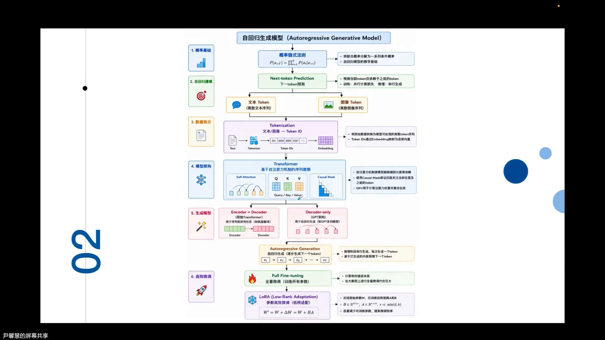

---

## 一、自回归模型的本质：把联合概率拆成一串条件概率

### 1.1 一句话定义

自回归模型通过**将联合概率分布分解为一系列条件概率，并按照序列顺序逐步预测当前元素** [【跳转到 00:55】](https://www.bilibili.com/video/BV1an846BEPE/?t=55)。

这里有三个关键点，缺一不可：

- **联合概率分布**：一整段序列 $x_1, x_2, \dots, x_n$ 同时出现的概率。写成 $P(x_{1:n})$。对语言模型来说，它就是"这句话在真实语料里有多合理"。
- **条件概率**：在已知前文的前提下，下一个元素出现的概率，形如 $P(x_i \mid x_{1:i-1})$。竖线读作"在……条件下"。
- **逐步预测**：生成第 $t$ 个元素时，只依赖第 $1$ 到第 $t-1$ 个元素的信息，每一步只预测下一个 token。

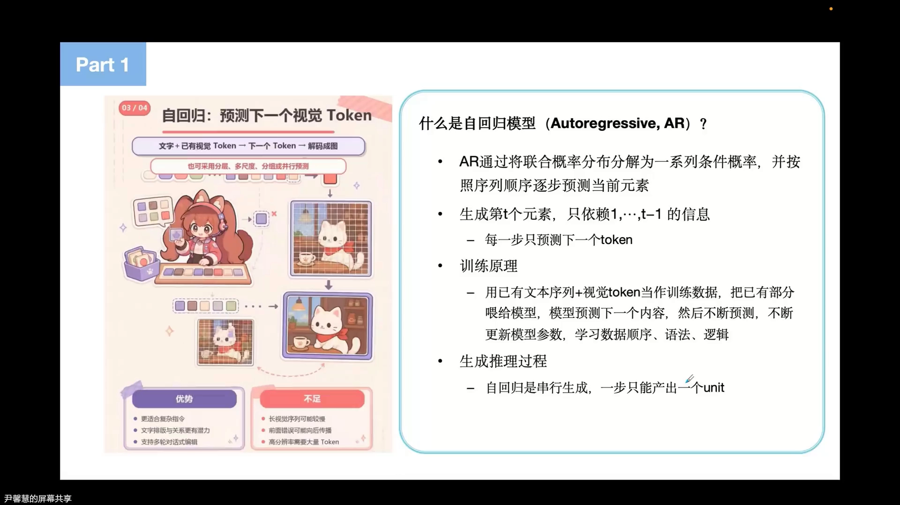

合起来就是自回归模型的招牌公式：

$$
P(x_{1:n}) = \prod_{i=1}^{n} P(x_i \mid x_{1:i-1})
$$

$\prod$ 是连乘符号，意思是把 $i$ 从 $1$ 到 $n$ 的每一项乘起来。这个式子会在后面的第三章里完整推导出来，它是整个自回归建模的数学地基。

### 1.2 它为什么能这样建模：拼图类比

课件用拼图来解释这个过程：一个整体（图像或文本）按某种顺序被拆成一系列小单位（块 / 像素 / token），然后按顺序逐个生成 [【跳转到 01:45】](https://www.bilibili.com/video/BV1an846BEPE/?t=105)。

拼图时我们也是先找到最好拼的部位，再根据这个部位依次拼下面的部位。换成 3×3 的拼图，就是从第 1 块开始，根据已生成的内容生成第 2 块、第 3 块……一直到第 9 块，得到完整图像。文本也一样，要生成"今天天气非常好"这句话：

1. 先根据起始符生成"今天"；
2. 再根据"今天"生成"天气"；
3. 再根据"今天 天气"生成"非常"；
4. 最后根据"今天 天气 非常"生成"好"。

每一步的输入都是"已经生成的部分"，输出都是"下一块"——这正是"自回归"这个名字的来历：用自己的输出（回归）作为下一步的输入条件。

### 1.3 训练与推理：两套不同的运行方式

**训练原理**：用已有的文本序列（加上视觉 token）当作训练数据，把已有部分喂给模型，让模型预测下一个内容，然后不断预测、不断更新模型参数，从而学习数据中的顺序、语法与逻辑 [【跳转到 01:20】](https://www.bilibili.com/video/BV1an846BEPE/?t=80)。

**生成推理过程**：串行生成，一步只能产出一个 unit，这里的 unit 可以理解为 token [【跳转到 01:45】](https://www.bilibili.com/video/BV1an846BEPE/?t=105)。

这个差别值得记住：**训练可以并行、推理只能串行**。训练时整段真实文本都是已知的，所以一句话里每个位置的"下一个 token"都能同时作为监督信号；推理时没有标准答案，只能生成一个、拼回序列、再生成下一个。

### 1.4 与其他生成模型的区别

课件把三类生成模型的直觉放在一起对比 [【跳转到 03:16】](https://www.bilibili.com/video/BV1an846BEPE/?t=196)：

- **自回归模型**：像拼图，一块一块拼；
- **VAE（变分自编码器）**：先画草图，这张草图就是上一讲提到的隐变量 $z$，再还原整张图；
- **Diffusion（扩散模型）**：先给一片噪声，再一步步去噪变清晰。

课件也列出了自回归路线的优劣：优势是更适合复杂指令、文字排版与元素关系更有潜力、支持多轮对话式编辑；不足是长序列（尤其长视觉序列）生成较慢、前面步骤的错误会向后传播、高分辨率图像需要大量 token。这也解释了为什么"串行"这个特性既是自回归的简洁之处，也是它的工程瓶颈。

---

## 二、自回归的三种形态：像素、token 与多 token 预测

目前广泛应用的自回归模型大致有三类 [【跳转到 03:41】](https://www.bilibili.com/video/BV1an846BEPE/?t=221)：

1. **像素预测（Next-Pixel Prediction）**：把图像展平为像素序列，一个像素就是一个 unit；
2. **token 预测（Next-Token Prediction）**：先由视觉编码器把图像转换成 token 序列，一个 token 就是一个 unit；
3. **多 token 预测（Next-Multiple-Tokens Prediction）**：和上一类的区别在于一步当中输出多个 token [【跳转到 03:46】](https://www.bilibili.com/video/BV1an846BEPE/?t=226)。

三者的共同点没有变：都是把整体拆成序列、按位置逐个（或每组）预测；变的只是"unit 是什么"。

### 2.1 最有代表性的应用：GPT-3

GPT 系列都是非常典型的自回归语言模型。课件举的例子是 NeurIPS 2020 的 GPT-3 论文《Language Models are Few-Shot Learners》[【跳转到 04:22】](https://www.bilibili.com/video/BV1an846BEPE/?t=262)。

GPT-3 有 175B 参数，通过 next-token prediction 训练，再通过自回归生成完成文本：把文本建模为 token 序列，用自回归的方式预测下一个 token，并通过规模化训练获得强大的 zero-shot / few-shot 能力。表格里同时列出了 GPT-1、GPT-2 与 GPT-3 各规格在参数量、层数、隐藏维度、注意力头数上的差异——它们共享同一个自回归目标，只是规模不同。

---

## 三、概率链式法则：整句概率如何拆成每一步的条件概率

### 3.1 先分清两个"链式法则"

"链式法则"在数学里有两个同名但完全无关的版本，课件特意把它们摆在一起对照 [【跳转到 04:57】](https://www.bilibili.com/video/BV1an846BEPE/?t=297)：

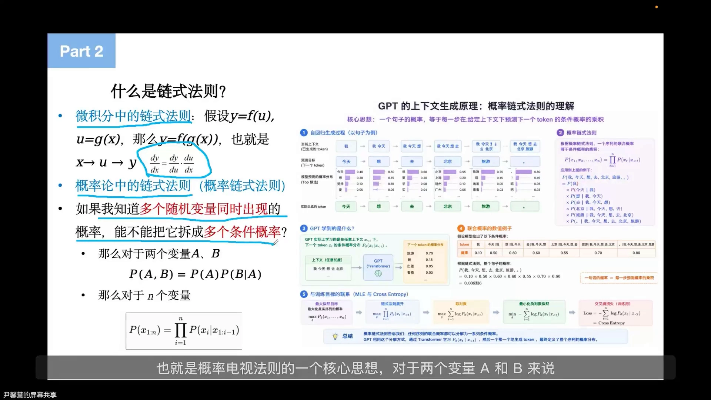

**微积分中的链式法则**：假设 $y = f(u)$、$u = g(x)$，那么 $y = f(g(x))$，也就是 $x$ 可以推导出 $u$、$u$ 可以推导出 $y$，于是

$$
\frac{dy}{dx} = \frac{dy}{du} \cdot \frac{du}{dx}
$$

这只是同名而已，它不是概率论里的链式法则，也不参与自回归建模。

**概率论中的链式法则（概率链式法则）**：假设我知道多个随机变量同时出现的概率，能不能把它拆成多个条件概率？答案是可以的，这就是概率链式法则的核心思想 [【跳转到 05:22】](https://www.bilibili.com/video/BV1an846BEPE/?t=322)。

### 3.2 从两个变量到 n 个变量

对于两个变量 $A$ 和 $B$：

$$
P(A, B) = P(A) \, P(B \mid A)
$$

意思是：$A$ 和 $B$ 同时发生，等于先发生 $A$，再在"$A$ 已经发生"的条件下发生 $B$。举个具体例子：从一副牌里连续抽两张，两张都是红桃的概率，等于第一张是红桃的概率，乘以"第一张已经是红桃"之后第二张也是红桃的概率。

把这个思路逐层套下去，对于 $n$ 个变量就得到累乘形式：

$$
P(x_{1:n}) = \prod_{i=1}^{n} P(x_i \mid x_{1:i-1})
$$

写开来看更直观：

$$
P(x_1, x_2, \dots, x_n) = P(x_1) \, P(x_2 \mid x_1) \, P(x_3 \mid x_1, x_2) \cdots P(x_n \mid x_1, \dots, x_{n-1})
$$

第一个因子 $P(x_1)$ 可以理解为"给定起始符（或空上下文）预测第一个 token"。这个公式就是前面提到的、自回归模型当中用到的概率链式法则的公式 [【跳转到 05:22】](https://www.bilibili.com/video/BV1an846BEPE/?t=322)。

### 3.3 它的意义：把"整句打分"变成"每步分类"

链式法则本身只是恒等变形，但对建模来说它做了一件很关键的事：**把一个高维的联合分布问题，换成了若干个"给定上文、预测下一个 token"的条件分布问题**。后者才是一个神经网络能学的东西——输入一段上下文，输出词表上的一个概率分布。

于是问题被转化成了：如何学习 $P(\text{下一个 token} \mid \text{前面的所有 token})$。这正是"next-token prediction"这个名字的含义。

---

## 四、链式法则怎么落到 GPT 的生成上

### 4.1 一步生成：从候选里选一个

课件用一个具体句子演示了自回归的一步：假设现在已知的 token 是"我"，模型要预测下一个 token，于是给出一组候选——"今天"、"想"、"觉得"、"爱"，每个候选都带一个条件概率 [【跳转到 06:12】](https://www.bilibili.com/video/BV1an846BEPE/?t=372)。

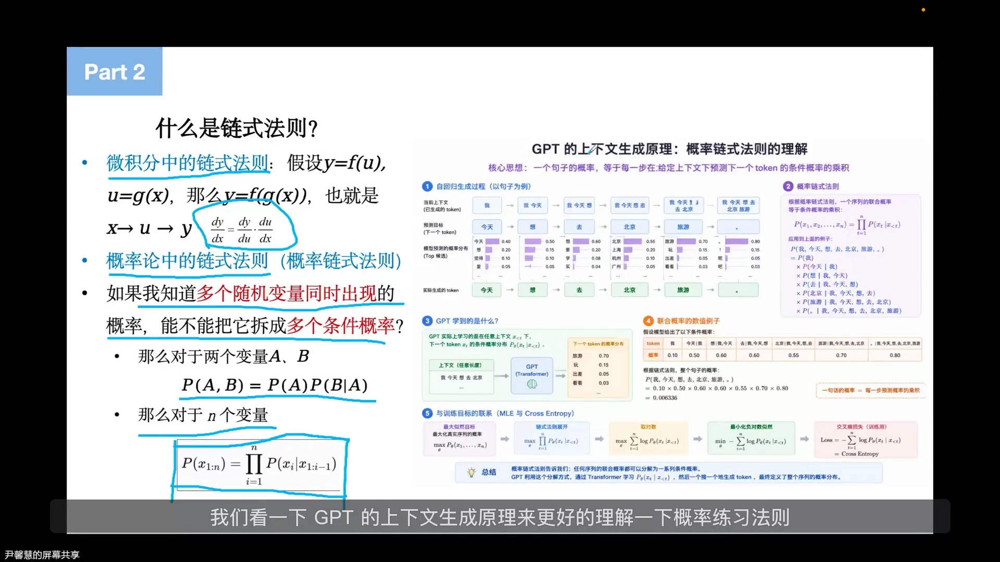

模型会选择条件概率最大的那个 token 作为预测结果，再把它加入现有序列，重复这样的过程。课件里对应的概率分布是"今天 0.40、想 0.15、觉得 0.10、爱 0.05"——选中的是"今天"，然后序列变成"我 今天"，下一步再预测"想"。

### 4.2 整句概率：每一步条件概率的乘积

用概率链式法则来计算，一个句子的概率就等于每一步条件概率的乘积 [【跳转到 06:12】](https://www.bilibili.com/video/BV1an846BEPE/?t=372)。比如"我今天想去北京旅游"的联合概率，就等于从"我"一直到"旅游"这几个 token 的条件概率相乘：

$$
P(\text{我}, \text{今天}, \text{想}, \text{去}, \text{北京}, \text{旅游}) = P(\text{我}) \, P(\text{今天} \mid \text{我}) \, P(\text{想} \mid \text{我}, \text{今天}) \cdots P(\text{旅游} \mid \text{我}, \text{今天}, \text{想}, \text{去}, \text{北京})
$$

课件给出的算例中，除第一个因子 $P(\text{我}) = 0.10$ 之外，后续每一步的条件概率大致在 0.5 到 0.8 之间，但六七个因子连乘之后，整句的概率已经掉到 $10^{-3}$ 量级——这直观说明了为什么句子越长、联合概率越小，也说明直接建模联合概率是多么不现实，必须借助链式法则拆开。

### 4.3 GPT 到底在学什么

那 GPT 学到的是什么呢？GPT 实际上要学习的是在任意上下文 $x_{<t}$ 下，下一个 token $x_t$ 的条件概率分布 [【跳转到 06:37】](https://www.bilibili.com/video/BV1an846BEPE/?t=397)：

$$
P_\theta(x_t \mid x_{<t})
$$

其中 $\theta$ 是模型参数，$x_{<t}$ 表示第 $t$ 个位置之前的所有 token。注意这个式子的三个特点：

- **输入是变长的上文**，从零个 token 到几千个 token 都要能处理；
- **输出是词表上的分布**，词表有多大，分布向量就有多少维；
- **同一个模型复用所有位置**，不管在句首还是在句尾，用的都是同一套参数。

课件还画出了从最大似然到交叉熵的推导链：最大化真实序列的概率 $\max_\theta P_\theta(x_1, \dots, x_n)$，用链式法则展开成连乘，取对数变成求和，再取负号变成最小化负对数似然，最后落成训练用的交叉熵损失。

### 4.4 链式法则的另一个战场：PixelCNN

概率链式法则不只服务语言。课件举的应用案例是 NeurIPS 2016 的 PixelCNN（《Conditional Image Generation with PixelCNN Decoders》）[【跳转到 07:27】](https://www.bilibili.com/video/BV1an846BEPE/?t=447)。

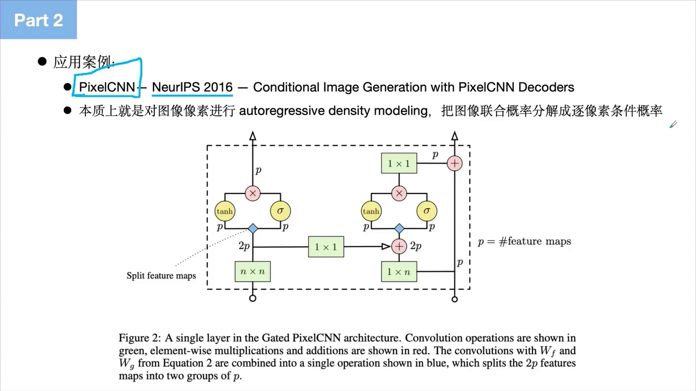

它其实就是前面提到的像素预测式自回归模型，本质上是对图像像素做自回归密度建模（autoregressive density modeling），把图像的联合概率分解成逐像素的条件概率。语言里 unit 是 token，图像里 unit 是像素——分解的数学形式一模一样。

---

## 五、Tokenization：模型看不到原始字符串

自回归建模要求数据是离散的序列，而原始文本是连续书写的字符串，中间必须过一道分词（Tokenization）[【跳转到 07:53】](https://www.bilibili.com/video/BV1an846BEPE/?t=473)。

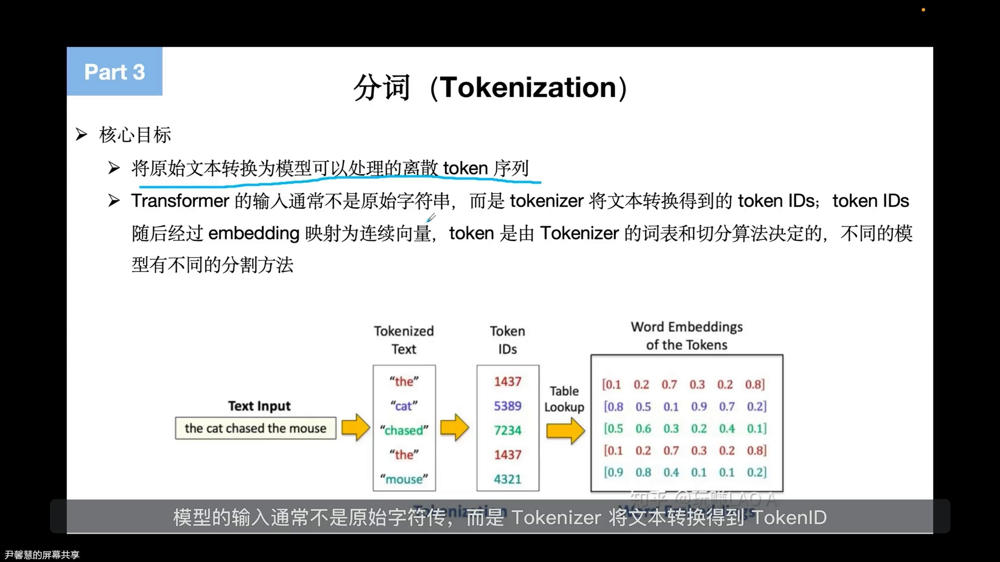

分词的核心目标就是：**将原始文本转换为模型可以处理的离散 token 序列**。Transformer 的输入通常不是原始字符串，而是 tokenizer 把文本转换得到的 token ID；token ID 随后经过 embedding 映射为连续向量。

课件用一句话演示了整条链路：

1. 原始文本：`the cat chased the mouse`；
2. 分词：切成 `the`、`cat`、`chased`、`the`、`mouse` 五个 token；
3. 查表：对应 token ID 依次是 1437、5389、7234、1437、4321（注意两个 `the` 拿到同一个 ID）；
4. 查 embedding 表：每个 ID 取出一行向量，得到这五个 token 的连续向量表示。

### 5.1 token 的切法取决于分词器

token 是由 tokenizer 的词表和切分算法决定的，不同的模型有不同的分割方法 [【跳转到 08:43】](https://www.bilibili.com/video/BV1an846BEPE/?t=523)。同样一句话，换一个模型可能切成五个 token（`the` / `cat` / `chased` / `the` / `mouse`），也可能按主谓宾的粒度划分——把 `the cat` 当作一个 token、`chased` 当作一个 token、`the mouse` 当作一个 token [【跳转到 09:08】](https://www.bilibili.com/video/BV1an846BEPE/?t=548)。

这件事的影响不止"序列长短"：切分粒度一变，自回归模型每一步要预测的 unit 就变了，链式法则里因子的个数和每个因子的难度也随之改变。

### 5.2 把四个概念串成一条链

课件最后用一张图把分词、概率链式法则、自回归模型和 GPT 串起来 [【跳转到 09:25】](https://www.bilibili.com/video/BV1an846BEPE/?t=565)：

1. **原始文本**：用户输入自然语言，如 `The cat is sleeping.`；
2. **Tokenization**：切成离散 token 序列；
3. **转 Token ID**：每个 token 查词表得到一个整数，得到 `[791, 9052, 374, 12872, 13]`；
4. **GPT（自回归语言模型）**：学习整个 token 序列的概率分布，并逐个预测下一个 token；
5. **生成文本**：把生成出的 token 序列再合并回自然语言。

一句话总结这张图：Tokenization 把自然语言变成离散 token 序列，GPT 作为基于 Transformer 的自回归语言模型，利用概率链式法则把整个序列的联合概率分解为一步步"预测下一个 token 的条件概率"，从而逐 token 生成自然语言。GPT 就是这套组合最有代表性的实现 [【跳转到 09:50】](https://www.bilibili.com/video/BV1an846BEPE/?t=590)。

---

## 六、Teacher Forcing：训练喂真实答案，推理只能靠自己

链式法则描述了"给定上文预测下一个"，但训练时如果模型自己生成的上文一路错下去，会怎样？这就是 Teacher Forcing 要解决的问题 [【跳转到 09:57】](https://www.bilibili.com/video/BV1an846BEPE/?t=597)。

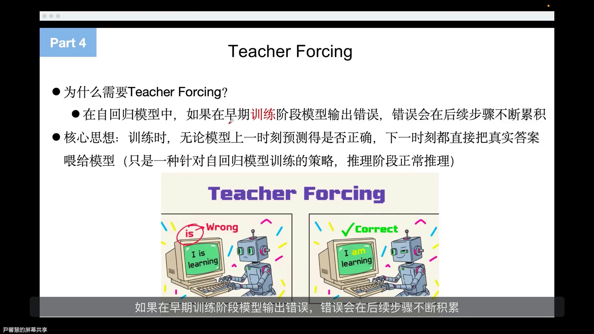

**为什么需要它**：在自回归模型中，如果早期训练阶段模型输出错误，错误会在后续步骤不断累积。因为模型是逐步预测下一个 token 的，这一步生成的 token 有问题，就会影响后续所有 token 的生成 [【跳转到 10:07】](https://www.bilibili.com/video/BV1an846BEPE/?t=607)。

**核心思想**：训练时，无论模型上一时刻预测得是否正确，下一时刻都直接把真实答案喂给模型。课件用"I is learning / I am learning"的插图说明这件事——模型预测错了就错了，但下一步的输入不用"is"，仍然用标准答案。

**边界**：Teacher Forcing 只是针对训练的一种策略，推理阶段不能使用 [【跳转到 10:32】](https://www.bilibili.com/video/BV1an846BEPE/?t=632)。推理时没有真实答案可喂，只能把模型自己吐出的 token 接回序列。这也正好解释了为什么训练可以并行（每个位置的输入都是真实前缀）、而推理必须串行（每个位置的输入依赖上一步的输出）。

课件还提到有两个针对 Teacher Forcing 的改进方法，分别来自 NeurIPS 2015 和 NeurIPS 2016 的两篇文章，本讲没有展开 [【跳转到 10:39】](https://www.bilibili.com/video/BV1an846BEPE/?t=639)。

---

## 七、Transformer：条件概率需要一个足够强的网络来算

前面讲清了"要学什么"（$P(x_t \mid x_{<t})$），接下来是"用什么学"。自回归建模需要一个神经网络来实现，Transformer 就是一个很有代表性的网络，而且它的架构非常灵活，可以演化出不同的模型结构 [【跳转到 10:55】](https://www.bilibili.com/video/BV1an846BEPE/?t=655)。

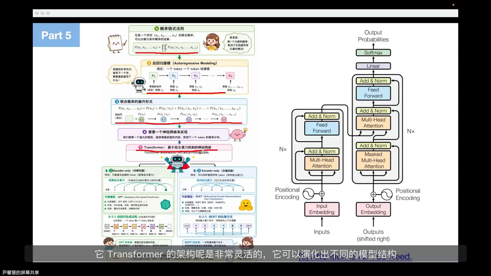

课件举了两个有代表性的分支：仅解码器（decoder-only）以 GPT 为代表，仅编码器（encoder-only）以 BERT 为代表，右侧是 Transformer 原文给出的架构图 [【跳转到 11:20】](https://www.bilibili.com/video/BV1an846BEPE/?t=680)。

### 7.1 把架构图拆成四个部分

这张架构图直接看有点复杂，可以拆成四个部分：**输入、输出、编码和解码** [【跳转到 11:55】](https://www.bilibili.com/video/BV1an846BEPE/?t=715)。

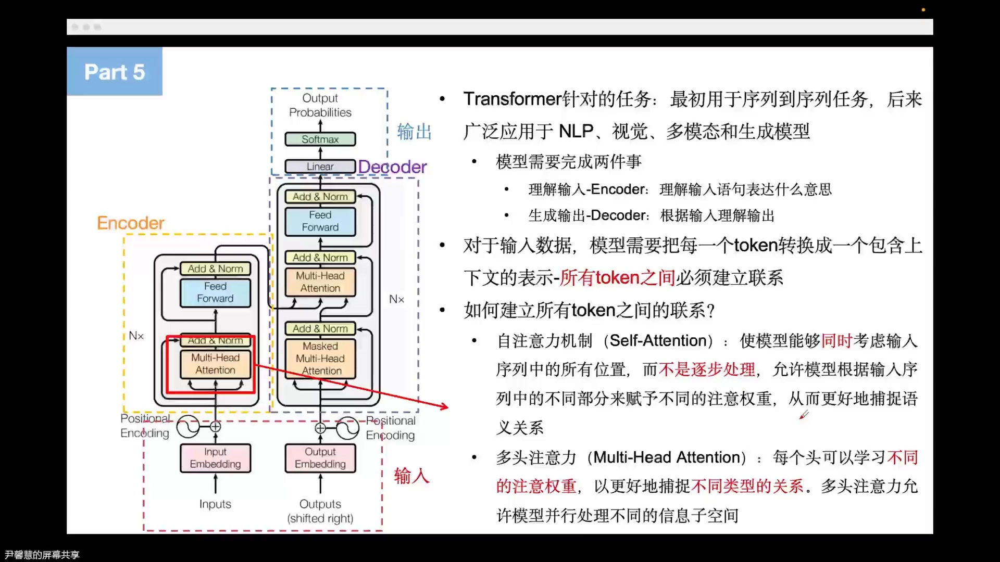

先忽略输入和输出，只看编解码：它其实是由三个模块堆叠而成的——Add & Norm（残差连接加层归一化）、Feed Forward、Multi-Head Attention。

为什么需要编码和解码两件事？Transformer 最初用于序列到序列的任务，后来被广泛应用于 NLP、视觉、多模态和生成模型。对这些任务，模型需要完成两件事 [【跳转到 12:20】](https://www.bilibili.com/video/BV1an846BEPE/?t=740)：

- **理解输入**——这是编码器干的事情，理解输入语句表达什么意思；
- **生成输出**——这可能是解码器干的事情，根据输入理解输出。

### 7.2 所有 token 之间必须建立联系

对于输入数据，模型需要把每一个 token 转换成一个包含上下文的表示，也就是说所有 token 之间必须建立联系 [【跳转到 12:45】](https://www.bilibili.com/video/BV1an846BEPE/?t=765)。

怎么建立？用自注意力机制：它使模型能够同时考虑输入序列中的所有位置，而不是逐步处理，允许模型根据输入序列中的不同部分赋予不同的注意力权重，从而更好地捕捉语义关系。

而 Transformer 里并没有直接用 self-attention，用的是 Multi-Head Attention（多头注意力）：它让每个头可以学习不同的注意力权重，以更好地捕捉不同类型的关系，允许模型并行处理不同的信息子空间 [【跳转到 13:10】](https://www.bilibili.com/video/BV1an846BEPE/?t=790)。可以把它理解为多个并行的自注意力机制 [【跳转到 13:35】](https://www.bilibili.com/video/BV1an846BEPE/?t=815)。

---

## 八、自注意力：为什么必须把表示拆成 Q、K、V 三个角色

### 8.1 直接拿 embedding 算注意力不行吗

不行，原因很具体：embedding 当中的每一个子向量 $x_i$ 并没有包含其他 token 的相关信息，可以理解为当前的子向量只是一个通用的语义表示，它并不知道哪个 token 需要更多的 attention [【跳转到 13:48】](https://www.bilibili.com/video/BV1an846BEPE/?t=828)。

打个比方：embedding 像一个只有"我是谁"的标签，而注意力需要的是一次"我要找什么"的提问。同一个 token 在不同句子里要找的东西不一样，所以必须让模型自己学出"查询"和"被查询"两套表示。

### 8.2 三种角色与三个投影

自注意力机制把每个 token 的表示 $x$ 分成三种角色：Q（Query）、K（Key）、V（Value），它们通过三个可学习的线性投影得到 [【跳转到 14:13】](https://www.bilibili.com/video/BV1an846BEPE/?t=853)：

$$
Q = XW_Q, \qquad K = XW_K, \qquad V = XW_V
$$

- **Query（查询）**：输入序列经过可学习的 Query 线性投影后得到的查询表示，用于与 Key 计算相似度，从而确定当前 token 应该关注其他 token 的程度——可以理解为"当前 token 想从其他 token 那里查询什么信息"。
- **Key（键）**：输入序列经过可学习的 Key 线性投影后得到的键表示，用于与 Query 计算相似度，以确定该 token 对当前查询的重要程度——可以理解为"当前 token 的需求与其他 token 特征的匹配程度" [【跳转到 14:38】](https://www.bilibili.com/video/BV1an846BEPE/?t=878)。
- **Value（值）**：输入序列经过可学习的 Value 线性投影后得到的值表示，它承载在注意力加权后实际被聚合和传递的信息 [【跳转到 15:03】](https://www.bilibili.com/video/BV1an846BEPE/?t=903)。

三者分工可以用一句话概括：**Q 和 K 决定"关注谁、关注多少"，V 决定"关注之后拿到什么信息"**。用 Q 和 K 算出匹配程度，再用 V 把这些信息传递过来。

### 8.3 注意力公式：先算相关度，再归一化，最后加权求和

完整的注意力计算分三步 [【跳转到 15:28】](https://www.bilibili.com/video/BV1an846BEPE/?t=928)：

**第一步，计算 Q 和 K 的相关度**：

$$
S = \frac{QK^{\top}}{\sqrt{d_k}}
$$

$QK^{\top}$ 的第 $(i, j)$ 个元素表示第 $i$ 个 token 的 Query 与第 $j$ 个 token 的 Key 的匹配程度；$1/\sqrt{d_k}$ 是缩放因子，$d_k$ 是 Key 的维度。缩放的作用是把点积的量级压回合适范围，避免 softmax 之后权重过度集中。

**第二步，softmax 归一化得到注意力权重**：

$$
A = \mathrm{softmax}(S)
$$

$A$ 的每一行是一个概率分布，表示当前 token 对其他 token 的注意力分配 [【跳转到 15:42】](https://www.bilibili.com/video/BV1an846BEPE/?t=942)。

**第三步，用权重去聚合 Value**：

$$
O = AV, \qquad \mathrm{Attention}(Q, K, V) = \mathrm{softmax}\!\left(\frac{QK^{\top}}{\sqrt{d_k}}\right) V
$$

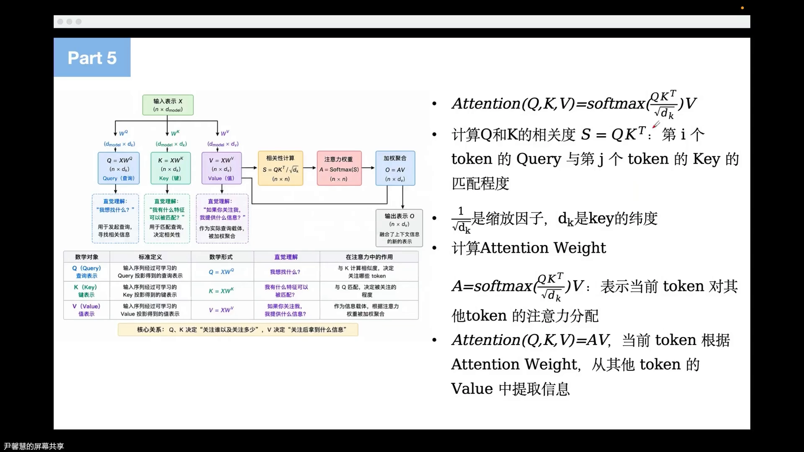

也就是当前 token 根据 attention weight，从其他 token 的 Value 当中提取信息 [【跳转到 16:07】](https://www.bilibili.com/video/BV1an846BEPE/?t=967)。课件里还有一个尺寸对照：输入 $X$ 是 $n \times d_{model}$，三个投影矩阵分别把维度映射到 $d_k$、$d_k$、$d_v$，相关度矩阵 $S$ 和权重矩阵 $A$ 都是 $n \times n$，输出 $O$ 是 $n \times d_v$。$n \times n$ 这个尺寸也暗示了注意力的计算量与序列长度的平方成正比。

---

## 九、Causal Mask 与两个配件：Add & Norm、Feed Forward

### 9.1 Causal Mask：不许偷看未来

Transformer 架构里有一个很特别的模块，它是多头注意力机制里的一个掩码，叫 Causal Mask（因果掩码）[【跳转到 16:46】](https://www.bilibili.com/video/BV1an846BEPE/?t=1006)。

它是自注意力机制当中的一种掩码，要求解码器在生成输出时必须按顺序逐个位置生成；为了保持模型对未来的信息不可访问，需要在每个位置把未来位置的信息屏蔽掉。

为什么必须屏蔽？因为训练时整句话都是已知的，如果允许第 $t$ 个位置看到第 $t+1$ 个 token，模型只要抄答案就能把损失降到零，学到的东西在推理时完全用不上。Causal Mask 保证了训练时的条件和推理时一致：**每个位置只能看自己和它左边**。

注意课件架构图里的细节：编码器侧是普通的 Multi-Head Attention（可以双向看），解码器侧有两处注意力——一处带 Masked（自注意力，防穿越），一处不带 Masked（交叉注意力，看编码器的输出）。

### 9.2 Add & Norm 与 FFN：让深层堆叠可行、让表示更强

除了注意力和掩码，架构图里还有两个反复出现的模块 [【跳转到 16:21】](https://www.bilibili.com/video/BV1an846BEPE/?t=981)：

- **Add & Norm**：包含残差连接（Residual Connection）和层归一化（LayerNorm）。残差连接把模块的输入直接加到输出上，让梯度有一条短路径回传；层归一化把每个 token 的表示重新标准化。图上每个子层后面都跟着一个 Add & Norm，编码器和解码器都是 $N$ 层堆叠。
- **Feed Forward（FFN）**：课件给出的形式是

$$
\mathrm{FFN}(x) = \max(0, xW_1 + b_1)W_2 + b_2
$$

它的分工和注意力不同：**自注意力机制负责 token 之间的信息交流，而 FFN 负责对每个 token 的信息做更深层的非线性变换**。前者是"横向"的（跨位置），后者是"纵向"的（逐位置加深）。

---

## 十、LoRA：不改整个 W，只学一个低秩增量

模型训练好之后，如果想让它适配一个新任务，最直接的办法是全参数微调；课件最后介绍的是低成本替代方案 LoRA [【跳转到 17:16】](https://www.bilibili.com/video/BV1an846BEPE/?t=1036)。

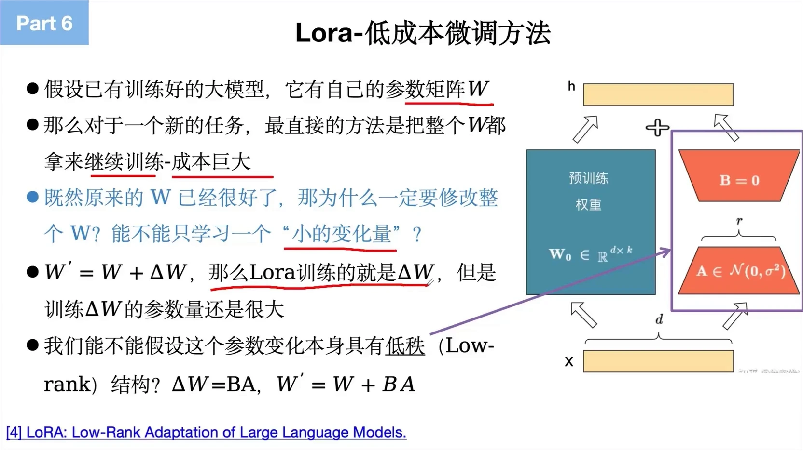

假设我们现在已经有训练好的大模型，它有它自己的参数矩阵 $W$。对于一个新的任务，最直接的方法是把整个 $W$ 都拿来继续训练，但这样会造成一个问题：训练成本非常大 [【跳转到 17:21】](https://www.bilibili.com/video/BV1an846BEPE/?t=1041)。

LoRA 的推理链条是三步：

1. **只学变化量**：既然原来的 $W$ 已经很好了，为什么一定要修改整个 $W$？能不能只学习一个小的变化量 $\Delta W$？于是

$$
W' = W + \Delta W
$$

2. **变化量本身也要压缩**：但训练 $\Delta W$ 的参数量还是很大。
3. **假设低秩**：LoRA 假设 $\Delta W$ 本身具有低秩结构，也就是说 $\Delta W$ 可以等于两个低秩矩阵 $B$ 和 $A$ 的乘积 [【跳转到 17:46】](https://www.bilibili.com/video/BV1an846BEPE/?t=1066):

$$
W' = W + \Delta W = W + BA
$$

其中 $B \in \mathbb{R}^{d \times r}$、$A \in \mathbb{R}^{r \times k}$，且 $r \ll \min(d, k)$。$r$ 就是人为设定的秩，它远小于原矩阵的行列数，所以 $BA$ 的参数量远小于 $W$ 本身。课件图里还标出：$B$ 初始化为 0、$A$ 随机初始化——这样训练起点处 $BA = 0$，模型行为与原始模型一致。

这样做的收益是：可以冻结原始参数 $W$，只训练低秩矩阵 $A$ 和 $B$，显著减少可训练参数与存储开销，同时保持预训练模型的能力。

---

## 小结：一条从概率到工程的链路

讲完所有零件，课件回到开头那张知识地图做总结 [【跳转到 18:11】](https://www.bilibili.com/video/BV1an846BEPE/?t=1091)：概率基础 → 自回归建模 → 数据表示 → 模型架构 → 生成模型 → 高效微调。把这条链路压成八句话：

1. **自回归模型的数学地基是概率链式法则**：联合概率 $P(x_{1:n})$ 拆成 $n$ 个条件概率 $P(x_i \mid x_{1:i-1})$ 的连乘，于是“整句打分”变成了“逐步预测下一个 token”；当前预测的 token 仅依赖于之前生成的 token [【跳转到 18:36】](https://www.bilibili.com/video/BV1an846BEPE/?t=1116)。
2. **链式法则有两个同名版本**：微积分里的 $\frac{dy}{dx} = \frac{dy}{du}\frac{du}{dx}$ 与概率论里的 $P(A,B) = P(A)P(B \mid A)$ 无关，自回归用的是后者。
3. **GPT 学的是条件分布 $P_\theta(x_t \mid x_{<t})$**：训练目标是最大化真实序列的似然（等价于最小化交叉熵），推理时按这个分布采样并回填序列。
4. **next-token 的 unit 可以是像素、token 或多 token 组**：语言用文本 token，图像可以用像素序列（PixelCNN）或视觉 token 序列。
5. **Tokenization 决定 unit 的粒度**：tokenizer 把文本切成 token 再查表得到 ID，ID 经 embedding 变成连续向量，不同模型的切法不同。
6. **训练并行、推理串行**：Teacher Forcing 在训练时屏蔽掉"模型自己生成的错误上文"，代价是训练与推理的输入分布不完全一致。
7. **Transformer 把条件分布算出来**：自注意力让所有位置互相关联（因而能捕获长距离依赖），QKV 三投影算出注意力权重并聚合信息，Causal Mask 阻止看到未来，Add & Norm 与 FFN 保证深层堆叠与逐 token 的非线性变换。Transformer 是一个既有编码器又有解码器的网络，GPT 只使用其中的解码器做自回归生成 [【跳转到 19:01】](https://www.bilibili.com/video/BV1an846BEPE/?t=1141)。
8. **LoRA 用低秩增量替代全参数微调**：冻结 $W$，只训练 $BA$，把可训练参数量压缩到极小，改善全参数微调训练成本高昂的问题 [【跳转到 19:26】](https://www.bilibili.com/video/BV1an846BEPE/?t=1166)。

## 关键术语速查

| 术语 | 一句话解释 |
| --- | --- |
| 自回归模型（AR） | 把整体拆成序列，按顺序逐步预测，每一步只用已生成的部分作为条件 |
| 联合概率 | 整段序列同时出现的概率，记作 $P(x_{1:n})$ |
| 条件概率 | 在已知上文 $x_{1:i-1}$ 的前提下，第 $i$ 个元素出现的概率 |
| 概率链式法则 | 把联合概率恒等地拆成一系列条件概率连乘的公式 |
| next-token prediction | 给定上文预测下一个 token，即学习 $P_\theta(x_t \mid x_{<t})$ |
| Tokenization | 把原始字符串切成离散 token 并映射为 token ID 的过程 |
| embedding | 把 token ID 查表映射成连续向量的操作，向量即该 token 的表示 |
| Teacher Forcing | 训练时每步都喂真实前缀而非模型自己的输出，避免错误累积 |
| Query / Key / Value | 同一表示经三个可学习投影得到的三种角色：查什么、有什么、提供什么 |
| Causal Mask | 注意力里的上三角掩码，屏蔽未来位置，保证因果性与训练推理一致 |
| FFN | 逐 token 的两层前馈网络，负责每个位置上的非线性变换 |
| LoRA | 冻结原权重、只训练低秩增量矩阵 $BA$ 的低成本微调方法 |
