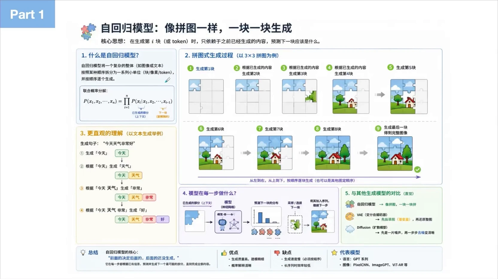
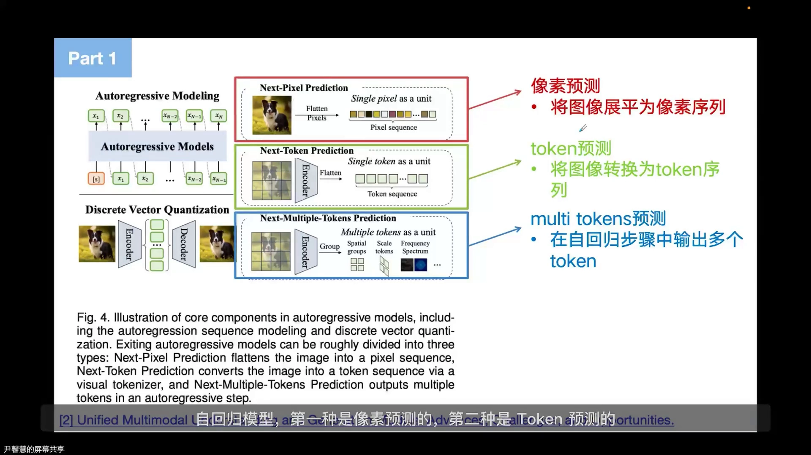
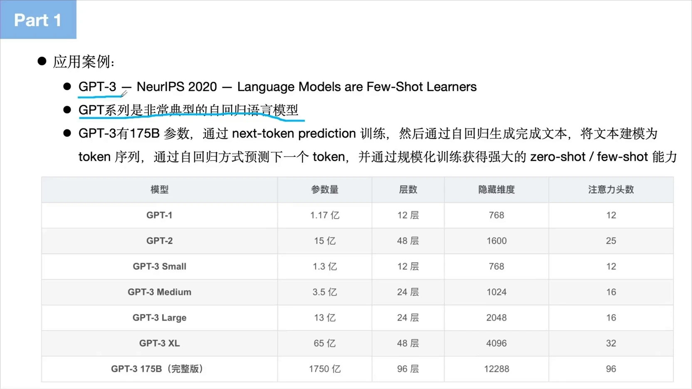
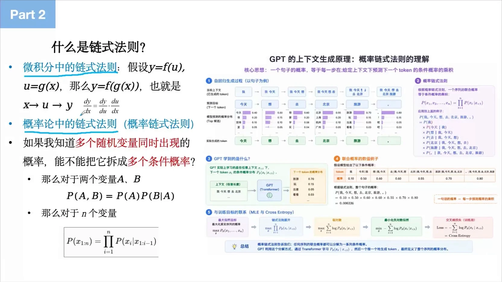
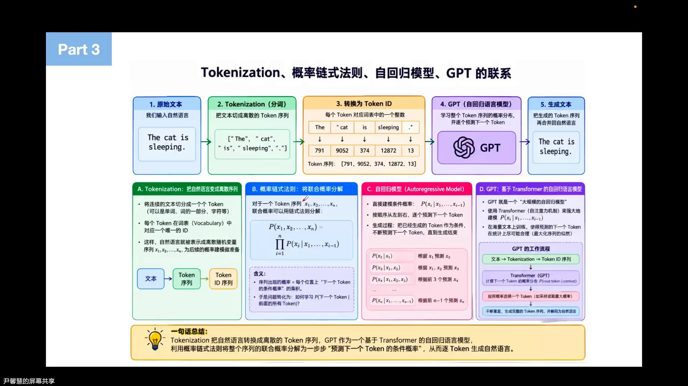
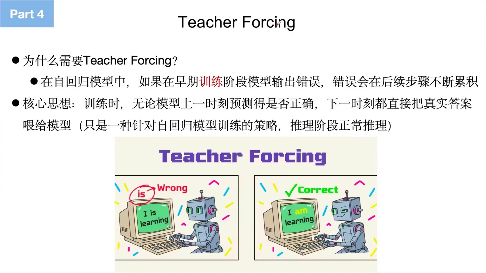
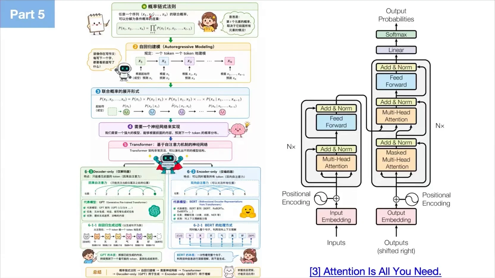
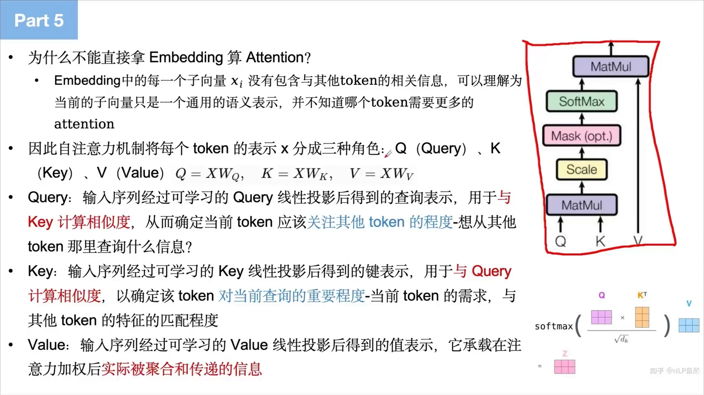
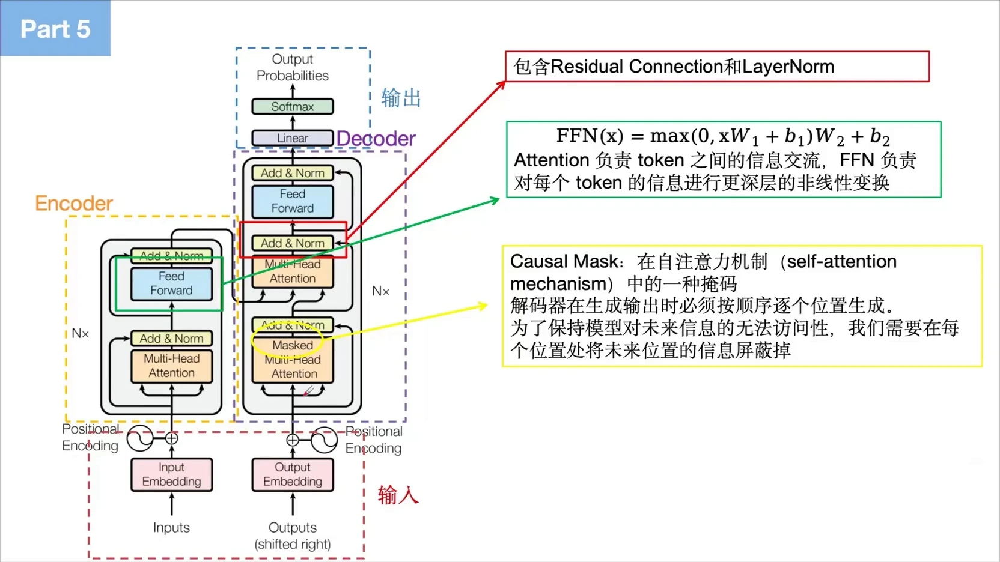
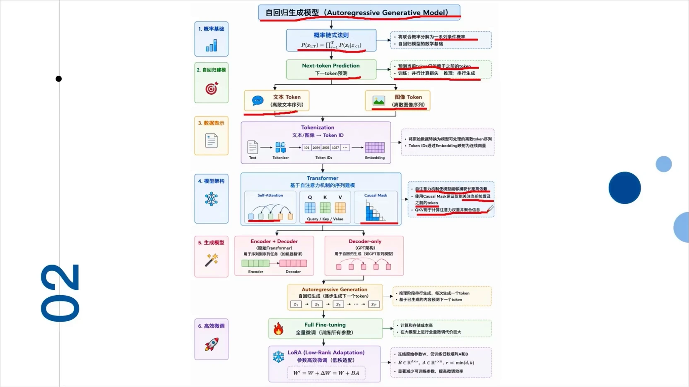

# 从 Next Token Prediction 到 LoRA：自回归模型与 Transformer 原理详解

## 本讲要解决的核心问题（SCQA）

**背景**：大语言模型回答问题时，是一个 token 一个 token 往外吐字的。上一个字刚出来，它才开始算下一个字。

**冲突**：这种"每次只猜下一个词"的做法看起来非常短视，可 GPT 却能写出连贯的长段落；而且训练时如果有几万亿 token 要学，难道要逐字串行地算？

**疑问**：一句话作为一个整体的概率，凭什么能拆成"一步一步往下猜"的形式？每一步要猜的"下一个 token 的概率"又是由谁算出来的、怎么训练出来的？模型规模变大之后，微调成本又该怎么降下来？

**回答（中心思想）**：这期视频把一条链子串了起来——**概率链式法则**把一句完整文本的联合概率，拆成"每一步在给定上文时预测下一个 token"的条件概率连乘（这就是 **next-token prediction**，下一 token 预测）；**Transformer** 用自注意力与因果掩码来拟合这个条件概率；训练时用 **Teacher Forcing** 把真实答案喂给模型，从而并行地算损失、推理时才是串行采样；最后 **LoRA** 用"冻结原权重、只学一个低秩增量"的办法，把微调成本压了下来。

---

## 一、自回归模型：像拼图一样，一块一块生成

自回归（Autoregressive, AR）模型的定义只有一句话：**把联合概率分布分解为一系列条件概率，并按序列顺序逐步预测当前元素**——生成第 $t$ 个元素时，只依赖 $1,\dots,t-1$ 的信息，每一步只预测下一个 token（[【跳转到 00:55】](https://www.bilibili.com/video/BV1an846BEPE/?t=55)）。

它的训练原理和推理过程是两件不同的事（[【跳转到 01:20】](https://www.bilibili.com/video/BV1an846BEPE/?t=80)）：

| 阶段 | 做法 | 特点 |
| --- | --- | --- |
| 训练 | 用已有文本序列（加上视觉 token）当训练数据，把已有部分喂给模型，让它预测下一个内容，不断预测、不断更新参数 | 数据里的"正确答案"全都有，可以并行算 |
| 推理 | 串行生成，一步只产出一个 unit（token），再把它拼回序列继续下一步 | 必须逐个往下走，无法并行 |

讲者用拼图来打比方：拼图时我们不会一上来就乱放，而是先拼最容易确定的部位，再顺着已经拼好的部分往外扩。自回归模型的生成过程也是这样——**根据已生成的部分，用神经网络预测下一块的分布，采样选出下一块，加入序列，再回到这一步**（[【跳转到 02:51】](https://www.bilibili.com/video/BV1an846BEPE/?t=171)）。

和其他生成模型相比，三者的直观区别是（[【跳转到 03:16】](https://www.bilibili.com/video/BV1an846BEPE/?t=196)）：

- **自回归模型**：像拼图，一个 token 一个 token 地拼；
- **VAE（变分自编码器）**：先画草图（隐变量 $z$），再还原整张图；
- **Diffusion（扩散模型）**：先产出一片噪声，再一步步去噪变清晰。

### 1.1 三种自回归建模方式

同样叫自回归，建模单位可以不同（[【跳转到 03:46】](https://www.bilibili.com/video/BV1an846BEPE/?t=226)）：

- **像素预测（Next-Pixel Prediction）**：把图像展平成像素序列，一次预测一个像素；
- **token 预测（Next-Token Prediction）**：先把图像过一遍视觉 tokenizer 变成 token 序列，再一次预测一个 token；
- **multi-token 预测（Next-Multiple-Tokens Prediction）**：在一步自回归中同时输出多个 token（可以按空间分组、尺度或频段输出）。

对语言模型来说，最常用的就是第二种——文本本身就是离散 token 序列，所以"预测下一个 token"天然成立。

### 1.2 最有名的应用：GPT 系列

GPT 系列就是非常典型的自回归语言模型。讲者以 NeurIPS 2020 的 GPT-3 论文为例（[【跳转到 04:22】](https://www.bilibili.com/video/BV1an846BEPE/?t=262)）：GPT-3 有 175B 参数，用 next-token prediction 训练，把文本建模为 token 序列、用自回归方式预测下一个 token，再通过规模化训练获得强大的 zero-shot / few-shot 能力。

---

## 二、概率链式法则：一句话的概率 = 每一步条件概率的乘积

第一节反复出现"把联合概率分解为条件概率"，这一步在数学上靠的就是**概率链式法则**。讲者特意区分了两个同名概念（[【跳转到 04:57】](https://www.bilibili.com/video/BV1an846BEPE/?t=297)）：

- **微积分里的链式法则**：若 $y=f(u)$、$u=g(x)$，则 $y=f(g(x))$，于是 $\frac{dy}{dx}=\frac{dy}{du}\cdot\frac{du}{dx}$——它讲的是复合函数求导时"一层层乘下去"。
- **概率论里的链式法则**：讲的是**多个随机变量同时出现的概率能不能拆成多个条件概率**。答案是能。

### 2.1 从两个变量到 n 个变量

两个变量时，链式法则就是条件概率定义的直接变形（[【跳转到 05:22】](https://www.bilibili.com/video/BV1an846BEPE/?t=322)）：

$$
P(A,B)=P(A)\,P(B \mid A)
$$

把它推广到 $n$ 个变量，就得到自回归模型真正用到的那条公式：

$$
P(x_1,x_2,\dots,x_n)=P(x_1)\,P(x_2 \mid x_1)\,P(x_3 \mid x_1,x_2)\cdots P(x_n \mid x_1,\dots,x_{n-1})=\prod_{i=1}^{n}P(x_i \mid x_1,\dots,x_{i-1})
$$

这条公式的读法是：**一个完整序列出现的概率，等于"每一步在给定前面所有元素时，出现当前元素"的条件概率连乘**。左边是一个整体，右边是一串"下一步"——这就把"一次性预测整句话"变成了"每次预测一个 token"。

### 2.2 用 GPT 的生成过程验证一遍

视频里用"我今天想去北京旅游"做例子（[【跳转到 06:12】](https://www.bilibili.com/video/BV1an846BEPE/?t=372)）：已知 token 是"我"，模型输出一组候选 token（"今天""想""觉得""爱"……），每个候选都带一个条件概率；模型选出概率最大的那个，拼到序列末尾，再重复这个过程。

于是整句话的联合概率就是每一步条件概率的连乘。按幻灯片上的数字：

$$
P(\text{我今天想去北京旅游。})=0.10\times0.50\times0.60\times0.60\times0.55\times0.70\times0.80\approx0.006336
$$

这个例子也点明了 GPT 到底在学什么（[【跳转到 07:02】](https://www.bilibili.com/video/BV1an846BEPE/?t=422)）——它学的是**在任意上下文 $x_{<t}$ 下，下一个 token $x_t$ 的条件概率分布**：

$$
p_\theta(x_t \mid x_{<t})
$$

有了它，整个序列的概率就能写成连乘：

$$
p_\theta(x_{1:n})=\prod_{t=1}^{n}p_\theta(x_t \mid x_{<t})
$$

### 2.3 这条路怎么变成训练目标：从最大似然到交叉熵

幻灯片把"链式法则"与"训练目标"的衔接也画了出来（[【跳转到 06:12】](https://www.bilibili.com/video/BV1an846BEPE/?t=372)）：

1. **最大似然**：让真实语料出现的概率最大，即 $\max_\theta p_\theta(x_1,\dots,x_n)$；
2. **用链式法则展开**成每一步条件概率的乘积；
3. **取对数**，把连乘变成连加（数值上也更稳定）；
4. **最小化负对数似然**，得到的就是训练时用的**交叉熵损失**：

$$
\mathcal{L}(\theta)=-\sum_{t=1}^{n}\log p_\theta(x_t \mid x_{<t})
$$

也就是说，"预测下一个 token"这个看似简单的任务，和最大似然估计、交叉熵损失在数学上是同一件事的不同说法。

### 2.4 一个非语言的例子：PixelCNN

链式法则不只用于文本。讲者举了 NeurIPS 2016 的 PixelCNN（[【跳转到 07:27】](https://www.bilibili.com/video/BV1an846BEPE/?t=447)）：它把图像像素当作序列，把图像的联合概率分解成"逐像素"的条件概率，于是图像生成也变成了"一个像素接一个像素地预测"。

---

## 三、Tokenization：文字先变成一串离散 token

概率链式法则处理的是离散符号 $x_1,\dots,x_n$，可计算机读不懂原始字符串。中间这一步就是**分词（Tokenization）**（[【跳转到 07:53】](https://www.bilibili.com/video/BV1an846BEPE/?t=473)）：

- **输入**：原始文本 → **Tokenizer** 按词表和切分算法切成 token 序列 → 每个 token 查表得到 **token id** → 再经 **embedding** 映射为连续向量；
- Transformer 的输入通常不是字符串，而是这些 token id 对应的向量；
- **token 由 tokenizer 的词表和切分算法决定，不同模型的分法不同**。

以 "the cat chased the mouse" 为例（[【跳转到 08:18】](https://www.bilibili.com/video/BV1an846BEPE/?t=498)）：切成五个 token，查出五个 id，再各自映射成六维向量。换成另一种分法，也可以按"主谓宾"切成 `the cat` / `chased` / `the mouse` 三个 token——序列长度、每个位置的含义都会随之改变。

把这条流水线和前面几节串起来（[【跳转到 09:25】](https://www.bilibili.com/video/BV1an846BEPE/?t=565)）：

1. 输入原始文本，分词切成离散 token 序列；
2. 转为 token id，再 embedding 成向量；
3. GPT 学习整个 token 序列的概率分布，逐个预测下一个 token；
4. 把生成的 token 序列拼回自然语言。

---

## 四、Teacher Forcing：训练时喂真答案，推理时只能靠自己

自回归模型的训练有个天然麻烦：如果早期预测错了，错误会沿序列一路累积下去，后面全被带偏（[【跳转到 10:02】](https://www.bilibili.com/video/BV1an846BEPE/?t=602)）。**Teacher Forcing** 的做法很直接：

> 训练时，无论模型上一时刻预测得是否正确，下一时刻都直接把**真实答案**喂给模型。

这样一来，每个位置的输入都是干净的真实上文，整条序列的损失可以一次并行算完——这正是"训练并行、推理串行"的由来。代价是训练和推理的输入分布不一致：推理时没有老师喂标准答案，只能吃自己刚生成的 token（[【跳转到 10:32】](https://www.bilibili.com/video/BV1an846BEPE/?t=632)）。讲者也提到，有 NeurIPS 2015、NeurIPS 2016 两篇文章专门改进 Teacher Forcing，但本讲没有展开。

---

## 五、Transformer：把"下一个 token 的概率"变成可训练的函数

链式法则给出了分解方式，但"给定上文预测下一个 token"这个函数本身，还需要一个神经网络来实现。Transformer 就是最有代表性的那个（[【跳转到 10:55】](https://www.bilibili.com/video/BV1an846BEPE/?t=655)），而且它的架构足够灵活，能演化出不同变体：

- **仅解码器（decoder-only）**：代表是 **GPT**，只能看见当前位置及之前的 token，适合自回归生成；
- **仅编码器（encoder-only）**：代表是 **BERT**，可以同时看见所有位置，适合理解类任务。

### 5.1 先把架构图拆成四块

原始论文的架构图看着复杂，讲者的办法是先拆成**输入、输出、编码、解码**四部分（[【跳转到 11:55】](https://www.bilibili.com/video/BV1an846BEPE/?t=715)）。编码器和解码器都由同样的三个模块反复堆叠：

- **Multi-Head Attention**（多头注意力）；
- **Feed Forward**（前馈网络）；
- **Add & Norm**（残差连接 + 层归一化）。

Transformer 最初是为序列到序列任务（比如机器翻译）设计的，模型要做两件事：**理解输入**（编码器）和**生成输出**（解码器）（[【跳转到 12:20】](https://www.bilibili.com/video/BV1an846BEPE/?t=740)）。而要让模型"理解"，每个 token 的表示就必须包含上下文——也就是所有 token 之间要建立联系。

### 5.2 自注意力：为什么需要 Q、K、V 三种角色

建立联系靠的是**自注意力机制（Self-Attention）**：它让模型能同时考虑序列中的所有位置，而不是逐步处理，并给不同位置分配不同的注意力权重，从而捕捉语义关系（[【跳转到 12:45】](https://www.bilibili.com/video/BV1an846BEPE/?t=765)）。实际 Transformer 用的是**多头注意力**——多个头并行，各自学习不同类型的关注方式（[【跳转到 13:10】](https://www.bilibili.com/video/BV1an846BEPE/?t=790)）。

那为什么不直接拿 embedding 算注意力？因为 embedding 里的每个子向量 $x_i$ 只是一个通用的语义表示，**并不包含"该关注谁"的信息**（[【跳转到 13:48】](https://www.bilibili.com/video/BV1an846BEPE/?t=828)）。于是自注意力用三个可学习的线性投影，把同一个 $x$ 投影成三种角色（[【跳转到 14:13】](https://www.bilibili.com/video/BV1an846BEPE/?t=853)）：

$$
Q=XW^Q,\qquad K=XW^K,\qquad V=XW^V
$$

| 角色 | 直观理解 | 作用 |
| --- | --- | --- |
| **Q（Query，查询）** | "我想找什么？" | 与 Key 算相似度，决定当前 token 该关注谁 |
| **K（Key，键）** | "我有什么特征可以被匹配？" | 与 Query 算相似度，决定被关注的程度 |
| **V（Value，值）** | "如果你关注我，我提供什么信息？" | 按注意力权重被加权求和，是真正被传递的内容 |

一句话概括：**Q 和 K 决定"关注谁、关注多少"，V 决定"关注之后拿到什么信息"**。

### 5.3 注意力怎么算：先打分，再归一化，最后加权求和

设序列长度为 $n$、Key 的维度为 $d_k$，则注意力权重的计算可以拆成三步（[【跳转到 15:28】](https://www.bilibili.com/video/BV1an846BEPE/?t=928)）：

$$
S=\frac{QK^{\top}}{\sqrt{d_k}},\qquad A=\mathrm{softmax}(S),\qquad O=AV
$$

- $S=QK^{\top}/\sqrt{d_k}$：第 $i$ 个 token 的 Query 与第 $j$ 个 token 的 Key 的匹配程度，得到一个 $n\times n$ 的相关度矩阵；
- $\frac{1}{\sqrt{d_k}}$ 是缩放因子，作用是避免点积随维度变大而数值过大、把 softmax 推到饱和区；
- $A=\mathrm{softmax}(S)$：每一行归一化成"当前 token 对其他 token 的注意力分配"；
- $O=AV$：用注意力权重去加权求和 Value，得到融合了上下文的新表示。

合起来就是大家最熟悉的那条公式：

$$
\mathrm{Attention}(Q,K,V)=\mathrm{softmax}\!\left(\frac{QK^{\top}}{\sqrt{d_k}}\right)V
$$

### 5.4 FFN、Add & Norm 与 Causal Mask

除了注意力，还有两个常被忽略但必需的模块（[【跳转到 16:21】](https://www.bilibili.com/video/BV1an846BEPE/?t=981)）：

- **Add & Norm**：残差连接 + 层归一化，让深层网络能稳定训练；
- **Feed Forward（FFN）**：对每个 token 的表示再做一层非线性变换。分工上，**Attention 负责 token 之间的信息交流，FFN 负责每个 token 内部更深层的特征变换**：

$$
\mathrm{FFN}(x)=\max(0,xW_1+b_1)W_2+b_2
$$

最后是自回归模型的关键约束——**Causal Mask（因果掩码）**（[【跳转到 16:46】](https://www.bilibili.com/video/BV1an846BEPE/?t=1006)）。解码器必须按顺序逐个位置生成输出，为了让模型"看不到未来"，就要在计算注意力时**把每个位置之后（未来）的信息屏蔽掉**。没有它，训练时模型能直接偷看下一个 token 的答案，损失会假装很低，推理时却根本用不上。

---

## 六、LoRA：改动不必发生在整个权重矩阵上

大模型训练好之后，要为下游任务微调，最直接的做法是把整个参数矩阵 $W$ 都拿来继续训练——成本极高（[【跳转到 17:21】](https://www.bilibili.com/video/BV1an846BEPE/?t=1041)）。LoRA 的思路是：**原来的 $W$ 已经很好，未必要动它，只学一个小的变化量 $\Delta W$**：

$$
W'=W+\Delta W
$$

但 $\Delta W$ 的参数量和 $W$ 一样大，所以 LoRA 再进一步假设这个变化量具有**低秩结构**，把它分解成两个小矩阵的乘积（[【跳转到 17:46】](https://www.bilibili.com/video/BV1an846BEPE/?t=1066)）：

$$
\Delta W=BA,\qquad B\in\mathbb{R}^{d\times r},\quad A\in\mathbb{R}^{r\times k},\quad r\ll\min(d,k)
$$

于是微调后的权重是：

$$
W'=W+BA
$$

训练时冻结原来的 $W$，只训练 $A$ 和 $B$，需要更新的参数量就大幅减少。幻灯片上还标注了初始化方式：$B$ 初始化为 0、$A$ 按高斯分布初始化——这样训练开始时 $BA=0$，模型的行为与原始预训练模型一致，不会一上来就被随机增量打乱。

---

## 七、把整条链路连起来

讲到最后，讲者用一张总图把整堂课回顾了一遍（[【跳转到 18:11】](https://www.bilibili.com/video/BV1an846BEPE/?t=1091)）：

1. **概率基础**：概率链式法则把联合概率分解为一串条件概率，这是自回归模型的数学基础；
2. **自回归建模**：next-token prediction，当前 token 只依赖之前的 token，训练并行、推理串行；
3. **数据表示**：文本 token 与图像 token（像素）都通过分词转成离散 token 序列，再由 embedding 映射为连续向量；
4. **模型架构**：Transformer 用自注意力捕获长距离依赖，用 Causal Mask 保证只关注当前位置及之前，用 QKV 计算注意力权重并聚合信息；
5. **生成模型**：Encoder + Decoder 的原始 Transformer 用于序列到序列任务，Decoder-only（GPT）用于自回归生成；
6. **高效微调**：全量微调成本太高，LoRA 用低秩增量把可训练参数降下来。

---

## 小结

- **自回归模型**做的事，是把"一次生成整段内容"拆成"每次只预测下一块"：生成第 $t$ 个元素时只依赖前 $t-1$ 个，像拼图一样由已拼好的部分决定下一块拼哪。
- **概率链式法则**提供了这个拆分方式的数学依据：一句完整文本的联合概率，等于每一步给定上文的条件概率连乘。
- GPT 学的就是条件分布 $p_\theta(x_t \mid x_{<t})$；最大化似然、取对数、最小化负对数似然，最终落地成**交叉熵损失**——"预测下一个 token"和"最大似然"是同一件事。
- **训练能吃真答案（Teacher Forcing），所以能并行；推理只能吃自己生成的 token，所以必须串行**，而且早期错误会沿序列累积。
- **Tokenization** 把自然语言变成离散 token id 再 embedding 成向量；切分方式由词表和算法决定，不同模型不一样。
- **Transformer** 用自注意力让每个 token 都能和其他 token 交互：Q 发问、K 被匹配、V 提供内容，$S=QK^{\top}/\sqrt{d_k}$ 经 softmax 得到权重后加权求和；FFN 做逐 token 的非线性变换，**Causal Mask** 保证不偷看未来。
- **LoRA** 冻结原权重，只学低秩增量 $\Delta W=BA$，用很少的可训练参数完成微调。

## 关键术语速查

| 术语 | 一句话解释 |
| --- | --- |
| 自回归（Autoregressive, AR） | 按顺序逐个预测元素，每步只依赖已经生成的前文 |
| 联合概率 | 整个序列（多个随机变量）同时出现的概率 |
| 概率链式法则 | 把联合概率拆成一串条件概率连乘的公式 |
| next-token prediction | 给定上文，预测下一个 token 的条件概率分布 |
| Teacher Forcing | 训练时把真实答案而不是模型自己的输出喂给下一步 |
| Tokenization | 把原始文本切成离散 token，并映射为 token id |
| Embedding | 把离散的 token id 查表映射为连续向量 |
| 自注意力（Self-Attention） | 序列内部各位置互相计算权重、聚合信息的机制 |
| Q / K / V | 同一输入经三个线性投影得到的查询、键、值三种角色 |
| 缩放点积注意力 | $\mathrm{softmax}(QK^{\top}/\sqrt{d_k})V$ 的注意力计算形式 |
| 多头注意力 | 多个并行的自注意力，各自学习不同的关注模式 |
| Causal Mask | 屏蔽未来位置的掩码，保证只能看见当前位置及之前 |
| Encoder-only / Decoder-only | 只能看见全序列（如 BERT）／只能看见前文（如 GPT）的架构 |
| LoRA | 冻结原权重，只训练低秩增量 $BA$ 的低成本微调方法 |
