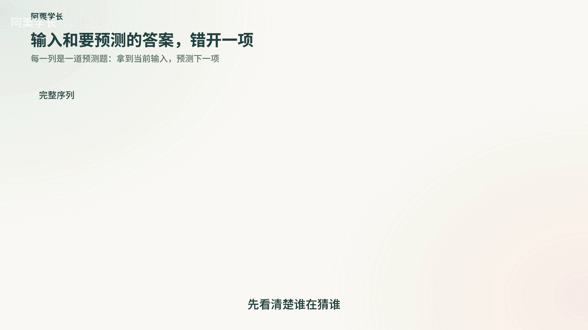
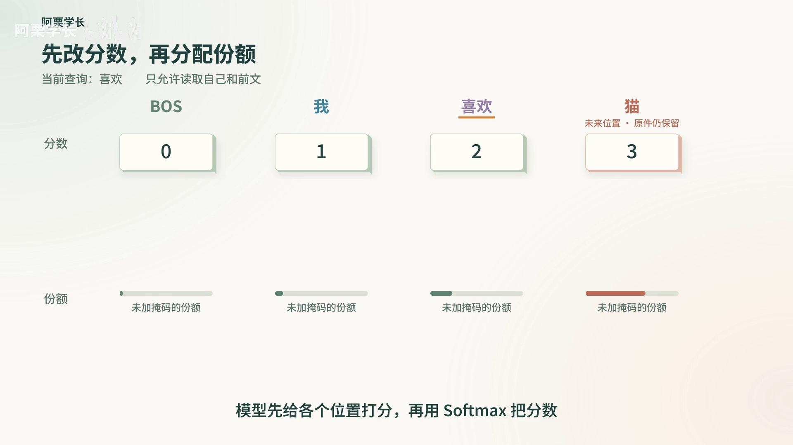
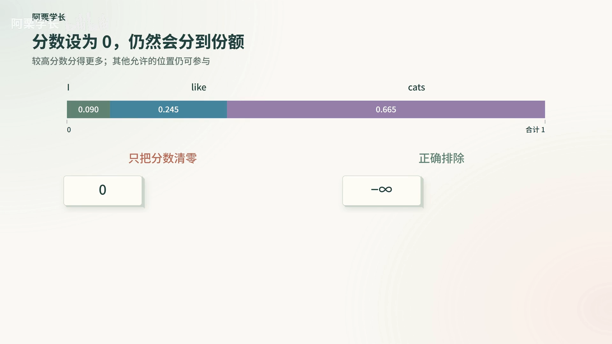
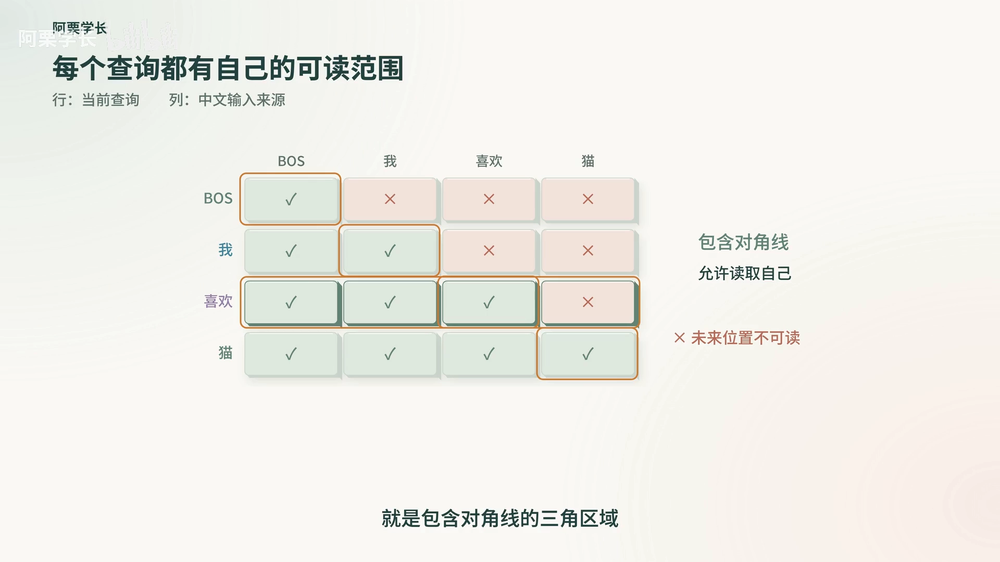
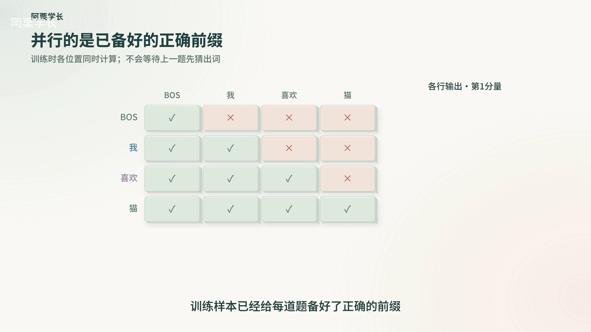
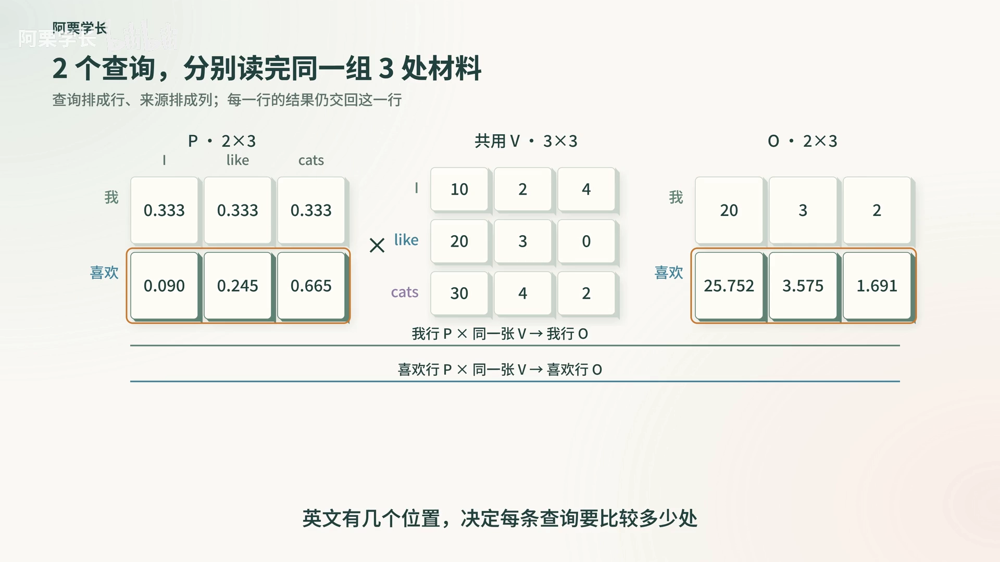
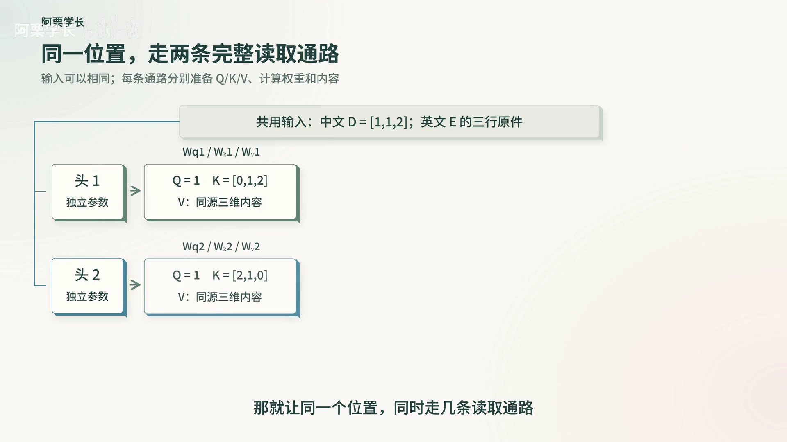
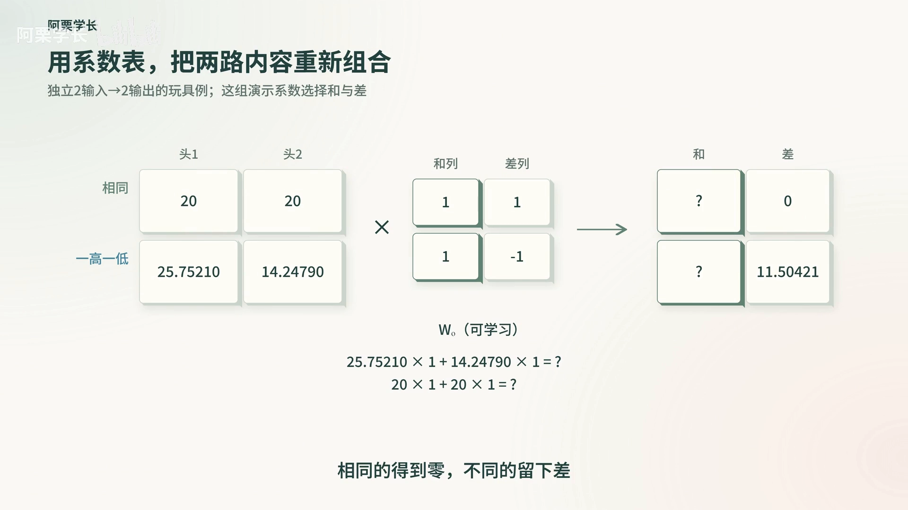
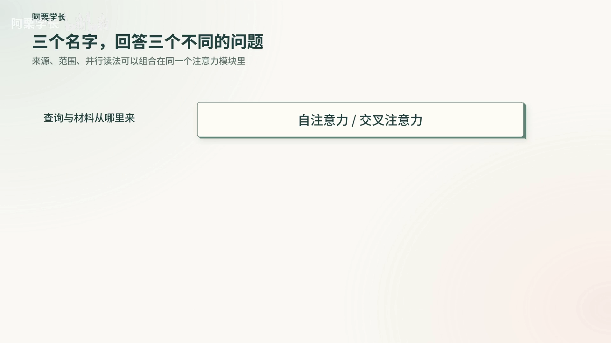
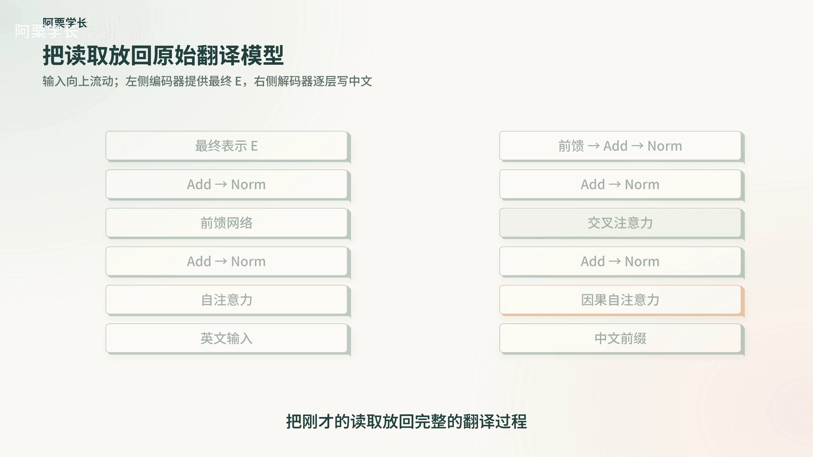

# 因果掩码：下三角矩阵如何阻止模型偷看未来

> 视频来源：[一个视频看懂因果掩码多头注意力机制](https://www.bilibili.com/video/BV1aphv6AEir/?t=0)（Bilibili · 阿栗学长）
> 本文基于视频演说图文稿整理，配图截自视频。

## 本讲要解决的核心问题（SCQA）

**背景**：训练一个翻译模型时，我们并不是一次只让它猜一个词，而是把一句中文的所有位置摊开、同时算出每个位置的"下一个词"预测。这样一份训练样本能同时当好几十道填空题。

**冲突**：这份输入里既有题干也有答案。要让"我喜欢"这一格预测"猫"，正确答案"猫"就躺在同一条输入序列里；可它又不能被删掉——同一句里的"猫"对下一道题来说恰恰是题干的一部分 [【跳转到 00:11】](https://www.bilibili.com/video/BV1aphv6AEir/?t=11)。答案必须留下，又不许提前被抄。

**疑问**：既然不能删内容，能不能改"读法"？也就是让每个位置在取信息时，主动跳过自己后面的位置。

**回答（中心思想）**：能，而且只改一步——**在 softmax 之前，把未来位置的匹配分数设成负无穷**。这样 softmax 之后这些位置分到的权重就是零，内容一点也加不进来。把每个位置允许读取的范围画在矩阵上，得到的就是一张**含对角线的下三角（三角）矩阵**，这就是因果掩码（causal mask）。它只约束"读法"、不动"内容"，所以答案可以留着，却抄不到；也正因为读法被逐行锁死，多个位置才能并行计算而不互相泄题。

---

## 一、问题的形状：输入与目标错开一项，答案就藏在题干里

视频开头用一场"答案印在题目下面"的考试来打比方：如果每到填空题答案就摊在旁边，答得再准也证明不了你真的会 [【跳转到 00:00】](https://www.bilibili.com/video/BV1aphv6AEir/?t=0)。训练语言模型时遇到的正是这种考试。

要理解这个尴尬处境，先要看清"谁在猜谁"。视频用一个四格例子来说明：输入序列是「BOS、我、喜欢、猫」，目标序列是「我、喜欢、猫、EOS」——两者**错开一格**，每一列就是一道题：拿到当前输入，预测下一项 [【跳转到 00:56】](https://www.bilibili.com/video/BV1aphv6AEir/?t=56)。

这里的 BOS（begin of sequence）是一个占位的**开始标记**，它自己没有语义，作用只是让第一个位置也有"输入"可用，从而预测出第一个词"我"；EOS（end of sequence）同理标记句子结束。第一个词之所以难，是因为模型手里除了 BOS 什么都没有；而后面每个位置看起来都"作弊条件很好"——"喜欢"这一格手里就拿着"喜欢"，要猜的"猫"还在后面。

所以"允许读自己"并不等于"偷看答案"：自己手里拿着的东西本来就是已知条件，真正的答案永远在后面一格 [【跳转到 01:21】](https://www.bilibili.com/video/BV1aphv6AEir/?t=81)。

## 二、屏蔽只能改分数，不能改内容：softmax 之前设负无穷

### 2.1 注意力先用分数决定"从哪取多少"

模型从各个位置取信息时，会先给每个位置分配一个**取用比例**（后来叫注意力权重），再把内容按比例加权加起来。步骤是两步：先给各个位置**打分**，再用 softmax 把分数转成合计为一的比例。

以"喜欢"这一格作为当前查询（query）为例：它只允许读取"自己和前文"，即 BOS、我、喜欢三格，而"猫"在未来、不许读 [【跳转到 01:46】](https://www.bilibili.com/video/BV1aphv6AEir/?t=106)。注意图中"猫"的框画成红色但**依然在序列里**——掩码做的就是"原件仍保留，只是不给读"。

### 2.2 为什么必须设成负无穷，而不是设成 0

这里有一个非常容易踩的坑：想让某个位置不参与，直觉上会"把它的分数清零"。但 softmax 的形式是

$$
\alpha_i = \frac{\exp(s_i)}{\sum_{m} \exp(s_m)}
$$

当 $s_i = 0$ 时，$\exp(0) = 1$，这一项在分母里仍然是一个正经的正数，仍然会分到一份比例。视频用一组具体数字演示了这一点：三个来源分数为 0、1、2 时，权重分别是 0.090、0.245、0.665；如果把某个分数"清零"，它照样占掉一块份额，其他位置分到的比例就被挤小了。

正确的做法是把未来位置的分数设成**负无穷**：$\exp(-\infty) = 0$，这一项在分子和分母里都消失了，它的比例才是真正的 0，剩下的份额由允许读取的位置重新分配 [【跳转到 01:46】](https://www.bilibili.com/video/BV1aphv6AEir/?t=106)。用一句话概括：**只改分数，不改内容；而改的方式必须是负无穷，不能是零。**

写成一个式子，就是"先打分、再屏蔽、最后归一化"：

$$
s_{ij} = \frac{q_i \cdot k_j}{\sqrt{d_k}}, \qquad
s'_{ij} =
\begin{cases}
s_{ij}, & j \le i \\
-\infty, & j > i
\end{cases}
$$

$$
\alpha_{ij} = \frac{\exp(s'_{ij})}{\sum_{m} \exp(s'_{im})}, \qquad
z_i = \sum_{j \le i} \alpha_{ij} \, v_j
$$

其中 $i$ 是当前查询所在的位置，$j$ 是它要读取的来源位置。条件 $j > i$ 就是"未来"，被置为 $-\infty$ 之后权重恒为零，所以 $z_i$ 的求和实际上只在 $j \le i$ 上展开。

### 2.3 顺手说清那个 $\sqrt{d_k}$：它是另一件事

既然讲到了 "$s_{ij} = q_i\cdot k_j$"，就必须补一句除以 $\sqrt{d_k}$ 的来历，否则容易和掩码混为一谈。$d_k$ 是每份 Q、K 里的数字个数（匹配维数）。点积是"对应项相乘再相加"，维数越多，相加的项越多，分数的波动也会越大；而在论文分析的简化条件下，分数的典型波动会随维数的平方根增长。分数差距一旦被拉得太大，softmax 就会把份额几乎全压到最高分那一个位置上，比例变得过分集中。除以 $\sqrt{d_k}$ 就是在抵消这种尺度放大 [【跳转到 05:37】](https://www.bilibili.com/video/BV1aphv6AEir/?t=337)。

所以完整顺序是：**先匹配算分，再控制分数尺度，最后才施加掩码并 softmax**。掩码负责"能不能读"，缩放负责"读得多集中"，两者不要混为一谈。

## 三、把可读范围画成矩阵，得到含对角线的下三角

对每个查询位置都问一遍"你能读谁"，把结果排成一张矩阵：**行是当前查询，列是输入来源**。于是"喜欢"这一行的可读格是 BOS、我、喜欢，"猫"那一行才四格全通。

这张图就是因果掩码最常见的样子：**对角线及以下（含对角线）为可读，上三角不可读** [【跳转到 02:11】](https://www.bilibili.com/video/BV1aphv6AEir/?t=131)。写成矩阵（以"可读"记 √、"屏蔽"记 ×）：

| 查询 \ 来源 | BOS | 我 | 喜欢 | 猫 |
| :--- | :---: | :---: | :---: | :---: |
| BOS | √ | × | × | × |
| 我 | √ | √ | × | × |
| 喜欢 | √ | √ | √ | × |
| 猫 | √ | √ | √ | √ |

形状上它是序列长度 $n$ 阶的方阵；把“可读记 0、屏蔽记 $-\infty$”铺成一张表，再加到分数矩阵上，就是这一章开头那个公式的矩阵形式。两种写法只是“表达”与“数值”的区别，掩码真正起作用的时刻永远在 softmax 之前。

有一点值得强调：对角线**必须**包含在可读范围内。因为当前这一格要预测的是"下一项"，它读取自己的状态并不构成泄漏；如果把对角线也挖掉，模型连自己已经算出的中间状态都用不上，反而不符合"基于已生成前缀预测下一项"的定义。

## 四、判定掩码是否真的生效：只改被挡住的位置，输出必须一字不变

"画了个三角形"不等于"未来真的进不来"。视频给了一个很干脆的检验方法：**前面的输入和计算规则都不动，只改后面被挡住的位置，看当前读回的内容还变不变**。

- 不加掩码：改动后面几位，结果跟着变——说明未来信息顺着注意力流了进来；
- 加上掩码：同样改动后面几位，结果保持不变——说明未来的信息根本进不来 [【跳转到 02:11】](https://www.bilibili.com/video/BV1aphv6AEir/?t=131)。

这个检验在后面的篇章里会反复被用到（交叉注意力、填充掩码各自都做了一次），它是判断"某个掩码到底挡的是什么"的通用手段：**改被挡的部分，若输出纹丝不动，才算真挡住了。**

## 五、掩码让"一起算"与"不许互看"同时成立

如果每个位置都只能读前缀，那能不能干脆一个一个算？能，但慢。视频指出，由于训练样本已经给每道题备好了**正确的前缀**（这就是所谓的 teacher forcing），各个位置不必等前一道题先猜出词，可以同时计算；而掩码负责守住各自的范围，让一起算的题目不会提前泄露答案 [【跳转到 02:36】](https://www.bilibili.com/video/BV1aphv6AEir/?t=156)。

这就是自回归模型训练的核心矛盾与解法：**"并行"来自知道正确前缀，"不泄漏"来自逐行不同的可读范围**。掩码是这二者的粘合剂——没有它，并行就等于集体抄答案；只有它而没有并行，训练成本会高得不可接受。

## 六、三角矩阵只属于自注意力，交叉注意力不能照搬

接下来视频把镜头拉远，回到最初的 Transformer 翻译模型：英文那边（编码器）先结合整句上下文准备各位置的表示，中文那边（解码器）先利用允许读取的前缀形成当前状态。当"喜欢"这一格要去英文里找信息时，它准备一份查询 Q，英文每个位置准备一份供匹配的线索 K，逐个点积得到匹配分数 [【跳转到 03:57】](https://www.bilibili.com/video/BV1aphv6AEir/?t=237)，softmax 后又得到一组取用比例，最后按比例汇总各位置的 V。

关键在于：这里是"中文查英文"，查询和来源**不是同一个序列**，而且英文整句都是已经给定的材料。

从图上能直接读出两件事：**行数由查询方（中文）决定，列数由来源方（英文）决定，两边不用一样长**；而且不能把开头那张三角形照搬过来——不能因为 cats 排在后面，就把它当成"还没写出来的中文答案" [【跳转到 07:48】](https://www.bilibili.com/video/BV1aphv6AEir/?t=468)。再做一次第四节的检验：只改一处英文表示，读回的结果**应该**跟着变，因为那是允许使用的题目材料。

这里就理清了掩码的判断依据，不是"位置靠后就屏蔽"，而是**"这个位置在未来会不会被当成答案"**：

| 注意力类型 | 查询/来源 | 要不要因果掩码 | 原因 |
| :--- | :--- | :--- | :--- |
| 解码器自注意力 | 中文 / 中文 | 要 | 后面的中文是还没写出来的答案 |
| 交叉注意力 | 中文 / 英文 | 不要 | 英文整句是翻译前就给定的题目材料 |
| 编码器自注意力 | 英文 / 英文 | 不要 | 原文一次性给定，没有"未来"概念 |

顺带一提，同一段里视频还清理了另一个"位置不该影响结果"的场景：把长短不同的句子放在一起算时，短句后面要补空位对齐长度，这些空位交出的 V 即使全设成零也不够——它还在参加比例分配，占走一份，真正有内容的位置就分得少了。所以补出来的位置也要在 softmax 前排除，让它的权重归零，这叫填充掩码（padding mask）[【跳转到 08:44】](https://www.bilibili.com/video/BV1aphv6AEir/?t=524)。它和因果掩码共用同一个"负无穷"机制，差别只在"挡谁"。

## 七、多头：一条掩码规则，广播到每一条读取通路

一个位置只走一条读取通路时，会遇到新的限制：想弄清"谁在喜欢"要多留意"我"，想弄清"喜欢什么"又要多留意 cats，可当前查询只有一套取用比例，"我"分得多，其他位置就得少一些；而且同一处 V 里的各个分量都乘上同一个比例 [【跳转到 09:42】](https://www.bilibili.com/video/BV1aphv6AEir/?t=582)。解法是让同一个位置同时走几条读取通路：每条通路各算各的比例、各读回一份内容，一条这样的通路就叫一个**头（head）**。

多开几条路并不自动带来不同信息——如果只是把同一套计算复制几遍，得到的还是同一份结果。所以每个头都有自己生成 Q、K、V 的参数矩阵：输入相同，重新组合这些数字的方式不同。视频的演示里第一头保持原样、第二头只换生成 K 的系数，英文没变，但拿来匹配的线索变了，于是同一份查询算出另一组分数，来源比例也变了——第一头更多取靠后位置的内容，第二头更多取靠前位置的内容 [【跳转到 10:32】](https://www.bilibili.com/video/BV1aphv6AEir/?t=632)。

**掩码在这里的位置很有意思：它是"读法的边界"，而不是"读法的内容"。** 每个头各有一套分数、各有一套权重，但"哪些列不许读"是同一张三角表——所以一条掩码规则被广播到所有头，每个头在各自 softmax 之前都套同一个上三角屏蔽。反过来也成立：换掩码会同时改变所有头能读的范围，换参数只会改变各头读的偏好。

多头收尾的两步也值得记住。各头结果**不能**先取平均：两头相同时平均得 20，一头高、一头低时平均仍是 20，只看平均值已经分不出"两路一样"还是"一高一低"，后面即使想用这个差别也找不回来了 [【跳转到 11:35】](https://www.bilibili.com/video/BV1aphv6AEir/?t=695)。所以先**拼接**（第一头的结果放前面、第二头接在后面，词的位置没有增加，变宽的是这个位置手里的那排数字），再接一张可学习的系数表做**输出投影**，由训练决定该强调、混合还是舍弃哪一路。

至于"多开几条路是不是计算量翻倍"，视频给的原论文设定是让每个头用**较窄**的表示，几个头拼起来正好回到整体宽度，按这个设置总计算量与使用完整宽度的单头相近 [【跳转到 12:43】](https://www.bilibili.com/video/BV1aphv6AEir/?t=763)。

## 八、三个名字各回答一个问题：来源、范围、并行读法

学到这里最容易混淆的是几个名词，视频把它们一次性摆平：

- **自注意力 / 交叉注意力**：回答"查询与材料从哪里来"；
- **掩码**：回答"哪些位置可以参与"；
- **多头**：回答"同一个位置有几套并行的读取方式" [【跳转到 13:24】](https://www.bilibili.com/video/BV1aphv6AEir/?t=804)。

三者是三个正交的维度，可以自由组合：一个模块可以既是**多头自注意力**，又带着**因果掩码**；交叉注意力也可以有多个头，同时用填充掩码排除原文里的空位。

## 九、放回整层：因果自注意力是解码器每一层的入口

把读法放回完整的翻译过程：负责处理英文的部分叫**编码器**（encoder），它让原文各位置结合上下文形成供后面读取的表示；负责写中文的部分叫**解码器**（decoder）。看解码器的一层，顺序是：先通过带因果掩码的自注意力整理**允许使用的中文前缀**，再带着这个状态通过交叉注意力读取英文，随后交给前馈网络（FFN，逐位置做非线性变换的全连接层）继续加工；每个子层算完都把结果加回原来的状态（残差连接）再做归一化，然后逐层往后传 [【跳转到 13:56】](https://www.bilibili.com/video/BV1aphv6AEir/?t=836)。

**"每一层都得守住这条规则"**是这段的关键。如果只有第一层挡了、后面某层的注意力又能读到未来，答案照样会绕路传回来——所以因果掩码不是加一次就完事，而是解码器自注意力在每个层、每个头上都要施加。

再往下就到了词表输出层：注意力权重决定"从哪里取多少信息"，词表概率才对应"接下来可能输出什么"。这两次分配很容易混，视频特意点明：更多的读取 cats 的内容，不等于注意力直接把中文"猫"吐了出来 [【跳转到 14:21】](https://www.bilibili.com/video/BV1aphv6AEir/?t=861)。

最后是训练与推理的一致性：训练时，各位置算出的预测会和对应的标准答案比较，差距变成训练误差，再沿计算过程传回去调整参数（包括各个头怎样生成 Q、K、V）[【跳转到 14:46】](https://www.bilibili.com/video/BV1aphv6AEir/?t=886)；而真正翻译新句子时，后面的中文还没有产生，模型写出一项就把它接回已有输入、再预测下一项，直到输出结束标记 [【跳转到 15:18】](https://www.bilibili.com/video/BV1aphv6AEir/?t=918)。两种情形在"能看到什么"上是完全对齐的——这正是因果掩码要守住的契约：**训练时要模拟的，就是推理时那种"未来真的不存在"的条件。**

## 小结

- 因果掩码要解决的是"答案必须留在输入里、又不许被抄"的矛盾：**它改读法，不改内容**。
- 落地方式只有一步：在 softmax **之前**把未来位置的分数设为 $-\infty$；设成 0 无效，因为 $\exp(0)=1$，照样分到份额。
- 把每个位置的可读范围画出来，得到含对角线的下三角（三角）矩阵；对角线必须算可读，读自己不构成泄漏。
- 是否生效的判定法：只改被挡住的位置，若当前输出纹丝不动，才算真挡住。
- 逐行锁死范围让"并行算所有位置"与"互不泄题"可以同时成立，而并行训练依赖 teacher forcing 提供的正确前缀。
- 三角矩阵只属于解码器自注意力；交叉注意力查询中文、来源英文，英文整句是给定材料，不需要因果掩码，但仍需填充掩码排除补齐的空位。
- 掩码是"读法的边界"，一条三角表会广播到所有头；各头各有自己的 Q/K/V 参数，结果先拼接再由输出投影重组，不能先取平均。
- 因果掩码在解码器的**每一层**都要施加，否则未来信息会绕路回来。

## 关键术语速查

| 术语 | 一句话解释 |
| :--- | :--- |
| 因果掩码（causal mask） | 只允许每个位置读取自己与之前位置的上三角屏蔽，保证不会提前看到未来 token |
| 三角掩码 / 下三角矩阵 | 因果掩码的矩阵形态：对角线与下三角可读，上三角为 $-\infty$ 或 False |
| teacher forcing | 训练时一次性喂入完整目标序列（含正确前缀），让所有位置并行预测下一项 |
| 负无穷屏蔽 | 在 softmax 前把分数设为 $-\infty$，使该项 exp 后为 0，权重真正归零 |
| 注意力权重 | softmax 之后得到的、合计为 1 的取用比例，决定从各来源位置取多少信息 |
| 自注意力 / 交叉注意力 | 前者查询与材料同源；后者查询来自解码器、材料来自编码器 |
| 多头注意力 | 同一位置并行走多条读取通路，每头用自己的 Q/K/V 参数，结果拼接后做输出投影 |
| 输出投影 | 拼接后接的一张可学习系数表，把各路结果重新组合成新的输出 |
| 填充掩码（padding mask） | 把补齐长度用的空位（PAD）在 softmax 前排除，避免它们占走注意力份额 |
| BOS / EOS | 序列开始 / 结束标记，BOS 让第一个位置也有输入可用，EOS 表示生成终止 |
