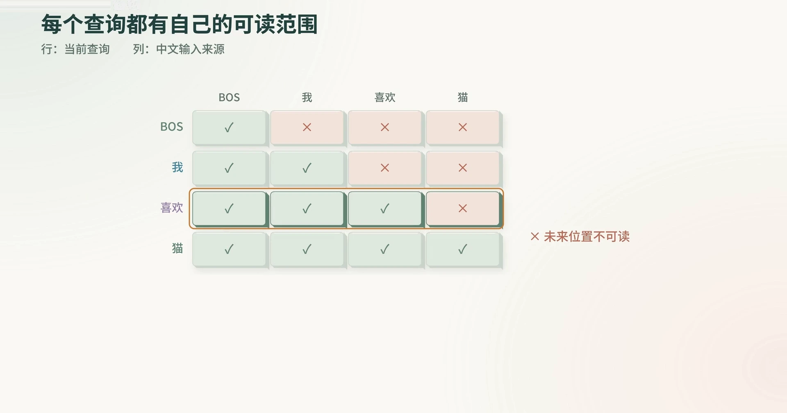
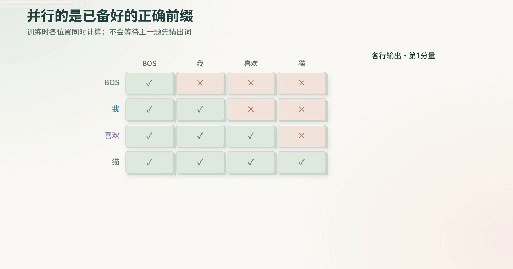
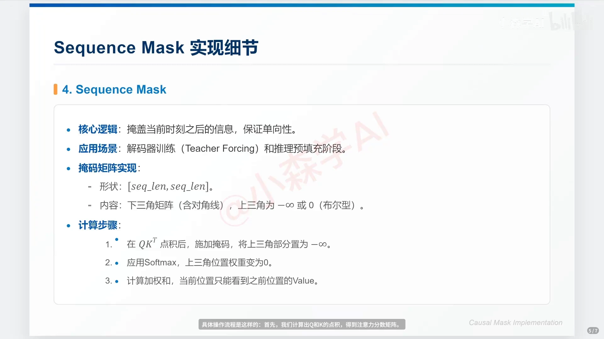
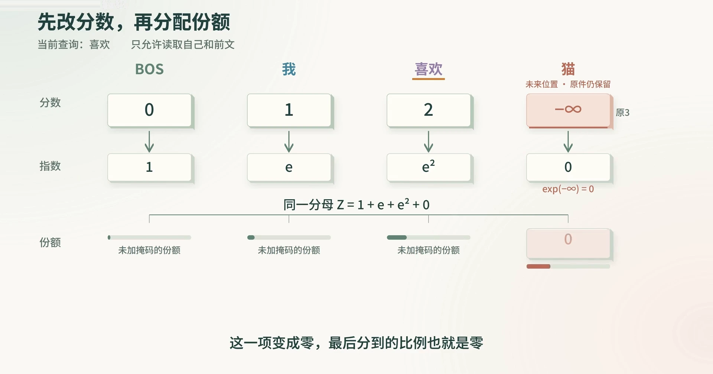
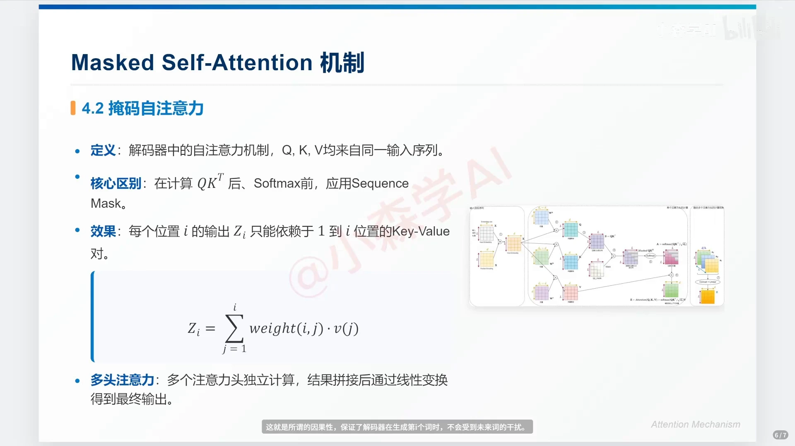
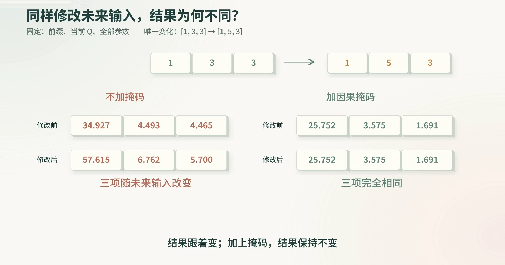
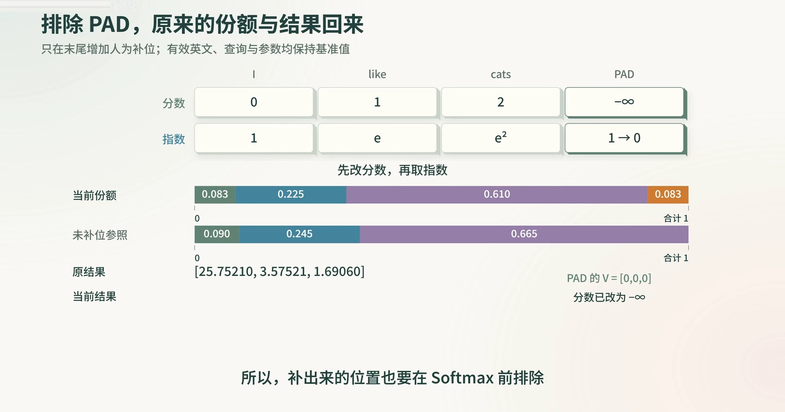
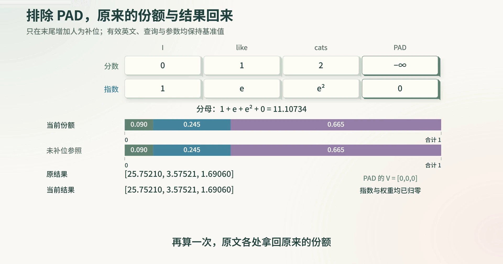
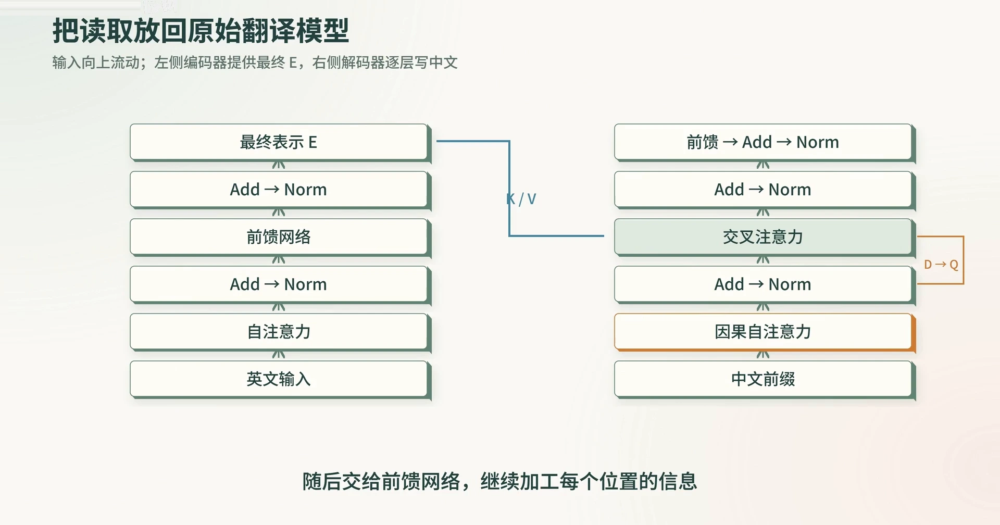
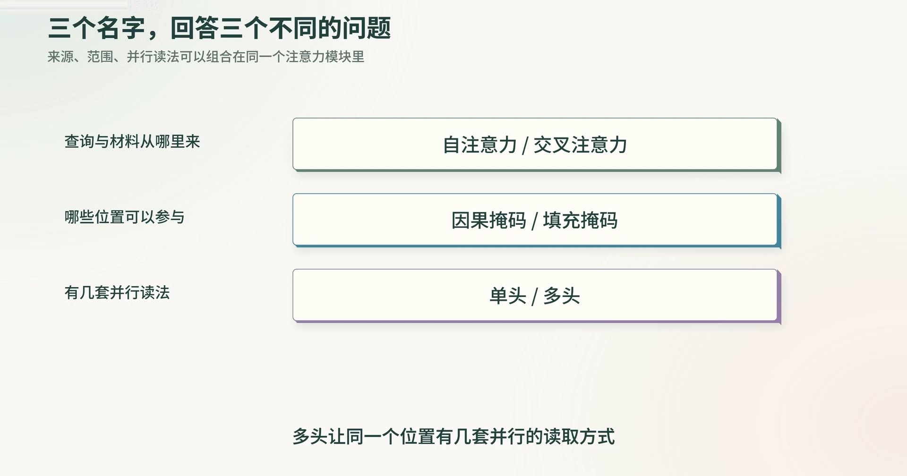

# 因果掩码：下三角矩阵如何阻止模型偷看未来



## 本讲要解决的核心问题（SCQA）

**背景**：解码器（decoder）是逐 token 写句子的：模型写出一项，就把它接回已有输入，再预测下一项，直到输出结束标记（[【跳转到 15:18】](https://www.bilibili.com/video/BV1aphv6AEir/?t=918)）。可训练时为了并行，我们不会真的等上一词生成完，而是一次性把整句目标序列喂给解码器，让它同时预测所有位置——这就是 teacher forcing（[【跳转到 02:10】](https://www.bilibili.com/video/BV1fuPizoEBD/?t=130)）。

**冲突**：整句都在输入里，意味着预测第 $t$ 个词的格子"看得见"第 $t+1$ 个及以后的词。这等于把答案印在题目下面：模型可以直接复制未来，而不是学着一步步生成（[【跳转到 02:10】](https://www.bilibili.com/video/BV1fuPizoEBD/?t=130)）。更麻烦的是，未来的 token 还不能删——同一个「猫」，对预测「我喜欢」的那道题是答案，对下一道题就是题干（[【跳转到 00:22】](https://www.bilibili.com/video/BV1aphv6AEir/?t=22)）。

**疑问**：怎样在保留整句输入的前提下，让每个位置只读自己和过去？

**回答（中心思想）**：Transformer 的做法是加一张**因果掩码（causal mask，也叫 sequence mask）**：构造一个 $T\times T$ 的下三角矩阵，把每个查询位置"未来"那几列的注意力分数在 softmax 之前置为 $-\infty$；softmax 取指数后这些项变成 0，未来信息就再也进不了加权和（[【跳转到 01:46】](https://www.bilibili.com/video/BV1aphv6AEir/?t=106)）。真正要记住的实现只有两步：**构造下三角** + **在 softmax 之前把掩码加到分数上**。难点在形状——$[T,T]$ 的矩阵要广播到 batch 与 head 两个维度，而且训练（prefill）与增量推理时掩码形状并不一样。另有一张常被混为一谈的 padding mask，它挡的不是未来，而是补齐出来的空位（[【跳转到 09:09】](https://www.bilibili.com/video/BV1aphv6AEir/?t=549)）。

---

## 一、为什么需要因果掩码：答案印在题目下面的考试

### 1.1 并行预测带来的"作弊"机会

课程开头打了一个比方：每到填空题，答案就印在题目下面。答得再准，也证明不了你真的会；更麻烦的是，这个答案还不能直接撕（[【跳转到 00:00】](https://www.bilibili.com/video/BV1aphv6AEir/?t=0)）。训练 AI 把 `I like cats` 翻成中文，遇到的正是这场考试：让它接"我喜欢"的下一个词，正确答案"猫"就躺在同一份训练输入里。

为什么不把"猫"删掉？因为一句话里几个位置的预测是**一起算**的："猫"对眼前这道题是答案，对下一道题却是题干；删掉它，这道题抄不了了，下一道题也少了条件（[【跳转到 00:22】](https://www.bilibili.com/video/BV1aphv6AEir/?t=22)）。答案要留下，又不能让它抄，这才是问题所在。

如果把整句目标序列 $y_1,\dots,y_T$ 一次性喂进解码器，第 $i$ 个位置的 query 会与所有位置的 key 做点积。没有任何限制时，它自然会把第 $i+1$ 个及以后的位置也算进加权和——模型于是"提前知道"了自己下一步该写什么（[【跳转到 02:10】](https://www.bilibili.com/video/BV1fuPizoEBD/?t=130)）。

### 1.2 信息泄露会层层传递

这种抄答案不只是某一层的小动作。第一层注意力看到了未来，第二层注意力再拿"带了未来信息的输出"去算，未来就沿着层数一路渗上去（[【跳转到 02:35】](https://www.bilibili.com/video/BV1fuPizoEBD/?t=155)）。模型在训练集上 loss 会很漂亮，因为它学会了复制粘贴；可一到真正逐词推理，后面还没有词可抄，行为立刻和训练时不一致。

### 1.3 因果掩码的定义：给每个位置画一个圈

课程把解法概括成一句话：**在计算注意力分数时给每个位置画个圈，只允许它关注自己以及前面的词，坚决不允许它看到后面的词**（[【跳转到 02:35】](https://www.bilibili.com/video/BV1fuPizoEBD/?t=155)）。把每个查询能读到的范围画成表格，就是一个包含对角线的下三角——行是当前查询，列是可读的来源，绿色对勾只出现在左下三角（[【跳转到 00:46】](https://www.bilibili.com/video/BV1aphv6AEir/?t=46)）。



注意对角线必须保留：当前词当然要能看见自己。课程用"我 / 喜欢 / 猫"解释过为什么这不算泄露——输入和要交出的答案错开了一格，"喜欢"这一格手里拿着"喜欢"，要猜的"猫"还在后面（[【跳转到 00:56】](https://www.bilibili.com/video/BV1aphv6AEir/?t=56)）。错位一格，是因果掩码能和 teacher forcing 共存的前提。

---

## 二、下三角矩阵：从定义到三行代码

### 2.1 把掩码写成矩阵

设序列长度为 $T$，位置下标从 0 开始。因果掩码就是一个 $T\times T$ 的加性矩阵 $M$，元素定义为

$$
M_{ij} =
\begin{cases}
0, & j \le i \\[4pt]
-\infty, & j > i
\end{cases}
$$

把它和缩放后的注意力分数相加，再做 softmax：

$$
\operatorname{Attn}(Q,K,V) = \operatorname{softmax}\!\left(\frac{QK^{\top}}{\sqrt{d_k}} + M\right)V
$$

$T=4$ 时，$M$ 长这样（`0` 表示可读，`-∞` 表示屏蔽）：

```text
              j=0    j=1    j=2    j=3     ← 被读位置（key）
        ┌──────┬──────┬──────┬──────┐
 i=0    │   0  │  -∞  │  -∞  │  -∞  │
 i=1    │   0  │   0  │  -∞  │  -∞  │
 i=2    │   0  │   0  │   0  │  -∞  │
 i=3    │   0  │   0  │   0  │   0  │
        └──────┴──────┴──────┴──────┘
                 ↑ 主对角线：允许读自己
```

课程在讲实现细节时给出的规格是：**形状为序列长度乘以序列长度的方阵，内容为下三角矩阵（含对角线）**；布尔型表示时下三角与对角线为 true、上三角为 false，浮点型表示时下三角与对角线为 0、上三角为负无穷大（[【跳转到 05:05】](https://www.bilibili.com/video/BV1fuPizoEBD/?t=305)）。



### 2.2 PyTorch 里的三种等价写法

```python
import torch

T = 4

# 写法一：布尔掩码，True = 允许读取
keep = torch.tril(torch.ones(T, T, dtype=torch.bool))

# 写法二：加性掩码，0 = 可读，-inf = 屏蔽；
# diagonal=1 表示"从第一条上对角线开始"，主对角线不在其中
additive = torch.triu(torch.full((T, T), float("-inf")), diagonal=1)

# 写法三：先全屏蔽再放开下三角，便于和 padding 掩码做逻辑与
block = torch.ones(T, T, dtype=torch.bool).triu(diagonal=1)
```

三种写法描述的是同一件事，区别只在**谁负责变成 0/-∞**：布尔掩码交给注意力函数去翻译（PyTorch 的布尔 **attn_mask** 约定 True 表示保留，False 表示屏蔽），加性掩码则直接与分数相加。课程提醒过，布尔型与浮点型是掩码的两种常见表示，浮点型一般填一个极小的负数，例如负 $10^9$（[【跳转到 03:25】](https://www.bilibili.com/video/BV1fuPizoEBD/?t=205)）。

### 2.3 为什么必须"加在 softmax 之前"

这里最容易踩的坑是：把未来位置的分数设成 **0** 行不行？不行。课程用一组演示算例展示过后果——当前查询"喜欢"的四个候选分数是 0、1、2、3，把"猫"的分数从 3 改成 $-\infty$ 之后，它的指数是 $\exp(-\infty)=0$，最终份额才是 0（[【跳转到 01:46】](https://www.bilibili.com/video/BV1aphv6AEir/?t=106)）。



如果只把它设成 0，$\exp(0)=1$，这一项仍然会参与分母、照样占走一份份额，只是"贡献的内容"可能为 0 而已（[【跳转到 04:47】](https://www.bilibili.com/video/BV1aphv6AEir/?t=287)）。这和 padding mask 的直觉完全一致：先改分数，再取指数。

### 2.4 softmax 之后，被屏蔽的位置为什么恰好是 0

设第 $i$ 行的分数为 $s_{i0},\dots,s_{i,T-1}$，加上掩码后未来位置变成 $-\infty$。softmax 的每一项是

$$
w_{ij} = \frac{\exp(s_{ij} + M_{ij})}{\sum_{k=0}^{T-1}\exp(s_{ik} + M_{ik})}
$$

对 $j > i$，分子是 $\exp(-\infty)=0$；分母里这一项同样是 0，所以分母只剩允许位置的指数和。于是

$$
w_{ij} = 0 \quad (j > i), \qquad \sum_{j \le i} w_{ij} = 1
$$

这正是课程说的"剩下的份额由允许读取的位置来分"（[【跳转到 01:46】](https://www.bilibili.com/video/BV1aphv6AEir/?t=106)）。用这个权重去加权求和 value，第 $i$ 个位置的输出就只由前 $i$ 个位置的 value 决定：

$$
Z_i = \sum_{j=1}^{i} \operatorname{weight}(i,j)\cdot v(j)
$$

（幻灯片按 1 起始编号；对应上面 0 起始的定义，就是 $j \le i$。）



> **补充（非讲者原话）**：为什么工程里常见 $-10^9$ 而不是字面的 $-\infty$？因为在 fp16 下真正的 $-\infty$ 参与整行计算时容易出现 NaN，而 $-10^9$ 在 softmax 里已经足够让 $\exp$ 下溢为 0。另一个坑是"整行都被屏蔽"：如果某一行所有位置都是 $-\infty$，分母为 0，softmax 会输出 NaN。因果掩码不会出现这种情况（对角线永远可见），但把 padding 掩码作用到"整条都是 PAD"的样本上时可能出现，实际实现通常直接跳过这些位置的 loss。

---

## 三、验证：挡住未来之后，改未来不再影响当前

### 3.1 一组可复核的对照实验

课程设计了一个很干净的实验：固定前缀、当前 query 和全部参数，**只把最后一个（未来的）输入从 [1, 3, 3] 改成 [1, 5, 3]**，比较"不加掩码"与"加因果掩码"两种情况下当前查询读回的结果（[【跳转到 02:11】](https://www.bilibili.com/video/BV1aphv6AEir/?t=131)）。



结果非常直观：

| 设置 | 修改前 | 修改后 | 结论 |
| --- | --- | --- | --- |
| 不加掩码 | 34.927 / 4.493 / 4.465 | 57.615 / 6.762 / 5.700 | 三项随未来输入改变 |
| 加因果掩码 | 25.752 / 3.575 / 1.691 | 25.752 / 3.575 / 1.691 | 三项完全相同 |

"改未来不该影响当前"就是因果性（causality）的可操作定义。课程特别强调，这条规则要**每一层都守住**：前缀和模型参数不变，只改被挡住的中文，当前预测就不该受影响，不能绕路把答案传回来（[【跳转到 15:45】](https://www.bilibili.com/video/BV1aphv6AEir/?t=945)）。

### 3.2 一个最小可运行实现

下面这段代码把"构造掩码、加掩码、softmax、加权求和"完整串起来，并复现上面的不变量检查，可直接运行：

```python
import math
import torch
import torch.nn.functional as F


def additive_causal_mask(T, device=None):
    """0 表示可读，-inf 表示屏蔽；形状 [T, T]"""
    return torch.triu(torch.full((T, T), float("-inf"), device=device), diagonal=1)


def attention(q, k, v, mask=None):
    """q: [B, H, Tq, d]；k/v: [B, H, Tk, d]；mask: [Tq, Tk] 或可广播形状"""
    d = q.size(-1)
    scores = q @ k.transpose(-2, -1) / math.sqrt(d)   # [B, H, Tq, Tk]
    if mask is not None:
        scores = scores + mask                        # 关键：softmax 之前加
    weights = F.softmax(scores, dim=-1)               # 被屏蔽列权重为 0
    return weights @ v, weights


torch.manual_seed(0)
B, H, T, d = 1, 2, 4, 8
q = torch.randn(B, H, T, d)
k = torch.randn(B, H, T, d)
v = torch.randn(B, H, T, d)
mask = additive_causal_mask(T)

out_masked, w = attention(q, k, v, mask)

# 只改最后一个（对前三个位置来说是"未来"）的 K、V
k2, v2 = k.clone(), v.clone()
k2[:, :, 3] += 10.0
v2[:, :, 3] += 10.0

out_masked_after, _ = attention(q, k2, v2, mask)
out_free, _ = attention(q, k, v, None)
out_free_after, _ = attention(q, k2, v2, None)

# 前三个位置的结果：有掩码时不受未来影响，无掩码时会被影响
print(torch.allclose(out_masked[:, :, :3], out_masked_after[:, :, :3]))   # True
print(torch.allclose(out_free[:, :, :3], out_free_after[:, :, :3]))       # False
print(w[0, 0])   # 第 0 个头的权重：上三角严格为 0，每一行之和为 1
```

这段代码只有两个关键点：**分数先除 $\sqrt{d}$、再加掩码、最后 softmax**，以及**掩码只与位置有关，不随样本和头变化**。第二点直接引出下一节的形状与广播问题。

---

## 四、形状与广播：从 [T, T] 到 [B, H, T, T]

### 4.1 分数是四维，掩码是二维

注意力模块里真正参与运算的分数张量通常有四个维度：batch、head、查询长度、键长度，即 $[B,H,T_q,T_k]$。而因果掩码只回答"第 $i$ 个查询能不能看第 $j$ 个键"，与是哪条样本、哪个头都无关，所以它只需要 $[T_q,T_k]$（或显式写成 $[1,1,T_q,T_k]$）。广播规则会自动把它铺到 $B$ 与 $H$ 上（[【跳转到 05:05】](https://www.bilibili.com/video/BV1fuPizoEBD/?t=305)；广播细节为补充）。

| 张量 | 形状 | 说明 |
| --- | --- | --- |
| 注意力分数 | $[B,H,T_q,T_k]$ | batch、head、查询长度、键长度 |
| 因果掩码 | $[T_q,T_k]$ | 只由位置决定，广播到 batch 与 head |
| padding 掩码 | $[B,1,1,T_k]$ | 每条样本的有效长度不同，广播到 head 与查询维 |

表里第三行是下一节的主角：padding 掩码的第一个维度是 batch，因为每条句子的有效长度不一样；它不关心 head，所以中间两维是 1。

### 4.2 prefill 与增量解码：掩码形状会变

同一个模型，两个阶段用的掩码形状不同：

- **prefill（预填充）**：把整段 prompt 一次送进去，$T_q=T_k=T$，掩码就是那张 $T\times T$ 下三角方阵。这也是训练时的形状（[【跳转到 04:40】](https://www.bilibili.com/video/BV1fuPizoEBD/?t=280)）。
- **增量解码（KV cache）**：每次只送一个新 token，$T_q=1$、$T_k=t$（$t$ 是已经缓存的长度）。新查询是第 $t$ 个位置，它可以看到全部 $t$ 个缓存键，所以这一行掩码**全是 0**：

$$
M^{\text{decode}} = \begin{bmatrix} 0 & 0 & \cdots & 0 \end{bmatrix}_{1\times t}
$$

也就是说，单步解码在因果性上天然安全——未来还没有被生成，根本不在 cache 里（[【跳转到 15:18】](https://www.bilibili.com/video/BV1aphv6AEir/?t=918)）。此时传一张 $[1,t]$ 的全零掩码和不传掩码，结果一样；真正需要小心的是不要错误地套用 prefill 的下三角。

> **补充（非讲者原话）**：PyTorch 2.0 起提供融合算子，prefill 阶段可以直接让它内部生成因果掩码：

```python
import torch
import torch.nn.functional as F

# prefill：q_len == k_len，交给算子内部生成下三角
out = F.scaled_dot_product_attention(q, k, v, is_causal=True)

# 显式传布尔掩码：True = 保留，False = 屏蔽
keep = torch.tril(torch.ones(T, T, dtype=torch.bool))
out = F.scaled_dot_product_attention(q, k, v, attn_mask=keep)

# 增量解码一步：q_len = 1、k_len = t，全部缓存可见，不必再套因果掩码
out = F.scaled_dot_product_attention(q_step, k_cache, v_cache)
```

> **补充（非讲者原话）**：单步解码时不要想当然地用 **is_causal** 让它"自动生成"掩码——非方阵下这个开关的对齐方式在不同 PyTorch 版本里并不一致（旧版按左上角对齐，$T_q=1$、$T_k=t$ 时只放开第 0 个键，结果就全错了）。单步要么不传掩码，要么显式构造形状为 $[1,t]$ 的全零掩码；混合了 padding 时则传合并后的 **attn_mask**。

---

## 五、padding mask 与 causal mask 是两件正交的事

### 5.1 padding mask 要解决的是"补出来的空位"

训练时一个 batch 里的句子长短不一，通常会在短句后面补 PAD 把长度对齐，才能拼成一个规整的三维张量（[【跳转到 00:30】](https://www.bilibili.com/video/BV1fuPizoEBD/?t=30)）。问题在于 PAD 的嵌入往往是零或很小的随机数：算注意力时若把它们当正常词，它们就会参与 softmax。$\exp(0)=1$，空气也会举手发言，抢走真实词的权重（[【跳转到 00:55】](https://www.bilibili.com/video/BV1fuPizoEBD/?t=55)）。

解法与因果掩码同构：在 softmax 之前把这些位置的分数拉到负无穷（或一个极小的负数），权重归零，PAD 的 V 就加不进结果（[【跳转到 00:55】](https://www.bilibili.com/video/BV1fuPizoEBD/?t=55)）。区别在于：**因果掩码按位置关系屏蔽（上三角），padding 掩码按样本的有效长度屏蔽（整列）**。

### 5.2 只把 PAD 的 V 设成零，为什么不够

一个常见直觉是：PAD 的 V 是零向量，加进来也不影响结果，不用管。课程用一个 $3+1$ 的算例否定了它：在原句 `I like cats` 后补一个 PAD，并强制 PAD 的 $V=[0,0,0]$。如果只把 V 置零、不屏蔽分数，PAD 仍以 $\exp(0)=1$ 参与分母，占走 **0.083** 的份额；三个真实位置被迫从 0.090 / 0.245 / 0.665 缩到 0.083 / 0.225 / 0.610，读回的结果因此改变（[【跳转到 08:44】](https://www.bilibili.com/video/BV1aphv6AEir/?t=524)）。



### 5.3 正确做法：softmax 前排除，权重归零

把 PAD 位置的分数改成 $-\infty$ 再算一次，三个有效位置拿回 0.090 / 0.245 / 0.665 的份额，结果与"没补空位"的参照完全一致（$[25.75210, 3.57521, 1.69060]$）（[【跳转到 08:44】](https://www.bilibili.com/video/BV1aphv6AEir/?t=524)）。这就是填充掩码（padding mask），它与因果掩码一个挡空位、一个挡未来（[【跳转到 09:09】](https://www.bilibili.com/video/BV1aphv6AEir/?t=549)）。



### 5.4 两张掩码如何合并

实际模型里往往同时需要两张掩码：masked self-attention 既要挡未来、又要挡 PAD；交叉注意力只用挡 PAD。合并规则很简单——**任何一个掩码要求屏蔽，就屏蔽**；用逻辑与（布尔掩码）或加法（加性掩码）即可（[【跳转到 08:50】](https://www.bilibili.com/video/BV1fuPizoEBD/?t=530)）。

```python
# 布尔掩码：keep_causal [Tq, Tk]，keep_pad [B, 1, 1, Tk]
keep = keep_causal & keep_pad          # 广播后逐元素与
# 加性掩码：两张掩码都只含 0 / -inf 时，直接相加等价于逻辑或
additive = additive_causal + additive_pad
```

课程把这个规则比作两个保安：只要有一个说这个人不行，这个人就得走开（[【跳转到 08:50】](https://www.bilibili.com/video/BV1fuPizoEBD/?t=530)）。要提醒的是，"直接相加"只有在两张都是加性掩码（0 与 $-\infty$）时才成立；如果把两个布尔掩码相加，`True + True` 会得到 2，语义就乱了（补充，非讲者原话）。

---

## 六、把掩码放回 Transformer：哪些层要加，哪些不用

### 6.1 解码器第一层：masked self-attention

解码器的第一个多头注意力模块，Q、K、V 都来自同一个输入序列（目标语言嵌入，或前一个解码器块的输出），所以叫自注意力；它和编码器里的自注意力结构一样，**唯一的关键区别是必须带上 sequence mask**（[【跳转到 06:20】](https://www.bilibili.com/video/BV1fuPizoEBD/?t=380)）。流程是：输入 $X$ 线性变换得到 Q、K、V，算 $QK^{\top}$ 得到分数，把上三角置 $-\infty$，softmax，再乘 V（[【跳转到 06:45】](https://www.bilibili.com/video/BV1fuPizoEBD/?t=405)）。

### 6.2 交叉注意力：不加因果掩码，但仍要 padding 掩码

第二个多头注意力是交叉注意力：Q 来自前一个带掩码的自注意力输出，K、V 来自编码器的输出。编码器能看完整段原序列，已经把信息都编码好了，所以这里**不需要额外的 sequence mask**——不该再给它戴眼罩，要让它充分读取原文（[【跳转到 08:00】](https://www.bilibili.com/video/BV1fuPizoEBD/?t=480)）。但原序列里的 PAD 仍要挡掉，所以交叉注意力通常带 padding 掩码。



课程还强调过一个容易照搬的错误：**别把因果掩码那张三角形搬到交叉注意力上**。英文整句都是已经给定的材料，不能因为 `cats` 排在后面，就把它当成还没写出来的中文答案（[【跳转到 07:48】](https://www.bilibili.com/video/BV1aphv6AEir/?t=468)）。

### 6.3 多头注意力：一张掩码，广播到每个头

多头并不会改变掩码的语义。每个头各自算一套 Q、K、V 与权重，但"哪些位置可读"是同一个规则，所以同一张因果掩码广播到所有头即可（[【跳转到 07:35】](https://www.bilibili.com/video/BV1fuPizoEBD/?t=455)）。课程用一句话把几个概念分开：**自注意力/交叉注意力**回答"查询与材料从哪里来"，**因果掩码/填充掩码**回答"哪些位置可以参与"，**单头/多头**回答"有几套并行读法"（[【跳转到 13:24】](https://www.bilibili.com/video/BV1aphv6AEir/?t=804)）。



---

## 小结

- **因果掩码解决的是"抄答案"**：teacher forcing 让整句输入可并行，但第 $i$ 个位置若能看到 $i$ 之后的 token，就会复制未来；这些 token 又不能删，因为它在下一个位置是题干。
- **本质是一次"加在 softmax 之前"的加法**：下三角位置加 0、上三角加 $-\infty$，$\exp(-\infty)=0$，被屏蔽的位置权重恰好为 0，剩余权重在可见位置内重新归一化。
- **不能把分数设成 0**：$\exp(0)=1$，0 分的位置照样占份额；只有 $-\infty$（工程上常用 $-10^9$）才让它真正出局。
- **构造只有一行**：布尔掩码用 `torch.tril`，加性掩码用 `torch.triu(..., diagonal=1)` 生成上三角的 $-\infty$。
- **形状靠广播**：分数是 $[B,H,T_q,T_k]$，因果掩码是 $[T_q,T_k]$；padding 掩码是 $[B,1,1,T_k]$，因为有效长度随样本变化。
- **两个阶段的形状不同**：prefill 是 $T\times T$ 下三角；增量解码 $T_q=1$、$T_k=t$，这一行全是 0，未来根本不在 KV cache 里。
- **padding mask 与 causal mask 正交**：前者挡补出来的空位，后者挡未来；同时存在时按"任一屏蔽即屏蔽"合并。
- **哪些层要加**：解码器因果自注意力加 causal mask；交叉注意力不加 causal mask，但仍加 padding mask；多头共享同一张掩码。

## 关键术语速查

| 术语 | 一句话解释 |
| --- | --- |
| 因果掩码（causal mask） | 只允许位置 $i$ 读取 $j \le i$ 的掩码，形状为下三角方阵 |
| sequence mask | 因果掩码的另一个名字，强调"按序列顺序屏蔽未来" |
| 加性掩码（additive mask） | 直接加在分数上的 0 / $-\infty$ 矩阵 |
| 布尔掩码（boolean mask） | True 表示保留、False 表示屏蔽，由注意力函数翻译成 $-\infty$ |
| prefill | 把整段 prompt 一次前向，掩码是 $T\times T$ 下三角 |
| KV cache 增量解码 | 每步只送一个新 token，键长随缓存增长，单行掩码全为 0 |
| padding mask | 屏蔽补齐的 PAD 位置，按样本有效长度构造，形状 $[B,1,1,T_k]$ |
| masked self-attention | 解码器里带因果掩码的自注意力，$Z_i$ 只依赖前 $i$ 个位置的 V |
| 广播（broadcast） | $[T_q,T_k]$ 的掩码自动铺到 batch 与 head 维，无需复制 |
| 注意力权重 | softmax 之后、和为 1 的取用比例；它决定"读哪里"，不直接等于词表概率 |
