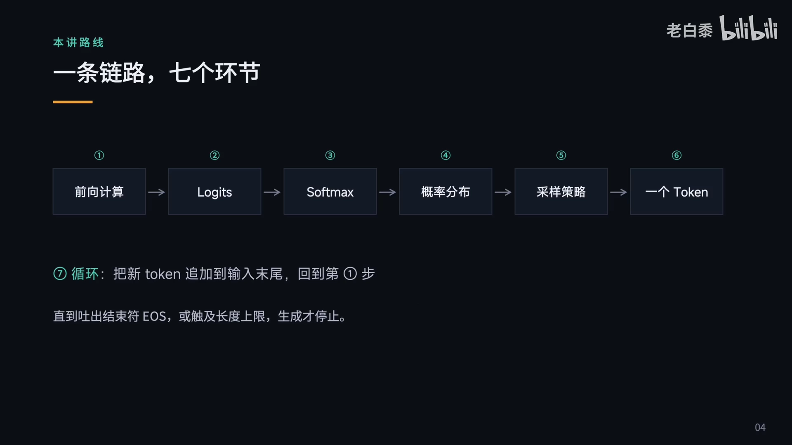
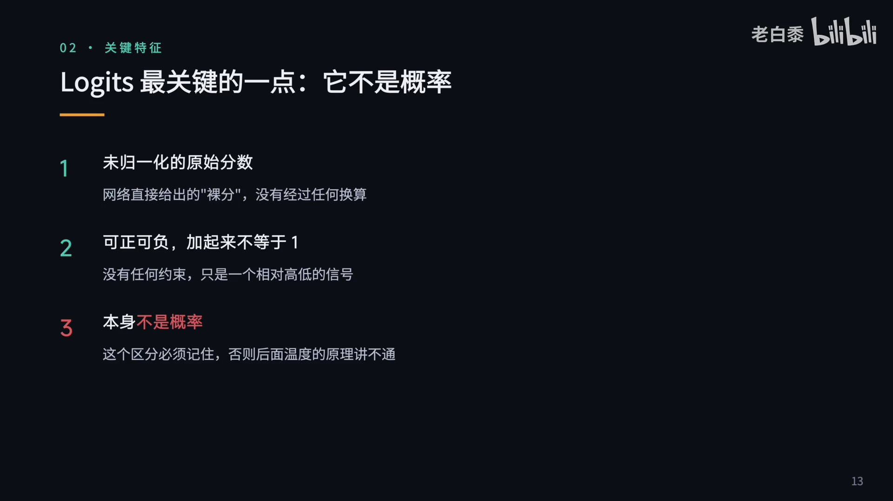
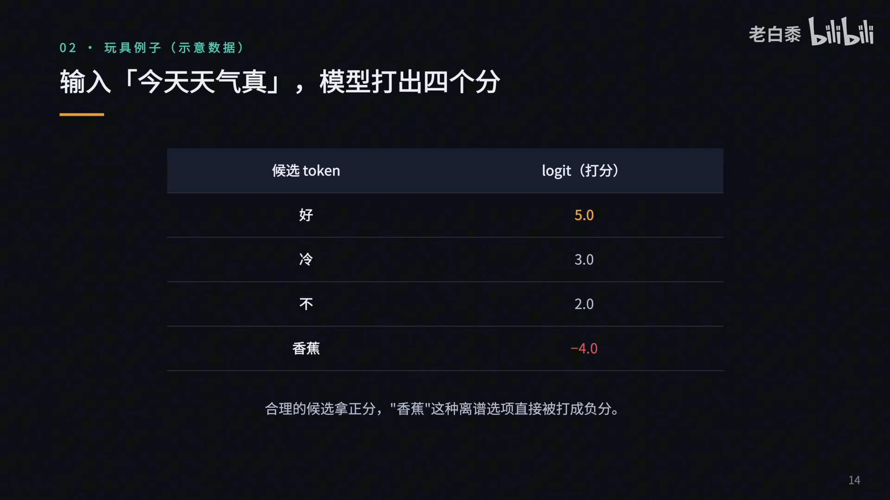
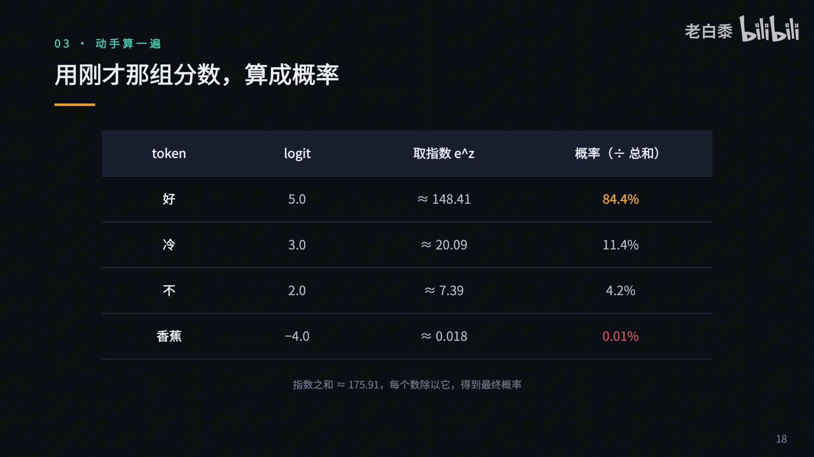
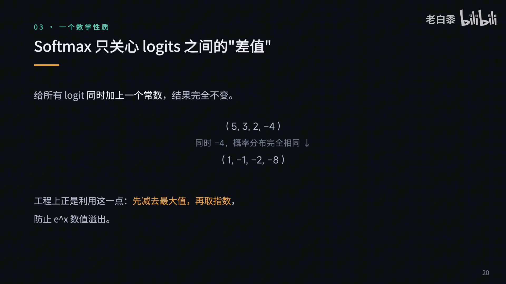
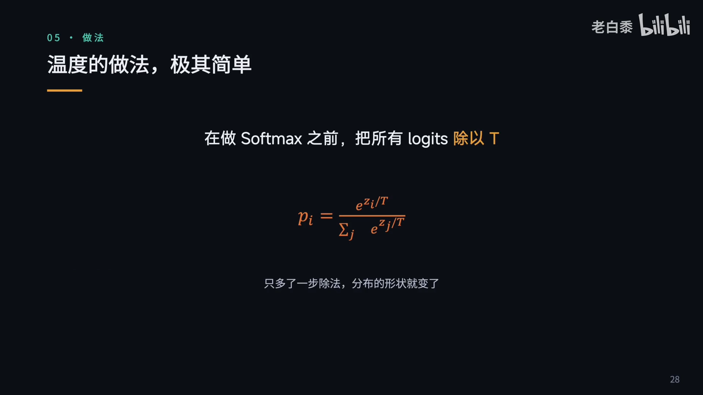
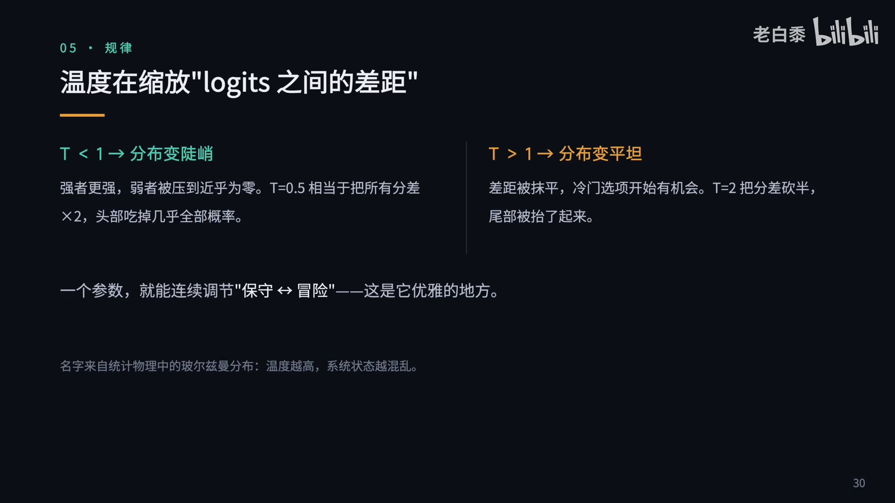
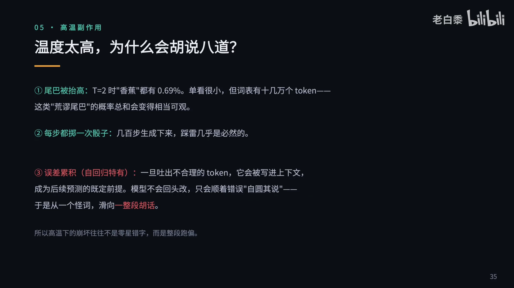

# Logits 不是概率：Softmax 与温度如何决定下一个 Token

> 视频来源：[大模型其实在掷骰子（上）：Logits、Softmax 与温度](https://www.bilibili.com/video/BV1XThS6zEoH/?t=0)（Bilibili · 老白泰）
> 本文基于视频演说图文稿整理，配图截自视频。

## 本讲要解决的核心问题（SCQA）

**背景**：向大模型提问，觉得答得不错，想再看一遍，于是刷新重发；结果它换了一套说法，再发一次又换一套。你什么设置都没有动，它自己就变了 [【跳转到 00:00】](https://www.bilibili.com/video/BV1XThS6zEoH/?t=0)。

**冲突**：这种"糊弄感"背后其实是三个现象叠在一起——同一个问题问两遍答案不一样；温度调高，它容易胡说八道，而且往往是从第三句开始你已经不知道它在聊什么；温度调低，它变成复读机，句式高度工整，你让它写广告文案，大部分开头都是"在这个快节奏的时代" [【跳转到 00:20】](https://www.bilibili.com/video/BV1XThS6zEoH/?t=20)。看起来是三个独立的问题，其实是**同一根链条上的三个位置**。

**疑问**：从"模型算完这一步"到"屏幕上多出一个字"，中间到底经过了什么？温度这只旋钮又拧在了链条的哪一段？

**回答（中心思想）**：**模型从头到尾没有"选中"任何一个字，它交出的只是一份覆盖整个词表的概率分布。** 把这串原始打分（logits）变成概率分布的是 softmax；决定最终吐出哪个 token 的是采样策略；而温度就是在 softmax 之前把所有 logits 除以 $T$——它不改变"谁高谁低"，只缩放"高多少"，从而连续调节"保守"与"冒险"。一句话概括这条链路的分工：**模型负责算数，采样策略负责做决策**。这也解释了为什么你在 API 里传几个参数就能改变输出风格，却完全不需要重新训练模型 [【跳转到 06:36】](https://www.bilibili.com/video/BV1XThS6zEoH/?t=396)。

---

## 一、一圈只产出一个 token：自回归是一条原地打转的环

大模型不是"想好一整段再说"，而是"边说边想" [【跳转到 00:40】](https://www.bilibili.com/video/BV1XThS6zEoH/?t=40)。人说话时脑子里多少还有个大概方向，模型的"边说边想"要更死板：**每吐出一个字，都要把前面说过的全部内容重读一遍，再决定下一个字**。

视频把整条链路画成七个环节 [【跳转到 00:58】](https://www.bilibili.com/video/BV1XThS6zEoH/?t=58)：

1. **前向计算**：把当前已有的全部文字送进网络算一遍；
2. **得到 logits**：网络输出一串打分；
3. **过 softmax**：把打分变成概率；
4. **概率分布**：一个长度等于词表、加起来等于 1 的向量；
5. **采样策略**：按这份分布决定到底挑哪个 token；
6. **得到一个 token**：这一步的全部产出；
7. **循环**：把新 token 追加到输入末尾，回到第 1 步。

注意第 7 步的措辞——**这不是流水线往前走，而是原地打转**，转一圈产出一个字 [【跳转到 00:58】](https://www.bilibili.com/video/BV1XThS6zEoH/?t=58)。什么时候停？两种情况：模型自己吐出一个特殊的结束符 **EOS**（end of sequence，"我讲完了"），或者撞上人为设定的长度上限被掐断 [【跳转到 01:18】](https://www.bilibili.com/video/BV1XThS6zEoH/?t=78)。

### 1.1 走一遍慢动作

输入"今天天气真"，第一轮输出一个"好"；第二轮它不是接着往下写，而是把"好"塞回输入里，变成"今天天气真好"，输出一个逗号；第三轮拿"今天天气真好，"再算一遍……如此循环 [【跳转到 01:48】](https://www.bilibili.com/video/BV1XThS6zEoH/?t=108)。所以**一段 500 字的回答不是算一次，而是算了大约 500 次**。

### 1.2 为什么非要这么设计

最根本的原因不在工程，而在**训练目标**：训练任务只有一句话——给定全文，猜下一个 token，就这样一件事做几万亿次，这叫**自监督学习**（self-supervised learning，监督信号直接从数据本身造出来，不需要人工贴标签）[【跳转到 02:13】](https://www.bilibili.com/video/BV1XThS6zEoH/?t=133)。这个任务美妙的地方在于不需要人工标注：互联网上任何一段话天然就是练习题，一篇新闻、一段代码、一条评论，随便掐一刀，前半段是题目、后半段就是答案。这意味着训练数据可以无限大——如果这个任务需要人工标注，那就不是烧钱的问题了，人类根本无法完成。

除了训练目标，还有两个工程上的理由 [【跳转到 02:42】](https://www.bilibili.com/video/BV1XThS6zEoH/?t=162)：

- **长度可变**：一个回答可能是 5 个 token，也可能是 5000 个 token。如果要求一次性输出整段，你就得事先确定长度和结构，模型第一步要先决定"我这次要说多少个字"然后严格填满，工程难度极高而且非常别扭。逐 token 生成天然支持任何长度，模型自行决定什么时候闭嘴。
- **计算可复用（KV Cache）**：前面已经处理过的 token，其中间结果可以缓存下来，生成第 $N$ 个 token 时不必把前 $N-1$ 个全部重算。前面说"每次都重读一遍"，严格讲是**逻辑上**重读一遍，工程上前面的账早就记下来了。

---

## 二、logits：模型的输出不是字，是一串裸分

一次前向计算的产物是什么？不是一个字，而是一个很长的实数向量，**长度等于词表的大小**。向量里每一个数对应词表里的一个 token 打分——这就是 **logits**（未归一化的原始打分）[【跳转到 03:22】](https://www.bilibili.com/video/BV1XThS6zEoH/?t=202)。Llama 3 的词表大约 12.8 万，GPT-4o 系列的分词器大约 20 万。也就是说，**它每决定一个字，都要给 20 万个候选每个都打一次分**，分数越高，说明模型越认为这个 token 该出现在下一个位置。

### 2.1 logits 的三个特征

视频强调 logits 有三个特征，其中第三条是理解全文的钥匙 [【跳转到 03:47】](https://www.bilibili.com/video/BV1XThS6zEoH/?t=227)：

1. **未归一化的原始分数**：它是网络直接给出的"裸分"，没有经过任何换算。
2. **可正可负，加起来也不等于 1**：它没有任何约束，只是一个相对的高低信号。
3. **它本身不是概率**：如果你以为 logits 就是概率，后面的温度原理就讲不通了。

用一句话记：**logits 是裸分，概率是加工品**。

### 2.2 一个四个候选的玩具例子

输入"今天天气真"，假设词表里只有四个候选，模型打出的分数是："好" $5.0$、"冷" $3.0$、"不" $2.0$、"香蕉" $-4.0$ [【跳转到 04:15】](https://www.bilibili.com/video/BV1XThS6zEoH/?t=255)。

| 候选 token | logit（打分） |
| --- | --- |
| 好 | 5.0 |
| 冷 | 3.0 |
| 不 | 2.0 |
| 香蕉 | -4.0 |

这个分布非常符合人的直觉：合理的候选拿正分，"好"和"冷"都说得过去；而"香蕉"拿了 $-4.0$——**模型不是忽略了香蕉，它是认真评估了香蕉，然后给了一个负分** [【跳转到 04:20】](https://www.bilibili.com/video/BV1XThS6zEoH/?t=260)。这一点很值得玩味：一个被"认真评估后否决"的选项，和根本没进入候选集的选项，含义完全不同。

---

## 三、为什么不直接输出概率：最后一层只是矩阵乘法

既然最终要概率，为什么网络不直接输出概率？因为**神经网络的最后一层就是一个线性层，说白了是一次矩阵乘法；矩阵乘法的自然输出就是无约束的实数**。如果强行要求网络直接吐出"非负且总和为 1"的数，会带来三个麻烦 [【跳转到 04:37】](https://www.bilibili.com/video/BV1XThS6zEoH/?t=277)：

1. **需要额外的结构化设计**：网络得在结构上就保证输出落在单纯形（各项非负、和为 1 的那个区域）里，而不是随便一个实数；
2. **梯度不好回传**：要保证和恒等于 1，就得引入归一化之类的耦合操作，反向传播时梯度会被搅在一起；
3. **数值容易溢出或者下溢**：把概率直接当网络输出，很容易撞上浮点数的边界。

所以更好的设计是**分工**：让网络自由打分，想给多少给多少，再用一个固定的、可微的数学函数把分数统一转成概率。这个函数就是 **softmax**。这个分工干净得多——网络只负责"怎么打分"，"怎么把分变成概率"由公式保证，永远成立 [【跳转到 04:57】](https://www.bilibili.com/video/BV1XThS6zEoH/?t=297)。

---

## 四、softmax 只做两件事：取指数、除以总和

softmax 的定义可以拆成两步 [【跳转到 05:02】](https://www.bilibili.com/video/BV1XThS6zEoH/?t=302)：

1. **取指数**：把每个 logit 变成 $\exp(\cdot)$，于是所有数都变成正数；
2. **除以总和**：让它们加起来等于 1。

写成公式，对第 $i$ 个候选（$z_i$ 是它对应的 logit）：

$$
p_i = \frac{e^{z_i}}{\sum_{j} e^{z_j}}
$$

拿上面那组分数算一遍 [【跳转到 05:07】](https://www.bilibili.com/video/BV1XThS6zEoH/?t=307)：

| token | logit | 取指数 $e^{z}$ | 概率（除以总和） |
| --- | --- | --- | --- |
| 好 | 5.0 | 约 148.41 | 84.4% |
| 冷 | 3.0 | 约 20.09 | 11.4% |
| 不 | 2.0 | 约 7.39 | 4.2% |
| 香蕉 | -4.0 | 约 0.018 | 0.01% |

指数之和约 175.91，每个数除以它，就得到最终概率："好"拿到 84.4%，"冷" 11.4%，"不" 4.2%，而原来的 $-4.0$ 变成约 0.01% [【跳转到 05:12】](https://www.bilibili.com/video/BV1XThS6zEoH/?t=312)。四个数加起来正好是 1，这就是一个合法的**概率分布**。

---

## 五、为什么必须取指数，而不是直接各项除以总和

有人会问：既然最后都是"除以总和"，直接各项除以总和不行吗？视频给了两个原因 [【跳转到 05:26】](https://www.bilibili.com/video/BV1XThS6zEoH/?t=326)：

**第一，logits 里有负数。** 直接除，"香蕉"就会算出一个负概率——这在数学上没有意义，在表达上也很难解释。取指数保证一切为正：$e^{z} > 0$ 对任何实数 $z$ 都成立，负分只会变得更接近 0，不会变成负数。

**第二，指数会放大差距。** "好"和"冷"的 logit 只差两分（5 和 3），看起来差不多，但换算成概率差了七倍多（84.4% 对 11.4%）。这正是我们想要的：**模型更中意的候选，就应该拿到压倒性的份额，而不是跟其他选项平分秋色**。

这里的直觉值得停一下：如果只是线性地除以总和，$5:3:2$ 的比例会原样保留，模型的态度会显得很"温吞"；取指数相当于把这个差距按指数放大，于是"稍微更可能"和"几乎必然"被区分开了。后面讲温度时你会看到，温度干的正是**往反方向拉**这件事——它把 logits 先缩小再取指数，差距就被抹平了。

---

## 六、平移不变性：数学上等价，工程上救命

softmax 还有一个性质：**它只关心 logits 之间的差值**。给所有 logit 同时加上一个常数，结果完全不变 [【跳转到 05:46】](https://www.bilibili.com/video/BV1XThS6zEoH/?t=346)。比如原来是 $5, 3, 2, -4$，全部减 4，变成 $1, -1, -2, -8$，算出的概率分布还是一模一样。

推导一下就很清楚：设给每个 $z_i$ 都加上常数 $c$，分子分母同时多出一个 $e^{c}$，约掉即可：

$$
p_i = \frac{e^{z_i + c}}{\sum_j e^{z_j + c}} = \frac{e^{c} \cdot e^{z_i}}{e^{c} \cdot \sum_j e^{z_j}} = \frac{e^{z_i}}{\sum_j e^{z_j}}
$$

工程上正是利用这一点：**先减去最大值，再取指数** [【跳转到 05:56】](https://www.bilibili.com/video/BV1XThS6zEoH/?t=356)。为什么？因为 $e^{x}$ 长得太快了。如果某个 logit 是 800，$e^{800}$ 直接把浮点数打爆；先减掉最大值，所有数都变成 0 或者负指数，结果都落在 0 到 1 之间，安全落地。这就是那种典型的"数学上等价、工程上救命"的技巧——公式一行没改，实现上必须这么写。

---

## 七、模型交出的只是一份意见书：概率分布与采样决策分工

到了这一步，模型的工作基本结束。它交付的产品是什么？**一个覆盖了整个词表的概率分布，20 万个数加起来等于一，仅此而已。它没有选中任何一个字，它只是给出了一份意见书** [【跳转到 06:36】](https://www.bilibili.com/video/BV1XThS6zEoH/?t=396)。

这个分工是理解后面所有内容的钥匙：

- **模型负责**：算出概率分布，这需要参数参与，也是训练学到的东西；
- **采样策略负责**：决定"到底挑哪个 token"，这是推理阶段的外部逻辑，跟模型参数没有关系。

所以 API 里传几个参数就能改变风格，却完全不需要重新训练模型。下面按"从最保守到最冒险"的顺序看这条决策链路上的几个位置。

### 7.1 贪心解码：每一步都选概率最高的那个

最实在的策略（也是最容易犯傻的策略）规则就一句话：**每一步都选择概率最高的那个值** [【跳转到 07:06】](https://www.bilibili.com/video/BV1XThS6zEoH/?t=426)。在刚才的例子里，它永远选"好"，问 1 万次，1 万次都是"好"。

那为什么还需要它？三个字：**简单、快、可复现**。尤其是"可复现"，在工程上非常重要。哪些任务需要它？机器翻译、信息抽取、代码补全、结构化输出（JSON）——这类任务有个共同特点，就是**有标准答案**，它不希望模型发挥创造力，它希望模型每次给出一个稳定的输出 [【跳转到 07:11】](https://www.bilibili.com/video/BV1XThS6zEoH/?t=431)。想象一下，你写了一个程序解析模型返回的 JSON，第一次返回"张三"，第二次返回别的值，这条流水线就崩了。

但贪心有两个明显的毛病。

**问题一：局部最优不等于全局最优。** 每一步都选当前最优，并不保证整句话的**联合概率**（整句作为一个整体出现的概率）最高 [【跳转到 07:31】](https://www.bilibili.com/video/BV1XThS6zEoH/?t=451)。就像下棋只看下一步，每一步都在吃子，但很快可能发现自己被将军了。有时候第一个词选得稍微次一点，后面能接出一句更顺的话，而贪心看不到那么远，它只认眼前那一分。专门解决这个问题的方法叫 **Beam Search**（束搜索）：不止留一条路，同时保留多条候选路径，走完之后回头看哪一条整体比较好 [【跳转到 08:03】](https://www.bilibili.com/video/BV1XThS6zEoH/?t=483)。视频的比喻是：不着急下结论，先同时活成五个版本的自己，最后挑一个最像样的交出去。

**问题二：退化。** 在开放式的写作任务上，贪心和 Beam Search 非常容易让模型陷入死循环，反复输出同一句话 [【跳转到 08:19】](https://www.bilibili.com/video/BV1XThS6zEoH/?t=499)。原因很简单也很深刻：**真实的人类语言充满了意外**。人说话时下一个词并不总是概率最高的那一个，人会拐弯，会突然插入一句别的话；而贪心输出的永远是概率最高的那个。人类语言本身的概率曲线是起起伏伏的，如果永远输出最高概率的内容，读起来就非常乏味、套路，而且容易在原地打转。

于是就有了那个看起来反直觉的结论：**每次回答都不一样，这不是缺陷，而是有意为之的设计**。我们主动引入随机性，不是因为技术做不到确定，而是因为纯粹的确定读起来不像人话 [【跳转到 08:50】](https://www.bilibili.com/video/BV1XThS6zEoH/?t=530)。

---

## 八、温度：在 softmax 之前把 logits 除以 T

引入随机性的办法之一，就是让采样按概率分布掷骰子；而控制"这颗粒子掷得多大胆"的旋钮，就是**温度（temperature）**。

温度的做法极其简单：**在做 softmax 之前，把所有 logits 除以 $T$** [【跳转到 09:00】](https://www.bilibili.com/video/BV1XThS6zEoH/?t=540)。

$$
p_i = \frac{e^{z_i / T}}{\sum_j e^{z_j / T}}
$$

注意它作用的位置：**在 softmax 之前**。这就是为什么前面反复强调"logits 不是概率"——如果 logits 已经是概率，你就没法再"除以 $T$ 再取指数"了，整个温度的机制都无从谈起。

### 8.1 温度在缩放 logits 之间的差距

同一组 logits，在不同温度下得到的概率分布是不一致的 [【跳转到 09:05】](https://www.bilibili.com/video/BV1XThS6zEoH/?t=545)：

- **$T < 1$，分布变陡峭**：相当于把所有分差放大，强者更强，弱者被压到近乎为零。比如 $T = 0.5$ 相当于把分差乘 2，头部选项吃掉几乎全部概率。
- **$T > 1$，分布变平坦**：差距被抹平，冷门选项开始有机会。比如 $T = 2$ 把分差砍半，尾部被抬了起来。

用一个参数就能**连续**调节"保守"和"冒险"，没有分档、没有模型切换，就是一个简单的连续旋钮——这是它优雅的地方。它的名字来自统计物理里的玻尔兹曼分布：温度越高，系统状态越混乱。

如果把这个旋钮拧到头，会发生什么 [【跳转到 09:17】](https://www.bilibili.com/video/BV1XThS6zEoH/?t=557)？

- **温度趋于 0**：等价于贪心算法，最高分的概率趋近 100%，其他全部压成零；
- **温度趋于无穷**：纯粹瞎蒙，所有 token 的概率都趋于相等，选谁全靠运气。

---

## 九、温度的最大值是 1 吗？不是，1 只是基准点

这是高频疑问 [【跳转到 09:37】](https://www.bilibili.com/video/BV1XThS6zEoH/?t=577)：**不是，数学上没有上限。$T = 1$ 只是模型原本的分布，这是个基准点，它是原点，不是天花板。**

但各家平台开放的口子不一样 [【跳转到 09:48】](https://www.bilibili.com/video/BV1XThS6zEoH/?t=588)：

| 平台 | 允许范围 | 默认值 |
| --- | --- | --- |
| OpenAI | 0 ~ 2 | 1 |
| Google Gemini | 0 ~ 2（部分旧模型上限为 1） | 1 |
| Anthropic Claude | 0 ~ 1 | 1 |
| 开源框架（如 vLLM） | 无硬上限 | 通常 1 |

差异纯粹是产品设计的选择，不是谁对谁错：放宽到 2 的一派，把旋钮完全交给开发者，你自己负责；限制到 1 的一派认为，超过 1 之后质量下降很快，与其让用户踩坑，不如直接封掉。两种思路都成立。

### 9.1 一个容易混淆的点：T 是除数，不是概率

温度 $T$ 是一个除数，数学上可以无限大；而 Top-P 是累计概率阈值，概率总和最多是 1，所以它的上限是 1 [【跳转到 10:37】](https://www.bilibili.com/video/BV1XThS6zEoH/?t=637)。一个是除数，可以无限大；一个是概率，天然封顶。所以"最大值是 1"这句话套用在 Top-P 上是对的，套在温度上是错的。

### 9.2 一个值得注意的趋势：越强的推理模型越不让你动它

越强大的推理模型，越倾向于不要修改温度 [【跳转到 10:17】](https://www.bilibili.com/video/BV1XThS6zEoH/?t=617)。为什么？因为**长推理链对采样扰动更加敏感**。想象一条几千个 token 的思考链，一步一步推理下来，如果在其中某一步采样走偏了，后面的几百步都会沿着这个偏差层层放大；它不会回头检查，而是顺着错误认真推理到底，最后给出一个逻辑严明、但前提错误的答案。

---

## 十、温度太高与太低，各自付出什么代价

### 10.1 温度太高为什么会胡说八道

视频给了三条原因 [【跳转到 10:58】](https://www.bilibili.com/video/BV1XThS6zEoH/?t=658)：

1. **长尾被抬高。** 回到前面的例子，$T = 2$ 时"香蕉"的概率为 0.69%。单看这个数字觉得很小，但别忘了词表有十几万个 token，每个荒谬的选项都被抬升了几十倍，这类荒谬长尾的概率总和就变得相当可观。
2. **每一步都是掷骰子。** 单步踩雷的概率再低，几百步生存下来，踩雷几乎是必然的。这就像买彩票，中奖概率很低，但只要买得足够多。
3. **误差累计，这是自回归特有的。** 一旦吐出一个不合理的 token，它被写进上下文里，就会成为后续预测的既定前提；模型不会回头改，只会顺着这个错误自圆其说。

所以温度过高时，往往不是零星的错字，而是整段跑偏了——**模型不是打错字，而是接受了一个荒谬的设定，然后极其负责地把这个设定演完** [【跳转到 11:38】](https://www.bilibili.com/video/BV1XThS6zEoH/?t=698)。

### 10.2 温度太低为什么像机器人

反过来，温度太低之所以像机器人，是因为它**退化成了贪心解码，继承了贪心的全部毛病**：句式套路化、用词平庸、爱重复 [【跳转到 11:58】](https://www.bilibili.com/video/BV1XThS6zEoH/?t=718)。它总是选择最安全的那个词，而人类语言的味道，恰恰来自那些不那么安全的选择。**温度低的模型不是不会写，是它不敢写**：每一步都选择那个不会出错的词，结果写出来的东西都是重复的套话。

---

## 小结

- 自回归生成是一条**原地打转**的环：前向计算 → logits → softmax → 概率分布 → 采样 → 一个 token → 追加回输入再算一遍；一段 500 字的回答是算了约 500 次。
- **logits 不是概率**：它是网络最后一层（一次矩阵乘法）给出的裸分，长度等于词表大小、可正可负、加起来不为 1。让网络直接输出概率会带来结构约束、梯度与数值三方面的麻烦。
- **softmax 只做两件事**：取指数把所有数变成正数，再除以总和让它们加起来等于 1。取指数不只是为了消负数，更是为了放大差距，让更中意的候选拿到压倒性份额。
- **softmax 只看差值**：整体加常数结果不变；工程上据此先减最大值，避免 $e^{x}$ 溢出——数学等价、工程致命。
- **模型与采样策略分工**：模型交付一份覆盖整个词表的概率分布（意见书），挑哪个 token 是推理阶段的外部逻辑，所以调 API 参数不需要重训模型。
- **贪心可复现但会退化**：局部最优不等于全局最优（Beam Search 治这个），而"永远选最高概率"会让文本乏味、打转；随机采样是有意为之的设计。
- **温度就是在 softmax 之前除以 $T$**：$T<1$ 分布陡峭、保守；$T>1$ 分布平坦、冒险；$T \to 0$ 退化为贪心，$T \to \infty$ 变成均匀乱选。
- **1 不是温度的天花板**，只是模型原本分布的基准点；T 是除数可以无限大，Top-P 才是那个上限为 1 的东西。长推理链对采样扰动敏感，所以强推理模型往往建议别动温度。

---

## 关键术语速查

| 术语 | 一句话解释 |
| --- | --- |
| token | 模型处理与生成的最小单位，可以是一个字、一个词或一个词片段 |
| 自回归（autoregressive） | 用已生成的全部内容预测下一个 token，再把结果追加回输入继续预测 |
| logits | 前向计算输出的、长度等于词表大小的原始打分向量，未归一化、可正可负 |
| softmax | 先取指数再除以总和，把任意实数打分变成和为 1 的概率分布 |
| 概率分布 | 覆盖整个词表、每项非负且总和为 1 的向量，模型这一步的唯一产出 |
| 采样策略 | 按概率分布决定挑哪个 token 的推理阶段逻辑，如贪心、Beam Search、随机采样 |
| 贪心解码（greedy） | 每步都取概率最高的 token；简单、快、可复现，但会套路化与死循环 |
| Beam Search | 同时保留多条候选路径，走完再比较整体优劣，缓解局部最优问题 |
| 温度（temperature） | 在 softmax 之前把 logits 除以 T，缩放 logits 之间的差距以调节分布的陡峭程度 |
| Top-P | 按累计概率截断候选集合的采样参数，上限天然是 1 |
| EOS | 结束符（end of sequence），模型用它表示"我说完了" |
| KV Cache | 缓存已处理 token 的中间结果，避免每步重算前面的内容 |

