# Logits 不是概率：Softmax 与温度如何决定下一个 Token


## 本讲要解决的核心问题（SCQA）

**背景**：大模型一次只生成一个 token。每前向一次，它读入当前已有的全部文字——你的提问加上它自己刚写出的部分——然后输出一个覆盖整个词表的分数向量，也就是 **logits**（[【跳转到 00:58】](https://www.bilibili.com/video/BV1XThS6zEoH/?t=58)）。

**冲突**：这些分数有正有负，加起来也不等于 1，看起来完全不像概率；可只要动一下 API 里的 **temperature**，同一个模型就会从"复读机"变成"胡说八道"，却不需要重新训练（[【跳转到 00:20】](https://www.bilibili.com/video/BV1XThS6zEoH/?t=20)）。更让人困惑的是：同一个问题问两遍，答案为什么可以不一样？

**疑问**：最后一层到底算出了什么？这些裸分怎样变成概率？温度是在哪一步、对什么做除法？为什么它既能"只改风格"又能把整段话带偏？它和训练时的交叉熵、困惑度又是什么关系？

**回答（中心思想）**：**logits 是模型对词表中每个 token 的未归一化打分，softmax 把它变成一张总和为 1 的概率分布；温度只是在 softmax 之前把 logits 统一除以 $T$，因此只改变分布的"陡峭程度"，不改变大小排序。** 模型的工作到"交出分布"就结束了，真正挑出哪个 token 的是采样器（Greedy、Top-K、Top-P 等，见同目录的 1.1.4）。训练时用的交叉熵，正是衡量这张分布与真实下一个 token 差距的损失函数。

---

## 一、先看整条链路：模型一次只产出一个 token

把一次生成拆开，是一条固定的七步链路：**前向计算 → 得到 logits → softmax 变成概率分布 → 采样策略挑出一个 token → 把这个 token 追加到输入末尾 → 回到第一步重跑**。停止条件只有两个：模型自己吐出结束符 EOS，或者撞上人为设定的长度上限（[【跳转到 00:58】](https://www.bilibili.com/video/BV1XThS6zEoH/?t=58)）。

注意"重跑"的含义：它不是流水线一直往前走，而是**在原地打转**——每一步都拿"原文 + 已生成内容"重新前向一次，转一圈只产出一个字（[【跳转到 00:58】](https://www.bilibili.com/video/BV1XThS6zEoH/?t=58)）。所以一段 500 字的回答，不是算一次，而是大约算了 500 次（[【跳转到 02:08】](https://www.bilibili.com/video/BV1XThS6zEoH/?t=128)）。

这么设计不是为了折磨 GPU，根子在训练目标：训练任务只有一句话——**给定全文，猜下一个 token**。把这件事做几万亿次，就是自监督学习；互联网上的任意一段话天然就是练习题，前半段是题目、后半段是答案，因此不需要人工标注，数据可以无限大（[【跳转到 02:13】](https://www.bilibili.com/video/BV1XThS6zEoH/?t=133)）。工程上还有两个附带好处：逐 token 生成天然支持任意长度，模型自己决定什么时候停；已经处理过的 token 可以用 KV Cache 缓存，生成第 N 个 token 时不必把前 N−1 个全部重算（[【跳转到 02:42】](https://www.bilibili.com/video/BV1XThS6zEoH/?t=162)）。

> 自回归的链式分解、Teacher Forcing 与 KV Cache 的细节，[1.1.1](../1.1.1_条件概率链式法则与Next-Token_Prediction/从Next_Token_Prediction到LoRA：自回归模型与Transformer原理详解.md) 与后续章节已分别展开；这里只需要记住：**每一轮前向的终点，都是一个长度为词表大小的打分向量。**

---

## 二、Logits：词表长度的一排"裸分"

### 2.1 最后一层输出的是向量，不是字

生成下一个 token 时，我们只关心序列的最后一个位置：它输出的不是一个字，而是一个很长的实数向量，**长度等于词表大小**。向量里的每一个数，对应词表中一个 token 的得分，这就是 logits（[【跳转到 03:22】](https://www.bilibili.com/video/BV1XThS6zEoH/?t=202)）。以课程给出的量级为例：Llama 3 的词表约 12.8 万，GPT-4o 系列的分词器约 20 万——也就是说，模型每决定一个字，都要给 20 万个候选各打一次分（[【跳转到 03:27】](https://www.bilibili.com/video/BV1XThS6zEoH/?t=207)）。

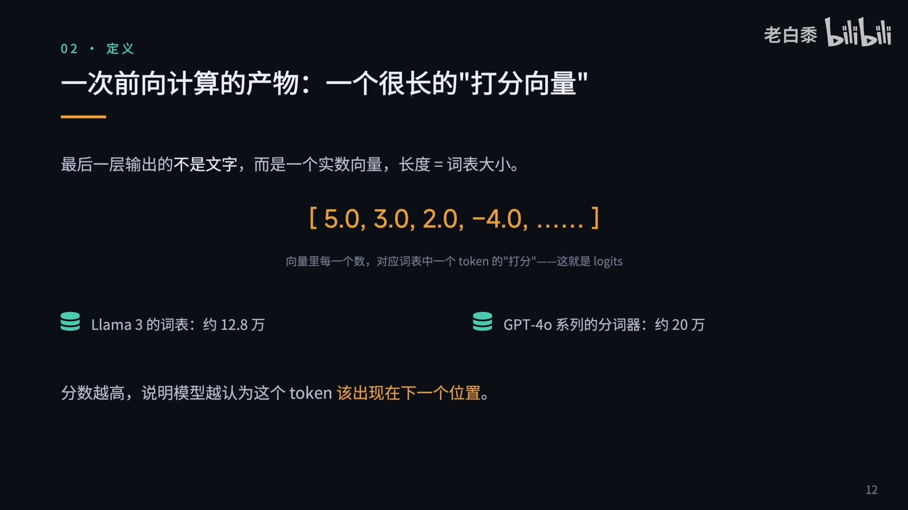

> **补充（非讲者原话）**：实现上，这一步通常是一个名为 **lm_head** 的线性层，把最后一层的隐藏向量（维度为 $d$）投影到词表维度 $\lvert V \rvert$；部分模型会让 **lm_head** 与输入 embedding 共享同一份权重（weight tying），以减少参数量。它不改变本文的结论：输出仍是未归一化的实数分数。

### 2.2 三个性质：未归一化、可正可负、不是概率

Logits 有三个必须记住的特征（[【跳转到 03:47】](https://www.bilibili.com/video/BV1XThS6zEoH/?t=227)）：

1. **它是未归一化的原始分数**——网络直接给出的"裸分"，没有经过任何换算；
2. **它可正可负，加起来也不一定等于 1**——没有任何约束，只是一个相对的高低信号；
3. **它本身不是概率**——如果把 logits 当成概率，后面的温度原理就讲不通：logits 是裸分，概率是加工品。

课程用一个玩具例子说明"负分"的含义：输入"今天天气真"，模型给"好"打 5.0、"冷"打 3.0、"不"打 2.0、"香蕉"打 −4.0（[【跳转到 04:15】](https://www.bilibili.com/video/BV1XThS6zEoH/?t=255)）。

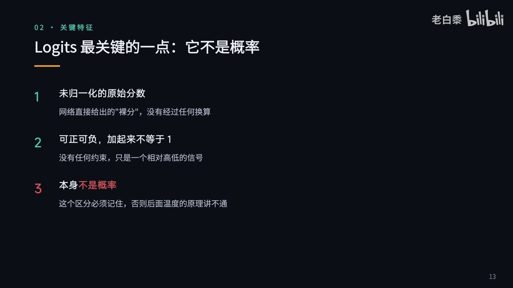

看到这个分布，会觉得非常符合直觉：合理的候选拿正分，"好"和"冷"还说得过去；而"香蕉"拿 −4.0，**并不是模型忽略了香蕉，而是它认真评估过香蕉，然后给了它一个负分**（[【跳转到 04:20】](https://www.bilibili.com/video/BV1XThS6zEoH/?t=260)）。分数低只表示"相对更不可能"，不表示"没有被考虑"。

### 2.3 为什么不让网络直接输出概率

既然最后要的是概率，为什么网络不直接吐出一组非负、且总和为 1 的数？因为**神经网络的最后一层就是一个线性层，说白了就是一次矩阵乘法**，而矩阵乘法的自然输出就是无约束的实数（[【跳转到 04:37】](https://www.bilibili.com/video/BV1XThS6zEoH/?t=277)）。

如果强行要求网络直接输出"非负且总和为 1"的数，会带来三个麻烦（[【跳转到 04:37】](https://www.bilibili.com/video/BV1XThS6zEoH/?t=277)）：

- 需要额外的结构约束，网络不再是"想给多少给多少"；
- 梯度不好回传；
- 数值容易溢出或下溢。

所以更干净的分工是：**让网络自由打分，再用一个固定的、可微的数学函数把分数统一转成概率**。这个函数就是 softmax（[【跳转到 04:57】](https://www.bilibili.com/video/BV1XThS6zEoH/?t=297)）。

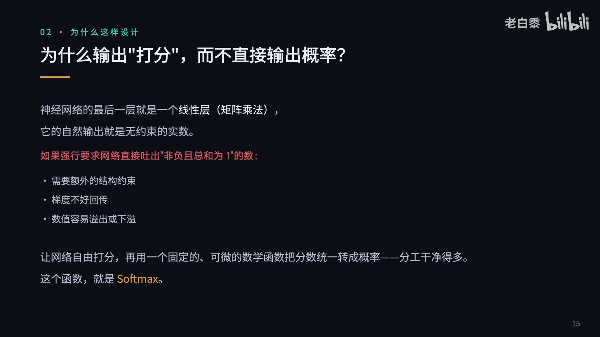

---

## 三、Softmax：两步把裸分变成概率

### 3.1 定义：先取指数，再除以总和

Softmax 只做两件事（[【跳转到 05:02】](https://www.bilibili.com/video/BV1XThS6zEoH/?t=302)）：

1. **取指数**：把所有数变成正数；
2. **除以总和**：让它们加起来等于 1。

写成公式，对第 $i$ 个候选 token：

$$
p_i = \mathrm{softmax}\left(\mathbf{z}\right)_i = \frac{\exp\left(z_i\right)}{\sum_{j=1}^{\lvert V \rvert} \exp\left(z_j\right)}
$$

其中 $\mathbf{z}$ 是长度为词表大小的 logits 向量，$V$ 是词表。

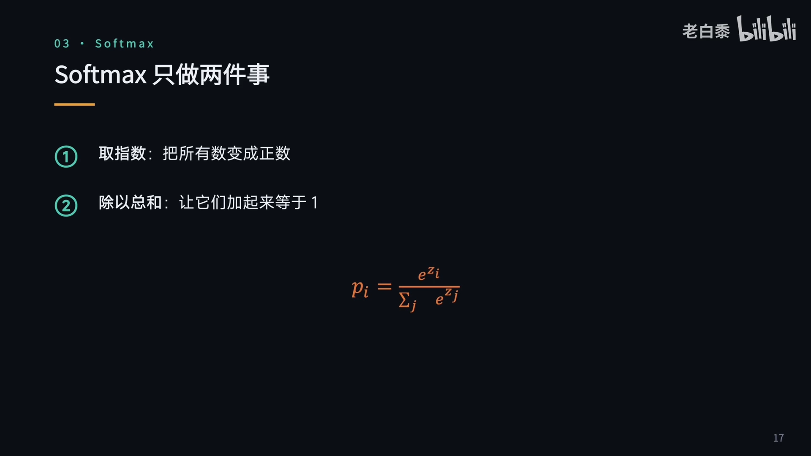

用刚才那组分数手算一遍，就能看到每个数怎样落到概率上（[【跳转到 05:12】](https://www.bilibili.com/video/BV1XThS6zEoH/?t=312)）：

| 候选 token | logit | 取指数后 | 概率（除以总和） |
| --- | --- | --- | --- |
| 好 | 5.0 | ≈ 148.41 | 84.4% |
| 冷 | 3.0 | ≈ 20.09 | 11.4% |
| 不 | 2.0 | ≈ 7.39 | 4.2% |
| 香蕉 | −4.0 | ≈ 0.018 | 0.01% |

指数之和约为 175.91，每个数除以它，就得到最终概率（[【跳转到 05:12】](https://www.bilibili.com/video/BV1XThS6zEoH/?t=312)）。四个概率相加恰好为 1——这就是一张合法的分布。

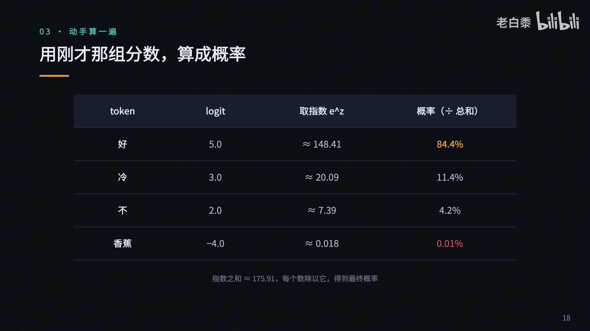

### 3.2 为什么必须取指数

有人会问：为什么不直接"各项除以总和"？课程给了两个原因（[【跳转到 05:26】](https://www.bilibili.com/video/BV1XThS6zEoH/?t=326)）：

**第一，logits 里有负数。** 直接除以总和，"香蕉"就会算出一个负概率；负概率在数学上没有意义，在表达上也很难解释。取指数保证一切为正。

**第二，指数能够放大差距。** "好"和"冷"的 logit 只差 2 分，看起来差不多；但换算成概率，84.4% 对 11.4%，差了七倍多（[【跳转到 05:46】](https://www.bilibili.com/video/BV1XThS6zEoH/?t=346)）。这正是我们想要的：模型明显更中意的候选，就应该拿到压倒性的份额，而不是跟其他选项平分秋色。

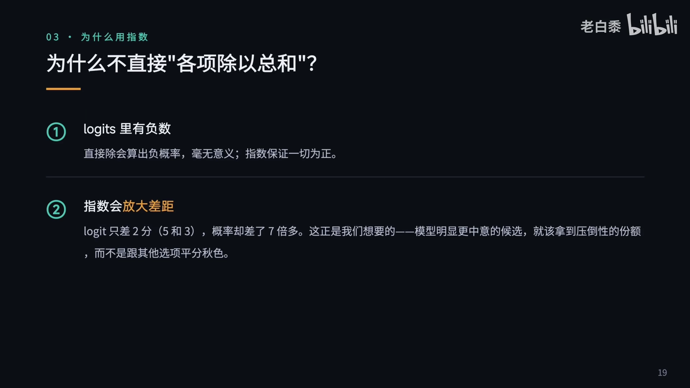

从数学上看，这个"放大"来自 softmax 的一个基本性质：任意两个候选的概率之比，只取决于它们的 logit 之差。

$$
\frac{p_i}{p_j} = \frac{\exp\left(z_i\right)}{\exp\left(z_j\right)} = \exp\left(z_i - z_j\right)
$$

差值越大，指数把比值拉得越开；差值为 0 时两者概率相等。这也解释了为什么 logits 的**绝对大小**不重要，重要的是彼此之间的差。

### 3.3 数值稳定：减掉最大值，结果不变

Softmax 还有一个关键性质：**它只关心 logits 之间的差值**。给所有 logit 同时加上一个常数，结果完全不变（[【跳转到 05:56】](https://www.bilibili.com/video/BV1XThS6zEoH/?t=356)）：

$$
\mathrm{softmax}\left(\mathbf{z} + c\mathbf{1}\right) = \mathrm{softmax}\left(\mathbf{z}\right)
$$

以示例分数为例：原来是 5、3、2、−4，全部减 4，变成 1、−1、−2、−8，算出的概率分布还是一模一样（[【跳转到 05:56】](https://www.bilibili.com/video/BV1XThS6zEoH/?t=356)）。

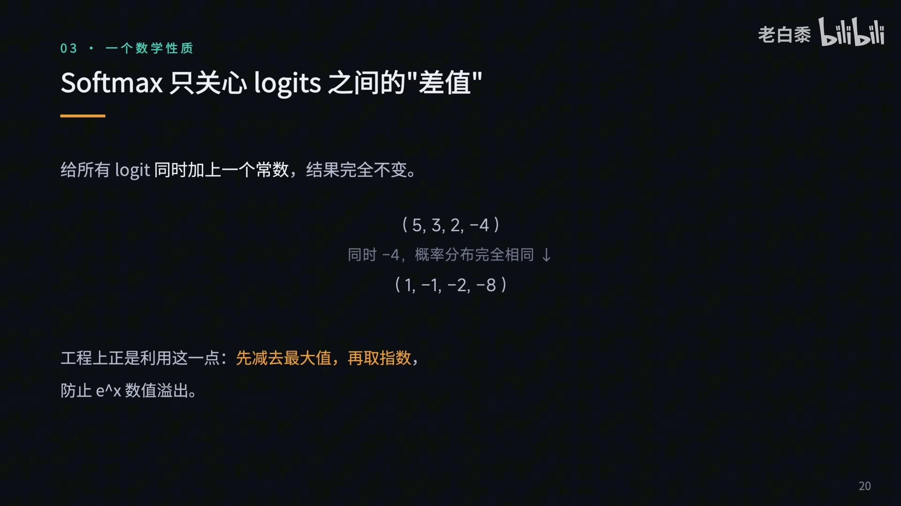

工程上正是利用这一点：**先减去最大值，再取指数**。原因很直接——$e^x$ 长得太快，如果某个 logit 是 800，$e^{800}$ 会直接把浮点数打爆；先减掉最大值，所有数都变成 0 或负数，指数结果落在 0 到 1 之间，安全落地（[【跳转到 06:16】](https://www.bilibili.com/video/BV1XThS6zEoH/?t=376)）。课程把这称为"数学上等价、工程上救命"的典型技巧。

写成稳定版公式，其中 $m$ 是 logits 的最大值：

$$
p_i = \frac{\exp\left(z_i - m\right)}{\sum_j \exp\left(z_j - m\right)}, \qquad m = \max_j z_j
$$

> **补充（非讲者原话）**：PyTorch 风格的实现通常就是下面这几行；**temperature** 的除法放在减最大值之前，两者顺序可以交换，但先除再减更直观。
>
> ```python
> import torch
>
> def softmax_with_temperature(logits: torch.Tensor, temperature: float = 1.0) -> torch.Tensor:
>     z = logits / temperature
>     z = z - z.max(dim=-1, keepdim=True).values   # 减最大值，防 exp 溢出
>     e = torch.exp(z)
>     return e / e.sum(dim=-1, keepdim=True)
> ```
>
> 另外，因果掩码或约束解码会在 softmax 之前把不允许的位置设成 $-\infty$，指数化后自然变成 0；这部分属于 1.1.2 与 12.4 的内容，本文不展开。

---

## 四、模型交出的只是一份"意见书"

到这一步，模型的工作基本结束。它交付的产品是：**一个覆盖整个词表的概率分布，20 万个数加起来等于 1**。仅此而已——它没有选中任何一个字，只是给出了一份意见书（[【跳转到 06:36】](https://www.bilibili.com/video/BV1XThS6zEoH/?t=396)）。

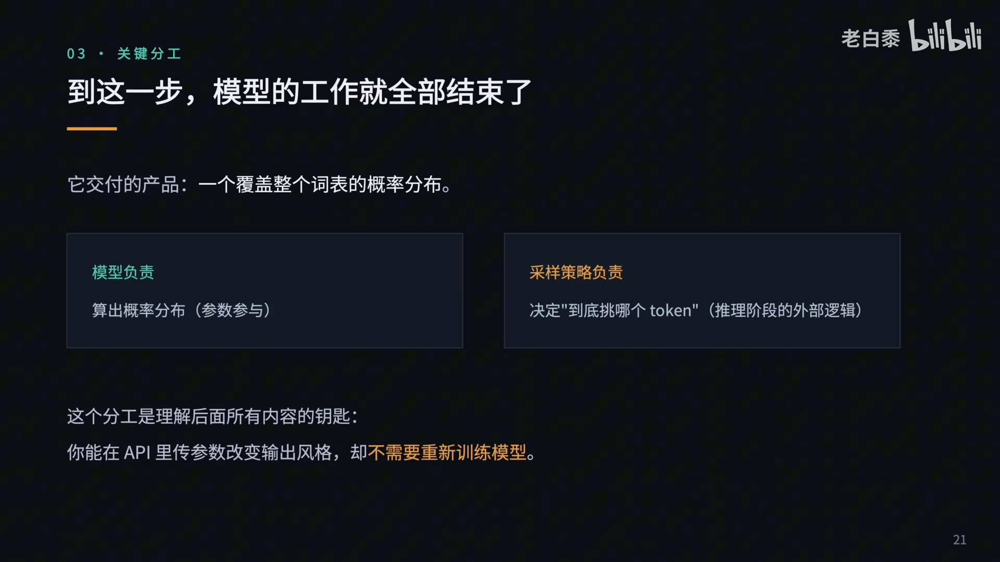

接下来到底挑出哪个 token，是**采样策略**的事情。那是推理阶段的外部逻辑，跟模型参数没有关系：模型负责算数，采样策略负责做决策（[【跳转到 06:56】](https://www.bilibili.com/video/BV1XThS6zEoH/?t=416)）。这个分工解释了一件很重要的事：**你在 API 里传几个参数就能改变输出风格，却完全不需要重新训练模型。**

这也回答了开头的疑问：同一个问题问两遍，答案不一样，不是模型"糊弄"，而是分布之后的采样环节引入了随机性。课程在 7:05–8:50 用贪心解码（[【跳转到 07:05】](https://www.bilibili.com/video/BV1XThS6zEoH/?t=425)）与 Beam Search 说明"永远选最高概率"的两个毛病——局部最优不等于全局最优、以及开放式写作中的退化复读——并由此引出"主动引入随机性"的设计。Greedy、Beam Search、Top-K、Top-P 的定义、代价与适用场景属于同目录的 [解码采样策略：Greedy Search、Top-K、Top-P 与重复惩罚](../1.1.4_解码采样策略/解码采样策略：Greedy_Search、Top-K、Top-P与重复惩罚.md)，本文只把 softmax 之后的这一棒交出去，不再展开。

---

## 五、温度：softmax 之前多除一步

### 5.1 定义：把 logits 统一除以 T

温度的做法极其简单：**在做 softmax 之前，把所有的 logits 除以 $T$**（[【跳转到 09:00】](https://www.bilibili.com/video/BV1XThS6zEoH/?t=540)）。于是第 $i$ 个候选的概率变成

$$
p_i\left(T\right) = \frac{\exp\left(z_i / T\right)}{\sum_{j=1}^{\lvert V \rvert} \exp\left(z_j / T\right)}
$$

只多了一步除法，分布的形状就变了（[【跳转到 09:00】](https://www.bilibili.com/video/BV1XThS6zEoH/?t=540)）。$T=1$ 时公式退化为普通 softmax，得到模型原本的分布；$T$ 越小，分布越尖；$T$ 越大，分布越平。


$T=0$ 在实现上是一个要特判的边界：除以 0 会出错，所以各家框架都直接把它当成取 argmax（[【跳转到 09:37】](https://www.bilibili.com/video/BV1XThS6zEoH/?t=577)）。

### 5.2 效果：只缩放差距，不改变排序

课程把温度的作用概括成一句话：**温度在缩放 logits 之间的差距**（[【跳转到 09:05】](https://www.bilibili.com/video/BV1XThS6zEoH/?t=545)）。

- **$T<1$：分布变陡峭。** 强者更强，弱者被压到近乎为零。$T=0.5$ 相当于把所有分差乘以 2，头部吃掉几乎全部概率（[【跳转到 09:17】](https://www.bilibili.com/video/BV1XThS6zEoH/?t=557)）。
- **$T>1$：分布变平坦。** 差距被抹平，冷门选项开始有机会。$T=2$ 把分差砍半，尾部被抬了起来（[【跳转到 09:17】](https://www.bilibili.com/video/BV1XThS6zEoH/?t=557)）。
- **$T=1$：原样输出。** 不做任何缩放，这就是模型训练时学到的分布。

从公式可以直接看出：对于任意 $T>0$，任意两个候选的概率之比是

$$
\frac{p_i\left(T\right)}{p_j\left(T\right)} = \exp\left(\frac{z_i - z_j}{T}\right)
$$

$T$ 只是把差值缩放，而指数函数单调递增，所以只要 $z_i>z_j$，无论 $T$ 取多少（$T>0$），$p_i>p_j$ 始终成立。**温度改变的是分布的陡峭程度，不是谁高谁低的排序**——这就是"温度只改风格、不改模型判断"的数学依据。

用同一组示例分数，把不同温度下的概率算出来，变化会非常直观（数值按视频给出的公式与分数计算，四舍五入）：

| 温度 T | "好" 5.0 | "冷" 3.0 | "不" 2.0 | "香蕉" −4.0 |
| --- | --- | --- | --- | --- |
| 0.5 | 98.0% | 1.8% | 0.2% | ≈ 0% |
| 1.0 | 84.4% | 11.4% | 4.2% | 0.01% |
| 2.0 | 62.4% | 23.0% | 13.9% | 0.69% |
| 5.0 | 41.9% | 28.1% | 23.0% | 6.9% |

这张表把温度的两端说得更清楚：$T=0.5$ 时"好"已经拿到 98%，"香蕉"几乎归零，行为非常接近贪心；$T=2$ 时"香蕉"从 0.01% 涨到 0.69%，"冷"拿到 23.0%，"不"也有 13.9%；$T=5$ 时分布明显变平，最高分只剩 41.9%，但四个候选仍按原顺序排开——这正说明温度只缩放差距，不改变排序。

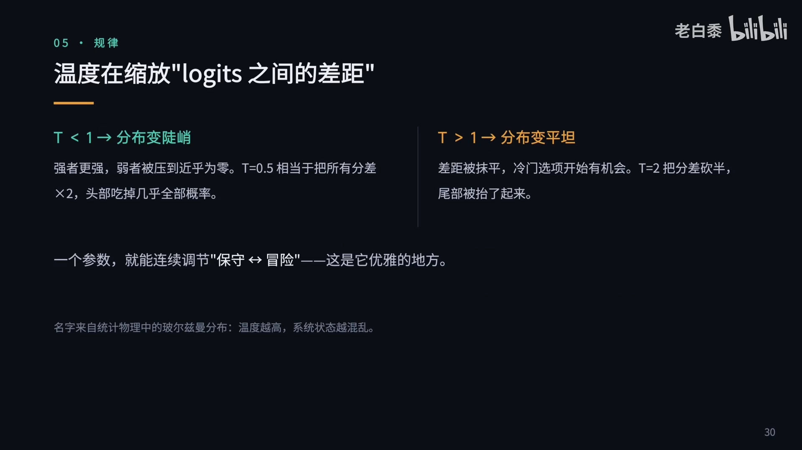

### 5.3 两个极限：贪心与瞎蒙

把旋钮拧到头，会发生两件很极端的事（[【跳转到 09:37】](https://www.bilibili.com/video/BV1XThS6zEoH/?t=577)）：

- **$T\to 0$：等价于贪心解码。** 最高分的概率趋近 100%，其他全部被压成 0；实现上 $T=0$ 会除零，所以各家框架都特判成直接取 argmax。
- **$T\to\infty$：纯粹瞎蒙。** 所有 token 的概率都趋于相等，选谁全靠运气。


### 5.4 T=1 是原点，不是天花板

一个常见误解是"温度最大就是 1"。课程明确回答：**不是，数学上没有上限；$T=1$ 只是模型原本的分布，这是个基准点，它是原点，不是天花板**（[【跳转到 09:48】](https://www.bilibili.com/video/BV1XThS6zEoH/?t=588)）。

各家平台允许的范围不一样，差异纯粹是产品设计的选择，不是谁对谁错（[【跳转到 09:48】](https://www.bilibili.com/video/BV1XThS6zEoH/?t=588)）：

| 平台 | 允许范围 | 默认值 |
| --- | --- | --- |
| OpenAI | 0 到 2 | 1 |
| Google Gemini | 0 到 2（部分旧模型上限为 1） | 1 |
| Anthropic Claude | 0 到 1 | 1 |
| 开源框架（如 vLLM） | 无硬上限 | 通常为 1 |

放宽到 2 的一派，是想把旋钮完整交给开发者，由你自己负责；限制到 1 的一派认为，超过 1 之后质量下降很快，与其让用户踩坑，不如直接封掉（[【跳转到 09:48】](https://www.bilibili.com/video/BV1XThS6zEoH/?t=588)）。两种思路都成立。

课程还观察到一个现象：**越是强大的推理模型，越倾向于不要修改温度**（[【跳转到 10:08】](https://www.bilibili.com/video/BV1XThS6zEoH/?t=608)）。原因是长推理链对采样扰动更敏感：一条几千个 token 的思考链，如果在其中某一步采样走偏了，后面的几百步都会沿着这个偏差层层放大；它不会回头检查，而是顺着错误认真推理到底，最后给出一个逻辑严明、但前提错误的答案（[【跳转到 10:17】](https://www.bilibili.com/video/BV1XThS6zEoH/?t=617)）。

### 5.5 别把温度和 Top-P 搞混

这两个参数经常被放在一起调，但它们的数学性质完全不同（[【跳转到 10:42】](https://www.bilibili.com/video/BV1XThS6zEoH/?t=642)）：

- **温度 $T$ 是一个除数**，数学上可以无限大；它改的是 softmax 之前 logits 的差距。
- **Top-P 是一个累计概率阈值**，概率总和最多就是 1，所以它的上限是 1；设为 1 等于不做任何截断。

所以"最大值是 1"这句话套在 Top-P 上是对的，套在温度上是错的（[【跳转到 10:42】](https://www.bilibili.com/video/BV1XThS6zEoH/?t=642)）。Top-P 如何按累积概率截断候选集，见 1.1.4，本文不重复。

---

## 六、温度调坏的两种方式

### 6.1 太高：长尾被抬高，错误被写进上下文

温度太高为什么会胡说八道？课程给了三个层层递进的原因（[【跳转到 10:58】](https://www.bilibili.com/video/BV1XThS6zEoH/?t=658)）：

1. **长尾被抬高。** 回到前面的例子，$T=2$ 时"香蕉"的概率是 0.69%。单看这个数字觉得很小，但词表有十几万到二十万个 token，每个荒谬选项都被抬升了几十倍，这类"荒谬长尾"的概率总和就变得相当可观（[【跳转到 10:58】](https://www.bilibili.com/video/BV1XThS6zEoH/?t=658)）。
2. **每一步都是掷骰子。** 单步踩雷的概率再低，几百步走下来，踩雷几乎是必然的；这就像买彩票，中奖概率很低，但只要买得足够多（[【跳转到 11:18】](https://www.bilibili.com/video/BV1XThS6zEoH/?t=678)）。
3. **误差累计，这是自回归特有的。** 一旦吐出一个不合理的 token，它被写进上下文，就会成为后续预测的既定前提；模型不会回头改，只会顺着这个错误自圆其说（[【跳转到 11:18】](https://www.bilibili.com/video/BV1XThS6zEoH/?t=678)）。

结果就是：温度过高时，往往不是零星的错字，而是整段跑偏——模型不是打错字，而是接受了一个荒谬的设定，然后极其负责地把这个设定演完（[【跳转到 11:38】](https://www.bilibili.com/video/BV1XThS6zEoH/?t=698)）。

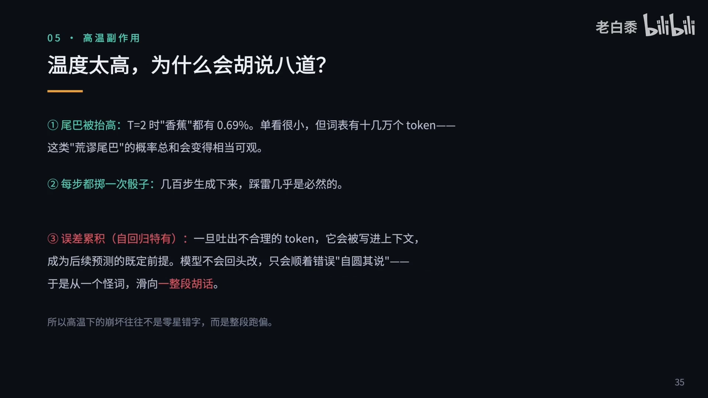

### 6.2 太低：退化成贪心，安全但套路

反过来，温度太低为什么像机器人？因为它**退化成了贪心解码，继承了贪心的全部毛病**：句式套路化、用词平庸、爱重复（[【跳转到 11:58】](https://www.bilibili.com/video/BV1XThS6zEoH/?t=718)）。

它总是选择"最安全"的那个词；而人类语言的味道，恰恰来自那些不那么安全的选择。温度低的模型不是不会写，是它不敢写——每一步都选那个不会出错的词，结果写出来的东西都是重复的套话（[【跳转到 12:03】](https://www.bilibili.com/video/BV1XThS6zEoH/?t=723)）。

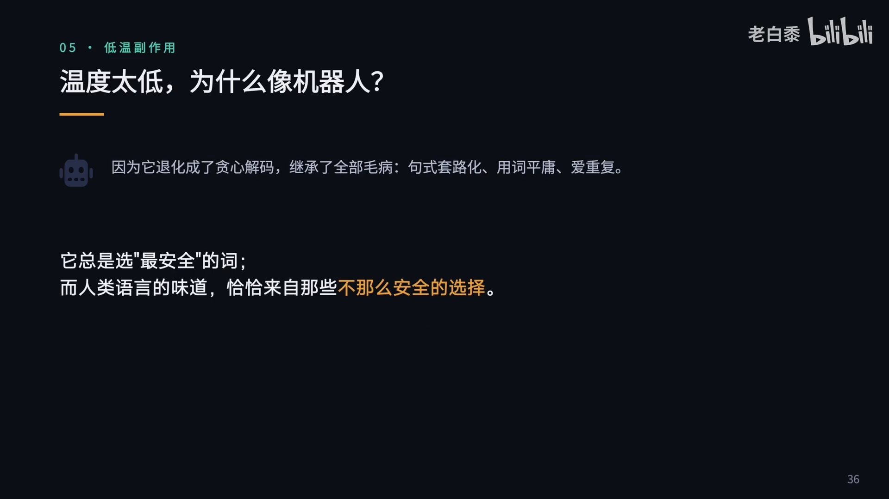

所以温度不是"越高越好"或"越低越好"的开关，而是一个在保守与冒险之间连续调节的旋钮：它没有分档、没有模型切换，只是一个简单的连续参数（[【跳转到 09:17】](https://www.bilibili.com/video/BV1XThS6zEoH/?t=557)）。

---

## 七、补充：Softmax 与交叉熵的来历（李沐）

> 本节基于李沐老师的《softmax 回归原理及损失函数》，讲的是分类任务里的 softmax 与交叉熵。视频主线讲到"分布交给采样器"之后，就转向采样策略与温度的应用，没有展开训练侧的交叉熵；这一节补上这块数学基础。**超出该视频原话的推论会单独标为补充。**

### 7.1 从多分类到 softmax：把一排分数变成概率

Softmax 回归用于多分类：它和线性回归一样，先把数值特征与权重做线性叠加，得到每个类别的分数；不同的是，线性回归输出一个连续值，softmax 回归输出的是离散类别（[【跳转到 00:00】](https://www.bilibili.com/video/BV1Kv4y1u7e9/?t=0)）。

以三个类别为例，输出层先算出 $o_1, o_2, o_3$，再通过 softmax 映射到 0 到 1 之间，得到 $\hat{y}_1, \hat{y}_2, \hat{y}_3$；这三个数都是正的，并且和为一，可以看成概率分布（[【跳转到 00:40】](https://www.bilibili.com/video/BV1Kv4y1u7e9/?t=40)）。预测时取其中最大的那个，对应哪个类别就预测哪个类别（[【跳转到 01:20】](https://www.bilibili.com/video/BV1Kv4y1u7e9/?t=80)）。

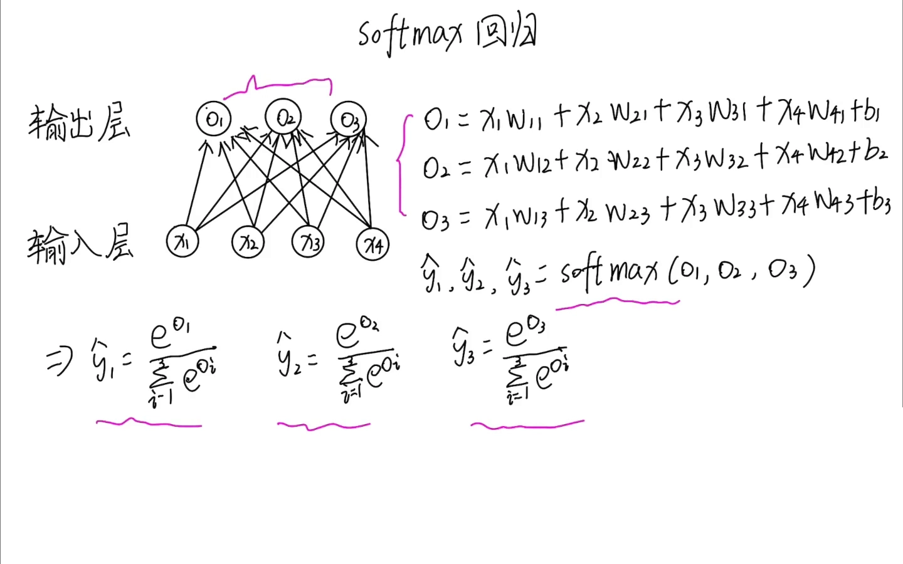

写成向量形式，小批量样本的计算是

$$
\mathbf{O} = \mathbf{X}\mathbf{W} + \mathbf{b}, \qquad \hat{\mathbf{Y}} = \mathrm{softmax}\left(\mathbf{O}\right)
$$

其中 $\mathbf{X}$ 是 $n\times d$（$n$ 个样本、$d$ 个特征），$\mathbf{W}$ 是 $d\times q$，$\mathbf{O}$ 与 $\hat{\mathbf{Y}}$ 都是 $n\times q$（$q$ 是类别数）（[【跳转到 05:41】](https://www.bilibili.com/video/BV1Kv4y1u7e9/?t=341)）。放到语言模型里，$q$ 就是词表大小 $\lvert V \rvert$，每个位置都在做一次"词表规模的多分类"。

### 7.2 为什么分类用交叉熵，而不是均方误差

线性回归用均方误差：真实值与预测值之差的平方和。但 softmax 回归不一样——**我们并不要求预测概率完全等于标签**（[【跳转到 07:37】](https://www.bilibili.com/video/BV1Kv4y1u7e9/?t=457)）。

课程举的例子很直观：如果真实类别是第 2 类，我们只需要 $\hat{y}_2$ 大于 $\hat{y}_1$ 和 $\hat{y}_3$ 就可以了，不需要管 $\hat{y}_1$、$\hat{y}_3$ 具体是多少（[【跳转到 09:02】](https://www.bilibili.com/video/BV1Kv4y1u7e9/?t=542)）。因此均方误差并不合适；对于概率分布，通常使用的损失函数是**交叉熵**（[【跳转到 09:02】](https://www.bilibili.com/video/BV1Kv4y1u7e9/?t=542)）：

$$
H\left(y, \hat{y}\right) = -\sum_{j=1}^{q} y_j \log \hat{y}_j
$$

其中 $y$ 是真实标签的 one-hot 向量，$\hat{y}$ 是预测分布。因为 $q$ 个输出中只有一个为 1、其他均为 0，求和之后只剩一项：

$$
H\left(y, \hat{y}\right) = -\log \hat{y}_{y}
$$

也就是说，交叉熵只惩罚"真实类别的预测概率"：给真实类别的概率越高，损失越小；给得越低，损失越大（[【跳转到 10:56】](https://www.bilibili.com/video/BV1Kv4y1u7e9/?t=656)）。

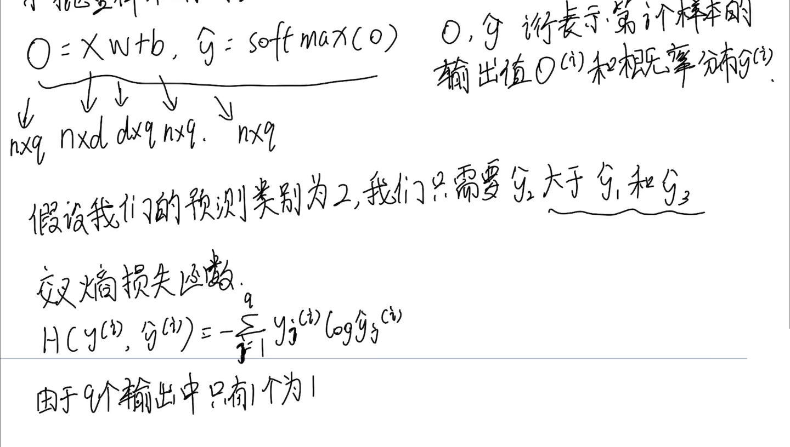

### 7.3 放回语言模型：每个 token 位置都在算一次交叉熵

> **补充（非讲者原话）**：语言模型训练时，每个位置的目标就是词表上的一个 one-hot 标签——真实的下一个 token。把每个位置的交叉熵取平均，就是训练损失；对它取指数，就是困惑度（perplexity）：
>
> $$
> \mathrm{PPL} = \exp\left(\frac{1}{N}\sum_{t=1}^{N} -\log p\left(w_t \mid w_{<t}\right)\right)
> $$
>
> 困惑度可以粗略理解为"模型在每一步平均要在多少个候选里犹豫"：$\mathrm{PPL}=1$ 表示每一步都完全确定，$\mathrm{PPL}=\lvert V \rvert$ 表示等同于在词表里均匀乱猜。

> **补充（非讲者原话）：温度与交叉熵、困惑度的关系。** 训练和标准评测都在 $T=1$ 下计算交叉熵，这样得到的才是模型"原本的"分布与困惑度。如果在推理时用 $T\neq 1$ 的分布去算交叉熵，损失值会变：$T<1$ 时分布更尖，若真实 token 本来就是最高分，交叉熵会下降；$T>1$ 时分布更平，同一个最高分 token 的概率被压低，交叉熵会上升、趋近 $\log\lvert V \rvert$。但如 5.2 节所示，只要 $T>0$，排序不变——**温度改变的是模型表达出的"确信程度"，不是它学到的偏好顺序**。这也解释了为什么调温度可以在不重新训练的情况下改变风格，却不会把模型变成另一个模型。

---

## 八、小结

- **Logits 是裸分，不是概率**：最后一层输出长度为词表大小的实数向量，可正可负、不归一化；负分只表示相对更不可能，不代表没有评估过。
- **Softmax 只做两件事**：先取指数把一切变正，再除以总和让它们加起来等于 1；指数还顺带把 logits 的差距放大成概率上的悬殊。
- **数值稳定靠"减最大值"**：softmax 只关心差值，减去最大值不改变结果，却能避免 $e^{800}$ 这类溢出；这也是所有框架的标准实现。
- **模型只交分布，采样器做决策**：softmax 之后的分布是"意见书"，Greedy、Top-K、Top-P 等策略才决定最终 token；API 参数能改风格而不必重训模型，原因就在这里。
- **温度只是在 softmax 前多除一步**：$T<1$ 变陡、$T>1$ 变平、$T=1$ 原样；$T\to 0$ 趋近 argmax，$T\to\infty$ 趋近均匀乱猜；只要 $T>0$，排序不变。
- **温度太高会整段跑偏，太低会变成复读机**：高温抬高长尾、每步掷骰子、错误写进上下文后自我强化；低温退化成贪心，只敢选最安全的词。
- **训练侧用交叉熵**：每个位置都是词表规模的多分类，one-hot 标签把交叉熵化简为"负 log 真实 token 概率"；困惑度是它的指数形式。

---

## 关键术语速查

| 术语 | 一句话解释 |
| --- | --- |
| Logits | 最后一层输出的、长度为词表大小的未归一化打分向量 |
| Softmax | 先取指数再除以总和，把任意实数向量变成总和为 1 的概率分布 |
| 温度 T | softmax 之前对 logits 的除数，控制分布的陡峭程度而不改变排序 |
| 数值稳定 | 利用 softmax 的平移不变性，先减去最大值再取指数，避免溢出 |
| 交叉熵 | 衡量预测分布与真实 one-hot 标签差距的损失，分类任务的标准选择 |
| 困惑度 | 交叉熵的指数形式，可粗略理解为每一步平均犹豫的候选数量 |
| 采样策略 | softmax 之后从概率分布中挑出具体 token 的外部逻辑 |

---

## 视频来源

| 视频 | 覆盖内容 | 时长 |
| --- | --- | --- |
| [大模型其实在掷骰子（上）｜Logits、Softmax 与温度](https://www.bilibili.com/video/BV1XThS6zEoH/) | 自回归生成链路、logits 的定义与三个性质、softmax 两步与数值稳定、模型与采样器的分工、温度公式与两端极限、平台温度范围、高温与低温的副作用 | 约 12 分 23 秒 |
| [softmax 回归原理及损失函数（李沐）](https://www.bilibili.com/video/BV1Kv4y1u7e9/) | softmax 回归的多分类设定、向量化形式与维度、为什么不用均方误差、交叉熵与 one-hot 化简 | 约 11 分 44 秒 |
