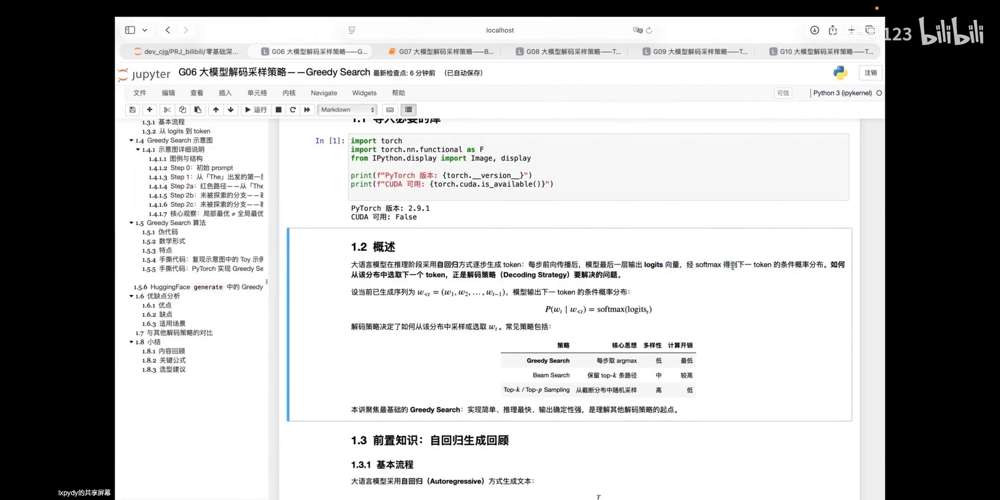
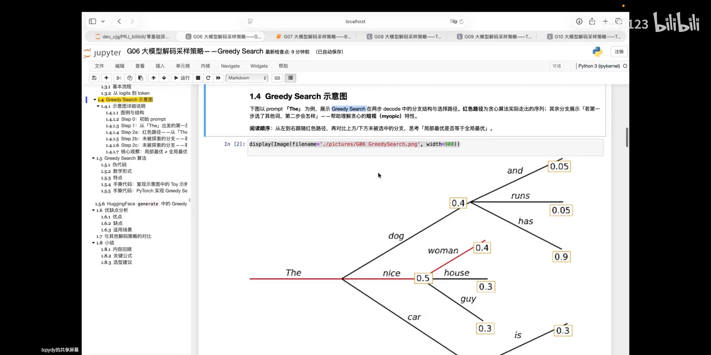
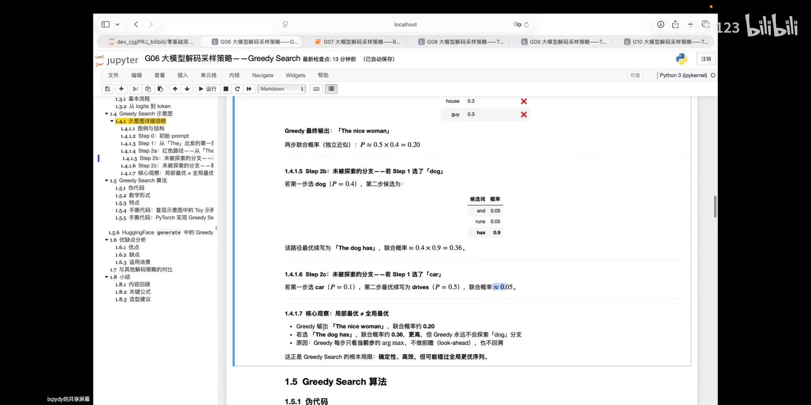
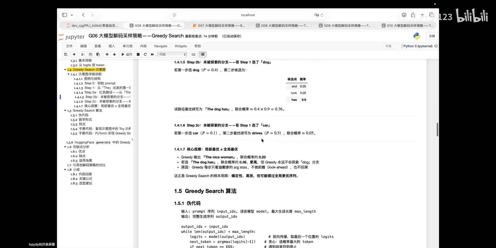
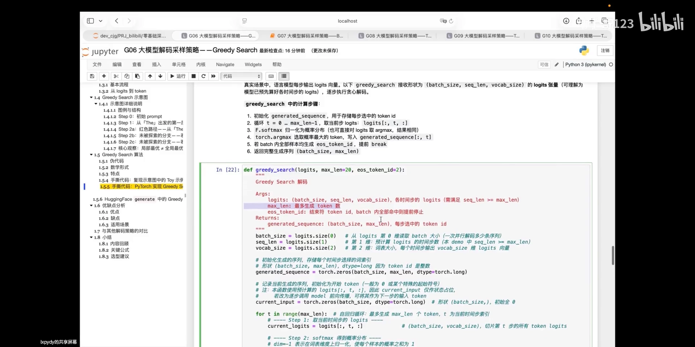
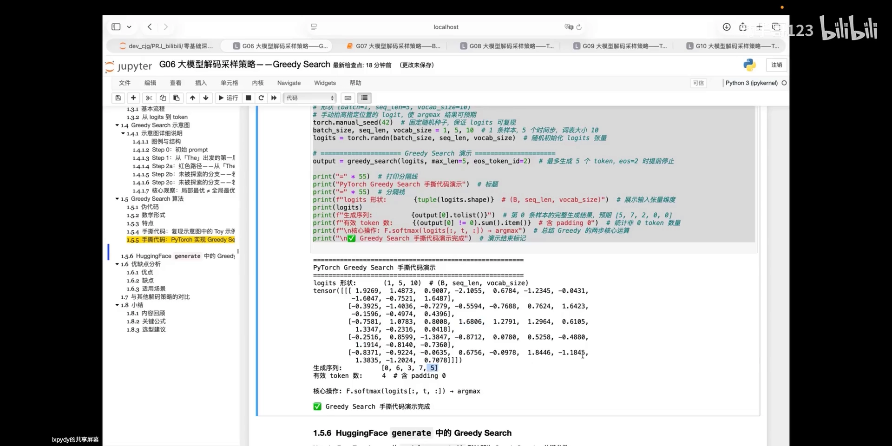
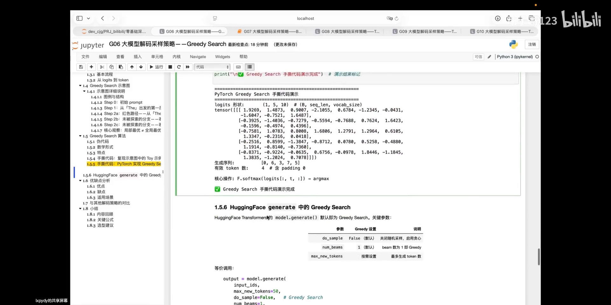
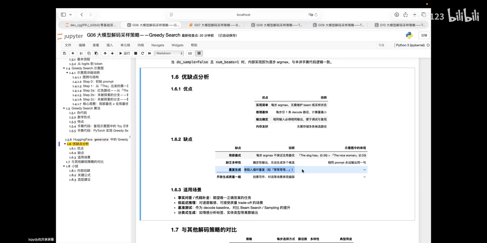

# Greedy Search：每一步都选最高分，贪心为什么会让整段文本走偏

> 视频来源：[G06 大模型解码采样策略——Greedy Search](https://www.bilibili.com/video/BV1KbMw66EJx/?t=0)（Bilibili）
> 本文基于视频演说图文稿整理，配图截自视频。

## 本讲要解决的核心问题（SCQA）

**背景**：大语言模型在推理阶段是自回归（autoregressive）生成——每走一步做一次前向传播，模型最后一层吐出一个长度等于词表大小的 **logits 向量**，经 softmax 归一化后，就得到"下一个 token 的条件概率分布"。分布是现成的。

**冲突**：分布拿到了，可"到底吐出哪一个 token"还要再选一次。这个"再选一次"的动作没有唯一正解：可以直接取概率最大的那个，也可以按概率掷骰子。选法不同，同一句 prompt 能续写出质量完全不同的长文；而这一步的选择规则，就叫**解码策略（decoding strategy）**。

**疑问**：那么，如果每一步都老老实实挑当前概率最高的 token，整段输出是不是就最"优"了？

**回答（中心思想）**：不是。Greedy Search（贪心搜索）每一步只做一次 argmax，拿到的是**局部最优**；它不做前瞻、也不回溯，所以会眼睁睁错过联合概率更高的分支——视频里 "The nice woman" 的联合概率是 0.20，而它永远走不到的 "The dog has" 是 0.36。贪心的全部价值在于**确定、快、省内存**：每步一次前向加一次 argmax，是 Beam Search 在 beam 数为 1 时的退化特例，也是理解其他所有解码策略的起点。

---

## 一、解码策略要解决的问题：logits 有了，token 怎么选



先把"生成"这件事拆成两步 [【跳转到 00:30】](https://www.bilibili.com/video/BV1KbMw66EJx/?t=30)：

1. **模型负责算分布**。Transformer 这类模型每一层都在做 token 之间的信息混合，走到最后一步，输出的是词表上每个候选 token 的原始打分，也就是 **logits**。logits 是实数，可正可负、没有归一化，不能直接当概率用。
2. **解码策略负责从分布里选 token**。把 logits 送进 softmax 变成概率，再按某个规则挑出一个 token 拼回序列，然后把这个更长的序列再喂回模型，循环往复。

用式子写出来，设当前已经生成的前缀是 $w_{<t} = (w_1, w_2, \dots, w_{t-1})$，那么下一个 token 的条件概率分布是：

$$
P(w_t \mid w_{<t}) = \mathrm{softmax}(\mathrm{logits}_t)
$$

这里的 softmax 就是把一串实数压成"总和为 1 的概率"的函数：分数高的候选分到大份额，分数低的候选分到小份额，但**谁都不会被清零**——哪怕是最不可能的 token，概率也只是"很小"，而不是 0。这一点很关键，后面讲 Top-P 时会回来算账。

**logits 与概率的区别**：logits 是"打分"，可以理解成考试卷面分，多少分都行；概率是"名次占比"，必须加起来等于 1。softmax 就是那个把卷面分换算成名次占比的换算器。

视频开头交代，这个系列要用五节课把常用的解码策略过一遍 [【跳转到 00:05】](https://www.bilibili.com/video/BV1KbMw66EJx/?t=5)：Greedy Search、Beam Search、Top-K Sampling、Top-P Sampling、Temperature Sampling。放一张总览表最直观：

| 策略 | 核心思想 | 多样性 | 计算开销 |
| --- | --- | --- | --- |
| Greedy Search | 每步取 argmax | 低 | 最低 |
| Beam Search | 保留 top-k 条路径 | 中 | 较高 |
| Top-k / Top-p Sampling | 从截断分布中随机采样 | 高 | 低 |

这张表其实已经把解码策略分成了两个阵营：**贪心类**（Greedy、Beam）每一步都在做"选优"，输出确定；**采样类**（Top-K、Top-P）每一步都在做"掷骰子"，输出随机。本讲聚焦最基础的那一个：Greedy Search。

## 二、Greedy Search 的定义：每一步只取一次 argmax

Greedy Search 又叫贪心搜索，是最基础、最常用、也最直观的解码策略：**在当前步的概率分布上取概率最大的那个 token，直接解码出去** [【跳转到 00:53】](https://www.bilibili.com/video/BV1KbMw66EJx/?t=53)。

"贪心"这个词是从算法课借来的。找零钱的经典例子：要凑 6 毛 5，贪心算法先拿最大面额的 5 毛，再拿 1 毛，再拿 5 分——每一步都拿"当前能拿的最大面额"。它算得快，但如果面额设计得刁钻（比如只有 4 毛、3 毛、1 毛这种组合），贪心凑出来的方案未必是硬币数最少的方案。语言模型解码是同一个道理：**每一步都追求局部最优，局部最优却不一定等于全局最优** [【跳转到 01:18】](https://www.bilibili.com/video/BV1KbMw66EJx/?t=78)。

用一句话概括它的行为：

> 不管上下文长什么样，我只看当前这一格的概率向量，把最大的那个下标取出来，其余的全都不看。

因为"全都看"变成了"只看一个"，它的结果就非常确定：同一份 prompt、同一个模型，输出永远一样；也正因为只看一个，它的计算开销是所有策略里最低的。

## 三、局部最优不等于全局最优：0.20 输给 0.36

这是本讲的核心。视频用一个两层的玩具例子把差距算得清清楚楚。



读图的方法 [【跳转到 06:43】](https://www.bilibili.com/video/BV1KbMw66EJx/?t=403)：节点上的英文单词是"当前这一步选了哪个 token"，箭头旁边的黄色小方框是该分支对应的**条件概率**（也就是走到这里时模型给出的概率）；**红色路径**是贪心算法实际走过的路，**黑色路径**是贪心没有选的分支——它们代表了"如果在第一步不贪心，后面会发生什么"。

从 prompt「The」出发，第一层三个候选 [【跳转到 05:03】](https://www.bilibili.com/video/BV1KbMw66EJx/?t=303)：

- `dog`：0.4
- `nice`：0.5
- `car`：0.1

贪心只看最大值，0.5 最大，于是选 `nice`，其余两个分支当场被放弃。接着从 "The nice" 继续走第二层：

- `woman`：0.4
- `house`：0.3
- `guy`：0.3

还是取最大，第二轮选 `woman`。于是贪心的输出是 **"The nice woman"**，它这一步的联合概率是：

$$
P(\text{The nice woman}) \approx 0.5 \times 0.4 = 0.20
$$

现在回头看被放弃的那条分支。如果第一步选了 `dog`（概率只有 0.4，比 0.5 小，是被贪心判了"次优"的那一支），第二步的候选是 [【跳转到 08:23】](https://www.bilibili.com/video/BV1KbMw66EJx/?t=503)：

| 候选词 | 条件概率 |
| --- | --- |
| and | 0.05 |
| runs | 0.05 |
| has | 0.9 |

其中 `has` 给到了 0.9。于是这条路径的联合概率是：

$$
P(\text{The dog has}) \approx 0.4 \times 0.9 = 0.36
$$

0.36 > 0.20。**第二步那个看起来只有 0.4 的"次优"选择，整体反而更好，因为它在下一步拿到了 0.9。** 同理，第一步选 `car`（0.1）再选 `drives`（0.5），联合概率只有 0.05，确实差，但这条分支贪心也永远不会知道它差在哪。



结论就写在这张图上 [【跳转到 09:13】](https://www.bilibili.com/video/BV1KbMw66EJx/?t=553)：

- Greedy 输出 "The nice woman"，联合概率约 **0.20**；
- 若选 "The dog has"，联合概率约 **0.36**，更高，但贪心**永远不会探索 `dog` 这条分支**；
- 原因：贪心每一步只看当前步的 argmax，**不做前瞻（look-ahead），也不做回溯**。

所以贪心的"眼窄"是结构性的，不是运气问题：它在第一步就把 40% 的搜索空间永久删掉了。这也是立刻能看出的改进思路——**别只留一条路**。视频在这里顺带透露了 Beam Search 的做法：设 top-k 为 2，就可以同时保留两条最优路径一起往下演算，"虽然你现在是次优的，我也给你留一个名分" [【跳转到 07:08】](https://www.bilibili.com/video/BV1KbMw66EJx/?t=428)。代价是要同时算 k 条路径，开销上去了。

视频还给出一个人生比喻：每一步都做了当时的最优选择，全局看却可能绕了弯路——**局部最优不等于全局最优** [【跳转到 09:38】](https://www.bilibili.com/video/BV1KbMw66EJx/?t=578)。

## 四、算法与数学形式：一次前向加一次 argmax



伪代码只有五六行 [【跳转到 10:03】](https://www.bilibili.com/video/BV1KbMw66EJx/?t=603)：

```
输入：prompt 序列 input_ids，语言模型 model，最大生成长度 max_length
输出：完整生成序列 output_ids

output_ids ← input_ids
while len(output_ids) < max_length:
    logits ← model(output_ids)          # 前向传播，取最后一个位置的 logits
    next_token ← argmax(logits[-1])     # 贪心：选概率最大的 token
    if next_token == EOS:               # 遇到结束符则停止
        break
    output_ids ← append(output_ids, next_token)
return output_ids
```

数学形式：给定 prompt $\mathbf{x} = (x_1, \dots, x_m)$，Greedy Search 生成的序列 $\hat{\mathbf{y}} = (\hat{y}_1, \dots, \hat{y}_T)$ 满足

$$
\hat{y}_t = \arg\max_{y \in V} P(y \mid \mathbf{x}, \hat{y}_1, \dots, \hat{y}_{t-1}), \quad t = 1, 2, \dots, T
$$

其中 $V$ 是词表。**注意这个式子的要害**：argmax 里只有**单步的条件概率**，而不是整段序列的联合概率 $\prod_t P(\hat{y}_t \mid \cdot)$。贪心把"最大化联合概率"这个真目标，偷换成了"每步最大化条件概率"这个容易解的假目标，第三节那 0.20 与 0.36 的差距就是这么来的。

视频总结了四条特点 [【跳转到 10:28】](https://www.bilibili.com/video/BV1KbMw66EJx/?t=628)：

1. **确定性高**：每步只选一个最大值，相同 prompt + 相同模型 ⇒ 输出必然相同，没有随机性。
2. **计算高效**：每步只需 1 次前向 + 1 次 argmax，时间复杂度是 $O(T \cdot \lvert V \rvert)$（$T$ 为生成长度，$\lvert V \rvert$ 为词表大小）。
3. **易于实现**：PyTorch 里对 `logits` 的最后一维做一次 `argmax` 就能表达。
4. **重复风险**：容易陷入高概率但单调的续写，比如反复生成相同的词语 [【跳转到 10:53】](https://www.bilibili.com/video/BV1KbMw66EJx/?t=653)——视频提到弹幕里常见的"复读机"现象，这可能就是原因之一。

## 五、手撕代码：核心只有 softmax 与 argmax 两步



视频强调，这段代码在面试里一般不会让你用 numpy 手写，而是用 PyTorch 写 [【跳转到 11:43】](https://www.bilibili.com/video/BV1KbMw66EJx/?t=703)。函数接收形状为（batch_size, seq_len, vocab_size）的 logits 张量（可以理解为模型已经预先算好了各时间步的 logits），逐时间步贪心解码：

```python
def greedy_search(logits, max_len=20, eos_token_id=2):
    batch_size = logits.size(0)      # 第 0 维：batch 大小（一次并行解码多少条序列）
    seq_len    = logits.size(1)      # 第 1 维：预先算好的时间步数
    vocab_size = logits.size(2)      # 第 2 维：词表大小，每个时间步输出 vocab_size 维向量

    generated_sequence = torch.zeros(batch_size, max_len, dtype=torch.long)

    for t in range(max_len):
        current_logits = logits[:, t, :]                  # 取第 t 步的所有 token logits
        probs = F.softmax(current_logits, dim=-1)         # 归一化为概率分布
        next_token = torch.argmax(probs, dim=-1)          # 取概率最大的 token
        generated_sequence[:, t] = next_token
        # 若 batch 内全部序列都已生成 eos_token_id，提前 break
    return generated_sequence
```

整段代码的**核心只有两步** [【跳转到 12:33】](https://www.bilibili.com/video/BV1KbMw66EJx/?t=753)：先 `softmax` 得到概率分布，再 `argmax` 取最大值的下标。其余都是套模板的工程细节。



跑一遍看结果更有体感 [【跳转到 13:23】](https://www.bilibili.com/video/BV1KbMw66EJx/?t=803)。给一个形状为（1, 5, 10）的随机 logits，每一步取最大值所在的列：

| 时间步 | 该步最大的 logits | 取到的下标 |
| --- | --- | --- |
| 第 1 步 | 1.9269 | 0 |
| 第 2 步 | 1.6423 | 6 |
| 第 3 步 | 1.6806 | 3 |
| 第 4 步 | 1.1914 | 7 |
| 第 5 步 | 1.8446 | 5 |

最终生成序列是 `[0, 6, 3, 7, 5]`。注意这里是**逐时间步独立取 argmax**，因为 logits 是预先给定的，各步之间没有互相影响；真实推理时上一步的 token 会拼进序列再喂回模型，所以每一步的分布都会变，但"每步只取一次 argmax"这条规则不变。

顺带说一个实现细节：`softmax` 之后再 `argmax`，与直接对 logits 取 `argmax`，结果完全一样——softmax 是单调的，不改变大小关系。多写一次 softmax 只是为了让"先得到概率分布，再取最大"这条逻辑更清楚。

## 六、HuggingFace 里的 Greedy：do_sample=False 加 num_beams=1



在 HuggingFace Transformers 里，`generate` 的**默认行为就是 Greedy Search** [【跳转到 14:13】](https://www.bilibili.com/video/BV1KbMw66EJx/?t=853)。关键参数只有三个：

| 参数 | Greedy 设置 | 说明 |
| --- | --- | --- |
| do_sample | False（默认） | 关闭随机采样，启用贪心 |
| num_beams | 1（默认） | beam 数为 1 即 Greedy |
| max_new_tokens | 按需设置 | 最多生成多少个 token |

等价调用长这样：

```python
output = model.generate(
    input_ids,
    max_new_tokens=50,
    do_sample=False,   # Greedy Search
    num_beams=1,
)
```

`num_beams` 取 1 这个参数值得单独说一句 [【跳转到 14:38】](https://www.bilibili.com/video/BV1KbMw66EJx/?t=878)：**Beam Search 是 Greedy 的推广，Greedy 是 Beam Search 在 beam 数为 1 时的特例**。所以当 `do_sample` 为 False 且 `num_beams` 为 1 时，内部实现就是逐步 argmax，与本讲手撕的代码逻辑一致。视频提醒，读项目代码或面试时不要看到 `do_sample` 为 False 就直接跳过——`do_sample` 与 `num_beams` 的配合，恰好能衍生出 Greedy 和 Beam 两种策略，这是面试常考点。

## 七、优缺点：确定、快、省内存，但僵化且容易复读



**优点** [【跳转到 15:28】](https://www.bilibili.com/video/BV1KbMw66EJx/?t=928)：

| 优点 | 说明 |
| --- | --- |
| 实现简单 | 每步 argmax，无需维护 beam 或采样状态 |
| 推理最快 | 每步仅 1 条 decode 路径，计算量最小 |
| 输出确定 | 相同输入必得相同输出，便于调试与复现 |
| 内存友好 | 无需存储多条候选路径 |

**缺点** [【跳转到 16:18】](https://www.bilibili.com/video/BV1KbMw66EJx/?t=978)：

| 缺点 | 说明 | 示意图中的体现 |
| --- | --- | --- |
| 局部最优 | 每步 argmax 不保证全局最优 | "The dog has"（0.36）优于 "The nice woman"（0.20） |
| 缺乏多样性 | 确定性输出，无法生成多个候选 | 相同 prompt 永远输出同一句 |
| 重复生成 | 易陷入循环重复（如"等等等等……"） | 无 |
| 开放生成质量一般 | 创意写作、对话等场景表现偏弱 | 无 |

第三条"重复生成"值得展开一点：模型的训练目标就是"给定上文，预测最可能的下一个 token"，而上文越长、某个词已经出现过，它在相似上下文里"再次出现"的条件概率往往就被推得更高。贪心从不掷骰子，一旦进入这个正反馈循环，就再也出不来了。这也是后面"重复惩罚"那一讲的出发点：既然分布被推高了，就在采样前把出现过的 token 压下去。

## 八、什么时候该用贪心：只有一个正确答案的任务

视频给出的适用场景 [【跳转到 16:43】](https://www.bilibili.com/video/BV1KbMw66EJx/?t=1003)：

- **事实问答 / 代码补全**：期望唯一正确答案的任务；
- **低延迟推理**：对速度敏感、可接受质量折中的场景；
- **基准测试**：作为 decode baseline，用来对比 Beam Search 与采样策略的提升；
- **分类式生成**：情感分析标签、实体类型这类离散输出。

反过来看，**创意写作、开放对话**这类需要"多个都说得通的好答案"的场景，贪心就不合适——它只会给你一个，而且往往是那个"最安全、最平庸"的。视频举的例子很接地气：生产环境里如果需要一个高确定性的输出，比如按固定结构吐一份 JSON 模板，模型却老是不稳定，那自然的选择就是换回确定的贪心。

## 小结

- 解码策略要解决的问题是：logits 经 softmax 得到下一个 token 的条件分布之后，**按什么规则选出那个 token**；这个选择规则决定了整段文本的走向。
- Greedy Search 的规则最简单：**每步只取一次 argmax**。它最大化的是单步条件概率，而不是整段序列的联合概率。
- 局部最优不等于全局最优：视频里 "The nice woman" 的联合概率是 0.20，而被贪心永久放弃的 "The dog has" 是 0.36，因为贪心**不做前瞻、不做回溯**。
- 优点是确定、最快、内存友好、实现只需一次 argmax；缺点是局部最优、缺乏多样性、容易陷入复读循环。
- 在工程里它有两个身份：HuggingFace `generate` 的默认行为（`do_sample` 为 False、`num_beams` 为 1），以及 Beam Search 在 beam 数为 1 时的退化特例。
- 它适合"只有一个正确答案"的任务（事实问答、代码补全、低延迟推理、分类式生成），不适合创意写作与开放对话——后面的 Top-K、Top-P、温度系数、重复惩罚，都是为了补它的这两个短板。

## 关键术语速查

| 术语 | 一句话解释 |
| --- | --- |
| logits | 模型最后一层输出的原始打分向量，长度等于词表大小，可正可负、未归一化 |
| softmax | 把 logits 换算成总和为 1 的概率分布的函数，分数越高分到的份额越大 |
| 自回归（autoregressive） | 每生成一个 token 就把它拼回输入、再预测下一个的生成方式 |
| 解码策略（decoding strategy） | 决定"从条件概率分布中怎么选出下一个 token"的规则 |
| Greedy Search | 贪心搜索，每步只取概率最大的 token，等价于逐步 argmax |
| argmax | 返回向量中最大值所在的下标，这里就是"概率最大的 token 的编号" |
| 局部最优 / 全局最优 | 单步最好的选择；整段序列联合概率最高的选择。两者不一定一致 |
| 联合概率 | 整条路径上各步条件概率的连乘，用来比较不同路径整体谁更可能 |
| Beam Search | 每步保留 k 条最优路径一起演算，用更多算力换取避开局部最优的机会 |
| EOS | 结束符 token，模型吐出它即表示序列生成结束 |
| num_beams | HuggingFace 的参数，beam 宽度；取 1 时 Beam Search 退化为 Greedy |
