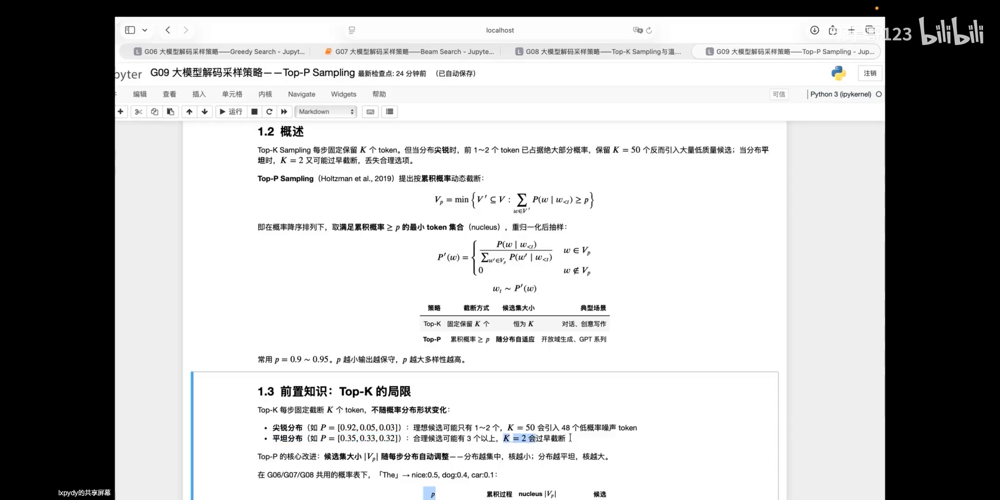
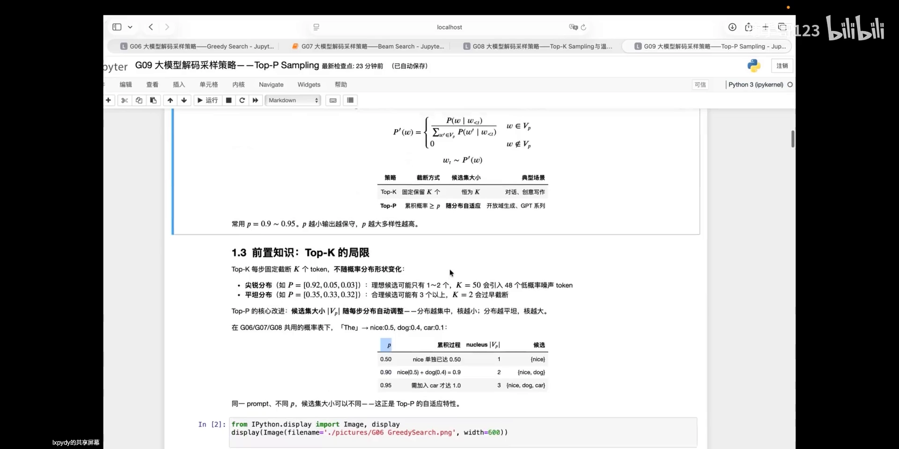
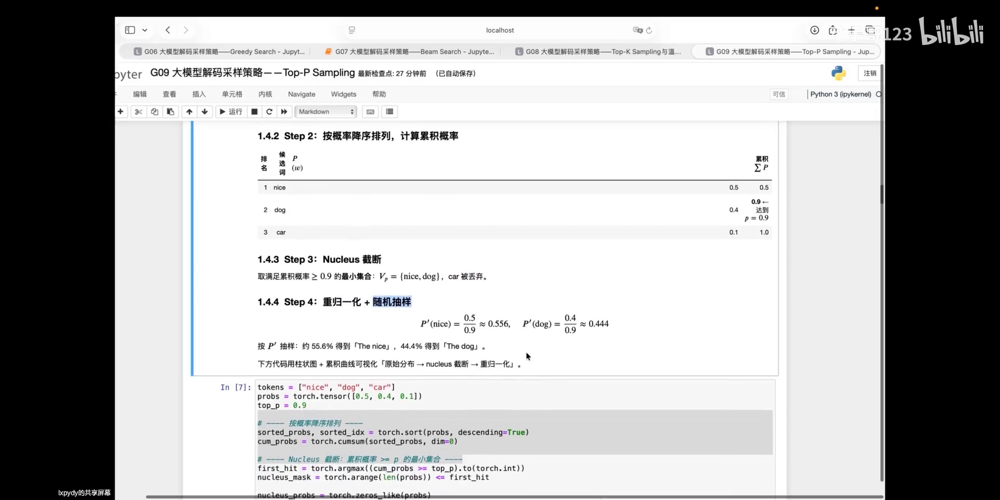
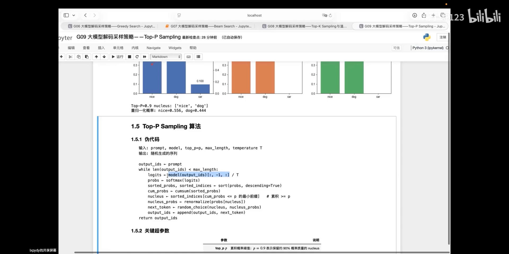
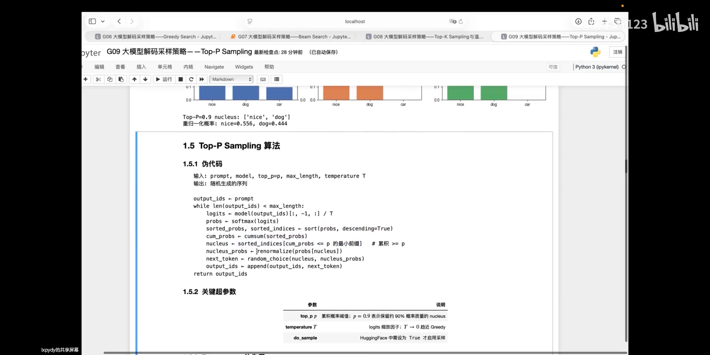
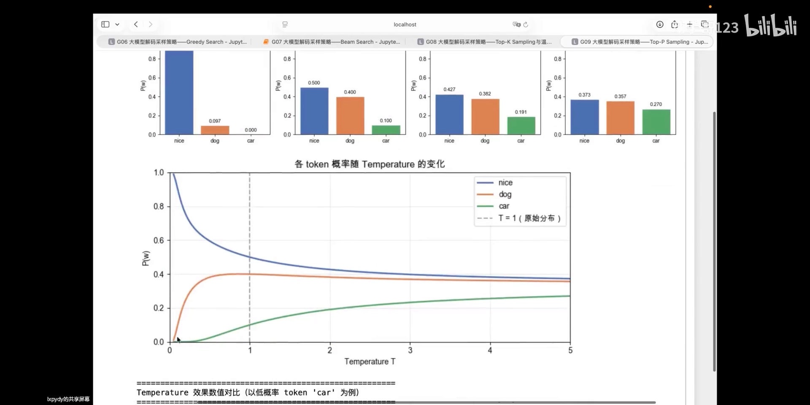
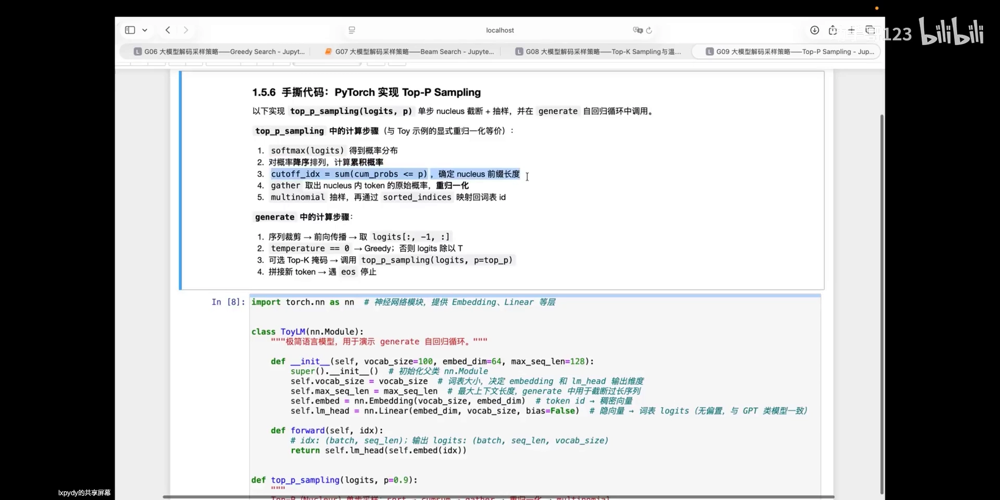
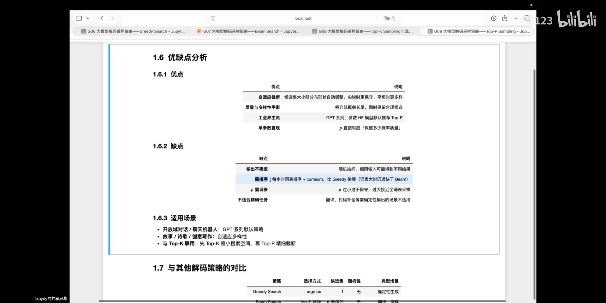

# Top-P 采样：概率攒到 p 为止，候选集跟着分布自己伸缩

> 视频来源：[G09 大模型解码采样策略——Top-P Sampling](https://www.bilibili.com/video/BV1wETQ6qEbX/?t=0)（Bilibili）
> 本文基于视频演说图文稿整理，配图截自视频。

## 本讲要解决的核心问题（SCQA）

**背景**：上一节讲的 Top-K 采样，做法是"每步固定保留概率最高的 K 个 token，在剩下的 K 个里按概率重新掷骰子"。K 是一个常数，写死在配置里。

**冲突**：分布的"形状"却在每一步都在变。有时某个 token 的概率高达 0.92，后面几个只有 0.02、0.01——这时候还硬留 K=50 个，等于把 48 个几乎不可能的 token 拉进抽奖池，白白引入噪声 [【跳转到 00:55】](https://www.bilibili.com/video/BV1wETQ6qEbX/?t=55)。反过来，有时分布平得像 0.35、0.33、0.32，三个候选势均力敌，可 K=2 会直接把第三个也说得通的答案剪掉 [【跳转到 01:20】](https://www.bilibili.com/video/BV1wETQ6qEbX/?t=80)。同一个 K，在尖锐分布上太多、在平坦分布上太少。

**疑问**：能不能不要写死"留几个"，而是改成"留多少概率质量"？

**回答（中心思想）**：能，这就是 Top-P 采样（又称 **nucleus sampling，核采样**）。它按概率从高到低累加，取**累积概率恰好达到阈值 p 的最小 token 集合**（这个集合叫 nucleus，核），把核外的 token 全部丢弃，再把核内的概率重新归一化后随机抽样。于是候选集大小随分布自动伸缩：分布越集中，核越小；分布越平坦，核越大。它只多了一个可解释的参数 p（p=0.9 就是"保留 90% 的概率质量"），因此成了工业界最常用的随机解码策略。

---

## 一、先复习痛点：Top-K 的 K 是死的，分布是活的



视频先把 Top-K 的局限摆出来 [【跳转到 00:30】](https://www.bilibili.com/video/BV1wETQ6qEbX/?t=30)。Top-K Sampling 每一步固定保留 K 个 token，**不随概率分布的形态自适应**：

- **尖锐分布**（例如 $P = [0.92, 0.05, 0.03]$）：真正合理的候选其实只有 1~2 个。此时若 $K = 50$，会引入 48 个低概率的噪声 token。
- **平坦分布**（例如 $P = [0.35, 0.33, 0.32]$）：合理的候选有 3 个甚至更多。此时若 $K = 2$，就属于过早截断，把说得通的答案丢了。

所以视频对 Top-P 的定位是"Top-K 的改进方法"：**它的核心改进在于，候选集大小 $|V_p|$ 随每步分布自动调整——分布越集中，核越小；分布越平坦，核越大** [【跳转到 00:05】](https://www.bilibili.com/video/BV1wETQ6qEbX/?t=5)。

## 二、Top-P 的定义：累积概率达到 p 的最小集合

设当前已生成前缀 $w_{<t}$，下一个 token 的条件分布为 $P(w \mid w_{<t})$。把候选按概率从高到低排好，Top-P 要取的是满足下面条件的最小集合 $V_p$：

$$
V_p = \min \left\{ V' \subseteq V : \sum_{w \in V'} P(w \mid w_{<t}) \ge p \right\}
$$

**逐字解释这个式子**：

- $V$ 是整个词表（几万个 token），$V'$ 是它的某个子集；
- $\sum_{w \in V'} P(w \mid w_{<t})$ 是这个子集里所有 token 的概率之和，也就是"这点概率质量占了多少"；
- 要求它 $\ge p$，然后在这些满足条件的子集里取**最小的那个**。因为是从高到低累加的，"最小集合"自然就等价于"从概率最高的开始往后数，数到累积概率刚够 p 就停"。

截断之后，核内概率之和已经不等于 1（只剩 0.9 左右），必须**重归一化（renormalize）**才能当概率用：

$$
P'(w) =
\begin{cases}
\dfrac{P(w \mid w_{<t})}{\sum_{w' \in V_p} P(w' \mid w_{<t})} & w \in V_p \\[2mm]
0 & w \notin V_p
\end{cases}
$$

也就是：核内每个 token 的概率除以核内概率总和，核外直接置 0。然后从 $P'$ 里抽一个 token：

$$
w_t \sim P'(w)
$$

**为什么要重归一化**：概率的公理是"所有可能结果加起来等于 1"。截断之后分母只剩 0.9，如果不除这一下，抽样器会以为"还有 10% 的概率什么都不输出"。除以 0.9 就是把那 0.9 重新拉回 1，保住"必然抽出一个 token"这件事。



视频用后面几讲共用的概率表算了一遍（prompt「The」之后，nice 0.5、dog 0.4、car 0.1）[【跳转到 03:25】](https://www.bilibili.com/video/BV1wETQ6qEbX/?t=205)：

| p | 累积过程 | 核的大小 | 核内候选 |
| --- | --- | --- | --- |
| 0.50 | nice 单独已达 0.50 | 1 | nice |
| 0.90 | nice(0.5) + dog(0.4) = 0.9 | 2 | nice, dog |
| 0.95 | 需加入 car 才达 1.0 | 3 | nice, dog, car |

**同一个 prompt、不同的 p，候选集大小可以完全不同——这正是 Top-P 的自适应特性。** p 越小输出越保守，p 越大多样性越高；视频提到实践中常用的范围是 $p = 0.9 \sim 0.95$。

## 三、自适应性的直观对比：尖锐分布留一个，平坦分布留三个

回到痛点场景，把 p 固定成 0.9 再看 [【跳转到 02:35】](https://www.bilibili.com/video/BV1wETQ6qEbX/?t=155)：

- **尖锐分布** $P = [0.92, 0.05, 0.03]$：第一个 token 自身的概率就 0.92，已经满足"累积 ≥ 0.9"，于是**只保留这一个**，后面 0.05、0.03 的候选全部丢掉。此时 Top-P 退化成近似贪心的行为——这恰好是对的，因为模型本来就很确定。
- **平坦分布**（比如前三个加起来 0.89 还没到 0.9，得再往后加一个）：于是**保留四个甚至更多**。模型自己都不确定，就多给它几个选项掷骰子。

这就是 Top-P 的全部分量：**它不关心"留几个"，只关心"留多少概率质量"**。质量是守恒的，个数是自由的。

## 四、完整走一遍四步：排序、累加、截断、重归一化



视频用 nice 0.5、dog 0.4、car 0.1、$p = 0.9$ 走了一遍完整流程 [【跳转到 03:00】](https://www.bilibili.com/video/BV1wETQ6qEbX/?t=180)：

**Step 1 取分布**：prompt「The」之后，模型给出 nice 0.5、dog 0.4、car 0.1。

**Step 2 降序排列、算累积概率**：

| 排名 | 候选词 | $P(w)$ | 累积 $\sum P$ |
| --- | --- | --- | --- |
| 1 | nice | 0.5 | 0.5 |
| 2 | dog | 0.4 | 0.9 ← 首次达到 p = 0.9 |
| 3 | car | 0.1 | 1.0 |

**Step 3 核截断**：取满足累积概率 ≥ 0.9 的最小集合，得到 $V_p = \{\text{nice}, \text{dog}\}$，car 被丢弃。

**Step 4 重归一化 + 随机抽样** [【跳转到 04:15】](https://www.bilibili.com/video/BV1wETQ6qEbX/?t=255)：

$$
P'(\text{nice}) = \frac{0.5}{0.9} \approx 0.556, \qquad P'(\text{dog}) = \frac{0.4}{0.9} \approx 0.444
$$

于是约有 55.6% 的概率抽到 "The nice"、44.4% 的概率抽到 "The dog"。注意 dog 的原始概率是 0.4，被"抬高"到了 0.444——这不是 bug，是因为 car 那 0.1 的质量被重新分配给了核内的两个候选。



这张柱状图把三步画在一起：左图是原始分布（nice 0.5、dog 0.4、car 0.1），中图把 car 砍掉（只剩两根柱子，但还没归一化），右图把剩下的两根按比例放大到总和为 1。**Top-P 的全部机制就在这三张柱子之间。**

## 五、伪代码：三个超参数，一条 while 循环



伪代码 [【跳转到 05:05】](https://www.bilibili.com/video/BV1wETQ6qEbX/?t=305)：

```
输入：prompt, model, top_p=p, max_length, temperature T
输出：随机生成的序列

output_ids ← prompt
while len(output_ids) < max_length:
    logits ← model(output_ids)[:, -1, :] / T
    probs  ← softmax(logits)
    sorted_probs, sorted_indices ← sort(probs, descending=True)
    cum_probs ← cumsum(sorted_probs)
    nucleus ← sorted_indices[cum_probs <= p 的最小前缀]   # 累积 >= p
    nucleus_probs ← renormalize(probs[nucleus])
    next_token ← random_choice(nucleus, nucleus_probs)
    output_ids ← append(output_ids, next_token)
return output_ids
```

这里有个实现细节值得注意：代码里先除温度 $T$、再 softmax、再排序。**先排序还是先除温度，对截断结果没有影响**（除以正数不改变大小顺序），但对最终的抽样概率有影响，因为温度改变了分布的陡峭程度。

三个关键超参数 [【跳转到 05:55】](https://www.bilibili.com/video/BV1wETQ6qEbX/?t=355)：

| 参数 | 说明 |
| --- | --- |
| top_p（p） | 累积概率阈值；p = 0.9 表示保留约 90% 概率质量的 nucleus |
| temperature（T） | logits 的缩放因子；T → 0 时分布趋近 one-hot，逼近 Greedy |
| do_sample | HuggingFace 中必须设为 True 才启用采样 |

## 六、温度系数：Top-P 之外的第二根旋钮

温度系数在本讲里是与 Top-P 配套讲的，因为它同样是在"改分布"，只不过改的方式不同：Top-P 是**砍掉尾巴**，温度是**改变整条曲线的陡峭程度**。

做法还是那一步：把 logits 除以 $T$，再 softmax [【跳转到 05:55】](https://www.bilibili.com/video/BV1wETQ6qEbX/?t=355)：

$$
P(w_i) = \frac{e^{z_i / T}}{\sum_j e^{z_j / T}}
$$

其中 $z_i$ 是第 $i$ 个 token 的 logit。为什么除以 T 能改变陡峭程度？直觉是：logits 之间的**差值**决定了概率差距，除以 T 就相当于把差值整体放大或缩小。

- $T = 1$：什么都不变，还是模型的原始分布；
- $T \to 0$：差值被放大，最大的那个 logit 一骑绝尘，分布趋近 one-hot，行为逼近 Greedy——模型变保守；
- $T$ 变大：差值被压缩，高低概率之间的差距变小，分布趋近平坦，模型变开放、更多样。



视频给了四组数值做对比 [【跳转到 06:45】](https://www.bilibili.com/video/BV1wETQ6qEbX/?t=405)（原始分布 nice 0.5、dog 0.4、car 0.1）：

| 温度 T | nice | dog | car |
| --- | --- | --- | --- |
| 0.1 | 0.903 | 0.097 | 0.000 |
| 1.0（原始） | 0.500 | 0.400 | 0.100 |
| 2.0 | 0.427 | 0.382 | 0.191 |
| 5.0 | 0.373 | 0.357 | 0.270 |

看第三、四列就能读出温度的脾气：**T 小的时候是"马太效应"**——本来概率就高的 nice 从 0.5 膨胀到 0.903，本来低的 dog、car 被压到 0.097 和 0.000 [【跳转到 07:10】](https://www.bilibili.com/video/BV1wETQ6qEbX/?t=430)；**T 大的时候是"抹平差距"**——nice 掉到 0.373，car 从 0.1 涨到 0.270，三个候选几乎三分天下。图里的连续曲线也印证这一点：随着 T 从 0 增到 5，三条曲线互相靠拢，最终趋于同高。

所以温度的用法很直白 [【跳转到 08:19】](https://www.bilibili.com/video/BV1wETQ6qEbX/?t=499)：**要模型保守，把 T 调小**，它会以更大比例抽到高概率 token；**要模型开放多样，把 T 调大**，采样会更随机。视频特别提到，本系列后面的温度系数专题会对它做更细的讲解。

## 七、两套实现：PyTorch 手撕与 HuggingFace 调用



视频强调，面试里一般不会让你用 Python 手写，而是考 PyTorch 实现 [【跳转到 10:24】](https://www.bilibili.com/video/BV1wETQ6qEbX/?t=624)。`top_p_sampling` 的计算步骤是 [【跳转到 11:14】](https://www.bilibili.com/video/BV1wETQ6qEbX/?t=674)：

1. 对 `logits` 做 `softmax` 得到概率分布；
2. 用 `sort` 降序排列，用 `cumsum` 算累积概率；
3. 数出 `cum_probs` 中不超过 p 的个数赋给 `cutoff_idx`，确定核的前缀长度（这一步就是"累积到 p 就停"）；
4. `gather` 出核内 token 的原始概率，重归一化；
5. `multinomial` 抽样，再用排序时留下的下标把这些位置映射回词表 id。

而 `generate` 这个自回归外壳的步骤是：序列裁剪 → 前向传播取最后一个位置的 logits → 温度处理（`temperature` 为 0 时退化为 Greedy，否则 logits 除以 T）→ 调用 `top_p_sampling` → 拼接新 token，遇 EOS 停止。

HuggingFace 里的调用就简单多了 [【跳转到 12:29】](https://www.bilibili.com/video/BV1wETQ6qEbX/?t=749)：调用 `generate` 时把 `do_sample` 设为 True（因为 Top-P 属于随机采样类）、`top_k` 设为 0（关闭 Top-K）、`top_p` 设为 0.9、`temperature` 按需设置，就实现了一次 Top-P 采样调用。视频在例子里取 temperature 为 0.8。

顺便回顾一下两大家族的划分 [【跳转到 08:44】](https://www.bilibili.com/video/BV1wETQ6qEbX/?t=524)：解码策略分两类，一类是 Greedy、Beam 为代表的**贪心类**，输出确定；一类是 Top-K、Top-P 为代表的**采样类**，靠 `do_sample` 设为 True 打开

## 八、Top-K 与 Top-P 该选谁：区别在"个数"还是在"质量"



视频给的对比结论很干脆 [【跳转到 09:09】](https://www.bilibili.com/video/BV1wETQ6qEbX/?t=549)：

| 策略 | 截断方式 | 候选集大小 | 典型场景 |
| --- | --- | --- | --- |
| Top-K | 固定保留 K 个 | 恒为 K | 对话、创意写作 |
| Top-P | 累积概率 ≥ p | 随分布自适应 | 开放域生成、GPT 系列 |

- 尖锐分布下，Top-K 保留过多低概率 token，引入噪声；Top-P 会把核缩小；
- 平坦分布下，Top-K 截断过早，丢掉有效候选；Top-P 会自动把核扩大。

实战取值参考 [【跳转到 09:34】](https://www.bilibili.com/video/BV1wETQ6qEbX/?t=574)：Top-K 的 K 一般在 40~50，Top-P 的 p 一般 0.9~0.95；**实践里用 Top-P 更多，Top-K 用得比较少**，两者也常常联用（先 Top-K 缩小搜索空间，再 Top-P 精细截断）。

**优点** [【跳转到 12:54】](https://www.bilibili.com/video/BV1wETQ6qEbX/?t=774)：

| 优点 | 说明 |
| --- | --- |
| 自适应截断 | 候选集大小随分布形状自动调整，尖锐时更保守、平坦时更多样 |
| 质量与多样性平衡 | 丢弃低概率长尾，同时保留合理候选 |
| 工业界主流 | GPT 系列、多数 HuggingFace 模型默认推荐 Top-P |
| 单参数直观 | p 直接对应"保留多少概率质量" |

**缺点** [【跳转到 13:19】](https://www.bilibili.com/video/BV1wETQ6qEbX/?t=799)：

| 缺点 | 说明 |
| --- | --- |
| 输出不确定 | 随机抽样，相同输入可能得到不同结果 |
| 需排序 | 每步要对词表排序加 cumsum，比 Greedy 略慢（但词表大时仍远快于 Beam） |
| p 需调参 | p 过小过于保守，过大接近全词表采样，通常要试几次看效果 |
| 不适合精确任务 | 翻译、代码补全等需要确定性输出的场景不适用 |

**适用场景**：开放域对话、聊天机器人（GPT 系列默认策略）；故事、诗歌、创意写作这类需要自适应多样性的任务；以及与 Top-K 联用 [【跳转到 13:44】](https://www.bilibili.com/video/BV1wETQ6qEbX/?t=824)。

## 小结

- Top-K 的病灶是"K 写死"：分布尖锐时引入噪声，分布平坦时过早截断；分布形状每步都变，固定的个数注定两边不讨好。
- Top-P 把"留几个"换成"留多少概率质量"：按概率降序累加，取**累积概率达到 p 的最小集合**（nucleus），核外置 0，核内重归一化后随机抽样。
- 候选集大小随分布自动伸缩，这是它的全部价值：尖锐分布自动只留一两个高质量候选，平坦分布自动多留几个。
- 重归一化不可省：截断后核内概率和不足 1，必须除以核内总和，抽样器才知道"必然抽出一个 token"。
- 温度 $T$ 是配套的第二个旋钮：logits 除以 T 再 softmax，T 小则分布趋近 one-hot（保守），T 大则趋于平坦（多样），$T \to 0$ 时逼近 Greedy。
- 工程上只需三个参数：`do_sample` 设为 True 打开采样、`top_p` 定阈值（常用 0.9~0.95）、`temperature` 调陡峭度；关掉 Top-K 就把 `top_k` 设为 0。
- 它输出不确定、要排序、p 要调，所以不适合翻译、代码补全这类要求确定性的任务；但作为"质量与多样性的平衡器"，它是目前工业界最常用的随机解码策略。

## 关键术语速查

| 术语 | 一句话解释 |
| --- | --- |
| Top-K 采样 | 每步固定保留概率最高的 K 个 token，在 K 个里按概率抽样 |
| Top-P 采样（核采样） | 每步保留累积概率达到 p 的最小 token 集合，再在其中抽样 |
| nucleus（核） | Top-P 选出的那个候选集合 $V_p$，大小随分布自适应 |
| 累积概率 | 按概率降序逐个累加得到的和，用来判断"攒够 p 没有" |
| 重归一化（renormalize） | 把截断后剩下的概率除以它们的总和，使总和重新等于 1 |
| 长尾 | 概率极低但数量庞大的一批 token，Top-P 会把它整段砍掉 |
| 温度系数 T | logits 除以 T 再 softmax，T 小分布更尖锐、T 大分布更平坦 |
| one-hot 分布 | 只有一个候选概率为 1、其余为 0 的极端分布，$T \to 0$ 时趋近它 |
| do_sample | HuggingFace 的开关，设为 True 才启用随机采样 |
| 尖锐分布 / 平坦分布 | 概率集中在少数 token 上 / 概率摊平在多个 token 上，决定核的大小 |
