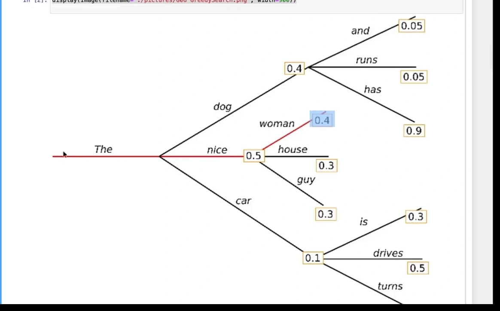
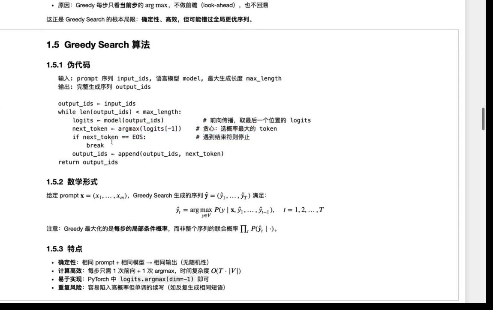
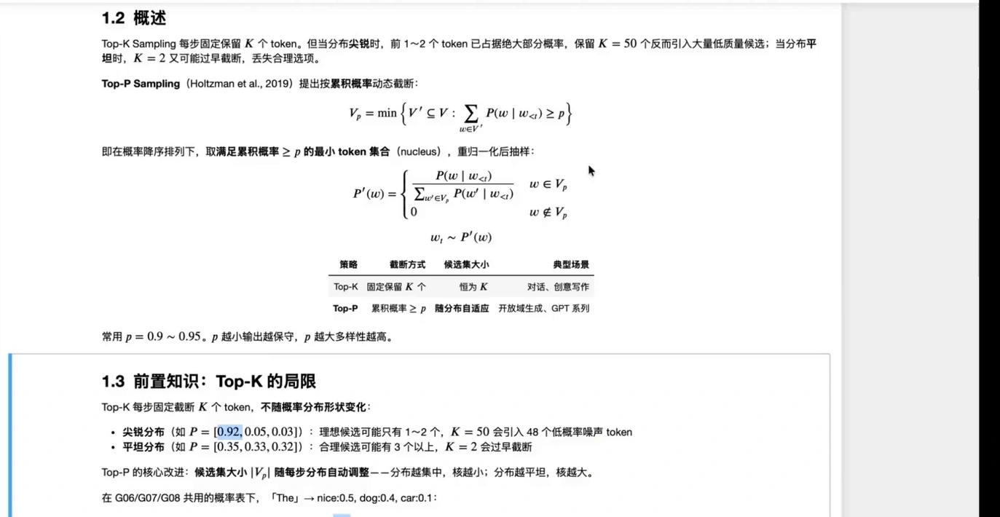
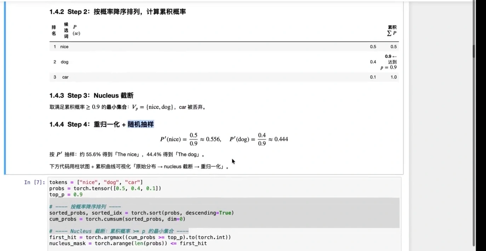
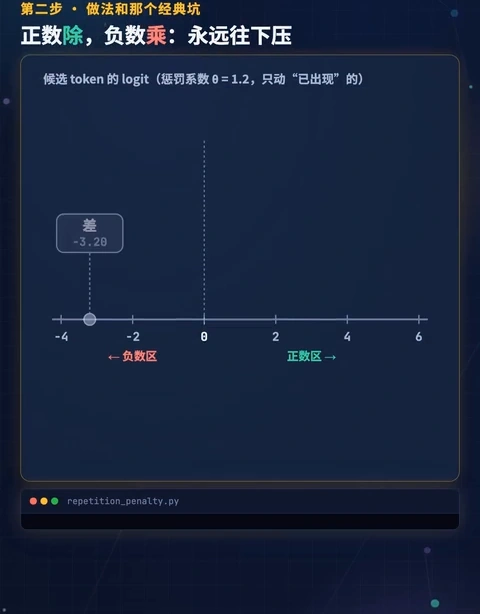

# 解码采样策略：Greedy Search、Top-K、Top-P 与重复惩罚



## 本讲要解决的核心问题（SCQA）

**背景**：大模型推理是自回归的——每前向一次，最后一层吐出一个覆盖整个词表的 logits 向量，softmax 之后得到"下一个 token"的条件概率分布（[【跳转到 01:43】](https://www.bilibili.com/video/BV1KbMw66EJx/?t=103)）。

**冲突**：模型给出的从来不是一个确定的词，而是一整张概率表。表里每个 token 都有概率，凭什么是这个而不是那个？同一个 prompt 问两遍，答案还可以不一样——这到底是缺陷还是设计？

**疑问**：从这张分布里"取一个 token"的动作叫什么？常见的有哪几种取法？每种取法的数学定义、代价和适用场景分别是什么？为什么模型说着说着会变成复读机，调一个"重复惩罚"就能治？

**回答（中心思想）**：从概率分布到最终 token 的这一动作就是**解码策略（decoding strategy）**，它和模型本身是两件事。本期课程按"确定性 → 随机性"排了一条线：**Greedy Search** 每步取 argmax，确定、最快，但只看局部；**Top-K / Top-P** 先截断候选集再随机抽样，用可控的随机性换多样性，其中 Top-P 按累积概率动态决定候选集大小，是工业界最常用的做法；**温度**只缩放分布形状、不改变排序；**重复惩罚**则在采样前对"已经出现过的 token"的 logit 动手，打断复读循环。三支视频分别对应这条线上的三段：G06 讲 Greedy Search，G09 讲 Top-K 的局限与 Top-P，最后一支一分钟短片专门拆解重复惩罚对 logits 做了什么。

---

## 一、解码策略在整条推理链路里的位置

大模型推理时逐步生成 token，每步前向成功后，模型最后一层输出的是 **logits 向量**（词表里每个 token 一个打分），对它做 softmax 就得到下一个 token 的条件概率分布；**如何从这个分布里选出 token，就是解码策略**（[【跳转到 02:03】](https://www.bilibili.com/video/BV1KbMw66EJx/?t=123)）。

写成数学形式：假设当前已生成序列 $w_{<t} = (w_1, \dots, w_{t-1})$，模型输出下一个 token 的条件分布

$$
P(w_t \mid w_{<t}) = \mathrm{softmax}\left(\mathbf{z}_t\right) = \frac{\exp\left(z_{t,w_t}\right)}{\sum_{v \in V} \exp\left(z_{t,v}\right)}
$$

其中 $\mathbf{z}_t$ 是第 $t$ 步的 logits 向量，$V$ 是整个词表。解码策略就是这个分布的**采样器**：它决定把哪个 $w_t$ 写回序列，然后进入下一步（[【跳转到 02:08】](https://www.bilibili.com/video/BV1KbMw66EJx/?t=128)）。

课程把常用策略归成五类（[【跳转到 00:05】](https://www.bilibili.com/video/BV1KbMw66EJx/?t=5)）：

| 策略 | 一句话本质 | 输出是否确定 |
| --- | --- | --- |
| Greedy Search | 每步取概率最大的 token | 确定 |
| Beam Search | 同时保留 $K$ 条候选路径，最后挑联合概率最高的一条 | 确定 |
| Top-K Sampling | 只在概率最高的 $K$ 个 token 里抽 | 随机 |
| Top-P Sampling | 只在累积概率达到 $p$ 的最小集合里抽 | 随机 |
| Temperature Sampling | 用温度系数改造分布形状后再抽 | 随机 |

前两类属于**贪心/搜索类**，后三类属于**随机采样类**，这是后面所有取舍的总纲（[【跳转到 09:09】](https://www.bilibili.com/video/BV1wETQ6qEbX/?t=549)）。

---

## 二、Greedy Search：每一步都拿当前最大的那个

### 2.1 定义与直观

Greedy Search（贪心搜索）是最基础、最直观的解码策略：**在每一步的概率分布上取概率最大的 token，用它继续解码**（[【跳转到 00:53】](https://www.bilibili.com/video/BV1KbMw66EJx/?t=53)）。形式上

$$
\hat{y}_t = \arg\max_{y \in V} P\left(y \mid \mathbf{x}, \hat{y}_1, \dots, \hat{y}_{t-1}\right), \qquad t = 1, 2, \dots, T
$$

注意它最大化的是**每一步的局部条件概率**，而不是整条序列的联合概率 $\prod_t P(\hat{y}_t \mid \cdot)$（[【跳转到 10:28】](https://www.bilibili.com/video/BV1KbMw66EJx/?t=628)）。

### 2.2 走一遍两步解码：局部最优为什么不等于全局最优

课程用一个以 `The` 为 prompt 的两步解码树做演示（[【跳转到 05:03】](https://www.bilibili.com/video/BV1KbMw66EJx/?t=303)）。第一步的三个候选是 `dog`（0.4）、`nice`（0.5）、`car`（0.1），Greedy 直接选 0.5 的 `nice`；第二步在 `nice` 之后，`woman`（0.4）/`house`（0.3）/`guy`（0.3）里又选最大的 `woman`，于是输出 `The nice woman`，联合概率约 $0.5 \times 0.4 = 0.20$。

但被放弃的 `dog` 分支其实更划算：`dog` 之后 `has` 的概率高达 0.9，走 `The dog has` 的联合概率约 $0.4 \times 0.9 = 0.36$，明显高于 0.20；第三条 `The car drives` 则只有 $0.1 \times 0.5 = 0.05$（[【跳转到 05:53】](https://www.bilibili.com/video/BV1KbMw66EJx/?t=353)）。

原因很直接：Greedy **每一步只看当前的最优解，不做前瞻（look-ahead），也不做回溯**，第一步选了 0.4 的 `dog`，就再也没有机会回头（[【跳转到 08:48】](https://www.bilibili.com/video/BV1KbMw66EJx/?t=528)）。讲者把这句总结成一句很像鸡汤的话：每一步都做了当时的最优选择，全局看却可能绕了弯路——**局部最优不等于全局最优**（[【跳转到 09:13】](https://www.bilibili.com/video/BV1KbMw66EJx/?t=553)）。

### 2.3 伪代码



```text
输入：prompt 序列 input_ids，语言模型 model，最大生成长度 max_length
输出：完整生成序列 output_ids

output_ids ← input_ids
while len(output_ids) < max_length:
    logits ← model(output_ids)              # 前向传播，取最后一个位置的 logits
    next_token ← argmax(logits[-1])         # 贪心：选概率最大的 token
    if next_token == EOS:                   # 遇到结束符则停止
        break
    output_ids ← append(output_ids, next_token)
return output_ids
```

真正落到 PyTorch 上只有两个核心算子：**先 `softmax` 得到概率分布，再 `argmax` 取最大 token**，外层套一个自回归的 `for` 循环，并把选中的 token 写回序列、判断是否遇到结束符（[【跳转到 12:08】](https://www.bilibili.com/video/BV1KbMw66EJx/?t=728)）。

### 2.4 优点、缺点与适用场景

Greedy 的优点非常明显：**确定性高**（相同 prompt + 相同模型 → 相同输出）、**计算高效**（每步只需 1 次前向 + 1 次 argmax，复杂度 $O(T \cdot \lvert V \rvert)$）、**易于实现**（一次 `argmax` 调用即可）、**内存友好**（[【跳转到 10:28】](https://www.bilibili.com/video/BV1KbMw66EJx/?t=628)）。

代价同样明显（[【跳转到 15:28】](https://www.bilibili.com/video/BV1KbMw66EJx/?t=928)）：

- **只能拿到局部最优**：不做前瞻、不回滚，好序列可能被第一步就错过；
- **缺乏多样性**：永远只选最大值，同一个 prompt 生成不出多个合理候选；
- **容易复读**：特别容易陷入高概率但单调的循环式续写，反复生成相同短语（[【跳转到 15:53】](https://www.bilibili.com/video/BV1KbMw66EJx/?t=953)）；
- **不适合开放场景**：创意写作、闲聊这类需要"意外之喜"的任务，确定性反而是缺点。

它适合的是**要稳定、要可复现**的地方：实时问答、代码补全、数学推理与基准测试、分类式生成等（[【跳转到 16:18】](https://www.bilibili.com/video/BV1KbMw66EJx/?t=978)）。

> **补充（非讲者原话）**：Beam Search 可以看作对 Greedy 的修正——每步保留得分最高的 $K$ 条**路径**而不是一个 token，最后按长度归一化的联合概率挑一条。代价是要同时维护 $K$ 条前缀、做 $K$ 倍的前向与排序，开销显著变高；课程把 Beam Search 放在 G07 单独讲，本讲只需记住"$K=1$ 的 Beam Search 就退化成 Greedy"。

### 2.5 在 HuggingFace 里怎么调出 Greedy

`model.generate` 用两个开关就能锁定 Greedy：把 `do_sample` 关掉（不随机采样）、把 `num_beams` 设为 1（不分叉）。课程特别提醒，这两组参数的组合关系是常见的面试考点（[【跳转到 14:13】](https://www.bilibili.com/video/BV1KbMw66EJx/?t=853)）：

- 采样关闭 + Beam 数 1 → **Greedy Search**；
- 采样关闭 + Beam 数大于 1 → **Beam Search**（Beam 本身就是贪心的推广，Beam 数为 1 时特例成 Greedy）；
- 采样开启 + 给 `top_k` / `top_p` → **随机采样**类。

所以看项目代码或面试时，不能看到 `generate` 就一句"跳过了"——每个参数怎么组合、各自等价于哪种策略，都是要能说清的（[【跳转到 15:03】](https://www.bilibili.com/video/BV1KbMw66EJx/?t=903)）。

---

## 三、Top-K：固定保留 K 个候选

Greedy 的"永远只选最大"是复读和多义丢失的根源，最简单的改造是：**每一步只保留概率最高的 $K$ 个 token，把其余概率清零，再在这 $K$ 个里重新归一化后随机抽样**（[【跳转到 03:48】](https://www.bilibili.com/video/BV1KbMw66EJx/?t=228)）。

$K$ 越大越多样、越小越保守。但 $K$ 是个**固定数**，它并不知道当前这张分布是"尖"还是"平"，问题就出在这里（[【跳转到 01:20】](https://www.bilibili.com/video/BV1wETQ6qEbX/?t=80)）：

- **分布尖锐时**，比如 $P = [0.92, 0.05, 0.03]$：合理候选其实只有 1~2 个，如果 $K=50$，后面 48 个概率极低的 token 全被放进来，等于往候选池里灌噪声；
- **分布平坦时**，比如 $P = [0.35, 0.33, 0.32]$：三个 token 质量非常接近，理论上都该保留，但 $K=2$ 会过早截断，把合理选项直接丢掉。

一句话：**固定 $K$ 与变化的分布形状不匹配**——这正是 Top-P 要解决的问题（[【跳转到 00:55】](https://www.bilibili.com/video/BV1wETQ6qEbX/?t=55)）。

---

## 四、Top-P（Nucleus Sampling）：按累积概率动态截断

### 4.1 定义

Top-P 又叫**核采样（Nucleus Sampling）**，出自 Holtzman 等人 2019 年的工作。核心思想是：**在概率降序排列后，取"累积概率刚好达到 $p$"的最小 token 集合**，只在这个集合（称为 nucleus，核）里采样，超出的部分直接丢弃（[【跳转到 02:10】](https://www.bilibili.com/video/BV1wETQ6qEbX/?t=130)）。



核的定义写成

$$
V_p = \min\left\{ V' \subseteq V \; : \; \sum_{w \in V'} P\left(w \mid w_{<t}\right) \ge p \right\}
$$

选出的 token 再在核内**重归一化**：

$$
P'\left(w\right) =
\begin{cases}
\dfrac{P\left(w \mid w_{<t}\right)}{\sum_{w' \in V_p} P\left(w' \mid w_{<t}\right)}, & w \in V_p \\[6pt]
0, & w \notin V_p
\end{cases}
$$

即 $w_t \sim P'(w)$。关键在于 $p$ 直接对应"保留多少概率质量"，与词表大小无关：**分布越集中，核越小；分布越平坦，核越大**（[【跳转到 02:35】](https://www.bilibili.com/video/BV1wETQ6qEbX/?t=155)）。

### 4.2 手算一遍：p = 0.9 时核里剩谁

沿用 G06 的同一张表 `The → nice: 0.5, dog: 0.4, car: 0.1`，取 $p = 0.9$（[【跳转到 03:25】](https://www.bilibili.com/video/BV1wETQ6qEbX/?t=205)）：

| 步骤 | 计算 | 结果 |
| --- | --- | --- |
| 降序排列 | nice 0.5 → dog 0.4 → car 0.1 | — |
| 累积概率 | 0.5 → 0.9 → 1.0 | 到 dog 时达到 0.9 |
| 截断 | 取最小满足集合 | $V_p = \{\text{nice}, \text{dog}\}$，car 被丢弃 |
| 重归一化 | $0.5 / 0.9$、$0.4 / 0.9$ | nice ≈ 0.556，dog ≈ 0.444 |

于是这一步约 55.6% 的概率得到 `The nice`、44.4% 得到 `The dog`（[【跳转到 04:15】](https://www.bilibili.com/video/BV1wETQ6qEbX/?t=255)）。同一个 prompt、同一个分布，只换 $p$，候选集大小就可以不同：

| $p$ | 累积过程 | 核大小 | 候选集 |
| --- | --- | --- | --- |
| 0.50 | nice 单独已达 0.50 | 1 | nice |
| 0.90 | nice(0.5) + dog(0.4) = 0.9 | 2 | nice, dog |
| 0.95 | 需加入 car 才达 1.0 | 3 | nice, dog, car |

这就是 Top-P 的**自适应特性**：不需要为不同模型、不同分布手调 $K$，只要给一个概率阈值（[【跳转到 03:00】](https://www.bilibili.com/video/BV1wETQ6qEbX/?t=180)）。



### 4.3 实现要点

PyTorch 里的核心就四行：`sort` 降序、`cumsum` 求累积概率、`argmax` 找第一个累积概率不小于 `top_p` 的位置、按 `nucleus_mask` 保留后重归一化再 `multinomial` 抽样（[【跳转到 04:40】](https://www.bilibili.com/video/BV1wETQ6qEbX/?t=280)）。

```python
tokens = ["nice", "dog", "car"]
probs = torch.tensor([0.5, 0.4, 0.1])
top_p = 0.9

# —— 按概率降序排列 ——
sorted_probs, sorted_idx = torch.sort(probs, descending=True)
cum_probs = torch.cumsum(sorted_probs, dim=0)

# —— Nucleus 截断：累积概率 >= p 的最小集合 ——
first_hit = torch.argmax((cum_probs >= top_p).to(torch.int))
nucleus_mask = torch.arange(len(probs)) <= first_hit
```

### 4.4 优点与缺点

Top-P 的四条优点（[【跳转到 12:54】](https://www.bilibili.com/video/BV1wETQ6qEbX/?t=774)）：相比 Top-K 能**自适应截断**（尖锐分布时核变小、更保守，平坦分布时核变大、更多样）；能**丢掉概率长尾**，在质量与多样性之间取得平衡；是**工业界最常用**的做法；**只有一个参数 $p$**，语义直观——$p$ 就是保留的概率质量。

四条缺点（[【跳转到 13:19】](https://www.bilibili.com/video/BV1wETQ6qEbX/?t=799)）：本质是随机采样，**输出不确定**；每一步都要**排序**，计算量比 argmax 大；$p$ 通常要试几组看效果；多样性足但**精确性不足**，不适合要求精确的任务。它适合开放域生成、对话、游戏、机器人、故事与诗歌、创意写作，实践中常与 Top-K 联用。

---

## 五、Temperature：只改形状，不改排序

温度不改变"谁大谁小"，只改变**高低概率之间的差距**。做法是在 softmax 之前把 logits 除以 $T$（[【跳转到 05:30】](https://www.bilibili.com/video/BV1wETQ6qEbX/?t=330)）：

$$
P_T\left(w \mid w_{<t}\right) = \frac{\exp\left(z_{w} / T\right)}{\sum_{v \in V} \exp\left(z_{v} / T\right)}
$$

以 `nice 0.5 / dog 0.4 / car 0.1` 为例（[【跳转到 06:45】](https://www.bilibili.com/video/BV1wETQ6qEbX/?t=405)）：

| $T$ | nice 的概率（原为 0.5） | 分布走向 |
| --- | --- | --- |
| 0.1（趋近 0） | ≈ 0.903 | 高概率被放大，接近 Greedy |
| 1.0 | 0.5 | 原始分布，不做改动 |
| 2.0 | ≈ 0.427 | 高概率被压低，差距缩小 |
| 5.0 | ≈ 0.373 | 更趋均匀，car 从 0.1 升到 ≈ 0.27 |

所以调 $T$ 就是在调"保守还是开放"：想让模型稳一点就把 $T$ 压小，想让它多样一点就把 $T$ 调大。$T=1$ 时退化为原始分布；$T \to 0$ 时越来越像 Greedy（[【跳转到 08:19】](https://www.bilibili.com/video/BV1wETQ6qEbX/?t=499)）。

> 温度缩放的完整推导（以及它与 logits、softmax 的关系）在上一讲 **1.1.3 输出层 Logits 计算、温度缩放与 Softmax 归一化** 中展开，这里只把它当作采样前的"分布调节旋钮"。

---

## 六、重复惩罚：在采样前把"说过的话"压下去

### 6.1 复读是怎么形成的

模型说着说着开始复读，原因可以一句话说清：**上下文里已经出现过这个词，模型给出它的下一步概率往往更高；越说越高，就掉进了循环**（[【跳转到 00:10】](https://www.bilibili.com/video/BV1s8HT6HEEu/?t=10)）。要打破循环，就得在采样前把"已经出现过的 token"往下压一压（[【跳转到 00:16】](https://www.bilibili.com/video/BV1s8HT6HEEu/?t=16)）。

### 6.2 经典做法：正数除，负数乘

最直接的做法是对已出现 token 的 logit 除以惩罚系数 $\theta$（常见取值 1.2）。但这里有个坑：**logit 是负数时，除以 1.2 反而变大了**，等于在奖励它。所以实现上要分情况（[【跳转到 00:21】](https://www.bilibili.com/video/BV1s8HT6HEEu/?t=21)）：

$$
z'_{w} =
\begin{cases}
\dfrac{z_{w}}{\theta}, & z_{w} > 0 \\[6pt]
z_{w} \cdot \theta, & z_{w} \le 0
\end{cases}
\qquad \theta > 1
$$

正数除以大于 1 的 $\theta$ 会变小，负数乘以大于 1 的 $\theta$ 会更负——两条路都保证**永远往下压**。这正是 HuggingFace `repetition_penalty` 的实现方式（[【跳转到 00:29】](https://www.bilibili.com/video/BV1s8HT6HEEu/?t=29)）。



### 6.3 OpenAI 的另一条路：做减法

OpenAI 系接口不在 logit 上做乘除，而是直接**减**，并拆成两个参数（[【跳转到 00:37】](https://www.bilibili.com/video/BV1s8HT6HEEu/?t=37)）：

$$
z'_{w} = z_{w} - \alpha \cdot c_{w} - \beta \cdot \mathbf{1}\left[c_{w} > 0\right]
$$

其中 $c_w$ 是该 token 在已生成文本中出现的次数，$\alpha$ 是频率惩罚（frequency penalty，**出现几次减几分**），$\beta$ 是存在惩罚（presence penalty，**出现过就减一份**，不论几次）。前者压"高频词"，后者压"已经聊过的话题"。

### 6.4 一个容易踩的坑

HuggingFace 的重复惩罚**会把 prompt 一起算进去**——它对"上下文里所有已出现的 token"统一处理，而不仅是生成部分（[【跳转到 00:45】](https://www.bilibili.com/video/BV1s8HT6HEEu/?t=45)）。做摘要、问答这类需要**引用原文**的任务时，这会让模型不敢重复原文里的关键词，输出变得畏手畏脚。使用时要知道这个边界。

> **面试怎么答**：重复惩罚作用于采样**之前**的 logits——对已出现 token，正数除、负数乘，保证 logit 单调下降；OpenAI 路线改为对出现次数/是否出现做减法；注意 HuggingFace 实现会把 prompt 一并惩罚（[【跳转到 00:51】](https://www.bilibili.com/video/BV1s8HT6HEEu/?t=51)）。

---

## 七、把参数放到一起：怎么选

| 想要的效果 | 选什么 | 关键参数（HuggingFace） | 代价 |
| --- | --- | --- | --- |
| 完全可复现、要稳定 | Greedy Search | 采样关闭、Beam 数 1 | 单一输出、易复读 |
| 要更优的整句、可接受变慢 | Beam Search | Beam 数大于 1 | 多路径前向，开销高 |
| 要多样性又要挡掉长尾 | Top-P | 采样开启、`top_p` 0.9、`top_k` 0 | 每步排序、输出不确定 |
| 粗粒度限制候选池 | Top-K | `top_k` 取 40~50 | 固定 $K$ 不适应分布形状 |
| 整体更保守/更发散 | Temperature | `temperature` 取 0.7~1.0 | 过高会输出无意义内容 |
| 抑制复读 | 重复惩罚 | `repetition_penalty` 取 1.1~1.2（或 `frequency_penalty`） | 过高会伤及必要重复 |

课程给出的实践建议是：**Top-P 用得多、Top-K 用得少**，常见取值 `top_k` 40~50、`top_p` 0.9~0.95；HuggingFace 里想跑 Top-P 要同时开启采样（`do_sample` 为真）、关闭 Top-K（`top_k` 设为 0）、`top_p` 设 0.9、`temperature` 设 0.8（[【跳转到 12:29】](https://www.bilibili.com/video/BV1wETQ6qEbX/?t=749)）。

> **补充（非讲者原话）**：现代推理引擎（vLLM、SGLang、TensorRT-LLM）把这套参数做成了采样器链：先按重复惩罚/频率惩罚改 logits，再按温度缩放，最后做 Top-K → Top-P 截断并抽样；`top_k` 为 0 / `top_p` 为 1.0 表示该层关闭。这也是为什么线上服务里"同一个模型、不同采样配置"能表现出完全不同的性格。

---

## 八、小结

- **解码策略是模型之外的一层**：logits → softmax 得到分布，策略决定怎么从分布里取 token（[G06 02:03](https://www.bilibili.com/video/BV1KbMw66EJx/?t=123)）。
- **Greedy** 每步 argmax，确定性最强、开销最低，但只做局部最优、易复读；采样关闭、Beam 数 1 即 Greedy（[G06 14:13](https://www.bilibili.com/video/BV1KbMw66EJx/?t=853)）。
- **Top-K** 固定保留 $K$ 个，$K$ 与分布形状不匹配，尖锐时引噪声、平坦时截断过早（[G09 01:20](https://www.bilibili.com/video/BV1wETQ6qEbX/?t=80)）。
- **Top-P** 取累积概率 $\ge p$ 的最小集合再重归一化抽样，$p$ 直接对应保留的概率质量，自适应且是工业界默认选择（[G09 02:10](https://www.bilibili.com/video/BV1wETQ6qEbX/?t=130)）。
- **温度**只压缩/拉伸分布形状、不改变排序；$T \to 0$ 近似 Greedy，$T$ 越大越均匀（[G09 06:45](https://www.bilibili.com/video/BV1wETQ6qEbX/?t=405)）。
- **重复惩罚**在采样前对已出现 token 的 logit 下手：正数除、负数乘；OpenAI 用频率/存在惩罚做减法；注意 HuggingFace 会把 prompt 一起罚（[重复惩罚 00:21](https://www.bilibili.com/video/BV1s8HT6HEEu/?t=21)）。

---

## 视频来源

| 视频 | 覆盖内容 | 时长 |
| --- | --- | --- |
| [G06 大模型解码采样策略——Greedy Search](https://www.bilibili.com/video/BV1KbMw66EJx/) | Greedy 的定义、树状示意图、伪代码与 PyTorch 实现、HuggingFace 参数、优缺点 | 约 17 分钟 |
| [G09 大模型解码采样策略——Top-P Sampling](https://www.bilibili.com/video/BV1wETQ6qEbX/) | Top-K 的局限、Top-P 的定义与手算、温度系数、实现与优缺点 | 约 14 分钟 |
| [重复惩罚对 logits 做了什么](https://www.bilibili.com/video/BV1s8HT6HEEu/) | 复读成因、正数除负数乘、频率/存在惩罚、HuggingFace 的 prompt 惩罚坑 | 约 1 分钟 |
