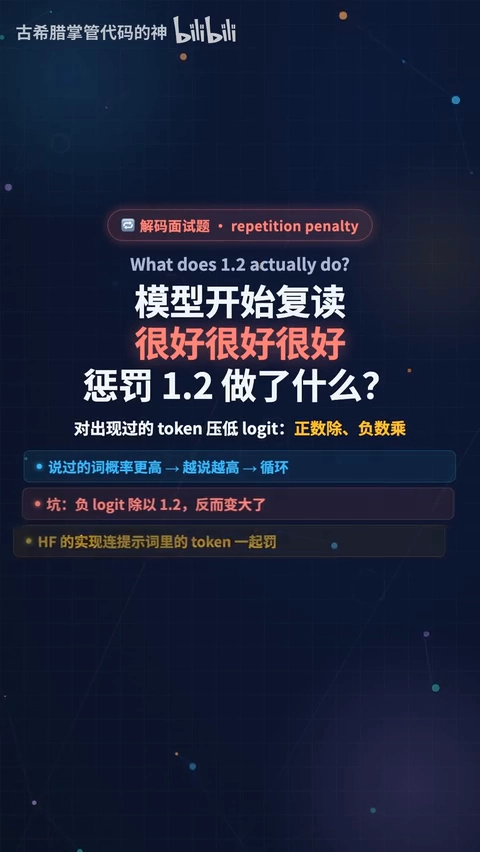
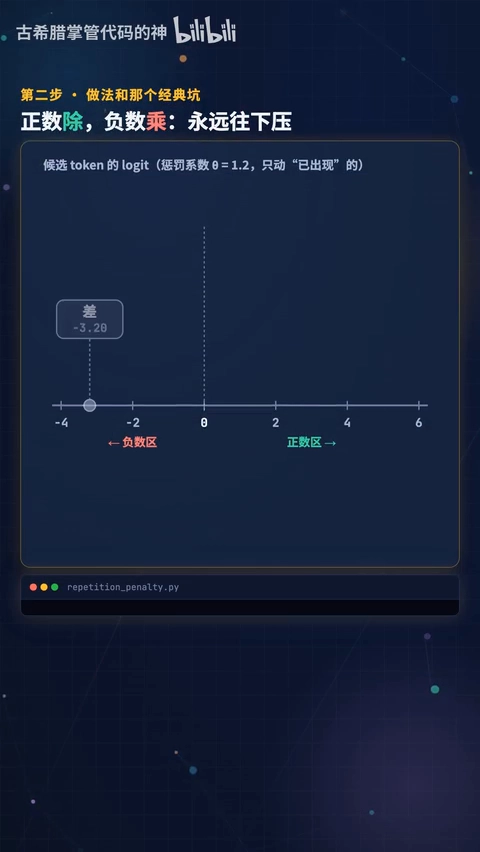
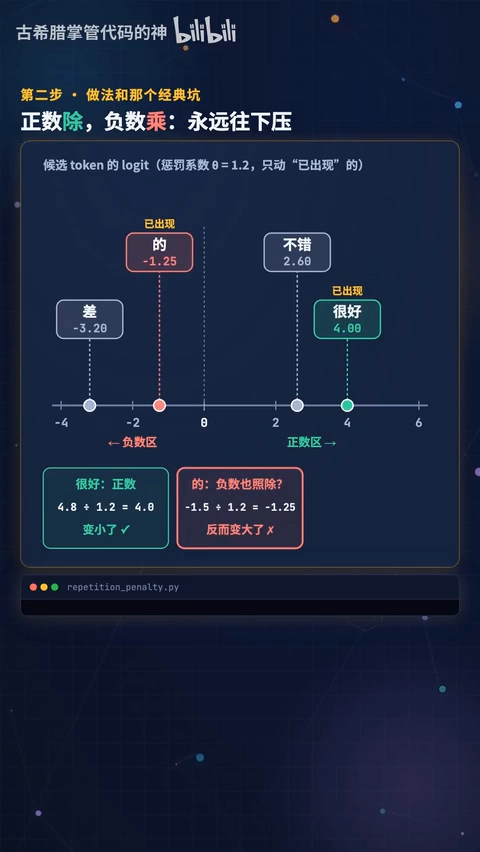
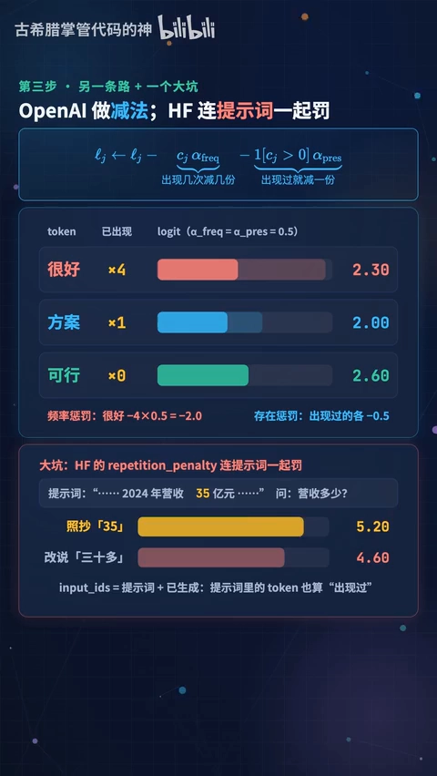

# 重复惩罚只改 logits：它怎么把复读的分数压下去

> 视频来源：[重复惩罚对 logits 做了什么](https://www.bilibili.com/video/BV1s8HT6HEEu/?t=0)（Bilibili）
> 本文基于视频演说图文稿整理，配图截自视频。

## 本讲要解决的核心问题（SCQA）

**背景**：模型说着说着开始复读，"很好很好很好"这五个字能连着吐出来 [【跳转到 00:00】](https://www.bilibili.com/video/BV1s8HT6HEEu/?t=0)。把重复惩罚（repetition penalty）从默认值调到 1.2，问题往往就好了 [【跳转到 00:02】](https://www.bilibili.com/video/BV1s8HT6HEEu/?t=2)。

**冲突**：调好了，但你未必说得清它到底做了什么。它并不改模型、不改采样器，只改一样东西——**logits**。而一涉及"把分数压下去"，就冒出一个反直觉的坑：logit 是负数的时候，除以 1.2 反而让它变大了，等于在奖励复读。

**疑问**：复读到底是怎么产生的？惩罚系数 1.2 对 logits 做了什么运算？负数为什么要特殊处理？

**回答（中心思想）**：复读的根子是"上下文里出现过的词，下一步的概率往往更高，越说越高就掉进循环"。所以重复惩罚只做一件事：**在采样之前，把已经出现过的 token 的 logit 压低**。压低的写法是"正数除以系数、负数乘以系数"，以保证无论正负都往下走；OpenAI 走的是另一条路——做减法（频率惩罚与存在惩罚）；而 HuggingFace 的实现还有一个坑：它把提示词里的 token 也算作"出现过"，于是连提示词一起罚。

---

## 一、复读从哪里来：越说越高，越说越想说

先看现象。自回归生成是"把已生成的 token 拼回输入，再预测下一个"，所以**说过的词一直在上下文里**。而在这种上下文下，同一个词再次出现的条件概率往往更高 [【跳转到 00:10】](https://www.bilibili.com/video/BV1s8HT6HEEu/?t=10)：模型看到"很好"后面跟着"很好"，就更倾向于认为这里还该是"很好"。

于是形成一个自我强化的闭环：

1. 生成一次"很好" → 上下文里多了一个"很好"；
2. 上下文里"很好"更多 → 下一步"很好"的概率被进一步推高；
3. 概率更高 → 更容易再抽到"很好" → 回到第 1 步。

**越说越高，越说越想说**，这就是"掉进循环"。这个机制跟 Greedy Search 的复读倾向是同一个根：贪心只是把"更容易抽到"变成了"必然抽到"，而更狠。

## 二、做法很直接：在采样前把说过的词压一压

要打破循环，就**得在采样前把说过的词压一压** [【跳转到 00:16】](https://www.bilibili.com/video/BV1s8HT6HEEu/?t=16)。注意这个动作的时机和对象：它发生在 softmax 与采样**之前**，动的不是概率，而是概率的原料——logits。

做法：**对已经出现过的 token，把它的 logit 除以惩罚系数 $\theta$**（例如 $\theta = 1.2$），没出现过的 token 一个都不动。

**为什么是"除"而不是"减"**：除以 1.2 相当于乘以 0.833，把原来领先的分数按比例缩水，名列前茅的 token 被拉近、但不会被一刀砍断；而减法是"一律扣掉同样的分"，对高分的压制力度与对低分的压制力度相同，不够精细。这也是后面要讲的两种流派的分野。

这张图标出的是"惩罚系数 $\theta = 1.2$，只动已出现的 token"这个前提。横轴是 logit 的取值范围，负数区在零点左边，正数区在右边——这条零线就是下一个坑的边界。

## 三、那个经典坑：负 logit 除以 1.2 反而变大了

视频把最典型的两个例子摆出来对照 [【跳转到 00:21】](https://www.bilibili.com/video/BV1s8HT6HEEu/?t=21)：

| token | 原始 logit | 简单除以 1.2 | 结果 |
| --- | --- | --- | --- |
| 很好（已出现） | 4.8 | 4.8 ÷ 1.2 = 4.0 | 变小了，符合预期 |
| 的（已出现） | −1.5 | −1.5 ÷ 1.2 = −1.25 | **反而变大了**，等于奖励复读 |

问题出在符号上。**负数除以一个大于 1 的数，绝对值变小，数值本身向 0 靠近——也就是变大了**。−1.5 变成 −1.25，这个 token 在 softmax 之后拿到的概率不降反升。

这里要记住 logit 的语义：它是"打分的原始值"，**越大越好**（越可能被选中）。所以"把 logit 往下压"这句话，在正数区是"变小"，在负数区是"变得更负"，两边方向相反的写法不能混用。

**所以必须分情况** [【跳转到 00:29】](https://www.bilibili.com/video/BV1s8HT6HEEu/?t=29)：

$$
z_i \leftarrow
\begin{cases}
z_i / \theta & z_i > 0 \\[1mm]
z_i \times \theta & z_i \le 0
\end{cases}
$$

- 正数：除以 $\theta$（4.8 → 4.0），分数变小；
- 负数：乘以 $\theta$（−1.5 → −1.8），绝对值变大、数值更负。

两条分支的共同效果只有一句话：**保证永远往下压**。这也是面试时最容易被追问的那个点——为什么不能简单地一律除法？因为在负数上它会变成奖励。

## 四、OpenAI 的另一条路：不做除法，做减法

视频接着说，OpenAI 走的是另一条路：**做减法** [【跳转到 00:37】](https://www.bilibili.com/video/BV1s8HT6HEEu/?t=37)。它把"重复"拆成两个可分别调节的量：

- **频率惩罚（frequency penalty）**：按出现次数扣分，**出现几次减几分**；
- **存在惩罚（presence penalty）**：不管出现几次，**只要出现过就减一份**。

写成式子是（$\alpha_{\text{freq}}$ 与 $\alpha_{\text{pres}}$ 是两个系数，$c_j$ 是 token $j$ 在上下文里出现的次数，$\mathbf{1}[c_j > 0]$ 表示"出现过就取 1，否则取 0"）：

$$
\ell_j \leftarrow \ell_j - c_j \alpha_{\text{freq}} - \mathbf{1}[c_j > 0] \alpha_{\text{pres}}
$$

**两者的分工**：频率惩罚管"重复得多不多"，出现越多扣得越狠，专门治"同一个词反复刷屏"；存在惩罚管"有没有出现过"，只要露过面就扣一次，作用是鼓励模型**换个说法**，而不是换个话题。视频的示例里两个系数都取 0.5，并列出三个 token 的出现次数与页面上的 logit 数值：很好出现 4 次、方案出现 1 次、可行出现 0 次（2.60）；按频率惩罚算，很好要被扣掉 $4 \times 0.5 = 2.0$，按存在惩罚算，出现过的两个各再扣 0.5。

**和除法的差别**：除法是"按比例缩水"，分数越高缩得越狠，天然有界——一个 logit 除以 $\theta$ 之后只会变向 0，不会翻到负无穷；减法是"按额度扣分"，扣多扣少由出现次数决定，压得更直白，但也更容易把一个本来该用的词压到不可能。

## 五、HuggingFace 的坑：它连提示词一起罚

第二个要小心的地方在实现层。**HuggingFace 的重复惩罚会把提示词里的 token 一起罚** [【跳转到 00:45】](https://www.bilibili.com/video/BV1s8HT6HEEu/?t=45)。

原因很容易理解：它统计"出现过"时，看的是 `input_ids`——而 `input_ids` 是"提示词 + 已生成的 token"。所以提示词里出现过的词，在第一步生成时就已经被算作"出现过"。

这会在**摘要、问答**这类任务上造成很反直觉的后果：**模型反而不敢引用原文**。视频给的例子是：

> 提示词是"……2024 年营收 **35 亿元**……"，问：营收多少？

- 照抄「35」给它 5.20 分（原始倾向）；
- 改说「三十多」给它 4.60 分。

如果只看原始倾向，模型当然该答"35 亿"。但「35」这个 token 在提示词里已经出现过，被重复惩罚扣了一刀，于是"照抄原文"这条最正确的路反而被压低了。**惩罚的对象搞错了**：它想惩罚的是"生成时自己的复读"，结果罚到了"用户给的输入"。

这也解释了为什么调参时要区分场景：对话、创意写作里查重式的惩罚是好事；但在需要逐字引用的场景里，惩罚系数要保守，或者干脆别开（用频率惩罚这类按次数计算的方案时，也要意识到计数里含着提示词）。

## 六、面试三句话：把机制、写法、坑一次说全

视频最后用三句话做了收口 [【跳转到 00:51】](https://www.bilibili.com/video/BV1s8HT6HEEu/?t=51)：

1. **对出现过的 token 压低 logit**——惩罚发生在采样之前，改的是 logits，不是概率、不是模型权重；
2. **正数除、负数乘**——保证正负两侧都往下压，避免"负 logit 除以系数反而变大"这个坑；
3. **OpenAI 用减法**——频率惩罚按次数减、存在惩罚只减一份；并且**小心它连提示词一起罚** [【跳转到 00:59】](https://www.bilibili.com/video/BV1s8HT6HEEu/?t=59)。

## 小结

- 复读的成因是自我强化：说过的词留在上下文里，下一步的概率被推得更高，越说越高就掉进循环。
- 重复惩罚的时机是采样之前，对象是已出现 token 的 logits——只改这一个量。
- 常见写法是"除以惩罚系数 $\theta$"（如 1.2）；但**负数除以大于 1 的系数会变大**，等于奖励复读，所以必须分情况：正数除、负数乘，永远往下压。
- OpenAI 走减法：频率惩罚按出现次数扣分、存在惩罚只扣一份，二者分别管"重复得多不多"和"有没有出现过"。
- HuggingFace 的实现把提示词也算进"出现过"，在摘要、问答等需要引用原文的任务上会让模型不敢引用，调参时要留意。
- 三句话记住它：压低已出现 token 的 logit；正数除负数乘；OpenAI 用减法，小心连提示词一起罚。

## 关键术语速查

| 术语 | 一句话解释 |
| --- | --- |
| logits | 模型输出的原始打分，未归一化、可正可负，数值越大越容易被选中 |
| 重复惩罚（repetition penalty） | 采样前把已出现 token 的 logit 压低的系数，常见取 1.2 |
| 惩罚系数 $\theta$ | 除法写法里的除数，大于 1 时对正 logit 起压制作用 |
| 频率惩罚（frequency penalty） | 按出现次数扣分的减法方案，出现几次扣几分 |
| 存在惩罚（presence penalty） | 只要出现过就扣一份的减法方案，作用是鼓励换说法 |
| input_ids | HuggingFace 里送进模型的完整输入，包含提示词与已生成部分 |
| 复读循环 | 上下文里重复词越多、下一步概率越高，从而不断自我强化的生成退化现象 |
