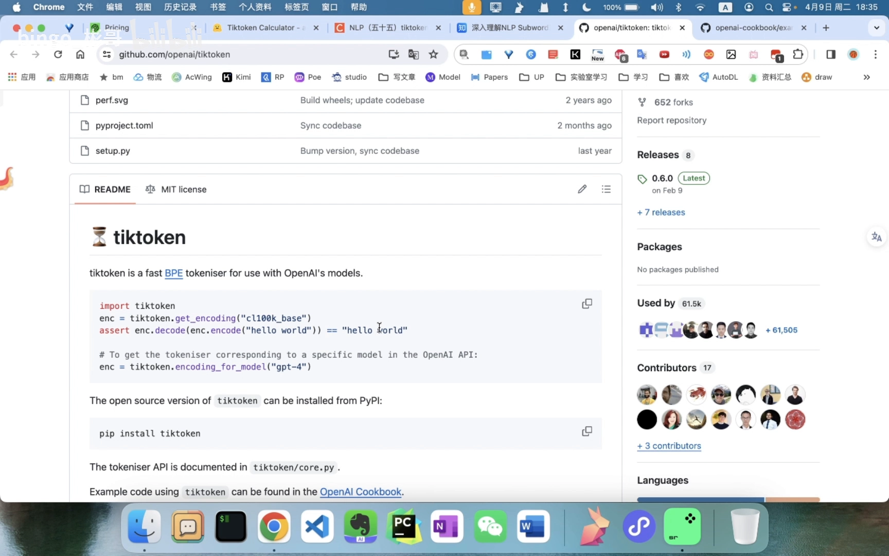
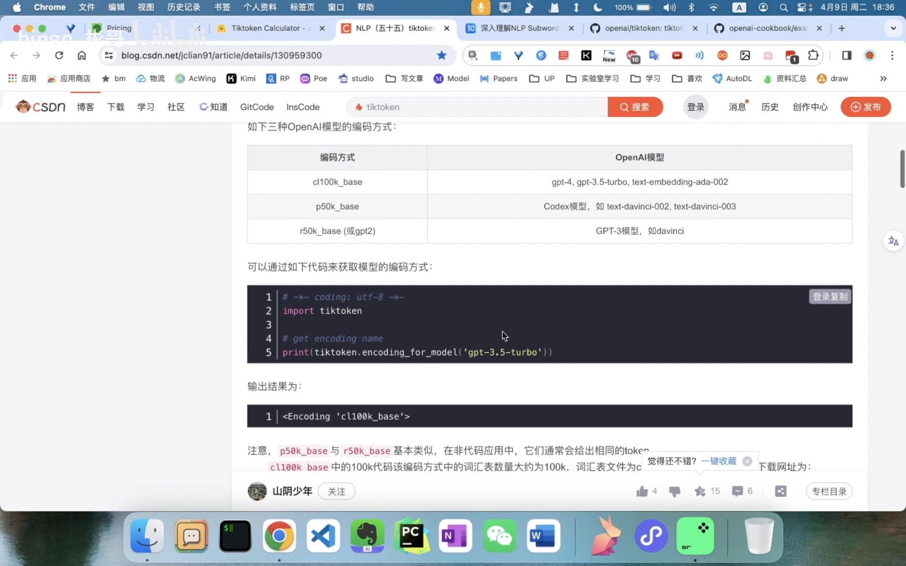
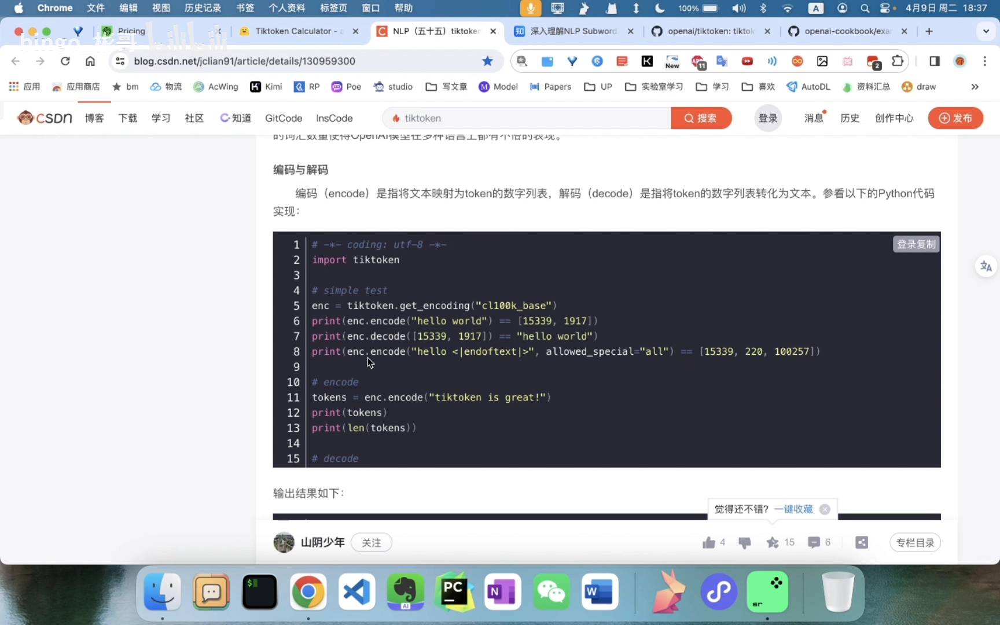
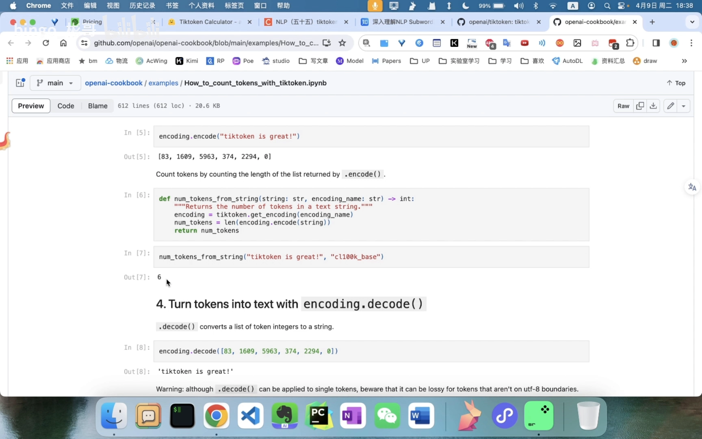
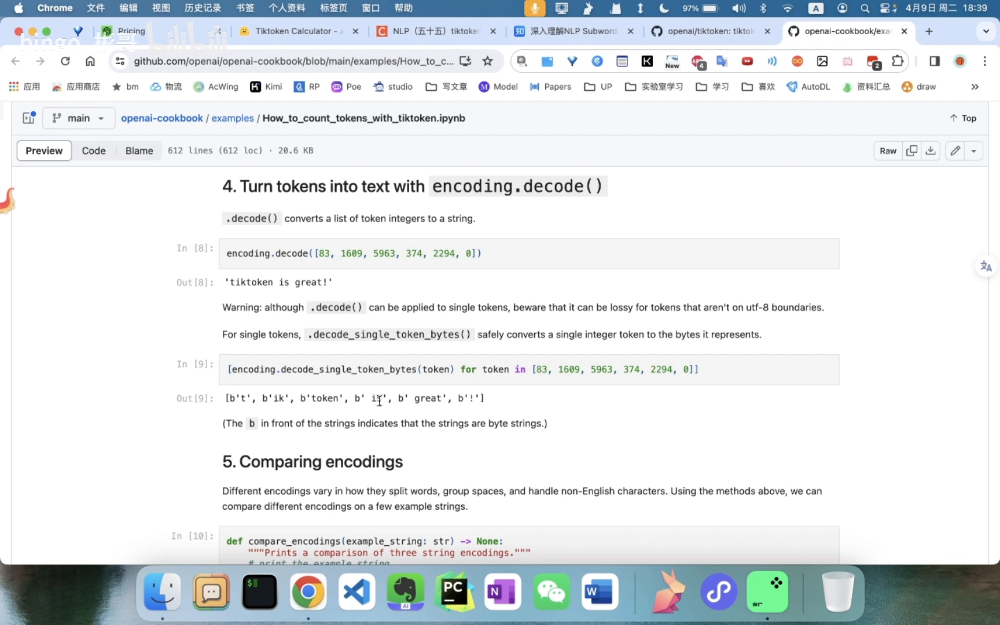
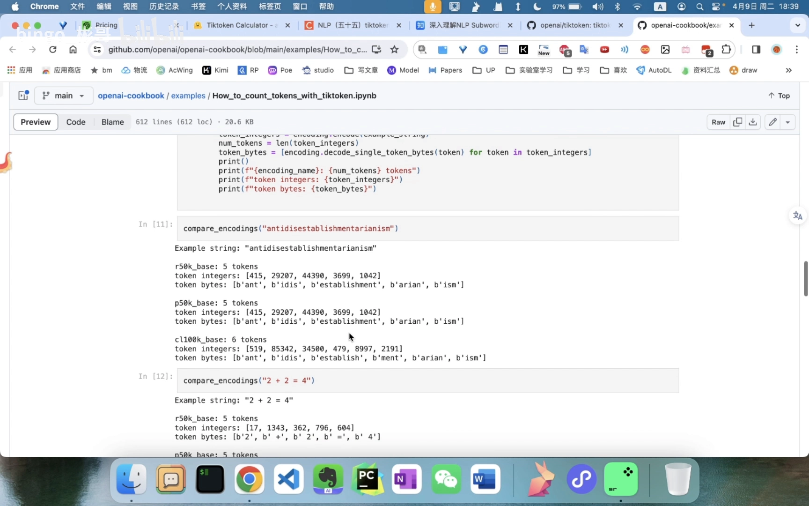
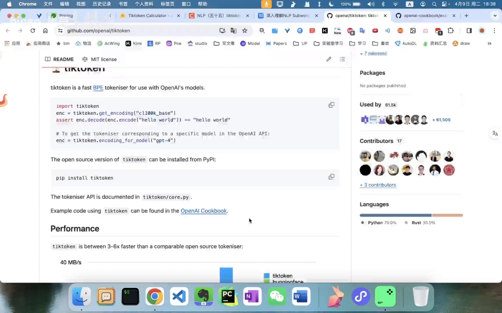
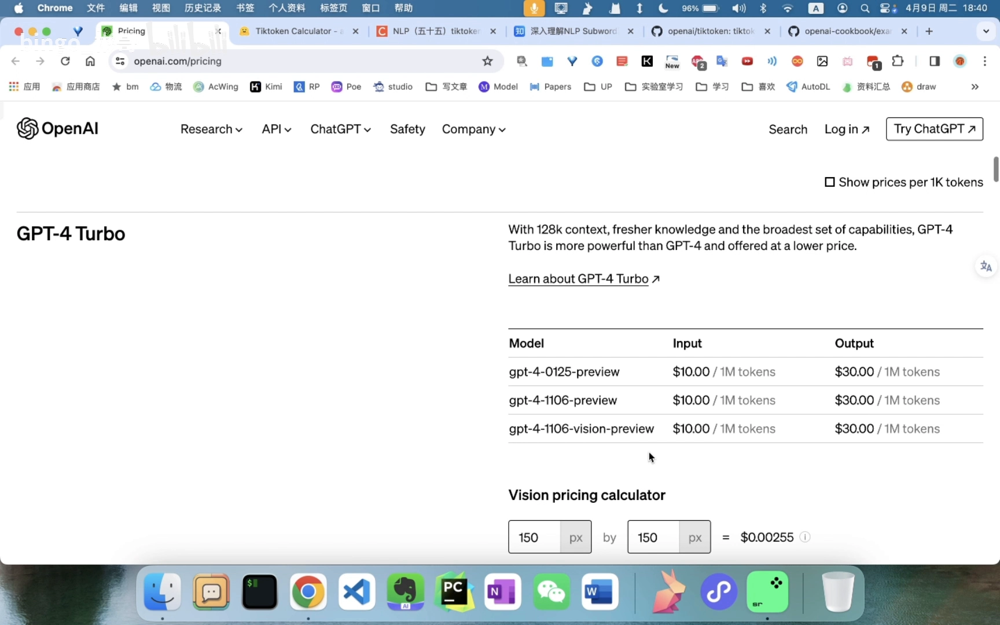
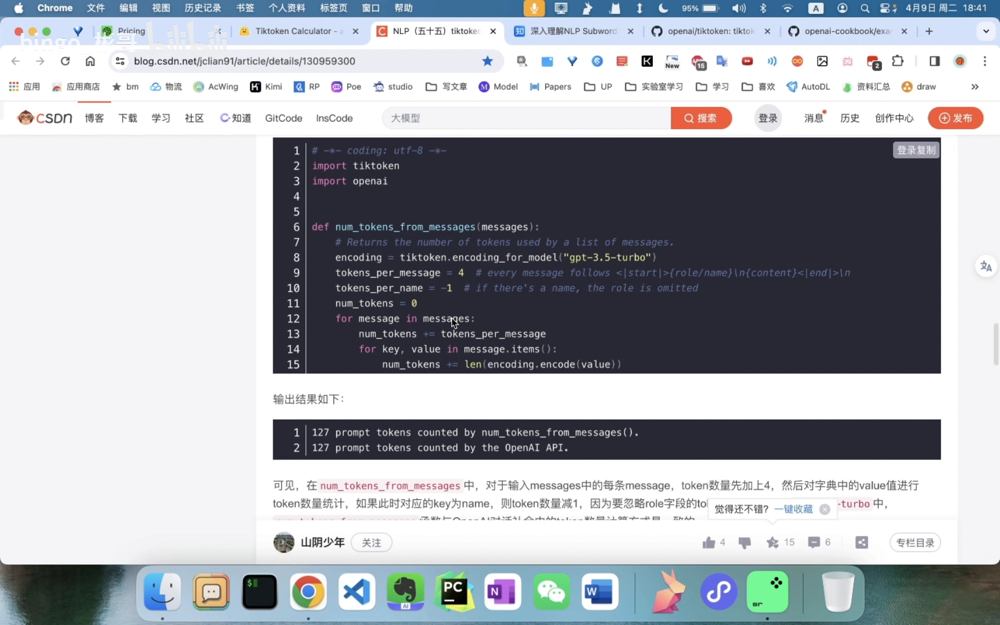

# tiktoken 实操：把 BPE 训练好的词表装成能查能编的编码器

> 视频来源：[tiktoken介绍](https://www.bilibili.com/video/BV1dC41157r5/?t=0)（Bilibili）
> 本文基于视频演说图文稿整理，配图截自视频。

## 本讲要解决的核心问题（SCQA）

**背景**：上一节讲的是 BPE 怎么"训练"：统计最高频相邻对、合并、最后落成 `vocab` 与 `merges` 两份文件。

**冲突**：这两份文件只是数据。真正在业务里天天要用的，是围绕它们的一圈操作——把一段文本变成 id 列表、把 id 列表变回文本、搞清楚某个 OpenAI 模型用的是哪套词表、以及这段文本到底会花多少钱。这些如果每次都自己写，既慢又容易和官方实现不一致。

**疑问**：有没有现成的库，装好就能编、能解、能数 token？

**回答（中心思想）**：**tiktoken 是 OpenAI 的 BPE 词表加载与编解码库**。它只有两条加载路径（按模型名、按编码名），三个必会接口（`encode`、`decode`、`decode_single_token_bytes`），外加一个现实动机：OpenAI 按 token 计费，所以"数 token"本身就是刚需。它的卖点是速度——比同类开源 tokenizer 快 3～6 倍。

---

## 一、tiktoken 是什么：BPE 词表的加载器加高速编解码器



视频开场先给定位：tiktoken 是 OpenAI 下面的一个 Python 库，主要实现的是 **BPE 算法的加载**——BPE 是子词切分（subword tokenization）的一种算法，常见的 subword 算法还有 WordPiece、Unigram 等，它们的差别主要在"怎么筛选子词进行合并、怎么控制词表大小" [【跳转到 00:05】](https://www.bilibili.com/video/BV1dC41157r5/?t=5)。

官方仓库的 README 写得很短 [【跳转到 00:30】](https://www.bilibili.com/video/BV1dC41157r5/?t=30)，核心就三句话：

```python
import tiktoken
enc = tiktoken.get_encoding("cl100k_base")
assert enc.decode(enc.encode("hello world")) == "hello world"

# To get the tokeniser corresponding to a specific model in the OpenAI API:
enc = tiktoken.encoding_for_model("gpt-4")
```

这段代码其实已经把库的契约讲完了：`encode` 之后必须能 `decode` 回原文，这是最基本的一致性保证；而"某个模型对应哪套编码"由库帮你查表，不用自己记。

安装就是一把梭：`pip install tiktoken`。仓库作者还特别把"速度"写进了 README——和同类的开源 tokenizer（视频里对比的是 HuggingFace 的实现）相比，它快 3～6 倍，所以加载和编码都快 [【跳转到 00:55】](https://www.bilibili.com/video/BV1dC41157r5/?t=55)。

---

## 二、两种加载方式：按模型名，或按编码名



编码方式（encoding）就是"一套具体的词表 + 合并规则"。tiktoken 支持两种拿法。

**第一种：按模型名拿。** 视频里跑的是 [【跳转到 01:30】](https://www.bilibili.com/video/BV1dC41157r5/?t=90)：

```python
print(tiktoken.encoding_for_model("gpt-3.5-turbo"))
# <Encoding 'cl100k_base'>
```

好处是"你不需要记具体用的是哪套编码"——`gpt-3.5-turbo` 自动映射到 `cl100k_base`，也就是那个词表约 10 万条的编码 [【跳转到 01:35】](https://www.bilibili.com/video/BV1dC41157r5/?t=95)。换模型，映射跟着换。

**第二种：直接报编码名。** 用 `get_encoding` 传入编码名即可 [【跳转到 01:54】](https://www.bilibili.com/video/BV1dC41157r5/?t=114)：

```python
enc = tiktoken.get_encoding("cl100k_base")
```

三种常见编码的对应关系 [【跳转到 01:19】](https://www.bilibili.com/video/BV1dC41157r5/?t=79)：

| 编码方式 | 对应的 OpenAI 模型 |
| --- | --- |
| cl100k_base | gpt-4、gpt-3.5-turbo、text-embedding-ada-002 |
| p50k_base | Codex 系模型，如 text-davinci-002、text-davinci-003 |
| r50k_base（也可写作 gpt2） | GPT-3 系模型，如 davinci |

视频里补了一句实用提醒：`p50k_base` 和 `r50k_base` 基本类似，在非代码场景里往往给出相同的 token 切分 [【跳转到 01:35】](https://www.bilibili.com/video/BV1dC41157r5/?t=95)。

---

## 三、encode：文本进去，id 列表出来



拿到 encoding 对象后，`encode` 把字符串变成一组整数 [【跳转到 02:04】](https://www.bilibili.com/video/BV1dC41157r5/?t=124)：

```python
enc = tiktoken.get_encoding("cl100k_base")
print(enc.encode("hello world"))   # [15339, 1917]
```

两个 token 就装下了 `hello world`——从结果看，空格被并进了第二个 token，这正是上一节"保护空格"规则的效果。但并不是所有文本都这么省——视频强调：**tiktoken 不是按单词切分的**，理论上一个单词完全可能被拆成多段 [【跳转到 02:29】](https://www.bilibili.com/video/BV1dC41157r5/?t=149)。

这段代码里还有一个容易被忽略的细节：特殊 token 要显式放行。

```python
print(enc.encode("hello <|endoftext|>", allowed_special="all"))
# [15339, 220, 100257]
```

`<|endoftext|>` 这种预训练时插入的文档分隔符，默认不会被当成普通文本拆开；把参数 `allowed_special` 设为 all 之后，它整体是一个 token（`100257`），前面那个 `220` 才是空格。

---

## 四、decode 与 decode_single_token_bytes：把切分看清楚



`decode` 是 `encode` 的逆操作，把 id 列表还原成字符串 [【跳转到 03:10】](https://www.bilibili.com/video/BV1dC41157r5/?t=190)：

```python
print(enc.decode([15339, 1917]))   # hello world

tokens = enc.encode("tiktoken is great!")
print(tokens)        # [83, 1609, 5963, 374, 2294, 0]
print(len(tokens))   # 6
```

`tiktoken is great!` 是 6 个 token——不是 3 个"单词"，也不是按字符数算出来的。想知道这 6 个 id 各自代表什么，就要用 `decode_single_token_bytes` 一个一个看：

```python
[enc.decode_single_token_bytes(t) for t in [83, 1609, 5963, 374, 2294, 0]]
# [b't', b'ik', b'token', b' i', b' great', b'!']
```



前导的 `b` 表示这是字节串（bytes）。从这六段就能直接读出 BPE 的痕迹：`tiktoken` 这个"词"被拆成 `t`、`ik`、`token` 三段，中间的空格则挂在 ` i` 和 ` great` 前面 [【跳转到 03:10】](https://www.bilibili.com/video/BV1dC41157r5/?t=190)。

这也解释了为什么"整句 decode"安全、"单个 token decode"要小心：有些 token 只是某个多字节 UTF-8 字符的一部分，单独解码可能得到不完整的字符。所以官方推荐单个 token 用 `decode_single_token_bytes` 看字节，而不是直接 `decode` 成字符串。

---

## 五、不同 encoding 切法不同：同一个词可能是 5 个 token，也可能是 6 个



视频接着做了一个横向对比：同一个字符串喂给不同 encoding，切分结果会不同 [【跳转到 03:35】](https://www.bilibili.com/video/BV1dC41157r5/?t=215)。最直观的是那个经典的超长单词 `antidisestablishmentarianism`：

| 编码 | token 数 | 切分结果 |
| --- | --- | --- |
| r50k_base | 5 | ant / idis / establishment / arian / ism |
| p50k_base | 5 | ant / idis / establishment / arian / ism |
| cl100k_base | 6 | ant / idis / establish / ment / arian / ism |

差别就在 `establishment` 这一段：老编码把它整段当一个 token，cl100k 则拆成 `establish` + `ment`。这也说明"词表是怎么训练出来的"直接决定"文本会被怎么切" [【跳转到 04:00】](https://www.bilibili.com/video/BV1dC41157r5/?t=240)。

数字和符号也一样逃不掉：`2 + 2 = 4` 在示例里同样是 5 个 token，数字与运算符各自独立成 token（空格挂在其中几个符号前面）[【跳转到 04:00】](https://www.bilibili.com/video/BV1dC41157r5/?t=240)。

---

## 六、性能：3～6 倍速来自实现方式，不是算法变了



为什么强调速度？视频的解释很实在：编码是每一次调用 API、每一批数据处理都要做的事，慢一点就会在长文本、大批量上被放大 [【跳转到 00:55】](https://www.bilibili.com/video/BV1dC41157r5/?t=55)。

README 里给出的对比图是 tiktoken 与 HuggingFace tokenizer 的吞吐：前者约 40 MB/s。仓库的语言构成也侧面说明了原因：Rust 约 30%、Python 约 70%，把热点循环放进编译语言，通常就是速度差距的来源。注意这 3～6 倍说的是**编解码实现的速度**，不是"切得更准"或"词表更好"，词表本身仍然是 BPE 训出来的那套。

---

## 七、为什么要数 token：账单是按 token 结的



OpenAI 的 API 是收费的，计费单位就是 token，所以"这段文本有多少 token"直接等于"这次调用大概花多少钱" [【跳转到 04:30】](https://www.bilibili.com/video/BV1dC41157r5/?t=270)。

视频展示的定价页上，GPT-4 Turbo 的输入是 10 美元每百万 token、输出是 30 美元每百万 token；不同版本的模型价格不同，GPT-3.5 系相对便宜 [【跳转到 04:35】](https://www.bilibili.com/video/BV1dC41157r5/?t=275)。

估算的方法也就成型了：

```python
price_in, price_out = 10.0, 30.0      # 美元 / 百万 token
n_in  = len(enc.encode(prompt))
n_out = len(enc.encode(answer))
cost = n_in / 1e6 * price_in + n_out / 1e6 * price_out
```

少量文本感觉不出差别，但批量处理时，先用 tiktoken 估一遍量级，比事后看账单要主动得多 [【跳转到 04:54】](https://www.bilibili.com/video/BV1dC41157r5/?t=294)。

---

## 八、消息级计费：每条 message 还要固定加 4 个 token



聊天接口的输入不是一段裸文本，而是一串 message（role 与 content 的结构）。这种情况下的 token 数不能简单把文本拼起来算，视频给出的官方估算函数核心就两块 [【跳转到 05:09】](https://www.bilibili.com/video/BV1dC41157r5/?t=309)：

```python
def num_tokens_from_messages(messages):
    enc = tiktoken.encoding_for_model("gpt-3.5-turbo")
    tokens_per_message = 4   # 每条消息的结构开销
    tokens_per_name = -1     # 带 name 时 role 会被省略
    num_tokens = 0
    for message in messages:
        num_tokens += tokens_per_message
        for key, value in message.items():
            num_tokens += len(enc.encode(value))
            if key == "name":
                num_tokens += tokens_per_name
    return num_tokens
```

两个常量的含义是这段代码的关键 [【跳转到 05:14】](https://www.bilibili.com/video/BV1dC41157r5/?t=314)：

- `tokens_per_message` 取 4：每条消息在正文之外还要额外加 4 个 token，这是角色、分隔符等结构本身占的；
- `tokens_per_name` 取 -1：如果这条消息带了 name 字段，role 字段会被省略，于是把先前计入的 4 个 token 扣掉 1 个。

代码注释里还把消息的拼接格式写了出来：每条消息形如 `<start>` + role 或 name + 换行 + content + `<end>` + 换行，那 4 个 token 就是这些结构字符折算出来的。视频里跑出来的结果是两边都等于 127——自算的和 API 返回的一致 [【跳转到 05:20】](https://www.bilibili.com/video/BV1dC41157r5/?t=320)。

当然，作者也提醒：日常不必这么精确，用上面的粗估法算个量级就够了 [【跳转到 05:39】](https://www.bilibili.com/video/BV1dC41157r5/?t=339)。

---

## 小结

1. **定位**：tiktoken 是 OpenAI 的 BPE 词表加载与编解码库，本身不做训练，只负责把训练好的词表高效地用起来。
2. **两条加载路径**：按模型名用 `encoding_for_model`（自动查表），按编码名用 `get_encoding`；`cl100k_base` 对应 gpt-4 与 gpt-3.5-turbo。
3. **三个必会接口**：`encode` 得 id 列表，`decode` 还原文本，`decode_single_token_bytes` 看清单个 token 的字节。
4. **切分不是按词**：`tiktoken is great!` 是 6 个 token，`tiktoken` 被拆成 `t`、`ik`、`token`。
5. **编码不同结果不同**：同一个长词在 r50k 里 5 个 token，在 cl100k 里 6 个。
6. **快 3～6 倍**说的是实现速度（Rust 核心），不是词表质量。
7. **数 token 就是算钱**：按每百万 token 的单价估算；聊天场景每条消息再加固定 4 个 token 的结构开销。

## 关键术语速查

| 术语 | 一句话解释 |
| --- | --- |
| token | 模型处理文本的最小单位，可能是一个词、词的一部分或一个符号 |
| BPE | 通过反复合并最高频相邻对来构建子词词表的算法 |
| subword（子词） | 介于"整词"和"单字符"之间的切分粒度 |
| encoding（编码方式） | 一套具体的词表加合并规则，如 cl100k_base |
| encode | 把字符串变成 token id 列表 |
| decode | 把 token id 列表还原成字符串 |
| decode_single_token_bytes | 把单个 token 解码成它对应的字节串，用来观察切分 |
| allowed_special | 指定哪些特殊 token 允许被当作整体识别，而不是拆成普通文本 |
| 特殊 token | 有固定用途、不参与普通切分的 token，如文档分隔符 |
| tokens_per_message | 聊天接口里每条消息额外计入的结构开销，视频中的取值是 4 |
