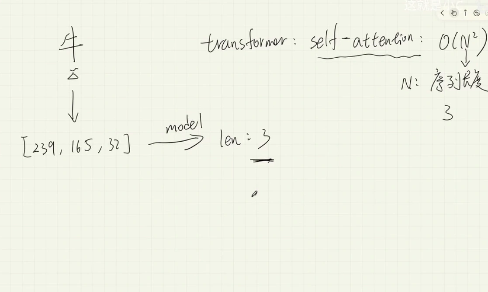
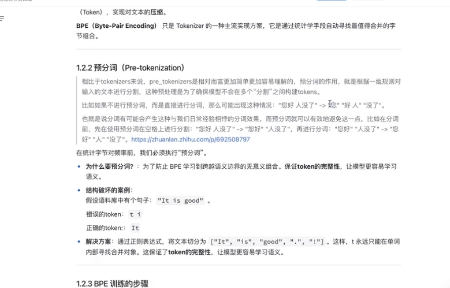
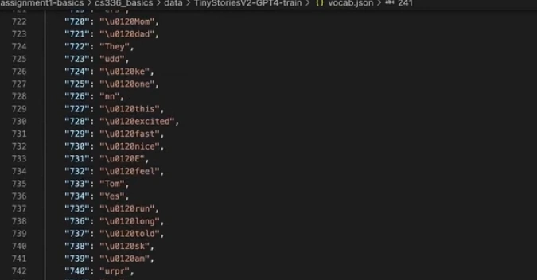
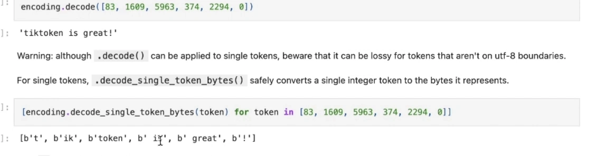

# 字节级 BPE 与 Tiktoken：从 UTF-8 字节到子词词表



## 本讲要解决的核心问题（SCQA）

**背景**：UTF-8 编码本身已经能把任何字符串变成字节序列——一个汉字大约三个字节，理论上模型直接吃这些字节就能训练（[【跳转到 01:37】](https://www.bilibili.com/video/BV1HLquB9ESx/?t=97)）。

**冲突**：如果真按字节喂，一个汉字就占三个位置，序列长度 $N$ 直接膨胀三倍；而 Transformer 里 self-attention 的复杂度是 $O(N^2)$，显存与训练/推理时间都跟着涨（[【跳转到 02:27】](https://www.bilibili.com/video/BV1HLquB9ESx/?t=147)）。

**疑问**：能不能在不丢信息的前提下把序列压短？压缩用的"字典"从哪来？为什么必须先预分词再统计？OpenAI 的 `tiktoken` 又是怎么把同一套东西做成可以几行代码调用的库？

**回答（中心思想）**：**字节级 BPE（Byte-Pair Encoding）** 就是那套"压短"的办法：先让 256 个字节各占一个 token，然后反复统计**相邻两个 token 一起出现的频率**，把最高频的一对合并成一个新 token（编号从 256 往后发），迭代到词表达到目标大小。合并只允许发生在**预分词（pre-tokenization）** 切出来的片段内部，避免跨语义边界拼出"好 人"这种无意义 token；训练实现上用**倒排索引**避免每次合并都全量重扫；最后把词表和合并规则（merges）存盘。`tiktoken` 则是这套机制的工程封装：它负责加载指定编码、把文本编成 token 列表、再把 token 解回字节。

---

## 一、为什么需要 tokenizer：把 $N$ 降下来

课程用一个汉字举例：它经过 Unicode / UTF-8 编码后变成三个字节，比如 $[239, 165, 32]$，喂给模型时这个 token 的序列长度就是 3（[【跳转到 02:02】](https://www.bilibili.com/video/BV1HLquB9ESx/?t=122)）。Transformer 最核心的组件 self-attention 复杂度是 $O(N^2)$，这里 $N$ 就是序列长度——等于说，只用字节会平白多出三倍长度、九倍注意力开销（[【跳转到 02:52】](https://www.bilibili.com/video/BV1HLquB9ESx/?t=172)）。

所以目标很明确：**想办法降低 $N$**，显存、训练时间、推理时间都会跟着降（[【跳转到 03:17】](https://www.bilibili.com/video/BV1HLquB9ESx/?t=197)）。tokenizer 就是干这个的。

---

## 二、压缩的基本盘：200 多个字节 + 一个不断长大的字典

思路用一个"字典"就能讲清：先准备 256 项，对应 0~255 这 256 个字节；再不断往里加新项——**新项的含义是"某两个已有 token 拼起来"**（[【跳转到 03:42】](https://www.bilibili.com/video/BV1HLquB9ESx/?t=222)）。

以字节序列 $[239, 165, 32]$ 为例（[【跳转到 04:32】](https://www.bilibili.com/video/BV1HLquB9ESx/?t=272)）：

| 步骤 | 序列 | 说明 |
| --- | --- | --- |
| 初始 | 239, 165, 32 | 三个字节，长度 3 |
| 查字典 | 256, 32 | 发现 256 表示"239 + 165"，合成一项 |
| 再查 | 257 | 发现 257 表示"256 + 32"，再合成一项 |
| 结果 | 257 | 长度从 3 变成 1 |

注意这是**迭代**的过程：每合成一次就再回头看能不能继续合，直到这个片段压成一个 token 为止（[【跳转到 05:22】](https://www.bilibili.com/video/BV1HLquB9ESx/?t=322)）。压缩后语义也保住了——这个 token 代表的就是完整的"您"字，而不是拆开的三个字节（[【跳转到 05:47】](https://www.bilibili.com/video/BV1HLquB9ESx/?t=347)）。

那么问题只剩一个：**字典是怎么学出来的**？这就是 BPE 训练。

---

## 三、BPE 训练：统计最高频的字节对，合并，迭代

### 3.1 三步走

课程把 BPE 训练归纳成一个循环（[【跳转到 07:52】](https://www.bilibili.com/video/BV1HLquB9ESx/?t=472)）：

1. **字节化与初始化**：把训练语料经 UTF-8 转成长字节序列，词表初始化成 0~255；
2. **统计字典**：统计整个训练集里**每两个相邻 token 组成的 pair** 出现了多少次；
3. **合并**：找出频率最高的 pair，给它分配一个新 id（从 256 开始），把训练集里所有该 pair 替换成这个新 token；
4. **回到第 2 步**，直到达到设定的词表大小 / 迭代次数。

形式化一点，设语料中所有相邻对构成的频次表为 $c(a, b)$，每一轮合并的对象是

$$
(a, b)^\star = \arg\max_{(a,b)} c(a,b)
$$

然后新增 token 的编号依次是 $256, 257, 258, \dots$，一项对应一个"合并规则"（[【跳转到 09:57】](https://www.bilibili.com/video/BV1HLquB9ESx/?t=597)）。词表越大、迭代越久，压缩率越高，序列越短（[【跳转到 31:28】](https://www.bilibili.com/video/BV1HLquB9ESx/?t=1888)）。

课程用 `low` 这个词演示了一次合并：语料里 `l+o` 出现 7 次、`o+w` 也出现 7 次，频率打平时按**字典序**决定谁赢（`l` 在 `o` 前面，所以选 `l+o`），于是产生新 token"lo"，训练集中所有 `l,o` 相邻处都被替换成这一项，然后再统计新的 pair（[【跳转到 26:22】](https://www.bilibili.com/video/BV1HLquB9ESx/?t=1582)）。

### 3.2 预分词：不许跨语义边界合并

如果直接在整条长字节序列上统计 pair，会学到很荒唐的东西。课程举的例子是 `您好 人没了`（[【跳转到 15:21】](https://www.bilibili.com/video/BV1HLquB9ESx/?t=921)）：不预分词时，`好` 和后面的空格、`人` 可能被合并成一个 token——而 `好` 原本该跟 `您` 组成"您好"，跟"人"毫无关系，这样学出来的 token 语义是乱的。

解决办法是先按**空格、标点**等规则把语料切成片段，再让 BPE **只在片段内部**找 pair，绝不跨片段合并（[【跳转到 16:11】](https://www.bilibili.com/video/BV1HLquB9ESx/?t=971)）。这样每个片段对应一个"词"，token 的完整性有保证，模型也更容易学到语义（[【跳转到 21:55】](https://www.bilibili.com/video/BV1HLquB9ESx/?t=1315)）。



英文同理：语料里是 `It is good`，正确学到的 token 是 `It`；如果允许跨片段合并，就可能出现 `t` + `i` 这种不在任何单词内部成立的组合（[【跳转到 22:20】](https://www.bilibili.com/video/BV1HLquB9ESx/?t=1340)）。

课程实现里直接复用了 **GPT-2 的正则预分词规则**（[【跳转到 39:40】](https://www.bilibili.com/video/BV1HLquB9ESx/?t=2380)）：不允许跨"字符类型"合并（字母、数字、标点会被分开），同时**保护前导空格**——` word` 前面的空格会和单词绑成一项，而不是单独切出去。所以 `hello world ok!` 会被切成 `hello`、` world`、` ok`、`!` 这样的片段（[【跳转到 40:23】](https://www.bilibili.com/video/BV1HLquB9ESx/?t=2423)）。

### 3.3 特殊 token：不许被拆的原子单位

训练时还可以传入一组 `special_tokens`，它们**不参与 BPE 统计、也不会被拆开**，永远自成一个 token（[【跳转到 32:00】](https://www.bilibili.com/video/BV1HLquB9ESx/?t=1920)）。两类典型用途：

- **文档分隔**：预训练语料由很多篇短文拼成，篇与篇之间插入 `<|endoftext|>`。没有它，模型会误以为上一篇的结尾和后一篇的开头存在因果逻辑；有了它，模型知道"上一段逻辑已结束，新一段开始"（[【跳转到 34:08】](https://www.bilibili.com/video/BV1HLquB9ESx/?t=2048)）。
- **垂类术语**：医学等领域有大量长术语，把"系统性红斑狼疮"整体设成一个 token，既少生成好几步、提升推理速度，也缩短序列长度（[【跳转到 35:23】](https://www.bilibili.com/video/BV1HLquB9ESx/?t=2123)）。

### 3.4 代码实现：四个坑与四个关键数据结构

课程的训练函数只收两个核心参数：语料和**目标词表大小**；迭代次数由它反推（[【跳转到 37:14】](https://www.bilibili.com/video/BV1HLquB9ESx/?t=2234)）：

```python
num_merges = vocab_size - 256 - len(special_tokens)
```

实现里有四个值得记住的点：

| 环节 | 做法 | 为什么 |
| --- | --- | --- |
| 读语料 | 先把 special token 从语料中删掉，再预分词 | 它们已固定为独立 token，不参与统计（[37:39](https://www.bilibili.com/video/BV1HLquB9ESx/?t=2259)） |
| 词频 | 用 `Counter` 统计每个片段（词）的出现次数，并转成 `wordlist` + `counterlist` 两个等长数组 | 后续按索引一一对应地取频率（[45:18](https://www.bilibili.com/video/BV1HLquB9ESx/?t=2718)） |
| pair 频次 | 维护 `pair → 频次` 字典，值是该 pair 在各词中的出现次数之和 | 找 best pair 只需扫这张表（[45:43](https://www.bilibili.com/video/BV1HLquB9ESx/?t=2743)） |
| 倒排索引 | 维护 `pair → 出现过它的词的下标列表` | 合并后只改这些词，不必重扫整个词表（[46:35](https://www.bilibili.com/video/BV1HLquB9ESx/?t=2795)） |

**找 best pair** 的排序键是 `(频率, pair)`：先比频率，频率相同再比字典序（[【跳转到 50:37】](https://www.bilibili.com/video/BV1HLquB9ESx/?t=3037)）。合并完成后要做三件维护工作，少一件都会导致频次表失真：

1. **旧邻居减**：`l+o` 合并后，原来 `o+w` 这对在涉及它的词里就不存在了，要从 pair 频次里减掉（[【跳转到 57:26】](https://www.bilibili.com/video/BV1HLquB9ESx/?t=3446)）；
2. **新邻居加**：合并出的新 token 又有自己的左右邻居，这两对新 pair 的频次要加上（[【跳转到 59:06】](https://www.bilibili.com/video/BV1HLquB9ESx/?t=3546)）；
3. **删掉已合并的 pair**：这对已经被新 token 取代，直接从表里删除（[【跳转到 59:56】](https://www.bilibili.com/video/BV1HLquB9ESx/?t=3596)）。

训练结束后保存两份东西（[【跳转到 60:21】](https://www.bilibili.com/video/BV1HLquB9ESx/?t=3621)）：**vocab**（id → 字节序列）和 **merges**（按顺序记录的合并规则）。真正训练出来的词表里，256 之后的项就是这些合并产物；课堂上跑出来的 vocab.json 里能看到大量以反斜杠加 u0120 开头的项——u0120 就是空格的转义，说明"空格 + 单词"已经合成了一个 token（[【跳转到 66:59】](https://www.bilibili.com/video/BV1HLquB9ESx/?t=4019)）。



**为什么要有 bytes → unicode 的映射**：字节里有大量不可见字符，空格、换行、控制符直接打印出来"长得都一样"，人没法核对词表。GPT-2 的做法是把 256 个字节映射到一批**可见字符**上（可见的保持不变，不可见的顺移到 256 之后的可打印区），这样词表文件才可读、可检查（[【跳转到 63:14】](https://www.bilibili.com/video/BV1HLquB9ESx/?t=3794)）。

---

## 四、Tiktoken：把 BPE 做成能直接调的库

`tiktoken` 是 OpenAI 开源的 Python 库，实现的就是 BPE 这一套的**加载与编解码**；README 里给出的对比是它比 HuggingFace 的 tokenizer 快 3~6 倍，所以加载和大批量编码都更快（[【跳转到 00:55】](https://www.bilibili.com/video/BV1dC41157r5/?t=55)）。

### 4.1 两种加载方式

| 方式 | 写法 | 适用 |
| --- | --- | --- |
| 按模型 | **encoding_for_model**，传入模型名 | 知道模型名，不想记编码名（[01:30](https://www.bilibili.com/video/BV1dC41157r5/?t=90)） |
| 按编码 | **get_encoding**，传入编码名 | 直接指定编码方案（[01:54](https://www.bilibili.com/video/BV1dC41157r5/?t=114)） |

```python
# 按模型名加载（内部映射到对应的编码方案）
enc = tiktoken.encoding_for_model("gpt-3.5-turbo")

# 按编码名直接加载
enc = tiktoken.get_encoding("cl100k_base")
```

`gpt-3.5-turbo` 对应的正是 `cl100k_base` 这套约 10 万项的编码。

### 4.2 encode / decode / decode_single_token_bytes

编码就是把文本映射成一串整数，解码是反过来（[【跳转到 02:45】](https://www.bilibili.com/video/BV1dC41157r5/?t=165)）。课堂上实测的 `"tiktoken is great!"`：

| 操作 | 结果 | 含义 |
| --- | --- | --- |
| **encode** 这句话 | `[83, 1609, 5963, 374, 2294, 0]` | 6 个 token |
| 取 **len** | 6 | 一个单词不等于一个 token，会被拆成多段（[02:24](https://www.bilibili.com/video/BV1dC41157r5/?t=144)） |
| **decode** 回文本 | `"tiktoken is great!"` | 无损还原 |
| **decode_single_token_bytes** | `b't', b'ik', b'token', b' i', b' great', b'!'` | 逐个 token 看它对应的字节（[03:10](https://www.bilibili.com/video/BV1dC41157r5/?t=190)） |

```python
enc.encode("tiktoken is great!")        # [83, 1609, 5963, 374, 2294, 0]
enc.decode([83, 1609, 5963, 374, 2294, 0])  # "tiktoken is great!"
[enc.decode_single_token_bytes(t) for t in enc.encode("tiktoken is great!")]
# [b't', b'ik', b'token', b' i', b' great', b'!']
```



注意 **decode** 有个边界情况：如果某个 token 不在 UTF-8 的字符边界上，单独解码可能得到乱码，所以看单个 token 应该用 **decode_single_token_bytes** 看字节（[【跳转到 03:10】](https://www.bilibili.com/video/BV1dC41157r5/?t=190)）。

### 4.3 不同编码 = 不同的合并规则

同一句话换一套编码，得到的 token 数和 token 列表都可能不同（课堂上实测第一种编码是 5 个、第二种相同、第三种不同），因为它们的词表和 merge 规则是分别训练出来的（[【跳转到 03:35】](https://www.bilibili.com/video/BV1dC41157r5/?t=215)）。

token 数之所以值得关心，是因为 API **按 token 计费**：先用 `tiktoken` 估一下 token 量，就能在跑任务前估算整体花费（[【跳转到 04:35】](https://www.bilibili.com/video/BV1dC41157r5/?t=275)）。聊天接口还要额外算结构开销——每条 message 后面会附加固定长度的控制 token（约 4 个），带 name 时还要相应扣减，这部分细节在仓库的 cookbook 里写得很清楚（[【跳转到 05:20】](https://www.bilibili.com/video/BV1dC41157r5/?t=320)）。

> **补充（非讲者原话）**：`tiktoken` 编码时的第一步其实也是 GPT-2 那套正则预分词，然后把每个片段查表、按 merge 顺序贪心合并——这正是上一节手写训练流程的推理侧对应物：训练得到 `merge_ranks`，编码时按 rank 从小到大反复合并，直到没有可合并的对。

---

## 五、BPE 与 WordPiece、Unigram 的差别

子词切分不止 BPE 一种，WordPiece 与 Unigram 也很常见，它们的差别主要在**"挑哪些子词进词表"的准则**上（[【跳转到 00:05】](https://www.bilibili.com/video/BV1dC41157r5/?t=5)）：

| 算法 | 合并/筛选准则 | 直观理解 |
| --- | --- | --- |
| BPE | 每次选**频次最高**的相邻 pair | 谁最常一起出现就合谁 |
| WordPiece | 选使**语言模型似然提升最大**的 pair | 合并不只看频次，还看带来的收益 |
| Unigram | 先大词表，再按**概率贡献**逐步删减 | 从大往小裁，保留最有用的子词 |

具体实现细节各家不同，但目标一致：用有限的词表覆盖尽可能多的文本，同时让 token 尽量贴近语义单元。

> **补充（非讲者原话）**：视频只点了一句"这三种算法筛选字词进词表的方式不同"，上表的具体准则是子词切分的通用背景知识，补充在此便于对照，不属于讲者原话。

---

## 六、小结

- **tokenizer 的第一性目标**是降低序列长度 $N$：字节级表示会让一个汉字占 3 个位置，而注意力是 $O(N^2)$（[CS336 02:27](https://www.bilibili.com/video/BV1HLquB9ESx/?t=147)）。
- **BPE 的机制**是"初始 256 字节 + 反复合并最高频相邻对"，新 token 从 256 起编号，词表越大压缩率越高（[CS336 09:57](https://www.bilibili.com/video/BV1HLquB9ESx/?t=597)）。
- **预分词是正确性的前提**：只在片段内部合并，才能避免"好 人"这类跨语义边界的 token；GPT-2 的正则规则同时做了"不跨类型"和"保护前导空格"（[CS336 40:23](https://www.bilibili.com/video/BV1HLquB9ESx/?t=2423)）。
- **特殊 token** 是不参与统计的原子单位，既用来隔离文档，也用来压缩垂类长术语（[CS336 32:00](https://www.bilibili.com/video/BV1HLquB9ESx/?t=1920)）。
- **工程实现的关键**是倒排索引与邻居频次维护：合并后旧邻居减、新邻居加、删掉已合并的 pair（[CS336 57:26](https://www.bilibili.com/video/BV1HLquB9ESx/?t=3446)）。
- **Tiktoken** 是这套机制的推理侧封装：encoding_for_model / get_encoding 选编码，encode 得 token 列表，decode_single_token_bytes 看字节，token 数直接对应 API 费用（[tiktoken 03:10](https://www.bilibili.com/video/BV1dC41157r5/?t=190)）。

---

## 视频来源

| 视频 | 覆盖内容 | 时长 |
| --- | --- | --- |
| [【CS336-1】1.2 BPE 算法原理与训练实现](https://www.bilibili.com/video/BV1HLquB9ESx/) | 为什么需要 tokenizer、BPE 合并机制、预分词与特殊 token、训练代码逐段走读、词表落盘 | 约 68 分钟 |
| [tiktoken介绍](https://www.bilibili.com/video/BV1dC41157r5/) | tiktoken 的加载方式、encode/decode、不同编码差异、token 计费 | 约 6 分钟 |
