# 字节级 BPE：从 UTF-8 字节出发，反复合并最高频相邻对

> 视频来源：[【CS336-1】1.2 BPE 算法原理与训练实现](https://www.bilibili.com/video/BV1HLquB9ESx/?t=0)（Bilibili · 小C_）
> 本文基于视频演说图文稿整理，配图截自视频。

## 本讲要解决的核心问题（SCQA）

**背景**：UTF-8 编码已经能把任何字符串变成字节序列——一个汉字通常 3 个字节，一个英文字母 1 个字节。所以把字节编号直接喂给语言模型，在原理上完全行得通。

**冲突**：行得通不等于划算。字节序列比原文长得多，而 Transformer 的核心组件 self-attention（自注意力）复杂度是 $O(N^2)$，$N$ 就是序列长度。序列长 3 倍，注意力相关的开销就要涨到 9 倍量级，显存和训练、推理时间一起被拖垮。

**疑问**：能不能在不丢信息的前提下，把同一段文本的 token 序列压短？

**回答（中心思想）**：**用字节级 BPE 训练一张"合并字典"**。词表从 256 个单字节起步，反复统计语料里出现次数最多的相邻 token 对，把这一对合并成一个新 token（从 id 256 开始编号），迭代到词表达到预设大小。三个关键设计缺一不可：统计前先做**预分词**，让合并只发生在词内部；合并循环用**倒排索引**避免每步遍历整个词表；保存词表时把不可见字节映射成**可见字符**，人才能读、工具才能存。

---

## 一、UTF-8 已经把文本变成数字了，为什么还要分词器

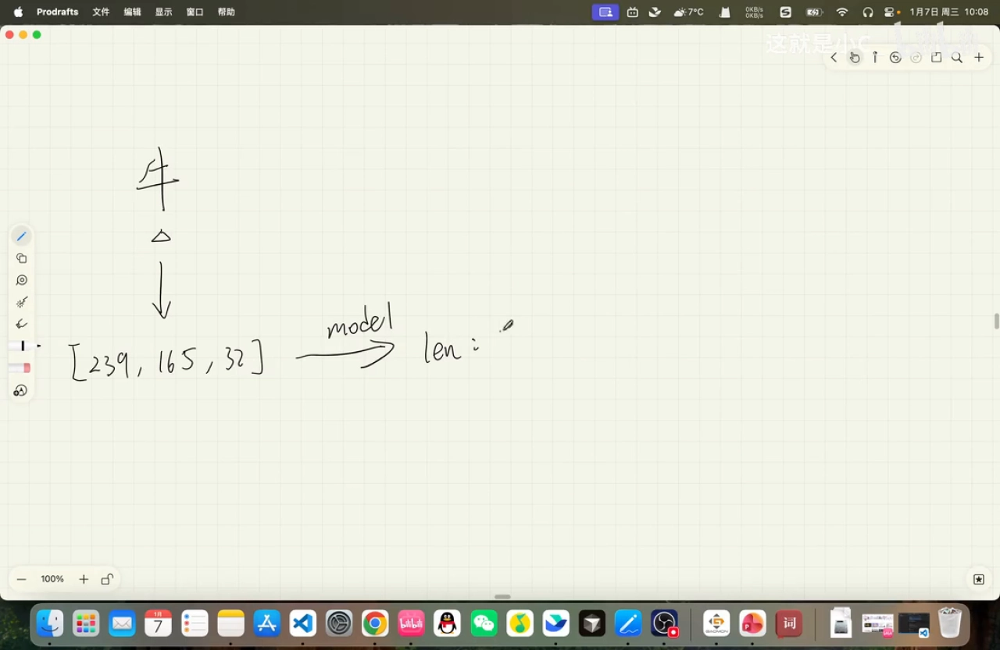

上一节已经讲过 UTF-8 编码：任何字符都能转成字节串。视频里随手举了一串字节 `[239, 165, 32]`，长度是 3；把这串数字直接送进模型，模型看到的输入长度就是 3 [【跳转到 02:02】](https://www.bilibili.com/video/BV1HLquB9ESx/?t=122)。

### 1.1 一个汉字三个字节，序列长度就是三倍

这里的"三倍关系"很直观：一个汉字在 UTF-8 下通常是 3 个字节，如果模型以字节为单位，那么同样一句话的输入长度大约是字符数的 3 倍。文字越长，这个绝对差距越大 [【跳转到 02:52】](https://www.bilibili.com/video/BV1HLquB9ESx/?t=172)。

### 1.2 self-attention 是 $O(N^2)$：$N$ 降下来，显存和时间一起降

Transformer 里最吃资源的模块是 self-attention，它的复杂度是 $O(N^2)$：

$$
\text{cost} \propto N^2,\qquad N = \text{序列长度}
$$

所以"降低 $N$"不是审美问题，而是直接的工程收益：显存占用下降，训练和推理时间下降 [【跳转到 03:17】](https://www.bilibili.com/video/BV1HLquB9ESx/?t=197)。这也解释了本讲标题里的"字节级"为什么值得单独讲：字节的覆盖面是完整的：任何字符都能被 UTF-8 编码，代价只是序列变长；BPE 要做的正是把这份长度还回去。

---

## 二、BPE 的压缩思路：一张字典把两个 token 换成一个

### 2.1 词表基座：0～255 这 256 个字节

想象一开始只有一本"字节字典"：0～255 每个数字对应一个字节，256 个条目把全部可能的字节穷举完了 [【跳转到 03:42】](https://www.bilibili.com/video/BV1HLquB9ESx/?t=222)。这就是字节级 BPE 的词表底子——不管以后学出多少新 token，最底下这 256 个永远在第一层。

### 2.2 迭代查表：三个字节压成一个 token

现在往字典里手工加两条规则，看压缩怎么发生：

```
dict = {
  256: [239, 165],
  257: [256, 32],
}
输入序列: [239, 165, 32]
第 1 步查表: [239, 165] -> 256     得到 [256, 32]
第 2 步查表: [256, 32]  -> 257     得到 [257]
序列长度: 3 -> 2 -> 1
```

整个过程分两步：第一步用 UTF-8 把人类字符变成字节；第二步反复遍历字典，把命中的相邻两项替换成一个新 id [【跳转到 05:22】](https://www.bilibili.com/video/BV1HLquB9ESx/?t=322)。$N$ 从 3 变成 1，这正是第一章想要的效果 [【跳转到 05:47】](https://www.bilibili.com/video/BV1HLquB9ESx/?t=347)。

注意字典每一条的右值**就是它对应的字节序列**（比如 `256` 代表 `[239, 165]` 这两个字节）。这条性质很重要：新 id 不是凭空发明的编号，它背后始终钉着一串具体字节，所以后面保存词表时直接用 `id → 字节串` 的映射就能表达整本字典（第八章会看到这一点）。

### 2.3 BPE 算法做的事：怎么把这张字典"学"出来

上面那张字典是人手写的。BPE 算法要解决的正是这件事：**给定一份训练语料，怎么自动得到这本字典** [【跳转到 06:12】](https://www.bilibili.com/video/BV1HLquB9ESx/?t=372)。

最初版本的设想非常朴素：

1. 有一个很大的训练集，用来训练 tokenizer；
2. 把训练集过一遍 UTF-8，变成一条很长的字节序列；
3. 遍历这条序列，统计每一对相邻字节在整个训练集里出现了多少次；
4. 找到出现次数最多的那一对，叫它 best pair，把这一对作为一个新条目加入字典，分配一个新 id（从 256 开始往后发号）；
5. 重复上面两步，迭代到固定的步数为止——比如迭代 1 万次，最后字典里就多出 1 万项。

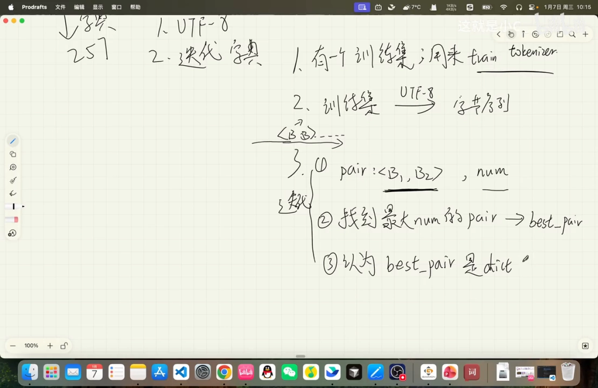

用伪代码写出来就是：

```python
vocab = {i: bytes([i]) for i in range(256)}   # 词表基座 0~255
tokens = 训练语料经过 UTF-8 得到的字节序列
for step in range(num_merges):
    pair_counts = 统计 tokens 中所有相邻两项的出现次数
    best_pair = 出现次数最多的那一对
    new_id = len(vocab)
    vocab[new_id] = best_pair[0] + best_pair[1]   # 两条合并成一条
    merges.append(best_pair)
    tokens = 把 tokens 中所有 best_pair 替换成 new_id
```

这套"统计最高频相邻对、合并、再统计"的循环，就是字节级 BPE 的全部骨架 [【跳转到 09:57】](https://www.bilibili.com/video/BV1HLquB9ESx/?t=597)。后面的章节都是在给它打补丁：先补"合并不能跨词"，再补"别每次都遍历整个词表"，最后补"词表怎么存成人类可读的文件"。

---

## 三、预分词：合并只能发生在词的内部

### 3.1 不分词会学到什么：一个反直觉的错误 token

假设训练集里有一句 `你好 人没了`。如果直接对整条字节流做 BPE，算法只认频率，它完全可能学出这样的三件套：`你` 一个 token、`好+空格+人` 一个 token、`没了` 一个 token [【跳转到 15:21】](https://www.bilibili.com/video/BV1HLquB9ESx/?t=921)。

这在语义上是错的：`好` 本来该跟 `你` 组合成 `你好`，它跟后面的 `人` 没有任何关系。把 `好 人` 焊成一个 token，等于把一个语义上不相干的组合固化进词表，模型拿到的"词"跟人的日常经验直接相悖 [【跳转到 15:46】](https://www.bilibili.com/video/BV1HLquB9ESx/?t=946)。

正确的期望是什么？`你好` 两个汉字是 6 个字节，也就是 6 个初始 token；我们希望 BPE 之后它们能变成一个 token，而这个 token 的含义就是 `你好`。反过来，如果学出来的是 `好+空格+人`，那这份词表就是训练错了 [【跳转到 19:56】](https://www.bilibili.com/video/BV1HLquB9ESx/?t=1196)。

### 3.2 预分词（Pre-tokenization）：先用规则把语料切小，再在片段内部统计

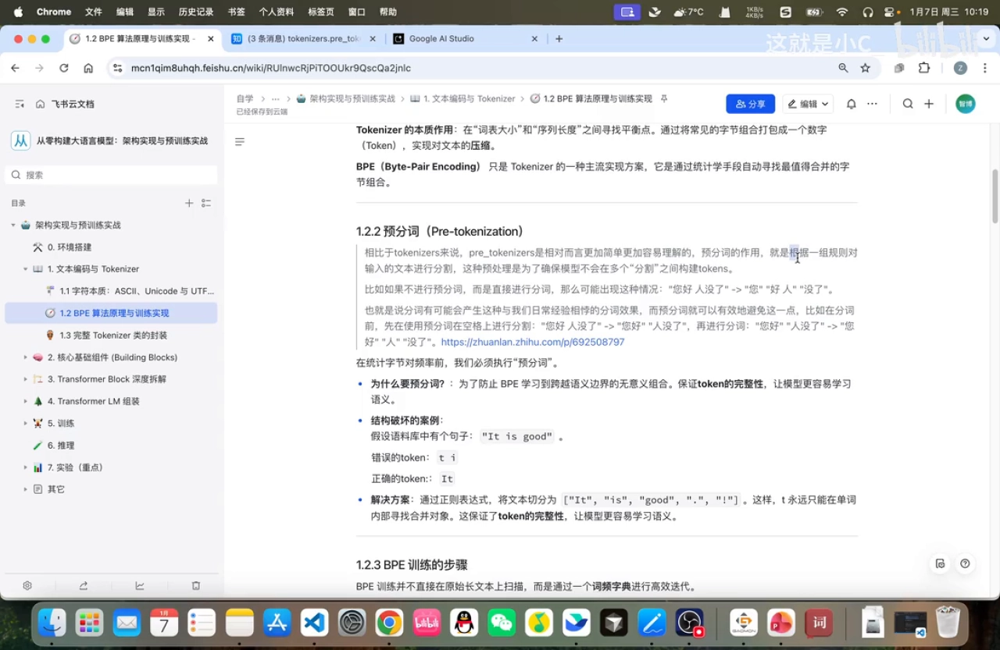

预分词（Pre-tokenization）就是"统计字节对频率之前，先用一组规则把输入文本切成若干片段"。切完之后，**每个 token 只能在一个片段内部学出来，不能跨越片段边界** [【跳转到 20:46】](https://www.bilibili.com/video/BV1HLquB9ESx/?t=1246)。

最常见的切分依据是空格和标点：`你好 人没了` 按空格切成 `你好` 和 `人没了` 两段，于是"某段的最后一个字节 + 下一段的第一个字节"这种组合根本不会进入统计 [【跳转到 14:39】](https://www.bilibili.com/video/BV1HLquB9ESx/?t=879)。视频里的总结是：

> 统计 pair 之前先做预分词，再 UTF-8 编码。目的是防止 BPE 学到跨越语义边界的无意义组合，保证 token 的完整性，让模型更容易学习语义。

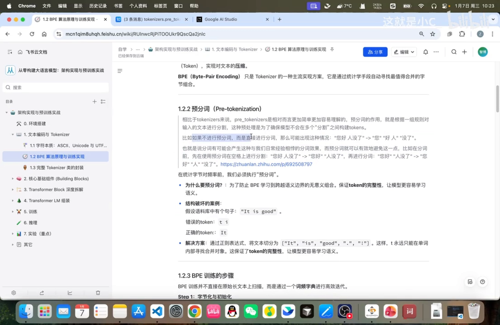

英文的例子更直观：语料里有 `It is good`，如果允许跨词合并，可能出现 `t` + `i` 这种 token——它横跨了 `It` 和 `is` 两个词，当然不是正常的 token；正确的结果是 `It` [【跳转到 21:55】](https://www.bilibili.com/video/BV1HLquB9ESx/?t=1315)。

## 四、完整的训练流程：五步走完

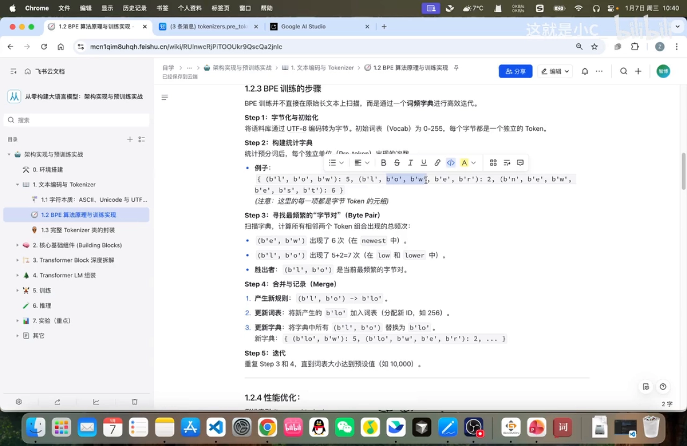

把前面几章拼起来，正式的 BPE 训练并不是在原始长文本上直接扫描，而是**借助一个词频字典做高效迭代** [【跳转到 22:20】](https://www.bilibili.com/video/BV1HLquB9ESx/?t=1340)。讲义把它拆成五步：

| 步骤 | 做什么 | 关键点 |
| --- | --- | --- |
| Step 1 字节化与初始化 | 语料过 UTF-8 变字节；初始词表 0～255 | 每个字节都是一个独立 token |
| Step 2 构建统计词典 | 统计预分词后每个独立单位（pre-token）出现的次数 | 词典的键是**字节 token 的元组**，不是字符串 |
| Step 3 找最频繁字节对 | 扫描词典，累加所有相邻两个 token 组合的总频次 | 频次要按单词频次加权，不能只数出现过的单词 |
| Step 4 合并与记录 | 产生新规则、新 token 入表（分配新 id）、改写词典 | 词典里所有该 pair 都要替换 |
| Step 5 迭代 | 重复 Step 3 和 Step 4，直到词表达到预设大小 | 例如词表 10000 |

Step 2、Step 3 的核心是"用词频加权" [【跳转到 24:17】](https://www.bilibili.com/video/BV1HLquB9ESx/?t=1457)。看讲义里的例子：`low` 出现 5 次、`lower` 出现 2 次、`newest` 出现 6 次。于是：

- 相邻对 `(l, o)` 的频次是 $5 + 2 = 7$（`low` 贡献 5 次，`lower` 贡献 2 次）；
- 相邻对 `(e, w)` 的频次是 6（`newest` 里 `e` 后面跟 `w`，`newest` 出现 6 次）；
- 7 > 6，所以这一轮的 best pair 是 `(l, o)`。

如果只统计"这个词出现过"而不乘词频，`low` 和 `lower` 都只算 1，`(l, o)` 会变成 2，就会被 `newest` 的 6 压过去——学出来的词表也就完全不同了 [【跳转到 28:02】](https://www.bilibili.com/video/BV1HLquB9ESx/?t=1682)。

Step 4 产生的新规则要记下来：`(l, o) -> lo`，新 token 拿 id 256，词典里所有 `(l, o)` 换成 `lo`，`low` 就变成 `[lo, w]`。原来两个 id 变成一个 id，序列长度直接减半 [【跳转到 27:37】](https://www.bilibili.com/video/BV1HLquB9ESx/?t=1657)。然后回到 Step 3 继续找下一个最高频对，一轮一轮直到词表填满。

---

## 五、写代码：词表大小决定"要合并多少次"

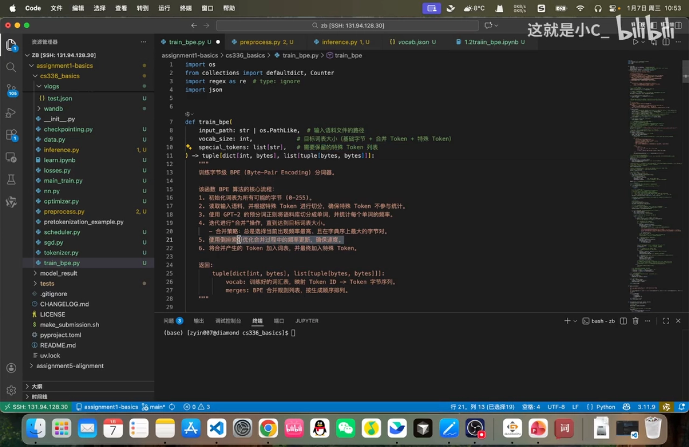

视频接下来进入代码实现。函数签名把整件事的目标讲得很清楚 [【跳转到 29:44】](https://www.bilibili.com/video/BV1HLquB9ESx/?t=1784)：

```python
def train_bpe(
    input_path: str | os.PathLike,   # 输入语料文件的路径
    vocab_size: int,                 # 目标词表大小（基础字节 + 合并 + 特殊 Token）
    special_tokens: list[str],       # 需要保留的特殊 Token 列表
) -> tuple[dict[int, bytes], list[tuple[bytes, bytes]]]:
```

返回两个东西：`vocab` 是 `id → 字节序列` 的词表，`merges` 是按生成顺序排列的合并规则列表。docstring 里列的流程和第四章的五步一一对应，另外多出两件工程上的事——**特殊 token 不参与统计**、**用倒排索引优化合并后的频率更新**。

### 5.1 迭代次数是算出来的，不是拍脑袋定的

词表里最终要装三类东西：256 个基础字节、BPE 合并出的新 token、以及特殊 token。于是迭代步数可以直接算出来 [【跳转到 37:14】](https://www.bilibili.com/video/BV1HLquB9ESx/?t=2234)：

$$
k = \lvert V \rvert - 256 - \lvert S \rvert
$$

其中 $\lvert V \rvert$ 是目标词表大小，$S$ 是特殊 token 集合，$k$ 就是需要执行的合并次数。视频里的意思很直白：词表越大，能装下的合并规则越多，**压缩率就越高**——当然词表本身占的参数和计算也更多 [【跳转到 31:28】](https://www.bilibili.com/video/BV1HLquB9ESx/?t=1888)。

### 5.2 特殊 token：不参与合并的原子单位

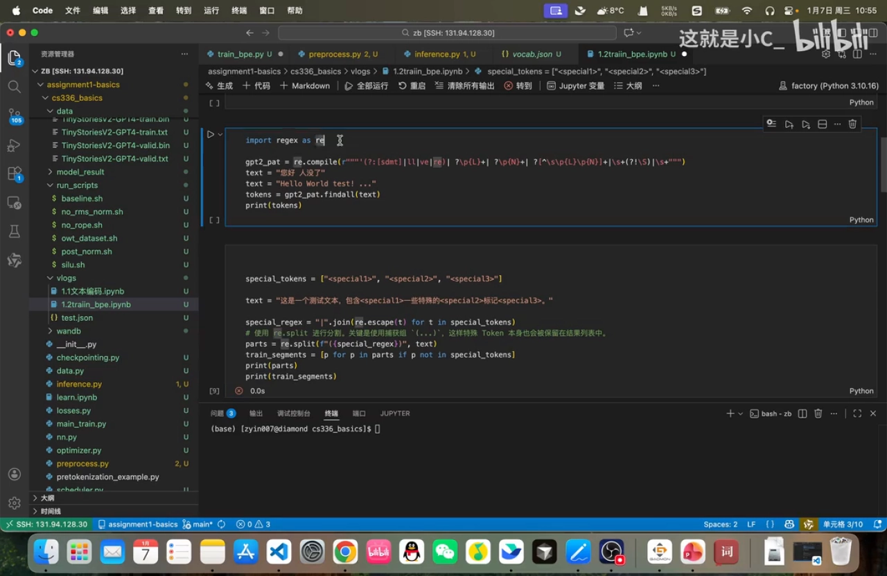

特殊 token（special token）是在分词器里有特定功能、**不可拆分的原子单位**：我们自己规定一批字符串，让它们整体作为一个 token，不允许 BPE 去拆 [【跳转到 31:55】](https://www.bilibili.com/video/BV1HLquB9ESx/?t=1915)。视频给了两个典型用途。

**用途一：隔开拼接在一起的文档。** 预训练语料通常把很多篇文章拼成一条长序列，文章之间插入一个 `<|endoftext|>` 之类的结束符 token。如果没有它做隔离，模型会把"上一篇的结尾"和"下一篇的开头"当成有因果关系的上下文——这是不正确的。有了这个 token，模型才知道前一篇的逻辑已经结束，新一篇从头开始 [【跳转到 34:08】](https://www.bilibili.com/video/BV1HLquB9ESx/?t=2048)。

**用途二：垂类术语整体成词。** 比如训练医学大模型时，把 `系统性红斑狼疮` 这种长术语设成一个 token。模型本来要一个 token 一个 token 地往外蹦，现在一次就吐出整段术语，推理更快，序列长度 $N$ 也更小 [【跳转到 35:23】](https://www.bilibili.com/video/BV1HLquB9ESx/?t=2123)。

代码上的处理很干脆：训练 BPE 之前，先用正则把语料里出现的特殊 token 切出来并**删掉**，剩下的片段才进入预分词与统计 [【跳转到 37:39】](https://www.bilibili.com/video/BV1HLquB9ESx/?t=2259)。特殊 token 本身不进合并循环，最后一步直接整段 UTF-8 编码后追加到词表末尾 [【跳转到 61:11】](https://www.bilibili.com/video/BV1HLquB9ESx/?t=3671)。

### 5.3 GPT-2 的预分词正则：三类规则

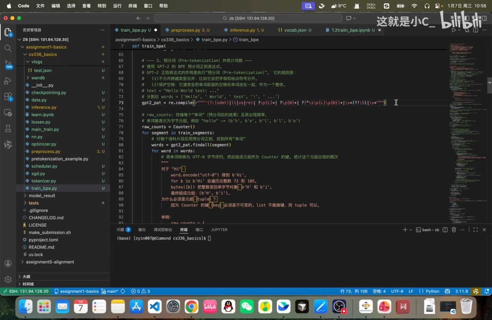

预分词的具体规则直接照搬 GPT-2 的正则表达式 [【跳转到 39:15】](https://www.bilibili.com/video/BV1HLquB9ESx/?t=2355)。不需要逐字符读懂这个正则，只要抓住它做的三件事：

1. **不允许跨类型合并**：字母和标点、数字之间会被切开，`Hello` 和 `!` 不会粘在一起；
2. **保护空格**：单词前面的空格和单词本身作为一个整体，这样"带前导空格的词"能长成一个 token；
3. **标点与省略号单独成段**：`!`、`...` 各自是一段。

于是 `Hello World test! ...` 会被切成 `Hello`、` World`、` test`、`!`、`...`——注意第二段开头的空格是带着的 [【跳转到 40:23】](https://www.bilibili.com/video/BV1HLquB9ESx/?t=2423)。

这一步同时也是"合并不跨词"的实现位置：后面所有的合并都只在单个 pre-token 内部进行，正是因为这里先切好了段 [【跳转到 41:38】](https://www.bilibili.com/video/BV1HLquB9ESx/?t=2498)。

---

## 六、数据结构：词频统计、pair 计数与倒排索引

### 6.1 先把"单词 → 频次"存成两个平行数组

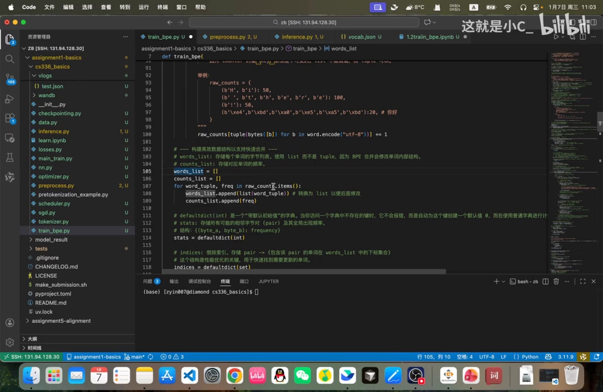

统计阶段用一个 `Counter`，键是**字节元组**（tuple of bytes），值是该 pre-token 在语料里的出现次数。比如 `hi` 出现 50 次、`lower` 出现 100 次、感叹号出现 50 次 [【跳转到 43:38】](https://www.bilibili.com/video/BV1HLquB9ESx/?t=2618)。

为什么键必须是元组而不是列表？因为 `Counter` 的键要可哈希，列表不能做键，元组可以——这是实现层面的硬约束，图里的注释写得很清楚。

接下来这一步很关键：BPE 要频繁修改"单词内部有哪些 token"，所以不能一直用不可变的元组。代码把它拆成两个**平行数组** [【跳转到 44:53】](https://www.bilibili.com/video/BV1HLquB9ESx/?t=2693)：

```python
words_list = []   # 每个单词当前的 token 列表，可修改
counts_list = []  # 与 words_list 同下标的单词频率
```

两个数组靠**下标一一对应**：`words_list` 的第 i 项是第 i 个单词的 token 列表，`counts_list` 的第 i 项是它的频次。这样"改单词"只需改 `words_list` 里的那一项，而它的频次随时能查到 [【跳转到 45:18】](https://www.bilibili.com/video/BV1HLquB9ESx/?t=2718)。

### 6.2 两份统计结构：pair 频次 + 倒排索引

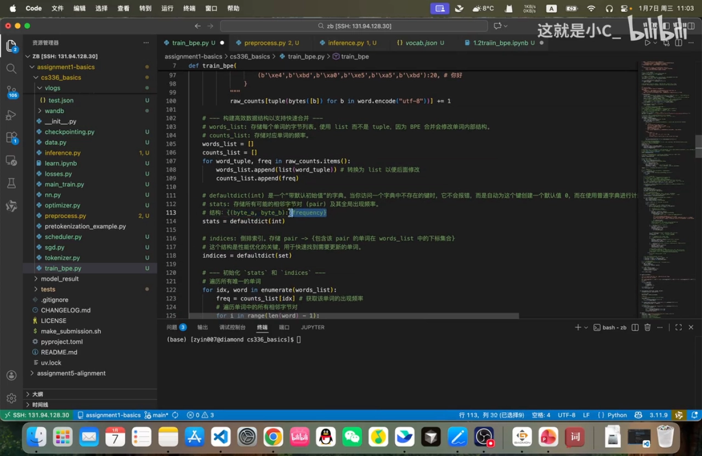

除了单词频次，还要维护两份以 pair 为键的结构 [【跳转到 45:43】](https://www.bilibili.com/video/BV1HLquB9ESx/?t=2743)：

| 结构 | 键 | 值 | 用途 |
| --- | --- | --- | --- |
| `stats` | 字节对（byteA, byteB） | 该 pair 在整个语料中的总频次 | 每轮挑最高频 pair |
| `indices` | 字节对（byteA, byteB） | 包含该 pair 的单词在 `words_list` 中的**下标集合** | 合并后只更新受影响的单词 |

`indices` 就是**倒排索引**（inverted index）——正常思路是"单词 → 它包含哪些 pair"，倒过来记"pair → 哪些单词包含我"，查询方向反了，效率就完全不同。

### 6.3 为什么要倒排索引：最笨的版本每合并一次要扫全表

最朴素的实现是：每找到一次 best pair，就把整个 `words_list` 从头遍历一遍，看哪个单词里有这个 pair，再逐个替换 [【跳转到 46:35】](https://www.bilibili.com/video/BV1HLquB9ESx/?t=2795)。而合并要做几千上万轮，每轮扫一遍全部单词，这个开销非常慢 [【跳转到 47:00】](https://www.bilibili.com/video/BV1HLquB9ESx/?t=2820)。

有倒排索引之后，事情变成：查 `indices` 里 best_pair 对应的下标集合，比如 `lo` 只在第 1、第 2 个单词里出现，那就只改这两个单词，其余的全部跳过 [【跳转到 48:15】](https://www.bilibili.com/video/BV1HLquB9ESx/?t=2895)。倒排索引省下的，正是这一次次全表遍历。

### 6.4 选 best pair：先比频次，频次打平再比字典序

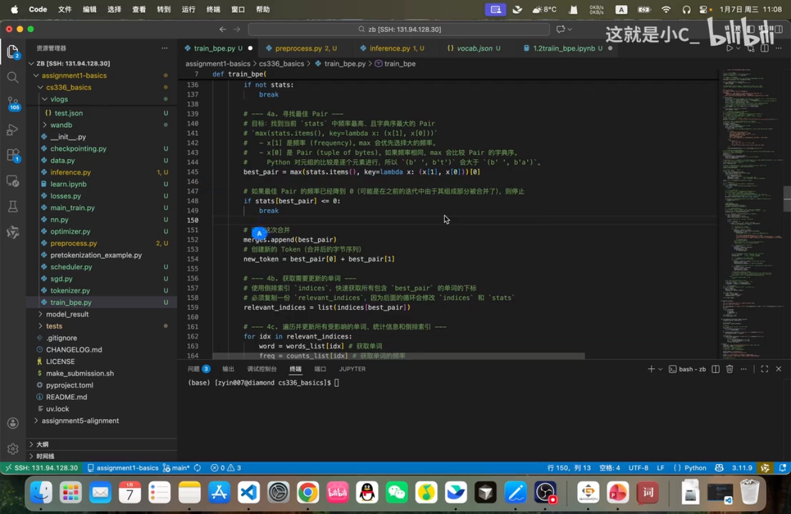

每轮循环的第一件事是从 `stats` 里取最大值。这里有个细节：**并列很常见**，两个 pair 频次相同怎么办？代码用一个二元组做排序键 [【跳转到 50:12】](https://www.bilibili.com/video/BV1HLquB9ESx/?t=3012)：

```python
best_pair = max(stats.items(), key=lambda x: (x[1], x[0]))
# x[1] 是频次：优先选频次最高的
# x[0] 是 pair：频次相同时，按字节对的字典序决定
```

用二元组做键的好处是：结果**唯一且可复现**——同样的语料、同样的词表大小，任何一次训练都得到同一份词表，不会因为字典遍历顺序不同而飘 [【跳转到 50:37】](https://www.bilibili.com/video/BV1HLquB9ESx/?t=3037)。

视频里手算那一步也碰到了并列：`(l, o)` 和 `(o, w)` 都是 7 次，最终靠字典序定出唯一的赢家，规则被记进 `merges` 列表，按顺序记录"这一轮合并了哪两个 token" [【跳转到 51:02】](https://www.bilibili.com/video/BV1HLquB9ESx/?t=3062)。

---

## 七、一次合并要更新哪五处

找到 best pair 之后，真正容易写错的是"更新"。视频把这一步拆成了五个动作，少一个都会让统计失真。

### 7.1 动作一：把两个字节拼成一个新 token

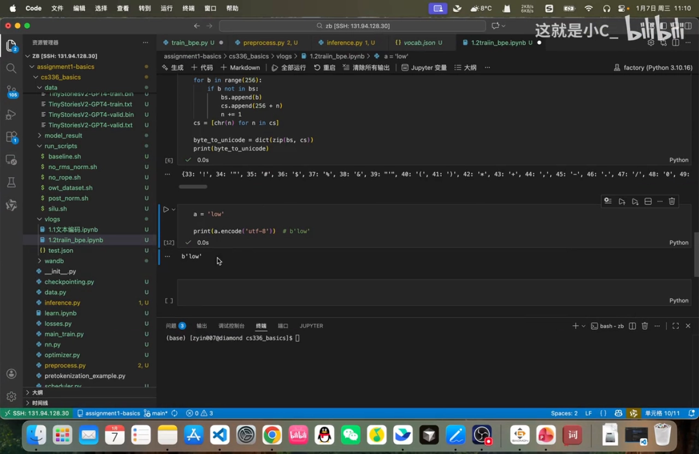

新 token 不是抽象编号，而是**两个字节序列直接相加**：把 pair 里的第一个和第二个字节序列首尾拼起来。视频用 `a = 'low'` 演示过，`a.encode('utf-8')` 得到 `b'low'`，字节序列的拼接和字符串拼接是一回事 [【跳转到 51:55】](https://www.bilibili.com/video/BV1HLquB9ESx/?t=3115)。

### 7.2 动作二：在单词内部做替换，并让单词变短

```python
word[i] = new_token     # 第一个字节换成合并后的新 token
del word[i + 1]         # 删掉第二个字节，单词变短一项
```

`low` 从 `[l, o, w]` 变成 `[lo, w]`：长度从 3 降到 2，两个 id 合成一个 id [【跳转到 54:06】](https://www.bilibili.com/video/BV1HLquB9ESx/?t=3246)。

### 7.3 动作三、四：旧邻居的频次要减，新邻居的频次要加

这一步是整段代码里最容易漏的地方。合并会**改变相邻关系**，而 `stats` 记的正是相邻关系 [【跳转到 57:26】](https://www.bilibili.com/video/BV1HLquB9ESx/?t=3446)：

- **旧邻居要减**：原来 `l` 后面跟着 `o`，现在这两个被焊成一个 `lo`，那条 `(l, o)` 的 pair 在这个单词里就不存在了；如果 `l` 左边还有字节，左边那条 pair 也变了，同样要减；
- **新邻居要加**：合并后的 `lo` 有了新的左邻居和右邻居，这些新 pair 的频次要加上去。

以 `low` 为例：`l` 左边没有东西，所以没有左邻居要减；但 `(o, w)` 这个旧 pair 在这个单词里消失了，要减掉这个单词贡献的那部分频次（注意：其他单词里可能还有 `(o, w)`，所以只是减，不是删） [【跳转到 57:51】](https://www.bilibili.com/video/BV1HLquB9ESx/?t=3471)。合并之后 `lo` 后面跟着 `w`，新的 pair `(lo, w)` 频次要加上 [【跳转到 59:31】](https://www.bilibili.com/video/BV1HLquB9ESx/?t=3571)。

视频的总结顺序很值得记：[【跳转到 59:06】](https://www.bilibili.com/video/BV1HLquB9ESx/?t=3546)

1. 先减去"合并之前"旧邻居 pair 的频次；
2. 再加上"合并之后"新邻居 pair 的频次；
3. 同时更新 `indices`——新 pair 要把当前单词的下标加进去。

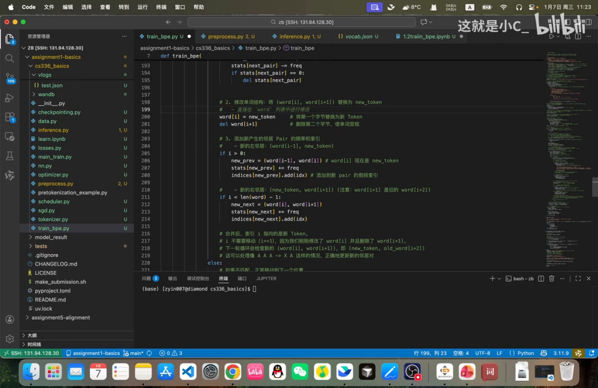

### 7.4 动作五：清理掉已经用过的 best pair

合并完成后，整个语料里不会再有这个 pair，直接从 `stats` 和 `indices` 里删掉即可 [【跳转到 59:56】](https://www.bilibili.com/video/BV1HLquB9ESx/?t=3596)。

### 7.5 训练收尾：把 merges 按顺序变成新 id

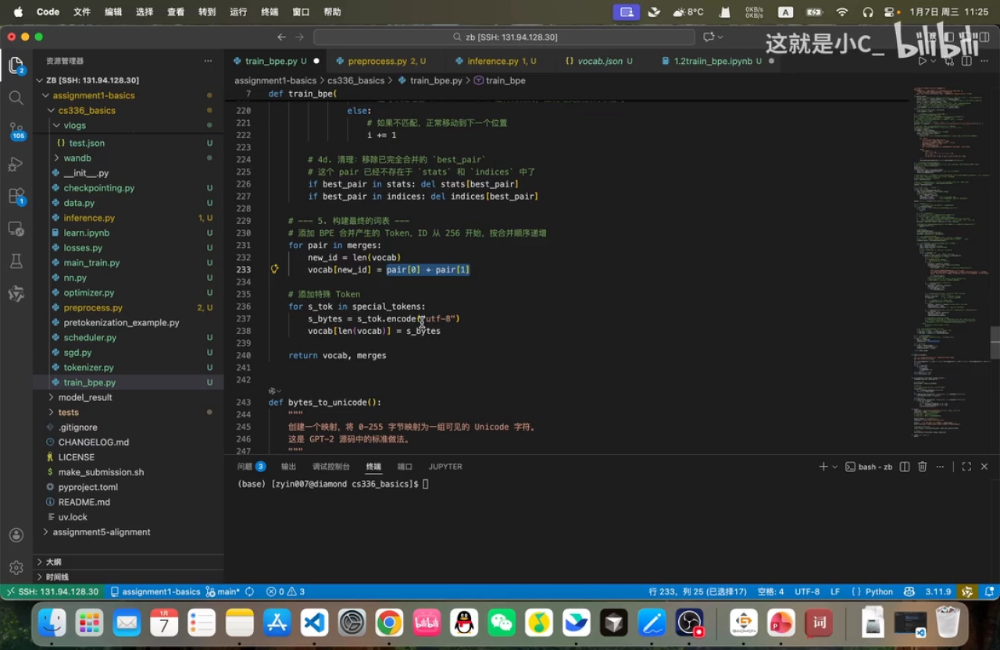

主循环结束后，还有一步"出账"：`merges` 里按顺序记着每一轮的合并规则，遍历它，用 `len(vocab)` 依次分配 id，把 `pair[0] + pair[1]` 存进 `vocab` [【跳转到 60:21】](https://www.bilibili.com/video/BV1HLquB9ESx/?t=3621)。因为初始词表正好 256 项，所以第一个新 id 天然就是 256，往后 257、258 顺延。最后把特殊 token 整段 UTF-8 编码后追加到末尾。

---

## 八、保存词表：为什么还要做 bytes_to_unicode

### 8.1 问题：空格、换行这些字节根本"看不见"

训练完把 `vocab` 和 `merges` 存成文件（`vocab.json` 和 `merges.txt`）就完事了？还差一步。视频指出 GPT-2 在保存时多做了一件事：把字节映射成 Unicode 字符 [【跳转到 62:28】](https://www.bilibili.com/video/BV1HLquB9ESx/?t=3748)。

原因是 ASCII 里有一批**人类不可见**的字节：空格、换行、制表符。如果词表里直接写原始字节，文件打开都是一片空白，没法检查也没法调试 [【跳转到 63:14】](https://www.bilibili.com/video/BV1HLquB9ESx/?t=3794)。

### 8.2 做法：可见字节原样保留，不可见字节平移到 256 之后

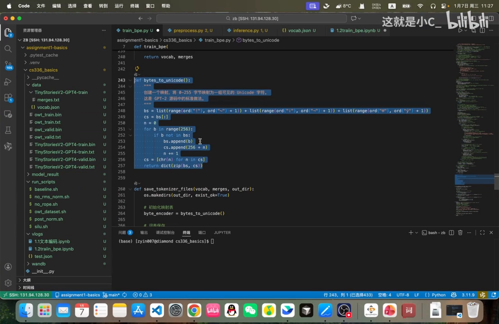

GPT-2 的 `bytes_to_unicode` 用的是一张固定映射表，规则分两半：

- **可见字符原样保留**：`!` 到 `~`（码点 33～126）、`¡` 到 `¬`（161～172）、`®` 到 `ÿ`（174～255），这三段在屏幕上能看见，直接照搬；
- **其余字节往后平移**：不在上面三段的字节（0～32、127～160 和 173 这些控制字符与空格），依次映射到从 256 开始的新码点 [【跳转到 64:54】](https://www.bilibili.com/video/BV1HLquB9ESx/?t=3894)。

代码只有几行，核心就是"取三段可见码点、剩下的按顺序补编号、最后 `dict(zip(bs, cs))` 拼成映射表"：

```python
bs = list(range(ord("!"), ord("~") + 1)) \
   + list(range(ord("¡"), ord("¬") + 1)) \
   + list(range(ord("®"), ord("ÿ") + 1))
cs = bs[:]              # 可见字符：字节值 -> 同一个字符
n = 0
for b in range(256):
    if b not in bs:     # 不可见字节：字节值 -> 256 之后的编号
        bs.append(b)
        cs.append(256 + n)
        n += 1
cs = [chr(n) for n in cs]
byte_to_unicode = dict(zip(bs, cs))
```

效果是：词表里的每个字节都有了一个"看得见"的替身。空格 32 会变成 `Ġ`（码点 256），换行 10 会变成 `Ċ`，文件里一眼就能认出来。

### 8.3 验收：词表里应该长出"像词"的东西

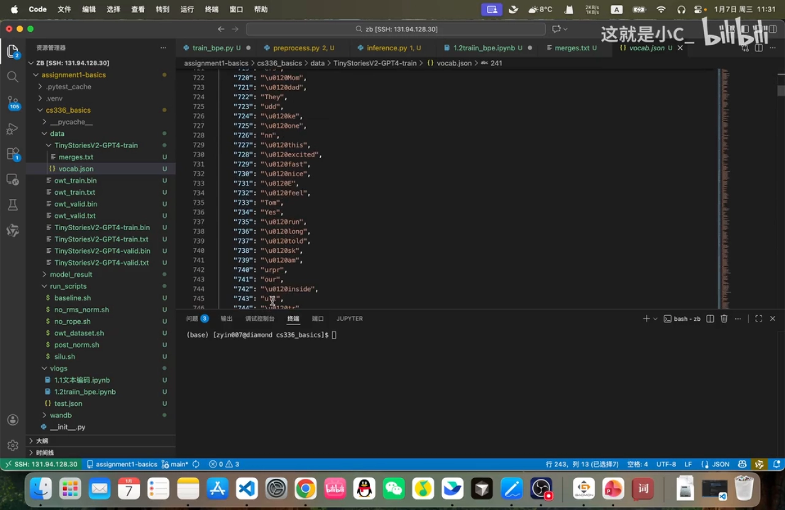

打开训练出来的 `vocab.json`，256 之后的条目里会大量出现这样的内容：`ĠMom`、`Ġdad`、`They`、`Ġfeel`……前面那个 `Ġ` 就代表空格 [【跳转到 66:59】](https://www.bilibili.com/video/BV1HLquB9ESx/?t=4019)。

为什么这算是验收标准？因为视频里提到，如果第一次合并是把"空格 + t"合成一个 token，那么 `256` 这个 id 就代表"空格加 t"——本来需要两个 token（空格 32 和字母 t）才能表达的东西，现在一个 id 就搞定了 [【跳转到 67:49】](https://www.bilibili.com/video/BV1HLquB9ESx/?t=4069)。视频作者翻看自己训练出的 `merges` 时也评价：合并出来的东西大致是有逻辑的、像词根和词的片段，说明这份 BPE 训练得比较合理 [【跳转到 65:44】](https://www.bilibili.com/video/BV1HLquB9ESx/?t=3944)。

---

## 小结

1. **动机是复杂度**：UTF-8 已经能把文本变数字，但字节序列会把长度放大（汉字约 3 倍），而 self-attention 是 $O(N^2)$，压短 $N$ 就是在省显存和时间。
2. **手段是合并**：词表以 256 个字节为底，反复把最高频相邻对合并成一个新 token，id 从 256 往后发号，新 token 的内容就是两个旧 token 字节串的拼接。
3. **预分词不可省**：没有它，BPE 会学出"好+空格+人"这类跨语义边界的 token；预分词用正则按空格、标点切段，合并只在段内发生。
4. **训练就是五步循环**：字节化与初始化、按词频统计 pre-token、找最高频 pair、合并并记录、迭代到词表满。迭代次数由词表大小倒推：$k = \lvert V \rvert - 256 - \lvert S \rvert$。
5. **频率要加权**：`low` 5 次 + `lower` 2 次，`(l, o)` 就是 7 次；只数单词个数会把结论算反。
6. **工程上靠倒排索引**：`pair → 包含它的单词下标` 让每轮只更新受影响的单词，而不是扫全表；选 best pair 用 `(频次, pair)` 做排序键保证结果唯一。
7. **一次合并要改五处**：拼新 token、改单词并删除后一项、减旧邻居频次、加新邻居频次、删掉用完的 pair。
8. **保存要多一层映射**：`bytes_to_unicode` 把不可见字节搬到 256 之后，词表才能被人读懂；看到 `ĠMom` 就说明空格已经被合并进 token 了。

## 关键术语速查

| 术语 | 一句话解释 |
| --- | --- |
| token | 模型处理文本的最小单位，可以是一个字节、一个词片段或一个词 |
| 词表（vocab） | id 与 token 内容的对照表，字节级 BPE 从 256 项起步 |
| BPE（Byte-Pair Encoding） | 反复把最高频的相邻 token 对合并成一个新 token 的压缩算法 |
| pair（字节对） | 序列里相邻的两个 token，统计与合并都以它为单位 |
| best pair | 当前语料里出现次数最多的那个 pair，每轮选一个 |
| merges | 按顺序记录每次合并了哪两个 token 的列表，是训练的主要产物之一 |
| 预分词（Pre-tokenization） | 统计前先用正则按空格、标点切段，防止跨边界合并 |
| pre-token | 预分词切出来的片段，合并只能在它内部发生 |
| 特殊 token | 约定不参与合并的原子单位，如文档分隔符、垂类长术语 |
| 倒排索引（inverted index） | 从 pair 反查"哪些单词包含它"，用来避免每轮全表扫描 |
| bytes_to_unicode | GPT-2 的标准映射，让不可见字节在词表文件里有可见字符表示 |
