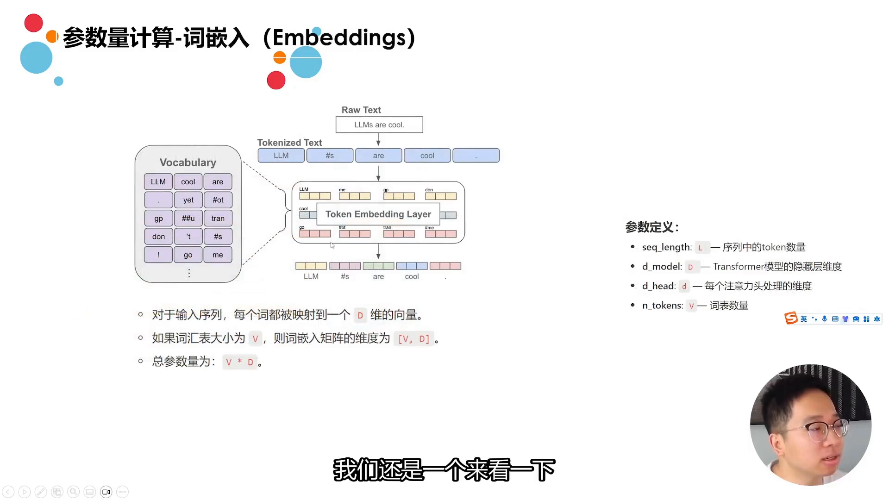
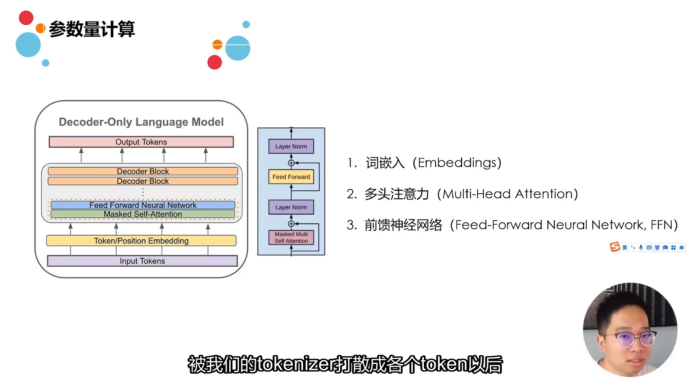
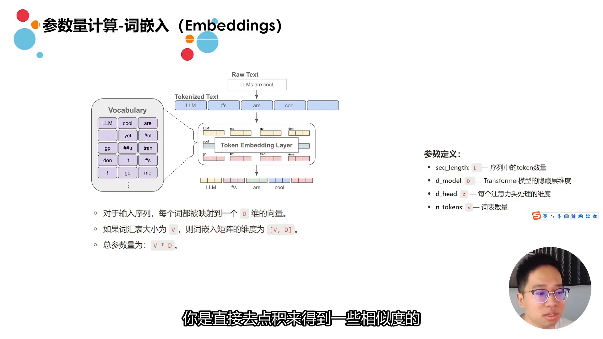
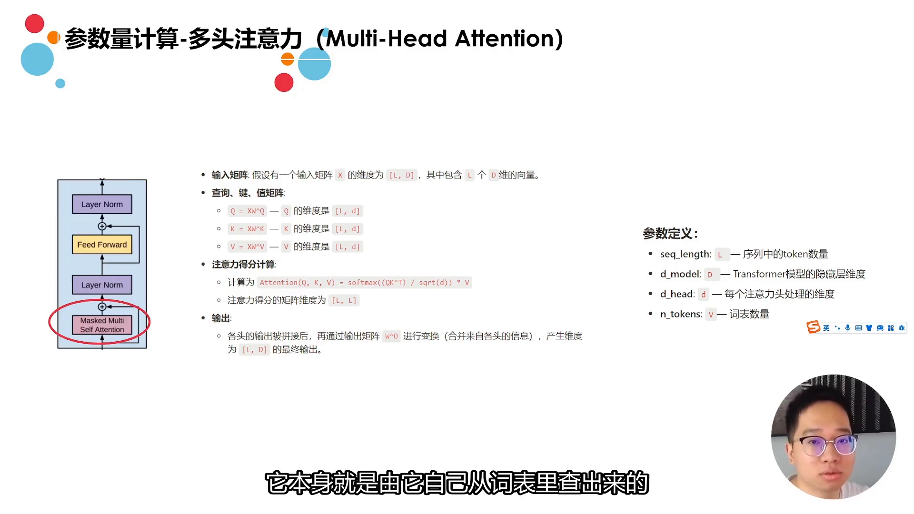
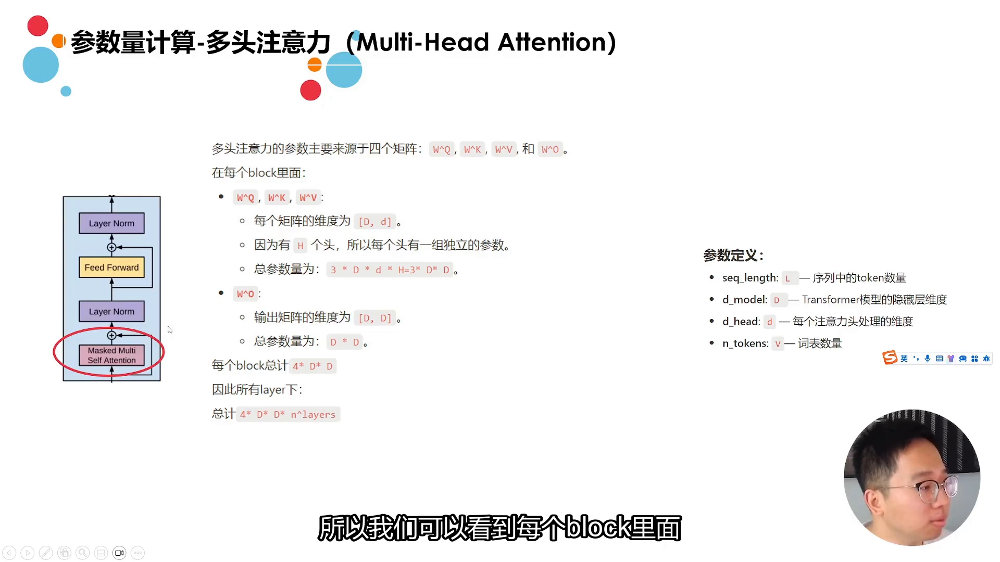
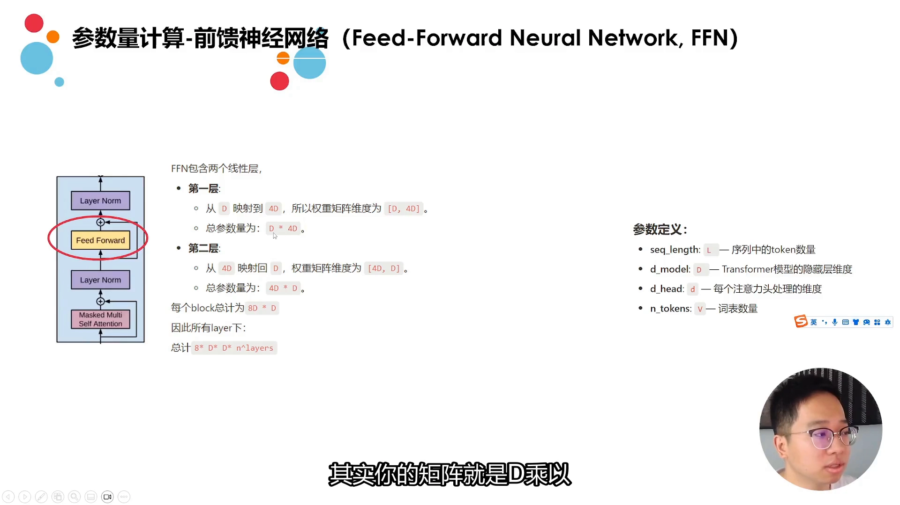
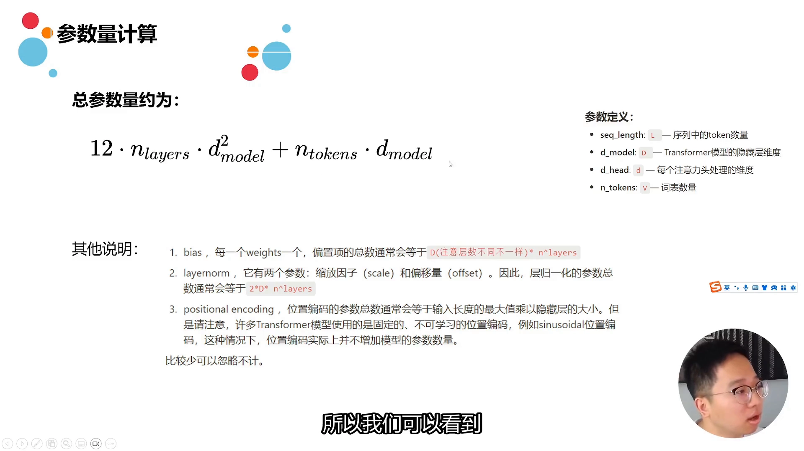

# 参数量怎么数：把 Embedding 与 LM Head 摊开算一遍

> 视频来源：[LLM 面试 模型参数量计算](https://www.bilibili.com/video/BV1DZ421s7WY/?t=0)（Bilibili，BV1DZ421s7WY）
> 本文基于视频演说图文稿整理，配图截自视频。

## 本讲要解决的核心问题（SCQA）

**背景**：面试里问"这个模型多少参数"，是 LLM 岗位的常见题；读源码、看 HuggingFace 上的 `config.json` 时，也总要判断"这些数字是怎么堆出来的"。

**冲突**：多数人背得出一句"总参数约等于 $12 \cdot n_{\text{layers}} \cdot d_{\text{model}}^2$"，但一旦被追问"这个词表项算在哪里""多头拆开之后参数量为什么不变""LayerNorm 到底算不算参数"，就答不上来；换成一个没见过的架构（比如 Llama 的门控 FFN），更是不知道从哪下手。

**疑问**：一个 Transformer 的参数，究竟该按什么顺序一块块数下来？每一块的算式从哪个形状推出来？哪些项该算、哪些项可以忽略？

**回答（中心思想）**：**参数量的数法只有一条通用规则——先写形状，再做乘法。** 每个可学习的权重都是一对括号里的两个数相乘（"$A \times B$ 的矩阵乘 $B \times C$ 的矩阵，结果就是 $A \times C$"，反过来说权重本身的参数量就是 $A \times B$）；把词嵌入 $V \times D$、多头注意力 $4D^2$、前馈网络 $8D^2$ 三块加起来，就得到文稿给出的总量式 $12 \cdot n_{\text{layers}} \cdot D^2 + V \cdot D$ [【跳转到 10:05】](https://www.bilibili.com/video/BV1DZ421s7WY/?t=605)。UP 主开头就说明了本讲的重点不在"把一个大矩阵累加到多少位"，而在"了解一个模型的网络架构大概是怎么样的" [【跳转到 00:05】](https://www.bilibili.com/video/BV1DZ421s7WY/?t=5)。

---

## 一、先立四个符号：$L$、$D$、$d$、$V$

数参数之前，先把课件约定的四个字母记住，后面所有算式都只用它们 [【跳转到 01:45】](https://www.bilibili.com/video/BV1DZ421s7WY/?t=105)：

| 符号 | 名称 | 含义 |
| --- | --- | --- |
| $L$ | seq_length | 序列里的 token 数量，也就是这句话有多长 |
| $D$ | d_model | 隐藏层维度，即一个 token 用多少维向量表示 |
| $d$ | d_head | 每个注意力头内部处理的维度 |
| $V$ | n_tokens | 词表里的 token 数量 |

其中 $d$ 这个符号最容易让人困惑：既然已经有 $D$ 了，为什么还要多一个 $d$？

因为现在的注意力都是**多头**的。模型不会真的拿 $D$ 这么长的一整条向量直接去做内积，而是把它拆成多个头，每个头分到 $d$ 维，各自算完再拼回来。UP 主给的理由是：这在一定程度上避免了"高维向量中各方向分布非常分散、直接点积算相似度效果不好"的问题 [【跳转到 02:10】](https://www.bilibili.com/video/BV1DZ421s7WY/?t=130)。

关键在于两者的关系：**头数乘以每头维度，正好回到 $D$**。课件举的例子是 $D = 1024$ 拆两个头，每头就是 512 维 [【跳转到 06:45】](https://www.bilibili.com/video/BV1DZ421s7WY/?t=405)。这条关系会在第四章把 $3D^2$ 变成 $4D^2$ 时起决定作用。

## 二、主线：形状从头到尾都是 $L \times D$

在看每一块之前，先记住整条流水线的形状，这是本讲最省力的一招。

输入是原始文字，被 tokenizer 打散成 token；每个 token 查表得到一个 $D$ 维向量，于是整句话变成一个 $L \times D$ 的矩阵（$L$ 行、每行 $D$ 个数）[【跳转到 03:50】](https://www.bilibili.com/video/BV1DZ421s7WY/?t=230)。

然后这个矩阵过很多层 decoder block，每层里面是"一个注意力 + 一个前馈网络"。UP 主特别强调了一句：**每一层的输入是 $L \times D$，输出还是 $L \times D$**，变的只是 $D$ 里面的数值 [【跳转到 04:40】](https://www.bilibili.com/video/BV1DZ421s7WY/?t=280)。

这条"形状不变"的性质，正是数参数的护栏：

- 既然形状不变，那么**不存在"越往深处参数越多"**的情况——每层的参数量是同一个数，乘以层数就行；
- 既然形状不变，那么**层与层之间不需要额外的投影矩阵**来对齐维度（残差连接只是加法，也没有参数）。

所以数参数的正确顺序是：先数"一层里有哪些权重矩阵"，再乘层数，最后单独加词表那一块。

## 三、词嵌入：一张 $V \times D$ 的查表矩阵

第一块是词嵌入。这里的操作严格来说不是矩阵乘法，而是**查表**：把输入 token 化以后，拿着每个 token 的编号去词表里翻它对应的向量 [【跳转到 02:35】](https://www.bilibili.com/video/BV1DZ421s7WY/?t=155)。比如第一个 token 是 LLM，就去表里查"LLM 是用怎样的 768 维向量表示的"；全部查完，就得到了输入到后面网络的输入矩阵。

查表这件事看起来不费参数，但**表本身是要存下来的**。表有多少行？词表大小 $V$。每行多少个数？$D$。所以：

$$
\text{Params}_{\text{emb}} = V \times D
$$

课件的写法是"如果词汇表大小为 $V$，则词嵌入矩阵的维度为 $[V, D]$，总参数为 $V \times D$"，并加了一句"这个其实还挺大的" [【跳转到 03:25】](https://www.bilibili.com/video/BV1DZ421s7WY/?t=205)。

"挺大"是多大？文稿给了一段词表规模的演进：一开始是 3.2 万的词表，后来有些系列到 6 万多，现在可能还越来越大。按课件举例的 768 维代入：

| 词表 $V$ | 嵌入维度 $D$ | 参数量 $V \times D$ |
| --- | --- | --- |
| 3.2 万 | 768 | 约 2458 万 |
| 6 万 | 768 | 约 4608 万 |

如果 $D$ 换成 1024，这两个数会变成约 3277 万和 6144 万——**只换一个维度，就是三分之一的差别**。这也说明词表项为什么值得单独盯住：它是唯一一块"只和词表打交道"的参数，而且和词表大小成正比。

> 补充一句边界：本讲课件把词表相关的参数记作 $V \cdot D$ 这一项，指的是输入端的查表矩阵。输出端把隐藏向量映射回词表分数的那一层也是同样的形状（$D \times V$），它在讲"最后一层输出"的那篇里展开，这里不重复。

## 四、多头注意力：三个投影加一个合并，合计 $4D^2$

进入 decoder block，第一个子层是多头注意力。课件把它的计算过程拆得很清楚 [【跳转到 05:05】](https://www.bilibili.com/video/BV1DZ421s7WY/?t=305)：

- 输入矩阵 $X$ 的维度是 $[L, D]$，里面是 $L$ 个 $D$ 维向量；
- 用三个权重矩阵分别乘出查询、键、值：$Q = X W^Q$、$K = X W^K$、$V = X W^V$，每个的维度都是 $[L, d]$；
- 注意力得分由 $\text{softmax}(QK^{\mathsf{T}} / \sqrt{d}) \cdot V$ 算出，注意力矩阵的形状是 $[L, L]$；
- 各头的输出拼起来之后，再过一个输出矩阵 $W^O$ 合并信息，得到 $[L, D]$。

> 命名提醒：这里的值矩阵也叫 $V$，与第一章的"词表大小 $V$"同名。它们碰巧撞了字母，含义完全不同——**读到这里，$V$ 是值矩阵；看到 $V \cdot D$ 这种词表项时，$V$ 是词表大小**。

注意这里最容易搞混的一点：**$X$ 的形状是 $L \times D$，本身不是参数**（它是数据），真正的参数是那几个 $W$。

### 4.1 先数 $W^Q$、$W^K$、$W^V$

要让 $L \times D$ 的输入变成 $L \times d$ 的输出，权重就得是 $D \times d$——按"$A \times B$ 乘 $B \times C$ 得 $A \times C$"的规则反推，$B$ 必须对齐，所以权重是 $D$ 行 $d$ 列 [【跳转到 06:20】](https://www.bilibili.com/video/BV1DZ421s7WY/?t=380)。

但这是**一个头**的量。有 $H$ 个头，就有 $H$ 组独立的参数，所以三个矩阵加起来是：

$$
\text{Params}_{QKV} = 3 \times D \times d \times H
$$

到这里，第一章立下的那条关系派上用场：$H \times d = D$。把它代进去：

$$
3 \times D \times \underbrace{d \times H}_{=D} = 3D^2
$$

**头数怎么拆，都不影响总参数量**——1024 维拆成 2 个头、每头 512 维，和拆成 16 个头、每头 64 维，$3D^2$ 都一样。这是面试里很好用的一个结论：多头的参数量只由 $D$ 决定。

### 4.2 再数 $W^O$

$W^O$ 负责把拼接后的多头信息合并一次：输入 $[L, D]$，输出也是 $[L, D]$，所以它是一个 $D \times D$ 的方阵，参数量 $D^2$ [【跳转到 06:45】](https://www.bilibili.com/video/BV1DZ421s7WY/?t=405)。UP 主的描述是"维度上没有变化，只是把刚才直接拼接起来的信息合并一下"。

### 4.3 一层注意力的总量

$$
\text{Params}_{\text{attn}} = 3D^2 + D^2 = 4D^2
$$

课件写的是"每个 block 总计 $4 \times D \times D$，因此所有 layer 下总计 $4 \times D \times D \times n_{\text{layers}}$"。取 $D = 1024$ 代进去，一层注意力是 $4 \times 1024^2 = 419.4$ 万参数，其中 QKV 三兄弟 314.6 万、$W^O$ 104.9 万。

## 五、前馈网络：一放一收，合计 $8D^2$

第二个子层是前馈网络（FFN）。它其实就是两层全连接 [【跳转到 07:10】](https://www.bilibili.com/video/BV1DZ421s7WY/?t=430)：

1. 第一层把 $L \times D$ 的输入映射到 $L \times 4D$——中间层维度扩大四倍；
2. 过一个激活函数；
3. 第二层再从 $L \times 4D$ 映射回 $L \times D$。

按形状反推参数：

| 层 | 变化 | 权重形状 | 参数量 |
| --- | --- | --- | --- |
| 第一层 | $D \to 4D$ | $D \times 4D$ | $4D^2$ |
| 第二层 | $4D \to D$ | $4D \times D$ | $4D^2$ |
| 合计 | 一放一收 | — | $8D^2$ |

课件的结论是"每个 block 总计为 $8 \times D \times D$，因此所有 layer 下总计 $8 \times D \times D \times n_{\text{layers}}$"。$D = 1024$ 时，一层 FFN 是 $8 \times 1024^2 = 839$ 万参数——**是注意力那 419 万的两倍**。这就是为什么说"Transformer 的参数大头在 FFN"：中间层扩了 4 倍，两个大矩阵一进一出，参数量自然翻上去。

## 六、合起来：$12 \cdot n_{\text{layers}} \cdot D^2 + V \cdot D$

把三块拼起来。一层 block 里，注意力 $4D^2$ 加 FFN $8D^2$，正好 $12D^2$；乘上层数，再加词表那一项：

$$
\text{Params}_{\text{total}} \approx 12 \cdot n_{\text{layers}} \cdot D^2 + V \cdot D
$$

这个式子的结构值得单独看一眼：

- **第一项随层数线性增长、随维度平方增长**：层数翻倍参数翻倍，$D$ 翻倍参数翻四倍。这就是为什么"加深"便宜、"加宽"贵。
- **第二项只和词表、维度有关，和层数无关**：不管堆多少层，词表这块都是同一个数。
- **$L$（序列长度）不在式子里**：序列长度影响的是激活值和算力，不影响权重个数。这是一个高频易错点。

按文稿给的公式代入一组具体数字，感受一下量级：取 $D = 1024$、$n_{\text{layers}} = 12$、$V = 3.2$ 万：

$$
12 \times 12 \times 1024^2 \approx 1.51 \text{ 亿}, \qquad 32000 \times 1024 \approx 3277 \text{ 万}
$$

合计约 1.84 亿参数。可以看到：$12 n D^2$ 那一项是绝对主力（约 1.51 亿），但词表项也已经占到总量的近五分之一（约 18%）——词表再放大几倍，它的存在感就不可忽略了。

## 七、零碎项：bias、LayerNorm、位置编码，为什么通常可以忽略

主干之外还有三类小项，课件专门列了"其他说明" [【跳转到 08:25】](https://www.bilibili.com/video/BV1DZ421s7WY/?t=505)：

1. **bias（偏置）**：$y = Wx + b$ 里的那个 $b$。每一个权重矩阵配一个偏置，偏置的维度等于输出维度，所以总量大约是 $D \times n_{\text{layers}}$（课件也注明"注意层数不同不一样"）。
2. **LayerNorm**：它本身只是一次计算，但它带两个可学习参数——缩放因子（scale）和偏移量（offset）。因为它作用在 $D$ 这个维度上，所以是 $D \times 2$，再乘层数 $n_{\text{layers}}$ [【跳转到 09:15】](https://www.bilibili.com/video/BV1DZ421s7WY/?t=555)。
3. **positional encoding（位置编码）**：很多模型用的是固定的、不可学习的位置编码（例如正弦位置编码），这种情况下它**根本不增加参数**；即使是可学习的，量级也"比较少可以忽略不计" [【跳转到 09:40】](https://www.bilibili.com/video/BV1DZ421s7WY/?t=580)。

为什么这三项可以忽略？还是比大小：偏置是 $O(D \cdot n)$，LayerNorm 是 $O(2D \cdot n)$，而主干是 $O(12 n D^2)$。除了一个 $D$、差了一个 $D^2$ 量级——$D = 1024$ 时是千分之一的差别。所以面试里报数，说"约 $12 n D^2 + VD$"完全够用，但**能主动说明"我还漏算了 bias 和 LayerNorm，量级差 $D$ 倍"**，才是真正读过架构的表现。

## 八、换个架构也照这个办法数：Llama 的门控 FFN

最后 UP 主把方法迁移到新架构上：现在去看 Llama，会发现它的 FFN 里多了一个"门控"（gate）——那个门控就是很多个类似 MLP 的矩阵，再加一个特殊的激活函数，"你也能推出它到底有多少参数量" [【跳转到 10:30】](https://www.bilibili.com/video/BV1DZ421s7WY/?t=630)。

这里没有再给具体数字，但方法完全一样，照抄三、四、五章的三步：

1. **画形状**：门控分支的输入还是 $L \times D$，它要把隐藏维映射到一个更宽的中间维度，权重就是这两个维度相乘；
2. **数列数**：普通 FFN 是"一放一收"两个矩阵，加了门控就变成"两个放、一个收"三个矩阵；
3. **乘层数**：一层里的总和乘 $n_{\text{layers}}$，词表项照旧单独加。

UP 主的期望也正是这个："这样你会对整个模型的架构有更好的理解，根据这些参数矩阵，你能推出整个参数是怎么从前到后流转的。"

## 九、这套账本用在哪：从面试题到架构直觉

课件末尾推荐了一个 LM 可视化网页，能把各种矩阵和运算过程都画出来，"大家可以上手去试一下" [【跳转到 10:55】](https://www.bilibili.com/video/BV1DZ421s7WY/?t=655)。这其实是本讲最好的复习工具：**看得见的形状，比背下来的公式可靠**。

把全篇的方法论压成四句话：

- **只数权重，不数数据**：$X$、$Q$、$K$、$V$ 都是中间结果，不是参数；
- **先写形状，再做乘法**：$A \times B$ 的矩阵，参数量就是 $A \cdot B$；
- **一层数完乘层数**：因为形状在层间不变，每层参数量相同；
- **词表项单独加**：它和层数无关，只和 $V \cdot D$ 有关。

---

## 小结

- 数参数只需要四个符号：$L$（token 数）、$D$（隐藏维度）、$d$（每头维度）、$V$（词表大小），四者的关系是 $H \times d = D$。
- 整条流水线的形状始终是 $L \times D$，变的只是数值，所以每层参数量相同，可以直接乘层数。
- 词嵌入是一张 $V \times D$ 的查表矩阵，参数量 $V \cdot D$；词表从 3.2 万涨到 6 万，这块参数就翻倍。
- 多头注意力是 $3D^2$（QKV，头数怎么拆都不变）加 $D^2$（$W^O$），合计 $4D^2$。
- 前馈网络是"$D \to 4D$ 再 $4D \to D$"，合计 $8D^2$，是注意力的两倍。
- 总量约 $12 \cdot n_{\text{layers}} \cdot D^2 + V \cdot D$；bias、LayerNorm、位置编码都低一个 $D$ 量级，可以忽略但要说得出来。
- 换成 Llama 这类带门控的新架构，方法不变：画形状、数列数、乘层数。

## 关键术语速查

| 术语 | 一句话解释 |
| --- | --- |
| 参数量 | 模型里所有可学习权重的个数总和，不含输入数据和中间激活 |
| $d_{\text{model}}$（$D$） | 隐藏层维度，一个 token 用多少维向量表示 |
| 多头注意力 | 把 $D$ 维拆成 $H$ 个头分别算相似度，再拼回来，参数量仍是 $4D^2$ |
| 前馈网络（FFN） | 两层全连接，中间维度放大到 $4D$，是 Transformer 的参数大头 |
| $n_{\text{layers}}$ | decoder block 的层数，参数量与它成正比 |
| LayerNorm | 归一化层，带缩放与偏移两个 $D$ 维参数 |
| 位置编码 | 给 token 注入顺序信息的向量，固定式（如正弦）不占参数 |
| 门控 FFN | Llama 一类架构在 FFN 里多一路门控投影，参数量比普通 FFN 更多 |
