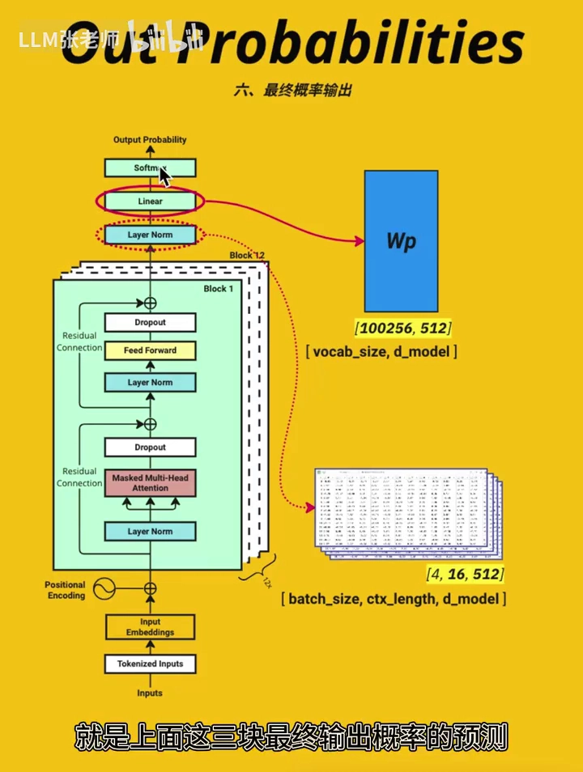
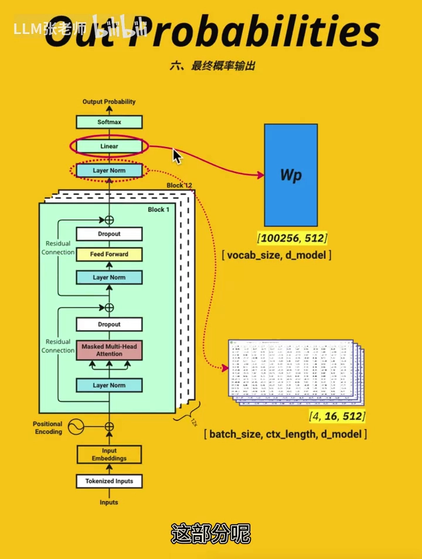
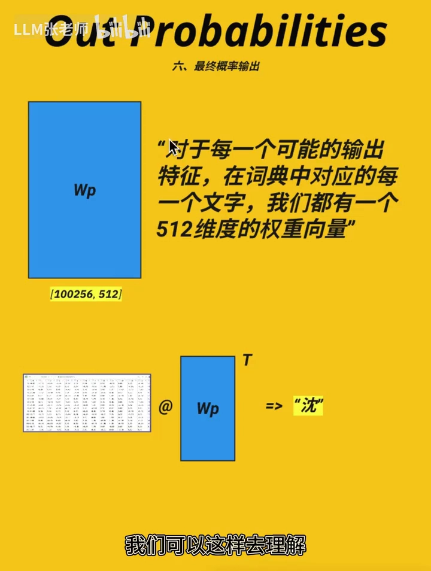
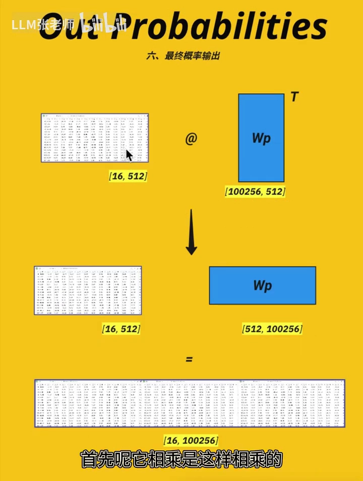
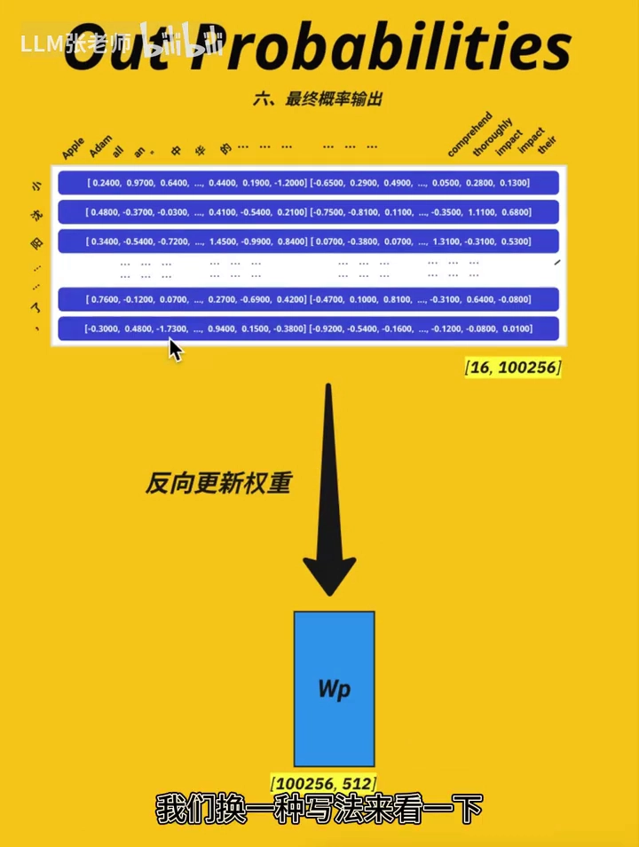
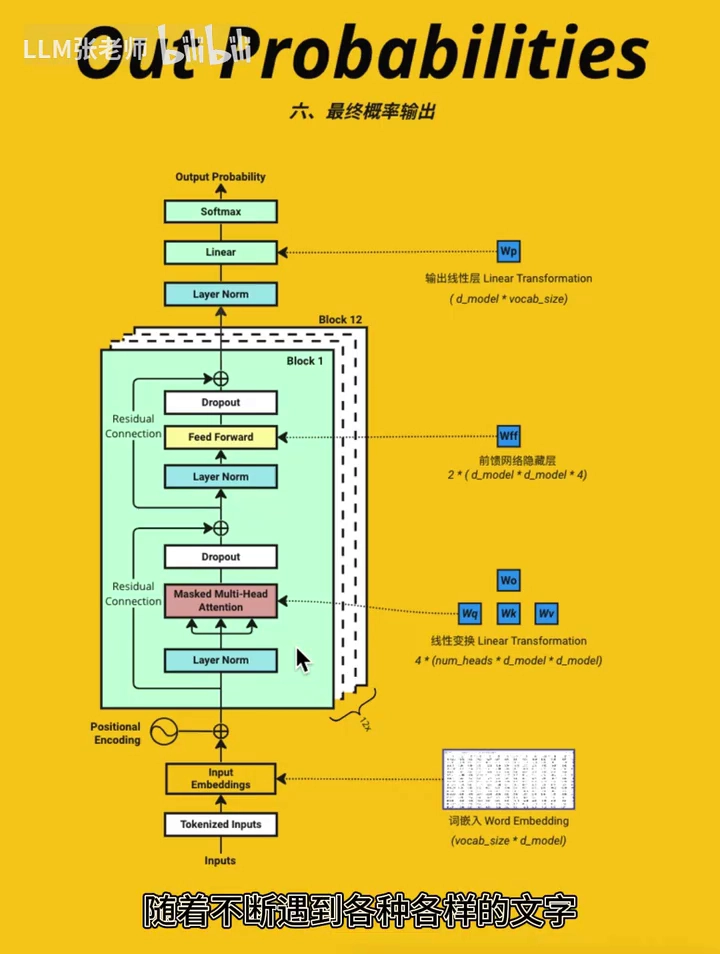

# 最后一层输出到词表分数：LM Head 的形状与计算量从哪来

> 视频来源：[Transformer 最终输出逻辑及参数量](https://www.bilibili.com/video/BV1mm4116794/?t=0)（Bilibili · LLM张老师，BV1mm4116794）
> 本文基于视频演说图文稿整理，配图截自视频。

## 本讲要解决的核心问题（SCQA）

**背景**：到这一步，Transformer 的主体已经跑完了——课件里的写法是"如果有 12 层就运行 12 次"，最后吐出一叠隐藏向量。这些向量是浮点数，不是文字。

**冲突**：隐藏向量怎么变成"下一个字是沈"这种具体预测？中间要靠一个线性变换，而这个矩阵的形状不是由层数决定的，而是由**词表长度**决定的：课件这个例子里是 10 万 256 行、512 列。于是每一步生成都要和 10 万多个候选词各算一次相似度，参数量与算力都挂在这个数字上。

**疑问**：最后这三步到底做了什么？那个 $[100256, 512]$ 的矩阵为什么是这个形状？乘完之后得到的巨大矩阵该怎么读？它的参数量与计算量从哪里来，又为什么会和词表绑在一起？

**回答（中心思想）**：**输出的最后一步是一次"打分"——用隐藏向量去和词表里每一个词算一次匹配分数。** 三步依次是 LayerNorm（只缩放数值、不改形状）、Linear（乘一个 $[V, D]$ 的可学习矩阵，把 $D$ 维隐藏向量变成 $V$ 维词表分数）、Softmax（把每行分数变成加起来为 1 的百分比）[【跳转到 00:30】](https://www.bilibili.com/video/BV1mm4116794/?t=30)。其中真正带参数、也真正吃掉算力的是中间那步 Linear：它的权重就是 $V \times D$ 个数，它的计算量是"每个 token 位置 × 每个候选词"一遍点积。这层常被叫作输出层或 LM Head。

---

## 一、三步走：只有中间那一步带参数

先看全景。课件右上角圈出来的三块，就是最后一轮输出的全部工作 [【跳转到 00:00】](https://www.bilibili.com/video/BV1mm4116794/?t=0)。

图里两个形状先记住，后面全篇都在用：

| 张量 | 形状 | 含义 |
| --- | --- | --- |
| 隐藏状态 | $[4, 16, 512]$ | 4 个批次，每批 16 个 token 位置，每个位置 512 维 |
| $W_p$ | $[100256, 512]$ | 10 万 256 行（词表里的每个词一行），512 列（等于 $d_{\text{model}}$） |

三步的分工很清楚：

1. **LayerNorm**：对 $[4, 16, 512]$ 做数值缩放，"比例和形状都没有改变"；
2. **Linear**：把每个 512 维向量映射成 100256 维的分数向量；
3. **Softmax**：在每一行上把这 100256 个分数转成百分比，"一行里所有数字加起来等于 1" [【跳转到 00:55】](https://www.bilibili.com/video/BV1mm4116794/?t=55)。

UP 主特别强调："这里面最重要的是这个线性变换层。" 原因很简单：**LayerNorm 和 Softmax 都是运算，没有可学习的权重；只有 Linear 有。**

## 二、为什么最后还要一个 LayerNorm：形状不变，只调数值

从这一讲开始，课件用的是"最新架构"：LayerNorm 被拿到前面去——多头注意力前面一个、前馈网络前面一个，**最终输出之后再补一个** [【跳转到 00:05】](https://www.bilibili.com/video/BV1mm4116794/?t=5)。

这一步的作用是"一个数字的缩放"，对象是形状为 4 个批次、16 乘 512 的矩阵；缩放完之后**比例和形状都没有改变**。这句话有两层意思，都值得初学者记住：

- **形状不变**：进来的还是 $[4, 16, 512]$，出去的也是 $[4, 16, 512]$，所以它不会影响后面 Linear 的乘法形状；
- **数值被规整**：它把数值压回一个稳定的量级范围，避免极端值主导后面 Linear 的结果。

很多初学者会问"既然形状不变，为什么还要这一层"，答案就是第二条：它不改变"信息有多少维"，只改变"数值有多大"。

## 三、Linear 的形状：$[100256, 512]$，行是词表、列是维度

现在进入正题。Linear 做的事，是把上一步的 $[4, 16, 512]$ 乘上一个"可以学习的、蓝色的东西"——形状是 $[100256, 512]$ [【跳转到 01:20】](https://www.bilibili.com/video/BV1mm4116794/?t=80)。

这个 100256 是哪来的？课件举的例子里用的是 tiktoken，字典长度就是 100256（读作十万零二百五十六）；换成任何一个分词器，这个数就等于**词表大小 $V$**。

所以 $W_p$ 的两个维度分别代表：

- **行**：词表里的每一个文字。100256 行，就是 100256 个候选词；
- **列**：$d_{\text{model}}$，这里取 512，即每个词对应一条 512 维的向量。

UP 主对它的解释是："**对于每一个可能的输出特征，在词典中对应的每一个文字，我们都有一个 512 维的权重向量**" [【跳转到 05:05】](https://www.bilibili.com/video/BV1mm4116794/?t=305)。

这句话是全篇的钥匙：**这层不是"分类器"，而是"相似度打分器"。** 它做的事，是拿当前这个 token 的 512 维隐藏向量，去和 10 万 256 个词各自的 512 维向量算一次匹配。跟哪个词最匹配，哪个词的分数就最高。

顺带把参数量算出来：这张表的参数就是两个维度相乘。

$$
\text{Params}_{W_p} = V \times d_{\text{model}} = 100256 \times 512 \approx 5131 \text{ 万}
$$

**一张表就是五千多万参数**，而它只是整张架构图最上面那一小块。

## 四、转置是为了对齐：$[16,512] \times [512,100256] = [16,100256]$

矩阵乘法有硬性规则：左边矩阵的列数必须等于右边矩阵的行数。而隐藏状态是 $[16, 512]$（这里先拿出一个批次的一片来看）、$W_p$ 是 $[100256, 512]$——两个矩阵的 512 都落在自己的第二维上，直接乘是对不齐的。

所以要先**转置**：把 $W_p$ 转成 $[512, 100256]$，这样"这两个数字相等就可以相乘" [【跳转到 02:03】](https://www.bilibili.com/video/BV1mm4116794/?t=123)。

$$
[16, 512] \times [512, 100256] = [16, 100256]
$$

UP 主的原话是："乘出来的结果是 16 乘 100256，这样一个**巨大的矩阵**" [【跳转到 02:28】](https://www.bilibili.com/video/BV1mm4116794/?t=148)。

"巨大"是字面意思：16 行、每行 100256 个数，一个批次就是 160 万个数字。完整输入是 4 个批次，也就是 $[4, 16, 100256]$，六百多万个数。这也是为什么这一层在某些实现里会成为显存峰值所在——**它产生的中间结果，元素个数是隐藏状态的约 195 倍**（$100256 \div 512 \approx 195.8$），而它只服务于一步打分。

## 五、这个 $[16, 100256]$ 怎么读：一行一个位置，一列一个候选词

乘法算完了，还得会读。课件强调了两件事：

**第一，行对应样本里的一个文字位置。** 回忆课件里那句"小沈阳江西演唱会邀请了逗号"：第一行就是"小"这个字的位置，它对应 10 万 256 个数字；下一行是"小沈阳"的"沈" [【跳转到 02:53】](https://www.bilibili.com/video/BV1mm4116794/?t=173)。

**第二，列对应词典里的一个文字。** "这些不是维度，每一列都是词典里的一个文字，可能是逗号、可能是英文字母、可能是数字，也可能是任何一个文字。"于是每一行里的每个数字，就是"下一个字是这个候选词"的可能性。

于是预测动作就变得非常机械：**每一行里挑出数值最高的那一列，这一列对应的词，就是这个位置预测出的下一个 token** [【跳转到 03:18】](https://www.bilibili.com/video/BV1mm4116794/?t=198)。

课件还给了个具体例子：16 行对应样本里的 16 个文字，比如"小"这一行里某个文字概率最高，它就被挑出来作为预测的下一个 token；而这个位置的**正确答案我们知道**，是"沈" [【跳转到 03:29】](https://www.bilibili.com/video/BV1mm4116794/?t=209)。

这就把"推理"和"训练"的区别摆出来了：

- **推理时**：挑最高（或按概率采样）就结束了，往下继续生成；
- **训练时**：挑完要和正确答案比，比错了就要回头改参数——这正是第七章的内容。

## 六、算力账：每生成一个 token，就要和 10 万 256 个词各算一次点积

现在把"计算量从哪来"算清楚。一次 $[16, 512] \times [512, 100256]$ 的矩阵乘法，本质上是**每个位置 × 每个候选词**各做一次长度为 512 的点积。

单个位置的乘法次数：

$$
512 \times 100256 = 51{,}331{,}072 \approx 5131 \text{ 万次}
$$

16 个位置（一个批次的一片）：

$$
16 \times 512 \times 100256 \approx 8.21 \text{ 亿次}
$$

4 个批次一起算：

$$
4 \times 16 \times 512 \times 100256 \approx 32.9 \text{ 亿次}
$$

这就是"词表越大越贵"的最直观来源：**词表每翻一倍，这一层的参数量翻一倍、乘法次数也翻一倍**，而它发生在**每一次**前向计算里。相比之下，注意力那几层的形状只跟 $d_{\text{model}}$ 和序列长度有关，跟词表没关系。

还有一处容易被忽略的连带开销：Softmax 要在 100256 个数上做归一化，采样也要在 100256 个候选上走一遍——都是"每个生成步 × 10 万"的量级。

## 七、训练时它在干什么：交叉熵挑错，反向更新 $W_p$

训练阶段，这一层的输出会被拿去和正确答案对账。

举例：位置是"小"，模型预测的不是"沈"，就要用**交叉熵损失函数**算出一个结果，这个结果会告诉模型"要更新多少比例的权重"，然后去更新那个蓝色的 $W_p$——也就是这层线性变换的权重 [【跳转到 03:54】](https://www.bilibili.com/video/BV1mm4116794/?t=234)。

第二个位置也一样：本来该出"阳"，模型却预测成"中华"的"中"，就把"中"和"阳"拿去做交叉熵计算，再更新 $W_p$ [【跳转到 04:19】](https://www.bilibili.com/video/BV1mm4116794/?t=259)。

UP 主把这里的批量关系数了一遍：

- 一个批次里有 16 个样本文字，就做了 16 次这样的计算；
- 一共有 4 个批次，于是**一次循环里做了 4 乘 16，也就是 64 个文字的预测，做了 64 次权重更新**。

注意这里的因果链：**损失函数不直接改隐藏状态，它改的是 $W_p$。** 而 $W_p$ 是共享的——64 个位置的梯度都会汇到同一张表上。所以这张 5000 万参数的表，在每一步都被大量位置的梯度同时推动。

把整个循环串起来看：丢入一批样本文字 → 加入位置信息 → token 化 → 12 层计算 → 预测下一个文字 → 交叉熵算出偏差 → 更新训练过程中涉及的所有权重 → 进入下一次循环 [【跳转到 06:20】](https://www.bilibili.com/video/BV1mm4116794/?t=380)。既然每次都在改权重，下次遇到同一个字时，是基于已更新过的权重再算，可能还会不准，那就再改。成千上万次循环之后，这些权重值就会变得非常准确。

## 八、把 $W_p$ 拆开看：10 万 256 个 512 维向量，各管一个词

最后回到对 $W_p$ 的理解。按行拆开，它就是 10 万 256 条向量，每条 512 维；第 $i$ 条向量负责的，就是"下一个词是不是第 $i$ 个词"这件事。

所以"预测下一个词"这个任务，被翻译成了一个**检索任务**：

- 当前上下文压缩成一个 512 维的查询向量（就是最后那个位置的隐藏状态）；
- 词表里每个词有一条 512 维的"词条向量"；
- 两边做点积，分数高的词就是候选。

这正好解释了为什么第二章那个 LayerNorm 是必要的：如果隐藏状态的数值量级飘了，点积结果也会飘，最高分可能被某个"数值大"的词莫名拿走。

也解释了为什么这一层的权重和词表同生共死：**词表多一个词，$W_p$ 就多一行，就多一条要学的向量。** 加词表不是"加个词条"，而是给这张表加一整行参数、给每次前向加一整列计算。

## 九、回到整张架构图：哪些参数随词表变，哪些不随

课件最后把参数的位置标在了整张架构图上 [【跳转到 07:35】](https://www.bilibili.com/video/BV1mm4116794/?t=455)。

从下往上，一共四类：

| 位置 | 课件标注的形状 | 是否随词表变 |
| --- | --- | --- |
| Input Embeddings（词嵌入表） | $V \times d_{\text{model}}$ | 是 |
| 多头注意力的四个线性变换 | 四个 $\text{num\_heads} \times d_{\text{model}} \times d_{\text{model}}$ 的组合 | 否 |
| 前馈网络的隐藏层 | $2 \times (d_{\text{model}} \times d_{\text{model}} \times 4)$ | 否 |
| 输出 Linear（LM Head） | $d_{\text{model}} \times V$ | 是 |

表格里有两行是跟随词表的，UP 主的说法是"一次循环下来，除了这个和这个是随词表变的之外，其他每一层里面都有自己的参数" [【跳转到 08:25】](https://www.bilibili.com/video/BV1mm4116794/?t=505)。这是一个非常实用的分类：

- **词表相关的参数只有两处**，都在"输入/输出"这两端，形状互为转置，各占 $V \times D$；
- **中间十几层的参数全都不看词表**，只看 $d_{\text{model}}$、头数与层数。

这也解释了为什么一个模型换 tokenizer 代价很高：词表一变，两端这两张 $V \times D$ 的表全部作废（形状都变了），必须重新训练。反过来，如果你想扩词表做继续预训练，改动也只能落在两端。

至于"千亿参数"是怎么来的，UP 主的总结是：样本数据越大、训练次数越多、层数越多，参数量就越大 [【跳转到 08:50】](https://www.bilibili.com/video/BV1mm4116794/?t=530)。这里需要补一句区分（属于本文的注解，不是课件原话）：**真正把参数量推上去的是层数与 $d_{\text{model}}$**；训练数据量与循环次数决定的是"这些参数被调教得多准"，不直接增加参数个数。

---

## 小结

- 最后输出分三步：LayerNorm（不改形状、只规整数值）→ Linear（$[100256, 512]$ 的可学习权重）→ Softmax（每行转成百分比）。只有 Linear 带参数。
- $W_p$ 的形状是 $[V, d_{\text{model}}]$：**行是词表里的每个词，列是 512 维表示**，参数约 5131 万。
- 乘法要先转置对齐：$[16, 512] \times [512, 100256] = [16, 100256]$，输出矩阵行对应 token 位置、列对应候选词。
- 计算量是"位置数 × 词表大小 × $d_{\text{model}}$"：一个位置就要 5131 万次乘法，四个批次合计约 32.9 亿次。
- 训练时用交叉熵对比"预测词"与"正确词"，梯度回传到 $W_p$；4 批 × 16 个位置 = 一次循环 64 次预测。
- 整张图里，只有输入端嵌入表与输出端 Linear 随词表变，中间各层只看 $d_{\text{model}}$、头数与层数。

## 关键术语速查

| 术语 | 一句话解释 |
| --- | --- |
| 隐藏状态 | Transformer 跑完最后一层得到的浮点数矩阵，形状 $[batch, seq, d_{\text{model}}]$ |
| LM Head（输出层） | 把隐藏向量映射成词表分数的那层线性变换，权重形状 $[V, d_{\text{model}}]$ |
| $W_p$ | 课件里给这层输出权重的名字，本例形状 $[100256, 512]$ |
| 词表大小（$V$） | 候选词的总数，本例用 tiktoken 的 100256 |
| Softmax | 把一行分数归一化成加起来为 1 的百分比 |
| 交叉熵损失 | 衡量"预测分布"与"正确答案"差多少的函数，训练时据此更新权重 |
| 批次（batch）与位置（token） | 本例 4 个批次、每批 16 个 token 位置，一次循环共 64 个预测 |
| 转置（$^{\mathsf{T}}$） | 把矩阵行列互换，用来满足矩阵乘法的维度对齐要求 |
