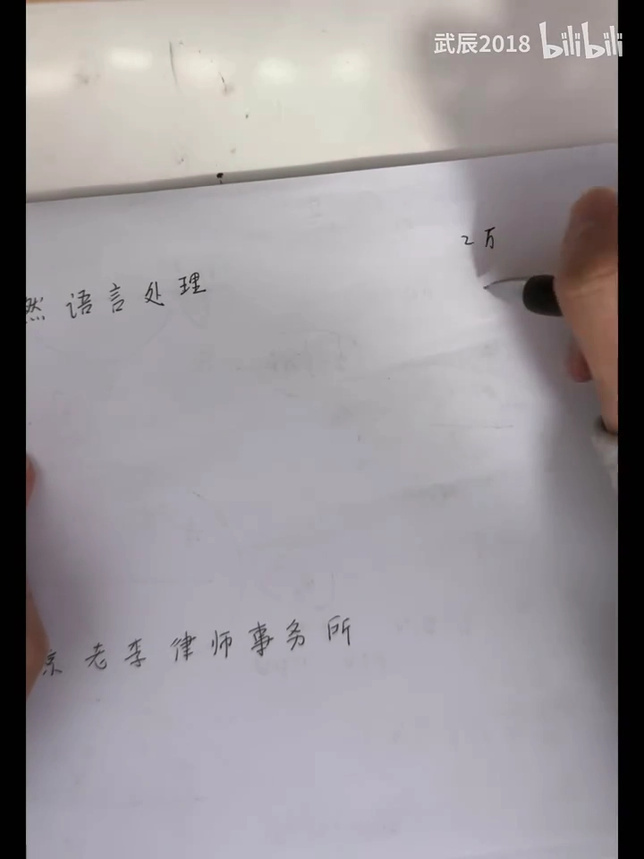
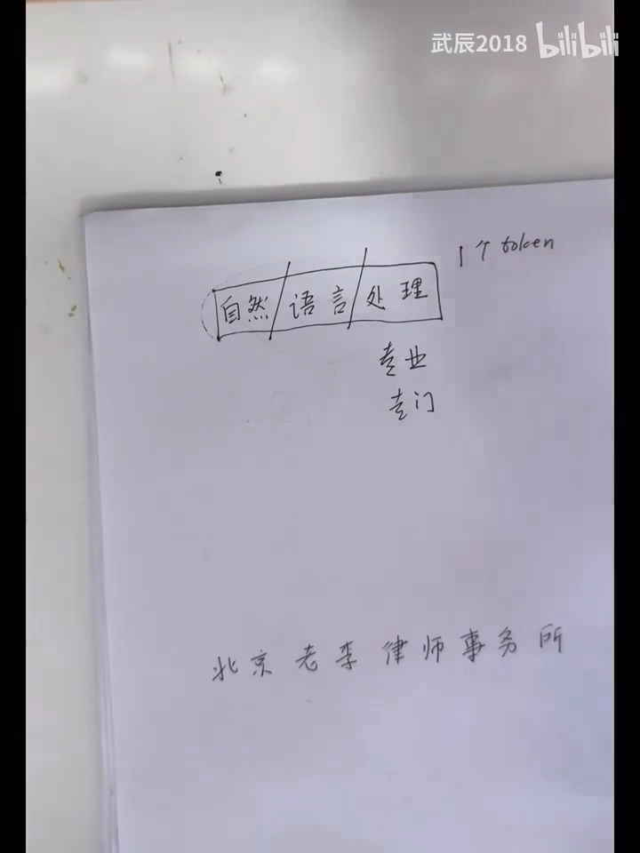
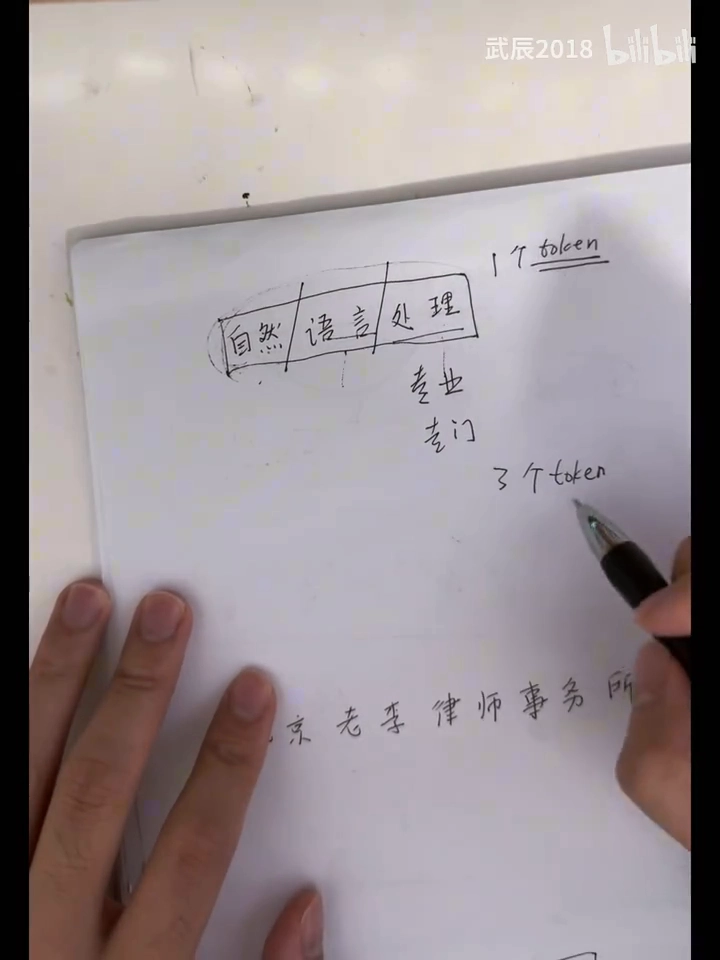
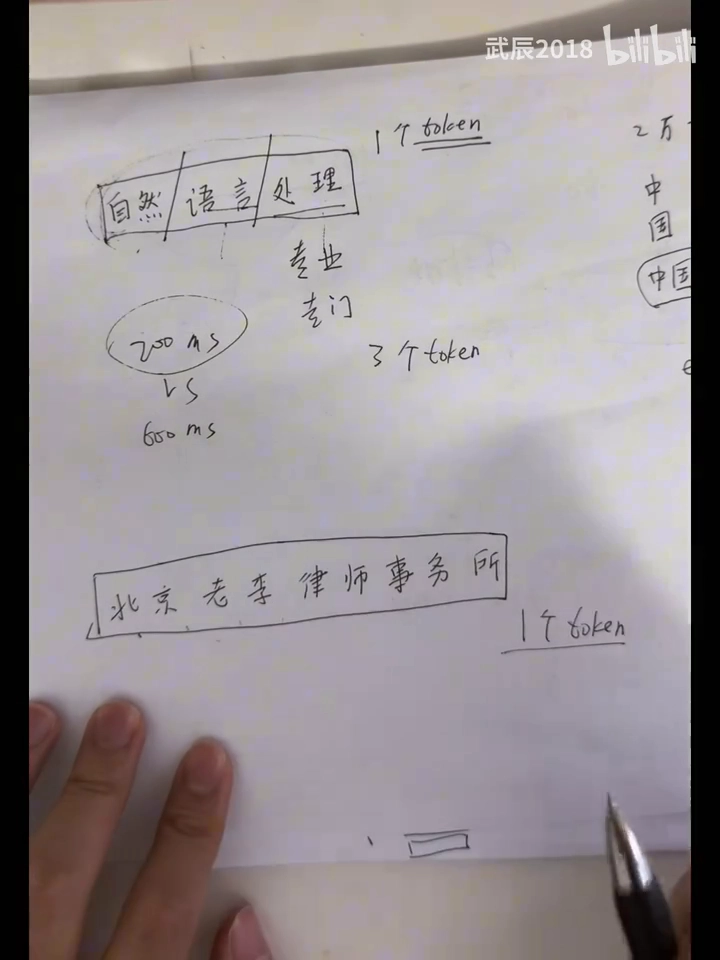
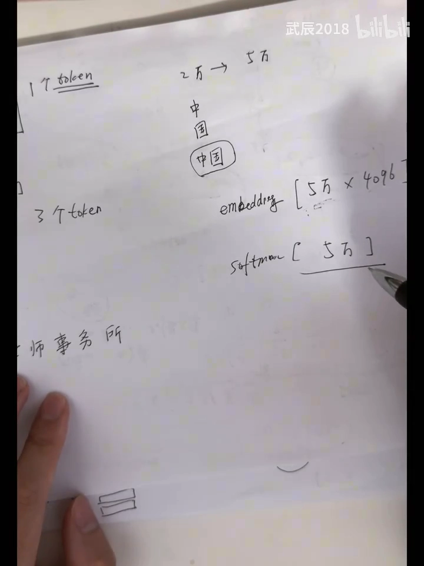
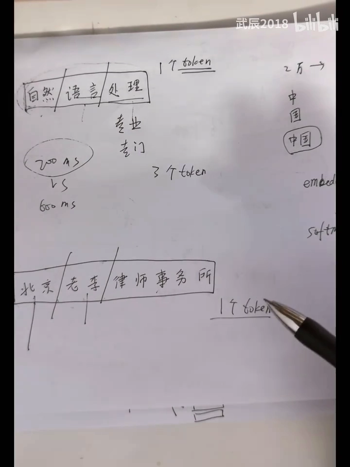

# 词表大小的账本：Embedding 与 LM Head 的显存算力开销

> 视频来源：[大模型的词汇表是越大越好，还是越小越好](https://www.bilibili.com/video/BV1jfU8BNEmC/?t=0)（Bilibili · 武辰2018，BV1jfU8BNEmC）
> 本文基于视频演说图文稿整理，配图截自视频。

## 本讲要解决的核心问题（SCQA）

**背景**：大模型处理文字的第一步是分词——tokenizer 把一句话切成若干个 token，模型真正"认识"的 token 全集就叫词表（vocabulary）。词表有多大，通常记作 $V$。这个数字在训练开始之前就定死了，训练完想改，就得连嵌入矩阵一起重练。

**冲突**：把词表调大，可以把"中国""自然语言处理""北京老李律师事务所"这种成块的词组直接收成**一个** token，一句话的 token 数立刻变少；但词表里每多一个 token，嵌入矩阵就多一行，输出层就多一列——参数和算力都要跟着付账，而且长尾词被整块吞进词表之后，模型反而不一定学得懂它。

**疑问**：词表到底该往大调还是往小调？大在哪里赚、在哪里亏？这笔账该怎么对？

**回答（中心思想）**：**既不是越大越好，也不是越小越好，合适才是最好的** [【跳转到 00:05】](https://www.bilibili.com/video/BV1jfU8BNEmC/?t=5)。判断"合适"的办法是把收益和代价摆在一张账本上：收益有三条——语义更清晰、同样内容占更少 token（上下文更省）、生成步数更少（推理更快）；代价有两条——Embedding 与最后输出层（LM Head）的参数随 $V$ 线性膨胀、softmax 要在 $V$ 维向量上做归一化与采样，以及一条容易被忽略的隐性代价：长尾词成块进词表后，模型见得太少，反而学不到意思。

---

## 一、词表变大，变的其实是 token 的"颗粒度"

"词表大"听起来抽象，UP 主先用汉字举了个直观的例子：常见汉字大概有 2 万个，如果**每个汉字就是一个 token**，那么词表大小就是 2 万个 token [【跳转到 00:24】](https://www.bilibili.com/video/BV1jfU8BNEmC/?t=24)。

但 token 不一定非得是一个字。当我们把词表从 2 万扩充到 5 万，多出来的位置就可以放"合并出来的组合"：原来"中"是一个 token、"国"是一个 token，词表扩到 5 万之后，"中国"可以被加进去，变成**另一个新的 token**。

这就是"词表变大"最直观的含义：不是模型多认识了几万个新概念，而是**它把原本要拆开写的词组合并成了整块**。颗粒度变粗，一句话的 token 数就变少；颗粒度变细，token 数就变多。后面所有收益与代价，都是从这一个变化推出来的。

## 二、收益一：整词成 token，语义更干净

第一个好处是**更高的语义清晰度** [【跳转到 00:59】](https://www.bilibili.com/video/BV1jfU8BNEmC/?t=59)。

拿"自然语言处理"这六个字来说。如果词表里它是一整个 token，那它就是一个干净、完整的词；如果词表里没有它，只能切成"自然语言"和"处理"，或者更细地切成"自然""语言""处理"，读者的第一反应就会跑偏：它跟"大自然"有什么关系？跟"处理结果"又有什么关系？[【跳转到 01:19】](https://www.bilibili.com/video/BV1jfU8BNEmC/?t=79)

切成三块时，模型看到的是三个各自常见、但组合含义模糊的碎片；合成一个 token 时，模型被明确告知"这是一个专门的词"，就会用对待专业词汇的方式对待它，语义自然更清晰 [【跳转到 01:34】](https://www.bilibili.com/video/BV1jfU8BNEmC/?t=94)。

一句话概括：**词表把哪些字符合成一个 token，就等于替模型预先划好了一部分词边界。**划得准，语义就干净；划得碎，模型就得自己在注意力里重新拼。

## 三、收益二：同样的内容占更少 token，上下文更"长"

第二个好处是**更长的上下文长度** [【跳转到 01:49】](https://www.bilibili.com/video/BV1jfU8BNEmC/?t=109)。

上下文窗口通常按 token 计，而不是按字数计——UP 主的说法是"大模型最低的细粒度就是以 token 为单位的" [【跳转到 02:19】](https://www.bilibili.com/video/BV1jfU8BNEmC/?t=139)。于是同样的六个汉字，"自然语言处理"合成一个 token 只占 1 格；按文稿的另一种切法把它拆成小块（"自然语言""处理"这类组合），就要占 3 格。

账算得很直白：

| 切法 | 六个汉字占用的 token 数 | 同一个窗口能装下多少这样的内容 |
| --- | --- | --- |
| 整词成 token | 1 | 1 份（基准） |
| 切成三个 token | 3 | 只剩三分之一 |

也就是说，词表变大、token 变粗之后，**同一个上下文窗口能塞进更多的实际内容**。这不是把窗口"变大"了，而是把内容"变短"了——效果上等价，且不需要改模型结构，只改分词器就够了。

## 四、收益三：生成步数变少，端到端更快

第三个好处是**推理速度更快**，道理和上面完全一样：自回归生成是一步一个 token 地吐字，token 少了，步数就少了 [【跳转到 02:34】](https://www.bilibili.com/video/BV1jfU8BNEmC/?t=154)。

UP 主给了一个很具体的假设：如果模型每生成一个 token 要 200 毫秒，那么"自然语言处理"按 3 个 token 算，就是第一个 token 200 毫秒、第二个 200 毫秒、第三个 200 毫秒，合计 600 毫秒；合成 1 个 token，就只要 200 毫秒 [【跳转到 02:44】](https://www.bilibili.com/video/BV1jfU8BNEmC/?t=164)。

200 毫秒对 600 毫秒，正好是 1 比 3。这里要注意：**变快的不是每一步，而是步数。**单步耗时由模型大小和硬件决定，分词器改不了；分词器能改的是"这句话要跑几步"。所以在长输出场景里，词表带来的这一步收益会被放大很多倍。

## 五、代价一：Embedding 与输出层的参数随 $V$ 线性膨胀

收益讲完，轮到账单。第一个、也是最实在的坏处：**词表越大，模型里的嵌入层和最后的输出层就越大** [【跳转到 03:09】](https://www.bilibili.com/video/BV1jfU8BNEmC/?t=189)。

嵌入层（embedding layer）本质是一张查表矩阵：词表里每个 token 对应一行，行的长度就是嵌入维度（记为 $d_{\text{model}}$）。所以它的参数量是词表大小乘以嵌入维度：

$$
\text{Params}_{\text{emb}} = V \times d_{\text{model}}
$$

UP 主举的例子是 $d_{\text{model}} = 4096$。按这个维度，词表 2 万和词表 5 万的差别是这样的：

| 词表大小 $V$ | 嵌入维度 $d_{\text{model}}$ | 参数量 $V \times d_{\text{model}}$ | 显存（按 FP16 每参数 2 字节粗算） |
| --- | --- | --- | --- |
| 2 万 | 4096 | 8192 万 | 约 164 MB |
| 5 万 | 4096 | 2.048 亿 | 约 410 MB |

2 万到 5 万，参数量差了 2.5 倍——UP 主的原话是"这就相差了两倍多的区别" [【跳转到 03:32】](https://www.bilibili.com/video/BV1jfU8BNEmC/?t=212)。这个量级单看不算可怕（几亿参数），但要记住两点：

1. **它是纯存储，不产生任何"能力"。** 如果词表继续加到 25 万、$d_{\text{model}}$ 仍取 4096，光这一张表就超过 10 亿参数——账面上"变大"了，会算的东西一点没多。
2. **它和输出层是一对。** 输入端做查表的是 $V \times d_{\text{model}}$，输出端把隐藏向量打回词表分数的那层（常称 LM Head）也是同一个形状 $d_{\text{model}} \times V$（这部分在讲"最后一层输出"的那篇里展开）。词表翻一倍，两端一起翻。

## 六、代价一的后半段：softmax 与采样也要在 $V$ 维向量上走一遍

前面说的是"存"的代价，现在说"算"的代价：**最后 softmax 出来的就是一个 $V$ 维的向量**，我们要在这个向量上做归一化、再采样 [【跳转到 03:37】](https://www.bilibili.com/video/BV1jfU8BNEmC/?t=217)。

词表 5 万，就是 5 万维；词表 25 万，就是 25 万维。UP 主的结论很直接："词汇表越大，这个向量维度越高，它造成的计算量也会增加" [【跳转到 03:47】](https://www.bilibili.com/video/BV1jfU8BNEmC/?t=227)。

这一步的计算量为什么值得单独说？

- 归一化要对 $V$ 个数逐个取指数、求和、再逐个相除，计算量随 $V$ 线性增长；
- 生成阶段是**逐 token** 循环的，每吐一个字都要重算一次整个 $V$ 维分布，于是这笔开销会被"步数 × 词表"放大；
- 采样（从分布里挑一个）也要在 $V$ 个候选上走一遍。

所以词表大小的代价不是一次性付清的，而是**每一个生成步都要再付一次**。这也解释了为什么第四章讲的"步数变少"和这里的"每步变贵"必须一起看：词表变大，步数变少、每步变贵，净收益取决于两者谁降得更快。

## 七、代价三：长尾词被整块吞进词表，模型反而学不到意思

第二个坏处是**词汇表的稀疏问题** [【跳转到 03:52】](https://www.bilibili.com/video/BV1jfU8BNEmC/?t=232)。

UP 主举的例子是"北京老李律师事务所"。假如词表足够大，把这整串当成**一个** token 收进去，如果模型在训练中很少见到它，它知道这是什么意思吗？"它不知道呀"——这么长的一个东西被当成一个 token，只要没经过足够的训练、见得不够多，模型就学不到它的含义 [【跳转到 04:14】](https://www.bilibili.com/video/BV1jfU8BNEmC/?t=254)。

反过来，如果把它拆成三个 token——"北京""老李""律师事务所"——再合起来，模型至少知道它跟北京有关系、老板可能姓李、这是一个律师事务所 [【跳转到 04:34】](https://www.bilibili.com/video/BV1jfU8BNEmC/?t=274)。"拆开之后，它已经会有一些语义在里面了。"

这就构成一个反直觉的结论：

- 常见组合（"中国""自然语言处理"）合起来是**赚的**——出现次数足够多，模型能学出这个整块的向量；
- 罕见组合（某个具体事务所的全名、某个冷门药名）合起来是**亏的**——它在语料里出现几次，学不出稳定含义，还丢掉了"北京 + 老李 + 律师事务所"这些零件自带的语义。

UP 主把这个称为"最主要的劣势" [【跳转到 04:54】](https://www.bilibili.com/video/BV1jfU8BNEmC/?t=294)。词表越大，越容易把长尾字符串也收成整块，这类"看起来省了 token、实际上丢了可解释性"的条目就越多。

## 八、给词表定大小的正确姿势：把三笔收益和两笔代价放在一张表里

把全篇的账收拢，判断一个词表大小是否合适，可以照着下面这张表逐行对：

| 维度 | 词表变大 | 词表变小 |
| --- | --- | --- |
| 语义清晰度 | 常见词组整块成词，语义更干净 | 词要拆碎，模型需自己重组语义 |
| 上下文占用 | 同内容 token 数变少，窗口更经用 | token 数变多，窗口被快速吃掉 |
| 推理步数 | 步数变少，端到端更快 | 步数变多，长输出明显变慢 |
| Embedding 与 LM Head 参数 | 随 $V$ 线性上涨，纯存储不产能力 | 参数省下来，显存压力小 |
| softmax 与采样算力 | 每步都要在更大的向量上算一遍 | 每步更便宜 |
| 长尾词 | 罕见组合被整块吞掉，学不到意思 | 罕见词退回零件级，语义可拼 |

三个判断口径，可以当口诀用：

1. **看语料覆盖**：候选 token 在训练语料里出现得够不够多？够多才配进词表。
2. **看语言混布**：多语言、多领域混训时，词表要照顾到每一块的常用组合，否则小语种会被切得极碎、白烧上下文。
3. **看参数预算**：词表每加 1 万，$d_{\text{model}}=4096$ 时就是 4096 万参数，而且输入输出两端都要放得下。

---

## 小结

- 词表大小的本质是 **token 的颗粒度**：把哪些字符合成一个 token，等于替模型预先划好词边界。
- 变大有**三条收益**：语义更清晰（"自然语言处理"整块成词）、上下文更省（1 个 token 对 3 个 token）、推理更快（200 ms 对 600 ms）。
- 变大有**两条显性代价**：Embedding 与输出层参数按 $V \times d_{\text{model}}$ 线性上涨（2 万对 5 万，差 2.5 倍）；softmax 与采样要在 $V$ 维向量上做，而且每个生成步都要重付一次。
- 还有一条**隐性代价**：长尾组合被整块收进词表后，模型见得太少，反而学不到意思——"北京老李律师事务所"拆成三块才带语义。
- 所以结论是"合适最好"：常见组合尽量合、罕见字符串尽量拆，总量受显存与算力预算约束。

## 关键术语速查

| 术语 | 一句话解释 |
| --- | --- |
| 词表（vocabulary） | 模型认识的全部 token 的集合，大小记作 $V$ |
| token | 模型处理文字的最小单位，可以是一个字、半个词，也可以是一个整词 |
| 嵌入层（embedding layer） | 一张 $V \times d_{\text{model}}$ 的查表矩阵，把 token 换成向量 |
| 嵌入维度（$d_{\text{model}}$） | 每个 token 用多少维的向量表示，例子里取 4096 |
| LM Head（输出层） | 把最后一层隐藏向量映射成词表上分数的那层线性变换，形状与嵌入层相对称 |
| softmax | 把一串分数归一化成加起来等于 1 的概率分布 |
| 词汇表稀疏 | 词表里存在大量语料中出现次数极少的 token，其向量学不出来 |
