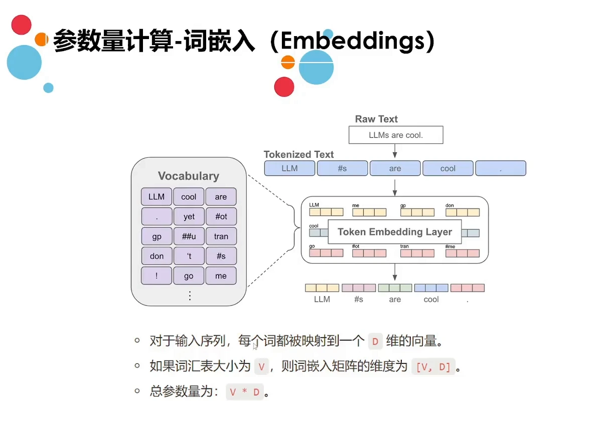
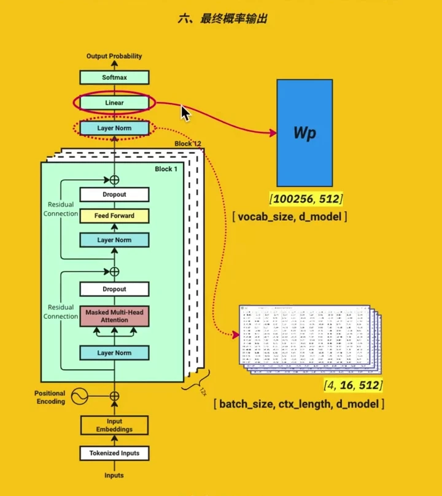
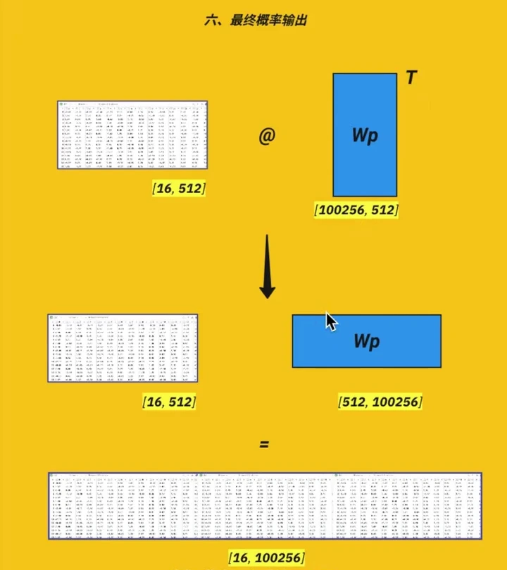
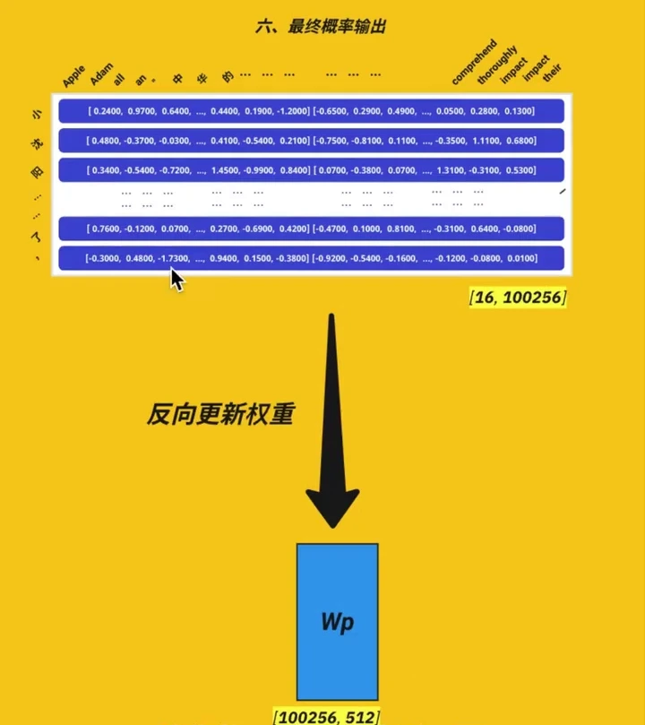
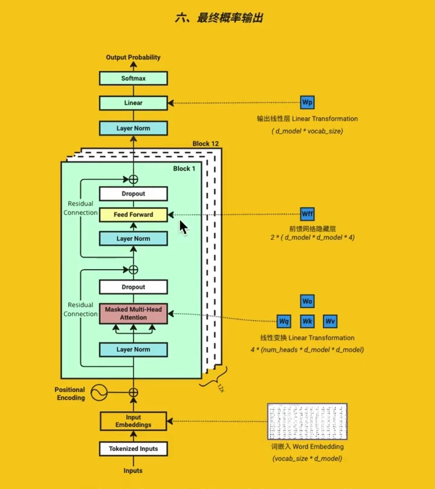
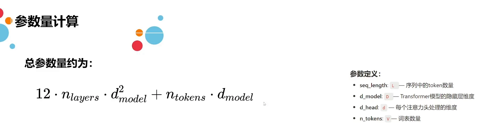
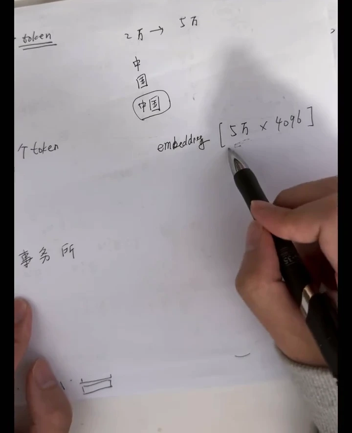
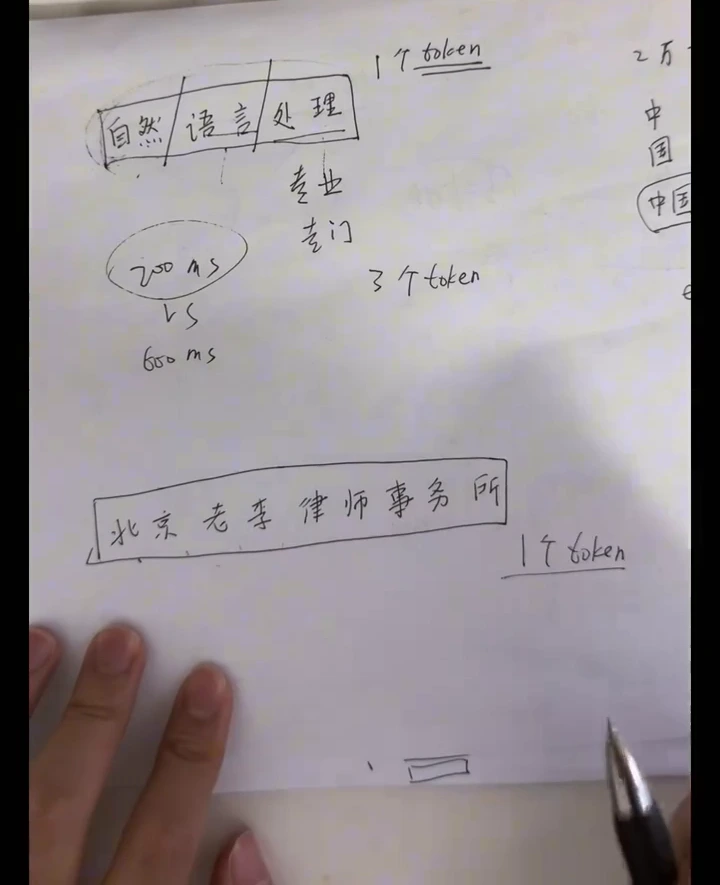

# 词表大小的账本：Embedding 与 LM Head 的显存与算力开销



## 本讲要解决的核心问题（SCQA）

**背景**：上一讲把 BPE 的训练过程走完了，词表规模 $V$ 是训练前就要定死的超参数；文本进模型的第一步，是把每个 token id 查表换成一个 $d_{model}$ 维向量（[【跳转到 03:25】](https://www.bilibili.com/video/BV1DZ421s7WY/?t=205)）。BPE 本身怎么长成这张表，见 [字节级BPE与Tiktoken：从UTF-8字节到子词词表](../1.2.1_Byte_level_BPE与Tiktoken/字节级BPE与Tiktoken：从UTF-8字节到子词词表.md)。

**冲突**：词表调大，同一段文字被切成更少的 token，序列短了、生成步数少了；但词表越大，模型的嵌入层和最后的输出层就越大（[【跳转到 03:09】](https://www.bilibili.com/video/BV1jfU8BNEmC/?t=189)）。$V=128\text{k}$、$d=4096$ 时，Embedding 与 LM Head 两张表加起来约 1.05B 参数，fp16 下接近 2 GB——这还只是"词表税"。

**疑问**：这笔钱具体花在哪几张矩阵上？每生成一个 token 又要多算多少？词表到底该往大调还是往回缩？

**回答（中心思想）**：词表只出现在两张 $V \times d$ 的矩阵上——输入侧的 **Embedding** 和输出侧的 **LM Head**（两者共享权重时只有一张）。参数量按 $V \cdot d$ 线性增长，显存等于参数个数乘以每参数字节数（fp16/bf16 为 2 字节）；算力上，每生成一个 token，输出层要做 $V \cdot d$ 次乘加（约 $2Vd$ FLOPs），再对 $V$ 个 logits 做一次 softmax。它的收益是压缩率、上下文利用率和生成步数，代价是显存、输出层的访存量和 softmax 开销，以及长尾 token 训练不足。

---

## 一、词表在模型里只落在两张矩阵上

### 1.1 输入侧：查表就是从 $V \times d$ 的矩阵里取一行

token 化之后，模型拿到的是一串整数 id。每个 id 对应词表里的一行，这一行就是一个 $d_{model}$ 维向量：如果词表大小是 $V$，每个词都有一个 $D$ 维向量，那么这张表的参数量就是 $V$ 乘 $D$（[【跳转到 03:25】](https://www.bilibili.com/video/BV1DZ421s7WY/?t=205)）。

用矩阵语言写出来，查表等价于把 token id 做成 one-hot 行向量，再乘整张表：

$$
\mathbf{e}_t = \mathbf{1}_{t}^{\top} \, W_{\text{emb}}, \qquad W_{\text{emb}} \in \mathbb{R}^{V \times d}
$$

其中 $\mathbf{1}_t$ 是第 $t$ 行是 1、其余为 0 的 one-hot 向量。one-hot 乘矩阵只会"选中"一行，所以工程上直接按下标取值（gather），不需要真的做一次矩阵乘法——但**参数量的算法不变**：整张表都要存下来，$V$ 行一行不少。

视频给了一个具体尺度：先从 3.2 万的词表起步，后来有些系列到 6 万多，现在可能还越来越大（[【跳转到 03:50】](https://www.bilibili.com/video/BV1DZ421s7WY/?t=230)）。

### 1.2 输出侧：LM Head 是同样形状的矩阵，但每个位置都要乘一遍

输出侧要把 $d$ 维的 hidden state 变回 $V$ 个分数。视频里把这个矩阵叫 $W_p$，形状是 $[100256, 512]$，也就是 **vocab_size** 乘 **d_model**——例子用的是 tiktoken，字典长度 10 万 256（[【跳转到 01:20】](https://www.bilibili.com/video/BV1mm4116794/?t=80)）。



注意这里的乘法方向和 1.1 节相反：查表是"取一行"，LM Head 是"乘以整张矩阵"。视频里一个 batch 的 hidden state 是 $[16, 512]$，乘上 $W_p$ 的转置 $[512, 100256]$，得到 $[16, 100256]$ 的矩阵（[【跳转到 01:48】](https://www.bilibili.com/video/BV1mm4116794/?t=108)）：

$$
H \times W_p^{\top} = Z
$$

其中 $H \in \mathbb{R}^{16 \times 512}$，$W_p^{\top} \in \mathbb{R}^{512 \times 100256}$，$Z \in \mathbb{R}^{16 \times 100256}$。



$Z$ 的每一行对应一个 token 位置，行里的 100256 个数字不是"维度"，而是**词表里每个词作为下一个 token 的分数**；做一次 softmax 就变成百分比，挑最高的那个就是预测结果（[【跳转到 02:09】](https://www.bilibili.com/video/BV1mm4116794/?t=129)）。



### 1.3 两张表还是同一张表：权重绑定

输入侧和输出侧的矩阵形状完全一样，都是 $V \times d$，所以工程上可以让它们**共享同一份权重**（weight tying）：输入用 $W_{\text{emb}}$ 查表，输出直接拿它的转置当 LM Head。共享时词表只付一份参数，不共享时付两份。



**补充（非讲者原话）**：视频没有讨论权重绑定，只把两处参数分别列了出来。是否绑定由模型的配置文件决定（HuggingFace 里的 `tie_word_embeddings`）；Llama 2、Llama 3 以及 Qwen2.5 的 7B 级模型通常不绑定，也就是词表参数要按两份算（小尺寸变体有绑定权重的写法，具体以配置为准）。本节的公式会同时给出"绑定"和"不绑定"两个数字。

### 1.4 放回总参数公式：$V \cdot d$ 是唯一随词表变的一项

视频最后把所有部件合成一条总参数量的近似公式（[【跳转到 08:25】](https://www.bilibili.com/video/BV1DZ421s7WY/?t=505)）：

$$
N \approx 12 \cdot n_{layers} \cdot d_{model}^{2} + n_{tokens} \cdot d_{model}
$$



前一项来自每层的注意力和前馈网络（$4d^2 + 8d^2$），后一项 $n_{tokens} \cdot d_{model}$ 就是词表那一份。这带来一个很实用的判断：**词表参数是唯一与 $V$ 成正比的部分**，层数、宽度、FFN 都跟词表无关。换句话说，调词表只会动这一项，调宽度会同时动两项。

拿 Llama 2 7B 的公开配置验算一下（$n_{layers}=32$、$d=4096$、$V=32000$，配置数字为补充）：$12 \times 32 \times 4096^2 \approx 6.44\text{B}$，加 $32000 \times 4096 \approx 0.13\text{B}$，合计约 6.57B，和公布的 6.74B 只差约 2.5%——差额主要来自偏置、LayerNorm，以及前馈层实际用的是 11008 而非 4d。

---

## 二、显存账：参数量乘以每参数字节数

### 2.1 一条公式算到底

显存占用只跟"参数个数"和"每个参数存多少字节"有关：

$$
M_{\text{emb}} = V \cdot d \cdot b, \qquad b = \begin{cases} 2 & \text{fp16 / bf16} \\ 4 & \text{fp32} \end{cases}
$$

推理时权重通常用 fp16 或 bf16 存放，也就是每个参数 2 字节；用 fp32 存则翻倍。**补充（非讲者原话）**：2 字节/4 字节是 fp16/bf16 与 fp32 的位宽常识，讲者没有展开讲精度；下面的具体 MiB 数字都是按它算出来的。

把视频里的教学例子代进去：$V=100256$、$d=512$，

$$
100256 \times 512 = 51\,331\,072 \ \text{个参数} \approx 5.13 \times 10^{7}
$$

fp16 下约 98 MiB（$5.13\times10^7 \times 2$ 字节）。这个量级单独看不大，但它会随着 $V$ 和 $d$ 同时放大。

### 2.2 词表从 2 万涨到 5 万：参数差 2.5 倍

视频用汉字词表举例：常见汉字 2 万个，扩充到 5 万之后可以把"中国"合成一个 token。代价是嵌入层"词汇表的大小乘以嵌入维度"，比如 4096——2 万和 5 万之间就相差两倍多（[【跳转到 03:24】](https://www.bilibili.com/video/BV1jfU8BNEmC/?t=204)）。



按 $d=4096$ 实算：

| 词表 $V$ | 参数量 $V \cdot d$ | fp16 显存 |
| --- | --- | --- |
| 2 万 | $8.19 \times 10^{7}$ | 约 156 MiB |
| 5 万 | $2.05 \times 10^{8}$ | 约 391 MiB |
| 倍数 | 2.5 倍 | 2.5 倍 |

这就是"词表税"最直观的一层：只改词表，嵌入层就多出 235 MiB；如果输出层不共享权重，这份增量还要再乘 2。

### 2.3 现代词表：$128\text{k} \times 4096$ 已经是 GB 级

把常见的现代配置代进去，$V=128000$、$d=4096$：

$$
V \cdot d = 128000 \times 4096 = 5.24 \times 10^{8} \ \text{个参数/张}
$$

单张表 fp16 约 1.05 GB（约 1.0 GiB）；输入、输出两张不共享时合计约 $1.05 \times 10^{9}$ 个参数，fp16 约 2.1 GB（约 2.0 GiB）。这就是"约 1.05B 参数、2 GB 显存"的来源——注意它是**两张表**的和，不是一张。

### 2.4 四个真实尺度摆在一起

**补充（非讲者原话）**：下表里的模型配置（词表大小、$d_{model}$、总参数量）取自各家公开的配置文件，不是视频里的数字；"占总参数"按不共享权重的单张表计算。

| 模型 | 词表 $V$ | $d_{model}$ | 单张表参数 | fp16 单张 | 两张表合计 | 单张占总参数 |
| --- | --- | --- | --- | --- | --- | --- |
| Llama 2 7B | 32000 | 4096 | $1.31 \times 10^{8}$ | 250 MiB | 500 MiB | 1.9% |
| Llama 3 8B | 128256 | 4096 | $5.25 \times 10^{8}$ | 1.00 GiB | 2.0 GiB | 6.5% |
| Qwen2.5 7B | 151936 | 3584 | $5.45 \times 10^{8}$ | 1.01 GiB | 2.0 GiB | 7.2% |
| 视频教学例子 | 100256 | 512 | $5.13 \times 10^{7}$ | 98 MiB | 196 MiB | — |

从 32k 到 128k，模型总参数只涨了不到两成，词表参数占比却从 1.9% 涨到 6.5%：**词表税翻了三倍多**。这也是为什么"词表扩大"从来不是免费的午餐——它吃掉的是一块固定的、和模型规模无关的显存。

---

## 三、算力账：每生成一个 token，输出层都要乘一遍

### 3.1 输入侧几乎不花算力，输出侧按 $V \cdot d$ 付费

同样是 $V \times d$ 的矩阵，两侧的计算量完全不同：

- **输入侧是查表**：one-hot 只选中一行，前向计算量是 $O(d)$，跟 $V$ 无关；
- **输出侧是矩阵乘**：hidden state 要和**每一行**做内积，一个 token 位置就要做 $V \cdot d$ 次乘加。

按"一次乘加算两次浮点运算"的惯例，单 token 输出层的计算量是：

$$
\text{FLOPs}_{\text{lm-head}} \approx 2 \cdot V \cdot d
$$

**补充（非讲者原话）**：视频只说了"词汇表越大，向量维度越高，计算量也会增加"（[【跳转到 03:47】](https://www.bilibili.com/video/BV1jfU8BNEmC/?t=227)），没有给出 FLOPs 公式；上面的 $2Vd$ 是按乘加折算的标准算法，代入的是各家公开配置。

| 模型 | $V$ | $d$ | 单 token 输出层 FLOPs | 占整模型前向（约 $2N$） |
| --- | --- | --- | --- | --- |
| Llama 2 7B | 32000 | 4096 | 0.26 GFLOP | 1.9% |
| Llama 3 8B | 128256 | 4096 | 1.05 GFLOP | 6.5% |
| Qwen2.5 7B | 151936 | 3584 | 1.09 GFLOP | 7.1% |

词表从 32k 扩到 128k，输出层每步的计算量从 0.26 GFLOP 涨到 1.05 GFLOP。绝对值看着不大，但 Decode 阶段每一步都要付一次；它和"层数 × 宽度"是**并列相加**的关系，砍层数、砍宽度都会伤模型能力，而词表这一项只由分词器决定，跟模型容量无关。

### 3.2 Decode 阶段真正贵的是访存，不是乘加

生成时一次只有一个 token，$1 \times d$ 的向量乘 $d \times V$ 的矩阵，是典型的矩阵-向量乘（GEMV）：计算量小，但必须把整张 $V \times d$ 的权重从显存读一遍。

以 Llama 3 8B 为例，LM Head 单张表 fp16 约 1.0 GiB。按 H100 SXM 约 3.35 TB/s 的显存带宽估算（带宽数字为补充），仅"读一遍输出层权重"就要：

$$
\frac{1.05\ \text{GB}}{3.35\ \text{TB/s}} \approx 0.31\ \text{ms}
$$

折合每秒最多约 3200 个 token——这还只是输出层一张表的上限，整模型 16 GB 权重读一遍要 4.8 ms 左右，实际吞吐会降到 200 token/s 量级。换句话说，**输出层大约占 Decode 时间的 6%，和它在参数量里的占比是同一数量级**。

### 3.3 Softmax 与采样：$V$ 路的额外开销

logits 出来后还要做一次 softmax，再按概率采样。视频强调：softmax 是一个 5 万维的向量，要在 5 万维的向量上采样，词表越大、维度越高，计算量也会增加（[【跳转到 03:37】](https://www.bilibili.com/video/BV1jfU8BNEmC/?t=217)）。

拆开看，单 token、词表 $V$ 时 softmax 要做：

- $V$ 次指数运算（数值稳定版还要先减最大值）；
- $V-1$ 次加法求分母；
- $V$ 次除法归一化；
- 采样时再扫一遍 $V$ 个概率。

当 $V=128\text{k}$ 时，这些是几十万次标量运算，跟 $2Vd \approx 10^9$ FLOPs 的矩阵乘比可以忽略；真正占地方的是 **logits 缓冲区**：一个 token 的 128k 个 fp16 分数就是 250 KiB，prefill 时是 $L$ 个位置各一份。所以工程上常把 LM Head 与 softmax、采样融合成一个 kernel，避免把 $L \times V$ 的中间结果反复写回显存。

**补充（非讲者原话）**：训练时确实要为每个位置都算 logits（视频里的 $16 \times 100256$ 就是这种批量形态，[【跳转到 01:48】](https://www.bilibili.com/video/BV1mm4116794/?t=108)）；而推理的 prefill 只为最后一个位置算 logits，其余位置不需要——这是推理引擎省掉大块输出层计算的标准做法。

### 3.4 输出层并行：词表维切分的通信代价

**补充（非讲者原话）**：张量并行时，LM Head 通常沿词表维切分——每张卡只负责 $V/TP$ 列，各自算出自己那一段 logits，然后把各段拼起来才能做 softmax 和 argmax。这意味着每生成一个 token 都要做一次规模为 $V$ 的 all-gather（$V$ 个 fp16 分数约 250 KiB），词表越大，这一步的通信量越大。视频没有展开并行细节，这里只作为"词表变大还有隐性通信成本"的提示。

---

## 四、收益：为什么大家还是把词表往上调

### 4.1 同样的文字，token 数更少

词表变大最直接的收益是**压缩率**。视频用"自然语言处理"举例：六个字如果各自成 token，就是 3 个 token；如果词表里已经有这一项，它就是 1 个 token（[【跳转到 01:04】](https://www.bilibili.com/video/BV1jfU8BNEmC/?t=64)）。同样一段话，token 数从 3 降到 1，序列就短了三分之二。



序列变短带来连锁收益：

- **上下文更耐用**：模型的上下文窗口是按 token 计的，同样 8k 窗口，1 个 token 表示 6 个字，就能比 3 个 token 表示 6 个字多装下约三倍的内容（[【跳转到 01:49】](https://www.bilibili.com/video/BV1jfU8BNEmC/?t=109)）；
- **生成步数更少**：视频给的账是每个 token 200 毫秒，3 个 token 就是 600 毫秒，合成 1 个 token 只要 200 毫秒（[【跳转到 02:44】](https://www.bilibili.com/video/BV1jfU8BNEmC/?t=164)）。自回归是一步一步生成的，少两步就少两次完整前向。

### 4.2 语义更"干净"

视频的第二个好处是**更高的语义清晰度**：把"自然语言处理"当成一个 token，模型会把它当作一个专业词汇来对待，而不是从"自然""语言""处理"三个方向去猜它跟大自然、跟处理结果有什么关系（[【跳转到 00:59】](https://www.bilibili.com/video/BV1jfU8BNEmC/?t=59)）。

**补充（非讲者原话）**：把这条讲成机制是这样的——一个 token 只对应 embedding 表里的一行，这一行的梯度主要服务于这一个语义单元；拆成三个 token 后，每个 token 的向量要在大量不同组合里复用，语义会被各种上下文"平均"掉。视频只给了"模型会把它当专业词汇对待"这个直觉，机制部分是本节的解释。

### 4.3 词表规模的演进：32k 到 128k

视频给出的经验数字是：最初 3.2 万的词表，后来有些系列到 6 万多，现在还在变大（[【跳转到 03:50】](https://www.bilibili.com/video/BV1DZ421s7WY/?t=230)）。

**补充（非讲者原话）**：公开模型里这条曲线更陡——Llama 2 用 32000 的词表，Llama 3 提到 128256，Qwen2.5 是 151936。词表变大通常同时服务三件事：英文压缩率、多语言覆盖（同样一句中文，词表里有整词就不必拆成字节）、代码里的长标识符。这三项收益都不出现在"参数量"这张表上，却直接决定同样的上下文窗口能装多少内容。

---

## 五、代价：显存之外，还有稀疏与训练不足

### 5.1 嵌入层和输出层同时变大

视频把代价归成两条，第一条就是"词汇表越大的话，我们在模型的嵌入层和最后的输出层就会比较大"（[【跳转到 03:09】](https://www.bilibili.com/video/BV1jfU8BNEmC/?t=189)）。这两层恰好是模型里**唯一随词表线性增长**的部分（见 1.4 节），所以词表翻倍，这两块就翻倍。

第二条代价是 softmax 与采样要在 $V$ 维向量上做，词表越大计算量越大（[【跳转到 03:37】](https://www.bilibili.com/video/BV1jfU8BNEmC/?t=217)）——这条在 3.3 节已经拆过账：绝对 FLOPs 不大，但 logits 缓冲区和采样扫描都随 $V$ 线性涨。

### 5.2 稀疏：一个 token 见得太少，就学不会

视频的第二个坏处是**词汇表稀疏问题**。它举的例子是"北京老李律师事务所"：如果把整串当一个 token，而模型没见过或见得不够多，它就不知道这是什么意思；拆成"北京""老李""律师事务所"三个 token，模型至少知道它跟北京有关、老板可能姓李、这是律师事务所（[【跳转到 03:52】](https://www.bilibili.com/video/BV1jfU8BNEmC/?t=232)）。

**补充（非讲者原话）**：把这条讲成数量关系——词表从 $V$ 扩到 $2V$，语料不变时每个 token 平均出现的次数就减半；embedding 表的每一行靠"出现一次、更新一次"来学，出现次数太少，这一行就基本停在初始化附近：**参数占着显存，却没被训练好**。讲者只说了"模型没见过就不懂"，这里的次数减半是本节的算术。

**补充（非讲者原话）**：这条规律在工程上有两个推论。其一，词表扩容往往要配合语料扩容或继续预训练，否则新增的词表行是"死重"；其二，超长 token（把一整串专名合成一项）泛化性差，遇到没见过的组合就只能回退到更短的子词，收益并不线性。视频只讲了"模型没见过就不懂"这个直觉，以上两条是把它量化后的推论。

---

## 六、把账本合起来：同一组数字的九笔账

把 $V=128\text{k}$、$d=4096$ 这一组数字放进同一张表，词表带来的每一笔开销就都能对上号：

| 账目 | 公式 | 数值（$V=128000$，$d=4096$） |
| --- | --- | --- |
| Embedding 参数 | $V \cdot d$ | $5.24 \times 10^{8}$ |
| LM Head 参数（不共享） | $V \cdot d$ | $5.24 \times 10^{8}$ |
| 单张表显存（fp16） | $2Vd$ 字节 | 约 1.0 GiB |
| 两张表合计（fp16） | $4Vd$ 字节 | 约 2.0 GiB |
| 单 token 输出层乘加 | $V \cdot d$ | $5.24 \times 10^{8}$ 次 |
| 单 token 输出层 FLOPs | $2Vd$ | 1.05 GFLOP |
| 单 token 输出层权重读入 | $2Vd$ 字节 | 约 1.0 GiB |
| softmax 宽度 | $V$ | 128000 路 |
| 每位置 logits 缓冲 | $2V$ 字节 | 250 KiB |

同一组数字，放到"参数表"里只占 6.5%，放到"每 token 访存"里也占约 6%，可一落到 softmax，它就是 12.8 万路——**词表大小对不同指标的影响完全不成比例**，这也是它容易被低估的原因：看总参数量觉得很便宜，看 decode 带宽和长尾 token 才发现并不便宜。

### 6.1 什么时候该把词表调大

视频的结论很克制：不是越大越好，也不是越小越好，**合适才是最好的**（[【跳转到 00:05】](https://www.bilibili.com/video/BV1jfU8BNEmC/?t=5)）。

**补充（非讲者原话）**：视频只给了这个结论，下面这张判据表是把前面的账本外推得到的。

| 情形 | 倾向 | 原因 |
| --- | --- | --- |
| 目标语言/领域集中，语料充足 | 可以调大 | 压缩率收益直接兑现，新增 token 见得多、学得会 |
| 多语言、代码混训 | 倾向调大 | 不同文字系统的公共子词多，词表大才装得下 |
| 模型本身很小 | 谨慎调大 | 词表参数与模型规模无关，小模型被"词表税"吃掉的比例更高 |
| 语料规模不变、只扩词表 | 不要扩 | 每个 token 出现次数被摊薄，新增行训练不足 |
| 显存/带宽吃紧 | 先共享权重、再考虑裁剪 | 不共享时输出层要多付一整张 $V \times d$ |

**补充（非讲者原话）**：最后一行可以用一个假设例子说明量级——假设一个 0.5B 的小模型用 $V=151936$、$d=768$ 的词表，单张 embedding 就是 $1.17 \times 10^{8}$ 个参数（约 223 MiB），占模型总参数的 23%；若输出层不共享，两张表合计 47%。同样的 15 万词表，Qwen2.5 7B（$d=3584$）单张只占 7%；换成一个 $d=768$ 的 0.5B 小模型，单张就是 23%、两张表 47%——**词表税是固定开销，模型越小越疼**。

### 6.2 这笔账怎么记

一句话版本：

```text
词表参数   = V × d                     每处一张表，共两处（输入查表 + 输出打分）
权重显存   = V × d × 2 字节            fp16/bf16，两张表就再乘 2
单步算力   = 2 × V × d FLOPs           只在输出侧付，每生成一个 token 付一次
单步访存   = V × d × 2 字节            输出层权重每步都要完整读一遍
softmax    = V 路                       指数、求和、归一化、采样都随 V 线性增长
```

---

## 七、小结

- **词表只落在两张 $V \times d$ 的矩阵上**：输入侧 Embedding 与输出侧 LM Head；共享权重时只有一张，不共享时参数与显存都翻倍（[03:25](https://www.bilibili.com/video/BV1DZ421s7WY/?t=205)、[05:05](https://www.bilibili.com/video/BV1mm4116794/?t=305)）。
- **参数量按 $V \cdot d$ 线性涨**：在总参数公式 $12 L d^2 + Vd$ 里，它是唯一随词表变的一项；$128\text{k} \times 4096$ 的单张表是 $5.24 \times 10^8$ 个参数，两张表约 1.05B、fp16 约 2 GB。
- **输入侧查表几乎不花算力，输出侧按 $V \cdot d$ 付费**：单 token 输出层约 $2Vd$ FLOPs；Llama 2 7B 是 0.26 GFLOP，Llama 3 8B 是 1.05 GFLOP，约占整模型前向的 2%~7%（补充算法）。
- **Decode 阶段贵在访存**：输出层权重每生成一个 token 都要读一遍，1.0 GiB 权重在 3.35 TB/s 带宽下约 0.31 ms，是 Decode 时间的重要组成。
- **收益是压缩率**：同一段文字 token 数变少，上下文更耐用，生成步数更少（200 ms 对 600 ms，[02:44](https://www.bilibili.com/video/BV1jfU8BNEmC/?t=164)），语义也更干净。
- **代价是稀疏**：词表翻倍，每个 token 平均出现次数减半；没见过的长 token（"北京老李律师事务所"）学不会，参数占着显存却没用（[03:52](https://www.bilibili.com/video/BV1jfU8BNEmC/?t=232)）。
- **结论**：词表大小是"压缩率收益"与"显存/算力/稀疏代价"的折中，合适才是最好的（[00:05](https://www.bilibili.com/video/BV1jfU8BNEmC/?t=5)）。

---

## 关键术语速查

| 术语 | 一句话解释 |
| --- | --- |
| 词表大小（$V$） | tokenizer 里不同 token 的个数，训练前定死，决定 embedding 与 LM Head 的行数 |
| Embedding 矩阵 | $V$ 行 $d$ 列的表，token id 查表取一行，参数量 $V \cdot d$ |
| LM Head（输出层） | 把 $d$ 维 hidden 映射成 $V$ 个分数的矩阵，参数量同样是 $V \cdot d$ |
| logits | 输出层乘出来的 $V$ 个未归一化分数，每一列对应词表里的一个词 |
| softmax | 把 $V$ 个 logits 变成加起来等于 1 的概率，宽度随词表线性增长 |
| 权重绑定（weight tying） | 让输入 embedding 与输出层共享同一份 $V \times d$ 权重，词表只付一份参数 |
| 压缩率 | 同一段文字被切成多少 token；词表越大，token 数通常越少 |
| 词表稀疏 | 大词表里长尾 token 出现次数太少，embedding 行训练不足 |

---

## 视频来源

| 视频 | 覆盖内容 | 时长 |
| --- | --- | --- |
| [大模型的词汇表是越大越好，还是越小越好？](https://www.bilibili.com/video/BV1jfU8BNEmC/) | 词表扩大的三个好处（语义、上下文、生成速度）与两个坏处（嵌入/输出层变大、稀疏） | 约 5 分钟 |
| [LLM面试_模型参数量计算](https://www.bilibili.com/video/BV1DZ421s7WY/) | embedding 参数量 $V \cdot D$、词表规模演进、注意力/FFN 参数量与总参数公式 | 约 11 分钟 |
| [Transformer最终输出逻辑及参数量](https://www.bilibili.com/video/BV1mm4116794/) | LM Head 的 $[V, d]$ 形状、$16 \times 100256$ logits、softmax 与采样 | 约 10 分钟 |
