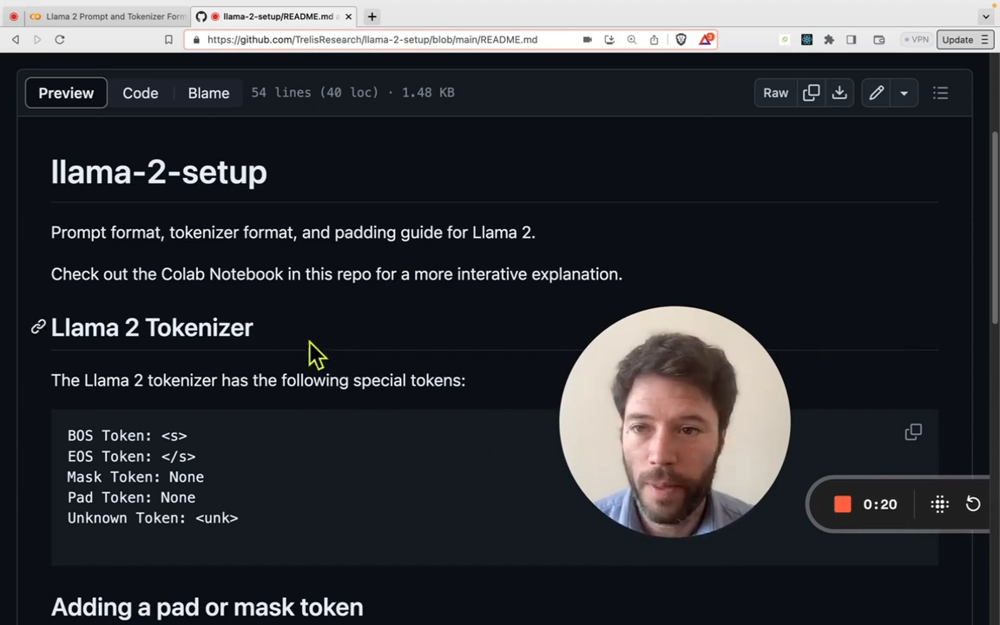
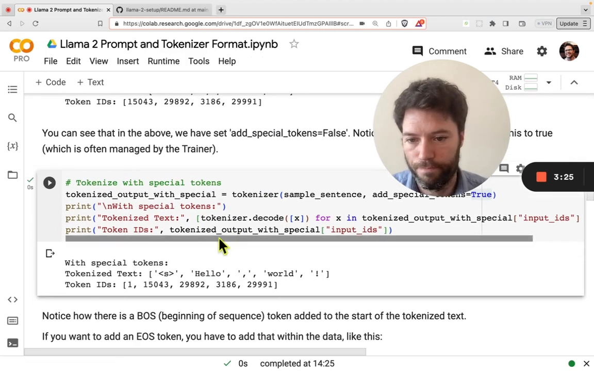
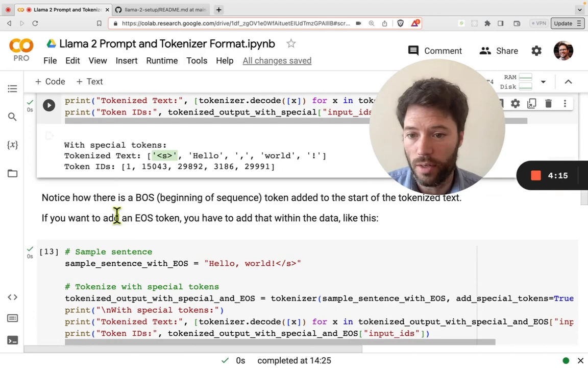
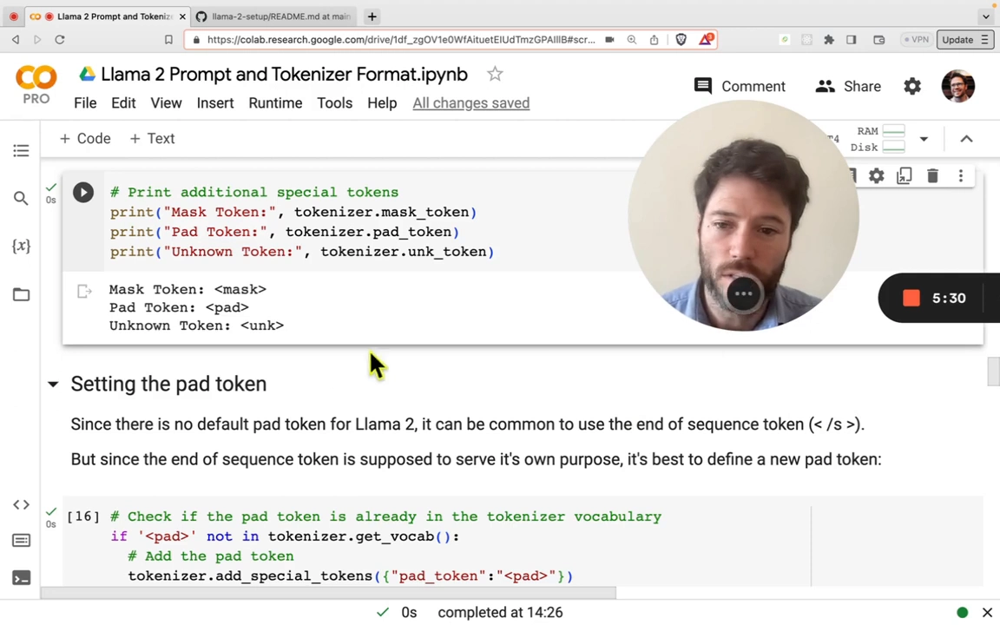
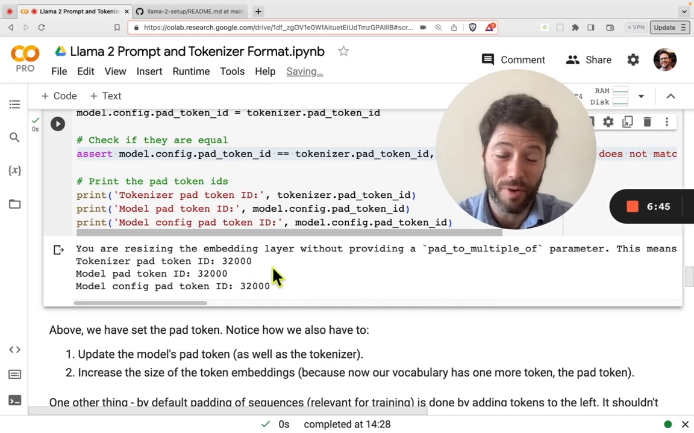
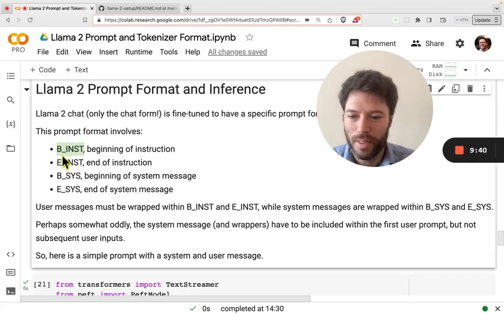
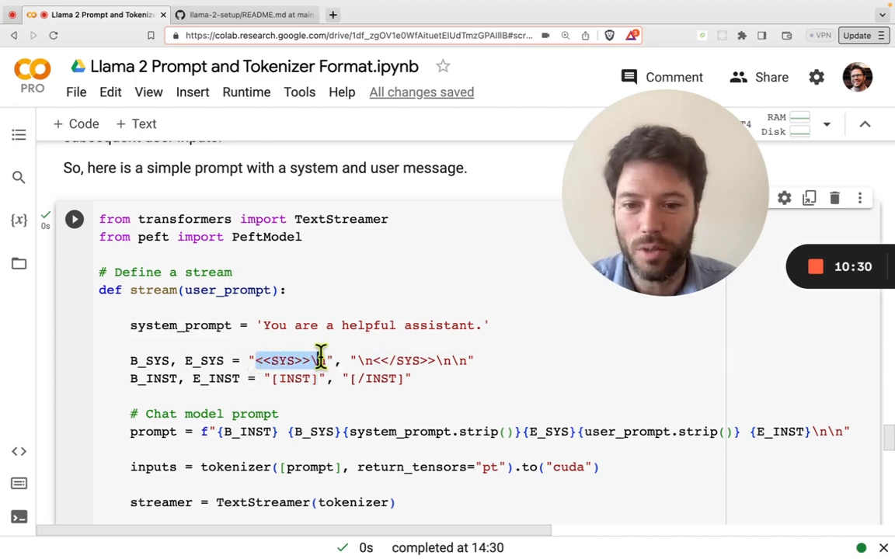
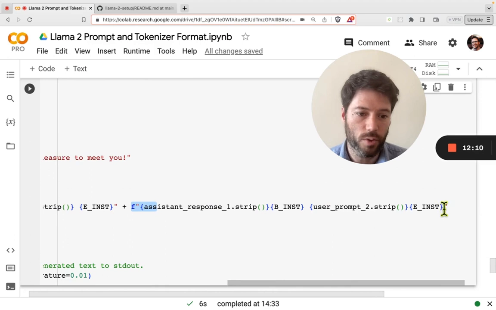
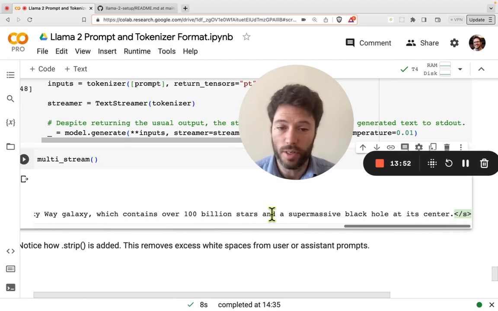

# Llama 2 的提示词格式：BOS、EOS 与双方对话标记怎么拼

> 视频来源：[Llama 2 tokenizer padding and prompt format](https://www.youtube.com/watch?v=MB0ZJ5Y-07s&t=0)（YouTube）
> 本文基于视频演说图文稿整理，配图截自视频。

## 本讲要解决的核心问题（SCQA）

**背景**：Llama 2 发布已经好几个月，在语言模型这个领域算是很久了。围绕它已经有大量微调脚本，`transformers` 里也有现成的 tokenizer。

**冲突**：可关于它的 tokenizer 到底怎么工作、padding 该怎么配，还是有很多疑问。最典型的两个坑：第一，Llama 2 **根本没有 padding token**，直接拿去批量微调会报错；第二，Llama 2 的对话格式相当独特，它用 `[INST]`、`<<SYS>>` 这些标记来标记指令与系统消息，可它们**在词表里并不是 token**。

**疑问**：一个自带 `padding_side`、自带 `add_special_tokens` 开关的 tokenizer，到底在哪几步需要人手动补？多轮对话又该怎么拼？

**回答（中心思想）**：**Llama 2 的 tokenizer 只保证 BOS，其他都要自己补**。BOS 是 `<s>`（id 1），EOS 是 `</s>`（id 2），没有 pad、也没有 mask；微调前必须新增一个 pad token，并同步三处——tokenizer 词表、模型 embedding 大小、模型配置里的 pad token id。对话侧则要按 Llama 2 的固定模板手工拼：`[INST]`/`[/INST]` 包住一轮提问，`<<SYS>>`/`<</SYS>>` 包住系统消息，且系统消息只出现在第一条指令里。生成时一旦吐出 `</s>`，就说明这次回答结束了。

---

## 一、Llama 2 tokenizer 的四个特殊 token 位置：两个有、两个空



视频配套的公开仓库是 Trellis Research 名下的 `llama2-setup`，里面有一个免费的 Colab notebook，可以拿来自己试 Llama 2 的 tokenizer [【跳转到 00:10】](https://www.youtube.com/watch?v=MB0ZJ5Y-07s&t=10)。

先看 tokenizer 的整体规格 [【跳转到 00:21】](https://www.youtube.com/watch?v=MB0ZJ5Y-07s&t=21)：Llama 的 tokenizer 有 **32000 个 token**，有的代表整词，有的代表短词。特殊 token 的情况是：

| 角色 | 符号 | 是否存在 |
| --- | --- | --- |
| BOS | `<s>` | 有 |
| EOS | `</s>` | 有 |
| Mask | 无 | 没有 |
| Pad | 无 | 没有 |
| Unknown | `<unk>` | 有 |

BOS 和 EOS 分别标记喂给语言模型的序列的**起点**和**终点**。它没有 masking token，也没有 padding token，这两样得自己解决；它还有一个 unknown token，代表不在词表里的东西。

**这里就埋下了本节第一个实用结论**：如果你要微调 Llama，最先要做的事可能就是**给它设一个 padding token**，因为它自己没带 [【跳转到 00:46】](https://www.youtube.com/watch?v=MB0ZJ5Y-07s&t=46)。padding token 的作用是把序列补齐——这个动作只在批量训练时才需要，因为一个 batch 里每行长度必然不一样。

---

## 二、add_special_tokens 只保证 BOS，EOS 要自己写进数据



先做最小实验：拿一句 "Hello, world!" 来分词 [【跳转到 02:36】](https://www.youtube.com/watch?v=MB0ZJ5Y-07s&t=36)。

```python
tokenizer("Hello, world!", add_special_tokens=False)
# Tokenized Text: ['Hello', ',', 'world', '!']
# Token IDs:      [15043, 29892, 3186, 29991]
```

四个 token：Hello、逗号、world、感叹号。注意这里 `add_special_tokens` 设成 False，意思是**分词时不会自动加 BOS 或 EOS**。

现在把它改成 True [【跳转到 03:01】](https://www.youtube.com/watch?v=MB0ZJ5Y-07s&t=301)：

```python
tokenizer("Hello, world!", add_special_tokens=True)
# Tokenized Text: ['<s>', 'Hello', ',', 'world', '!']
# Token IDs:      [1, 15043, 29892, 3186, 29991]
```

变成五个 token，多出来的就是 BOS，也就是 `<s>`，它的 ID 是 1；EOS 的 ID 则是 2。所以 `add_special_tokens` 打开后，tokenizer 会在数据**开头**自动加上 BOS。

这通常是 trainer 干的事，在大多数微调脚本里都是自动的；但如果你自己手写训练脚本，就应该显式打开它，因为**告诉模型"序列从这里开始"是有用的** [【跳转到 03:26】](https://www.youtube.com/watch?v=MB0ZJ5Y-07s&t=206)。

**但注意：它并不会自动补 EOS。** 如果你希望数据里带结束符，得自己加 [【跳转到 03:51】](https://www.youtube.com/watch?v=MB0ZJ5Y-07s&t=231)：



```python
sample = "Hello, world!</s>"          # 结束符直接写进数据
tokenizer(sample, add_special_tokens=True)
# Token IDs: [1, 15043, 29892, 3186, 29991, 2]
```

同样开着 `add_special_tokens`，现在有六个 token，可以看到 EOS 在 Llama tokenizer 里就是编号 2。这条不对称的规则值得记牢：**BOS 靠开关自动加，EOS 必须出现在文本里**。

---

## 三、PAD 缺失是微调的第一道坎：不要拿 EOS 或 UNK 顶替

接着讲 padding token，这个只在微调、训练模型时才相关 [【跳转到 04:16】](https://www.youtube.com/watch?v=MB0ZJ5Y-07s&t=256)。原因很朴素：你有一批数据，每条长度不一，而一个 batch 必须是个矩形张量，所以要把短的补齐。

Llama 没有 pad token，你得自己定义一个。视频里点开确认了一下：确实没有 pad token，也没有 mask token，但有一个 unknown token [【跳转到 04:41】](https://www.youtube.com/watch?v=MB0ZJ5Y-07s&t=281)。于是常见做法有两种，作者都不推荐：

1. **把 pad token 设成 EOS**。这很常见，但有点容易混淆，因为 EOS 从此要担两个职责——它是"序列真的结束了"，还是"这里只是补齐"？trainer 也许能正确处理、不出问题，但语义上仍然不够清晰。
2. **把 unknown token 当 pad**。同样会和真正的 UNK 混淆：模型看到 UNK 时，它无法分清这是"没见过的词"还是"这里只是空位"。

**为什么不推荐"借用"**：pad 位在训练里是被 mask 掉、不参与损失计算的；而 EOS 是参与损失、并且是模型要学着吐出来的目标。两者混在一个 id 上，短序列多的时候，模型更容易把"该结束了"学成"该补齐了"。

---

## 四、新增 pad token 要联动三处：tokenizer、embedding、模型配置



正确的做法是新定义一个 pad token [【跳转到 05:31】](https://www.youtube.com/watch?v=MB0ZJ5Y-07s&t=331)：

```python
# 1. 确认词表里真的没有
if '<pad>' not in tokenizer.get_vocab():
    # 2. 把它加进 tokenizer 词表
    tokenizer.add_special_tokens({"pad_token": "<pad>"})

# 3. 词表变长了，embedding 必须跟着变长
model.resize_token_embeddings(len(tokenizer))

# 4. 让模型也知道自己的 pad token 是哪个
model.config.pad_token_id = tokenizer.pad_token_id

# 5. 断言两边真的对齐
assert model.config.pad_token_id == tokenizer.pad_token_id, \
    "The model's pad token ID does not match"
```

第 2 步和第 3 步缺一不可：**模型期望的词表大小是 32000，你往 tokenizer 里加了一个 token，就必须把 token embedding 重新 resize 成 tokenizer 的新长度**，否则新 token 在模型侧没有对应的向量行 [【跳转到 05:56】](https://www.youtube.com/watch?v=MB0ZJ5Y-07s&t=356)。第 4 步同样不能省——tokenizer 有了 pad token，模型也得知道它的存在。



跑一下就能看到编号变化的规律 [【跳转到 06:21】](https://www.youtube.com/watch?v=MB0ZJ5Y-07s&t=381)：tokenizer 给 pad 分配的 ID 是 **32000**，因为编号是从 0 开始的——不加新 token 时最后一个编号是 29999，现在多了一个 32000 的 token，所以 tokenizer 和模型当前的词表大小其实是 **32001**。屏幕上三行打印（Tokenizer、Model、Model config）都是 32000，说明三处已经一致。

顺带一句：mask token 也能这么加，不过这更进阶 [【跳转到 07:11】](https://www.youtube.com/watch?v=MB0ZJ5Y-07s&t=431)。mask token 用在训练时想忽略某些 token 的场合。比如你想让前五个 token 完全不参与训练——因为问题就在这前五个 token 里，你只想让模型在后面那些 token 上学——这时可以用所谓 **loss mask**，只对后面那部分算损失，训练函数调用这类结构化输出时就是这么做的。另一种用法是 **attention mask**：预测段落末尾的 token 时，你不希望它去看前面某些内容。设置 mask token 的方法和上面完全一样，加了之后会是编号 32001，也就是说现在实际有 32002 个 token——因为 0 本身也是一个 token [【跳转到 08:26】](https://www.youtube.com/watch?v=MB0ZJ5Y-07s&t=506)。

---

## 五、padding side：训练时右补更直观，推理时另有一套

最后一件事是关于 **padding side**（填充加在哪一侧）[【跳转到 08:51】](https://www.youtube.com/watch?v=MB0ZJ5Y-07s&t=531)：

- 默认情况下，tokenizer 在批量分词时通常把 padding 加在**左边**；
- 但有时把 padding 加到**右边**更好用：这样真实 token 永远在序列最前面，可能更直观，也能避免一些问题——模型就不会看到"以 pad token 开头的序列"。

原则上这不该有问题，因为 attention mask 会把 pad 位屏蔽掉；但模型习惯看到序列开头就是 token，所以往右补 padding 可能更好理解、也更顺。

这里需要提醒一句边界条件：**上面说的是"训练时把一批数据补齐"这个语境。如果是批处理推理做文本生成，结论会反过来**——那时要让所有真实 prompt 都结束在同一个最右槽位，就得用左填充。这两件事经常被混为一谈，值得分开记。

---

## 六、Llama 2 的对话标记不是 token，而是"迷你序列"



现在讲 prompt 格式 [【跳转到 09:16】](https://www.youtube.com/watch?v=MB0ZJ5Y-07s&t=556)。Llama 用的格式相当独特，不像 OpenAI 那套，它有特定的标记来标记一条指令的开头和结尾、以及 system 消息的开头和结尾：

| 标记 | 含义 | 写法 |
| --- | --- | --- |
| B_INST | 指令开始 | `[INST]` |
| E_INST | 指令结束 | `[/INST]` |
| B_SYS | 系统消息开始 | `<<SYS>>` |
| E_SYS | 系统消息结束 | `<</SYS>>` |

这很不直观，但**它们在词表里并不是 token** [【跳转到 10:06】](https://www.youtube.com/watch?v=MB0ZJ5Y-07s&t=606)：你在词表里找不到 `[INST]` 这一项；实际上 `[INST]` 常被切成两个 token，`[/INST]` 甚至可能切成三个。它们虽然不是 token，但模型被训练成期待这些符号，所以不妨叫它们"**迷你序列**"——几个普通 token 碰巧组成一个模型认得的结构。

还有一条容易被忽略的规则：**system 消息（连同它的起止符）必须包含在第一条用户输入里**，后续的用户输入里不再出现。

拼装的顺序是固定的 [【跳转到 10:31】](https://www.youtube.com/watch?v=MB0ZJ5Y-07s&t=631)：先是指令开头，然后是包在 system 起止符之间的 system 消息，接着是用户的话，最后是指令结尾。



```python
system_prompt = 'You are a helpful assistant.'

B_SYS, E_SYS = "<<SYS>>", "\n<</SYS>>\n\n"
B_INST, E_INST = "[INST]", "[/INST]"

prompt = f"{B_INST} {B_SYS}{system_prompt.strip()}{E_SYS}{user_prompt.strip()} {E_INST}\n\n"
```

跑出来的实际结构是：**BOS `<s>` → 指令开头 → system 消息开头 → system 消息本身 → system 消息结尾 → 用户消息 → 指令结尾**，后面紧跟着 assistant 的回答。视频里把 `max_new_tokens` 限制成 25 只为演示，放开就会生成更长的回答 [【跳转到 10:56】](https://www.youtube.com/watch?v=MB0ZJ5Y-07s&t=656)。

---

## 七、多轮对话：system 只放第一条，回答与提问各自被包起来



视频演示的多轮对话是：用户说 howdy，assistant 回答 "howdy there, it's a pleasure to meet you"，用户又问了一个关于太阳系的问题 [【跳转到 11:21】](https://www.youtube.com/watch?v=MB0ZJ5Y-07s&t=681)。

结构完全一样，只是多了一段 [【跳转到 11:46】](https://www.youtube.com/watch?v=MB0ZJ5Y-07s&t=706)：

```
[INST] <<SYS>>
{system_prompt}
<</SYS>>

{user_prompt_1} [/INST] {assistant_response_1}
[INST] {user_prompt_2} [/INST]
```

要点有两个：

1. **system 消息只放在最开头那一条用户输入里**，第二轮开始不再重复；
2. **第二轮的 `[INST]` 紧接在上一轮 assistant 回答之后**——也就是说，模型的回答没有被任何标记包住，它只是"夹在两组指令之间"。拼接时记得对每一段做 `.strip()`，去掉多余的首尾空格，否则空格会变成额外的 token 混进上下文 [【跳转到 13:28】](https://www.youtube.com/watch?v=MB0ZJ5Y-07s&t=808)。

---

## 八、看到 EOS 就该停：结束符就是停止信号



视频最后把 token 上限调大，想让大家看到 EOS 出现的瞬间 [【跳转到 12:58】](https://www.youtube.com/watch?v=MB0ZJ5Y-07s&t=778)。让模型回答得简短一点之后，果然能清楚看到：assistant 把话说完，末尾就追加了 `</s>` [【跳转到 13:53】](https://www.youtube.com/watch?v=MB0ZJ5Y-07s&t=833)。

它的作用是**给调用方一个停止条件**：你可以据此停止继续调用模型去预测下一个 token——看到结束符，就意味着不用再找下一个 token 了。这正是 EOS 的意义，也回过头解释了为什么 BOS 和 EOS 都很有用：**它们是训练模型学会说"我的序列结束了、这次回答完了，不用再让我吐下一个 token"的方式**。

之所以要专门看这一幕，是因为很多"模型停不下来"的 bug 就出在这里：EOS 被你当 pad 用掉了、或者训练数据里没写 EOS，模型就没学会在该停的地方吐 `</s>`，于是只能靠长度上限强行截断。

---

## 小结

- **Llama 2 tokenizer 是 32000 词表**：BOS 是 `<s>`（id 1）、EOS 是 `</s>`（id 2）、UNK 是 `<unk>`，**没有 pad、也没有 mask**。
- **`add_special_tokens` 只负责 BOS**：设成 True 会在句首自动加 `<s>`；EOS 不会自动加，必须自己写进数据里。
- **微调第一步是补 pad token**：不要拿 EOS 或 UNK 顶替，语义会混；新定义一个专名最干净。
- **加 token 要联动三处**：tokenizer 词表、`resize_token_embeddings`、`model.config.pad_token_id`，并用断言校验一致。新 pad 拿到 32000，词表变 32001；再加 mask 是 32001，总数 32002。
- **padding side 分场景**：训练补齐时右填充更直观（模型中不会看到以 pad 开头的序列）；批处理推理生成则相反。
- **`[INST]`、`[/INST]`、`<<SYS>>`、`<</SYS>>` 不是 token**：它们是几个普通 token 拼成的"迷你序列"，但模型被训练成期待它们。
- **system 消息只放第一条指令里**；多轮时 assistant 回答裸露在两组 `[INST]`/`[/INST]` 之间。
- **EOS 是停止信号**：看到 `</s>` 就不必再预测下一个 token；训练时漏掉它，模型就学不会主动停。

## 关键术语速查

| 术语 | 一句话解释 |
| --- | --- |
| BOS | Beginning Of Sequence，Llama 2 里是 `<s>`，id 1 |
| EOS | End Of Sequence，Llama 2 里是 `</s>`，id 2；出现即表示回答结束 |
| UNK | Unknown，词表外内容的兜底 token，Llama 2 里是 `<unk>` |
| PAD | Padding，补齐 batch 内序列长度用的填充 token；Llama 2 默认没有 |
| add_special_tokens | 分词开关，打开后自动在开头插入 BOS（不插 EOS） |
| resize_token_embeddings | 词表变大后同步扩大模型的 token embedding 层 |
| pad_token_id | 模型配置里记录"哪个 id 是 pad"的字段，需与 tokenizer 一致 |
| loss mask | 训练时把某些位置的损失置零，只让模型学指定的部分 |
| attention mask | 告诉模型哪些位置是真实内容、哪些是补齐或不该看的 |
| padding side | 填充加在序列左侧还是右侧 |
| B_INST / E_INST | Llama 2 的指令起止标记，写作 `[INST]` 与 `[/INST]` |
| B_SYS / E_SYS | Llama 2 的系统消息起止标记，写作 `<<SYS>>` 与 `<</SYS>>` |
