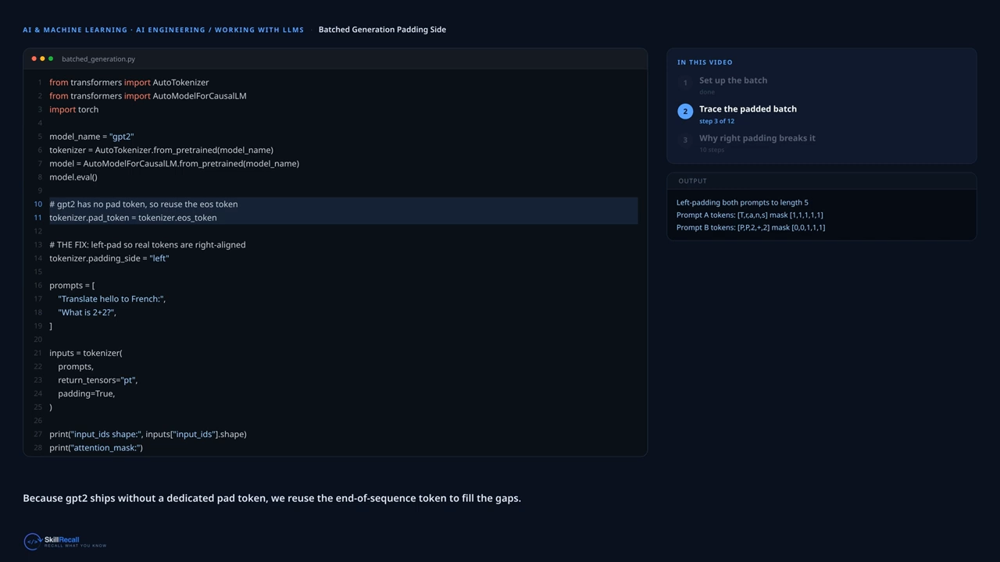
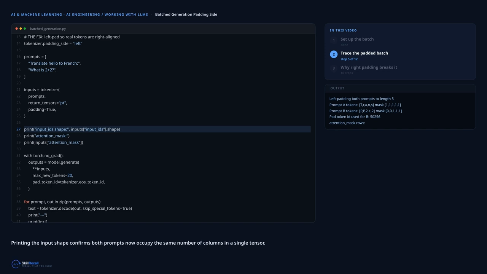
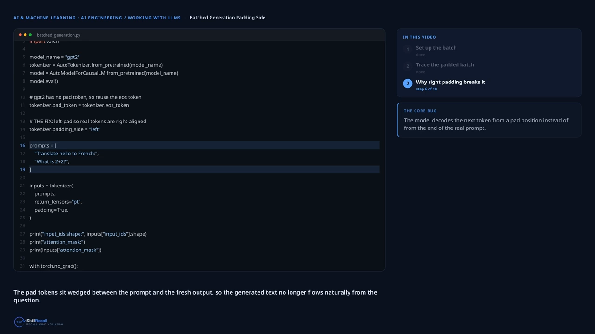

# 左填充还是右填充：批处理生成里 PAD 放在哪一侧

> 视频来源：[Left vs Right Padding for Batched LLM Generation](https://www.youtube.com/watch?v=gSRaJ9hgfBY&t=0)（YouTube）
> 本文基于视频演说图文稿整理，配图截自视频。

## 本讲要解决的核心问题（SCQA）

**背景**：在 AI 工程里对外提供 LLM 服务时，几乎总会把多条 prompt 拼成一个 batch，来提高吞吐。一个 batch 是个矩形张量，所以短的那几条必须补齐——多数人顺手就用 tokenizer 的默认设置。

**冲突**：decoder-only 模型对 batch 的 padding 方式很敏感。一旦搞错，**输出会被悄悄污染，而且不会报错**：短 prompt 得到的是跑题或乱码的续写，你只会以为是模型不行。

**疑问**：padding 加在左边和加在右边，对生成到底差在哪里？

**回答（中心思想）**：**做 decoder-only 模型的批量生成，必须用左填充**。原因是生成时模型"看最后一个位置"来预测下一个 token；左填充把所有真实 prompt 都推到最右边缘，让整个 batch 从一条干净、一致的边界继续生成。右填充则把 pad token 夹在 prompt 和新生成内容之间，模型从一个毫无意义的 padding 槽位开始往下接，即使 attention mask 已经把 pad 标成可忽略，位置信息也已经被打乱。落地就一句：批量生成时永远记得把 `tokenizer.padding_side` 设成 `left`。

---

## 一、实验设置：GPT-2 + 借来的 pad token + 左填充



视频从 `transformers` 里导入 tokenizer 和 causal language model 两个类 [【跳转到 00:00】](https://www.youtube.com/watch?v=gSRaJ9hgfBY&t=0)，选 GPT-2 做模型名，因为它是人人熟悉的小型 decoder-only 模型。接着加载与该 checkpoint 匹配的 tokenizer、加载同一个 checkpoint 的权重，并把模型切到 eval 模式，因为这里只做推理不做训练——eval 关掉了 dropout 这类只在训练时起作用的行为，输出才稳定可复现 [【跳转到 00:25】](https://www.youtube.com/watch?v=gSRaJ9hgfBY&t=25)。

关键的三步设置：

```python
# GPT-2 没有专门的 padding token，复用它本身的 EOS
tokenizer.pad_token = tokenizer.eos_token

# 最关键的一步：填充补在左侧
tokenizer.padding_side = "left"

# 长度刻意不同的两条 prompt，这样 padding 才会真的发生
prompts = [
    "Translate hello to French:",
    "What is 2+2?",
]
```

然后一次性把两条 prompt 都 tokenize [【跳转到 01:15】](https://www.youtube.com/watch?v=gSRaJ9hgfBY&t=75)：要求返回 PyTorch 张量，`padding` 设为 True，tokenizer 就会把较短的那条补齐，使两条能塞进同一个矩形张量。

打印出来的结果很清楚：

- **两条 prompt 都被补到长度 5**；
- Prompt A 那行 mask 是 `[1, 1, 1, 1, 1]`，五个位置全是真实 token；
- Prompt B 那行 mask 从 0 开头（屏幕上显示为 `[0, 0, 1, 1, 1]`），说明前面几列是补出来的 pad，真实文本要从右边才出现；
- 用来填空的 pad token id 是 **50256**，也就是 GPT-2 的 EOS id。

换句话说：`padding` 为 True 的含义是"把每条序列都补到 batch 内最长的那条的长度"；而 `padding_side` 决定补在最前还是最后。因为 GPT-2 出厂时没有专门的 pad token，这里就拿 EOS 来填空——这一点和 Llama 2 那类模型要自己加 pad token 的做法是一个思路。

---

## 二、attention mask 是一张"真实内容地图"



打印 `input_ids` 的 shape 可以确认，两条 prompt 现在占用同一个张量的同样多列 [【跳转到 02:30】](https://www.youtube.com/watch?v=gSRaJ9hgfBY&t=150)。接下来打印 **attention mask**，看清哪些位置是真实 token、哪些是补出来的 [【跳转到 02:55】](https://www.youtube.com/watch?v=gSRaJ9hgfBY&t=175)。

attention mask 是一张"地图"，它告诉模型哪些位置是真实内容、哪些只是 padding。用形式化的说法，对 batch 中第 $b$ 条序列的第 $i$ 个位置：

$$
m_{b,i} = \begin{cases} 1 & \text{真实 token} \\ 0 & \text{补齐的 pad 位} \end{cases}
$$

较长的那条每个位置都有效，所以它那行 mask 全是 1；较短的那条，mask 一开始是 0（对应左填充进来的 pad），等真实文本开始才变成 1。生成时这两个张量要一起传进去：

```python
with torch.no_grad():
    outputs = model.generate(
        **inputs,
        max_new_tokens=20,
        pad_token_id=tokenizer.eos_token_id,
    )

for prompt, out in zip(prompts, outputs):
    text = tokenizer.decode(out, skip_special_tokens=True)
    print("---")
    print(text)
```

`no_grad` 是因为推理不需要梯度；`generate` 同时收 `input_ids` 和 `attention_mask`；`pad_token_id` 要显式给出，否则生成阶段的补齐会用错符号；解码时 `skip_special_tokens` 为 True，把控制符从输出里去掉 [【跳转到 01:40】](https://www.youtube.com/watch?v=gSRaJ9hgfBY&t=100)。

**这个对齐才是重点**：两条真实 prompt 现在都结束在同一个最右侧列上 [【跳转到 03:20】](https://www.youtube.com/watch?v=gSRaJ9hgfBY&t=200)。这件事重要，是因为 decoder-only 模型生成下一个 token 时，**看的就是输入之后紧挨着的那个位置**。既然每条 prompt 都停在同一个最右槽位，整个 batch 的生成就从一条干净、一致的边界继续。把每条输出解码回文本，两条都能得到连贯的续写。

---

## 三、右填充为什么坏：pad 被夹在 prompt 和新生成内容之间



要理解左 padding 为什么重要，不妨想一下换成右侧 padding 会怎样 [【跳转到 03:45】](https://www.youtube.com/watch?v=gSRaJ9hgfBY&t=225)：右 padding 下，较短的那条保留真实 token 在前面，pad token 被追加到**末尾**。

这意味着对较短的那条来说，**序列的最后一个位置是 pad token，而不是真实的词**。而生成的做法是看最后一个位置、预测下一个是什么，然后重复 [【跳转到 04:10】](https://www.youtube.com/watch?v=gSRaJ9hgfBY&t=250)。所以右 padding 等于让模型从一个毫无意义的 padding 槽位开始往下接：pad token 被夹在 prompt 和新生成内容之间，生成文本自然就接不上原始问题。

更麻烦的是它**不会报错**。问题在于，即使 attention mask 已经把 pad 标成可忽略，较短那条的位置信息此时已经被打乱了；结果就是 batch 里那些较短的 prompt 会得到乱码或跑题的续写 [【跳转到 04:35】](https://www.youtube.com/watch?v=gSRaJ9hgfBY&t=275)。而左 padding 把每个真实 token 都推到右边缘，让所有序列都结束在真实内容上，从而修掉这个问题。

这也是为什么它容易被漏掉：**batch 里只要有一条 prompt 刚好最长，它就不受影响；只有短的会莫名其妙变差**。看起来像"模型对某些问题表现不好"，实际是 padding 侧选错了。

---

## 四、结论：批量生成就把 padding_side 设成 left

一条可执行的规则 [【跳转到 05:00】](https://www.youtube.com/watch?v=gSRaJ9hgfBY&t=300)：

- **只要用 batch 做 decoder-only 模型的生成，左 padding 就是正确选择**——模型从最后一个真实 token 位置开始生成；
- 右 padding 把 pad token 摆在 prompt 之后，会污染输出；
- 所以批量生成时永远记得把 `tokenizer.padding_side` 设成 left，并且别忘了同时给出 pad token 和 `pad_token_id`。

顺手记一个边界：**训练时的习惯常常和生成时相反**。训练阶段把一批数据补齐、算损失，右填充更符合"真实 token 都在前面"的直觉；而生成阶段比的是"谁的末尾在最右列"，所以必须左填充。同一个 `padding_side` 参数，在两个阶段的最优值不同——这也是这类 bug 难查的原因。

---

## 小结

- **batch 是矩形张量**，短序列必须补齐，而 decoder-only 模型对补在哪一侧很敏感。
- **左填充把真实 token 推到最右列**，所有序列结束在同一条边界，生成从一致的位置继续。
- **attention mask 只是"内容地图"**（真实位为 1、pad 位为 0），它能屏蔽 pad 的内容，但改变不了右填充造成的位置错位。
- **右填充的 bug 是静默的**：短 prompt 的最后一个位置是 pad，模型从 pad 槽位开始续写，输出接不上原问题，却不报任何错。
- **落地一句话**：批量生成时把 `padding_side` 设为 left，并显式给出 pad token 与生成用的 pad id。

## 关键术语速查

| 术语 | 一句话解释 |
| --- | --- |
| padding | 把 batch 内长短不一的序列补到同一长度 |
| padding_side | 补齐的 token 加在序列左侧还是右侧 |
| pad_token | 用来填空的符号；GPT-2 没有专用的，这里借 EOS（id 50256） |
| attention mask | 标记哪些位置是真实内容、哪些是补齐，1 为真实、0 为 pad |
| decoder-only 模型 | 只有解码器、按"看前文预测下一个 token"方式工作的模型，如 GPT-2 |
| 左填充 | pad 加在前面，真实 token 右对齐，批处理生成必须用它 |
| 右填充 | pad 加在后面，真实 token 左对齐，生成时会把 pad 夹进 prompt 与输出之间 |
