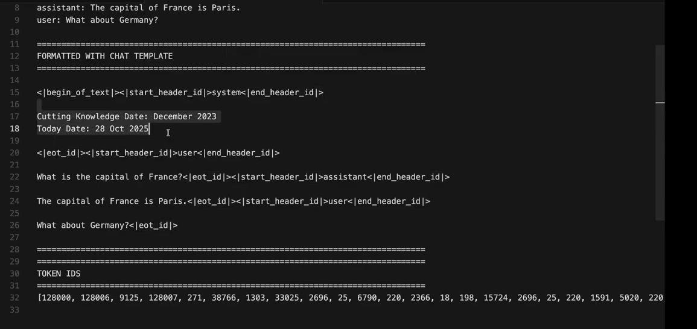
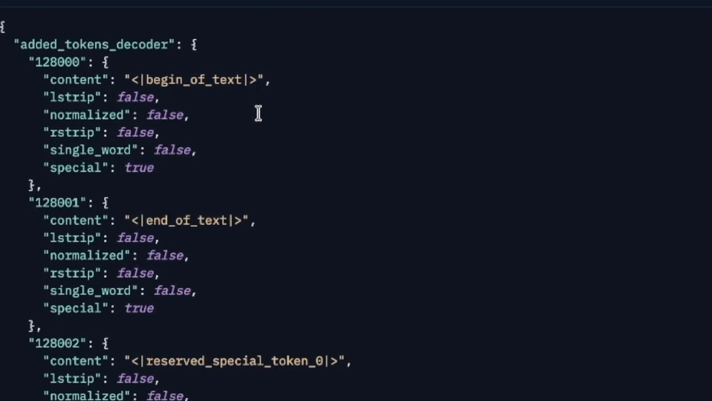
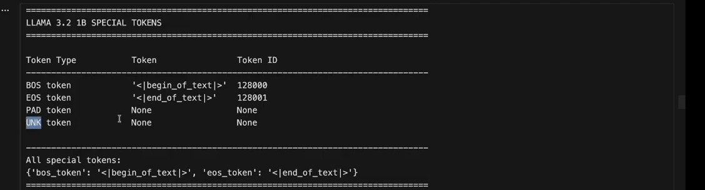
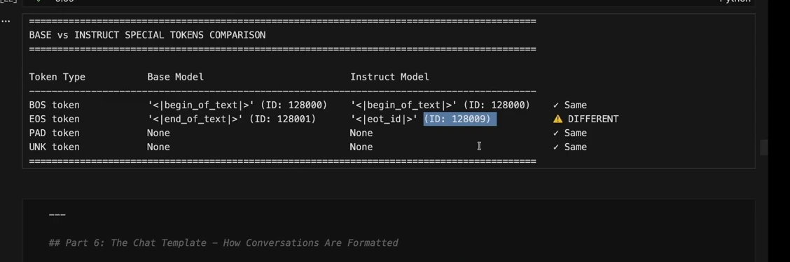
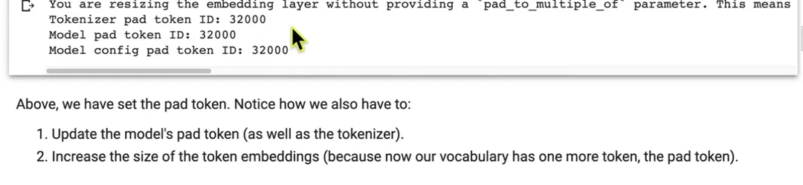
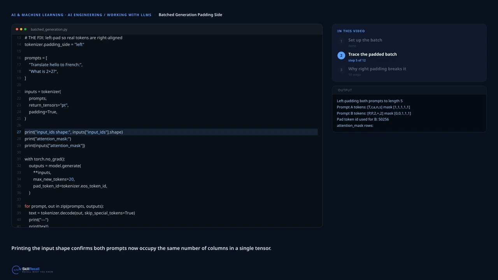
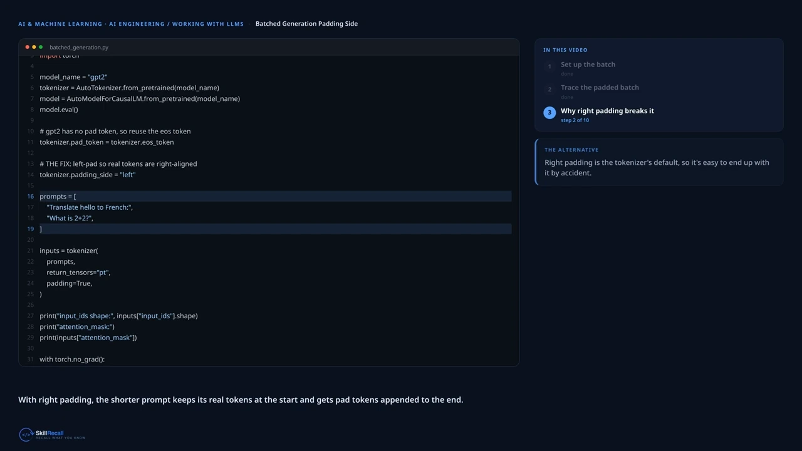
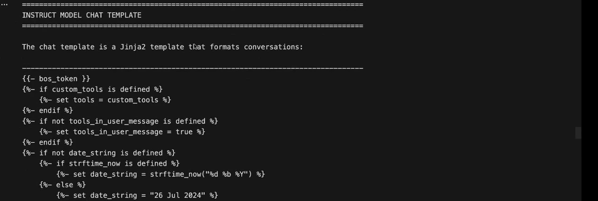
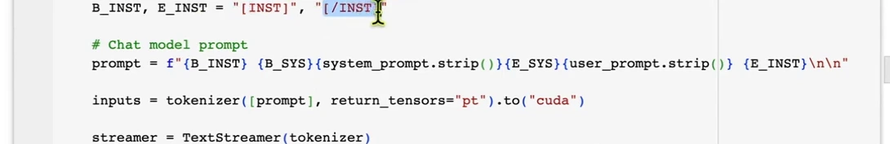
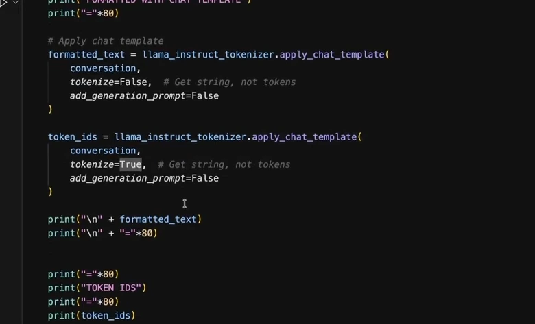

# 特殊 Token 的状态机：BOS、EOS、PAD 与 Chat Template 如何控制生成



## 本讲要解决的核心问题（SCQA）

**背景**：前两节我们已经把文本变成了 token id 序列，也知道了给定前文时模型怎么选出下一个 token。直觉上，模型"读到的就是内容"——一句话的 token 挨着另一句话的 token 排下去。

**冲突**：但模型真正吃进去的序列里，混着一批**不代表任何文字内容的保留 id**：句首那个 128000、回答末尾那个 `</s>`、为了让 batch 变成长方形而补出来的一堆占位符。这些占位符一旦用错，模型不会报错，只会**该停不停、或者把用户的话当成自己的续写**（[【跳转到 00:00】](https://www.youtube.com/watch?v=gSRaJ9hgfBY&t=0)）。

**疑问**：BOS、EOS、PAD、UNK 各自管什么？生成循环凭什么在 EOS 处停下来？PAD 为什么必须配一张 attention mask，而生成时又必须补在左边？Chat Template 到底把"几轮对话"拼成了什么，模型为什么接上就能继续写？

**回答（中心思想）**：特殊 token 是这套系统里的**状态转移信号**，而不是内容。BOS/角色头把序列推进"开始 / 轮到谁说话"的状态，EOS（以及同类的结束符）把序列推进"结束"状态，PAD 只在"凑 batch 形状"时存在、必须靠 attention mask 声明为无效；Chat Template 则是一段把 messages 列表渲染成"带控制符的纯文本"的程序，`add_generation_prompt` 把状态停在"assistant 即将开口"的那一格——所以模型看起来"接着写"。

---

## 一、四种特殊 token 各管一件事

### 1.1 BOS 和 EOS：序列的开头与结尾

每个 tokenizer 都会留一些 token 专门用于格式化，最出名的是 beginning of sequence（BOS）和 end of sequence（EOS）：BOS 会被自动插到每句话开头，用来标记文本的起点；EOS 的位置正好相反，标记文本的结束（[【跳转到 00:31】](https://www.youtube.com/watch?v=WQLdiWNYxnI&t=31)）。

这个"自动"很容易被忽略，直到你去看编码结果：Notebook 里随便几句不同开头的话，**第一个 token 都是 128000**，因为句首那个位置放的是 BOS，而不是"the"本身——"the"是 791（[【跳转到 01:41】](https://www.youtube.com/watch?v=WQLdiWNYxnI&t=101)）。



到 Hugging Face 模型页点 Files and versions，打开 `tokenizer_config.json`，就能看到这些 token 是**显式登记**在 `added_tokens_decoder` 里的：128000 对应 **<|begin_of_text|>**，128001 对应 **<|end_of_text|>**，再往后还有一批 reserved 槽位（[【跳转到 02:11】](https://www.youtube.com/watch?v=WQLdiWNYxnI&t=131)）。文件末尾还会声明 `bos_token` 和 `eos_token` 是哪个符号——往模型里输入文本时，这两个符号会分别追加在开头和结尾（[【跳转到 02:42】](https://www.youtube.com/watch?v=WQLdiWNYxnI&t=162)）。

用代码打印更直观：



注意这张表里 **PAD 和 UNK 都是 None**——不是所有模型都备齐四种，但最常见的至少要有 BOS 和 EOS（[【跳转到 05:01】](https://www.youtube.com/watch?v=WQLdiWNYxnI&t=301)）。

### 1.2 UNK 是兜底，而且各家标记完全不同

UNK（unknown）用在模型遇到训练时没见过的东西时：用户往 prompt 里打了一个模型从未见过的词，它就会被指派成 UNK（[【跳转到 00:56】](https://www.youtube.com/watch?v=WQLdiWNYxnI&t=56)）。

同一件事在不同模型上长得完全不一样。Mistral 的 BOS 是 `<s>`、id 是 1；EOS 是 `</s>`，走 HTML 风格标签；它还有一个 id 为 0 的 UNK（[【跳转到 05:26】](https://www.youtube.com/watch?v=WQLdiWNYxnI&t=326)）。也就是说，"BOS 是第几个 id"这种事**没有任何跨模型约定**，只能查配置。

顺带解释一个常见困惑：Llama 的词表为什么比 Mistral（32000）大这么多？因为 Llama 会把"带前导空格的 the"、"大写开头的 The"、"句首不带空格的 the"都算成不同的 token（[【跳转到 03:32】](https://www.youtube.com/watch?v=WQLdiWNYxnI&t=212)）。同一个词能有三四个 id，词表自然膨胀（[【跳转到 04:21】](https://www.youtube.com/watch?v=WQLdiWNYxnI&t=261)）。这属于词表设计取舍（代价是 embedding 与 LM Head 变大，账怎么算见 [1.2.2 词表大小与显存](../1.2.2_词表大小与显存/词表大小的账本：Embedding与LM_Head的显存算力开销.md)），这里只记结论：**同一个词不等于同一个 token id**。

### 1.3 同一个模型家族的 base 版与 instruct 版，EOS 可能不同

这是整节里最容易被踩的坑。现在的大模型基本都有不止一个版本：预训练版（base）与指令微调版（instruct）。对比 Llama 3.2 1B 的两个版本，词表大小一样（128,256），BOS 也一样，但 **EOS 换了**（[【跳转到 06:41】](https://www.youtube.com/watch?v=WQLdiWNYxnI&t=401)）：



于是"拿一个版本的 tokenizer 去配另一个版本"是非常危险的操作：你训练时用的是哪个版本，就严格用那个版本训练时用的 tokenizer，哪怕两者只是同一模型的不同版本（[【跳转到 07:06】](https://www.youtube.com/watch?v=WQLdiWNYxnI&t=426)）。

### 1.4 PAD：Llama 出厂时根本没带

Llama 的 tokenizer 有 32000 个 token，其中 BOS 是 `<s>`、EOS 是 `</s>`，**没有 masking token，也没有 padding token**，但有一个 UNK（[【跳转到 00:21】](https://www.youtube.com/watch?v=MB0ZJ5Y-07s&t=21)）。所以微调 Llama 要做的第一件事，往往就是给它补一个 pad token（[【跳转到 00:46】](https://www.youtube.com/watch?v=MB0ZJ5Y-07s&t=46)）。

三种做法各有代价（[【跳转到 04:41】](https://www.youtube.com/watch?v=MB0ZJ5Y-07s&t=281)）：

| 做法 | 代价 |
| --- | --- |
| 把 pad 设成 EOS | 很常见，但同一个 EOS 从此要担两个职责，容易混淆 |
| 把 pad 设成 UNK | 会和真正的 UNK 混在一起，同样不清晰 |
| 新建一个 pad token | 要动词表，但语义最干净（讲者推荐） |

新建 pad token 的代价是**必须同步改模型**，因为模型的词表大小是固定的：先把 pad 加进 tokenizer 的词表，再 `resize_token_embeddings` 把 embedding 层扩到新长度，最后把模型的 `pad_token_id` 也设上（[【跳转到 05:31】](https://www.youtube.com/watch?v=MB0ZJ5Y-07s&t=331)）。跑完之后，tokenizer、模型、模型配置三处的 pad token id 都应该是 32000，词表大小从 32000 变成 32001（编号从 0 开始）（[【跳转到 06:21】](https://www.youtube.com/watch?v=MB0ZJ5Y-07s&t=381)）。



### 1.5 add_special_tokens 决定 BOS 加不加、EOS 加不加

同一句话 `hello world!` 在 Llama 的 tokenizer 里被切成 4 个 token：hello、逗号、world、感叹号（[【跳转到 02:36】](https://www.youtube.com/watch?v=MB0ZJ5Y-07s&t=156)）。把 `add_special_tokens` 设成 True 再跑一次，序列变成 5 个——多出来的就是 BOS `<s>`，id 是 1（[【跳转到 03:26】](https://www.youtube.com/watch?v=MB0ZJ5Y-07s&t=206)）。

这里有个反直觉的细节：**它只自动加 BOS，不会自动加 EOS**。想要数据里带结束符，得自己手动补——补上之后才是 6 个 token，而 EOS 在 Llama 里是 id 2（[【跳转到 04:16】](https://www.youtube.com/watch?v=MB0ZJ5Y-07s&t=256)）。大多数微调脚本由 trainer 自动处理这一步；手写训练脚本时，就该显式设成 True，因为"告诉模型序列从哪开始"是有用的（[【跳转到 03:51】](https://www.youtube.com/watch?v=MB0ZJ5Y-07s&t=231)）。

---

## 二、生成为什么会在 EOS 处停：停止条件就是一个 token id 集合

### 2.1 一次生成循环里，"停"只是判断下一个 id 在不在集合里

Llama 2 那个 demo 跑到最后给出了一幕很关键的画面：assistant 把话说完，末尾追加了 `</s>`。讲者的原话是——看到这个结束符，你就可以**停止继续调用模型去预测下一个 token**，不用再问它要下一个词了（[【跳转到 13:53】](https://www.youtube.com/watch?v=MB0ZJ5Y-07s&t=833)）。

把这句话翻译成代码，就是下面这个循环。注意它有多朴素：**模型自己并不知道"该结束了"，是外面的循环替它判断**（[【跳转到 14:18】](https://www.youtube.com/watch?v=MB0ZJ5Y-07s&t=858)）。

```python
stop_ids = {128001}                 # 停止集合：通常就是 eos_token_id
tokens = tokenizer(prompt, return_tensors="pt")

for _ in range(max_new_tokens):     # 安全阀：防止永远不停
    logits = model(tokens).logits   # 只关心最后一个位置的分布
    next_id = sample(logits[0, -1]) # 采样策略属于 1.1.4 的内容，这里不展开
    if next_id in stop_ids:         # 命中停止集合 -> 状态机走到"结束"
        break
    tokens = torch.cat([tokens, next_id.view(1, 1)], dim=-1)

text = tokenizer.decode(tokens[0], skip_special_tokens=True)
```

`skip_special_tokens` 这一项也值得记：解码时把 BOS、EOS 这类控制符过滤掉，用户才看不到它们（[【跳转到 01:40】](https://www.youtube.com/watch?v=gSRaJ9hgfBY&t=100)）。

### 2.2 用错 tokenizer，就停在错误的地方（或者根本不停）

把上一节的结论接进来，问题立刻显现：Llama 3.2 的 base 版 EOS 是 128001，instruct 版是 128009。如果你的停止集合写的是 128001，而模型实际吐出的是 128009，那么**循环永远匹配不上**，只能一路撞到 `max_new_tokens` 才停——现象就是回答后面拖出一大段无意义的续写，或者把下一个用户的提问也一起"编"出来。

反过来的错误同样常见：因为二者词表大小相同，拿 base 的 tokenizer 处理 instruct 的输入不会报任何错，只会安静地错下去（[【跳转到 07:06】](https://www.youtube.com/watch?v=WQLdiWNYxnI&t=426)）。所以"特殊 token 必须整体匹配"这件事，在 id 层面是一条硬约束：**停止集合必须与推理时那份 tokenizer 的 EOS 配置一致**。

> **补充（非讲者原话）**：实际框架里停止条件通常比单个 id 更宽一点。Transformers 的 `eos_token_id` 可以传一个列表，vLLM 的采样参数里有 `stop_token_ids`，聊天接口还支持 `stop` 字符串。Llama 3 系列的部署配置一般会同时把 **<|end_of_text|>**（128001）和 **<|eot_id|>**（128009）放进停止集合：前者是"整篇文档结束"，后者是"这一轮对话结束"。两者都算"该停了"，只是语义粒度不同。

### 2.3 为什么"结束"必须是一个 token，而不是一句话

因为模型只会做一件事：预测下一个 token。要让它在语义上"说完就收"，唯一的办法是**把"说完了"也编成一个 token**，让它在训练数据里学会"这句话之后该输出它"。Llama 2 的讲者把这层因果关系说得挺直白：BOS 与 EOS 的价值，正是训练模型学会说"我的序列结束了、这次回答完了，不用再让我吐下一个 token"（[【跳转到 14:18】](https://www.youtube.com/watch?v=MB0ZJ5Y-07s&t=858)）。

于是"停止"这件事在系统里被拆成两半：**模型负责预测出结束符**（这是学出来的），**框架负责在见到它时跳出循环**（这是写死的）。任何一半出问题，表现都是"停不下来"。

---

## 三、PAD、attention mask 与 padding side：凑形状的代价

### 3.1 batch 要成矩形，就必须补位

推理时我们几乎总会把多条 prompt 拼成一个 batch 来提高吞吐，但 batch 在底层是一个矩形张量，**每行长度必须一样**（[【跳转到 00:00】](https://www.youtube.com/watch?v=gSRaJ9hgfBY&t=0)）。训练侧同理：一个 batch 里每条样本长度不一，得先补齐才能送进模型（[【跳转到 04:41】](https://www.youtube.com/watch?v=MB0ZJ5Y-07s&t=281)）。

补位用的就是 PAD。GPT-2 也没有专门的 pad token，所以视频里直接复用了它的 EOS 来顶替（[【跳转到 00:50】](https://www.youtube.com/watch?v=gSRaJ9hgfBY&t=50)）。

### 3.2 attention mask：告诉模型哪些位置是"假的"

补出来的位置不能参与计算，否则模型会把 pad 当成真实上下文。这就是 attention mask 的作用：它是一张和输入等长的 0/1 表，标明每个位置是真实 token 还是补出来的。

$$
M_i = \begin{cases} 0, & \text{position } i \text{ is padding} \\ 1, & \text{position } i \text{ is real} \end{cases}
$$

视频里的实测输出正好把这件事摊开了：两条 prompt 补到长度 5 之后，长的那条 mask 是 `[1,1,1,1,1]`，短的那条是 `[0,0,1,1,1]`（[【跳转到 02:55】](https://www.youtube.com/watch?v=gSRaJ9hgfBY&t=175)）。短的那条前面两个 0，就是 pad。



### 3.3 生成必须左 padding：因为模型只看最后一个位置

为什么 padding 要补在**左边**而不是右边？视频给的理由很干脆：decoder-only 模型生成下一个 token 时，看的是**输入的最后一个位置**（[【跳转到 03:20】](https://www.youtube.com/watch?v=gSRaJ9hgfBY&t=200)）。

- 左 padding：把填充塞在每条序列**前面**，所有真实 token 被推到右边，于是所有 prompt 都结束在同一个最右列，全 batch 从一条干净的边界继续生成（[【跳转到 02:30】](https://www.youtube.com/watch?v=gSRaJ9hgfBY&t=150)）。
- 右 padding：填充追加在**末尾**，短的那条最后一个位置变成了 pad，模型等于被要求"从一个毫无意义的占位符往下接"，pad 被夹在 prompt 和新生成内容之间；即使 attention mask 已经标了忽略，较短那条的位置信息也已经被打乱（[【跳转到 04:10】](https://www.youtube.com/watch?v=gSRaJ9hgfBY&t=250)）。

结果就是：batch 里较短的 prompt 会得到乱码或跑题的续写，而且**不会报错**（[【跳转到 04:35】](https://www.youtube.com/watch?v=gSRaJ9hgfBY&t=275)）。



结论一句话：**批量生成时，永远显式把 padding side 设成左**（[【跳转到 05:00】](https://www.youtube.com/watch?v=gSRaJ9hgfBY&t=300)）。

### 3.4 训练侧的 mask 是另一回事：loss mask 让某些 token 不参与算损失

除 attention mask 之外，训练时还常用另一张 mask：**loss mask**。视频举的例子是——如果问题就在前五个 token 里，你只想让模型学后面那部分，就可以把前五个位置排除在损失之外（[【跳转到 07:11】](https://www.youtube.com/watch?v=MB0ZJ5Y-07s&t=431)）。训练函数调用这类结构化输出时就这么做。

两者容易混：attention mask 管"这个位置**能不能被看见**"，loss mask 管"这个位置**要不要算误差**"。视频里也提醒，mask token 的加法跟 pad token 一模一样——定义一个、加进词表、resize embedding，只是 ID 会再加一（[【跳转到 08:26】](https://www.youtube.com/watch?v=MB0ZJ5Y-07s&t=506)）。

> **补充（非讲者原话）**：在 PyTorch 交叉熵里，常用的做法是把要忽略的 label 直接写成 `-100`（`ignore_index` 的默认值），这样不用额外传 mask 张量。它和视频里说的"定义一个 mask token 再配合 loss mask"目的相同，只是实现层面换了载体。

### 3.5 两位讲者对"默认 padding side"说法相反，怎么办

这里必须停下来纠一个矛盾：Llama 2 那期说"默认情况下 tokenizer 在批量分词时通常把 padding 加在左边"（[【跳转到 08:26】](https://www.youtube.com/watch?v=MB0ZJ5Y-07s&t=506)），而 Padding Side 那期说"右 padding 才是 tokenizer 的默认值，所以一不小心就会用错"（[【跳转到 05:00】](https://www.youtube.com/watch?v=gSRaJ9hgfBY&t=300)）。

> **补充（非讲者原话）**：在 Hugging Face 的实现里，`padding_side` 是 tokenizer 的一个配置项，具体默认值随 tokenizer 而定（GPT-2、Llama 系大多是 right）。所以"默认值"本身不可依赖。可操作的结论只有一条：**训练按你的数据习惯显式设一次，生成前再显式设成 left**，不要吃默认值。

---

## 四、Chat Template：把 messages 渲染成模型认识的纯文本

### 4.1 输入是"角色 + 内容"的列表

多轮对话在代码里通常写成这样的结构，两个键：`role` 和 `content`（[【跳转到 09:04】](https://www.youtube.com/watch?v=WQLdiWNYxnI&t=544)）：

```python
conversation = [
    {"role": "system",    "content": "..."},
    {"role": "user",      "content": "What is the capital of France?"},
    {"role": "assistant", "content": "The capital of France is Paris."},
    {"role": "user",      "content": "What about Germany?"},
]
```

`role` 可以是 user、assistant、system，也可以是 tools。但模型并不认识 JSON——它只吃 token 序列，所以中间必须有一层"渲染"。

### 4.2 模板本身是一段 Jinja2 程序，不是固定字符串

指令微调模型的 tokenizer 配置里带一个 `chat_template`，它是一段 Jinja2 模板：以 BOS 开头，如果你的应用要用工具调用，工具定义也在这里注入，然后是 system 消息的位置，再往下是 user 和 assistant 消息的位置（[【跳转到 08:39】](https://www.youtube.com/watch?v=WQLdiWNYxnI&t=519)）。



这段模板**只存在于指令微调版本**：同样的 tokenizer，base 版往下翻就找不到它（[【跳转到 08:14】](https://www.youtube.com/watch?v=WQLdiWNYxnI&t=494)）。所以 base 模型没有可以调用的聊天模板，只能自己拼字符串；"模型会聊天"这件事，是 instruct 版在训练时把模板结构也一起学进去了。

### 4.3 渲染结果（Llama-3）：角色头 + 角色名 + 角色尾

把上面那段对话交给 Llama 3.2 Instruct 的模板，渲染出来的文本是这样的（[【跳转到 10:19】](https://www.youtube.com/watch?v=WQLdiWNYxnI&t=619)）：

```text
<|begin_of_text|><|start_header_id|>system<|end_header_id|>

Cutting Knowledge Date: December 2023
Today Date: 28 Oct 2025

<|eot_id|><|start_header_id|>user<|end_header_id|>

What is the capital of France?<|eot_id|><|start_header_id|>assistant<|end_header_id|>

The capital of France is Paris.<|eot_id|><|start_header_id|>user<|end_header_id|>

What about Germany?<|eot_id|>
```

拆开看，每个结构都在承担一个状态转移（[【跳转到 10:44】](https://www.youtube.com/watch?v=WQLdiWNYxnI&t=644)）：

| 片段 | 作用 |
| --- | --- |
| begin_of_text 标记 | 序列开始，就是 128000 那个 BOS |
| start_header_id 标记 + 角色名 + end_header_id 标记 | "接下来是谁在说话"，角色名被夹在中间 |
| `Cutting Knowledge Date` / `Today Date` | 模板自动追加的元数据，不是用户写的 |
| eot_id 标记 | 这一轮结束，轮到下一方 |

渲染完还要再过一遍 tokenizer：整段文本会变成一长串 id，画面里那行 `TOKEN IDS` 的开头是 `[128000, 128006, 9125, 128007, ...]`——128000 是 BOS，9125 是 `system` 这个词本身，两个 128006/128007 就是角色头的起止符（[【跳转到 11:34】](https://www.youtube.com/watch?v=WQLdiWNYxnI&t=694)）。

> **补充（非讲者原话）**：128006/128007 与 **<|start_header_id|>** / **<|end_header_id|>** 的对应关系来自 Llama-3 词表的通用映射，画面只给出了 id 列表，没有逐项标注；128009 与 **<|eot_id|>** 的对应则由同页的 base/instruct 对照表直接给出。

### 4.4 渲染结果（Llama-2）：`[INST]` 与 `<<SYS>>` 甚至不是 token

Llama 2 的格式更"手工"一点：system 消息被 `<<SYS>>` 和 `<</SYS>>` 包起来，每条指令用 `[INST]` 与 `[/INST]` 包起来。拼装代码就是几行字符串格式化（[【跳转到 09:16】](https://www.youtube.com/watch?v=MB0ZJ5Y-07s&t=556)）：

```python
B_SYS, E_SYS = "<<SYS>>\n", "\n<</SYS>>\n\n"
B_INST, E_INST = "[INST]", "[/INST]"

prompt = f"{B_INST} {B_SYS}{system_prompt.strip()}{E_SYS}{user_prompt.strip()} {E_INST}\n\n"
```



这里最反直觉的一点：**`[INST]` 和 `<<SYS>>` 在词表里并不是 token**。你在词表里找不到 `[INST]`，它常被切成两个 token，`[/INST]` 甚至可能被切成三个。它们只是普通文本，但模型被训练成期待这些符号，所以讲者把它们叫作"迷你序列"（mini sequence）——不是 token，却承担着标记状态的作用（[【跳转到 10:06】](https://www.youtube.com/watch?v=MB0ZJ5Y-07s&t=606)）。

跑起来之后，prompt 的实际内容是长这样的：

```text
<s> [INST] <<SYS>>
You are a helpful assistant.
<</SYS>>

Howdy! [/INST]Well, howdy there! It's a pleasure to meet you![INST] What is the ...
```

可以看到角色切换全都靠这几个标记：BOS、`[INST]`、`<<SYS>> ... <</SYS>>`、用户内容、`[/INST]`、assistant 的回答、下一轮 `[INST]`……多轮对话时 **system 段只出现在第一轮**，后面每轮只重复 `[INST] ... [/INST]`（[【跳转到 12:11】](https://www.youtube.com/watch?v=MB0ZJ5Y-07s&t=731)）。

### 4.5 apply_chat_template：同一个方法，两种输出

有了模板，渲染就可以一行调用。注意它**只对带 chat_template 的模型可用**（[【跳转到 09:54】](https://www.youtube.com/watch?v=WQLdiWNYxnI&t=594)）：



- `tokenize=False`：返回渲染后的纯文本。人要看的就是这个，调试模板错位时尤其有用。
- `tokenize=True`：直接返回 token id 列表，就是模型的输入。

两条路径走的是同一段 Jinja2 模板，只是最后一步要不要顺手分词（[【跳转到 10:19】](https://www.youtube.com/watch?v=WQLdiWNYxnI&t=619)）。

### 4.6 模型为什么会"接着写"：因为 prompt 的最后一个字符就是 assistant 的开场

视频里这个参数一直显式写成 False，所以渲染结果停在最后一个 **<|eot_id|>**——也就是"用户问完了，等你说"。

> **补充（非讲者原话）**：如果要把这份 prompt 直接喂给模型生成，通常会把这个开关打开（`add_generation_prompt` 设为 True），让模板在末尾**追加** assistant 的角色头：

```text
...<|eot_id|><|start_header_id|>assistant<|end_header_id|>
```

也就是说，状态被主动推进到"assistant 已经开口、但还没说话"的那一格。模型在训练数据里见过无数次"这个头之后跟的就是回答"，于是下一个 token 自然开始接内容——所谓"接着写"，本质是**用模板把状态预置好了，让模型接着已经成立的前文续写**（补充，非讲者原话）。

> **补充（非讲者原话）**：换一个模板家族就是换一套控制符。ChatML（Qwen 等模型常用）的渲染结果长这样，**<|im_start|>** 后面跟角色名、**<|im_end|>** 收尾：

```text
<|im_start|>system
You are a helpful assistant.<|im_end|>
<|im_start|>user
What is the capital of France?<|im_end|>
<|im_start|>assistant
```

三家放一起对比，结构其实是同一件事的三种写法：

| 家族 | 角色开始 | 角色结束 | 序列开始/结束 |
| --- | --- | --- | --- |
| ChatML | im_start 标记 + 角色名 | im_end 标记 | 依赖模型配置 |
| Llama 2 | `[INST]`（不是 token） | `[/INST]`（不是 token） | `<s>` / `</s>` |
| Llama 3 | start_header_id 标记 + 角色名 + end_header_id 标记 | eot_id 标记 | begin_of_text / end_of_text |

---

## 五、状态机视角：一次请求只有四个状态，特殊 token 负责推门

把上面三节合起来看，一次聊天请求其实可以在四个状态之间走：

```text
                 BOS + 角色头（system/user）
   [起点] ─────────────────────────────────► [等待回答]
                                                   │
                          追加 assistant 角色头     │  （add_generation_prompt）
                                                   ▼
                                            [生成中] ◄──┐
                                                   │      │ 下一个 id 不在停止集合
                                                   │      └──┘
                                   命中停止集合      │
                                                   ▼
                                              [结束] ──► decode(skip_special_tokens) ──► 文本
```

每个转移都对应一个具体的东西，没有一处是"模型自己懂"：

| 状态转移 | 触发器 | 代码里的对应物 |
| --- | --- | --- |
| 起点 → 等待回答 | BOS + system/user 角色头与角色尾 | `apply_chat_template` 分词模式的前半段 |
| 等待回答 → 生成中 | assistant 角色头 | `add_generation_prompt` 设为 True（补充） |
| 生成中 → 生成中 | 任意非停止 id | 把新 token 拼回序列继续前向 |
| 生成中 → 结束 | 命中停止集合 | `eos_token_id` / `stop_token_ids` 判等 |
| 全程旁路 | PAD | 不参与状态，只由 attention mask 标成无效 |

反过来，这份状态表也是最好的排障表：

| 现象 | 大概率原因 |
| --- | --- |
| 回答停不下来、拖到长度上限 | 停止集合与 tokenizer 的 EOS 不一致（如 128001 对 128009），或没设 `max_new_tokens` 兜底（[【跳转到 06:41】](https://www.youtube.com/watch?v=WQLdiWNYxnI&t=401)） |
| batch 里短的 prompt 输出乱码、跑题 | 用了右 padding，或生成时没把 attention mask 传进去（[【跳转到 04:35】](https://www.youtube.com/watch?v=gSRaJ9hgfBY&t=275)） |
| 模型把用户的话当成自己的回答继续编 | 模板里漏了角色尾（eot_id、im_end、INST 结尾这类收尾标记），状态没切回来（[【跳转到 10:44】](https://www.youtube.com/watch?v=WQLdiWNYxnI&t=644)） |
| 换了模型就整体变差，但不报错 | base 与 instruct 混用了 tokenizer；或用了没有 `chat_template` 的 base 版（[【跳转到 07:06】](https://www.youtube.com/watch?v=WQLdiWNYxnI&t=426)） |
| 输出里出现结束符字样（如 EOS 符号或 eot_id） | 解码时没打开 `skip_special_tokens`（[【跳转到 01:40】](https://www.youtube.com/watch?v=gSRaJ9hgfBY&t=100)） |

### 5.1 "特殊 token 必须整体匹配"这条约束，在分词器里同样成立

上面讲的是 id 层面。再往下一层还有一个容易忽略的对称问题：**特殊 token 的字符串形式也必须整体匹配，不能被拆开**。

`tiktoken` 把这件事做成两个开关：默认情况下它只把普通文本当普通文本编码，`<|endoftext|>` 这类串会被按 BPE 切开；要让它识别成"一个整体"，必须显式允许（`allowed_special`），而想强制"只按普通文本编、一个特殊 token 都不认"，就用 `encode_ordinary`。

> **补充（非讲者原话）**：这两个开关的具体用法、以及"哪些串算特殊 token"由编码方案（encoding）定义，具体用法见上一节 [1.2.1 字节级 BPE 与 Tiktoken](../1.2.1_Byte_level_BPE与Tiktoken/字节级BPE与Tiktoken：从UTF-8字节到子词词表.md) 里的 tiktoken 部分。这里的要点只是：**特殊 token 的整个字符串被当成不可分割的原子**——这正是它能稳定充当状态信号的前提；一旦被拆成若干普通 token，模型看到的就是一段普通文本，状态机也就失效了。

---

## 六、上线前的检查清单

把三节内容压成一张能照着核对的表：

| 检查项 | 该确认什么 | 依据 |
| --- | --- | --- |
| tokenizer 与模型版本对应 | 用 instruct 的模型，就配 instruct 的 tokenizer；停止集合取那份配置里的 EOS | [【跳转到 07:06】](https://www.youtube.com/watch?v=WQLdiWNYxnI&t=426) |
| 停止集合 | EOS 可能不止一个（文档结束 vs 轮次结束），并保留长度上限兜底 | 补充 |
| 输入是否要 BOS | 手动构造时明确设 `add_special_tokens`；不要假设 EOS 会自动加 | [【跳转到 03:26】](https://www.youtube.com/watch?v=MB0ZJ5Y-07s&t=206) |
| pad token 是否存在 | Llama 出厂没有 pad；新建时同步 resize embedding 与模型配置 | [【跳转到 05:31】](https://www.youtube.com/watch?v=MB0ZJ5Y-07s&t=331) |
| padding side | 生成一律左 padding；训练侧按数据习惯显式设置 | [【跳转到 05:00】](https://www.youtube.com/watch?v=gSRaJ9hgfBY&t=300) |
| attention mask | 有 padding 就必须把 mask 一起传给 generate | [【跳转到 01:15】](https://www.youtube.com/watch?v=gSRaJ9hgfBY&t=75) |
| 模板渲染 | 先用 `tokenize=False` 打出来人眼看一眼，确认角色头、角色尾、system 段都没错位 | [【跳转到 10:19】](https://www.youtube.com/watch?v=WQLdiWNYxnI&t=619) |
| 生成入口 | 要模型直接回答，就补 assistant 角色头（`add_generation_prompt`） | 补充 |
| 解码显示 | 面向用户时过滤特殊 token | [【跳转到 01:40】](https://www.youtube.com/watch?v=gSRaJ9hgfBY&t=100) |

---

## 小结

- **BOS / EOS 标记边界**：BOS 由 tokenizer 自动加在开头，EOS 标记结束；Llama 的 `tokenizer_config.json` 里两者是显式登记的特殊 token（128000 / 128001）[【跳转到 02:11】](https://www.youtube.com/watch?v=WQLdiWNYxnI&t=131)。
- **同一家族的 base 与 instruct，EOS 可能不同**：Llama 3.2 的 base 用 **<|end_of_text|>**（128001），instruct 用 **<|eot_id|>**（128009），混用 tokenizer 不会报错但会静默出错（[【跳转到 06:41】](https://www.youtube.com/watch?v=WQLdiWNYxnI&t=401)）。
- **"停"是框架判断的**：模型负责预测出结束符，外面那个循环负责"见到它就不再加 token"，这就是停止条件的全部（[【跳转到 13:53】](https://www.youtube.com/watch?v=MB0ZJ5Y-07s&t=833)）。
- **PAD 只为凑矩形 batch**，必须配 attention mask；Llama 出厂没有 pad，新建时要同步 resize embedding（[【跳转到 05:31】](https://www.youtube.com/watch?v=MB0ZJ5Y-07s&t=331)）。
- **生成必须左 padding**：decoder-only 模型从最后一个实际位置续写，右 padding 等于让模型从占位符开始编（[【跳转到 04:10】](https://www.youtube.com/watch?v=gSRaJ9hgfBY&t=250)）。
- **Chat Template 是一段 Jinja2 程序**，把 role/content 列表渲染成"角色头 + 内容 + 角色尾"的纯文本；只有 instruct 版带它（[【跳转到 08:14】](https://www.youtube.com/watch?v=WQLdiWNYxnI&t=494)）。
- **同一件事有三种写法**：ChatML 的 im_start 标记、Llama 2 的 `[INST]`（甚至不是 token）、Llama 3 的 start_header_id 标记，结构都是"声明说话人 → 内容 → 收尾"。
- **模型"接着写"是因为状态被预置**：`add_generation_prompt` 把 assistant 的角色头写上，模型见过的训练数据里这个头之后就是回答（补充）。

---

## 关键术语速查

| 术语 | 一句话解释 |
| --- | --- |
| BOS | 序列开始 token，tokenizer 自动加在开头；Llama 3 里是 128000 |
| EOS | 序列结束 token，也是生成循环的停止信号；Llama 3 的 base 版是 128001 |
| PAD | 补位 token，只为让 batch 成矩形；必须配合 attention mask 才安全 |
| UNK | 兜底 token，代表词表里没有的内容；不同模型 id 完全不同 |
| attention mask | 与输入等长的 0/1 表，0 表示该位置是补出来的、不参与计算 |
| loss mask | 训练时决定哪些位置不参与损失计算的标记，常用 `-100` 实现（补充） |
| padding side | padding 补在哪一侧；批量生成必须用 left |
| chat template | tokenizer 配置里的一段 Jinja2 模板，把 messages 渲染成带控制符的文本 |
| add_generation_prompt | 渲染时追加 assistant 角色头，让模型从"该我说话"处开始生成（补充） |
| `stop_token_ids` | vLLM 等框架里的停止 id 集合，命中即结束该请求（补充） |
| 迷你序列 | 讲者对 `[INST]` 这类"不是 token 但被模型期待"的字符串的称呼 |

---

## 视频来源

| 视频 | 覆盖内容 | 时长 |
| --- | --- | --- |
| [Special Tokens in LLMs: Understanding BOS, EOS, and Chat Templates](https://www.youtube.com/watch?v=WQLdiWNYxnI) | BOS/EOS/PAD/UNK 的定义与配置、Llama 与 Mistral 对照、base 与 instruct 的 EOS 差异、chat template 与 apply_chat_template | 约 12 分钟 |
| [Llama 2 tokenizer, padding and prompt format](https://www.youtube.com/watch?v=MB0ZJ5Y-07s) | Llama 2 的特殊 token、add_special_tokens、新建 pad token 与 resize embedding、loss/attention mask、padding side、`[INST]`/`<<SYS>>` 提示词格式、EOS 与停止生成 | 约 15 分钟 |
| [Left vs Right Padding for Batched LLM Generation Explained](https://www.youtube.com/watch?v=gSRaJ9hgfBY) | 批量生成中的 padding side、attention mask 的含义、右 padding 为什么会污染输出、左 padding 的修复 | 约 5 分钟 |
