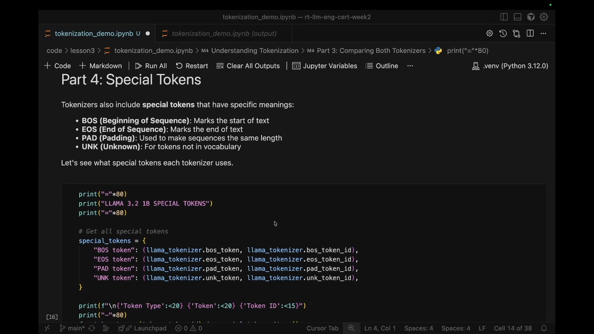
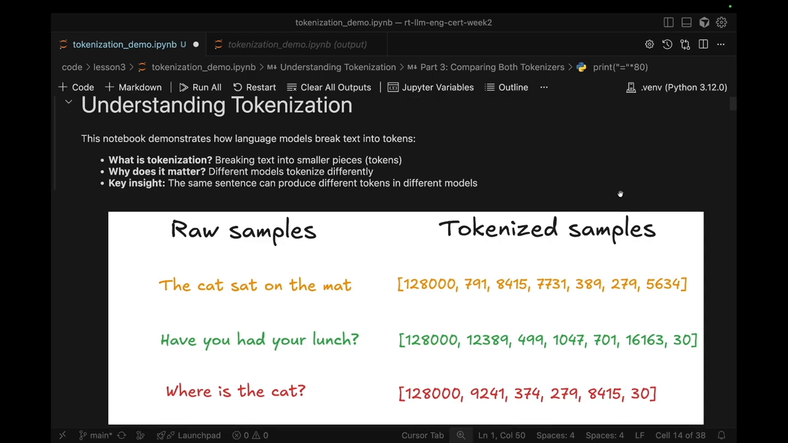
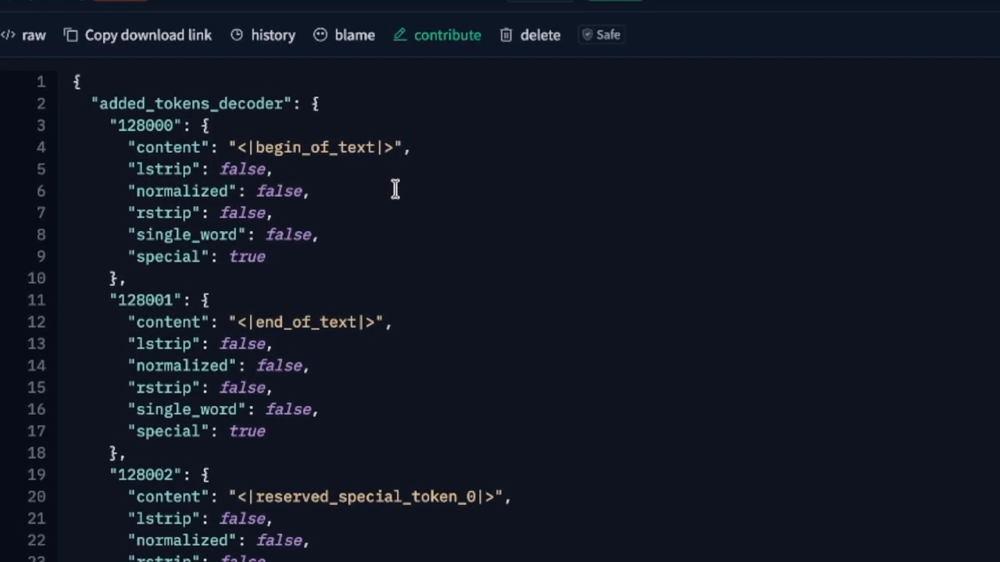
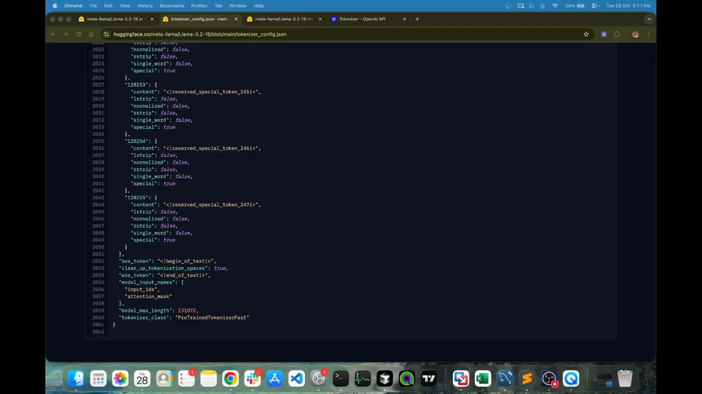
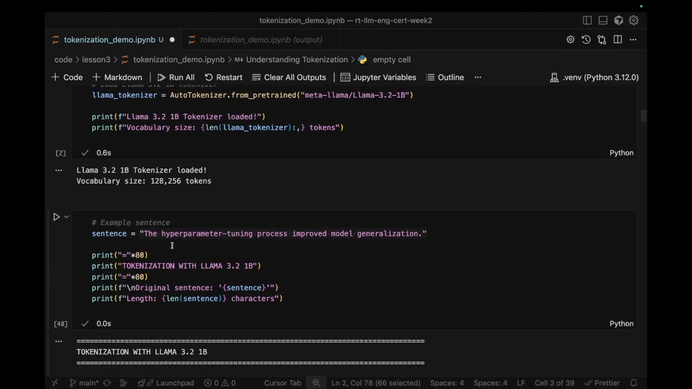
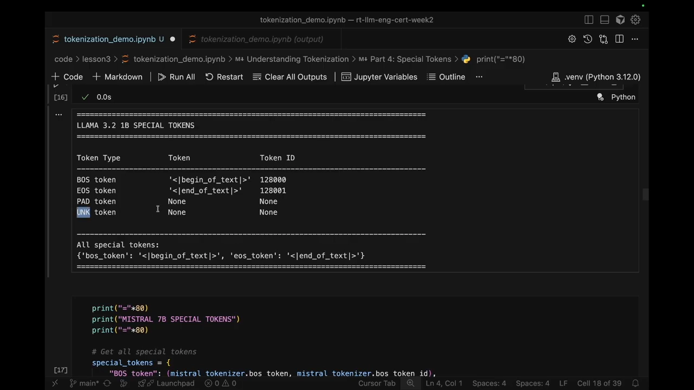
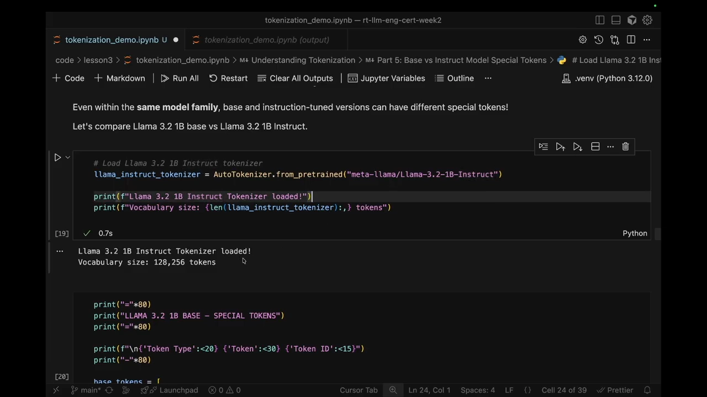
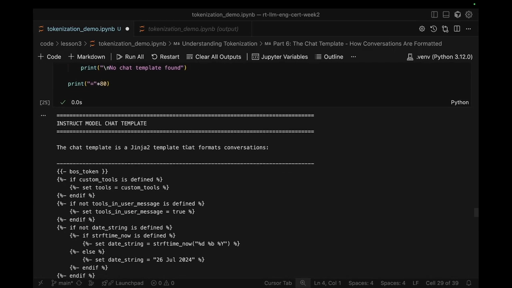
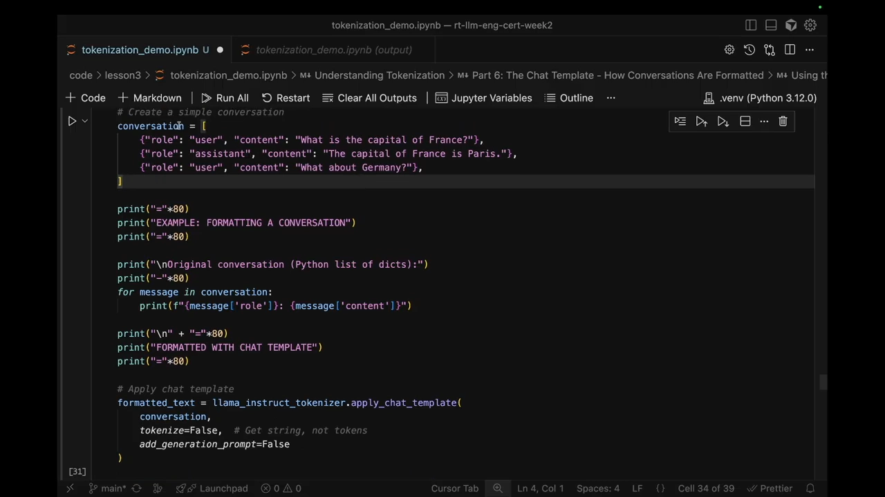
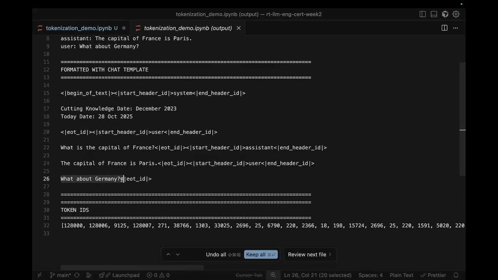

# 特殊 Token 的状态机：BOS、EOS、PAD 与 Chat Template 如何控制生成

> 视频来源：[Special Tokens in LLMs: BOS, EOS and Chat Templates](https://www.youtube.com/watch?v=WQLdiWNYxnI&t=0)（YouTube）
> 本文基于视频演说图文稿整理，配图截自视频。

## 本讲要解决的核心问题（SCQA）

**背景**：上一节讲 tokenization，解决的是"一句话为什么会被切成这些 id"。我们已经知道：同一个句子在不同模型里会得到不同的 id，因为各自词表和切分规则不同。

**冲突**：真正喂给模型的 id 序列里，往往并不只有"词"。很多句子的第一个 id 不是任何词，而是一个固定数字——在 Llama 3.2 里它是 128000。"the"明明是 791，可每句话开头的数字都是 128000。这些数字不在你的文本里，却决定了模型从哪里开始读。

**疑问**：这些看不见的 token 到底是什么？它们在哪儿定义？为什么同一个模型家族的 base 版和 instruct 版还会不一样？上了线的模型又是怎么把"用户说"和"模型答"区分开的？

**回答（中心思想）**：**特殊 token（special token）是词表里的一组"角色标记"，它们不参与阅读，只负责控制状态**。最基础的四类是 BOS（序列开始）、EOS（序列结束）、PAD（补位）、UNK（词表外的兜底）。这些都写在 tokenizer 的配置文件里，可以直接查、可以打印。而 instruct 模型额外带一份 **chat template**，它是把"谁在说话"这套对话状态编译成控制符序列的模板——最终仍然变成一串数字，只是这串数字里混着控制符。所以本节可以概括成一句话：BOS/EOS 管"一段文本的边界"，chat template 管"一段对话里面谁该说话"。

---

## 一、特殊 token 是词表里的"格式指令"，不是要读懂的词



先把四类特殊 token 的角色讲清楚 [【跳转到 00:26】](https://www.youtube.com/watch?v=WQLdiWNYxnI&t=26)：

1. **BOS（Beginning Of Sequence，序列开始）**：从名字就能看出来，它标记文本的起点。它的特点是**会自动被插到每句话的开头**，你不需要自己写。
2. **EOS（End Of Sequence，序列结束）**：正好相反，标记文本的结束。
3. **PAD（Padding，补位）**：把长短不一的序列补齐成同样长度时用的填充符号。
4. **UNK（Unknown，未知）**：模型遇到训练时从未见过的东西时用它兜底。比如用户新造了一个模型没见过的词，写进 prompt 里，模型就会把它指派给 UNK。

**为什么需要这套东西**：模型真正看到的是一段连续的 id，它并不知道"这段文本到哪儿为止""这是提问还是回答""哪个位置只是凑数"。模型没有被训练成靠标点或换行来判断这些，它靠的是被显式插进去的控制符。所以特殊 token 的作用不是表达语义，而是**告诉模型现在处于什么状态**。

注意上面这张幻灯片里打印的是 `PAD token` 和 `UNK token`——打印结果里这两行可能是 `None`，说明不是每个 tokenizer 都必须配齐四种，但最常见的至少要有前两个（BOS 和 EOS）[【跳转到 05:01】](https://www.youtube.com/watch?v=WQLdiWNYxnI&t=301)。

---

## 二、BOS 会替每句话占住第 0 位：128000 与 791 的区别



幻灯片把"原文"和"tokenized 结果"并排放在一起，一眼就能看出异常 [【跳转到 01:36】](https://www.youtube.com/watch?v=WQLdiWNYxnI&t=96)：

| 原文 | token id 序列 |
| --- | --- |
| The cat sat on the mat | 128000, 791, 8415, 7731, 389, 279, 5634 |
| Have you had your lunch? | 128000, 12389, 499, 1047, 701, 16163, 30 |
| Where is the cat? | 128000, 9241, 374, 279, 8415, 30 |

三句话开头的词各不相同（The、Have、Where），但第一个 id 全都是 128000。原因就是它是 **BOS token**，并不是"the"这个词本身 [【跳转到 01:41】](https://www.youtube.com/watch?v=WQLdiWNYxnI&t=101)。句中那个真正的 "the" 在这套词表里是 279，而句首大写的 "The" 是 791——它们根本不是同一个 token。这也是初学者最容易踩的坑：以为"加不加空格、首字母大小写"只是排版细节，其实在 tokenizer 眼里是完全不同的输入。

---

## 三、配置文件里查得到：tokenizer_config.json 是特殊 token 的"户口本"



这些 token 不是口头约定，而是写在模型仓库里的文件。到 Hugging Face 的模型页面点 **Files and versions**，就能看到模型里实实在在的文件，其中一个就是 `tokenizer_config.json` [【跳转到 02:11】](https://www.youtube.com/watch?v=WQLdiWNYxnI&t=131)。

文件里这些就是模型真正在用的 token [【跳转到 02:23】](https://www.youtube.com/watch?v=WQLdiWNYxnI&t=143)：

- `128000` 的 `content` 是 <|begin_of_text|>，也就是我们说的 BOS token——这就解释了为什么每个句首都会出现 128000；
- `128001` 的 `content` 是 <|end_of_text|>；
- 后面是一长串 <|reserved_special_token_0|>、<|reserved_special_token_1|>…，都是预留位，`special` 字段一律为 `true`。

这里有个细节值得注意：每一项除了名字，还带着 `lstrip`、`rstrip`、`normalized`、`single_word` 这些开关。它们的意思是"这个符号在切分时要不要被清理空格、要不要被规范化、是不是必须整词匹配"——特殊 token 之所以能作为整体被识别，不被打散成字符，靠的就是这些开关。



翻到文件最末尾，会看到它总会声明 BOS token 和 EOS token 分别是哪个符号 [【跳转到 02:42】](https://www.youtube.com/watch?v=WQLdiWNYxnI&t=162)：`bos_token` 是 <|begin_of_text|>，`eos_token` 是 <|end_of_text|>。这几行是 tokenizer 的行为约定——往模型里输入文本时，开头该追加哪个符号、结尾该追加哪个符号，都是照着这里来的。同一段里还能看到 `model_input_names` 里有 `input_ids` 和 `attention_mask`，以及 `model_max_length` 是 131072，也就是这个模型能接受的最长上下文。

> 小结这一节：想知道一个模型用什么特殊 token，不必猜——配置文件里，开头看 id 到符号的映射，末尾看 bos_token / eos_token 的声明。

---

## 四、Llama 词表大，是因为同一个词存了好几种写法



顺带解释一个常见疑问：**为什么 Llama 的词表这么大，而 Mistral 只有 32000？** [【跳转到 03:07】](https://www.youtube.com/watch?v=WQLdiWNYxnI&t=187) 视频里加载 Llama 3.2 1B 的 tokenizer 后，打印出的词表大小是 128,256 个 token。

答案藏在切分规则里。打开 Llama 的 tokenizer 本身，搜 "the" 这个词，会看到一个带点的 G 样的记号 [【跳转到 03:32】](https://www.youtube.com/watch?v=WQLdiWNYxnI&t=212)——那个记号代表"前面有一个空格"。也就是说，模型看到前面带空格的 "the"，会把它映射成另一个编号。视频里在 notebook 里验证 [【跳转到 03:55】](https://www.youtube.com/watch?v=WQLdiWNYxnI&t=235)：用 Llama 的 tokenizer 编码带前导空格的 " the"，前面自动追加了 BOS，然后这个 " the" 是 279。

但 "the" 不止一个 id [【跳转到 04:16】](https://www.youtube.com/watch?v=WQLdiWNYxnI&t=256)：

- 前面带空格的 " the" 是 279；
- 大写 T 开头的 "The" 又是另一个 token（791）；
- 出现在句子开头、前面没有空格时，编码结果又不一样。

把这个现象推广到整个语言就明白了：**同一个词本身就能有三四个不同的 token id**，词表自然被撑得很大。Mistral 不这么处理，所以它的词表比 Llama 小很多。这里没有对错，只是两套设计取向：一套把"空格 + 词"的组合直接编进词表，切出来的序列更短；另一套把空格交给规范化流程处理，词表更紧凑。

---

## 五、不同模型家族的特殊 token 不能互换



除了翻配置文件，也可以直接用 Python 把特殊 token 打印出来 [【跳转到 05:01】](https://www.youtube.com/watch?v=WQLdiWNYxnI&t=301)。对 Llama 来说：

| token 类型 | 符号 | id |
| --- | --- | --- |
| BOS | <\|begin_of_text\|> | 128000 |
| EOS | <\|end_of_text\|> | 128001 |
| PAD | None | None |
| UNK | None | None |

Llama 默认没有 padding token，也没有 unknown token——所以前面才说，四种特殊 token 不是每个模型都必须齐备，但最常见的至少要有 BOS 和 EOS。

再看 Mistral [【跳转到 05:26】](https://www.youtube.com/watch?v=WQLdiWNYxnI&t=326)：它**也有 BOS，但标记不一样**——用的是 `<s>` 这个标签来表示句子开头，token id 是 1，和 Llama 的 128000 截然不同；它的 EOS 是同一个标签的**闭合形式**，也就是 HTML 风格的 `</s>`；它还有一个 unknown token，ID 是 0。

| 模型 | BOS | EOS | UNK |
| --- | --- | --- | --- |
| Llama 3.2 1B | <\|begin_of_text\|> / 128000 | <\|end_of_text\|> / 128001 | 无 |
| Mistral 7B | `<s>` / 1 | `</s>` | 有 / 0 |

看到这张并排对比表，就应该建立一个反射：**特殊符号是每个 tokenizer 自己的私有约定，不能跨模型套用**。同样是"序列开始"，一个是 128000，一个是 1；这是一种奇特的编号方式，但这就是事实。

---

## 六、base 与 instruct 是两套 tokenizer：词表一样大，EOS 却不同



现在的大模型基本都不止一个版本：一个 base（预训练）版，一个 instruct（指令微调）版。对比这两个模型时，你有时会发现词表大小变了，或者 instruct 版里多了一些 token [【跳转到 06:16】](https://www.youtube.com/watch?v=WQLdiWNYxnI&t=376)。而在本视频这对模型里，词表大小是一样的，都是 128,256，没有差别。

但继续往下翻、看它们的特殊 token，差别就出来了 [【跳转到 06:41】](https://www.youtube.com/watch?v=WQLdiWNYxnI&t=401)：**BOS 相同，EOS 不同**——base 模型用一个 token 和 ID，instruct 模型用的是另一个缩写、另一个 ID。

所以不能想当然：**即使是同一个模型家族的不同版本，也不能拿一个版本的 tokenizer 去配另一个版本**。你训练哪个版本，就严格用那个版本训练时用的 tokenizer，哪怕两者只是同一模型的不同版本。否则就会出现"模型以为该停了却没停""明明没到结尾却吐出结束符"这类很难排查的症状——因为边界符号根本不是它训练时见过的那个。

---

## 七、chat template：把"谁在说话"编译成控制符



指令微调模型还可能带一个叫 **chat template** 的东西 [【跳转到 07:31】](https://www.youtube.com/watch?v=WQLdiWNYxnI&t=451)。到 Hugging Face 上 instruct 模型的页面进 tokenizer configuration，翻到最末尾就能看到它：一个很长的模板，用来把 prompt 灌进 Llama。而去看 base 版的同一个 tokenizer，往下翻就找不到这个模板——所以它是**指令微调模型专有的东西**，虽然不是所有模型都有，但 Llama 这里确实有 [【跳转到 08:22】](https://www.youtube.com/watch?v=WQLdiWNYxnI&t=502)。

模板本身是一段 **Jinja2 模板**（Jinja2 是 Python 生态里常用的模板语言，用双花括号做插值、用带百分号的花括号写条件与循环）[【跳转到 08:39】](https://www.youtube.com/watch?v=WQLdiWNYxnI&t=519)：

```
{{- bos_token }}

    


    


    
        {%- set date_string = strftime_now("%d %b %Y") %}
    
        
    

```

读这段模板能抓住三件事：

1. **它一开头就插 BOS**（模板第一行就是插入 bos_token 的语句）——上一节说的"句首总有个 128000"，在这里就落实了；
2. **它负责自定义工具的位置**：如果你要用自定义工具，工具也在这里定义。这部分更进阶，因为只有被训练过的模型才会用工具调用，本课程不展开；
3. **它负责自动补元数据**：如果没有传入日期，模板会取当前时间生成一个 `date_string`；没有传入就会退回一个默认值。

再往下，模板里依次是 **system 消息、user 消息、assistant 消息**各自的位置。这就是"状态机"的骨架：模板规定了每种角色进场时该配哪些控制符、退场时该配哪个控制符。

**为什么必须有模板**：对话在代码里是一份列表，列表里每个元素只有两项——`role` 和 `content` [【跳转到 09:04】](https://www.youtube.com/watch?v=WQLdiWNYxnI&t=544)。`role` 可以是 user、assistant，也可以是 system（系统消息），还可以是 tools。而模型只接受一段连续文本。模板就是这两者之间的编译器。

---

## 八、apply_chat_template 的两种输出：文本与 id



看一段实际对话 [【跳转到 09:29】](https://www.youtube.com/watch?v=WQLdiWNYxnI&t=569)：用户问 "What is the capital of France?"，模型答 "The capital of France is Paris."，用户再问 "What about Germany?"。想把它喂给 Llama，就把整段对话交给 tokenizer，调用 `apply_chat_template` 这个方法。

注意：**不是所有模型都有这个方法**，只有带 chat template 的模型才有 [【跳转到 09:54】](https://www.youtube.com/watch?v=WQLdiWNYxnI&t=594)。调用两次，拿两种输出：

```python
conversation = [
    {"role": "user", "content": "What is the capital of France?"},
    {"role": "assistant", "content": "The capital of France is Paris."},
    {"role": "user", "content": "What about Germany?"},
]

# 拿排版好的文本
formatted_text = tokenizer.apply_chat_template(
    conversation,
    tokenize=False,
)

# 拿最终的 token id
token_ids = tokenizer.apply_chat_template(
    conversation,
    tokenize=True,
)
```

`tokenize` 为 False 时返回格式化后的文本，为 True 时返回 `input_ids`。两份输出其实是同一个东西的两个视角：**一个给眼睛看，一个给模型看**。

---

## 九、读一遍输出：控制符组成的状态机



把格式化后的文本读一遍，机制的脉络就清楚了 [【跳转到 10:19】](https://www.youtube.com/watch?v=WQLdiWNYxnI&t=619)：

```
<|begin_of_text|><|start_header_id|>system<|end_header_id|>

Cutting Knowledge Date: December 2023
Today Date: 28 Oct 2025

<|eot_id|><|start_header_id|>user<|end_header_id|>

What is the capital of France?<|eot_id|><|start_header_id|>assistant<|end_header_id|>

The capital of France is Paris.<|eot_id|><|start_header_id|>user<|end_header_id|>

What about Germany?<|eot_id|>
```

逐步对照 [【跳转到 10:44】](https://www.youtube.com/watch?v=WQLdiWNYxnI&t=644)：

1. 以 **begin_of_text** 开头——整段对话的起点；
2. 紧跟一个特殊 token，用来做格式化，它表示"**接下来是一个角色**"（<|start_header_id|>）；
3. 写角色名 `system`，再用 **end_header** 关掉角色头；
4. 里面自动塞了一些元数据，比如 Cutting Knowledge Date 和今天的日期，这些都是自动追加的；
5. 然后用 **EOT id**（<|eot_id|>，end of turn，一轮结束）表示这块信息结束了、轮到用户说话；
6. 用户开口前同样有 role 头，问句结束又是一个 EOT；
7. assistant 段同理，答完 EOT；
8. 再下一个 role 头轮到 user，第二问结束，文本到此为止——**最后那个位置正是模型该接着往下写的地方**。

同一段内容被 tokenize 后，就是你看到的那串很长的数字：

```
128000, 128006, 9125, 128007, 271, 38766, 1303, ...
```

对着上面的文本，这串数字可以一个个对上：128000 是 begin_of_text，128006 对应 <|start_header_id|>，9125 是角色名 system 本身，128007 对应 <|end_header_id|>，271 则对应角色头后面的换行。剩下的就是元数据和问题本身。所谓"应用 chat template"就是这样：**你的对话被转换成这个样子，然后被 tokenize 成那串很长的数字，作为 LLM 的输入** [【跳转到 11:34】](https://www.youtube.com/watch?v=WQLdiWNYxnI&t=694)。

现在再看标题里的"状态机"，它指的是这套约定的四条规则：

- **每个角色靠一对控制符开合**（begin header / end header），中间填角色名；
- **每一轮对话靠 EOT 收尾**，谁说完就交棒；
- **整段序列靠 BOS 开始、EOS 结束**，管的是"文本边界"这一层；
- **模板是唯一的生成者**，不要手写这些符号——手写的空格差一个，模型的输出质量就可能掉一档。

---

## 小结

- **特殊 token 是控制符，不是词**：BOS 标起点、EOS 标结束、PAD 补位、UNK 兜底；它们决定模型的状态，而不是语义。
- **BOS 会替每句话占住第 0 位**：Llama 3.2 里它是 128000，而句中 "the" 是 279、句首 "The" 是 791——同一个词的几种写法对应不同 id。
- **配置在文件里，可以直接查**：`tokenizer_config.json` 开头是从 id 到符号的映射（含大量 reserved 特殊 token），末尾是 `bos_token` 与 `eos_token` 的声明；也可以用 Python 把 `bos_token`、`eos_token`、`pad_token`、`unk_token` 打印出来。
- **四种特殊 token 不必齐备**：Llama 就没有 PAD 和 UNK；Mistral 的 BOS 是 `<s>`（id 1）、EOS 是 `</s>`、UNK 是 0。
- **Llama 词表大是因为词形多**：带空格、首字母大写、句首无空格会各占一个 id，同一个词能有三四个 token；Mistral 不这样做，所以只有 32000。
- **base 与 instruct 不能混用 tokenizer**：词表可以一样大，EOS 却不一样；训练哪个版本就用哪个版本的 tokenizer。
- **chat template 只属于指令微调模型**：它是一段 Jinja2 模板，以 BOS 开头，规定 system / user / assistant 各自的控制符，还会自动补元数据。
- **apply_chat_template 是唯一的正确入口**：`tokenize` 为 False 得到给人看的文本，为 True 得到喂模型的 id。

## 关键术语速查

| 术语 | 一句话解释 |
| --- | --- |
| special token（特殊 token） | 词表里带固定语义的控制符号，如 BOS、EOS，不参与正常阅读 |
| BOS | Beginning Of Sequence，序列开始，会被自动插到文本开头 |
| EOS | End Of Sequence，序列结束，标记文本终点 |
| PAD | Padding，把不同长度序列补齐到同一长度时用的填充符号 |
| UNK | Unknown，词表里没有的东西统一归到它 |
| tokenizer_config.json | Hugging Face 模型仓库里描述 tokenizer 行为的配置文件，特殊 token 在此声明 |
| reserved special token | 配置文件里预留出来、暂时未赋予用途的特殊 token 编号 |
| base 版 | 只做预训练、没做指令微调的语言模型 |
| instruct 版 | 在 base 之上做过指令微调、能按对话格式回答的模型 |
| chat template | 把 role 与 content 组成的对话列表编译成控制符文本的模板 |
| Jinja2 | Python 生态的模板语言，用插值和条件分支生成文本 |
| apply_chat_template | transformers 里应用 chat template 的方法，可只返回文本或直接返回 token id |
| eot_id | end of turn，一轮发言结束的控制符 |
