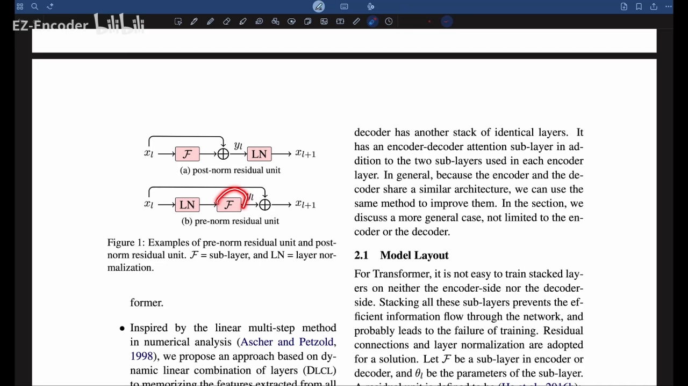
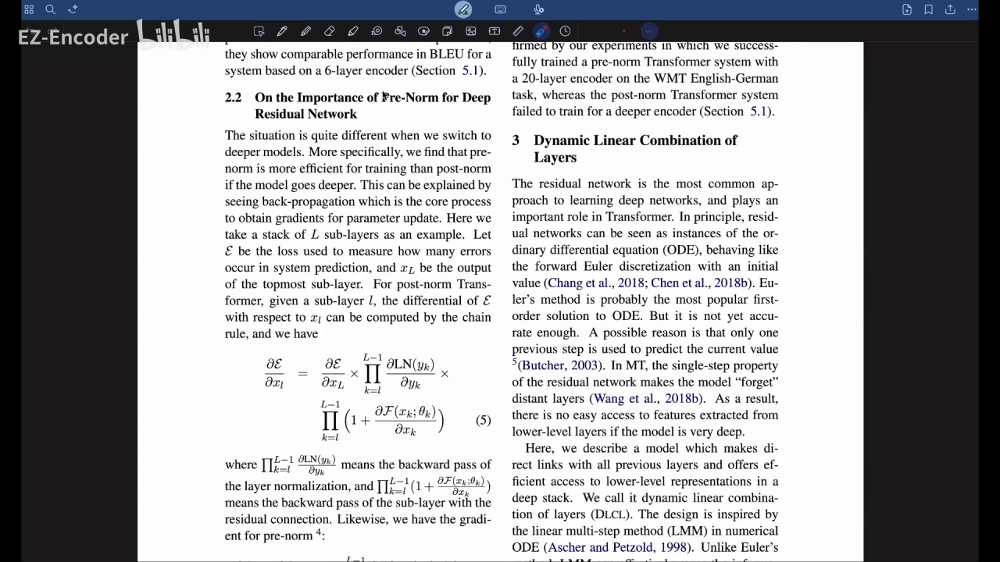
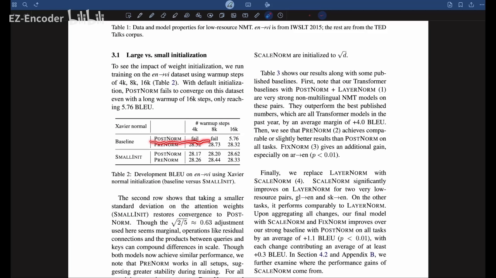
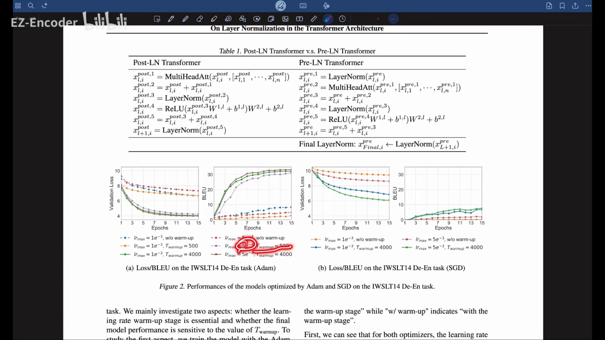
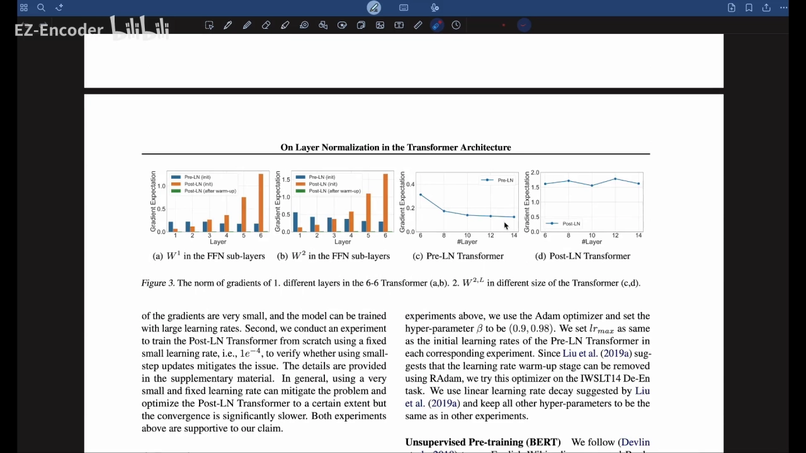
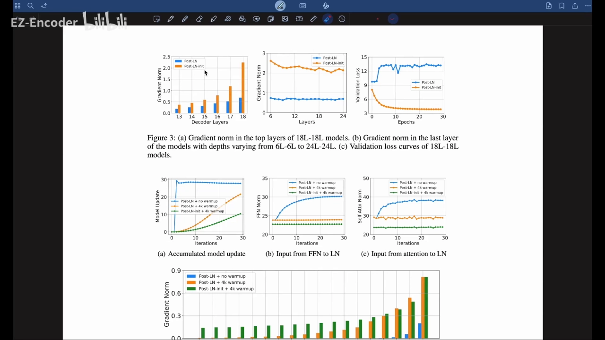
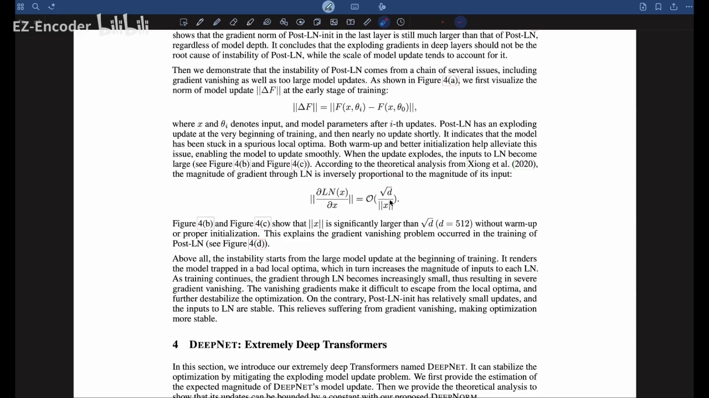
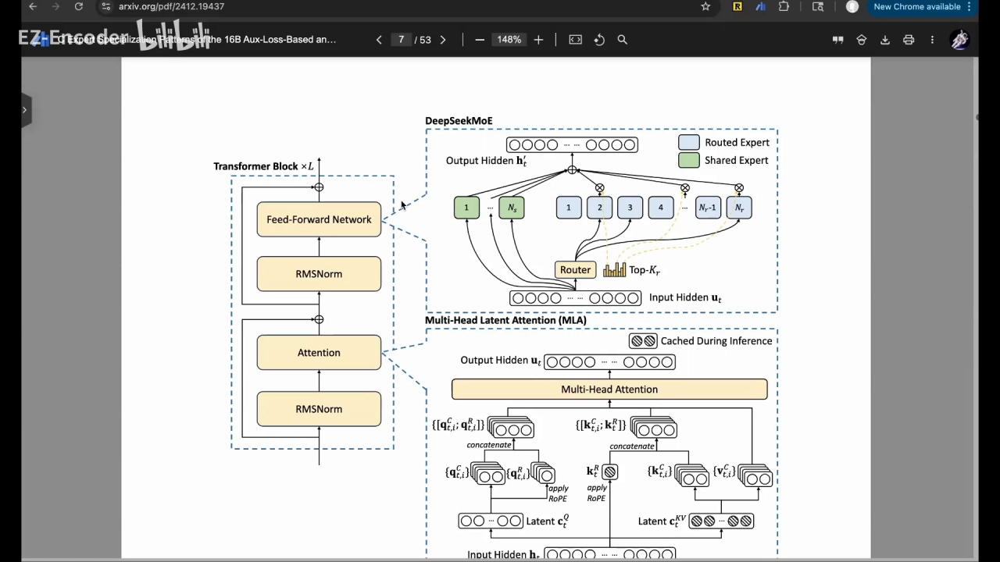
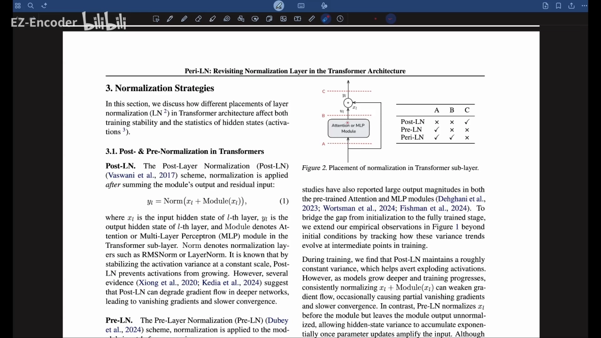

# Post-Norm 的梯度是连乘、Pre-Norm 是连加：四篇论文看深层 Transformer 为什么训得动

> 视频来源：[大模型面试] 什么是 pre-norm, post-norm? 为什么现在大模型都用 pre-norm 架构? post-norm 有什么问题? 新的架构?（Bilibili · EZ-Encoder，[BV1QbYhzzEZr](https://www.bilibili.com/video/BV1QbYhzzEZr/?t=0)）
> 本文基于视频演说图文稿整理，配图截自视频。

## 本讲要解决的核心问题（SCQA）

**背景**：Transformer 的每个子层（self-attention 或 FFN）旁边都挂着一个 LayerNorm（层归一化，把向量重新缩放到统一的尺度）。2017 年原始论文把它放在「残差相加之后」，这种摆法叫 **Post-Norm**；现在主流大模型几乎都把它挪到「子层的输入上」，叫 **Pre-Norm**。

**冲突**：两者只差一个框的位置，深层模型上的结果却是天壤之别——Post-Norm 一加深就直接训练失败，必须靠 warmup（先用极小学习率起步、再慢慢升上去）硬撑；更麻烦的是，文献里对「为什么」给出了两套互相打架的解释：一份说最后一层的梯度太大，另一份说真正的杀手是初始几步的更新量太大、把 LayerNorm 的梯度压没了。

**疑问**：这个框的位置到底改变了哪一条数学性质？两套解释谁对、能不能并存？今天的模型为什么一致选了 Pre-Norm，又为此付了什么代价？

**回答（中心思想）**：**差别在反向传播的乘法结构上**。Post-Norm 把归一化放在残差主干上，梯度沿深度方向是 $L$ 项**连乘**，每过一层都要乘一个跟归一化雅可比有关的因子，深了就必然不可控；Pre-Norm 把归一化挪进支路、让主干保持恒等映射，梯度变成「$1 + \sum$」的**连加**，项数与深度无关。所以 Pre-Norm 免 warmup、更深更稳；代价是主干数值再也不被复位，于是最新的模型又在子层出口补了第二个 norm。

---

## 一、先在残差支路里认出那个框

先统一记法。一层的子层函数记作 $F$（可以是 attention，也可以是 FFN），本层参数记作 $\theta_l$，第 $l$ 层的输入记作 $x_l$。残差连接做的事就是「把子层的修修补补加回原向量」：

$$
x_{l+1} = x_l + F(x_l;\theta_l)
$$

这个加号是整篇文章的主角：正向时它让原始信息有一条不经过 $F$ 的通路，反向时它把梯度原样分给两个输入（学过 micrograd 那类自动求导的话，加法节点的反向就是「梯度原封不动传给两边」）。



上图就是两种摆法的原始定义 [【跳转到 01:50】](https://www.bilibili.com/video/BV1QbYhzzEZr/?t=110)：

- **Post-Norm**（图 (a)）：先做残差相加，再归一化，$x_{l+1} = \mathrm{LN}\!\left(x_l + F(x_l;\theta_l)\right)$。原始 Transformer（Attention Is All You Need）用的就是这种，归一化的输出直接就是下一层的输入，所以归一化**坐在主干上**。
- **Pre-Norm**（图 (b)）：先归一化，再送进子层，$x_{l+1} = x_l + F\!\left(\mathrm{LN}(x_l);\theta_l\right)$。归一化被搬进了支路内部，主干上只剩加法，「干干净净」地把向量一路送上去 [【跳转到 01:25】](https://www.bilibili.com/video/BV1QbYhzzEZr/?t=85)。

一句话记：**Post-Norm 的归一化管的是「主干的出口」，Pre-Norm 的归一化管的是「支路的入口」**。这两种摆法在浅层网络里都能训，差别要到十几层、几十层才显形。

---

## 二、连乘与连加：两种结构的梯度表达式

### 2.1 把梯度一路乘下去

设共 $L$ 个子层，损失为 $\mathcal{E}$，最顶层输出为 $x_L$。我们想看「损失对第 $l$ 层输入的梯度」$\partial \mathcal{E}/\partial x_l$ 长什么样，因为这决定了这一层能不能收到学习信号。

Post-Norm 每一层是 $x_{k+1} = \mathrm{LN}(y_k)$，其中 $y_k = x_k + F(x_k;\theta_k)$。从顶层往下一层层套链式法则，得到 [【跳转到 02:34】](https://www.bilibili.com/video/BV1QbYhzzEZr/?t=154)：

$$
\frac{\partial \mathcal{E}}{\partial x_l}
= \frac{\partial \mathcal{E}}{\partial x_L}
\times \prod_{k=l}^{L-1} \frac{\partial\, \mathrm{LN}(y_k)}{\partial y_k}
\times \prod_{k=l}^{L-1}\left(1 + \frac{\partial F(x_k;\theta_k)}{\partial x_k}\right)
$$

拆开读：第一个 $\prod$ 是「归一化层的反向」逐层连乘，第二个 $\prod$ 是「残差加子层」的反向逐层连乘——那个 $1$ 来自残差旁路，那个 $\partial F/\partial x_k$ 来自子层本身。

Pre-Norm 每一层是 $x_{k+1} = x_k + F(\mathrm{LN}(x_k);\theta_k)$，主干上没有归一化，于是链式法则收成一个**和式**：

$$
\frac{\partial \mathcal{E}}{\partial x_l}
= \frac{\partial \mathcal{E}}{\partial x_L}
\left(1 + \sum_{k=l}^{L-1} \frac{\partial F(\mathrm{LN}(x_k);\theta_k)}{\partial x_l}\right)
$$

注意右边这个括号里，无论 $L$ 有多大，结构永远是「1 加上一堆项」。



视频里说得很直白：式 (5) 是 Post-Norm 的梯度，式 (6) 是 Pre-Norm 的梯度，**前者是连乘记号，后者是连加记号** [【跳转到 02:34】](https://www.bilibili.com/video/BV1QbYhzzEZr/?t=154)。论文自己也点明了关键差别：式 (6) 里右侧乘积项的数量**不随深度变化**，而式 (5) 传梯度是低效的。

### 2.2 为什么「连乘」天生比「连加」脆

用一个极简算例体会（只为说明乘性与加性的差别，不是真实测量）：假设每层传回来的因子都略小于 1，取 $0.9$。

- **连乘**（Post-Norm 形态）：12 层后是 $0.9^{12} \approx 0.28$，24 层后是 $0.9^{24} \approx 0.08$。层数每加一倍，信号再掉一个数量级。
- **连加**（Pre-Norm 形态）：括号里是 $1 + 0.9 \times 12 \approx 11.8$（12 层），$1 + 0.9 \times 24 \approx 22.6$（24 层）。深度只让「多出的那部分」线性变大，而那个 $1$ 始终在，梯度不会塌到零。

反过来如果每层因子略大于 1（比如 $1.1$），连乘会指数爆炸，连加只是线性增长。一句话：**连乘把每一层的缩放误差累积成指数，连加只让它们线性叠加**。这就是为什么「深了就训不动」在 Post-Norm 上是结构性的，在 Pre-Norm 上只是程度问题。

---

## 三、第一份证据：20 层 encoder 上，Post-Norm 直接训不出来

前面的式 (5)(6) 出自 Wang 等人 2019 年的 *Learning Deep Transformer Models for Machine Translation*。视频里翻到这篇论文时，先给了概念图，再给了实验结论：同一套深层 Transformer，**Post-Norm 的架构训练直接 fail，而 Pre-Norm 的架构仍然能训出来** [【跳转到 03:24】](https://www.bilibili.com/video/BV1QbYhzzEZr/?t=204)。

论文自己在正文里写得更具体：他们成功预训练了一个 **20 层 encoder 的 pre-norm 系统**（WMT 英德），而 **post-norm 系统在更深的 encoder 上训练失败**。也就是说，「深度」是这两条曲线的分水岭：浅的时候看不出差别，一旦把层数堆上去，Post-Norm 就交白卷。

这一步只证明了「现象」，还没解释「机理」。视频随后按时间顺序补了三篇论文，正好对应三种解释路径。

---

## 四、第二份证据：Transformers without Tears 说「Pre-Norm 可以不 warmup」

2019 年底的 *Transformers without Tears: Improving the Normalization of Self-Attention* 把「不用 warmup」变成了 Pre-Norm 的正式卖点。视频提到，这篇论文的标题里那个「tears」，大概就是训 Transformer 时流下的眼泪 [【跳转到 04:14】](https://www.bilibili.com/video/BV1QbYhzzEZr/?t=254)。



看这张表的 baseline 行就够了 [【跳转到 04:39】](https://www.bilibili.com/video/BV1QbYhzzEZr/?t=279)：

| warmup 步数 | Post-Norm（baseline） | Pre-Norm（baseline） |
| --- | --- | --- |
| 4k | fail | 28.52 BLEU |
| 8k | fail | 28.73 BLEU |
| 16k | 5.76 BLEU | 28.32 BLEU |

三列读下来：Post-Norm 把 warmup 拉到 4000、8000 步都还是训崩，只有熬到 16000 步才勉强收敛出一个 5.76 BLEU 的结果；Pre-Norm 在三种 warmup 下都稳定收敛，而且分数还更高。视频的总结是：**对 Pre-Norm 来说，只做一些非常简单的 warmup 网络就能收敛，结果还优于 Post-Norm** [【跳转到 05:04】](https://www.bilibili.com/video/BV1QbYhzzEZr/?t=304)。

同一篇论文还做了「加深」实验：Post-Norm 加到 5 层、6 层就训练失败；Pre-Norm 在 5 层、6 层（而且**不做 warmup**）依然收敛。于是得到本节最重要的一句经验结论——**Pre-Norm 能稳定 Transformer 的训练，尤其是可以不用 warmup，训练因此更快** [【跳转到 05:29】](https://www.bilibili.com/video/BV1QbYhzzEZr/?t=329)。

---

## 五、第三份证据：Xiong 等人 2020 从理论上证明「顶层梯度大」

现象有了，机理还缺。视频接着翻到 *On Layer Normalization in the Transformer Architecture* [【跳转到 05:59】](https://www.bilibili.com/video/BV1QbYhzzEZr/?t=359)。它的结论可以浓缩成一句：**Post-Norm 需要 warmup，是因为靠近输出层的梯度在初始化时就非常大，用大学习率去训就会不稳**；而论文同时证明了 Pre-Norm 没有这个问题，因此不需要 warmup，也不需要在学习率上反复调超参。



上图上排是两种结构的逐层前向公式：Post-LN 里每一层的最后一个动作是 LayerNorm，Pre-LN 里每一层的第一个动作是 LayerNorm，最后再补一个 Final LayerNorm。下排是实验 [【跳转到 07:09】](https://www.bilibili.com/video/BV1QbYhzzEZr/?t=429)：不做 warmup、或只 warmup 500 步同时把学习率调大，这几条 Post-Norm 曲线要么不降、要么很差；把 warmup 加上、学习率压小，Post-Norm 才收敛。

理论的核心是一条**上界**：对 Post-Norm，最后一层梯度的上界**与层数 $L$ 无关**；对 Pre-Norm，上界**与 $L$ 有关、且随 $L$ 增大而减小** [【跳转到 07:34】](https://www.bilibili.com/video/BV1QbYhzzEZr/?t=454)。用比例关系写出来就是：

$$
\left\|\frac{\partial \mathcal{E}}{\partial x_L}\right\|_{\text{Post-Norm}} \propto 1,
\qquad
\left\|\frac{\partial \mathcal{E}}{\partial x_L}\right\|_{\text{Pre-Norm}} \propto \frac{1}{L}
$$

后者按视频的表述就是「与层数成反比」——网络越深，最后一层的梯度反而越小。这句话听起来像是好事（梯度不炸），但它同时意味着：**Post-Norm 无论堆多深，顶层那几层在第一步就顶着同样大的梯度**，模型越深，「顶层步子太大」的问题越突出。



实验图把这套理论画了出来 [【跳转到 08:32】](https://www.bilibili.com/video/BV1QbYhzzEZr/?t=512)：

- 左两幅（(a)(b)）是同一个 6-6 模型里不同层的梯度。蓝柱（Pre-LN）在各层都小且均匀；橙柱（Post-LN，未 warmup）**越靠近顶层越高**，最高那根柱子远超其它；绿柱（Post-LN + warmup）被整体压得很低。
- 右两幅（(c)(d)）是不同深度模型的**最后一层**梯度。(c) Pre-LN：深度从 6 加到 14，最后一层梯度从约 0.35 一路降到约 0.1，符合「与 $L$ 成反比」；(d) Post-LN：深度从 6 加到 14，梯度基本恒定在 **1.6 左右**，符合「与 $L$ 无关」 [【跳转到 08:57】](https://www.bilibili.com/video/BV1QbYhzzEZr/?t=537)。

这就给了「Post-Norm 为什么必须 warmup」一个干净的答案：**训练对所有层用同一个学习率，而顶层天然拿到最大的梯度，于是最开始的几步在顶层就是大步子，容易把模型一脚踢进再也回不来的状态**；warmup 的作用是把这几步先按住。

---

## 六、第四份证据：微软 2020 说「不是梯度爆炸，是 update 爆炸」

紧接着视频翻到了一篇微软的论文，UP 主的评价是「它似乎是在驳斥上一篇的解释」 [【跳转到 09:47】](https://www.bilibili.com/video/BV1QbYhzzEZr/?t=587)。这篇的观点是：Post-Norm 不稳定的**终极原因不是最后一层的 gradient norm 太大，而是初始化阶段 model update 太大**。



证据链是「反着来」的 [【跳转到 10:12】](https://www.bilibili.com/video/BV1QbYhzzEZr/?t=612)：

1. **先看 gradient norm**。蓝色是原始 Post-Norm（不收敛），橙色是 Post-Norm 加了好初始化（能收敛）。结果是**收敛的那个模型 gradient norm 反而更大**，不收敛的那个增长缓慢。这一条直接跟「顶层梯度爆炸导致不收敛」的说法顶上了 [【跳转到 11:02】](https://www.bilibili.com/video/BV1QbYhzzEZr/?t=662)。
2. **再看累积 model update**。蓝色模型（Post-Norm、无 warmup）在训练最开始的几步 update 巨大，随后曲线走平——注意这是**累积**量，走平就意味着后续更新几乎是零，也就是进入了梯度消失状态 [【跳转到 11:52】](https://www.bilibili.com/video/BV1QbYhzzEZr/?t=712)。黄色（有 warmup）和绿色（warmup + 好初始化）到后期仍在持续更新，没有消失问题。
3. **最后看 LayerNorm 的输入**。图 4(b)(c) 画的是送进 LN 的向量范数：不收敛的蓝线一路上涨、越来越大；有 warmup / 好初始化的黄绿线基本恒定 [【跳转到 13:57】](https://www.bilibili.com/video/BV1QbYhzzEZr/?t=837)。

把这三条串起来，需要一个把「输入幅度」和「梯度」连起来的公式 [【跳转到 12:42】](https://www.bilibili.com/video/BV1QbYhzzEZr/?t=762)：

$$
\left\| \frac{\partial\, \mathrm{LN}(x)}{\partial x} \right\| = \mathcal{O}\!\left(\frac{\sqrt{d}}{\lVert x \rVert}\right)
$$

其中 $d$ 是向量维度，$\lVert x \rVert$ 是送进 LayerNorm 的向量的范数（幅度）。读法很直白：**LayerNorm 自己的梯度，跟它输入的幅度成反比**。



于是整条因果链闭合了 [【跳转到 13:32】](https://www.bilibili.com/video/BV1QbYhzzEZr/?t=812)：

```
初始化 → 前几步 update 巨大（update 爆炸）
      → 主干向量被推得越来越大
      → 送进 LayerNorm 的 ‖x‖ 越来越大
      → ‖∂LN/∂x‖ = O(√d / ‖x‖) 越来越小
      → 反向传回 LayerNorm 之前的梯度趋于 0（梯度消失）
      → 后面几乎不再更新，训练卡死
```

极端情况下，如果 LN 的输入无限大，这个梯度就趋近于零。反过来，warmup 或合适的初始化避免了初始的巨大 update，LN 的输入保持恒定，梯度就不会消失——这正好解释了图 4 最下面那排「逐层梯度范数」：蓝色模型在前面十几层几乎没有梯度，只有最后几层还剩一点；黄绿模型在每一层都有可用的梯度 [【跳转到 15:12】](https://www.bilibili.com/video/BV1QbYhzzEZr/?t=912)。

UP 主自己的判断是：**更倾向微软这篇的解释，因为它的理论和结果自洽** [【跳转到 16:02】](https://www.bilibili.com/video/BV1QbYhzzEZr/?t=962)。我们不妨把两篇的关系摆正：

| 说法 | 关注的对象 | 说的是哪一段 |
| --- | --- | --- |
| Xiong 等人 2020 | 初始化时刻、最后一层的梯度范数 | 静态事实：Post-Norm 顶层梯度天生大，与深度无关 |
| 微软 2020 | 训练最初几步的更新量、LN 输入的幅度 | 动态后果：大步更新把 LN 输入推大，再经 $\mathcal{O}(\sqrt{d}/\lVert x\rVert)$ 把梯度压没 |

两者并不互斥：Xiong 解释了「为什么第一步就敢迈大步」（顶层梯度大 + 全局同一个学习率），微软解释了「迈大步之后为什么再也爬不出来」（LN 输入膨胀 → LN 梯度消失）。**共同的结论只有一句：Post-Norm 把尺度控制压在了主干上，任何一次尺度失控都会污染整条路径；Pre-Norm 把尺度控制局部化到了每个支路的入口。**

---

## 七、现在的主流：Pre-Norm 一统，新的补丁是「两边都归一化」

视频最后回到工程现状，直接翻两家模型的技术资料 [【跳转到 16:17】](https://www.bilibili.com/video/BV1QbYhzzEZr/?t=977)：



上图是 DeepSeek 的网络结构：attention 前面一个 RMSNorm、FFN 前面一个 RMSNorm。判断一个模型是 Pre-Norm 还是 Post-Norm，只看归一化落在残差相加的**前面还是后面**就够了——这里是前面，所以是 Pre-Norm。视频还举了千问 3 的技术报告，里面明写用的也是 pre-normalization [【跳转到 16:42】](https://www.bilibili.com/video/BV1QbYhzzEZr/?t=1002)。原因很实在：模型越训越大，Post-Norm 的稳定性根本支撑不到那个规模。

但 Pre-Norm 也留了一道口子。视频把三种摆法画成了 A、B、C 三个位置 [【跳转到 17:11】](https://www.bilibili.com/video/BV1QbYhzzEZr/?t=1031)：



- 在 **C** 处加 LN，就是原始 Transformer 的 Post-Norm；
- 在 **A** 处加 LN，就是 Pre-Norm；
- 在 **A 和 B 两处都加** LN，是 2025 年这篇 Peri-LN 提出的做法。

动机是这样的 [【跳转到 17:36】](https://www.bilibili.com/video/BV1QbYhzzEZr/?t=1056)：Post-Norm 之所以糟，是因为 LN 加在残差相加之后、压在了「信息的主要通路」上，反向会梯度消失；Pre-Norm 把 LN 挪进旁支，梯度能顺着残差一路回传，但它只归一化了**输入**，对 attention 与 MLP 的**输出**没有归一化，于是输出的 variance 可能被子层内部的计算放大 [【跳转到 18:01】](https://www.bilibili.com/video/BV1QbYhzzEZr/?t=1081)。Peri-LN 的判断是：不要在 C 处加，而是在 A、B 两处各加一个，这样进入和离开 attention / MLP 的数值都被归一化，同时残差主干仍然通畅 [【跳转到 18:26】](https://www.bilibili.com/video/BV1QbYhzzEZr/?t=1106)。

一句话：**Post-Norm 归一化的是主干的出口，Pre-Norm 归一化的是支路的入口，Peri-LN 把入口和出口都归一化一次，只放过主干本身。**

---

## 小结

1. **结构差别只有一个框的位置**：Post-Norm 是 $x_{l+1}=\mathrm{LN}(x_l+F(x_l))$，归一化在主干的出口；Pre-Norm 是 $x_{l+1}=x_l+F(\mathrm{LN}(x_l))$，归一化在支路的入口。
2. **数学差别是连乘对连加**：Post-Norm 的梯度沿深度是两层 $\prod$ 连乘；Pre-Norm 的梯度是 $1+\sum$，项数与深度无关。乘性误差指数累积，加性误差线性叠加。
3. **Wang 等人 2019** 给出了现象：20 层 encoder，Post-Norm 训不出来，Pre-Norm 训得出来。
4. **Transformers without Tears** 给出「免 warmup」这个卖点：Post-Norm 要 16000 步 warmup 才勉强收敛，Pre-Norm 在 4k 甚至不做 warmup 都稳定；加深到 5、6 层，Post-Norm 直接 fail。
5. **Xiong 等人 2020** 给出静态解释：Post-Norm 最后一层梯度的上界与层数无关（实测恒在 1.6 左右），Pre-Norm 的上界与层数成反比（实测随深度下降），于是 Post-Norm 顶层在第一步就顶着大梯度。
6. **微软 2020** 给出动态解释：真正致命的是初始几步 update 过大，把 LN 的输出/输入幅度推大，而 $\lVert \partial \mathrm{LN}/\partial x\rVert = \mathcal{O}(\sqrt{d}/\lVert x\rVert)$，输入越大梯度越小，最后走进梯度消失。
7. **两条解释可以并存**：一条讲「为什么第一步步子大」，一条讲「迈大步之后为什么爬不出来」。
8. **今天的答案是 Pre-Norm**（DeepSeek、千问 3 等都在用），而 Peri-LN 这类「入口 + 出口各归一化一次」的新写法，是在补 Pre-Norm「只归一化输入、不归一化输出」留下的那道口子。

下一节我们把镜头拉近到归一化算子本身：RMSNorm 去掉的正是 LayerNorm 中「减均值」那一步。想先看一个能用手算出来的对照实验（两个小模型的 loss 曲线、逐层梯度柱状图），可以接着读本小节另一篇：《把归一化框挪出残差主干：两个小模型的对照实验看 Pre-Norm 为何更稳》。

## 关键术语速查

| 术语 | 一句话解释 |
| --- | --- |
| LayerNorm（LN，层归一化） | 对「单个 token 的向量」减均值、除标准差，再用可学习的 $\gamma,\beta$ 缩放平移，把它复位到统一尺度 |
| Post-Norm | 先残差相加再归一化，$x_{l+1}=\mathrm{LN}(x_l+F(x_l))$，原始 Transformer 的摆法 |
| Pre-Norm | 先归一化再进子层，$x_{l+1}=x_l+F(\mathrm{LN}(x_l))$，现代主流摆法 |
| 残差连接 | $y=x+F(x)$，正向提供一条不经过子层的通路，反向让梯度原样直通 |
| 连乘 / 连加 | 梯度表达式中因子逐层相乘（乘性累积）与相加（加性叠加）的区别，决定了深层网络的稳定性 |
| warmup | 训练开头用极小学习率、再逐步升到设定值的策略，用来压住最初几步的更新幅度 |
| gradient vanish（梯度消失） | 反向传播的梯度小到几乎为零，参数几乎不再更新 |
| model update | 一次参数更新带来的模型输出变化量，微软论文用它衡量「步子大小」 |
| RMSNorm | 只除均方根、不减均值的归一化变体，省掉中心化步骤 |
| Peri-LN | 在子层入口和出口各放一个 LN、同时保持残差主干不被归一化的折中摆法 |
