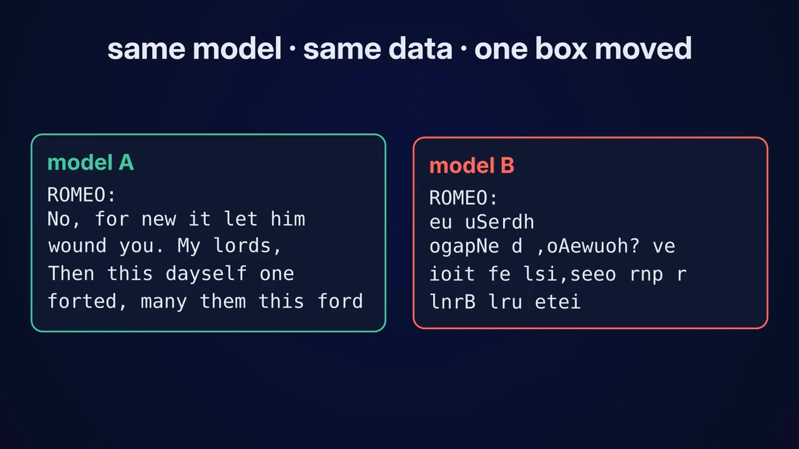
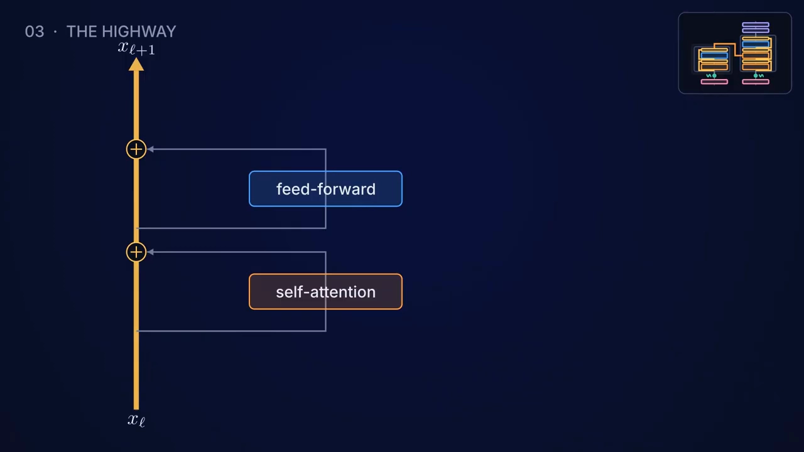
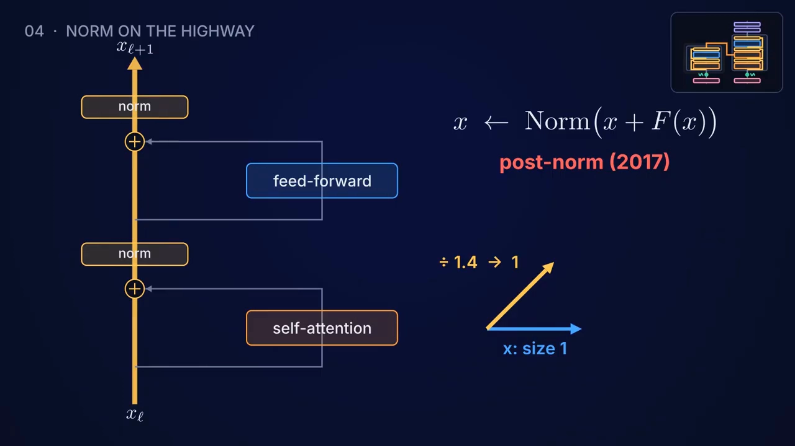
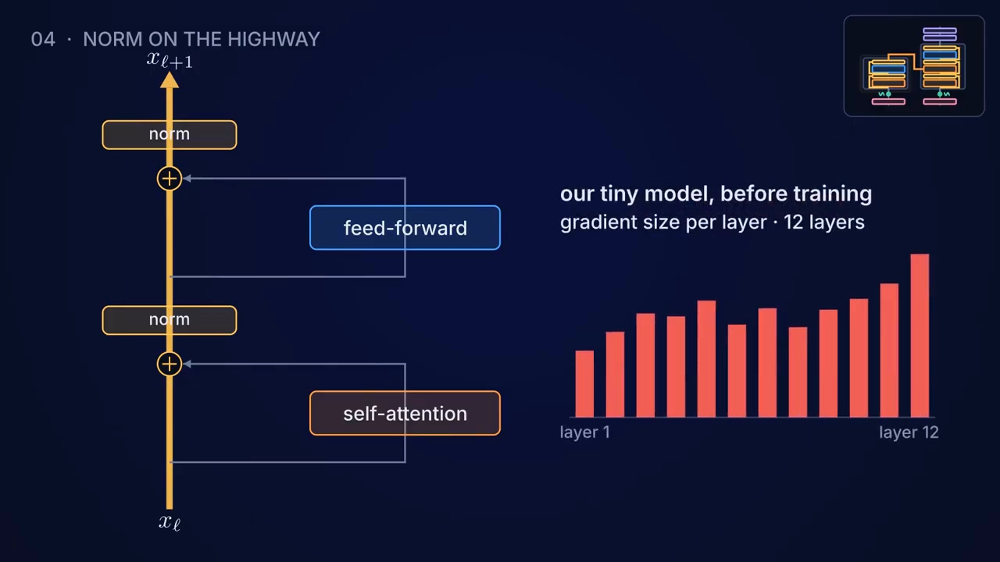
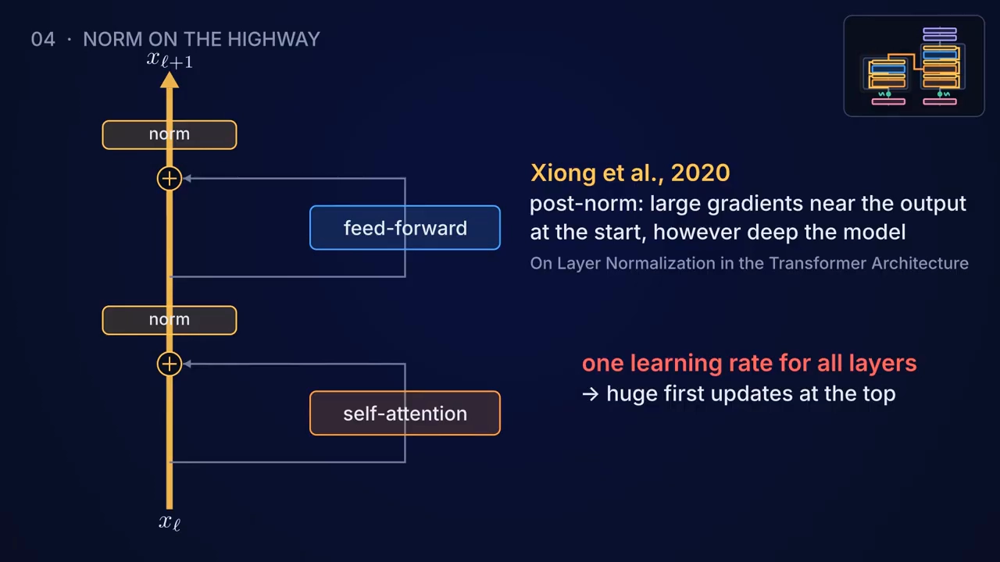
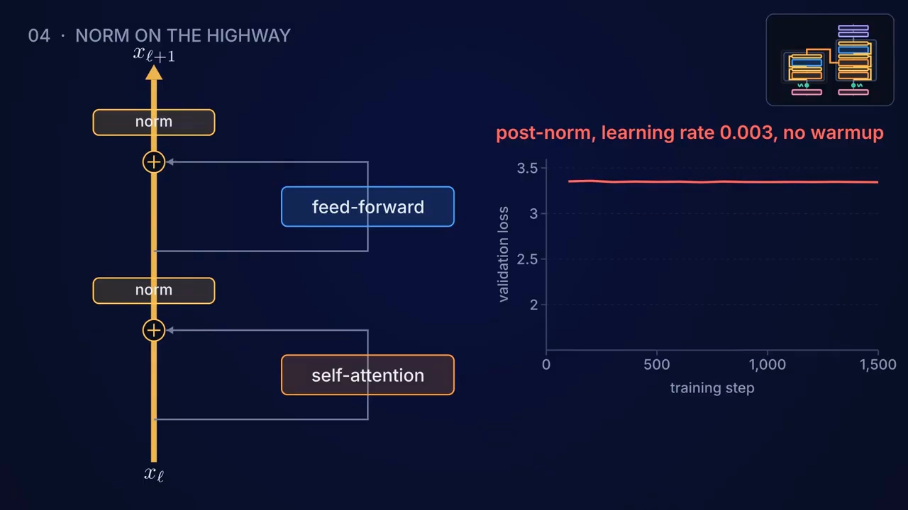
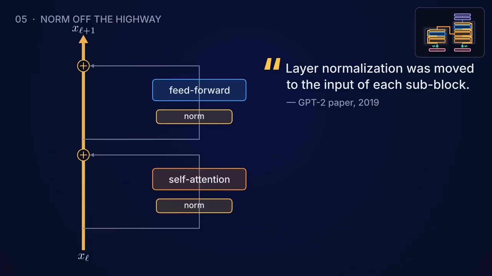
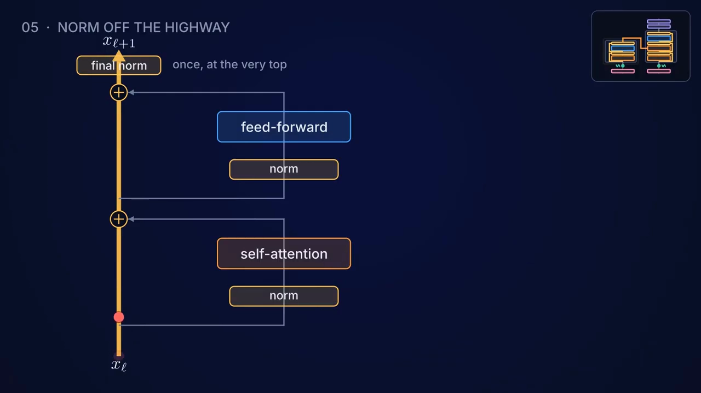
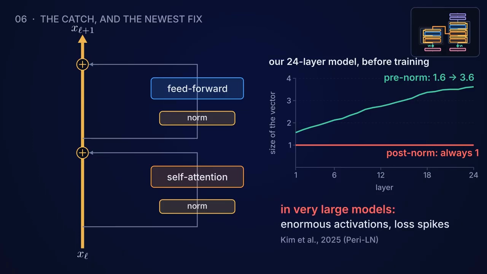
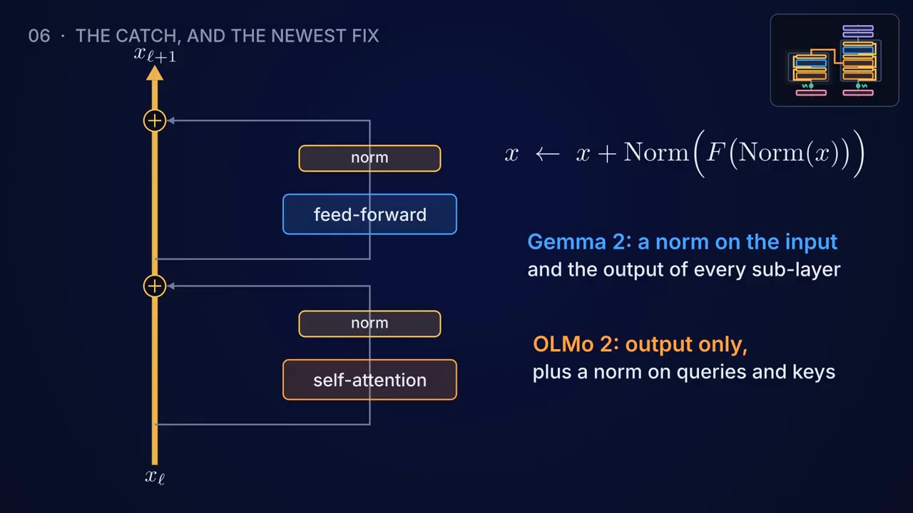

# 把归一化框挪出残差主干：两个小模型的对照实验看 Pre-Norm 为何更稳

> 视频来源：Pre-norm vs post-norm and RMSNorm, explained | Stanford CS336 Lecture 3 companion（YouTube · Dot Product，[lu9EM48td8o](https://www.youtube.com/watch?v=lu9EM48td8o&t=0)）
> 本文基于视频演说图文稿整理，配图截自视频。

## 本讲要解决的核心问题（SCQA）

**背景**：同一条数据、同一个模型规模、同一套超参、连随机种子都一样，只把归一化这个小框从「残差相加之后」挪到「子层输入之前」，两个 12 层的小语言模型就开始往完全不同的方向长。

**冲突**：一个模型学会了拼出莎士比亚腔的句子，另一个从头到尾在吐乱码——它的 loss 在整整 1500 步里一动不动地停在 3.35，那恰好是「只知道每个字母出现频率、什么规律都没学到」的水平。

**疑问**：一个框的位置，凭什么决定「能不能学会」？两组 loss 曲线、逐层梯度柱状图的差别到底从哪里来？Pre-Norm 就这么完美吗？

**回答（中心思想）**：**因为归一化坐在残差主干上，还是坐在支路上，决定了梯度是被每一步重新缩放，还是沿主干原样直通**。Post-Norm 每层都把主干压缩一遍，于是顶层梯度最大、每层的「自我编辑」占比过大，开局就得靠 warmup；Pre-Norm 让主干成为一条干净的恒等通路，各层梯度几乎持平，不用 warmup 也能起步。它的代价是主干数值不再被复位、会逐层涨大——这正是最新模型补第二个 norm 的原因。

---

上面这张图就是实验的全部前提：两边是**同一份数据、同一规模、同一套设置、同一个随机种子**，唯一的不同是那个小框坐在每一层的**前面**还是**后面**。原始 Transformer 放在后面，今天几乎所有你用过的大模型都放在前面。

## 一、残差主干是一条「高速公路」

先把结构画清楚。视频把一层 Transformer 重画成一根竖直的黄色主线，从 $x_\ell$ 一路通到 $x_{\ell+1}$：self-attention 从这条线上读出输入、算出一份「修改」，加回主线；feed-forward 再做一遍同样的事 [【跳转到 02:35】](https://www.youtube.com/watch?v=lu9EM48td8o&t=155)。

写作符号就是：

$$
x_{\ell+1} = x_\ell + F(x_\ell)
$$

其中 $F$ 是一个子层（attention 或 feed-forward）。这个加号有两重意义：

- **正向**：每个 token 的向量沿着这条线一层层往上走，子层只在旁边做「编辑」，原始信息永远有一条不经过 $F$ 的通路。
- **反向**：梯度沿同一条路往回走。加号在反向时把梯度**原样**分给两个输入（如果你看过 micrograd 那类自动求导的实现，加法节点的反向就是「梯度不动、两边各一份」）。所以一条干净的 highway 上，学习信号能以全强度抵达每一层，哪怕模型有一百层 [【跳转到 03:00】](https://www.youtube.com/watch?v=lu9EM48td8o&t=180)。

用雅可比写出来更清楚：$y=x+F(x)$ 时

$$
\frac{\partial y}{\partial x} = I + \frac{\partial F}{\partial x}
$$

那个单位矩阵 $I$ 就是「原样直通」的数学形式——它保证不管 $\partial F/\partial x$ 多小，梯度都还有一条路。

---

## 二、Post-Norm 把归一化压在了这条主路上

原始 Transformer（2017）的摆法是把归一化直接放在**加号之后**，整条主线的每个出口都被压一遍：

$$
x \leftarrow \mathrm{Norm}\bigl(x + F(x)\bigr)
$$

这就是 **Post-Norm** [【跳转到 03:25】](https://www.youtube.com/watch?v=lu9EM48td8o&t=205)。

上图的算术值得一步步跟着算一遍：假设主线上向量的「大小」是 1，attention 的修改也大约是 1，两个正交方向相加，长度变成约 $\sqrt{2}\approx 1.4$；归一化把它压回 1，等价于**除以 1.4**。

于是关键后果出现了：**从下面传上来的所有内容，此刻只值原来的约 70%（$1/1.4$）**；再过一层，只剩一半（$1/2$）。每一层都在把「下面攒下来的东西」打个折。

反向也一样：梯度往回流的时候，每经过一个 norm 就被缩放一次。缩放比例逐层叠加，结果是**越靠顶层的梯度越大**——因为顶层经过的 norm 最少。视频在 12 层的小模型上直接量了这个现象（还没有开始训练）[【跳转到 03:50】](https://www.youtube.com/watch?v=lu9EM48td8o&t=230)：

顶层梯度约为底层的 **2.5 倍**。这不是巧合，Xiong 等人在 2020 年从理论上证明了这条性质：**Post-Norm 下，靠近输出层的层在训练开始时梯度就很大，而且与模型多深无关** [【跳转到 04:15】](https://www.youtube.com/watch?v=lu9EM48td8o&t=255)。（那条上界定理的推导与实测曲线，见本小节另一篇《Post-Norm 的梯度是连乘、Pre-Norm 是连加》。）

---

## 三、为什么非要归一化：不复位，数字就会漂

讲到这里要回答一个前置问题：这个框到底在做什么？视频给了一个能心算的 LayerNorm 算例 [【跳转到 01:10】](https://www.youtube.com/watch?v=lu9EM48td8o&t=70)。

取一个只有 4 个数的向量：$2,4,6,8$。

1. 先减均值：均值是 $5$，得到 $-3,-1,1,3$；
2. 再除以标准差：这里标准差是 $\sqrt{5}\approx 2.24$；
3. 结果是 $-1.34,-0.45,0.45,1.34$。

$$
\mathrm{LN}(x) = \frac{x - \mu}{\sigma},\qquad \mu=\frac{1}{d}\sum_i x_i,\quad \sigma=\sqrt{\frac{1}{d}\sum_i (x_i-\mu)^2}
$$

出来之后，每个向量的均值都是 0、尺度都是 1。随后再乘一个可学习的 scale、加一个可学习的 shift（即 $\gamma,\beta$，每个位置两个学出来的数），模型想拉回原来的大小也可以 [【跳转到 01:35】](https://www.youtube.com/watch?v=lu9EM48td8o&t=95)。

**为什么要这么折腾？** 因为每一层都把自己的输出加回主线上，如果没人复位，数字就会一路漂 [【跳转到 02:00】](https://www.youtube.com/watch?v=lu9EM48td8o&t=120)：

- 若每层让数变大 10%，24 层后是 $1.1^{24}\approx 9.85$，接近十倍；
- 若每层让数变小 10%，24 层后是 $0.9^{24}\approx 0.08$，不到十分之一。

那些「学着处理 1 左右数值」的权重，突然要面对 10 左右的输入，训练自然乱套。归一化做的事就是**在每一步把尺度复位**，让每一层看到的输入都落在它预期的范围里。

麻烦在于：**这个复位到底该放在哪一步**。放在主线出口（Post-Norm），复位的同时也把主干信息一起压了；放在支路入口（Pre-Norm），复位只管「送进子层的那份输入」，主干本身不被碰。这就是两条 loss 曲线的分水岭。

---

## 四、症状一：顶层梯度大，而学习率是全局共享的

回到实验。梯度一边倒会带来什么后果？视频给的解释很短：**训练对所有层用同一个学习率，顶层梯度大就意味着最初几步在顶层是「又大又笨」的更新，模型可能被一脚踢进一个再也回不来的状态** [【跳转到 04:15】](https://www.youtube.com/watch?v=lu9EM48td8o&t=255)。

这句话可以拆成三段因果，每一段都能在实验里对上号：

1. **梯度分布不均**（第 2 节量到的 2.5 倍）；
2. **学习率共享**（工程上每层单独调学习率不现实）；
3. **开局几步被顶层主导**，模型走进一个「输出分布已经歪掉」的区域，此后再也拉不回来。

第 3 段在实验里表现为 loss 完全不动——不是变慢，而是**卡死**。

---

## 五、症状二：loss 卡在 3.35，正是「什么都没学会」的水平

Post-Norm 模型、学习率 0.003、不做 warmup，跑 1500 步：

曲线是一条几乎水平的线，loss 停在 **3.35**。视频点出了这个数字的含义：3.35 恰好是「只知道每个字母有多常见、其它什么都不懂」时能得到的最优损失 [【跳转到 04:40】](https://www.youtube.com/watch?v=lu9EM48td8o&t=280)。也就是说，这个模型学会了字母频率，别的什么都没学到——开头那个吐乱码的模型就是它。

原始 Transformer 的解药是 **warmup**：先用极小的学习率起步，在最初 4000 步里慢慢升上去。视频把同一份代码加上 400 步 warmup，模型就学起来了，最终 loss 是 **1.86** [【跳转到 05:05】](https://www.youtube.com/watch?v=lu9EM48td8o&t=305)。Xiong 等人在德英翻译上也看到同一件事：**不做 warmup，Post-Norm 只有 8.45 BLEU；加上 warmup，约 34 BLEU**。

但 warmup 本身是个脆弱的旋钮：**warmup 步数偏短、学习率稍微高一点，分数会掉到 3 以下** [【跳转到 05:30】](https://www.youtube.com/watch?v=lu9EM48td8o&t=330)。

### 5.1 还有第二个更深的问题：每层「自我编辑」的占比太大

Post-Norm 的麻烦不止「开局步子大」。因为每个 norm 都在压缩「下面传上来的内容」，压缩得越多，本层自己的修改在主干里占的份额就越大。Liu 等人 2020 年的工作指出：**这会让模型输出对哪怕很小的权重更新都非常敏感**，输出会剧烈摆动。

所以真正的解法不是「开局走得慢一点」，而是**把 norm 从主线上请下去**。

---

## 六、Pre-Norm：把框挪到支路，主干保持干净

GPT-2 的做法是（论文原话）：**layer normalization was moved to the input of each sub-block**——归一化被挪到每个子块的输入处 [【跳转到 05:55】](https://www.youtube.com/watch?v=lu9EM48td8o&t=355)。于是 norm 落在了支路上，紧贴 attention 之前和 feed-forward 之前：

$$
x_{\ell+1} = x_\ell + F\bigl(\mathrm{Norm}(x_\ell)\bigr)
$$

上图右侧就是 GPT-2 的那句原话。这样每个子层仍然拿到「刻度整齐」的输入，但主线本身没有任何东西碰它 [【跳转到 06:20】](https://www.youtube.com/watch?v=lu9EM48td8o&t=380)。

代价是主干再也不会被复位，所以要在最顶上补一个 norm，只补一次：

$$
x_{\text{out}} = \mathrm{Norm}(x_L)
$$

### 6.1 效果：梯度变平，训练不用热启动

在这个干净的主线上，梯度可以不被缩放地流回去，各层分到相近的份额。视频的实测是：**12 层 Pre-Norm 的逐层梯度几乎是平的**；同样的模型、同样的学习率、依然不做 warmup，**Pre-Norm 上来就学，最终 loss 是 1.79**——这就是那个写莎士比亚腔的模型。

为了排除运气，他们又换两个随机种子重跑（各 600 步）[【跳转到 06:45】](https://www.youtube.com/watch?v=lu9EM48td8o&t=405)：

| 设置 | 无 warmup 的 Post-Norm | 有 warmup 的 Post-Norm | 无 warmup 的 Pre-Norm |
| --- | --- | --- | --- |
| 种子 1 | 卡在 3.35 | 学起来了（1.86） | 学起来了（1.79） |
| 种子 2 | 卡在 3.35 | 学起来了 | 学起来了 |
| 种子 3 | 卡在 3.35 | 学起来了 | 学起来了 |

**「不需要 warmup」是 Pre-Norm 当年最大的卖点**，而今天更重要的收益是**稳定性**：Pre-Norm 能在更大的学习率上稳定训练，这一点对最大的模型最要紧 [【跳转到 07:10】](https://www.youtube.com/watch?v=lu9EM48td8o&t=430)。GPT-3 沿用了它；LLaMA 的论文写得更直白——为了提升训练稳定性，他们归一化每个 Transformer 子层的**输入**，而不是输出。

---

## 七、Pre-Norm 不是免费的：主干会越长越大

主干上既然没有任何东西复位，那每一次「加上一份修改」都会让向量变长一点，一层层累积下去。

视频的实测：24 层模型、训练之前，**Pre-Norm 的向量规模从第一层的 1.6 涨到最后一层的 3.6，翻了一倍还多**；而 Post-Norm 的向量大小始终是 1 [【跳转到 08:00】](https://www.youtube.com/watch?v=lu9EM48td8o&t=480)。在很大的模型上，这种增长会变成**巨大的激活值和突然的 loss 尖峰（spike）**。

### 7.1 新补丁：在子层的出口再加一个 norm（sandwich norm）

最新的模型于是补了第二个 norm：**在离开子层时也归一化一次**，让「修改」在被加到主干之前先被压好，主干依旧保持干净：

$$
x \leftarrow x + \mathrm{Norm}\Bigl(F\bigl(\mathrm{Norm}(x)\bigr)\Bigr)
$$

各家取舍不同 [【跳转到 08:25】](https://www.youtube.com/watch?v=lu9EM48td8o&t=505)：

- **Gemma 2**：每个子层的输入和输出都放一个 norm，正是上式的写法；
- **OLMo 2**：只保留输出那个 norm，另外还给 attention 里的 query 和 key 也做归一化。

证据目前是正面的 [【跳转到 08:50】](https://www.youtube.com/watch?v=lu9EM48td8o&t=530)：2025 年的一项研究把这种布局称为 **Peri-LN**，在 400M、1.5B、3.2B 三个规模上，它都取得了比 Pre-Norm 更低的 loss，发散的次数也更少；OLMo 2 团队也量到了类似效果——加上这些改动后，**梯度范数的尖峰下降了大约三分之一**。

不过视频也提醒了一句：**这些都是给大模型准备的补丁**。在他们那个小模型上，多出来的那个 norm 没帮上忙——**1.81，而 Pre-Norm 是 1.78** [【跳转到 09:15】](https://www.youtube.com/watch?v=lu9EM48td8o&t=555)。

### 7.2 还留了一个反方向的代价

视频引用 Liu 等人的结果：**当 Post-Norm 真的训练成功时，它常常略好一点——在他们的长时间训练里，8 个设置中有 7 个是 Post-Norm 更优** [【跳转到 07:35】](https://www.youtube.com/watch?v=lu9EM48td8o&t=455)。换句话说，Pre-Norm 换来的是「几乎总能训起来」，代价是「训起来的天花板略低」。对一个动辄上亿美金训练成本的大模型来说，这个交换显然是值得的。

---

## 八、顺带一提：框里的公式也换过了（RMSNorm）

这一节只做一句交接。LayerNorm 干两件事：先减均值，再除标准差。**RMSNorm 跳过第一步**，直接把向量除以它的均方根（root mean square：把每个数平方、求平均、再开根号），也去掉了那个可学习的 shift [【跳转到 09:40】](https://www.youtube.com/watch?v=lu9EM48td8o&t=580)。

同样用那 4 个数：平方是 $4,16,36,64$，平均是 $30$，开根号约 $5.48$；除完得到 $0.37,0.73,1.10,1.46$。向量被重新缩放了，但没有被重新中心化。

$$
\mathrm{RMSNorm}(x) = \frac{x}{\sqrt{\frac{1}{d}\sum_i x_i^2}}
$$

Zhang 与 Sennrich 在 2019 年提出这个变体时的赌注是：真正起作用的是「重新缩放」而不是「去均值」。证据站在他们那边——223M 参数上的一次仔细对比里，**RMSNorm 的 loss 是 1.821，LayerNorm 是 1.838，训练还快了约 5%** [【跳转到 10:05】](https://www.youtube.com/watch?v=lu9EM48td8o&t=605)。小模型上两者几乎重合（1.79 对 1.78）。

一个自然的疑问是：归一化只占 Transformer 浮点运算的约 **0.17%**，砍掉它的一步怎么可能快 5%？答案是 **flops 不是时间**。2021 年一项针对 BERT 单层的测量显示，softmax、layer norm 这类操作只占 0.17% 的 flops，却占掉约**四分之一的运行时间**：它们要读回主线上每一个数、再写回每一个数，却只做几次运算，属于典型的**访存受限（memory-bound）**——GPU 大部分时间在等数据 [【跳转到 11:10】](https://www.youtube.com/watch?v=lu9EM48td8o&t=670)。少做一点、少搬一些数，省下来的就是实打实的时间。所以 LLaMA、Gemma、Chinchilla、T5 都用 RMSNorm。（算子的完整推导与融合优化，见 1.3.2 与 1.3.3 两节。）

---

## 小结

1. **主干是一条高速公路**：$x_{\ell+1}=x_\ell+F(x_\ell)$，加号在反向时让梯度原样直通，这是深层网络能训练的物理基础。
2. **Post-Norm 把 norm 压在主线上**：$x\leftarrow\mathrm{Norm}(x+F(x))$。相加后大小从 1 变成约 1.4，再被除回 1，等于把「下面来的东西」打七折；下一层再打一次，只剩一半。
3. **后果一：梯度一边倒**。12 层小模型量到顶层梯度约是底层的 2.5 倍；学习率却是全局共享的，于是开局几步在顶层特别大。
4. **后果二：卡死**。Post-Norm + 学习率 0.003 + 无 warmup，1500 步的 loss 一直钉在 3.35，而 3.35 就是「只懂字母频率」的水平；加 400 步 warmup 能到 1.86，但 warmup 步数偏短、学习率稍高就会掉到 3 以下。
5. **Pre-Norm 把 norm 挪进支路**：$x_{\ell+1}=x_\ell+F(\mathrm{Norm}(x_\ell))$，主干干净了，逐层梯度几乎持平，无 warmup 直接到 1.79，三个种子都复现。
6. **代价一：主干数值膨胀**。24 层模型里 Pre-Norm 的向量从 1.6 涨到 3.6（Post-Norm 恒为 1），大模型上会变成激活爆炸与 loss 尖峰，于是补上 sandwich norm（Gemma 2 两端都加、OLMo 2 只加输出并归一化 Q/K，Peri-LN 在三个规模上更优）。
7. **代价二：天花板略低**。Post-Norm 一旦训起来往往略好，8 个设置里赢 7 个。
8. **结论**：这个框的位置不改变「归一化在做什么」，只改变「谁被归一化」——主干还是支路。这一点差别，就是能不能学会的差别。

## 关键术语速查

| 术语 | 一句话解释 |
| --- | --- |
| 残差连接（residual connection） | $y=x+F(x)$，给每一层一条越过自身的直通通路，也被称为「高速公路」 |
| Post-Norm | 归一化放在残差相加之后，$x\leftarrow\mathrm{Norm}(x+F(x))$，原始 Transformer 的摆法 |
| Pre-Norm | 归一化放在子层输入之前，$x\leftarrow x+F(\mathrm{Norm}(x))$，GPT-2 之后的通行摆法 |
| LayerNorm | 对单个 token 的向量减均值、除标准差，再用 $\gamma,\beta$ 缩放平移 |
| RMSNorm | 只除均方根、不减均值、不带 shift 的归一化变体 |
| final norm | Pre-Norm 下主干不被归一化，所以在输出层之前补的唯一一个归一化 |
| sandwich norm | 子层输入与输出各放一个归一化，中间的主干仍保持干净 |
| warmup | 训练开头用极小学习率再逐步升上去，用来压住最初几步的更新幅度 |
| loss spike | 训练中 loss 突然跳高再回落的现象，常与激活值过大有关 |
| memory-bound | 运算量很小但读写数据量很大的算子，运行时间由访存决定而非计算决定 |
