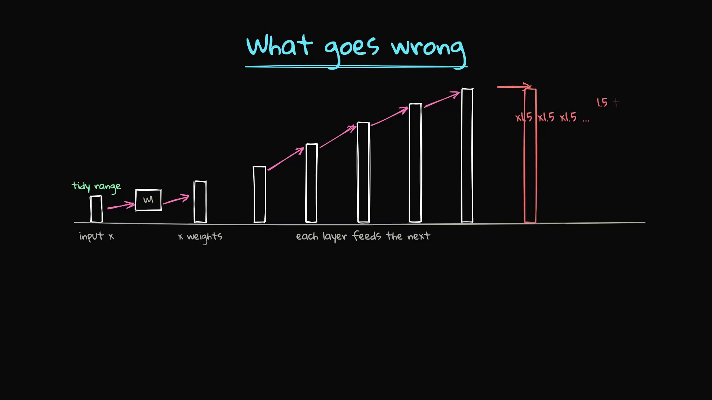
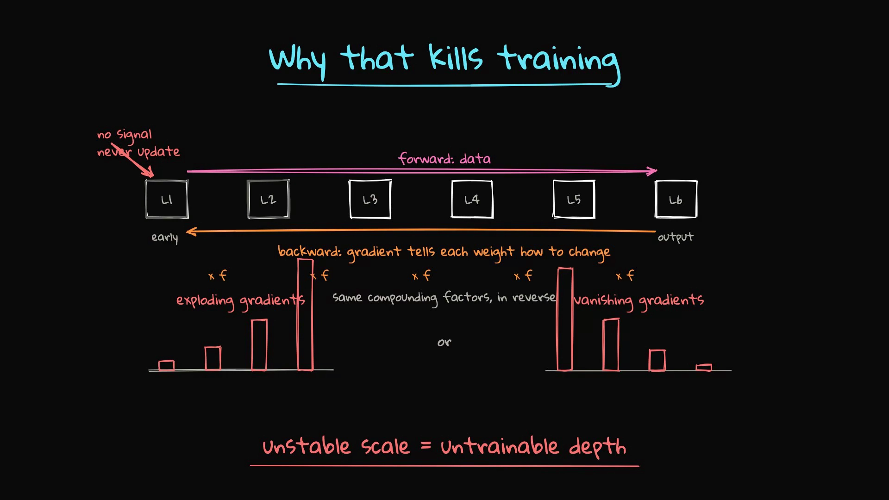
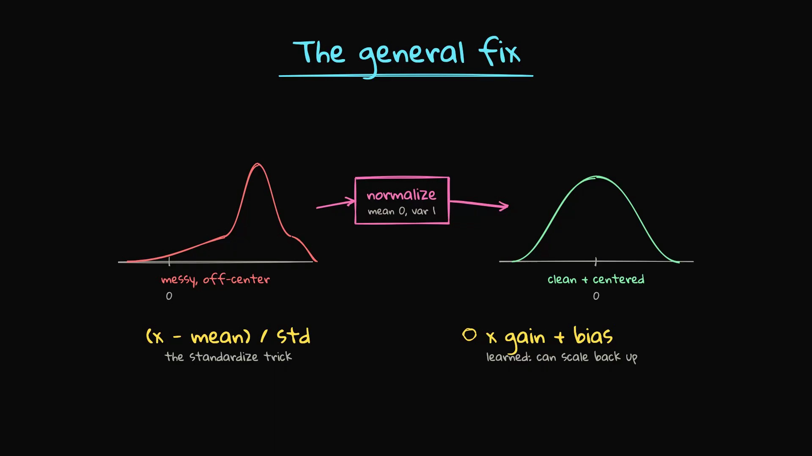
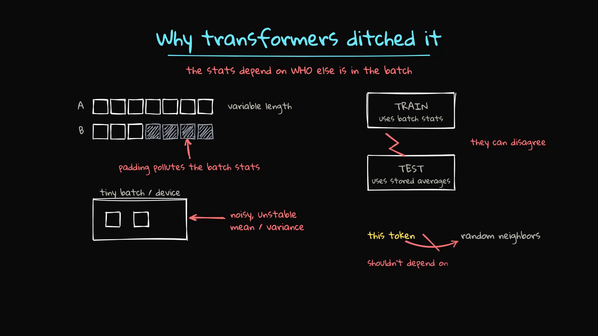
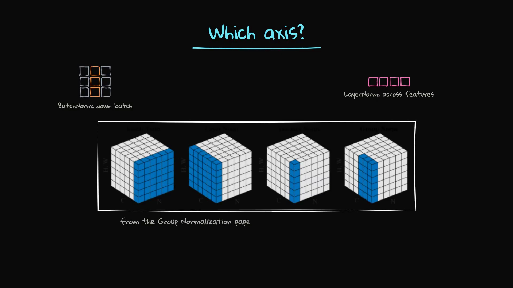
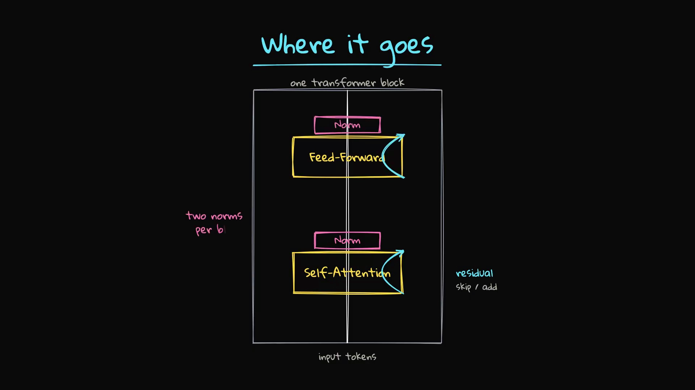
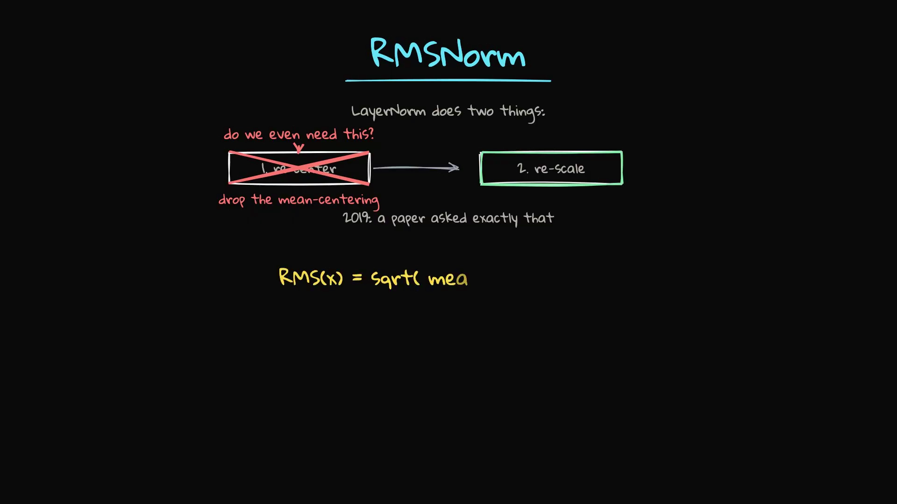
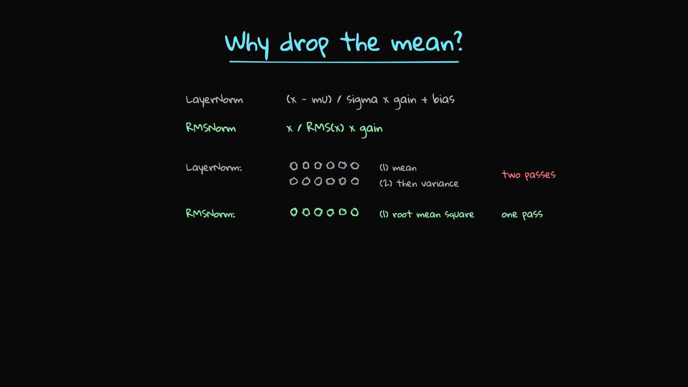
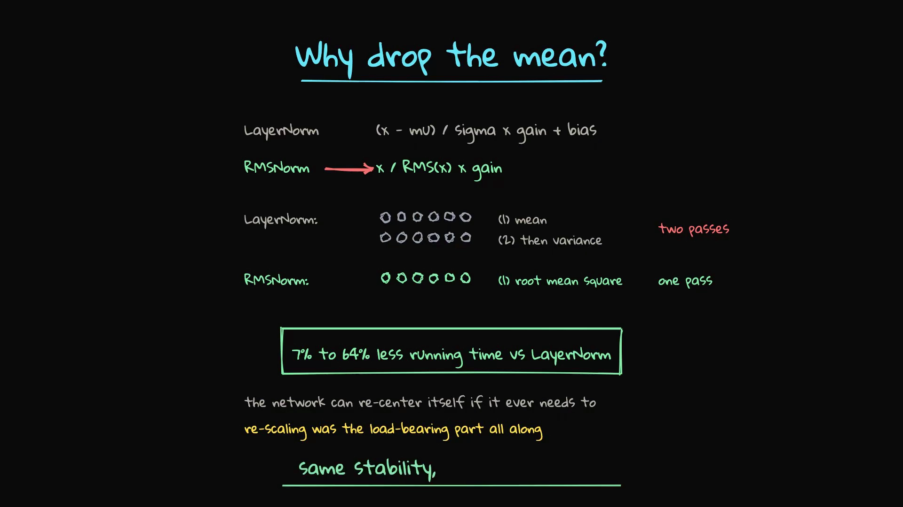
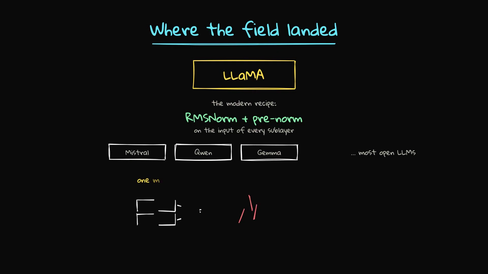

# RMSNorm 的本质：一个默认均值为零的 LayerNorm

> 视频来源：[LayerNorm vs RMSNorm: Why LLMs Dropped the Mean](https://www.youtube.com/watch?v=QrYSLXX09j8&t=0)（YouTube · 视频 ID QrYSLXX09j8，时长约 9 分钟）
> 本文基于视频演说图文稿整理，配图截自视频。

## 本讲要解决的核心问题（SCQA）

**背景**：一个三层的小网络能训得很好，把它堆到五十层，往往就直接不学了：损失要么一条直线不动，要么爆成 NaN。几乎所有深度学习教材给出的第一副解药都一样——在层与层之间插一个归一化（normalization）操作：把向量减掉均值、除以标准差，再乘一个可学习系数。

**冲突**：到了 Transformer 时代，这套归一化被悄悄改小了一半。今天主流的开源大模型（LLaMA、Mistral、Qwen、Gemma 家族）用的都不是完整的 LayerNorm（层归一化），而是 **RMSNorm（均方根归一化）**——它把「减均值」这一步整条删掉了，连偏置项也不要，只除以一个「均方根」。一个被证明有效的操作，为什么可以丢掉一半？

**疑问**：删掉均值中心化，凭什么质量不掉？省下来的那点计算，真的值得几万亿次前向传播去换吗？

**回答（中心思想）**：**因为归一化真正承重的是「重新缩放」，而不是「重新居中」**。RMSNorm 保留缩放、丢掉居中，数学上它是一个「默认均值等于零」的 LayerNorm：只要输入向量的均值本来就接近零，均方根就等于标准差，两者几乎等价；而网络其余部分（线性层的偏置、后续的增益）本来就能把数据中心挪回去。代价是少算一遍均值，收益是归一化这一步从「两趟遍历」变成「一趟遍历」，实测能省下 7% 到 64% 的归一化运行时间——对一个要跑几十层、几百亿参数、无数个 token 的模型来说，这是一笔稳赚的买卖。

---

## 一、真正坏掉的是信号的尺度，不是「深度」本身

先把病因讲清楚，否则后面所有操作都像在背口诀。一层网络做的事很朴素：把输入激活值乘上权重矩阵、加上偏置，再交给下一层 [【跳转到 00:25】](https://www.youtube.com/watch?v=QrYSLXX09j8&t=25)。麻烦在于，这一步会顺带把整份激活值的**整体幅度**往上或往下推一点点，而下一层不会做任何「复位」，于是这个推送被层层累乘。

视频给的数字很直白：如果每一层把数值放大 1.5 倍，50 层之后就是 $1.5^{50}$，大约六亿倍；反过来，如果每层缩到 1.5 分之一，五十层后就趋近于零，信号等于消失。两条路都通向同一个结果：**激活值漂离了下一层「预期」的量级范围**，而这份漂移就是全部的病灶 [【跳转到 00:50】](https://www.youtube.com/watch?v=QrYSLXX09j8&t=50)。

### 1.1 为什么尺度漂移会让梯度一起坏掉

训练靠的是反向传播：梯度从输出往回走，告诉每个权重该怎么改。而梯度往回走时，乘的正是同一批「每层因子」，所以**同样的累乘会原封不动地作用在梯度上**——放大链变成梯度爆炸（变成一堆垃圾数），缩小链变成梯度消失（还没走到浅层就归零）。

消失的后果最直观：最靠前的几层几乎收不到任何学习信号，于是几乎不更新。你堆了 50 层，实际在学的可能只有最后十几层 [【跳转到 01:15】](https://www.youtube.com/watch?v=QrYSLXX09j8&t=75)。所以视频反复强调一句话：**敌人不是深度，而是「信号的尺度在层间奔跑」**。深度只是让这个累乘有足够多的次数。

---

## 二、所有归一化方法共用同一个配方

看清病灶之后，解药就简单得近乎粗暴：在每一层把激活值交出去之前，先把它**重新居中到均值零、缩放到方差一**，然后乘一个可学习的 gain（增益）、加一个可学习的 bias（偏置）。

写成公式就是统计学里老掉牙的标准化（standardize）：

$$
z = \frac{x - \mu}{\sigma},\qquad \mu = \frac{1}{n}\sum_{i=1}^{n} x_i,\qquad \sigma = \sqrt{\frac{1}{n}\sum_{i=1}^{n}(x_i - \mu)^2}
$$

随后再接一层可学习的仿射变换，让网络在需要时把尺度「拨回去」：

$$
y = z \odot \gamma + \beta
$$

其中 $\gamma$（读作 gamma）、$\beta$（读作 beta）是这一层自己学的参数，$\odot$ 表示逐元素相乘 [【跳转到 01:40】](https://www.youtube.com/watch?v=QrYSLXX09j8&t=100)。这样每一层交给下一层的都是「干净、可预期」的分布，累乘就再也没有机会滚成雪球，你想堆多深都可以。

这里有个容易被忽略的细节，也是后面理解 RMSNorm 的钥匙：**归一化本身会抹掉「绝对大小」的信息**，而 $\gamma$ 和 $\beta$ 的作用正是让模型在需要时把这份信息部分找回来。归一化不是「禁止」某种尺度，而是把尺度的决定权从「层与层的偶然累乘」收归给「可学习参数」。

---

## 三、沿哪个轴取均值，决定了归一化的家族

同一个配方，只要换一下「对谁求均值和方差」，就得到不同的归一化方法。

**BatchNorm（批归一化，2015 年）** 问的是：某个特征，在**整个 batch 的所有样本**上，均值和方差是多少？它沿着 batch 维度做统计，然后同样乘一个每特征的可学习缩放与平移。它在视觉上极其成功——视频提到，它让一些图像模型用大约十四分之一的训练步数就达到了相同精度 [【跳转到 02:30】](https://www.youtube.com/watch?v=QrYSLXX09j8&t=150)。对卷积网络处理图像，BatchNorm 至今仍是好选择。

但 Transformer 悄悄离开了它，原因全在「统计量依赖谁」上：

1. **padding 污染**：Transformer 喂的是变长序列，要补齐（pad）成矩形，补出来的假 token 会混进 batch 统计量；
2. **batch 太小**：大模型每张卡上的 batch 往往很小，算出来的均值和方差噪声极大、极不稳定；
3. **训练与推理不一致**：训练时用当前 batch 的统计量，推理时根本没有 batch，只能退回训练时存下的滑动平均，两套数字可能对不上。

最后还有一条更根本的理由，视频称之为「哲学上的」：**一个 token 的归一化结果，不应该取决于同批里随机混进来的其它句子**。

**LayerNorm（层归一化，2016 年，Ba、Kiros、Hinton）** 于是换了一个方向：不看 batch，只看**单个 token 自己的所有特征**。对这一个 token，取它自己特征维度上的均值和标准差，减掉、除掉，再乘 $\gamma$、加 $\beta$ [【跳转到 03:20】](https://www.youtube.com/watch?v=QrYSLXX09j8&t=200)。因为它完全不碰 batch，训练与推理行为一致，一个 token 的结果也永远不受「同批邻居」影响。

这张图出自 Group Normalization 论文，是全视频最值得记住的一张：**两种归一化的差别只在于「沿哪条轴取统计量」**，标准化与再缩放的公式一模一样。理解这一点以后，RMSNorm 就不再是「另一种新方法」，而只是在这条轴上又做了一次减法。

---

## 四、Transformer 里每个子层都配一个归一化

Transformer 的一个 block 由两个子层组成：自注意力（self-attention）和紧随其后的小型前馈网络（feed-forward）。每个子层外面都套着一个残差连接（residual connection），也就是那条把输入加回输出的「跳跃箭头」。归一化就塞在这两个残差单元里，一个套在注意力子层外，一个套在前馈网络外——所以一个典型 block 带着**两个**归一化 [【跳转到 04:45】](https://www.youtube.com/watch?v=QrYSLXX09j8&t=285)。

接着就是那个对深层模型真正要紧的问题：归一化放在子层**之前**还是**之后**？这就是 Post-Norm 与 Pre-Norm 之争：

- **Post-Norm**（原始 Transformer）：先跑子层，加上残差，最后对和做归一化；
- **Pre-Norm**：先归一化输入，再跑子层，把结果加回**未被改动**的残差主干 [【跳转到 05:10】](https://www.youtube.com/watch?v=QrYSLXX09j8&t=310)。

关键差别在「残差高速公路」上：Post-Norm 把一个归一化直接摆在主干上，Pre-Norm 则让主干保持一条干净的恒等通路，原始信号可以从第一层一路流到最后一层而不会被反复压扁。2020 年的一项分析显示，Post-Norm 在初始化时靠近输出层的梯度极大，必须用学习率 warmup（先用极小学习率起步、再慢慢升上去）硬压住；Pre-Norm 因为主干干净，从第一步开始梯度就温和，于是可以丢掉 warmup、用更大学习率、堆更深 [【跳转到 06:00】](https://www.youtube.com/watch?v=QrYSLXX09j8&t=360)。这就是今天几乎所有大语言模型都采用 Pre-Norm 的原因。

（这一段的完整梯度推导、实验对照与代价分析，见本系列 1.3.1 的两篇博客，此处只保留与 RMSNorm 相关的结论：**RMSNorm 是装在 Pre-Norm 这条线上的**。）

---

## 五、RMSNorm：把 LayerNorm 的「重新居中」整条删掉

现在到正题。LayerNorm 干两件事：先重新居中（减均值），再重新缩放（除以标准差）。2019 年的一篇论文问了一个朴素的问题：**居中那一步，真的需要吗？** 答案是「不需要」——大部分收益来自缩放，于是 RMSNorm 直接把均值中心化扔掉，改为除以**均方根**（Root Mean Square）[【跳转到 06:25】](https://www.youtube.com/watch?v=QrYSLXX09j8&t=385)。

「均方根」三个字就是它的算法：**平方 → 求平均 → 开根号**。设一个 token 的隐状态向量为 $x \in \mathbb{R}^{n}$，

$$
\mathrm{RMS}(x) = \sqrt{\frac{1}{n}\sum_{i=1}^{n} x_i^{2}}
$$

$$
\mathrm{RMSNorm}(x) = \frac{x}{\mathrm{RMS}(x)} \odot \gamma
$$

对照一下 LayerNorm 的写法：

$$
\mathrm{LN}(x) = \frac{x - \mu}{\sigma} \odot \gamma + \beta,\qquad
\mu = \frac{1}{n}\sum_{i=1}^{n} x_i,\quad
\sigma = \sqrt{\frac{1}{n}\sum_{i=1}^{n}(x_i - \mu)^2}
$$

差别一目了然：分子里没有 $- \mu$，分母里没有 $\sigma$ 只有 RMS，末尾也没有 $+ \beta$。**RMSNorm 就是「删掉居中步骤、同时去掉偏置」的 LayerNorm**，是一个严格更简单的算子 [【跳转到 06:50】](https://www.youtube.com/watch?v=QrYSLXX09j8&t=410)。

### 5.1 它为什么不算「另一种归一化」

把两个式子的分母摆在一起看就明白了。记向量均值 $\mu = \frac{1}{n}\sum_i x_i$，则

$$
\frac{1}{n}\sum_{i=1}^{n} x_i^{2} \;=\; \sigma^2 + \mu^2
$$

也就是说 **RMS 的平方 = 方差 + 均值的平方**。当 $\mu = 0$ 时，两者严格相等，$\mathrm{RMS}(x) = \sigma$；当 $\mu$ 接近零时，两者只差一个很小的量。

所以 RMSNorm 可以精确地读成一句话：**它是一个「默认均值为零」的 LayerNorm**。它不去搬动数据中心，只调整数据幅度。视频里那句总结正是这个意思：重新缩放才是承重墙，减均值多半只是搭便车 [【跳转到 07:15】](https://www.youtube.com/watch?v=QrYSLXX09j8&t=435)。

（这条等价关系的完整代数推导——把平方展开、认出 RMS² 与均值——见本小节的另一篇博客《归一化是把两把尺子的刻度拉平》，此处不重复。）

---

## 六、省下的是一趟遍历，赚到的是几十个百分点

删掉一步不只是「少一次减法」，而是**少一整趟对向量的遍历**。

为什么要强调「趟」？因为算方差必须先知道均值：你得先把 $n$ 个数过一遍求 $\mu$，再把这 $n$ 个数过第二遍算 $(x_i-\mu)^2$。而均方根不需要任何前置统计量，平方和可以在一次循环里累加完。对显存带宽受限的 GPU 来说，「少读一遍」比「少几次浮点运算」更值钱。

视频给出的实测数字是：**RMSNorm 把归一化的运行时间削减了 7% 到 64%**（不同模型、不同配置下幅度不同）[【跳转到 07:15】](https://www.youtube.com/watch?v=QrYSLXX09j8&t=435)。

那质量为什么守得住？视频给了两条理由：

1. **网络自己能居中**。紧随其后的线性层带偏置，$\gamma$ 又在旁边做缩放，只要模型真的需要某个数据中心，它完全可以在下游把它加回来。归一化真正要杀掉的是「失控的累乘」，而不是「数据中心」。
2. **实验上没掉队**。RMSNorm 原论文报告它的效果不差于 LayerNorm（本小节另一篇博客会讲这条结论的出处与语境），而它换来的是更少的算子、更简单的实现。

把这两条合起来看，这笔交易就非常符合大模型的处境：**稳定性不变，操作数变少**。而这个「少」，在每次前向传播里要被重复几十层 × 几千个 token × 几万亿次训练步。

---

## 七、今天的落点：RMSNorm + Pre-Norm 成了标准配方

视频最后把镜头拉远，给出今天的事实标准：

- **位置**：Pre-Norm，归一化挂在每个子层的**输入**上；
- **算子**：RMSNorm；
- **跟随者**：Mistral、Qwen、Gemma 家族，以及大多数后来的开源权重模型 [【跳转到 07:40】](https://www.youtube.com/watch?v=QrYSLXX09j8&t=460)。

### 7.1 还有一个地方需要归一化：QK Norm

注意力本身也会失稳。如果 query 与 key 的点积长得太大，softmax 就会饱和成一个近乎 one-hot 的尖峰——几乎所有注意力权重都压在一个位置上，模型拿不到其它维度的信息，损失跟着跳。**QK Norm** 的做法是：在 query 与 key 相乘**之前**，先分别对它们做一次归一化 [【跳转到 08:05】](https://www.youtube.com/watch?v=QrYSLXX09j8&t=485)。

这个技巧现在出现在大型视觉 Transformer、Gemma、Qwen 里。它背后的原则可以概括成一句工程经验：**如果一次便宜的归一化能买来稳定，那就把它放在所有容易炸的地方**。

---

## 八、一个可以带走的心智模型

全视频最后收敛成一句话：

> **归一化让每一层说的是同一种「尺度语言」。**

不管网络多深，每一层收到的输入都落在它被调好的量级范围内；模型想要什么尺度，参数总能自己加回去；归一化真正消灭的，是那个会滚雪球的累乘。**正是这一个便宜到几乎可以忽略的操作，把「深度」从负债变成了资产** [【跳转到 08:30】](https://www.youtube.com/watch?v=QrYSLXX09j8&t=510)。

视频也留了一个开放结尾：LayerNorm、RMSNorm、QK Norm 其实是同一个想法的三次精炼——**把分布钉住，然后按它要运行的场景反复改良**；而学界还有一整条研究线在尝试**彻底去掉显式归一化**。所以「RMSNorm + Pre-Norm」是今天的标准答案，但未必是最终答案 [【跳转到 08:55】](https://www.youtube.com/watch?v=QrYSLXX09j8&t=535)。

---

## 小结

- **病根是尺度，不是深度**：每层的矩阵乘法把激活幅度推一点，几十层累乘后要么爆炸要么消失，梯度遭遇同样的累乘，浅层因此学不到东西。
- **归一化的通用配方**：减均值、除标准差，再乘可学习的 $\gamma$、加可学习的 $\beta$；$\gamma,\beta$ 的作用是让模型把被抹掉的绝对尺度按需找回来。
- **家族的分歧只在「沿哪条轴取统计量」**：BatchNorm 沿 batch，LayerNorm 沿单个 token 的特征；Transformer 抛弃 BatchNorm，是因为 padding 污染、小 batch 噪声、训练/推理统计量不一致，以及「一个 token 不该依赖同批的随机邻居」。
- **Pre-Norm 胜出**：归一化挪进支路，残差主干保持恒等，梯度从第一步就温和，可以免 warmup、用更大学习率、堆得更深。
- **RMSNorm 是删掉居中的 LayerNorm**：$x \mapsto x/\mathrm{RMS}(x) \odot \gamma$，没有均值减法、没有偏置项。
- **它为何等价**：$\mathrm{RMS}^2 = \sigma^2 + \mu^2$，当 $\mu = 0$ 时 RMS 就是标准差——RMSNorm 相当于「默认均值为零」的 LayerNorm，而下游参数本来就能把中心挪回去。
- **它为何更快**：LayerNorm 要两趟遍历（先均值、再方差），RMSNorm 只要一趟；实测归一化运行时间下降 7%~64%。
- **今天的标准**：Pre-Norm + RMSNorm，LLaMA 之后被 Mistral、Qwen、Gemma 等普遍采用；注意力部分再补一个 QK Norm 防 softmax 饱和。

## 关键术语速查

| 术语 | 一句话解释 |
| --- | --- |
| 归一化（Normalization） | 把一组数重新缩放（必要时也平移）到统一尺度，让后续层拿到的输入量级可预期 |
| LayerNorm（层归一化） | 对**单个 token 自己的所有特征**求均值与标准差，做减均值除标准差，再乘 $\gamma$ 加 $\beta$ |
| BatchNorm（批归一化） | 对**同一特征在所有样本上**求均值与方差，依赖 batch 内容，序列任务里容易被 padding 与小编号 batch 拖累 |
| RMSNorm（均方根归一化） | 只除以 $\sqrt{\text{均值}(x^2)}$ 并乘 $\gamma$，不减均值、不加偏置，相当于默认均值为零的 LayerNorm |
| 均方根（RMS） | 平方、求平均、再开根号；度量「整体幅度」，与标准差只差一个均值项 |
| $\gamma$ / $\beta$（gain / bias） | 归一化层里可学习的逐元素缩放与平移参数，用来把被抹掉的绝对尺度按需找回来 |
| Pre-Norm / Post-Norm | 归一化放在子层输入之前 / 残差相加之后；前者主干干净，深层更稳 |
| QK Norm | 在 query 与 key 相乘前先各自归一化，防止点积过大让 softmax 饱和成 one-hot 尖峰 |
