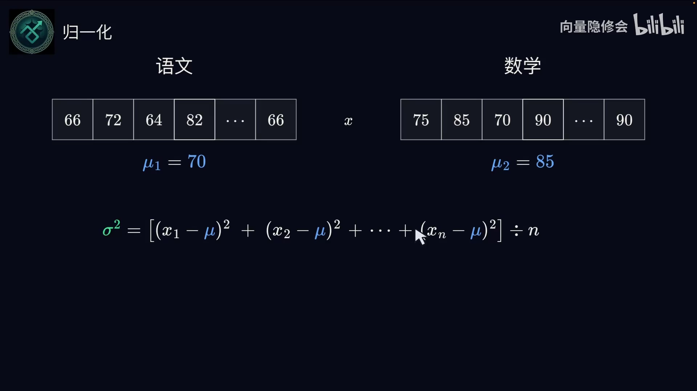
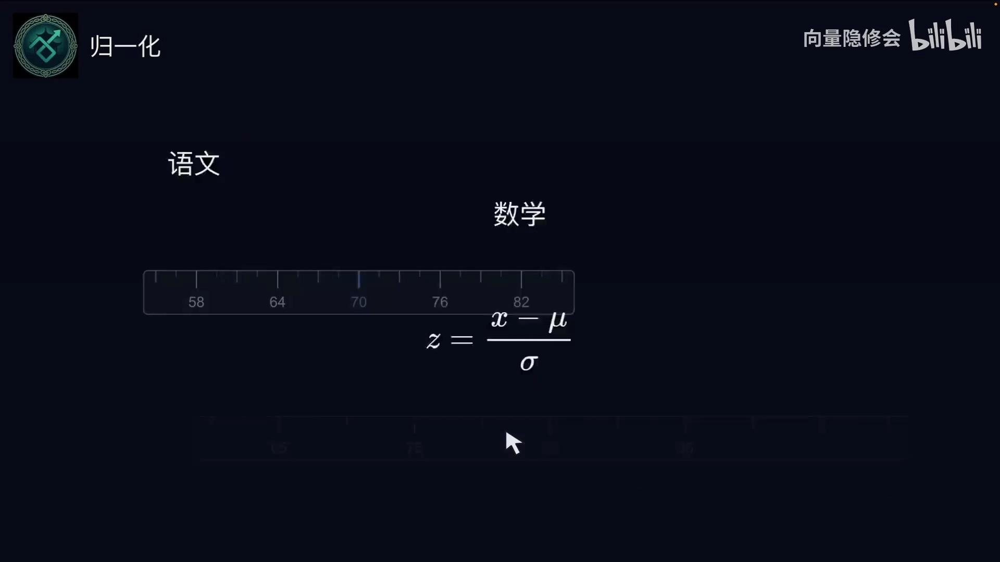
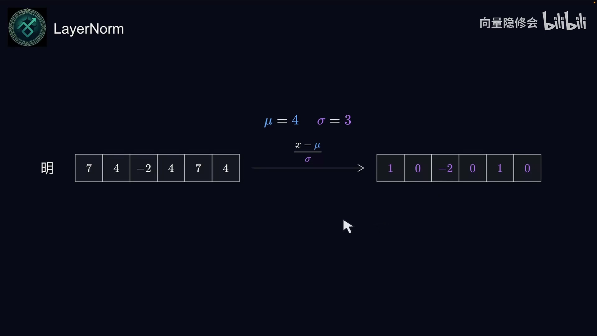
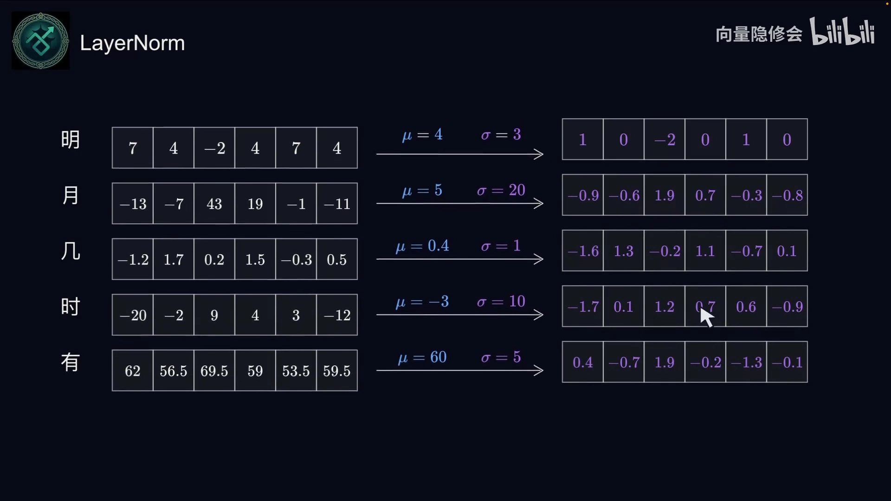
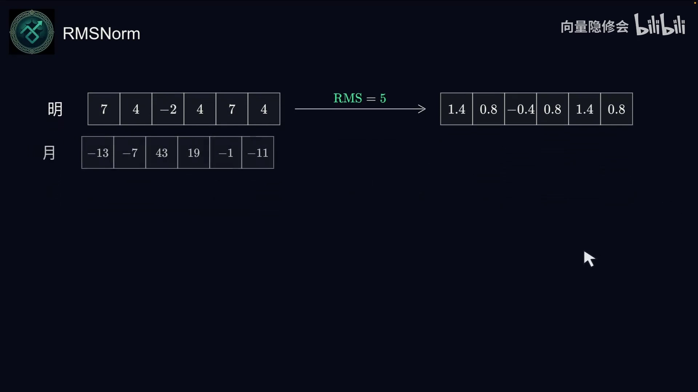
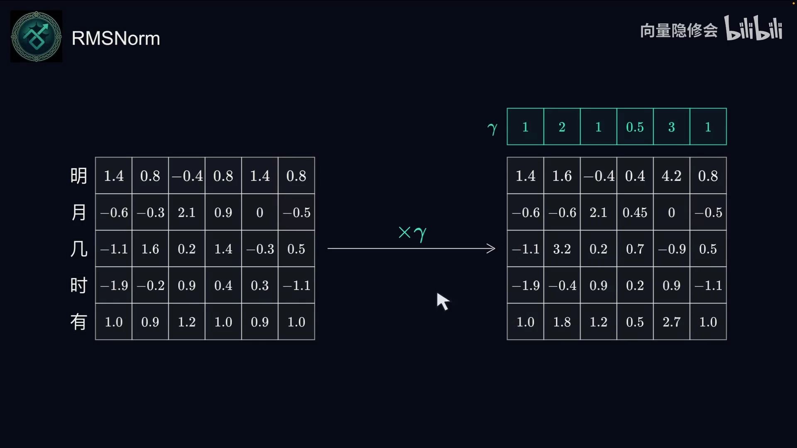
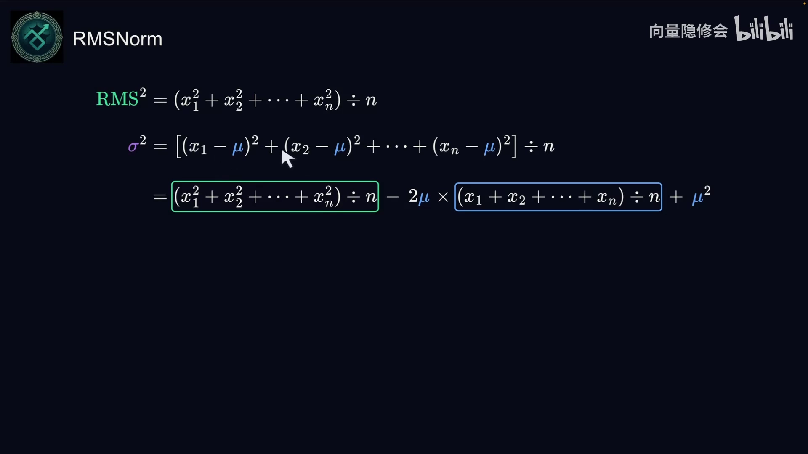
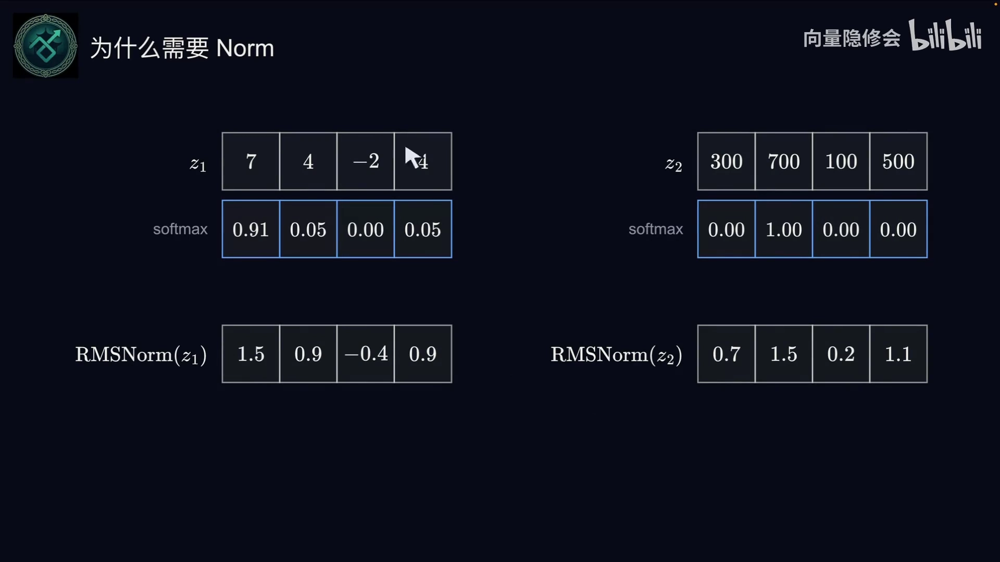
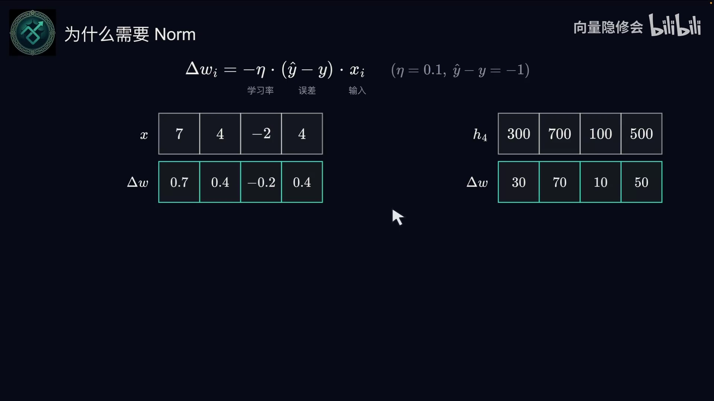
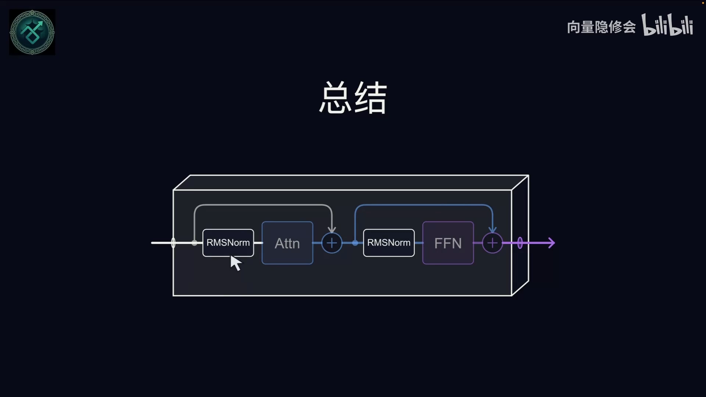

# 归一化是把两把尺子的刻度拉平：从z-score到RMSNorm，大模型为什么离不开它

> 视频来源：[LayerNorm与RMSNorm是什么：大模型为什么需要归一化](https://www.bilibili.com/video/BV1tAnp6wEVd/?t=0)（Bilibili · 向量隐修会，BV1tAnp6wEVd，时长约 18 分钟）
> 本文基于视频演说图文稿整理，配图截自视频。

## 本讲要解决的核心问题（SCQA）

**背景**：Transformer 的每个 block 里，自注意力（Attention）与前馈网络（FFN）两个计算模块**动手之前**，数据都要先过一次归一化。今天的模型大多用 RMSNorm（均方根归一化），完整一点的 LayerNorm（层归一化）也会出现。它们看起来只是「把数字缩小一点」的机械操作。

**冲突**：这个操作到底是干什么的？为什么非做不可？更奇怪的是，RMSNorm 明明比 LayerNorm 少做了一步（不减均值、连偏置项都不要），却能顶替它、还成了主流选择——一个「做得更少」的算子，凭什么效果不变？

**疑问**：归一化究竟在消除数据的哪一种变化？删掉均值那一步，到底删掉了什么、又为什么可以删？

**回答（中心思想）**：**归一化是在把「尺子的刻度」拉平**。数据从一个 token 传到深层，会同时发生两种变化——一种是整体等比放大（成比例的变化），一种是内部各维之间的相对变化。前者对训练只有坏处（会让 softmax 饱和、让每次更新的幅度乱跳），于是用除法把它除掉，只留下相对变化。LayerNorm 用「减均值、除标准差」拉平尺子，RMSNorm 只用「除均方根」拉平；因为 $\mathrm{RMS}^2 = \sigma^2 + \mu^2$，两者只差一个均值项，**RMSNorm 就是把数据中心默认钉在 0 的 LayerNorm**——少算一遍均值、不需要偏置，计算更简单，这也是它在众多模型里胜出的原因。

---

## 一、先从一个班的两门成绩说起：z-score 是什么

设学生小明语文 82 分、数学 90 分。要判断他哪门更强，直接比 82 和 90 是错的——两门课的难度不同，分数的「尺子」也不同。

视频先算两件事 [【跳转到 00:30】](https://www.bilibili.com/video/BV1tAnp6wEVd/?t=30)：

- **均值**（mean，平均分）：班上语文平均 70 分，数学平均 85 分。它标记了这把尺子的「中心」。
- **方差**（variance，分散程度）：把每个学生的分数减去均值，得到「他离平均差多少」，再平方（避免正负抵消），最后除以人数 $n$：

$$
\sigma^2 = \frac{1}{n}\left[(x_1-\mu)^2 + (x_2-\mu)^2 + \cdots + (x_n-\mu)^2\right]
$$

代入数字后，语文的方差是 36、数学是 100 [【跳转到 01:20】](https://www.bilibili.com/video/BV1tAnp6wEVd/?t=80)。方差 36 说明语文成绩更集中，100 说明数学成绩更分散。对方差开根号就得到**标准差** $\sigma$（语文 6、数学 10），它和原始分数同量纲，「一个标准差」就是这把尺子上的一格刻度 [【跳转到 01:45】](https://www.bilibili.com/video/BV1tAnp6wEVd/?t=105)。

于是

$$
z = \frac{x - \mu}{\sigma}
$$

小明的语文是 $(82-70)/6 = 2$，数学是 $(90-85)/10 = 0.5$。这就是 **z-score**（标准分）——「他相当于在均值之上几个标准差」。

为什么必须这么绕？视频给了两步解释：

1. **先移动中心**。减去均值，相当于把两把尺子的零点都挪到「平均分」上，语文那把从 70 挪到 0，数学从那 85 挪到 0。这时小明的成绩是「+12」和「+5」——但**还是不能直接比**，因为两把尺子的刻度大小不同（一小格一个 6 分，一个 10 分）。
2. **再统一刻度**。除以标准差，相当于把「一格」的长度统一成「一个标准差」。这时刻度一样了，小明的语文是 2 格、数学是 0.5 格 [【跳转到 03:50】](https://www.bilibili.com/video/BV1tAnp6wEVd/?t=230)。

于是结论才成立：**2 个标准差 > 0.5 个标准差，小明的语文更好**。归一化做的全部事情就是这一句：**把两个数据的尺度统一一下**，从而让比较与后续处理变得有意义 [【跳转到 04:15】](https://www.bilibili.com/video/BV1tAnp6wEVd/?t=255)。

---

## 二、LayerNorm：把 z-score 对每个 token 各做一遍

LLM 里的数据不是一列分数，而是一张「每个 token 一个向量」的表。视频用「明月几时有」这五个字做例子：每个字是一个 token，每个 token 有一个隐状态向量（hidden state，模型在这一层为它算出的那串数）。

对「明」这个 token 的向量 $[7,4,-2,4,7,4]$：均值 $\mu = 4$，方差 $\sigma^2 = 9$、标准差 $\sigma = 3$。套 z-score 得到 $[1, 0, -2, 0, 1, 0]$ [【跳转到 05:30】](https://www.bilibili.com/video/BV1tAnp6wEVd/?t=330)。

这串新数字的含义很关键：**它把「绝对大小」的信息抹掉了，只留下相对于这一格刻度的相对值**。原来的 7 和 4 差了 3，除以标准差后变成 1 和 0；这种「谁比谁大、大多少格」的关系被保留，而「它们本来都是两位数」这种信息被丢掉了。

对每个 token 重复同样的操作，就得到整张归一化后的表：

### 2.1 γ 与 β：把被抹掉的绝对大小按需要找回来

和纯 z-score 不同的是，LayerNorm 还多两个参数：$\gamma$（gamma，逐元素相乘）与 $\beta$（beta，逐元素相加）。

$$
\mathrm{LN}(x) = \frac{x - \mu}{\sigma} \odot \gamma + \beta
$$

$\gamma$ 和大模型里其它权重一样，是**学出来的**。它的作用正是补救上一步的副作用：z-score 抹掉了绝对大小的信息，但模型有时候确实需要这份信息，于是让它用一个可学习参数在需要时**部分地找回来** [【跳转到 06:20】](https://www.bilibili.com/video/BV1tAnp6wEVd/?t=380)。$\beta$ 则是加法，作用同样是给模型留一个「自己决定中心在哪」的自由度 [【跳转到 07:10】](https://www.bilibili.com/video/BV1tAnp6wEVd/?t=430)。

一句话概括 LayerNorm：**对每个 token 先做 z-score，再乘 $\gamma$、加 $\beta$**。它是「逐 token」的，而不是逐 batch 的——这一点让它在变长序列上比 BatchNorm 稳当得多。

---

## 三、RMSNorm：只除均方根，连 β 都不要

RMS 是三个词的缩写：**R**oot（开根号）+ **M**ean（平均）+ **S**quare（平方），中文叫**均方根**。它的算法就是字面意思：平方 → 求平均 → 开根号。

$$
\mathrm{RMS}(x) = \sqrt{\frac{1}{n}\sum_{i=1}^{n} x_i^{2}}
$$

还是拿「明」的 $[7,4,-2,4,7,4]$ 举例：平方得 $[49,16,4,16,49,16]$，平均是 $150/6 = 25$，开根号得 5。**均方根 = 5** [【跳转到 08:00】](https://www.bilibili.com/video/BV1tAnp6wEVd/?t=480)。

然后每个数直接除以 5：

$$
\mathrm{RMSNorm}(x) = \frac{x}{\mathrm{RMS}(x)} \odot \gamma
$$

注意和 LayerNorm 的三处差别 [【跳转到 08:50】](https://www.bilibili.com/video/BV1tAnp6wEVd/?t=530)：

1. 分子里**没有 $- \mu$**，数据不移动中心，只改幅度；
2. 分母是 RMS 而不是 $\sigma$，不需要先求均值再求方差；
3. **没有 $\beta$**，只有 $\gamma$ 这一个逐元素乘法。

视频对它的评价只有一句，但很到位：「RMSNorm 处理起来逻辑是比较简单的」[【跳转到 08:50】](https://www.bilibili.com/video/BV1tAnp6wEVd/?t=530)。它的优势也正是从这份简单里来的：**不用减 μ**，所以计算更省；不动中心，所以不需要 $\beta$ 这个补救项。

---

## 四、RMS² = 方差 + 均值²：两者只差一个「中心」

看起来 RMSNorm 与 LayerNorm 是两个不同的东西，但把式子展开就会发现它们是同一件事的两个版本。

把方差的平方打开：

$$
\begin{aligned}
\sigma^2 &= \frac{1}{n}\sum_{i=1}^{n}(x_i-\mu)^2 \\
&= \frac{1}{n}\sum_{i=1}^{n}x_i^{2} \;-\; 2\mu\cdot\frac{1}{n}\sum_{i=1}^{n}x_i \;+\; \mu^{2} \\
&= \mathrm{RMS}^{2} \;-\; 2\mu\cdot\mu \;+\; \mu^{2} \\
&= \mathrm{RMS}^{2} - \mu^{2}
\end{aligned}
$$

中间那一步用上了「均值定义」：$\frac{1}{n}\sum_i x_i = \mu$。整理后得到视频里那个关键的等式 [【跳转到 10:05】](https://www.bilibili.com/video/BV1tAnp6wEVd/?t=605)：

$$
\mathrm{RMS}^{2} = \sigma^{2} + \mu^{2}
$$

结论就摆在眼前：**如果均值 $\mu = 0$，那么均方根的平方就等于方差，均方根就等于标准差**——此时 RMSNorm 与 LayerNorm 的中心化步骤也就没有区别了 [【跳转到 10:05】](https://www.bilibili.com/video/BV1tAnp6wEVd/?t=605)。

所以 RMSNorm 的语义可以精确地写成一句话：

> **RMSNorm 就是在「默认均值是 0」的前提下做归一化**——我不去移动数据中心，只改数据的幅度 [【跳转到 10:30】](https://www.bilibili.com/video/BV1tAnp6wEVd/?t=630)。

**本质上 RMSNorm 是 LayerNorm 的一种变体**：它假设「中心已经在 0 附近，不用管」。视频也点明了代价与收益的权衡：RMSNorm 的论文证明它不会差于 LayerNorm，而它的优势是计算更简单（不用减 $\mu$），所以现在很多模型默认就用它 [【跳转到 10:55】](https://www.bilibili.com/video/BV1tAnp6wEVd/?t=655)。

（为什么「默认均值为零」这个假设站得住、以及它省下的「两趟遍历变一趟遍历」在工程上值多少，本小节的另一篇博客《RMSNorm 的本质：一个默认均值为零的 LayerNorm》有专门讨论。）

---

## 五、为什么非要归一化（一）：不归一化，softmax 就抓不到信息

前面一直在讲「怎么做」，视频从 11:20 开始回答「为什么必须做」[【跳转到 11:20】](https://www.bilibili.com/video/BV1tAnp6wEVd/?t=680)。它先搭了一个无归一化的例子上路：输入经过 Attention 算出一个值、加残差得到 $u_1$；$u_1$ 再进 FFN、再加残差得到 $h_1$；一层层走下去，到第四层数据变成 $[300,700,100,500]$。

### 5.1 两种变化：等比放大 vs 相对变化

把最初的数据与第四层的数据对照，能看出数字其实经历了**两种**改变 [【跳转到 12:35】](https://www.bilibili.com/video/BV1tAnp6wEVd/?t=755)：

- **成比例的变化**：整体被放大了（这一例里均方根大约放大了 100 倍），所有维度一起变大；
- **相对变化**：内部各维之间的比例变了（原来是 7 和 4，现在变成 300 和 700）。

归一化的目标就是**把成比例的那部分排除掉，只留下相对变化**——相当于又拿出两把尺子，用均方根把刻度拉平，拉平之后看到的就是数据自己的相对变化 [【跳转到 13:00】](https://www.bilibili.com/video/BV1tAnp6wEVd/?t=780)。

那「绝对大小的信息」不是也有用吗？视频说得很直接：**这是一个权衡**。等比放大的那部分会给训练带来明确的坏处，所以宁可把它抹掉、只用相对变化来训练；而实验证明这个想法是 OK 的 [【跳转到 13:25】](https://www.bilibili.com/video/BV1tAnp6wEVd/?t=805)。

### 5.2 坏处之一：softmax 饱和成 one-hot 尖峰

第一个坏处出在 softmax 上。softmax 负责把一串注意力得分（$z_1, z_2, \dots$）变成加起来为 1 的权重。

浅层的 $z_1$ 归一化前后都还算正常；但到了深层，$z_2$ 这种量级的得分一做 softmax，第二个位置就几乎吃掉了 100% 的权重——模型**没法再从其它维度获取信息**了。而如果把 $z_2$ 先做一次 RMSNorm（图中变成 $[0.7,1.5,0.2,1.1]$），分布又回到可以分配权重的状态 [【跳转到 14:15】](https://www.bilibili.com/video/BV1tAnp6wEVd/?t=855)。

这就是需要 Norm 的**第一个主因**：没有归一化，softmax 拿信息的效果会大打折扣，模型也就难以继续训练好 [【跳转到 14:40】](https://www.bilibili.com/video/BV1tAnp6wEVd/?t=880)。

### 5.3 坏处之二：更新幅度随输入尺度乱跳

第二个坏处出在梯度下降上。视频用一个最小例子说明：参数 $w_1, w_2$，损失函数 $L$，更新量可以写成

$$
\Delta w_i = -\eta\cdot(\hat{y}-y)\cdot x_i
$$

其中 $\eta$ 是学习率、$(\hat{y}-y)$ 是误差、$x_i$ 是该位置的输入。

视频把这个式子读成一句很实用的话：**每一次调整的幅度取决于学习率、误差和输入** [【跳转到 15:30】](https://www.bilibili.com/video/BV1tAnp6wEVd/?t=930)。在同样学习率 0.1、同样误差 $-1$ 的情况下，唯一的变量是输入：输入本身更大，更新幅度就更大（30、70、10、50 对 0.7、0.4、-0.2、0.4）。

问题就来了：如果数据里本来就有很大的值，或者层数变多、数值没被归一化而越长越大，后续的更新幅度就会一起变大；反之输入小，更新就小。**更新幅度在跳来跳去，而学习率是固定，训练自然不稳** [【跳转到 16:20】](https://www.bilibili.com/video/BV1tAnp6wEVd/?t=980)。

归一化之后，所有数值落在同一尺度下，每次更新的差别不大，学习率 0.1 对应的步长就是稳定的，于是可以稳定地找到一个更小的损失值 [【跳转到 16:45】](https://www.bilibili.com/video/BV1tAnp6wEVd/?t=1005)。这是需要 Norm 的**第二个主因**。

---

## 六、归一化装在哪些位置：每个子层前，加 LM Head 之前

视频的总结图把位置讲得最清楚：

- **每个子层之前**各一次：无论在哪一层、哪个 block，送进 Attention / FFN 的数据尺度都稳定，从而同时避开 softmax 饱和与学习率失配这两个坑 [【跳转到 17:10】](https://www.bilibili.com/video/BV1tAnp6wEVd/?t=1030)；
- **block 全部结束、送进 LM Head（输出层，把隐状态映射成词表上的打分）之前**再一次：因为残差连接一路都在做加法，主干上的数值尺度可能已经涨得比较大，归一化之后才能更稳定地送进 LM Head [【跳转到 17:35】](https://www.bilibili.com/video/BV1tAnp6wEVd/?t=1055)。

### 6.1 为什么这里通常选 RMSNorm 而不是 LayerNorm

回到本讲的第二个问题：既然两者等价性依赖「均值接近零」这个前提，为什么工程上偏爱更简的那个？视频给出的理由是直接的 [【跳转到 10:55】](https://www.bilibili.com/video/BV1tAnp6wEVd/?t=655)：

- **计算更省**：不用减 $\mu$，也就不必先求一遍均值；
- **参数更少**：没有 $\beta$，只有一个 $\gamma$ 向量；
- **效果不打折**：RMSNorm 的论文证明了它不会差于 LayerNorm。

对一个要在每个 block、每个 token 上重复执行几十层、上千次的操作来说，「少一步」不是审美问题，而是实打实的吞吐与显存带宽问题。而序列越深、batch 内的序列越长，这笔账越划算。

---

## 小结

- **归一化的本质是「拉平刻度」**：把两把单位不同的尺子换成同一套刻度，数据才有可比性，后续处理才有意义。
- **z-score 分两步**：先减均值把中心挪到 0，再除标准差把一格统一成一个标准差；小明的语文 2 个标准差 > 数学 0.5 个标准差，这才比得出来。
- **LayerNorm 是对每个 token 做一遍 z-score**，再乘 $\gamma$、加 $\beta$；$\gamma$、$\beta$ 是学出来的，用来把被抹掉的绝对大小按需找回来。
- **RMSNorm 只除均方根**（平方 → 平均 → 开根号），不减均值、不加 $\beta$，只留一个 $\gamma$。
- **两者只差一个中心**：$\mathrm{RMS}^2 = \sigma^2 + \mu^2$，$\mu = 0$ 时 RMS 就是标准差，所以 RMSNorm 等价于「默认均值为零」的 LayerNorm。
- **为什么必须归一化**：一是防 softmax 饱和（得分太大时权重塌成 one-hot，模型只能从一个位置取信息）；二是防更新幅度乱跳（$\Delta w = -\eta(\hat{y}-y)x$，输入尺度一大，同样学习率下的步长就跟着失控）。
- **装在哪**：Attention 与 FFN 之前各一次，block 结束送 LM Head 之前再一次；现代模型多选 RMSNorm，因为计算更简单、参数更少，效果不打折。

## 关键术语速查

| 术语 | 一句话解释 |
| --- | --- |
| 归一化（Normalization） | 把数据换到同一套尺度上，消除整体等比放大，只留相对变化 |
| 均值 $\mu$ | 一组数的平均水平，标记这把尺子的中心 |
| 方差 $\sigma^2$ / 标准差 $\sigma$ | 数据相对均值的分散程度；标准差与原始数据同量纲，是「一格」的长度 |
| z-score（标准分） | $(x-\mu)/\sigma$，即「离均值几个标准差」 |
| LayerNorm（层归一化） | 对每个 token 自己的特征向量做 z-score，再乘 $\gamma$、加 $\beta$ |
| $\gamma$ / $\beta$ | 归一化层里可学习的逐元素缩放与平移，用来把被抹掉的绝对大小按需找回 |
| RMS（均方根） | 平方、求平均、再开根号，度量数据的整体幅度 |
| RMSNorm（均方根归一化） | 只用 $x/\mathrm{RMS}(x)$ 再乘 $\gamma$，不减均值、不加偏置，等价于默认均值为零的 LayerNorm |
| softmax 饱和 | 输入量级过大时 softmax 输出塌成接近 one-hot 的尖峰，注意力无法从其它位置取信息 |
| LM Head | 输出层，把最后一层的隐状态映射成词表上每个 token 的打分 |
