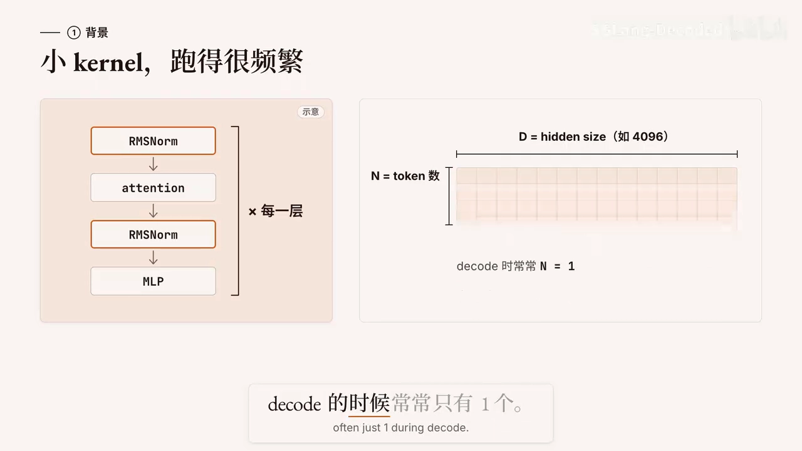
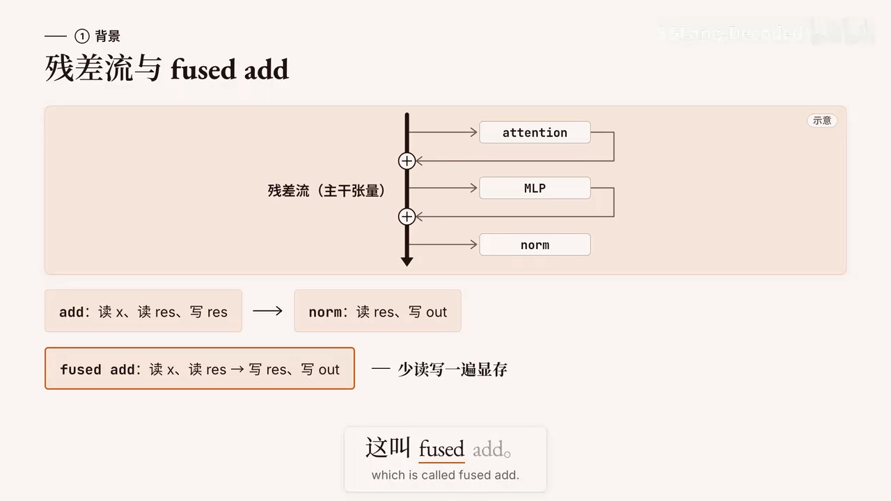
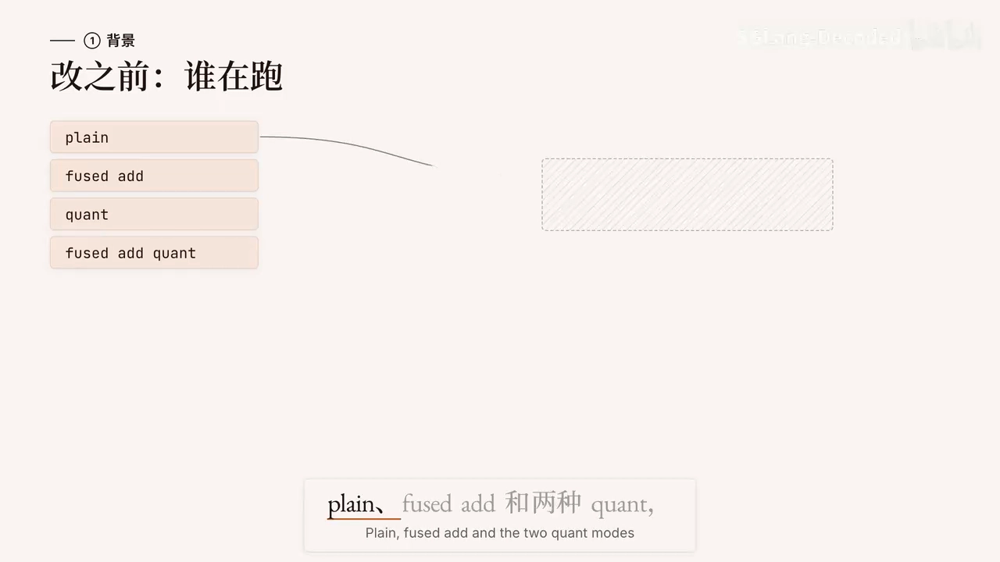
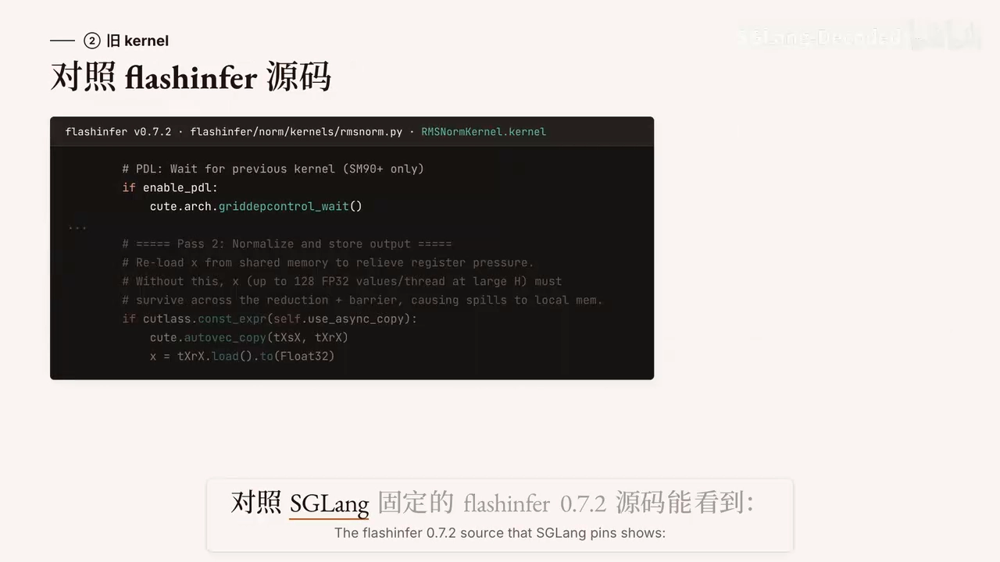
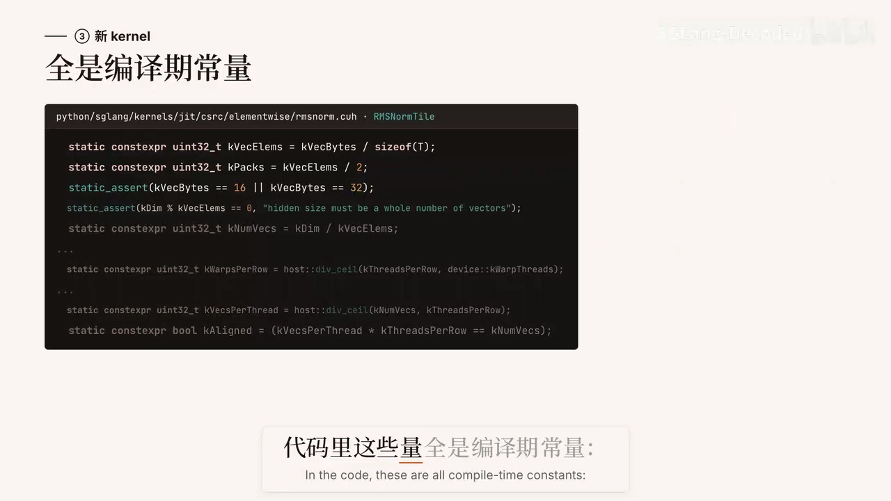
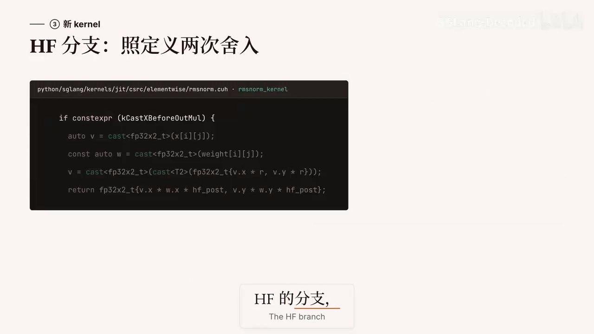
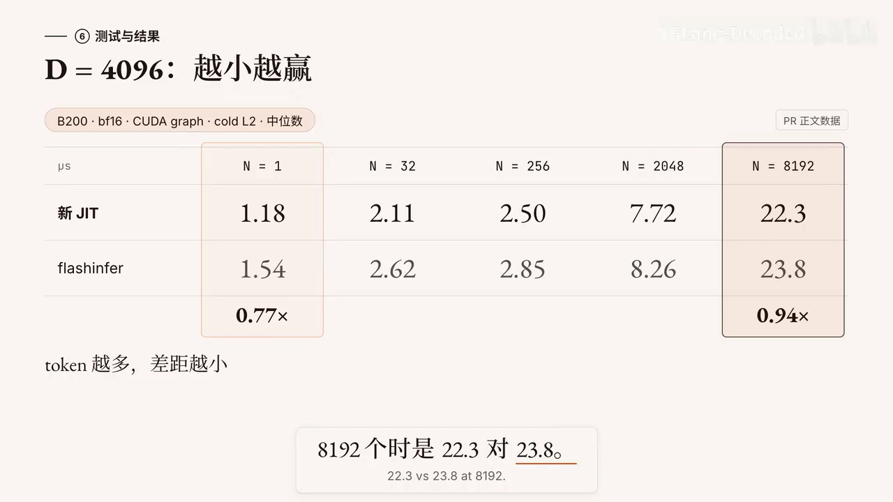
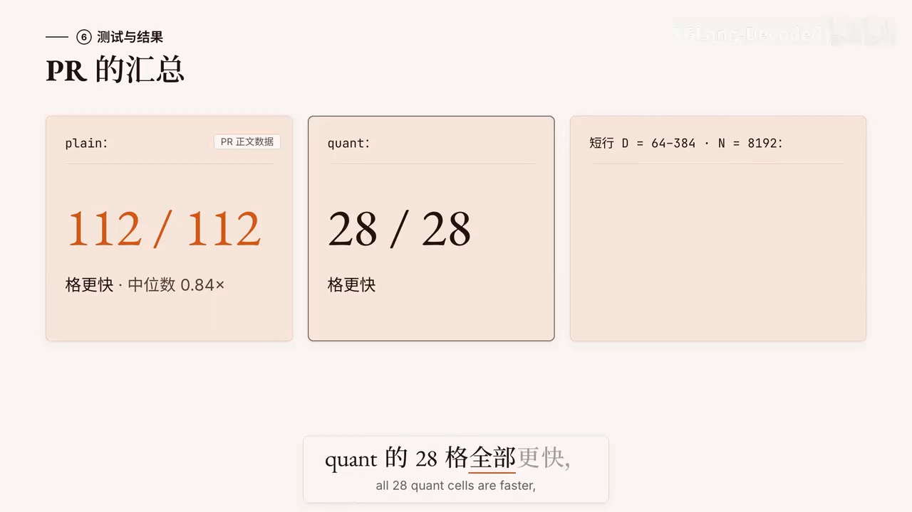

# 一个 token 只读写 24KB：decode 时 add+RMSNorm 融合省下的是固定延迟

> 视频来源：[RMSNorm 每层都要跑，单 token 怎么快两到三成（SGLang PR 讲解）](https://www.bilibili.com/video/BV1BR4Y6ZETc/?t=0)（Bilibili · SGLang-Decoded）
> 本文基于视频演说图文稿整理，配图截自视频。讲的是 SGLang 一个把 RMSNorm 换成 JIT 模板的 PR：既讲字节账，也讲寄存器、PDL、归约与舍入的取舍。

## 本讲要解决的核心问题（SCQA）

**背景**：RMSNorm（均方根归一化）是 Transformer 每一层都要跑两遍的小算子：attention 前一次、MLP 前一次。decode 阶段一次只生成一个 token，所以它的输入只有一行向量——hidden size 4096、BF16 精度时，读输入 8KB、读权重 8KB、写回 8KB，一共 24KB。

**冲突**：这么小的数据量本该一瞬完成，可旧 kernel（SGLang 固定的 FlashInfer CuTe DSL 实现）在 B200 上要 1.54 微秒。用 1.18 微秒算 24KB，折合每秒只有 21GB 左右——离显存带宽差了两三个数量级。也就是说，时间根本不是花在搬数据上，而是花在启动、等待、同步这些固定延迟上。**这类 kernel 的关键指标不是带宽利用率，而是「有多少固定开销被白白等掉」。**

**疑问**：这些固定开销具体来自哪里？把它们一个个抠掉，能抠出多少？如果顺便把残差相加也融进同一个 kernel，账又要怎么算？

**回答（中心思想）**：**decode 阶段的 add+RMSNorm 不是带宽问题，而是延迟问题；融合与重构的价值就等于「省掉的固定延迟之和」**。SGLang 的新 JIT 模板用四招把固定开销压下去——整行留在寄存器、PDL 提前上 SM 并在等待之前读权重、最多一次 CTA barrier、输出只舍入一次；同时把残差加法折进来，少一趟整行读写。结果在 B200、D=4096、单 token 时从 1.54 微秒降到 1.18 微秒，16 种 hidden size × 7 种 token 数的 112 个格子里全部更快（中位数 0.84 倍）；token 越多差距越小，因为那时瓶颈才真的转移到 HBM 带宽上。

---

## 一、先看结果：小 batch 赢两到三成，大 batch 差距收窄

讲者先把结论摆在前面：这个每层都要跑的 kernel 被换成一个 JIT 模板，用一套母版同时覆盖 plain（纯 RMSNorm）、fused add（融合残差）、FP8 量化三种用法，**单 token 时比 FlashInfer 快两到三成** [【跳转到 00:05】](https://www.bilibili.com/video/BV1BR4Y6ZETc/?t=5)。

在 B200 上，hidden size 4096、只有一个 token 时：FlashInfer 的 RMSNorm 要 **1.54 微秒**，新 kernel 只要 **1.18 微秒**。PR 统计了 16 种 hidden size 乘 7 种 token 数，plain 的 112 个格子全部更快，耗时中位数是原来的 **0.84 倍** [【跳转到 00:19】](https://www.bilibili.com/video/BV1BR4Y6ZETc/?t=19)。

放进真实链路里看更直观：前面一个 kernel、后面一个 kernel，中间这个 norm 多出来的时间从 **1.63 微秒降到 1.05 微秒** [【跳转到 00:36】](https://www.bilibili.com/video/BV1BR4Y6ZETc/?t=36)。所谓"多出来的时间"，指的是把 norm 插入前后两个 kernel 之间、测出的增量——它比单独测一个 kernel 更接近线上真实收益。

后面会看到这个趋势的成因：**token 少时 kernel 是延迟主导，token 多时两边都逼近 HBM 带宽，差距自然缩小。**

---

## 二、为什么这个小 kernel 值得专门优化

### 2.1 它每层跑两次，而 decode 时只有一行

在 SGLang 里，大多数模型的每一层有两处 RMSNorm：attention 前一处、MLP 前一处。这里的 $D$ 是 hidden size（比如 4096），$N$ 是这一批有多少个 token，**decode 的时候常常只有一个** [【跳转到 01:47】](https://www.bilibili.com/video/BV1BR4Y6ZETc/?t=107)。

所以这是一个"很小、却跑得非常频繁"的 kernel：小到无法靠吞吐摊薄固定成本，频繁到任何一点固定开销都会被层数乘上去。

### 2.2 RMSNorm 到底算什么

RMSNorm 对一行向量做两件事：先求所有元素平方的平均值，加一个很小的 $\epsilon$，求平方根再取倒数；然后把每个元素乘上这个倒数，再乘上对应的权重：

$$
\text{rms}(x)=\sqrt{\frac{1}{D}\sum_{i=1}^{D}x_i^2+\epsilon},\qquad y_i=\frac{x_i}{\text{rms}(x)}\,w_i
$$

和 LayerNorm 比，它**不减均值、也没有 bias** [【跳转到 00:57】](https://www.bilibili.com/video/BV1BR4Y6ZETc/?t=57)——省掉的那一步求均值与平移，正是它比 LayerNorm 便宜的原因。

讲者给了一个贯穿全片的数值例子：$x=1,2,3,4$，平方和是 30，平均是 7.5，倒数是 $1/\sqrt{7.5}\approx 0.365$；若权重是 $0.5,1,1.375,2$，输出大约是 $0.18,0.73,1.51,2.92$ [【跳转到 01:22】](https://www.bilibili.com/video/BV1BR4Y6ZETc/?t=82)。这个例子后面讲舍入时还会再出现。

### 2.3 残差流：为什么 add 和 norm 天然挨在一起

先补一个词：**残差流（residual stream）**。Transformer 每一层都把 attention 或 MLP 的输出加回一条主干向量，下一层再对这条主干做 norm。所以**加残差和做 norm 天然挨在一起**，把它们合成一个 kernel 能少读写一遍显存，这叫 **fused add** [【跳转到 02:12】](https://www.bilibili.com/video/BV1BR4Y6ZETc/?t=132)。

**这就是本小节的主题**：残差相加与归一化算子的访存融合。它在数值上没有任何简化，只是把两次显存往返合并成一次。

### 2.4 四种模式

再加上量化：如果下一层是静态 per-tensor 的 FP8 线性层，norm 可以直接输出 FP8（把结果除以一个提前标定好的 scale）。于是模板一共四种模式：**plain、fused add、quant、fused add quant**。另外还有一个开关叫 **HF 语义**，用来和 HuggingFace 的实现逐位对齐 [【跳转到 02:37】](https://www.bilibili.com/video/BV1BR4Y6ZETc/?t=157)。

---

## 三、24KB 的账：时间都花在延迟上，不在带宽上

现在算最核心的一笔账。$D=4096$、一个 token、BF16 精度：

- 读输入 $x$：8KB；
- 读权重 $w$：8KB；
- 写回 $y$：8KB。

合计 **24KB** [【跳转到 03:52】](https://www.bilibili.com/video/BV1BR4Y6ZETc/?t=232)。

把它按 1.18 微秒折算：

$$
\frac{24\ \text{KB}}{1.18\ \mu\text{s}} \approx 21\ \text{GB/s}
$$

这个数字就是全片的题眼：**21GB/s 离显存带宽差得远** [【跳转到 04:17】](https://www.bilibili.com/video/BV1BR4Y6ZETc/?t=257)。B200 这种卡的 HBM 带宽是 TB/s 量级，而这个 kernel 只用到其中的百分之几。也就是说，24KB 根本不需要花 1.18 微秒去搬，多出来的时间全是**启动、等待、同步、访存往返这些固定延迟**。

于是优化目标变得非常明确：不去想"怎么把带宽利用率做高"，而是想"哪些固定延迟可以不给"。

---

## 四、旧 kernel 的四笔固定开销

PR 指出，FlashInfer 的这个 kernel 有四笔开销 [【跳转到 04:22】](https://www.bilibili.com/video/BV1BR4Y6ZETc/?t=262)，说得更准一点是四类：

1. **一进来就等上一个 kernel**。对照 SGLang 固定的 FlashInfer 0.7.2 源码可以看到，kernel 一开头（启用 PDL 时）就是一条等待指令，等待之前什么都不做 [【跳转到 04:42】](https://www.bilibili.com/video/BV1BR4Y6ZETc/?t=442)。
2. **归约要两次 CTA barrier**。CTA（线程块，一组一起调度、共享片上内存的线程）内要全员对齐才能继续，两次 barrier 意味着两次全员干等 [【跳转到 04:33】](https://www.bilibili.com/video/BV1BR4Y6ZETc/?t=273)。
3. **$x$ 要进出 shared memory 三次**。shared memory 是 CTA 共享的片上存储，虽然比 HBM 快得多，但比寄存器慢，而且每次进出都要额外指令与同步；归约之后为了减轻寄存器压力，代码还从 shared memory 把 $x$ 读回来一次。
4. **每一行都把权重重新读一遍**。权重是模型参数、同一层内一行与另一行完全相同，却要被反复读。

PR 的说法是，在 decode 这种规模下，**每次 launch 白白丢掉 0.3 到 0.8 微秒** [【跳转到 04:49】](https://www.bilibili.com/video/BV1BR4Y6ZETc/?t=289)。对照总耗时 1.54 微秒，这个比例相当可观——它等于说旧 kernel 有近一半的人生是在等。

另外讲者也提到旧实现在大 batch 下的上限：hidden size 小于 4096 时，即使大批量也只能跑到每秒 **3.8 到 4.6TB** [【跳转到 05:03】](https://www.bilibili.com/video/BV1BR4Y6ZETc/?t=503)。

---

## 五、fused add 省的是哪一趟：48KB 变 40KB

把第三节的 24KB 口径延伸到 fused add，就能算清"少读写一遍显存"到底是多少：

| 走法 | 读 | 写 | 合计 |
| --- | --- | --- | --- |
| 先 add | $x$ 8KB + res 8KB | res 8KB | 24KB |
| 再 norm | res 8KB + $w$ 8KB | out 8KB | 24KB |
| 分两步合计 | — | — | 48KB |
| fused add + norm | $x$ 8KB + res 8KB + $w$ 8KB | res 8KB + out 8KB | 40KB |

（这张表是按文稿给出的 8KB 口径推算的算术，不是 PR 的原始数据。）省下来的 8KB，正好是 norm 那次"再读一遍残差"——融合后它直接从寄存器里拿，不必再回 HBM。注意尽管融合了，**残差仍要写回**，因为后面的层还要用这条主干；fused add 省的是读，不是写。

在 24KB 这个量级上，省 8KB 意味着访存总量降了约六分之一；而在延迟主导的场景里，更重要的收益来自"少一个 kernel"——少一次 launch、少一次等待上一个 kernel、少一次同步。

---

## 六、新 kernel 的五处改动

新 kernel 是一个模板：用一个枚举区分四种模式，再加一个 HF 开关；**所有分支都在编译期决定**，每种组合编译出来都是一个没有运行时分支的 kernel，hidden size 也是编译期常量 [【跳转到 05:19】](https://www.bilibili.com/video/BV1BR4Y6ZETc/?t=319)。

### 6.1 线程怎么分工：32 字节向量、合并访存

一个向量是 32 字节，也就是 16 个 BF16。一行由几个线程一起负责，一个 CTA 里放几行。Blackwell 上用 32 字节的向量，更早的卡用 16 字节。

以 $D=4096$ 为例：一行是 256 个 32 字节向量，分给 128 个线程（= 4 个 warp，warp 是一起执行同一条指令的 32 个线程），每个线程拿两个向量——线程 $t$ 先读第 $t$ 个，再读第 $128+t$ 个，下标就是 $i\times 128+t$。这样每一轮一个 warp 读的是连续的 1KB，访存是合并的（coalesced，相邻线程访问相邻地址，一次事务就能取回）[【跳转到 06:00】](https://www.bilibili.com/video/BV1BR4Y6ZETc/?t=360)。

### 6.2 改进一：整行留在寄存器

寄存器是每个线程私有、最快的存储。新 kernel 里每个线程的 $x$ 和权重都是寄存器数组，**从读进来一直用到最后写回，中间不经过 shared memory**；整个 kernel 唯一的 shared memory 是放每个 warp 部分和的一小块 [【跳转到 06:20】](https://www.bilibili.com/video/BV1BR4Y6ZETc/?t=380)。

这一改直接消掉了旧 kernel 的第 3、4 笔开销：$x$ 不再进出 shared memory，权重也不再"每行重读"。

### 6.3 改进二：用 PDL 在等待之前把权重读进来

正常情况下，下一个 kernel 要等上一个完全结束才开始。开了 PDL（Programmatic Dependent Launch，程序化依赖启动）后，它可以**提前上 SM**，一直执行到等待指令 `wait` 那一句才停下，等上一个 kernel 写完 [【跳转到 06:39】](https://www.bilibili.com/video/BV1BR4Y6ZETc/?t=399)。

于是规则变成：`wait` 之前只能做不依赖上一个 kernel 输出的事。而**权重是模型参数**，上一个 kernel 不会改它；静态量化的 scale 也一样。新 kernel 就把"读权重、算 $1/\text{scale}$"都放在 `wait` 之前，这段时间被上一个 kernel 的尾巴盖住了。$D=4096$ 时，提前读好的就是 8KB 权重 [【跳转到 07:04】](https://www.bilibili.com/video/BV1BR4Y6ZETc/?t=424)。而 FlashInfer 和旧的 JIT kernel 都是"先等再读"。

这里有个编译器的坑值得记一笔：代码注释说，kernel 里只要出现内联汇编（包括 PDL 的等待指令），NVCC 13.2–13.4 就会把后面的 32 字节加载拆成两条通用的 LD.128。**在访存前告诉编译器这是全局地址**，就能恢复成一条 256 位的 LDG [【跳转到 07:47】](https://www.bilibili.com/video/BV1BR4Y6ZETc/?t=467)。

### 6.4 改进三：平方和、一次 barrier、warp shuffle 归约

求平方和时，每个 BF16 对的低半和高半分别累加到两条独立的链上，两条链可以互相掩盖加法的延迟；Blackwell 上还用了一条混合精度的乘加指令，直接拿 BF16 做乘加、结果是 FP32，不用先转换 [【跳转到 08:12】](https://www.bilibili.com/video/BV1BR4Y6ZETc/?t=492)。

归约靠 **warp shuffle**：同一个 warp 的线程直接交换寄存器里的值，不经过内存。每一步与距离 16、8、4、2、1 的线程交换并相加，五步之后 32 个线程都拿到总和。一行跨了几个 warp 时，每个 warp 的 0 号线程把部分和写进 shared memory，**只做一次 barrier**，然后每个线程自己把这几个数加起来（$D=4096$ 时就是四个部分和相加）[【跳转到 08:34】](https://www.bilibili.com/video/BV1BR4Y6ZETc/?t=514)。旧 kernel 还要让一个 warp 再归约一遍、再 barrier 一次去广播——这就是旧 kernel 的第 2 笔开销（两次 barrier）被砍成一次。

短行怎么办？$D=128$ 时一行只有 8 个向量，不够一个 warp。这时一行只占 warp 的一段（8 个线程），4 行挤在同一个 warp 里，一个 CTA 放 16 行；归约只要三步 shuffle，一次 barrier 都不用 [【跳转到 09:14】](https://www.bilibili.com/video/BV1BR4Y6ZETc/?t=554)。

### 6.5 改进四：输出只舍入一次（以及 −0 这种细节）

默认做法是先算 $x\times w$，再乘那个倒数。BF16 的有效位只有 8 位，两个 BF16 相乘最多 16 位，而 FP32 有 24 位，所以 $x\times w$ 在 FP32 里是精确的，**整个结果只在乘倒数的时候舍入一次** [【跳转到 09:56】](https://www.bilibili.com/video/BV1BR4Y6ZETc/?t=596)。

代码里这一步用混合精度乘加指令算出 $x\times w$，**加数写的是 $-0$**，再乘上倒数。为什么是 $-0$？因为这条指令只用来算乘积，加数必须什么都不改变；而按浮点标准，正 0 加 $-0$ 得正 0——如果 $x=0$、权重是 $-0$，乘积是 $-0$，加正 0 就把符号位丢了，只有加 $-0$ 才能保住 $-0$ [【跳转到 10:42】](https://www.bilibili.com/video/BV1BR4Y6ZETc/?t=642)。这是那种"只有读源码才知道"的细节。

### 6.6 fused add 与 FP8 两条支路

- **fused add**：$x$ 和残差用一条打包的 BF16x2 加法相加，一次加两个元素，**结果只舍入一次**；舍入后的值写回残差，后面的平方和与归一化用的也是这个舍入后的值 [【跳转到 11:03】](https://www.bilibili.com/video/BV1BR4Y6ZETc/?t=663)。这一点和 FlashInfer 不同——**FlashInfer 归一化的是 FP32 的和**。举个例子：$1+2^{-8}=1.00390625$，正好落在两个 BF16 刻度的中间，舍入后是 $1.0$；新 kernel 用 $1.0$ 去算，FlashInfer 用 $1.0039$ 去算，第一个输出就差了一格，而写回的残差两边都是 $1.0$ [【跳转到 11:41】](https://www.bilibili.com/video/BV1BR4Y6ZETc/?t=701)。作者的理由是：HuggingFace Transformers 里残差相加本身就是一次单独的 BF16 加法。
- **FP8 量化**：输出的 FP8 用四位指数、三位尾数，最大 448，没有无穷大。结果乘 $1/\text{scale}$ 后用带饱和（saturate）的转换指令，一次转两个数，超出范围的值饱和到 $\pm 448$ 而不是变成无效值。取 scale 为 $0.05$：$1.2345/0.05=24.69$，这种 FP8 在 16–32 之间的刻度是 2，取最近的 24；$30/0.05=600$ 超过 448，就饱和成 448 [【跳转到 12:23】](https://www.bilibili.com/video/BV1BR4Y6ZETc/?t=743)。写回时每个 BF16 对算出的两个 FP32 转成一个 FP8x2，8 对凑在一起正好 16 字节，一次 store 写出去 [【跳转到 12:48】](https://www.bilibili.com/video/BV1BR4Y6ZETc/?t=768)。

---

## 七、数值语义：默认一次舍入，HF 两次，差一格是被允许的

前面提过 HF 开关。默认做法是全在 FP32 里算、最后只舍入一次变成 BF16；HF 是先把 $x$ 乘倒数的结果按 BF16 舍入，**再**乘权重，中间多舍入一次 [【跳转到 03:02】](https://www.bilibili.com/video/BV1BR4Y6ZETc/?t=182)。

还是用第二节的例子看第三个元素（$x=3$，权重 $1.375$）：默认做法得到 $1.5078125$，正好是离精确值最近的 BF16；HF 先把 $1.095$ 按 BF16 舍入得到 $1.09375$，乘完再舍入得到 $1.5$——**差了一个，而这一个就是这附近 BF16 的最小刻度（ulp）**。HF 要的就是这个结果 [【跳转到 03:27】](https://www.bilibili.com/video/BV1BR4Y6ZETc/?t=327)。

测试的判据也因此按"格"来定，把 BF16 的位模式当成整数相减来数 ulp [【跳转到 16:31】](https://www.bilibili.com/video/BV1BR4Y6ZETc/?t=991)：

| 输出 | 允许误差 |
| --- | --- |
| plain 与 fused 的输出 | 不超过 1 ulp |
| HF 输出（两次舍入） | 不超过 2 ulp |
| 写回的残差 | 逐位相同（torch.equal） |
| FP8 | 位不同的比例小于 $2\times10^{-3}$ |

另外还测了极端大的输入、空输入，以及支持尺寸表 [【跳转到 16:40】](https://www.bilibili.com/video/BV1BR4Y6ZETc/?t=1000)。

---

## 八、调度与 CUDA Graph 的交界：为什么两套调度要提前编好

模板只是 kernel 本身，外面还有一层"怎么派发"。这部分改动不大，但和线上性能直接相关。

### 8.1 两套调度与阈值

规则是：plain 默认每个线程两个向量，每行最多 256 个线程；**decode 一行一个 CTA，prefill 尽量凑满 256 个线程、最多 8 行**。fused add 因为每个线程要读 $x$ 和残差两路数据，所以 decode 时每个线程只拿一个向量，每行最多 512 个线程 [【跳转到 14:03】](https://www.bilibili.com/video/BV1BR4Y6ZETc/?t=843)。

token 数不超过阈值就用 decode 调度，超过就用 prefill 调度；$D$ 不超过 1536 时阈值是 128，否则是 512。还有两个尺寸是实测以后单独定的：**1536 和 3072**——比如 3072 的 prefill 用 64 个线程、每个线程 3 个向量 [【跳转到 14:28】](https://www.bilibili.com/video/BV1BR4Y6ZETc/?t=868)。

### 8.2 为什么要提前编：capture CUDA Graph 时不能编译

同一个签名的两套调度用**并行编译**一次编好，运行时按 token 数挑一个。为什么要提前编？因为 **capture（录制）CUDA Graph 的时候会遇到各种 batch 大小**，如果第一次见到某个 token 数才去编译，就会卡在录制里 [【跳转到 14:44】](https://www.bilibili.com/video/BV1BR4Y6ZETc/?t=884)。

这一点和上一节讲的 fused add 相互印证：fused add 减少了 kernel 数量与访存，但"每次 launch 仍要由 CPU 发起"这件事没变，需要 CUDA Graph 这类机制另算；而一旦用上录制，就得保证录制期间不再有新的编译发生。

### 8.3 对外接口与门控

对外有四个入口：`RMSNorm`、`fused add RMSNorm`、`RMSNorm quant`、`fused add RMSNorm quant`。HF 语义改成一个参数，原来单独的 `RMSNorm HF` 被删掉。支持的 hidden size 在 32–16384 之间，且必须是 16 的倍数 [【跳转到 15:06】](https://www.bilibili.com/video/BV1BR4Y6ZETc/?t=906)。

接近 SGLang 的落地方式时还加了一道静态门控：只在 SM100（B200 和 B300）上，BF16 与 FP16 走新 kernel；其他架构的 plain、fused add 和 quant 继续用 FlashInfer，判断在每一层建好的时候做一次 [【跳转到 15:27】](https://www.bilibili.com/video/BV1BR4Y6ZETc/?t=927)。超过 16384 的 hidden size 退回原生实现。

顺带一个 review 抓到的 bug：静态 FP8 模型加载出来的 scale，有时是形状唯一的张量，有时是零维张量；第一版只接受形状 1，遇到零维的 scale，第一层 norm 就会报错。修完以后只检查两件事：只有一个 FP32 元素，且和输入在同一块 GPU 上 [【跳转到 13:19】](https://www.bilibili.com/video/BV1BR4Y6ZETc/?t=799)。

---

## 九、性能：小 batch 赢在两到三成，例外只有一格

性能数据来自 PR 正文：B200、BF16、CUDA Graph、cold L2、取中位数。

- $D=4096$ 的 plain 从一个 token 到 8192 个 token 全部更快，但差距随 token 数收窄：单 token 是 1.18 对 1.54，8192 个时是 22.3 对 23.8 [【跳转到 17:05】](https://www.bilibili.com/video/BV1BR4Y6ZETc/?t=1025)；
- **3072 提升最大**：2048 个 token 时从 8.46 降到 5.69 微秒；16384 的单 token 从 2.62 降到 1.82 [【跳转到 17:30】](https://www.bilibili.com/video/BV1BR4Y6ZETc/?t=1050)；
- 也有一个例外：fused add quant 在 $D=8192$、32 个 token 这一格，3.13 对 3.08，新 kernel 略慢一点。

汇总起来：16 种 hidden size 乘 7 种 token 数，plain 的 112 个格子全部更快、中位数 0.84 倍；quant 的 28 个格子全部更快、0.83 倍 [【跳转到 17:40】](https://www.bilibili.com/video/BV1BR4Y6ZETc/?t=1060)。此外 **64 到 384 这些短行，在 8192 个 token 时快 25% 到 40%**。

为什么会是"小 batch 赢得多"？讲者的解释很干净：小 batch 时 kernel 是延迟主导，提前读权重、少一次 barrier、不走 shared memory，**省下来的全是固定延迟**；token 一多，两边都接近 HBM 带宽，差距自然就小了 [【跳转到 18:05】](https://www.bilibili.com/video/BV1BR4Y6ZETc/?t=1085)。这也回过头解释了第三节那笔 24KB / 21GB/s 的账：延迟主导的 kernel，优化点一定是延迟。

---

## 十、小结

- **这不是带宽问题而是延迟问题**：单 token 只读写 24KB，按 1.18 微秒折合约 21GB/s，离 HBM 带宽差几个量级，时间全花在启动、等待、同步上。
- **旧实现有四类固定开销**：一进来就等上一个 kernel、归约要两次 CTA barrier、$x$ 三次进出 shared memory、每行重读权重；decode 规模下每次 launch 白丢 0.3–0.8 微秒。
- **四招对症**：整行留寄存器（消掉 shared memory 往返与权重重读）、PDL 在 `wait` 之前读权重（把 8KB 权重藏进上一个 kernel 的尾巴）、warp shuffle 归约且最多一次 barrier、输出只舍入一次（并用 $-0$ 当加数保住符号位）。
- **fused add 的收益是"少一趟"**：按 8KB 口径推算，先 add 再 norm 是 48KB，融合后 40KB，省的是 norm 那次再读残差；残差本身仍要写回。
- **数值语义可选**：默认只舍入一次，HF 模式按定义舍入两次（差一格 ulp），写回的残差要求逐位相同，FP8 允许位不同比例小于 $2\times10^{-3}$，超出范围饱和到 $\pm448$。
- **调度要与 CUDA Graph 配合**：两套调度并行预编译，避免在录制图的过程中触发编译；SM100 上 BF16/FP16 走新 kernel，其余架构与超大 hidden size 仍回退。
- **收益形状**：小 batch 提升最大（单 token 1.54→1.18 微秒、中位数 0.84 倍），token 变多后收敛到带宽上限，仅一格略慢。这类"每层都要跑的小 kernel"，优化回报来自延迟而非吞吐。

## 关键术语速查

| 术语 | 一句话解释 |
| --- | --- |
| decode / prefill | decode 是逐个生成 token 的阶段（$N$ 常常为 1）；prefill 是一次处理整段 prompt 的阶段 |
| 残差流（residual stream） | Transformer 逐层累加的主干向量，每层把子层输出加回来，再做归一化 |
| fused add | 把残差相加折进 RMSNorm 的同一个 kernel，少读写一遍显存 |
| ulp | 某个数值附近可以表示的最小刻度，衡量舍入误差的"格数" |
| CTA / barrier | CTA 是一组一起调度、可共享片上内存的线程；barrier 要求全组到齐才能继续 |
| PDL | Programmatic Dependent Launch，允许下一个 kernel 提前上 SM，执行到等待指令再停，把不依赖前序输出的活提前干完 |
| warp / warp shuffle | warp 是 32 个一起执行同一条指令的线程；shuffle 让它们直接交换寄存器值，不经过内存 |
| shared memory | CTA 共享的片上存储，比 HBM 快但比寄存器慢，进出都要额外指令与同步 |
| FP8（E4M3） | 四位指数、三位尾数的 8 位浮点，最大 448，没有无穷大，量化时需要饱和处理 |
| BF16x2 / 混合精度乘加 | 把两个 BF16 打包成一条指令处理；乘加指令以 BF16 输入、FP32 输出，省掉格式转换 |
| CUDA Graph | 把一段 kernel launch 序列连地址录制下来，之后一次调用重放，避免逐 kernel 的启动开销 |
