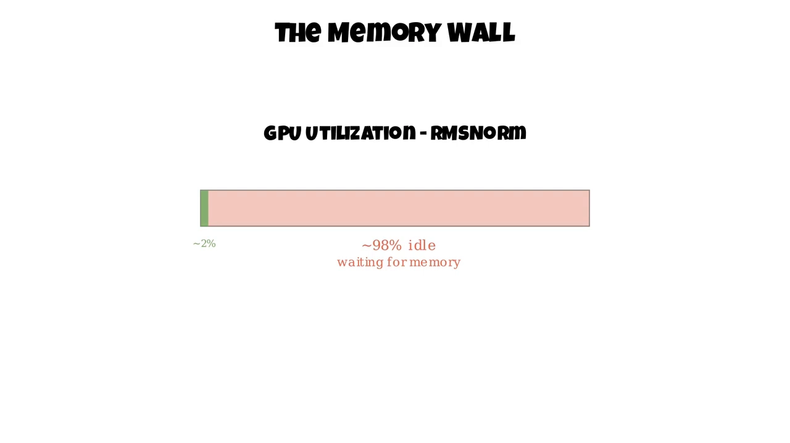
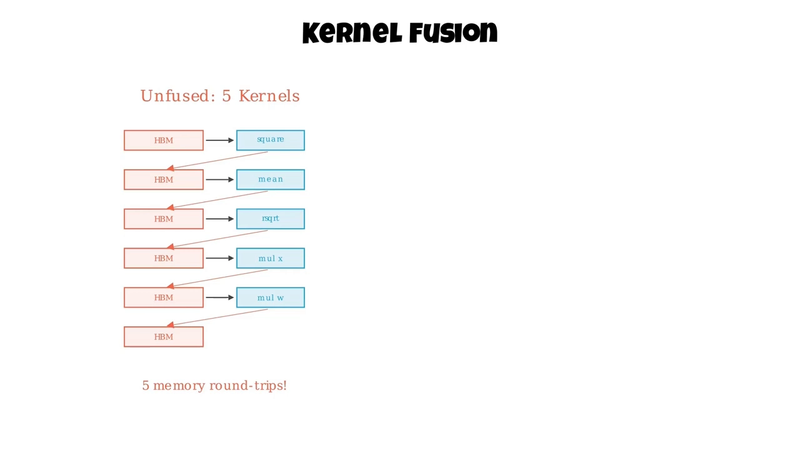
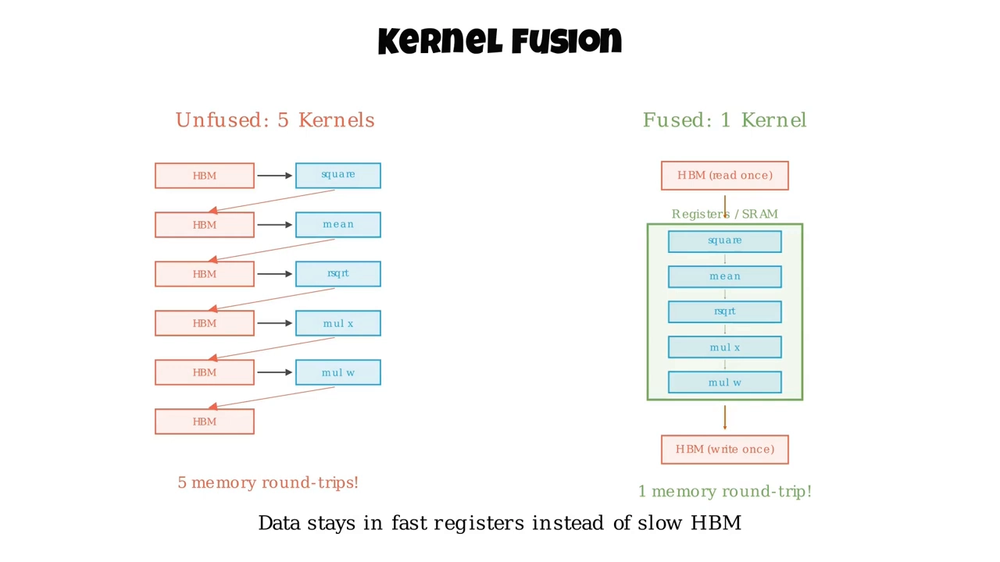
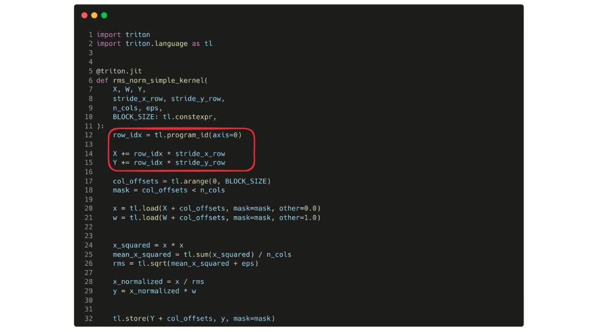
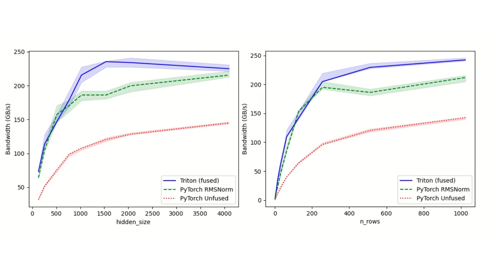
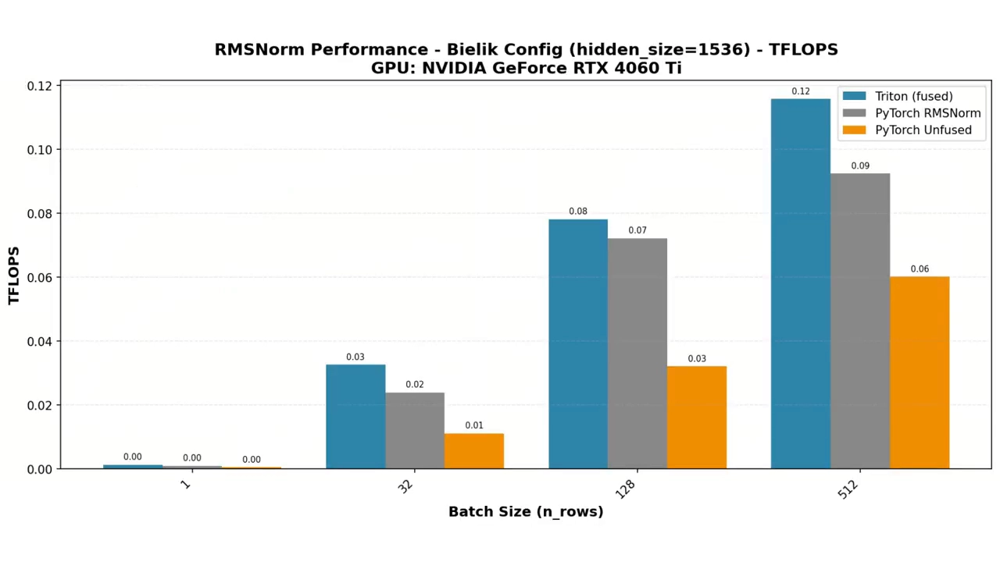
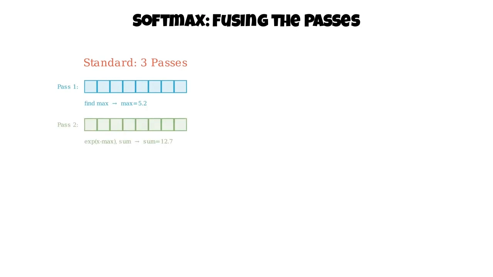
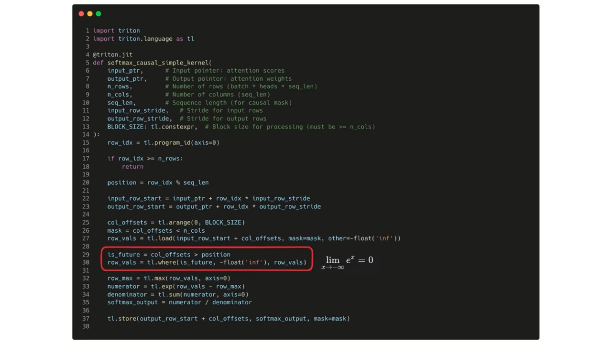
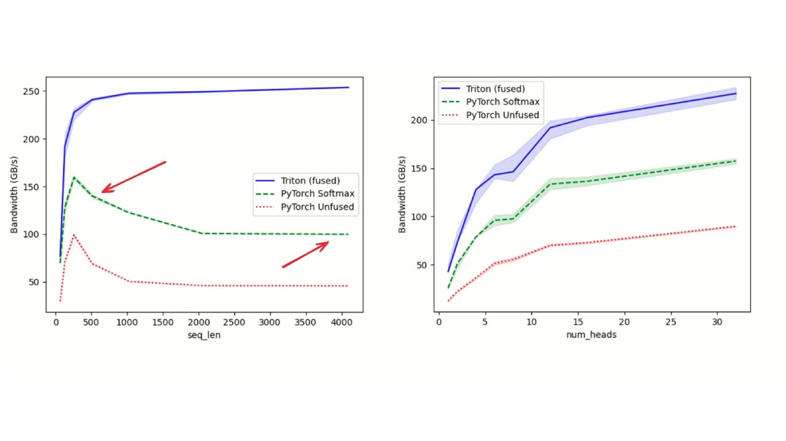

# 五次显存往返压成一次：算子融合把中间张量留在片上

> 视频来源：[JUST FUSE IT: Fixing GPU Memory Bottlenecks with kernel fusion](https://www.youtube.com/watch?v=FD_xre7abZU&t=0)（YouTube · Kuba / Bielik Anatomy 系列第 5 集）
> 本文基于视频演说图文稿整理，配图截自视频。讲者在这一集里把 RMSNorm 与 causal softmax 都手写成 Triton kernel，并在自己的显卡上跑基准对比。

## 本讲要解决的核心问题（SCQA）

**背景**：在同一个 Transformer 层里，矩阵乘（matmul）是"算得多"的算子，而 RMSNorm（均方根归一化）和 softmax 是"算得极少"的算子——它们对每个元素只做几次乘除，看上去便宜得可以忽略。

**冲突**：讲者实测发现，跑一次 RMSNorm 时，他的显卡有大约 98% 的时间什么都不算、只是在等数据从显存运过来。把 RMSNorm 写成一串独立算子，每个算子都会把整个张量从显存读一遍、再写一遍，五次往返之后，这个"便宜"的算子反而成了瓶颈；换上高度优化的 PyTorch 原生实现也一样卡在访存上。

**疑问**：既然算力根本用不完，瓶颈到底在哪一段？能不能让数据只在显存里走一趟？

**回答（中心思想）**：**把这些逐元素/归约算子融合（kernel fusion）成一个 kernel，中间结果留在寄存器里不回显存，就能把五次显存往返压成一次**。讲者手写的 Triton RMSNorm kernel 达到约 230 GB/s、吃满 80% 以上的显存带宽，而未融合的 PyTorch 路径只有约 150 GB/s；同样的方法用在 causal softmax 上，在 4K 上下文时比原生实现快一倍以上。原因很简单：这类算子 100% 是访存受限（memory-bound），优化它们不要优化计算，要优化数据搬运。

---

## 一、先承认"算力不值钱"：一块 22 TFLOPS 的卡在 RMSNorm 上 98% 时间在发呆

讲者的出发点是一句反直觉的观察：现在的显卡算力过剩到离谱。他说自己的 4060 能跑到 22 TFLOPS 以上，处理数据快得惊人——**但每一份数据都必须先从显存搬进来**，而显存的速度完全跟不上 [【跳转到 00:40】](https://www.youtube.com/watch?v=FD_xre7abZU&t=40)。



于是出现上面这种极端画面：跑一个像 RMSNorm 这样的算子，GPU 大约 98% 的时间是空闲的，只是在等下一批数据到货 [【跳转到 00:45】](https://www.youtube.com/watch?v=FD_xre7abZU&t=45)。讲者把这个现象叫**内存墙（memory wall）**，并强调它会彻底改变你思考优化的方式：你以为要省的是运算次数，实际要省的是数据搬运次数。

顺带把两个术语说清楚，后面会反复用到：

- **HBM / 显存（global memory）**：显卡上那块容量大（几 GB 到几十 GB）、但相对慢的存储。一次"读进来 + 写回去"叫作一次**显存往返（round-trip）**，代价用带宽衡量（GB/s）。
- **寄存器 / 片上存储（registers、SRAM、shared memory）**：SM（流式多处理器，显卡里真正干活的单元）内部的小块高速存储，容量只有几十到几百 KB，但快一个数量级以上。数据一旦进了寄存器，反复用它几乎不花钱。

内存墙的本质就是这两者的速度差：算一个数只要几个时钟周期，把它从 HBM 取过来要等几百个周期。

---

## 二、五次往返的来历：五个"小算子"，每个都要完整走一趟显存

RMSNorm 的数学只有几步：

$$
\text{rms}(x)=\sqrt{\frac{1}{D}\sum_{i=1}^{D} x_i^2+\epsilon},\qquad y_i=\frac{x_i}{\text{rms}(x)}\cdot w_i
$$

其中 $x$ 是一行 $D$ 维的激活向量（$D$ 是隐藏维度 hidden size），$w$ 是可学习的权重，$\epsilon$ 是一个很小的常数，防止输入全为零时除以零。

公式看着短，但如果用最朴素的方式写（平方、求均值、开方、相除、乘权重各算一步），每一步在 PyTorch 里都是一个独立的 GPU kernel [【跳转到 01:10】](https://www.youtube.com/watch?v=FD_xre7abZU&t=70)。



上图就是这五次往返的来源：每个 kernel 都必须从 global memory 读出数据、做一点点计算、再把结果写回去；下一个 kernel 再把这些结果读回来、再做一点点计算、再写回 [【跳转到 01:35】](https://www.youtube.com/watch?v=FD_xre7abZU&t=95)。五次操作 = 五次慢速显存往返，而真正花在算术上的时间加起来微不足道。瓶颈就这么被制造出来了。

---

## 三、融合的判据：读一次、在寄存器里算完、写一次

解法只有一句话：**把五个操作塞进一个 kernel 里**。读一次数据，把全部数学在快速寄存器里做完，最后把最终结果写一次。一次往返取代五次——这就是 kernel fusion，讲者称它是 GPU 上访存受限算子最重要的一项优化技术 [【跳转到 02:00】](https://www.youtube.com/watch?v=FD_xre7abZU&t=120)。



左边是未融合的五段式，右边是融合后的一段式，图上那句注解是本讲的中心思想：**数据待在快速寄存器里，而不是慢速 HBM 里**。注意融合并没有让算术变少——平方、求均值、开方、相除、乘权重一步都没省，省掉的是中间的四个临时张量在显存里的进出。

这也顺便回答了一个常见困惑：为什么"把几个算子合并"能快这么多，明明计算量完全一样？因为对这类算子来说，时间几乎全花在搬运上，而不是计算上。

---

## 四、逐行读 RMSNorm kernel：一个 program 管一行，读两次、写一次

讲者用 Triton 手写了这个融合 kernel（Triton 是 OpenAI 出的 GPU kernel 语言，写起来像 Python，编译后是机器码），并逐段讲解。完整代码只有三十来行：

```python
import triton
import triton.language as tl

@triton.jit
def rms_norm_simple_kernel(
    X, W, Y,
    stride_x_row, stride_y_row,
    n_cols, eps,
    BLOCK_SIZE: tl.constexpr,
):
    row_idx = tl.program_id(axis=0)      # 每个 program 负责一行
    X += row_idx * stride_x_row          # 用 stride 算术把指针挪到这一行
    Y += row_idx * stride_y_row

    col_offsets = tl.arange(0, BLOCK_SIZE)
    mask = col_offsets < n_cols          # 防止越过真实列数去读数据

    x = tl.load(X + col_offsets, mask=mask, other=0.0)   # 读输入行
    w = tl.load(W + col_offsets, mask=mask, other=1.0)   # 读权重

    x_squared = x * x
    mean_x_squared = tl.sum(x_squared) / n_cols
    rms = tl.sqrt(mean_x_squared + eps)

    x_normalized = x / rms
    y = x_normalized * w

    tl.store(Y + col_offsets, y, mask=mask)             # 只写一次
```



逐段看几个关键设计：

1. **一个 program 一行，行与行完全并行**。每个线程块（thread block / CTA，一组一起调度、可以共享片上内存的线程）拿到一个唯一的 program ID 当行号，再用 stride 算术把输入、输出指针推到这一行上 [【跳转到 02:31】](https://www.youtube.com/watch?v=FD_xre7abZU&t=151)。
2. **BLOCK_SIZE 取 2 的幂，再用掩码兜住边界**。Bielik 模型的 hidden size 是 1536，不是 2 的幂，所以 kernel 用 2048 的块大小，靠一个掩码（`col_offsets` 小于 `n_cols`）保证不读到真实数据之外 [【跳转到 02:56】](https://www.youtube.com/watch?v=FD_xre7abZU&t=176)。这就是为什么被掩掉的位置要填中性值：输入的 `other=0.0` 不影响平方和，权重的 `other=1.0` 相当于乘 1。
3. **整个 kernel 只有两次读、一次写，其余时间数据都在寄存器里**。开头两条向量化加载（输入行、权重）之后，直到最后 `tl.store` 之前，kernel 不再碰全局显存 [【跳转到 03:21】](https://www.youtube.com/watch?v=FD_xre7abZU&t=201)。
4. **$\epsilon$ 的作用是防除零**。输入数值非常小时 $\text{rms}(x)$ 可能下溢，加上一个很小的 $\epsilon$ 就能兜住。所有数学（平方、求和、开方、相除、乘权重）都在寄存器里一次性完成，最后只写一次 [【跳转到 03:46】](https://www.youtube.com/watch?v=FD_xre7abZU&t=226)。

顺便对照一下未融合的 HuggingFace 写法会更直观：`hidden.to(float32)`、`pow(2)`、`mean`、`rsqrt(var+eps)`、相乘、`to(dtype)`、再乘 `weight`——八步，每一步都是一个 kernel，每一步都要扫一遍整个激活张量。融合版做的是同一套数学，只是把这些步骤压在同一个 kernel 的寄存器里。

---

## 五、实测：230 GB/s 对 150 GB/s，十行代码追平高度优化过的原生实现

讲者用 Triton 自带的 benchmark 工具跑了两组扫描：一组变化 hidden size，一组变化行数（batch size），三条曲线分别是他的手写 Triton kernel、PyTorch 原生融合 RMSNorm、以及未融合的 PyTorch 写法 [【跳转到 04:16】](https://www.youtube.com/watch?v=FD_xre7abZU&t=256)。



结果很清楚：

- 手写融合 kernel 约 **230 GB/s**，吃满显卡最大显存带宽的 **80% 以上**；
- 未融合版本最高只有约 **150 GB/s**——因为每一步中间结果都被迫回显存走一趟，而不是留在快速 SRAM 里 [【跳转到 04:41】](https://www.youtube.com/watch?v=FD_xre7abZU&t=281)；
- 更大的 batch size 下，这个只有十行的简单 kernel 反超了 PyTorch 高度优化的原生实现 [【跳转到 05:15】](https://www.youtube.com/watch?v=FD_xre7abZU&t=315)。

更有说服力的是算力占用：整块 22 TFLOPS 的卡，在这个 kernel 上只用到不到 1 TFLOPS 的一小部分——**算术是免费的**，这个算子 100% 访存受限，所以融合不是可选项而是必需项 [【跳转到 05:29】](https://www.youtube.com/watch?v=FD_xre7abZU&t=329)。



这张柱状图把"算力不值钱"钉死了：哪怕最优实现，在 batch 512 时也只用到 0.12 TFLOPS 量级的算力。既然算力空着九成以上，继续压计算毫无意义，唯一的出路是压访存。

---

## 六、同一套方法搬到 causal softmax：三次扫（pass）变一次，掩码在片上现算

RMSNorm 之后讲者用 softmax 做第二次验证，因为 softmax 的处境更糟。标准 softmax 需要三次完整扫过数据：第一次找最大值（为了数值稳定），第二次算指数并求和，第三次把每个指数除以和 [【跳转到 05:46】](https://www.youtube.com/watch?v=FD_xre7abZU&t=346)。

讲者要做的是三件事合成一趟：一次扫描、把因果掩码（causal mask，decoder 里禁止看到未来 token 的下三角掩码）直接写进 kernel、并且保持数值稳定。原因是推理的 prefill 阶段会并行处理整段 prompt，此时每个 token 只允许看它之前的内容，绝不能看到未来 [【跳转到 05:51】](https://www.youtube.com/watch?v=FD_xre7abZU&t=351)。



融合后的步骤是：

1. 先确定自己在哪一行、当前位置是第几个 token（`row_idx` 对 `seq_len` 取余）；
2. 一次把整行读进来；
3. 施加因果掩码——列号大于当前位置的元素一律置为负无穷。而 $e^{-\infty}=0$，这些"未来"位置自动拿到零权重 [【跳转到 06:21】](https://www.youtube.com/watch?v=FD_xre7abZU&t=381)；
4. 在寄存器里做数值稳定的 softmax（减最大值、取指数、除以和）；
5. 只写回一次 [【跳转到 06:46】](https://www.youtube.com/watch?v=FD_xre7abZU&t=406)。



---

## 七、softmax 的基准更能说明问题：原生实现在长上下文下会崩

同样的三路对比（Triton 手写融合、PyTorch 原生 softmax、PyTorch 未融合），这次扫的是序列长度和头数 [【跳转到 07:09】](https://www.youtube.com/watch?v=FD_xre7abZU&t=429)。



两条曲线的形状本身就是解释：

- 手写融合 kernel 随序列长度**平稳上升**，最终封顶在约 **250 GB/s**；
- PyTorch 原生 softmax 先冲到峰值，然后**一路崩塌**，到 4K 上下文窗口时只剩 **99 GB/s**。

为什么？因为标准 PyTorch 实现要显式加上一个因果掩码矩阵——这个巨大的临时矩阵被创建在慢速显存里，把缓存效率彻底毁掉。而一次扫描的 Triton kernel 把掩码直接在超快的 SRAM 里现算现用，根本不需要中间矩阵 [【跳转到 08:00】](https://www.youtube.com/watch?v=FD_xre7abZU&t=480)。结果就是在 1024 个 token 时，手写 kernel 比原生 PyTorch 快整整一倍。

再看一眼算力占用：softmax 这边的峰值只有约 0.15 TFLOPS，再一次证明它完全是访存受限的。所以**把因果掩码融合进去不是什么锦上添花的技巧，而是长上下文场景的必需品** [【跳转到 08:30】](https://www.youtube.com/watch?v=FD_xre7abZU&t=510)。

---

## 八、边界：融合能救的是访存受限算子，不是所有算子

讲者在这一集里没花篇幅讲融合的代价（同系列的另一期会讲启动开销与 CUDA Graph），但从他的话里能划出一条清晰的适用边界：

1. **融合的价值与"memory-bound 程度"成正比**。RMSNorm 吃不到 1 TFLOPS、softmax 峰值 0.15 TFLOPS，这类算子融合收益巨大；矩阵乘则相反——它的瓶颈是算力与 tile 复用，真正的流量早被内部切块（tile）榨干了，所以讲者说"没有人手写矩阵乘"，直接调 cuBLAS 就好。
2. **融合需要形状在编译期确定**。这个 kernel 的 `BLOCK_SIZE` 是编译期常量（`tl.constexpr`），2048 是专门为 hidden size 1536 选的；换了模型的隐藏维度就得重新选块大小，这也是后面几集要讲 torch.compile 自动生成 kernel 的原因。
3. **融合不能消除启动开销**。kernel 数量少了，但每个 kernel 仍要由 CPU 一个个发起；当张量很小（decode、batch=1）时，CPU 决定下一个 launch 的时间可能比 kernel 在 GPU 上算完的时间还长，这一半要靠别的机制解决。

---

## 小结

- **内存墙是真的**：22 TFLOPS 的卡跑 RMSNorm 时约 98% 的时间在等显存，算力根本没用上。
- **往返次数是可数的成本**：朴素 RMSNorm 的五个小算子 = 五次显存往返，瓶颈就在这五次里，不在算术里。
- **融合的做法是"读一次、算在寄存器、写一次"**：一个 program 管一行，两次向量化加载，全部数学在寄存器完成，最后一次写回。
- **收益可测**：手写融合 RMSNorm 约 230 GB/s（吃满 80% 以上带宽）对未融合的 150 GB/s，batch 变大时反超高度优化的原生实现。
- **causal softmax 更极端**：三趟扫描合成一趟、掩码在 SRAM 里现算，稳定在 250 GB/s；PyTorch 原生实现因为显式构造掩码矩阵，在 4K 上下文崩到 99 GB/s。
- **一句话结论**：当算子访存受限时，不要优化计算，要优化数据搬运，能融合的都融合 [【跳转到 08:53】](https://www.youtube.com/watch?v=FD_xre7abZU&t=533)。

## 关键术语速查

| 术语 | 一句话解释 |
| --- | --- |
| HBM / global memory | 显卡上的大容量主存（显存），带宽相对 CPU 内存高但仍远慢于片上存储；一次读写叫一次显存往返 |
| 寄存器 / SRAM | SM 内部的高速小容量存储，数据进来后反复使用几乎不额外花钱 |
| memory-bound（访存受限） | 算子耗时的绝大部分花在数据搬运而非算术上，RMSNorm、softmax 都属于这一类 |
| kernel fusion（算子融合） | 把多个逐元素/归约算子合进一个 kernel，中间结果留在寄存器，减少显存往返 |
| thread block / CTA | 一组一起被调度的线程，可以共享片上内存、能在块内同步 |
| BLOCK_SIZE | Triton kernel 里一次处理的列宽，取 2 的幂，用掩码处理越界列 |
| $\epsilon$（eps） | 加在均方根里的小常数，防止输入过小导致除零 |
| causal mask（因果掩码） | 让每个 token 只能看到自己及之前位置的掩码，用负无穷填充未来位置即可在 softmax 后自动变为零权重 |
