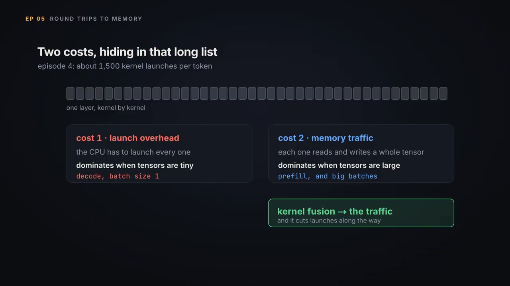
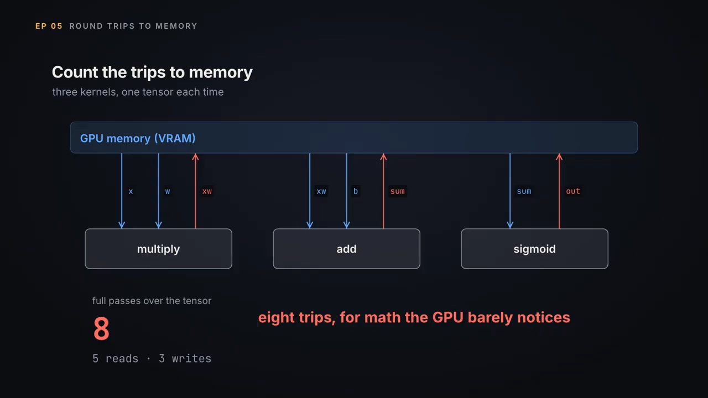
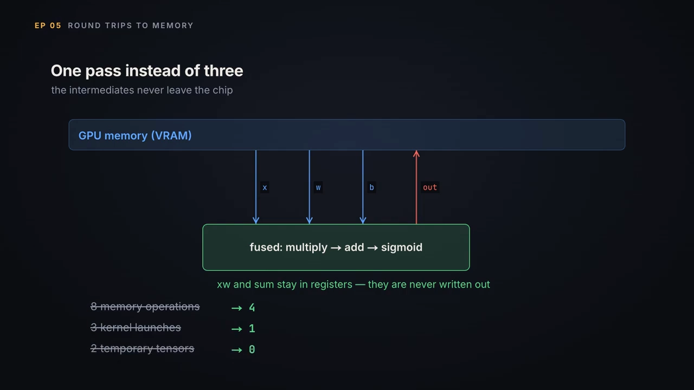
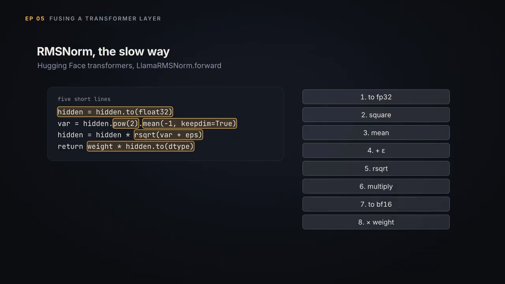
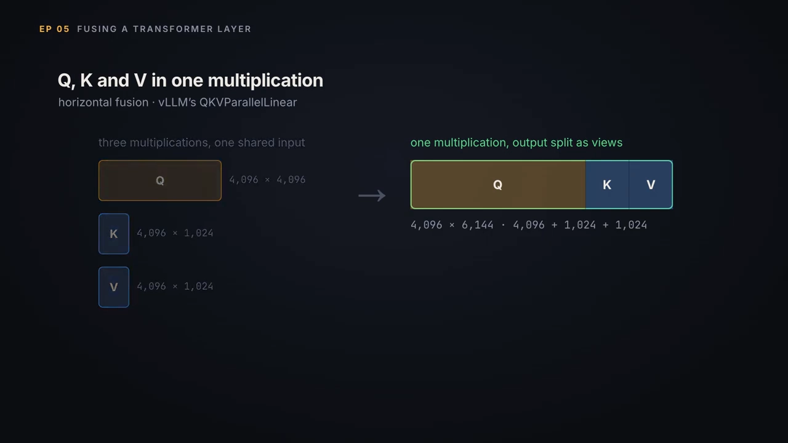
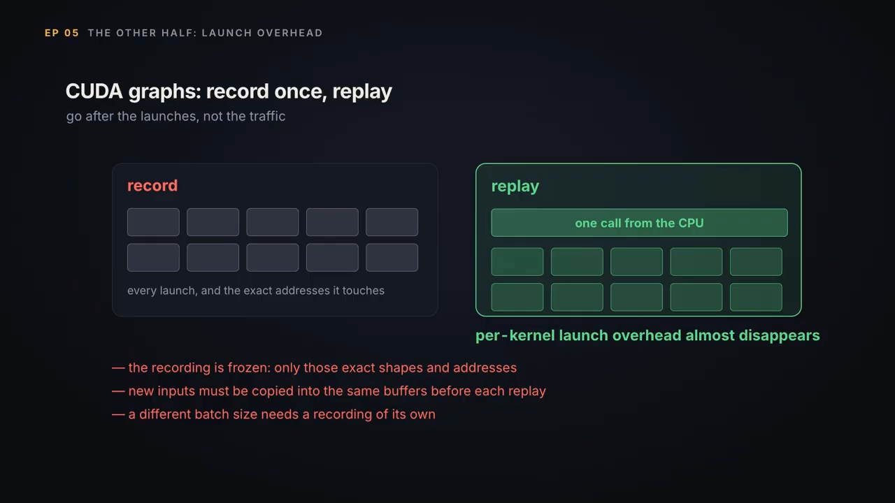
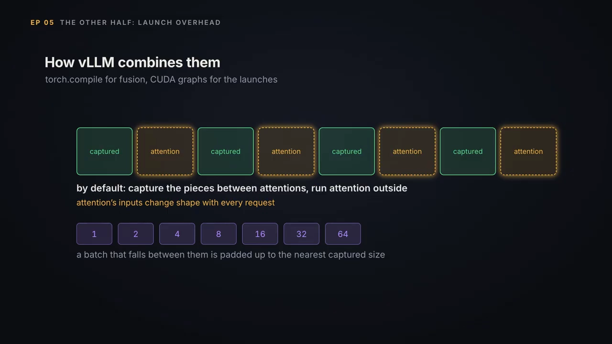
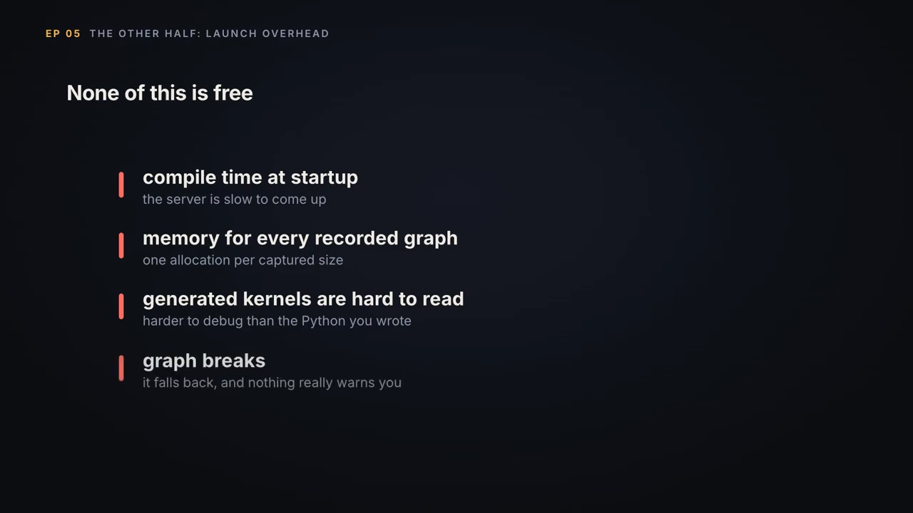

# 融合省的是访存、CUDA Graph 省的是启动：两笔成本要分开算

> 视频来源：[Kernel Fusion and CUDA Graphs, From the Ground Up](https://www.youtube.com/watch?v=_mwx30GqsA4&t=0)（YouTube · 系列第 5 集「Round Trips to Memory」）
> 本文基于视频演说图文稿整理，配图截自视频。这一集把「算子融合」与「CUDA Graph」两件事放在一起讲，因为它们常被混为一谈。

## 本讲要解决的核心问题（SCQA）

**背景**：上一集数过一个 Transformer 层里的 kernel 数量——每个 token 大约要发起 1500 次 kernel launch。每个 kernel 都得由 CPU 发一次命令，也都得把整个张量从显存读一遍、再写一遍。

**冲突**：这两件事听起来像同一笔账，其实拆得开：张量很小时（decode、batch size 为 1），真正贵的是 CPU 一次次发命令；张量很大时（prefill、大 batch），真正贵的是显存流量。只做算子融合能减少 kernel 数量，但**融合并不能去掉 launch**——一个融合层依然是一串由 Python 逐个发起的启动，GPU 仍然在等 CPU。

**疑问**：那两笔成本分别该用什么工具去省？它们的边界在哪，代价是什么？

**回答（中心思想）**：**算子融合针对的是访存流量（顺手减少启动次数），CUDA Graph 针对的是启动本身**。前者的做法是让中间结果不回显存，把「8 次整张量访存」压成 4 次；后者的做法是把一层里所有 launch 连同地址录下来，之后用一次 CPU 调用整段重放。两者互补：vLLM 先用 torch.compile 拿到融合 kernel，再按 batch size 录 CUDA Graph。而两者都不免费——融合要靠手写 kernel 或编译器，CUDA Graph 要用固定形状和额外显存换来重放。

---

## 一、先拆成两笔成本：启动开销与访存流量

讲者开门见山给了个三行 PyTorch 的例子：一个乘法、一个加法、一个 sigmoid。跑成三个独立 kernel，和跑成一个 kernel，后者更快完成——**算术没有变聪明，唯一变化的是数据要回显存的次数** [【跳转到 00:00】](https://www.youtube.com/watch?v=_mwx30GqsA4&t=0)。

上图把两笔成本摆在一起 [【跳转到 00:25】](https://www.youtube.com/watch?v=_mwx30GqsA4&t=25)：

| 成本 | 花在哪 | 什么时候占主导 |
| --- | --- | --- |
| 启动开销（launch overhead） | CPU 为每个 kernel 发一次命令、准备参数 | 张量很小时：decode、batch size 为 1 |
| 访存流量（memory traffic） | 每个 kernel 把整个张量读一遍、写一遍 | 张量很大时：prefill、大 batch |

于是修法也分成两种：**算子融合打的是访存流量，顺手把启动次数也剪掉一些；CUDA Graph 打的是启动本身。**这一集的大部分篇幅在讲前者的具体做法，最后四分之一才转到后者，讲清两者的分工。

---

## 二、数一遍账：8 次整张量访存怎么来的、融合后怎么变成 4

把那个三行例子摊开，每个 kernel 的读写都能数清：

1. 乘法 kernel 读 $X$ 和 $W$，写出乘积 $XW$；
2. 加法 kernel 读 $XW$ 和 bias，写出和 $\text{sum}$；
3. sigmoid kernel 读 $\text{sum}$，写出最终结果 $y$。

一共 **5 次整张量读 + 3 次整张量写 = 8 次往返**，而这点数学 GPU 几乎感觉不到 [【跳转到 00:50】](https://www.youtube.com/watch?v=_mwx30GqsA4&t=50)。

融合版本则一次把 $X$、$W$、bias 都读进来，对每个元素在片上做乘、加、sigmoid，最后只存最终结果——两个中间值**根本没写进显存** [【跳转到 01:15】](https://www.youtube.com/watch?v=_mwx30GqsA4&t=75)。

这张图上的三行对照值得记住：

$$
\underbrace{8}_{\text{访存次数}} \rightarrow 4,\qquad
\underbrace{3}_{\text{kernel 启动}} \rightarrow 1,\qquad
\underbrace{2}_{\text{临时张量}} \rightarrow 0
$$

讲者给的经验法则很干脆：**当你被访存而不是算力卡住时，把流量砍一半，时间就接近砍一半。**

---

## 三、真实的一层里：RMSNorm 从八步变一个 kernel，残差加法也被折进去

三行例子只是玩具。讲者接着看真实例子：Llama 每一层里的 RMSNorm（均方根归一化：把一行激活向量按它的均方根缩放，再乘一个可学习权重）。按 HuggingFace 的实现写出来，一共八步 [【跳转到 01:40】](https://www.youtube.com/watch?v=_mwx30GqsA4&t=100)：

在 eager PyTorch（默认的逐条执行模式）里，这八步是八个独立 kernel，而且大多数都要扫过整个激活张量。prefill 一段 8192 token 的 prompt 时，这个张量有 3300 多万个数，为了做一次归一化要反复扫它 [【跳转到 02:05】](https://www.youtube.com/watch?v=_mwx30GqsA4&t=125)。

融合版用同一个 kernel 做同样的数学：对每个 token，先把向量走一遍求平方和（第 1 遍），再走一遍把每个值缩放后写出（第 2 遍）。

**注意这里有个容易误解的点**：融合之后仍然要"走两遍"，但这两遍走的是**寄存器里的数据**，不是显存。走第二遍不需要重新从 HBM 把向量取回来——这正是融合与"少写几行代码"的本质区别。

vLLM 在这个基础上又多走了一步：**紧挨在 norm 之前的那次残差相加，也被折进同一个 kernel** [【跳转到 02:30】](https://www.youtube.com/watch?v=_mwx30GqsA4&t=150)。于是「残差相加、平方、求均值、开方、缩放」全部发生在同一次 launch 里，中间没有任何临时张量。这就是本系列小节名里的「残差连接与归一化算子的融合」：它们天然挨在一起，因为残差流（主干向量）在每一层都要先加上子层输出、再做归一化。

---

## 四、融合的三种形状：垂直、水平、以及焊在矩阵乘尾巴上的 epilogue

讲者把融合手法归了类，这部分是很容易被忽略但很有用的框架。

### 4.1 垂直融合（vertical fusion）：把链条接起来

上一步的输出直接喂给下一步，就像 RMSNorm 内部那几步——加残差、平方、求均值、开方、缩放。这是最直觉的一种融合：**同一条数据流上的串行操作合成一个 kernel**。

### 4.2 水平融合（horizontal fusion）：把共享同一份输入的独立操作并起来

每个 attention 层要把输入投影三次：一次 Q、一次 K、一次 V。这是三次独立的矩阵乘，而**三次读的是同一份输入**。于是把三个权重矩阵叠成一个，一次矩阵乘算完再切分输出 [【跳转到 02:55】](https://www.youtube.com/watch?v=_mwx30GqsA4&t=175)：

以 Llama 3 8B 为例：Q 有 4096 个输出，K 和 V 各 1024 个，一次矩阵乘产出全部 6144 个数，输出再切成三块（view，共享底层存储的视图，不复制数据）。vLLM 就是这么做的（`QKVParallelLinear`）；MLP 同理——gate 和 up 两个投影合成一次矩阵乘，随后的激活函数与逐元素相乘合成一个融合 kernel [【跳转到 03:20】](https://www.youtube.com/watch?v=_mwx30GqsA4&t=200)。

### 4.3 第三种形状：编译器常把小的逐元素工作焊到矩阵乘的尾巴上

偏置相加、激活函数这类"小活"，编译器经常直接挂到矩阵乘的尾部（epilogue）：结果在写回显存之前就已经算完，不需要再单独读一次、写一次。

那么矩阵乘**本身**能不能融合？讲者的回答是不能，也不需要：一个足够好的矩阵乘早已把两个矩阵切成能放进片上快存储的 tile，一次只加载一对 tile，然后让里面每个数被复用很多次才写回 VRAM——流量已经在内部被榨干了。这就是"没有人手写矩阵乘、直接调 cuBLAS"的原因 [【跳转到 04:10】](https://www.youtube.com/watch?v=_mwx30GqsA4&t=250)。**融合发生在矩阵乘的边缘**：把共享输入的几个乘并起来、把小的逐元素工作焊到尾巴上。唯一一个"里外都做"的 kernel 是 attention，那要留到后面几集。

---

## 五、这些 kernel 谁写：手写与编译器两条路

融合不会自己发生，得有人写。讲者列了两条路 [【跳转到 04:35】](https://www.youtube.com/watch?v=_mwx30GqsA4&t=275)：

| 路线 | 代表 | 优点 | 代价 |
| --- | --- | --- | --- |
| 人手写 | NVIDIA Apex 的融合归一化层、vLLM 的自定义 kernel、FlashInfer、FlashAttention | 通常最快 | 每个只覆盖一种模式、一组有限形状与数据类型，换一代 GPU 就得有人维护 |
| 编译器生成 | `torch.compile`：Dynamo 捕获计算图，Inductor 融合并写出新 kernel（NVIDIA 上是 Triton 语言） | 覆盖广、不用手写 | 依赖能追踪的代码；生成的 kernel 难读难调 |

关于编译器这条路有个细节值得记住：调用 `torch.compile` 时，组件 Dynamo 会看着你的 Python 代码跑、把张量操作捕获成一张图；默认后端 Inductor 一次看整张图，找出能融合的操作，为它们写出全新的 kernel。**PyTorch 文档把融合称为 Inductor 执行的最重要的一项优化** [【跳转到 05:25】](https://www.youtube.com/watch?v=_mwx30GqsA4&t=325)。

同时讲者提醒了一个术语坑：**Triton 这门语言来自 OpenAI**（用类似 Python 的代码写 GPU kernel，再编译成机器码）；**Triton Inference Server 来自 NVIDIA**（托管模型、通过网络回答请求的服务器）。两者只共享名字，别的什么都不共享——讲到 TensorRT-LLM 时起作用的是后面那个服务器 [【跳转到 05:50】](https://www.youtube.com/watch?v=_mwx30GqsA4&t=350)。

想亲眼看到融合发生在自己代码上，可以把环境变量 `TORCH_LOGS` 设成 `output_code` 再跑一次编译过的模型，Inductor 会打印它生成的每个 kernel，kernel 名字会告诉你什么被融合了——比如一个叫 `fused_add_mul_sigmoid` 的 kernel，就是本集开头那个三行例子，现在是一次显存遍历 [【跳转到 06:15】](https://www.youtube.com/watch?v=_mwx30GqsA4&t=375)。

---

## 六、融合管不了的那一半：GPU 在等 CPU

到这里融合的好处讲完了。讲者话锋一转：**融合减少了 kernel 数量，但它并没有真正去掉 launch** [【跳转到 06:40】](https://www.youtube.com/watch?v=_mwx30GqsA4&t=400)。

一个融合层仍然是一串从 Python 一个接一个发起的 kernel launch。当 batch size 为 1 时，一个 kernel 在 GPU 上算完的速度比 CPU 决定下一个 launch 还快——于是 GPU 在等 CPU。这时候你再怎么融合，也解决不了这段等待。

CUDA Graph 就是为这段等待准备的：

1. 你把模型跑一遍，同时**录下每个 kernel launch 以及每个 kernel 读写的确切显存地址**；
2. 之后 CPU 一次调用，就能把整段冻结的录制序列在 GPU 上重放；
3. 于是每个 kernel 的启动开销几乎消失。

代价图上也写了，一共三条：

- **录制被冻住了**：只对当时见到的形状和显存位置有效；
- **新输入要先拷进同一批缓冲区**才能重放；
- **不同的 batch size 需要单独录一份**。

在 `torch.compile` 里，`reduce-overhead` 模式会打开它 [【跳转到 07:05】](https://www.youtube.com/watch?v=_mwx30GqsA4&t=425)。

---

## 七、两者怎么配合：vLLM 的用法与「融合之外的边界」

vLLM 两种都用：先用 `torch.compile` 编译模型拿到融合 kernel，再为一组 batch size 各录一份 CUDA Graph；落在中间的 batch 可以补齐（pad）到最近的录制尺寸 [【跳转到 07:30】](https://www.youtube.com/watch?v=_mwx30GqsA4&t=450)。

最别扭的部分是 attention：它的输入每个请求都在变形状，所以默认情况下 vLLM 只录 attention 之间那几段模型，attention 本身在录制之外跑。**但对于纯 decode 的 batch（形状稳定），它可以把整个模型连 attention 一起录下来。**

这一集最后一段专门讲"没有一样是免费的" [【跳转到 07:55】](https://www.youtube.com/watch?v=_mwx30GqsA4&t=475)：

- **编译时间**：服务器启动时会慢；
- **显存**：每张录好的图都要占住自己的显存；
- **可维护性**：生成的 kernel 比你写的 Python 更难读、更难调；
- **graph break（断图）**：编译器遇到无法追踪的代码时会在那里断开图、退回普通执行。模型还能正确运行，只是没有你期待的那份加速，**而且没有任何东西会警告你**。

最后这一条最容易被误判成"编译没生效"或"显卡不行"——它其实是静默降级。

---

## 八、小结：一个处方的两面

- **两笔成本**：启动开销（小张量、decode 时占主导）与访存流量（大张量、prefill 时占主导），分别对应两种工具。
- **融合省的是流量**：中间结果不回显存，8 次整张量访存变 4 次，顺带把 3 次启动变 1 次、2 个临时张量变 0；访存减半，时间就接近减半。
- **融合的三种形状**：垂直（链条相接）、水平（共享输入并起来，如 QKV 合成一次 4096×6144 的矩阵乘）、以及焊在矩阵乘尾部的 epilogue；矩阵乘内部已经自己榨干了流量，融合只发生在它的边缘。
- **融合从哪来**：手写 kernel（Apex、vLLM、FlashInfer、FlashAttention）或编译器（Dynamo 捕获、Inductor 生成 Triton kernel）。
- **CUDA Graph 省的是启动**：录下每次 launch 与地址，再用一次 CPU 调用重放，用固定形状换近乎消失的启动开销。
- **两者互补**：vLLM 先编译拿融合 kernel，再按 batch size 录图；attention 因形状多变通常留在录制之外。
- **都不免费**：编译时间、每张图的显存、可读性下降，以及 graph break 带来的静默降级。

## 关键术语速查

| 术语 | 一句话解释 |
| --- | --- |
| kernel launch | CPU 向 GPU 提交一次 kernel 执行命令，有固定的准备与提交开销 |
| memory traffic（访存流量） | 一个 kernel 需要从显存读出、写回的数据总量 |
| vertical fusion（垂直融合） | 数据流上前后相接的操作合成一个 kernel，如 RMSNorm 内部的加残差、平方、开方、缩放 |
| horizontal fusion（水平融合） | 共享同一份输入的独立操作合并，如 Q、K、V 三个投影合成一次矩阵乘 |
| epilogue fusion | 把 bias、激活这类小的逐元素工作焊在矩阵乘尾部，写回显存之前算完 |
| tile（切块） | 矩阵乘把大矩阵切成能放进片上存储的小块，一次只加载一对，提高数据复用 |
| eager 模式 | PyTorch 默认的逐条执行方式，每个张量操作立即对应一次 kernel |
| CUDA Graph | 录下整段 kernel launch 序列与地址，之后用一次 CPU 调用重放，几乎消除逐 kernel 启动开销 |
| graph break | 编译器遇到无法追踪的代码时断开计算图、退回普通执行，通常没有警告 |
