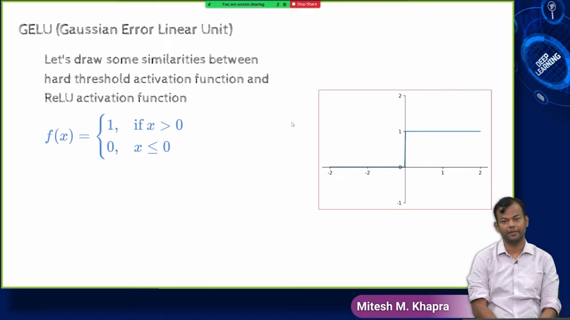
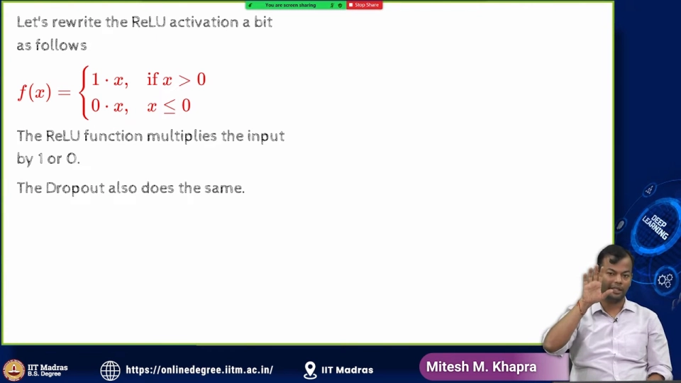
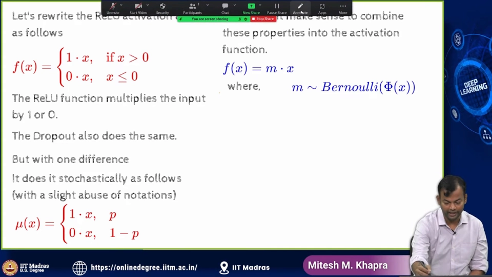
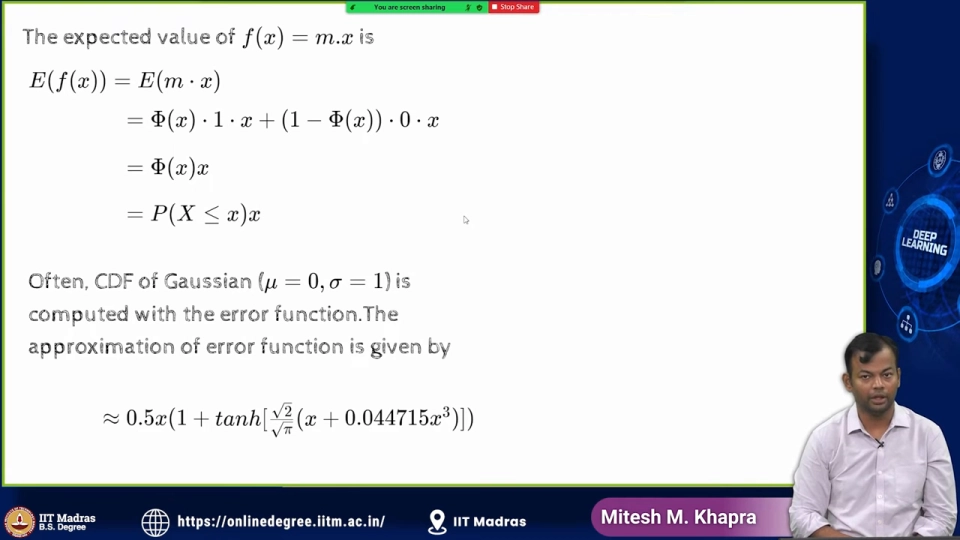
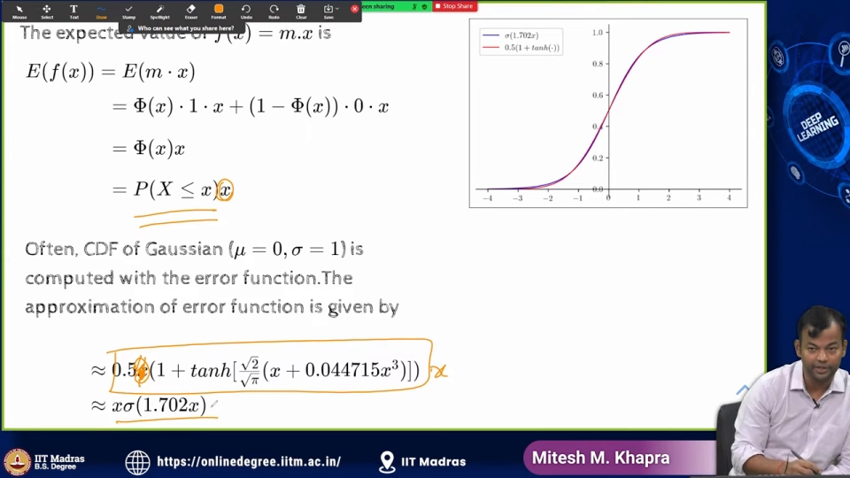
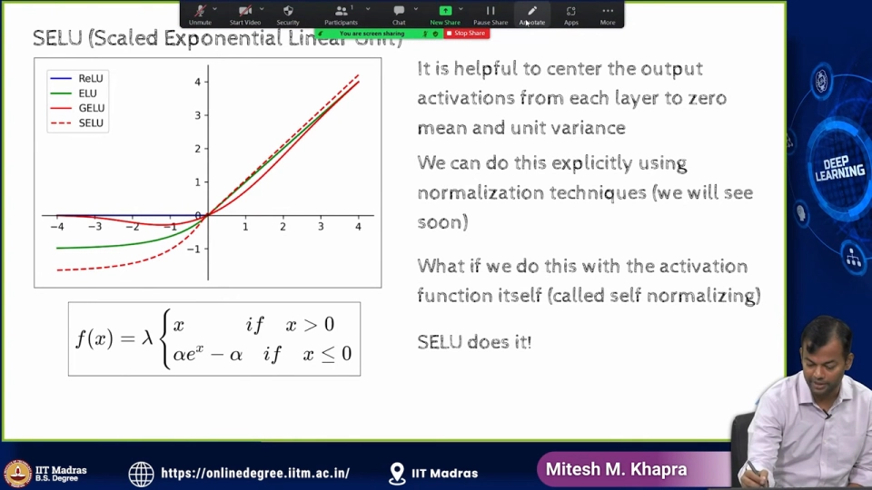
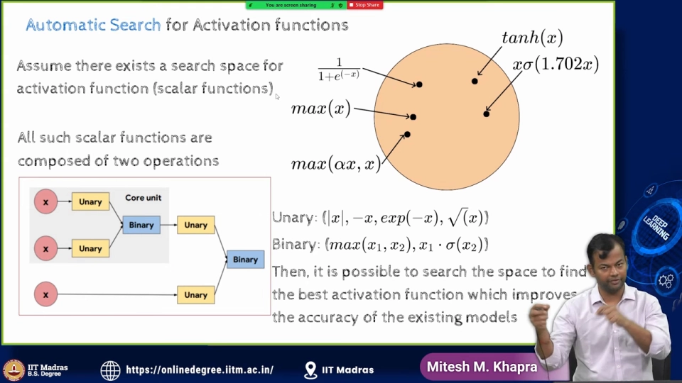
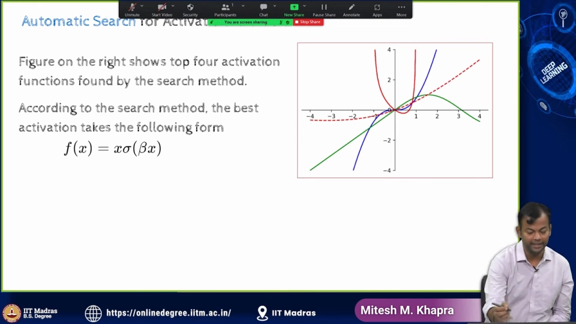
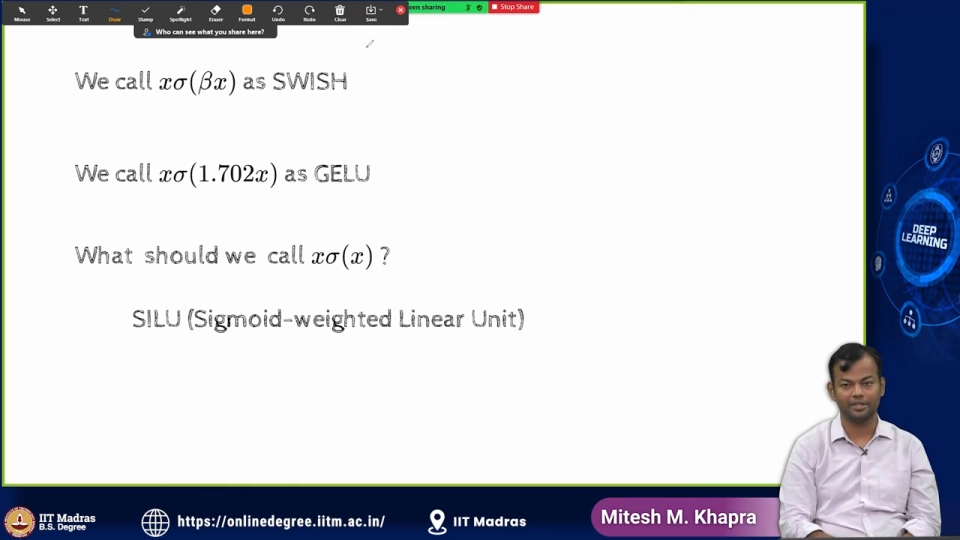
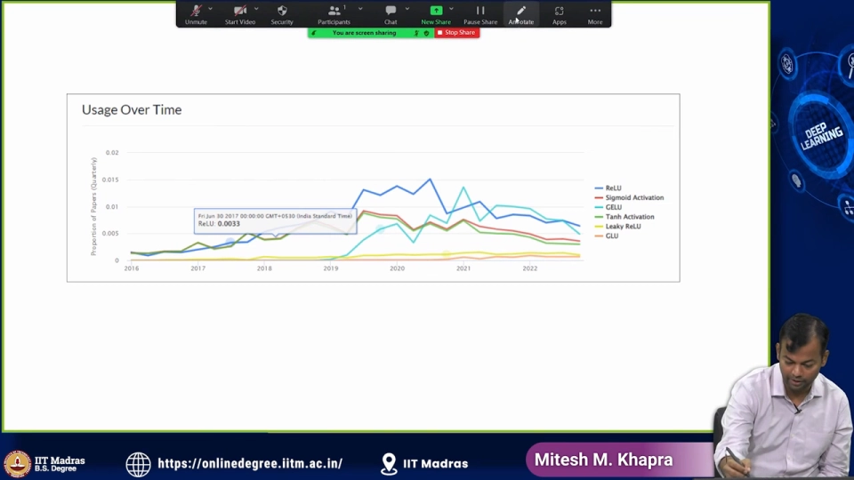

# GELU 的来历：ReLU 在随机 Dropout 下的期望，与激活函数的自动搜索

> 视频来源：[L59 Gelu to SiLU: activation functions for modern neural nets](https://www.youtube.com/watch?v=srcPpAV6Yfs&t=0)（YouTube · IIT Madras 在线学位课程，讲者 Mitesh M. Khapra）｜时长约 21 分钟
> 本文基于视频演说图文稿整理，配图截自视频。这支视频不直接抛出公式，而是用一条完整的推导把 GELU「推」出来：先指出 ReLU 与 Dropout 都在「乘以 0 或 1」，再把随机性写进激活函数本身、取期望得到 $\Phi(x)x$，然后交代 1.702 这类常数是怎么近似来的，最后回答「能不能让机器自己搜出一个激活函数」。

## 本讲要解决的核心问题（SCQA）

**背景**：神经网络的一层做完线性变换 $z = Wx + b$ 之后，还要过一个激活函数（activation function，即对单个标量逐个施加的非线性函数）才进入下一层。ReLU 是最常见的选择：负数一律输出 0，正数原样输出。

**冲突**：可 GELU（Gaussian Error Linear Unit，高斯误差线性单元）的写法却是 $\mathrm{GELU}(x) = x \cdot \Phi(x)$，工程实现里干脆写成 $x\sigma(1.702x)$。前一个式子里的 $\Phi$ 是正态分布的累积分布函数，后一个式子里的 1.702 更是毫无来由。初学者把公式抄下来，也说不出它凭什么长成这样。

**疑问**：这个公式是谁、凭什么想出来的？1.702 又是从哪冒出来的？

**回答（中心思想）**：GELU 是「把 Dropout 的随机性搬进激活函数本身」的必然结果——令乘数 $m$ 服从参数为 $\Phi(x)$ 的伯努利分布，对 $m \cdot x$ 取期望，就只剩 $\Phi(x)x$；1.702 不是魔法常数，而是把正态 CDF 换成一条 sigmoid 做近似时定下来的系数。更有意思的是，后来有人用「枚举算子组合 + 搜索」的办法独立地又搜出了同一族形式 $x\sigma(\beta x)$，这说明「输入乘以一个 0 到 1 的门」本身就是个好的归纳偏置。

---

## 一、ReLU 与硬阈值是同一个结构：都在「乘以 0 或 1」

课程的出发点是两个看起来毫不相干的函数。第一个是**硬阈值**（hard thresholding）：输入 $x > 0$ 时输出 1，$x \le 0$ 时输出 0 [【跳转到 00:21】](https://www.youtube.com/watch?v=srcPpAV6Yfs&t=21)。它的图像是一个台阶，在 0 处跳变，常用于「要么通过、要么不通过」的判定。

$$
f(x) = \begin{cases} 1, & x > 0 \\ 0, & x \le 0 \end{cases}
$$

第二个是 **ReLU**（Rectified Linear Unit，修正线性单元）。讲者没有把它写成常见的 $\max(0, x)$，而是改写成下面这种「乘 0 或乘 1」的形式 [【跳转到 00:46】](https://www.youtube.com/watch?v=srcPpAV6Yfs&t=46)：

$$
f(x) = \begin{cases} 1 \cdot x, & x > 0 \\ 0 \cdot x, & x \le 0 \end{cases}
$$

这样一改写，共同点就露出来了：**两个函数的输出都只由输入的符号决定**——符号为正走一支，符号为负走另一支 [【跳转到 01:05】](https://www.youtube.com/watch?v=srcPpAV6Yfs&t=65)。差别只在于乘以什么：硬阈值乘的是常数 1 或 0，ReLU 乘的是 $x$ 本身或 0。ReLU 名字里的「线性单元」正是这个意思——正半轴上它没有做任何变形，只是把输入原样放行。

## 二、Dropout 也在乘 0 或乘 1，只是乘哪个要掷硬币

讲者接着引入 **Dropout**（随机失活）：训练时给网络套一个「掩码」，掩码要么把某个神经元的输出清零，要么让它原样通过，然后再在这个被削小的网络上做反向传播 [【跳转到 01:30】](https://www.youtube.com/watch?v=srcPpAV6Yfs&t=90)。所以 Dropout 在形式上也是「乘以 0 或乘以 1」。

唯一的区别是**条件变了**：ReLU 看的是输入的符号，Dropout 看的是掷硬币的结果——它不总是 1、也不总是 0，而是以概率 $p$ 取 1、以概率 $1-p$ 取 0 [【跳转到 01:55】](https://www.youtube.com/watch?v=srcPpAV6Yfs&t=115)。讲者用了一点不太严格的记号把这件事写下来：

$$
\mu(x) = \begin{cases} 1 \cdot x, & \text{概率 } p \\ 0 \cdot x, & \text{概率 } 1-p \end{cases}
$$

于是有了一条很自然的思路 [【跳转到 02:20】](https://www.youtube.com/watch?v=srcPpAV6Yfs&t=140)：ReLU 提供了「与硬阈值同构」的形状，Dropout 提供了「随机」这一性质，那能不能把两者揉进同一个函数里，造出一个新的激活函数？这正是后面几章要走的路。

## 三、把随机性写进函数本身：$m \sim \mathrm{Bernoulli}(\Phi(x))$ 的乘数

揉合的办法是把「乘 0 还是乘 1」交给一个随机变量 $m$：

$$
f(x) = m \cdot x, \qquad m \sim \mathrm{Bernoulli}\big(\Phi(x)\big)
$$

先解释这个记号。**伯努利分布**（Bernoulli distribution）是只取 0 和 1 两个值的分布，唯一的参数 $p$ 表示「取 1 的概率」：以概率 $p$ 得到 1（好比抛硬币正面），以概率 $1-p$ 得到 0 [【跳转到 03:10】](https://www.youtube.com/watch?v=srcPpAV6Yfs&t=190)。平时说「以概率 $p$ 保留神经元」，用的就是这个分布。

这里的关键改动是：参数不再是固定的 $p$，而是 $\Phi(x)$——**一个随输入变化的函数**。也就是说，「保留还是清零」这件事，不再由全局统一的失活率决定，而是由这个神经元自己的输入决定 [【跳转到 03:35】](https://www.youtube.com/watch?v=srcPpAV6Yfs&t=215)。

讲者特意强调记号别写混了 [【跳转到 04:25】](https://www.youtube.com/watch?v=srcPpAV6Yfs&t=265)：这里的 $x$ 不是随便一个数，而是某个隐藏层里某个神经元的**预激活**（pre-activation，即上一层输出做加权求和、还没过激活函数时的那个值）。设第 2 个隐藏层为 $H_2$，其中某个神经元的预激活为 $a^{(2)}_1$，它的激活输出为 $h^{(2)}_1$，那么定义就是：

$$
h^{(2)}_1 = f\left(a^{(2)}_1\right) = m \cdot a^{(2)}_1, \qquad m \sim \mathrm{Bernoulli}\Big(\Phi\big(a^{(2)}_1\big)\Big)
$$

一句话概括：**每个神经元在每次前向时，以 $\Phi(\text{自己的预激活})$ 的概率原样通过，否则输出 0**。这已经比 Dropout 更「懂」输入了——但函数里带着一个随机变量，还不能直接当成一条确定的激活函数曲线用。要把它变成确定的，就得取期望。

## 四、$\Phi(x)$ 只能是 0 到 1 之间的函数：两条候选

既然 $\Phi(x)$ 是「取 1 的概率」，它就必须落在 0 到 1 之间 [【跳转到 03:35】](https://www.youtube.com/watch?v=srcPpAV6Yfs&t=215)。那么，你熟悉的函数里，哪些的输出恰好落在 0 到 1？

- **候选一：logistic 函数**（也就是常说的 sigmoid）$\sigma(z) = \dfrac{1}{1+e^{-z}}$。它输出 0 到 1，是最直接的选择 [【跳转到 05:15】](https://www.youtube.com/watch?v=srcPpAV6Yfs&t=315)。
- **候选二：正态分布的累积分布函数**（CDF，cumulative distribution function）。既然我们在概率的地盘上做事，用一条概率分布曲线也顺理成章 [【跳转到 05:40】](https://www.youtube.com/watch?v=srcPpAV6Yfs&t=340)。

第二条需要一点解释。正态分布（高斯分布）的**概率密度函数**（PDF）是那条钟形曲线；把钟形曲线从负无穷一路积分到某一点 $x$，得到的面积就是**累积分布函数** $\Phi(x)$，含义是「随机变量 $X$ 取值不超过 $x$ 的概率」，即 $P(X \le x)$。举例：如果 $X$ 是随机抽取的成年男性身高，$\Phi(175)$ 就是「抽到的人身高不超过 175 cm」的概率。因为积分从最左边开始累积，$\Phi$ 在 $x \to -\infty$ 时接近 0，在 $x \to +\infty$ 时接近 1，中间是一段 S 形曲线 [【跳转到 06:05】](https://www.youtube.com/watch?v=srcPpAV6Yfs&t=365)。

这两条候选都提供了「0 到 1 的 S 形门」。讲者在这里没有二选一，而是两条都保留下来——后面会看到，选哪条门，恰好决定了最后得到的是 GELU 还是 SiLU。

## 五、取期望：GELU 就是给输入打一个 $\Phi(x)$ 的折扣

随机的东西不能直接写进函数定义，取期望就把随机性抹平了 [【跳转到 08:10】](https://www.youtube.com/watch?v=srcPpAV6Yfs&t=490)：

$$
\begin{aligned}
E\big[f(x)\big] &= E(m \cdot x) \\
&= \Phi(x) \cdot 1 \cdot x + \big(1 - \Phi(x)\big) \cdot 0 \cdot x \\
&= \Phi(x)\,x \\
&= P(X \le x)\,x
\end{aligned}
$$

三行推导对应三句话：

1. 期望就是**两个分支的加权平均**，权重是各自被抽中的概率；
2. 第二项前面乘了 0，整个消失，只剩 $\Phi(x) \cdot x$；
3. 把 $\Phi(x)$ 换成它的含义 $P(X \le x)$，这个函数就完全用概率语言说清楚了。

把这个结果当作激活函数，得到的就是 **GELU**：输入 $x$ 先被一个介于 0 和 1 之间的系数 $\Phi(x)$ 缩放，再输出。可以把它理解成给输入**打一个随 $x$ 变化的折扣**——$x$ 越正，$\Phi(x)$ 越接近 1，输入几乎原样通过；$x$ 越负，$\Phi(x)$ 越接近 0，输入几乎被清零；$x$ 在 0 附近时折扣最明显。区别在于：ReLU 的折扣是「硬」的（非 0 即 1），GELU 的折扣是「软」的，随输入连续变化。这也解释了为什么 GELU 的曲线在 0 附近是平滑的，而不是一个折角。

## 六、1.702 从哪来：把正态 CDF 换成一条 sigmoid

理论上 GELU 的公式 $x\Phi(x)$ 已经写完了，但它不好算：正态 CDF 没有初等闭式表达，工程上通常借助误差函数（error function，记作 $\mathrm{erf}$）来计算，而 $\mathrm{erf}$ 本身又要靠近似 [【跳转到 09:46】](https://www.youtube.com/watch?v=srcPpAV6Yfs&t=586)。

视频给出了第一层近似——标准正态（$\mu=0$、$\sigma=1$）的 CDF 可以用一个 tanh 形式的式子逼近：

$$
\Phi(x) \approx 0.5\left(1 + \tanh\left[\sqrt{\frac{2}{\pi}}\left(x + 0.044715\,x^{3}\right)\right]\right)
$$

把它代回 $x\Phi(x)$，就得到常被称为「tanh 版 GELU」的写法：

$$
\mathrm{GELU}(x) \approx 0.5\,x\left(1 + \tanh\left[\sqrt{\frac{2}{\pi}}\left(x + 0.044715\,x^{3}\right)\right]\right)
$$

还有更省事的一层近似：直接用一条 sigmoid 去贴合这条 S 形曲线，把横向尺度调到与正态 CDF 相称，就得到那个「奇怪但很好算」的公式 [【跳转到 10:36】](https://www.youtube.com/watch?v=srcPpAV6Yfs&t=636)：

$$
\mathrm{GELU}(x) \approx x\,\sigma(1.702\,x), \qquad \sigma(z) = \frac{1}{1+e^{-z}}
$$

视频把 tanh 版和 $\sigma(1.702x)$ 版画在同一张图上，两条曲线几乎重合，形状都像正态 CDF [【跳转到 10:36】](https://www.youtube.com/watch?v=srcPpAV6Yfs&t=636)。所以 1.702 的地位并不神秘：它只是在对正态 CDF 做 sigmoid 近似时定下来的一个系数，让这条 S 曲线在横轴上「张」到合适的位置。讲者的原话大意是：如果只是把公式丢给你，你不会明白它从哪来；走完这条推导才知道，它是「CDF 的值乘以 $x$」，而 CDF 又有多种近似法，这里选了其中一种。

## 七、GELU 在家谱里的位置：SELU 走的是另一条路

把 GELU 画进激活函数家族图里（图中红色那条），它和 ReLU、ELU 的差别一目了然 [【跳转到 11:51】](https://www.youtube.com/watch?v=srcPpAV6Yfs&t=711)。视频顺手讲了同族的另一个成员 **SELU**（Scaled Exponential Linear Unit，缩放指数线性单元），但它的动机和 GELU 完全不同，值得对照。

先要理解一个概念：**零中心**（zero-centered）。一个激活函数的输出如果在 0 两侧分布均衡——正的取值和负的取值同样常见、幅度相当——就叫零中心；tanh 是典型例子，它在 0 两侧对称 [【跳转到 13:06】](https://www.youtube.com/watch?v=srcPpAV6Yfs&t=786)。而 ReLU 显然不是：正半轴可以取任意大的正值，负半轴一律是 0，输出整体偏正。ELU 好一些，它的负半轴有小幅负值，仍偏正但至少有了一点平衡；GELU 也类似。

让输出更接近零中心有两条路 [【跳转到 12:41】](https://www.youtube.com/watch?v=srcPpAV6Yfs&t=761)：一条是用归一化（normalization）技术显式地做，这是后面课程的内容；另一条是直接改激活函数，把「归一化」内建进去，这种做法叫**自归一化**（self-normalizing）。SELU 走的是第二条：把 ELU 整体乘上一个缩放系数 $\lambda$，

$$
\mathrm{SELU}(x) = \lambda \begin{cases} x, & x > 0 \\ \alpha e^{x} - \alpha, & x \le 0 \end{cases}
$$

只要 $\lambda$ 选得合适，正负两侧的输出幅度就能拉平，接近零中心。视频提到，文献里给出过若干经验取值，例如 $\lambda = 1.05$ 与 $\lambda = 1.67$ [【跳转到 13:31】](https://www.youtube.com/watch?v=srcPpAV6Yfs&t=811)。

对照下来很清楚：**GELU 的动机是「随机性」（把 dropout 的期望写进函数），SELU 的动机是「零中心」（把归一化写进函数）**。同一个家族里，两条支线各自解决不同的问题。

## 八、不靠人拍脑袋：把激活函数当成搜索空间里的一个点

设计到这个地步，就有一个绕不开的问题：这样的函数还能手工想出多少个？有没有更系统的方法，直接把更好的激活函数**搜出来** [【跳转到 14:14】](https://www.youtube.com/watch?v=srcPpAV6Yfs&t=854)？

视频介绍的思路是这样：把所有可能的激活函数看成一个巨大的函数空间，ReLU、sigmoid、tanh、max 都只是空间里的点；但观察下来，这些函数几乎都是**两种基本操作的组合** [【跳转到 14:39】](https://www.youtube.com/watch?v=srcPpAV6Yfs&t=879)：

- **一元算子**（unary operator）：只吃一个输入，例如取负 $-x$、绝对值 $|x|$、乘常数 $a\cdot x$、取指数 $\exp(-x)$、开方 $\sqrt{x}$；
- **二元算子**（binary operator）：吃两个输入，例如取最大 $\max(x_1, x_2)$、以及 $x_1 \cdot \sigma(x_2)$ 这种「一路乘另一路的门」。

图里的小方块就是所谓「核心单元」：几个输入各自先过一元算子，再由二元算子合并，合并结果还能再过一元、再和别的支路做二元合并——层层堆叠，就能拼出各种形状 [【跳转到 15:18】](https://www.youtube.com/watch?v=srcPpAV6Yfs&t=918)。把一元、二元的候选算子各限定成一个小集合，搜索空间就从「无穷」变成一个可以枚举的有限集合，剩下的问题就变成「试哪些组合、按什么顺序试、怎么评估好坏」。

按讲者的说法，真正把搜索跑起来需要用到强化学习（reinforcement learning）的思路，这已经超出本讲范围；但在通俗意义上可以这么理解：在有限的算子组合空间里，用一种更聪明的方式去试，而不是盲目穷举，看哪种组合训出来的模型表现更好 [【跳转到 15:43】](https://www.youtube.com/watch?v=srcPpAV6Yfs&t=943)。搜索跑完，冒出了一批候选激活函数（图里画的是排名前四的那几个），而结论很有意思 [【跳转到 16:20】](https://www.youtube.com/watch?v=srcPpAV6Yfs&t=980)：

**只要是 $x\,\sigma(\beta x)$ 这种形式的函数，都是好激活函数。** 而它正是 **Swish**：$\beta$ 是常数 1.702 时就是 GELU，$\beta$ 变成可学习参数时就是 Swish，$\beta = 1$ 时就是 SiLU [【跳转到 16:43】](https://www.youtube.com/watch?v=srcPpAV6Yfs&t=1003)。

$$
\mathrm{Swish}(x) = x\,\sigma(\beta x)\ (\beta \text{ 可学习}), \qquad \mathrm{GELU}(x) = x\,\sigma(1.702 x), \qquad \mathrm{SiLU}(x) = x\,\sigma(x)
$$

「SiLU」的全称是 Sigmoid-weighted Linear Unit，直译就是「被 sigmoid 加权的线性单元」——名字拆开就是它的做法：线性单元（linear unit，即 $x$）被一条 sigmoid 加权 [【跳转到 17:20】](https://www.youtube.com/watch?v=srcPpAV6Yfs&t=1040)。讲者在这里把整条脉络收了一遍：sigmoid、tanh、ReLU、leaky ReLU、parametric ReLU（PReLU）、ELU、maxout、GELU，再到把 GELU 推广开的 Swish，以及 Swish 的一个特例 SiLU [【跳转到 17:45】](https://www.youtube.com/watch?v=srcPpAV6Yfs&t=1065)。

这一段最值得记住的结论是：**手推出来的 GELU 和机器搜出来的 Swish 撞在了同一个形式上**。人是从「dropout 的期望」出发，机器是从「算子组合的性能」出发，两条完全不同的路走到同一个形状，说明 $x$ 乘以一个 0 到 1 的门这种结构本身就有内在优势。

## 九、那么多激活函数，到底该用哪个

视频最后放了一张来自 Papers with Code 的曲线，横轴是时间、纵轴是该激活函数在论文中的使用占比，用来回答「实际工程里大家怎么选」[【跳转到 18:10】](https://www.youtube.com/watch?v=srcPpAV6Yfs&t=1090)：

- **GELU** 出现在 Transformer 流行前后，随着 Transformer 成为主流，它成了今天最常用的激活函数之一；
- **ReLU** 在十多年里一直维持着很高的使用率，至今仍是主力；
- **sigmoid** 虽然作为激活函数有不少毛病，但因为输出恰好在 0 到 1 之间、天然像概率，在需要「一个 0 到 1 的系数」的地方（例如某些注意力机制内部）仍在使用；
- **tanh** 因为 LSTM、RNN 里的需要，也仍然常见。

讲者的经验总结大致是三条对应关系 [【跳转到 19:30】](https://www.youtube.com/watch?v=srcPpAV6Yfs&t=1170)：**卷积神经网络**用 ReLU（各种变体可以试，但并没有那么流行）；**LSTM / RNN** 用 tanh；**Transformer** 用 GELU。这一讲也是「激活函数」这个专题的收尾——讲者把 2006 至 2009 年之后深度学习能真正训起来的改进方向归成四条主线：优化、正则化、激活函数、权重初始化；前三条已讲完，下一篇进入权重初始化 [【跳转到 20:20】](https://www.youtube.com/watch?v=srcPpAV6Yfs&t=1220)。

## 小结

- 把 ReLU 改写成 $1\cdot x$ 与 $0\cdot x$ 之后能看出：它与硬阈值同构，输出只由输入符号决定。
- Dropout 也是「乘以 0 或乘以 1」，只不过乘哪个由掷硬币决定，而不是由符号决定。
- 把硬币的参数换成输入的函数 $\Phi(x)$，得到 $f(x)=m\cdot x$、$m\sim\mathrm{Bernoulli}(\Phi(x))$：每个神经元按自己的输入决定是否放行。
- 取期望抹掉随机性，得到 GELU 的定义式 $\mathrm{GELU}(x)=\Phi(x)x$，也就是给输入打一个随 $x$ 变化的连续折扣。
- $\Phi$ 必须是 0 到 1 的函数，候选有 logistic 与正态 CDF；用 sigmoid 近似正态 CDF 就得到 $x\sigma(1.702x)$，1.702 是这一近似里的系数。
- SELU 属于同族的另一条支线：它追求零中心（把归一化内建进激活函数），动机与 GELU 的随机性无关。
- 自动搜索把激活函数拆成「一元算子 + 二元算子」的组合来搜，独立地搜出 $x\sigma(\beta x)$：Swish 是通式，GELU 与 SiLU 分别是 $\beta=1.702$ 与 $\beta=1$ 的特例。
- 选型上：CNN 用 ReLU，LSTM/RNN 用 tanh，Transformer 用 GELU；需要 0 到 1 的系数时 sigmoid 仍有用武之地。

## 关键术语速查

| 术语 | 一句话解释 |
| --- | --- |
| 激活函数 | 线性变换之后逐个标量施加的非线性函数，让网络能拟合非线性关系 |
| 硬阈值 | 输入大于 0 输出 1、否则输出 0 的阶跃函数，是「通过或不通过」的硬开关 |
| ReLU | 负输入归零、正输入原样输出，可写成 $1\cdot x$ 与 $0\cdot x$ 两段 |
| Dropout | 训练时随机把一部分神经元输出清零，相当于每次训练一个更小的子网络 |
| 伯努利分布 | 只取 0 与 1 的分布，参数 $p$ 是取 1 的概率 |
| 期望 | 随机变量按概率加权的平均值；对 $\mathrm{Bernoulli}(p)$ 而言就是 $p\cdot 1 + (1-p)\cdot 0$ |
| 预激活 | 一层里加权求和的结果，尚未经过激活函数 |
| 概率密度函数 PDF | 描述连续随机变量落在各处相对可能性的曲线，正态分布是钟形 |
| 累积分布函数 CDF | 密度曲线从负无穷积分到 $x$ 的面积，即 $P(X \le x)$，取值在 0 到 1 |
| erf / 误差函数 | 计算正态 CDF 时常用的特殊函数，工程上还要再近似 |
| GELU | $x\Phi(x)$，即用正态 CDF 当作 0 到 1 的折扣系数；近似实现为 $x\sigma(1.702x)$ |
| Swish | $x\sigma(\beta x)$，$\beta$ 可学习，是 GELU 与 SiLU 的同族通式 |
| SiLU | $x\sigma(x)$，即 $\beta=1$ 时的特例，全称 Sigmoid-weighted Linear Unit |
| SELU | 把 ELU 乘以缩放系数，目标是让输出接近零中心（自归一化） |
| 零中心 | 激活输出在 0 两侧分布均衡、不整体偏向一侧 |
