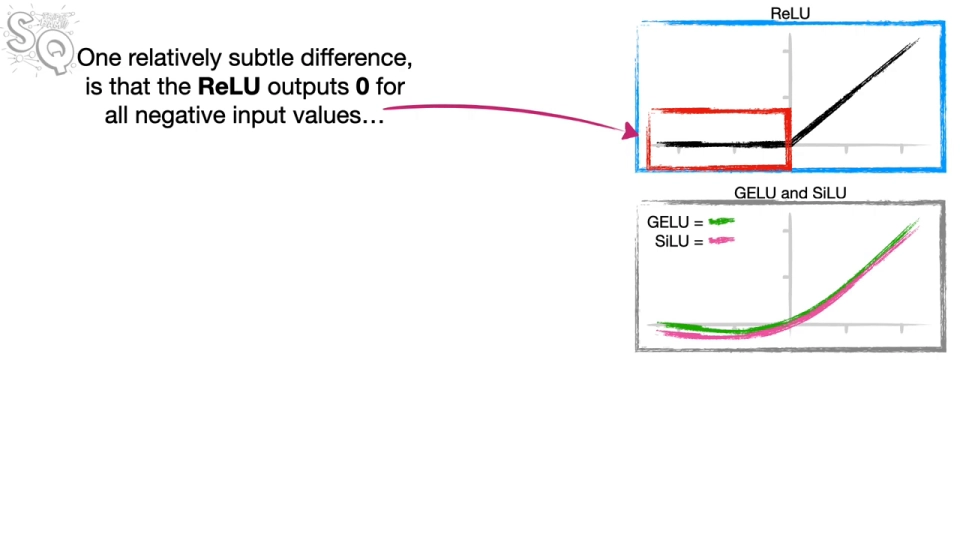
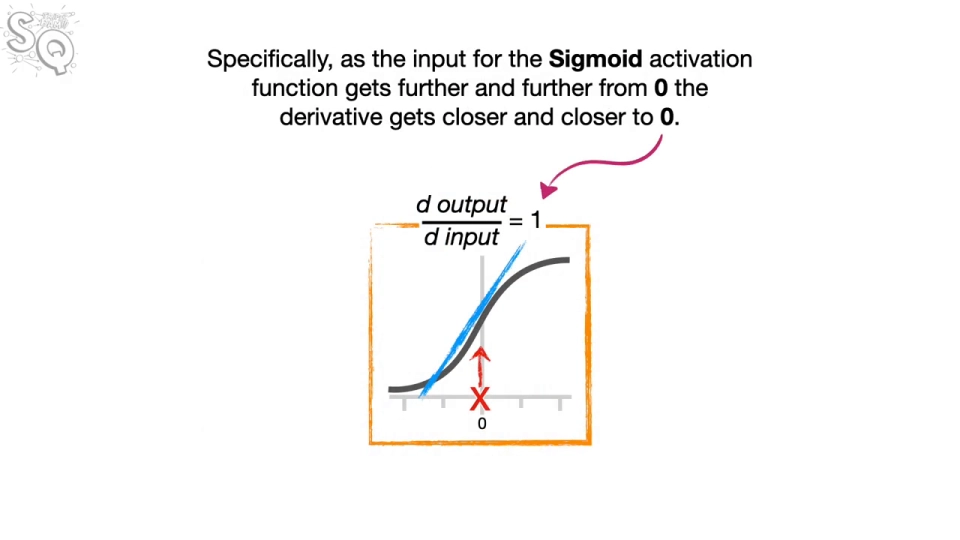
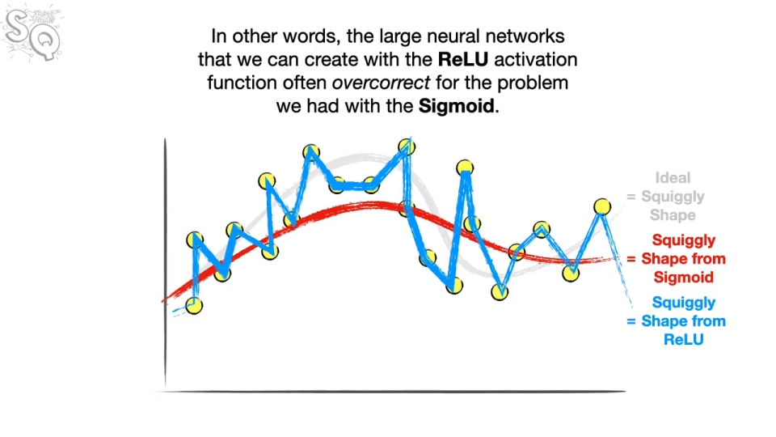
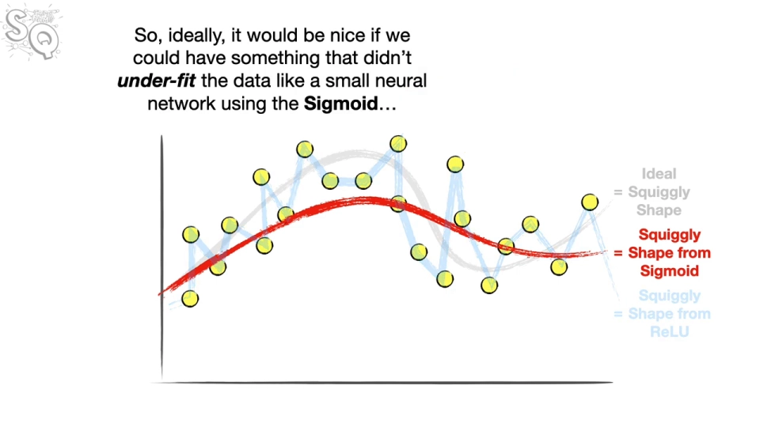
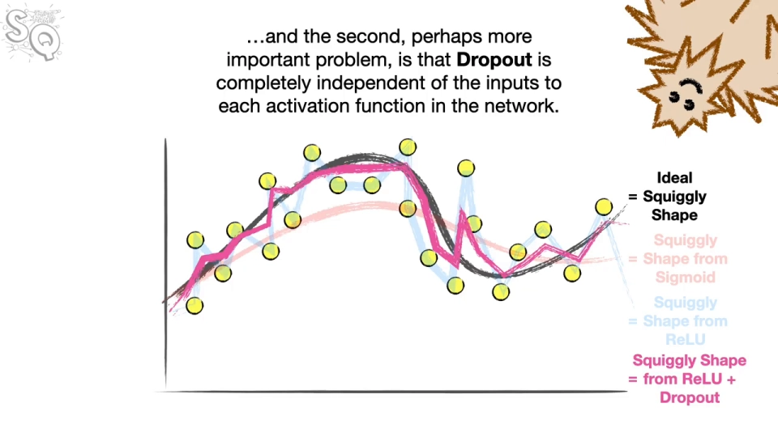
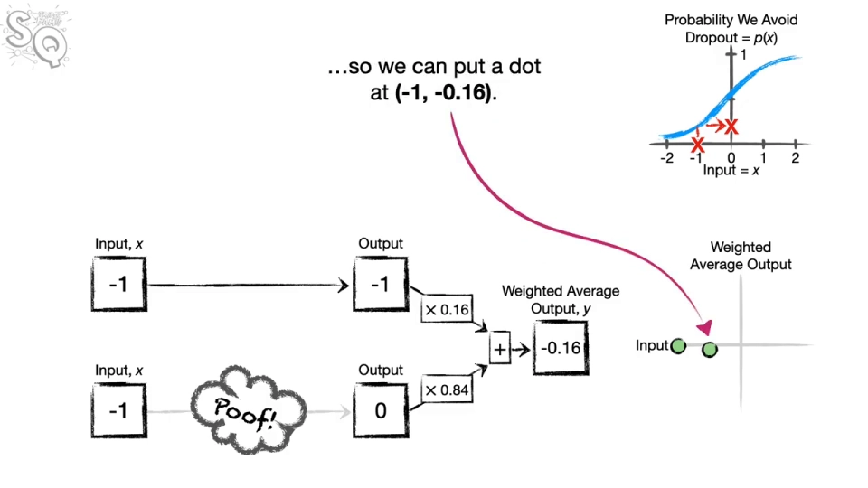
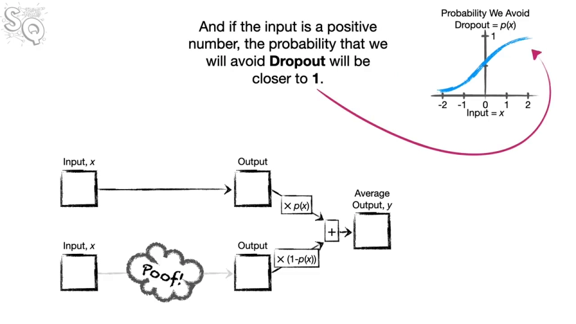
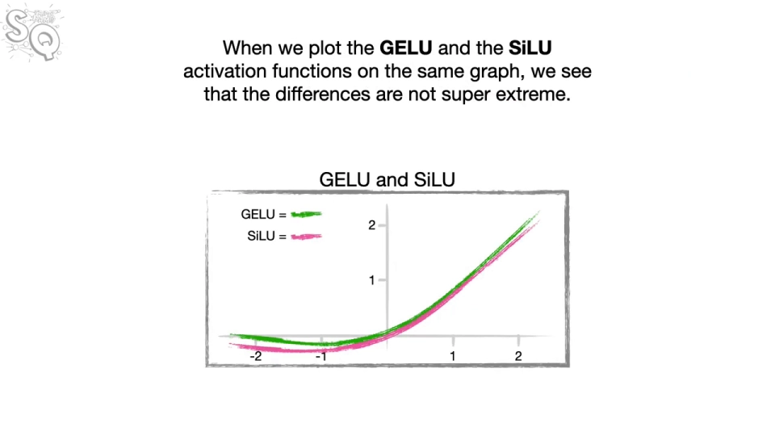
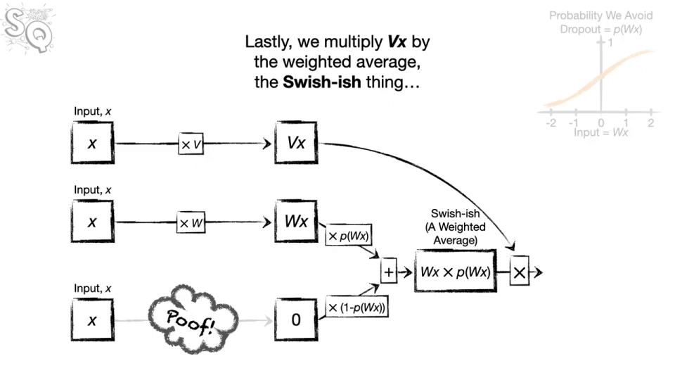
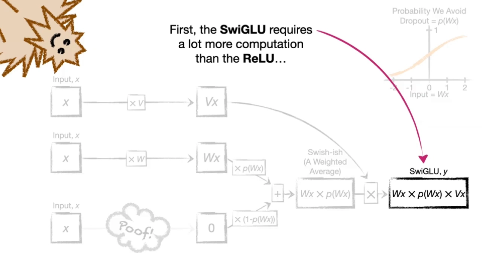

# 平滑与门控各解决什么：从 ReLU 的过拟合到 GELU、SiLU 与 SwiGLU

> 视频来源：[The GELU, SiLU and SwiGLU activation functions, clearly explained!!!](https://www.youtube.com/watch?v=2FaI2Fen1mQ&t=0)（YouTube · StatQuest，讲者 Josh Starmer）｜时长约 24 分钟
> 本文基于视频演说图文稿整理，配图截自视频。这支视频走的是「形状与直觉」路线：先用三条曲线指出 GELU、SiLU 与 ReLU 差在哪，再把这段历史讲成 sigmoid 太慢 → ReLU 太快 → dropout 补救 → dropout 不看输入 → 让输入自己决定失活概率，最后落到 SwiGLU 的「门控」。与本节另一篇（IIT Madras 课程的推导线）互补：那篇用伯努利随机变量取期望、再追 1.702 的来历，本篇用两个分支的加权平均把同样的结论算成具体的数。

## 本讲要解决的核心问题（SCQA）

**背景**：ReLU（Rectified Linear Unit）在 2010 年前后取代 sigmoid，成为深度网络能够训练起来的关键部件，也是卷积网络的标准配置。

**冲突**：ReLU 好用，但它有两个毛病：负输入一律输出 0（那一侧梯度也是 0），并且在 0 处有一个折角、不可导。而 GELU、SiLU、SwiGLU 这些新函数在负区间会「凹一下」，在 0 处是光滑的，形状上明显更讲究——但它们凭什么更好，为什么值得多花算力？

**疑问**：这些形状差异到底解决了什么问题？它们是怎么被「设计」出来的？

**回答（中心思想）**：它们是同一个想法的不同版本——**把 dropout 的随机失活改造成「由输入自己决定失活概率」**，取期望后就得到 $x$ 乘以一个 0 到 1 的门。GELU 的门是正态 CDF，SiLU 的门是 sigmoid，SwiGLU 则把「自己乘自己」换成「另一路投影来乘自己」。这样换来的好处有三层：0 处可导、负区保留一点梯度、以及一种内建的、与输入相关的正则化，因此更不容易过拟合。

---

## 一、三处形状差异：负区凹陷、0 处平滑、正区略缩

视频一开场就把四个函数名摊开：**ReLU**、**GELU**（Gaussian error linear unit，高斯误差线性单元）、**SiLU**（sigmoid linear unit，sigmoid 线性单元——讲者打趣说这个名字听起来像个自相矛盾的词）、以及 **SwiGLU**（Swish gated linear unit，Swish 门控线性单元）[【跳转到 00:42】](https://www.youtube.com/watch?v=2FaI2Fen1mQ&t=42)。名字很唬人，但前三者的差别其实相当细微，讲者把它们归纳成三条 [【跳转到 01:07】](https://www.youtube.com/watch?v=2FaI2Fen1mQ&t=67)：

1. **负区间的行为不同**：ReLU 对一切负输入都输出 0；GELU 与 SiLU 在大约 $-2$ 到 $0$ 之间会「凹」下去一小块，输出是个很小的负数，然后再回到 0。
2. **0 点处的光滑程度不同**：ReLU 在 0 处有一个明显的折角（angular bend）；GELU 与 SiLU 在 0 处是一条更柔和、可导的曲线。
3. **正区间的斜率不同**：ReLU 对正输入原样输出（输出等于输入，斜率为 1）；GELU 与 SiLU 的正半轴有一条轻微的弯曲，使得输出比输入略小一点。

至于 **SwiGLU**，它「可以长得像一条平滑版的 ReLU，也可以长得几乎像任何它想长的样子」[【跳转到 01:32】](https://www.youtube.com/watch?v=2FaI2Fen1mQ&t=92)——形状的自由度大得多，但它和 GELU、SiLU 是同源的。

这三条差异就是本讲的悬念：它们看起来只是曲线在 0 附近「圆了一点」，凭什么能影响模型表现？

## 二、ReLU 是后来的救火队员：sigmoid 的梯度越走越小

要理解这些新函数，得先回到 2010 年之前。那时大家建网络基本都用 **sigmoid** 激活函数，理由是它看起来很合理 [【跳转到 03:27】](https://www.youtube.com/watch?v=2FaI2Fen1mQ&t=207)：

- 输出被限制在 0 到 1 之间，正好对应生物神经元「不放电 / 放电」两种状态，曲线本身描述了从一个状态过渡到另一个状态的过程；
- 它在所有输入处都连续、可导，适合反向传播（backpropagation，即从损失往回算梯度、逐层更新参数的过程）。

小网络用 sigmoid 完全没问题。但一旦把网络加深、每层加宽，训练就越来越难 [【跳转到 04:17】](https://www.youtube.com/watch?v=2FaI2Fen1mQ&t=257)，原因出在它的导数上：

**输入离 0 越远，sigmoid 的导数越接近 0** [【跳转到 04:25】](https://www.youtube.com/watch?v=2FaI2Fen1mQ&t=265)。而梯度下降（gradient descent，沿梯度反方向小步挪动参数以降低损失的优化方法）每一步的步长正比于梯度，梯度接近 0 就等于「几乎不动」，找到好参数要花非常久。这个现象通常叫梯度消失（vanishing gradient），视频里的说法更直白：超小的导数意味着超小的步子 [【跳转到 05:10】](https://www.youtube.com/watch?v=2FaI2Fen1mQ&t=310)。

后果落在拟合能力上。讲者用一组散点和一条「理想的波浪线」来说明：如果数据本身需要一条弯弯曲曲的曲线才能拟合，那么因为 sigmoid 撑不起大网络，我们最后只能得到一条过于平坦的曲线——这叫**欠拟合**（underfit，模型太简单，连训练数据都没拟合好）[【跳转到 05:35】](https://www.youtube.com/watch?v=2FaI2Fen1mQ&t=335)。

于是 2010 年前后，ReLU 登场，把 sigmoid 换了下来，并被认为是让深度网络真正可训练的关键；按视频的叙事，到 2017 年 ReLU 还随着第一代 Transformer 风光了一把 [【跳转到 06:07】](https://www.youtube.com/watch?v=2FaI2Fen1mQ&t=367)。ReLU 好在两点 [【跳转到 06:32】](https://www.youtube.com/watch?v=2FaI2Fen1mQ&t=392)：

- **极省算力**：输入是负的就输出 0，是正的就原样输出，一次比较加一次乘法就够；
- **导数只有 0 和 1 两个值**：正区间的导数恒为 1，不管输入多大都不衰减。这一点直接治好了 sigmoid 的病——大输入也能以正常步长更新参数，优化速度明显更快 [【跳转到 06:57】](https://www.youtube.com/watch?v=2FaI2Fen1mQ&t=417)。

## 三、救过头了：ReLU 能撑起大网络，也就容易过拟合

ReLU 解决了「训不动」，却带来了反方向的问题。既然可以建很大的网络，网络就会把训练数据连噪声一起记住：那条理想的波浪线被一条上下乱窜、穿过每个黄色数据点的尖刺曲线取代 [【跳转到 07:22】](https://www.youtube.com/watch?v=2FaI2Fen1mQ&t=442)。这就是**过拟合**（overfit，模型把训练集的细节和噪声都学了进去，换新数据就变差）。讲者的说法是：用 ReLU 建起来的大网络，往往「矫枉过正」地补偿了 sigmoid 时代的欠拟合 [【跳转到 07:47】](https://www.youtube.com/watch?v=2FaI2Fen1mQ&t=467)。

那为什么不干脆建小一点的网络？视频替观众问了这个反问并自己回答 [【跳转到 08:12】](https://www.youtube.com/watch?v=2FaI2Fen1mQ&t=492)：理论上可以，实践上几乎不可能找到「最优规模」。设想你从 10 万个激活函数开始，难道要挨个试 99999 个、99998 个……一直试下去吗？代价无法接受 [【跳转到 08:37】](https://www.youtube.com/watch?v=2FaI2Fen1mQ&t=517)。

于是需求变得很明确：**要一个既不像小 sigmoid 网络那样欠拟合、也不像大 ReLU 网络那样过拟合的东西**。

## 四、Dropout 是第一次补救：训练一堆小网络，再做平均

早期的答案是 **dropout**。它的做法是：训练时随机挑一部分激活函数（神经元）从网络里删掉，用这个更小的网络做反向传播、更新权重与偏置；更新完回到原网络，再随机挑另一批删掉，如此反复直到训练结束 [【跳转到 08:58】](https://www.youtube.com/watch?v=2FaI2Fen1mQ&t=538)。

这个操作的妙处在于「等价于训练了很多个小网络」：每次删掉的子集不同，就是不同的子网络；等训练结束、用完整网络做预测时，效果上相当于对所有训练过的子网络做了**模型平均**（model averaging，把多个模型的预测综合起来，通常比单模型更稳）[【跳转到 09:48】](https://www.youtube.com/watch?v=2FaI2Fen1mQ&t=588)。ReLU 加上 dropout 之后得到的那条曲线，确实更接近理想形状——不如 ReLU 单独那样尖刺，也不像 sigmoid 那样平 [【跳转到 10:13】](https://www.youtube.com/watch?v=2FaI2Fen1mQ&t=613)。

## 五、Dropout 的缺口：它根本不看输入

但 ReLU + dropout 仍有问题，视频列了两条 [【跳转到 10:30】](https://www.youtube.com/watch?v=2FaI2Fen1mQ&t=630)：

1. dropout 是训练阶段额外加的一道工序，多一份复杂度；
2. 更关键的是——**dropout 与激活函数的输入完全无关**。不管进来的信号是大是小、重要不重要，它都按同样的概率把这个神经元删掉。

第二条正是新激活函数的切入点 [【跳转到 10:55】](https://www.youtube.com/watch?v=2FaI2Fen1mQ&t=655)。理想的做法应该是：输入很大（说明这个神经元正在传递强信号）就少删一点，输入很小就多删一点——也就是**让失活概率由输入决定**。GELU、SiLU、SwiGLU 都是从这个想法里长出来的。

## 六、把失活概率交给输入：GELU 是加权平均的结果

为了把这个想法算清楚，视频从最小的网络开始：一个输入、一个输出、没有隐藏层 [【跳转到 11:26】](https://www.youtube.com/watch?v=2FaI2Fen1mQ&t=686)。给它加上 dropout，就会出现两种情形：有时输入值（比如 $-2$）顺利到达输出；有时它被删掉，输出变成 0 [【跳转到 11:51】](https://www.youtube.com/watch?v=2FaI2Fen1mQ&t=711)。

如果 dropout 的概率固定为 50%，那么平均输出就是两个分支各乘 0.5 再相加：$0.5\times(-2) + 0.5\times 0 = -1$ [【跳转到 12:41】](https://www.youtube.com/watch?v=2FaI2Fen1mQ&t=761)。

现在做关键改动：**不用固定的 50%，而是用输入 $x$ 本身决定「避免被 dropout」的概率 $p(x)$**。这条用来把输入换算成概率的曲线，视频画成一条蓝色的 S 形曲线，并说明它就是标准正态分布的累积分布函数（CDF，即 $P(X\le x)$，输出从 0 平滑升到 1）[【跳转到 13:06】](https://www.youtube.com/watch?v=2FaI2Fen1mQ&t=786)。于是：

- 输入是负数时，避免 dropout 的概率 $p(x)$ 靠近 0——这个神经元很容易被删掉；
- 输入是正数时，$p(x)$ 靠近 1——它大概率能通过 [【跳转到 13:31】](https://www.youtube.com/watch?v=2FaI2Fen1mQ&t=811)。

具体数字最能说明问题。输入 $x=-2$ 时，蓝色曲线给出 $p(-2)=0.02$，也就是「避免 dropout」的概率是 0.02、「被 dropout」的概率是 $1-0.02=0.98$：

$$
y = p(x)\cdot x + \big(1-p(x)\big)\cdot 0 = 0.02\times(-2) + 0.98\times 0 = -0.04
$$

因为两个概率不再相等，这一步已经从「简单平均」变成了**加权平均**（weighted average，各分支按自己的概率加权）[【跳转到 14:21】](https://www.youtube.com/watch?v=2FaI2Fen1mQ&t=861)。同理：

| 输入 $x$ | 避免 dropout 的概率 $p(x)$ | 加权平均输出 $y$ |
| --- | --- | --- |
| $-2$ | $0.02$ | $-0.04$ |
| $-1$ | $0.16$ | $-0.16$ |
| $0$ | $0.50$ | $0$ |
| $1$ | $0.84$ | $0.84$ |
| $2$ | $0.98$ | $1.96$ |

把这些点连起来，就得到了一条完整的曲线 [【跳转到 15:36】](https://www.youtube.com/watch?v=2FaI2Fen1mQ&t=936)。注意负区那两点：$-2$ 对应的输出是 $-0.04$、$-1$ 对应 $-0.16$——**输出是负数**，这就是第一章里说的「$-2$ 到 $0$ 之间的那个小凹陷」的来源。

写成通式就一句话 [【跳转到 17:03】](https://www.youtube.com/watch?v=2FaI2Fen1mQ&t=1023)：

$$
y = x\cdot p(x) + 0\cdot\big(1-p(x)\big) = x\cdot p(x)
$$

第二项乘了 0，正如被 dropout 掉的那一路直接消失，只剩「输入值乘以它避免被删的概率」。因为那条蓝色 S 曲线正是正态分布的 CDF（这里记作 $\Phi$），这个激活函数就有了名字 [【跳转到 16:38】](https://www.youtube.com/watch?v=2FaI2Fen1mQ&t=998)：

$$
\mathrm{GELU}(x) = x\cdot\Phi(x)
$$

用一句人话说：**GELU 相当于把「按输入决定失活概率的 dropout」直接固化进激活函数里**，那个带 dropout 的网络可以整体简化为一个带 GELU 的网络 [【跳转到 16:13】](https://www.youtube.com/watch?v=2FaI2Fen1mQ&t=973)。这也回答了第一章的第一个疑问：负区的小凹陷不是随手画的，它是「负输入大概率被删掉，但小概率没被删」的加权结果。

## 七、换一条 S 曲线就是 SiLU，两者几乎同族

既然通用式是 $x\cdot p(x)$，那 $p(x)$ 就不一定非得是正态 CDF——**换一条 0 到 1 的 S 曲线，就换出一个新的激活函数** [【跳转到 17:53】](https://www.youtube.com/watch?v=2FaI2Fen1mQ&t=1073)。

最自然的选择就是本文开始时被 ReLU 取代的那条 **sigmoid**。视频把 sigmoid（橙色）和正态 CDF（蓝色）放在一起比较：两者的形状差别并不大，都从 0 升到 1。把 sigmoid 当作 $p(x)$ 代进去，得到的激活函数叫 **SiLU**（sigmoid linear unit）[【跳转到 18:43】](https://www.youtube.com/watch?v=2FaI2Fen1mQ&t=1123)：

$$
\mathrm{SiLU}(x) = x\cdot\sigma(x), \qquad \sigma(x) = \frac{1}{1+e^{-x}}
$$

把 GELU 和 SiLU 画在同一张图上，差异确实不极端，只是 SiLU 的负区凹陷略浅、正区略低一点 [【跳转到 18:56】](https://www.youtube.com/watch?v=2FaI2Fen1mQ&t=1136)。正因为形状相近，两者能用在相似的场合。视频还顺带提了一句当时的观察：Google 的模型更偏好 GELU。命名上也有个小坑——**很多人（包括 PyTorch 文档的维护者）干脆用 SiLU 这个名字同时指代 SiLU 与 Swish**（Swish 是把 $x$ 而不是 $Wx$ 放在概率函数外面的那个版本）[【跳转到 20:11】](https://www.youtube.com/watch?v=2FaI2Fen1mQ&t=1211)。

## 八、SwiGLU：把「自己乘自己」换成「另一路投影来乘」

到这里，$x\cdot p(x)$ 的结构一直是「**同一个 $x$ 既当被缩放的量，又当决定缩放系数的量**」——这就是所谓**自门控**（self-gating）：门（那个 0 到 1 的系数）和信号来自同一条路。SwiGLU 把这一点改掉。

视频还是从那个最小网络出发，一步步加料 [【跳转到 19:21】](https://www.youtube.com/watch?v=2FaI2Fen1mQ&t=1161)：

1. 先给输入乘一个权重 $W$，让送到输出端的值变成 $Wx$；被 dropout 的那一路仍然是 0；
2. 把 $Wx$ 送进那条 sigmoid 概率曲线，得到加权平均 $Wx\cdot p(Wx)$。视频说，如果到此为止，这个结果已经非常接近一个叫 **Swish** 的激活函数——差别只在于 Swish 的概率函数外面挂的是原始输入 $x$，而不是 $Wx$，所以讲者把中间这个结果戏称为「**Swish-ish**」[【跳转到 19:46】](https://www.youtube.com/watch?v=2FaI2Fen1mQ&t=1186)；
3. 再复制一份输入，乘上另一个不同的权重 $V$，得到第二路 $Vx$ [【跳转到 20:36】](https://www.youtube.com/watch?v=2FaI2Fen1mQ&t=1236)；
4. 最后把 $Vx$ 与那个「Swish-ish」的加权平均**相乘**，得到最终输出 [【跳转到 21:01】](https://www.youtube.com/watch?v=2FaI2Fen1mQ&t=1261)。

$$
\mathrm{SwiGLU}(x) = \underbrace{Vx}_{\text{门}} \cdot \underbrace{Wx\cdot p(Wx)}_{\text{Swish-ish}}
$$

名字也由此拼出来：那个「旁路相乘」的 $Vx$ 所在的乘法结构叫**门控线性单元**（gated linear unit，GLU——用一路信号去控制另一路信号能通过多少），再配上 Swish 形状的部分，合起来就是 **SwiGLU**（Swish gated linear unit）[【跳转到 21:26】](https://www.youtube.com/watch?v=2FaI2Fen1mQ&t=1286)。

门控的价值在于自由度：多出来的权重 $W$、$V$ 与一次乘法，让这个激活函数能取到的形状比 GELU、SiLU 丰富得多——所以它「可以像平滑版 ReLU，也可以像几乎任何形状」[【跳转到 01:32】](https://www.youtube.com/watch?v=2FaI2Fen1mQ&t=92)。这也是第一章里那条「形状差异」的终点：从「0 处圆一点」走到「形状由两路投影自己商量」。

## 九、作者也没解释，但有两个说得通的理由

一个自然的追问是：为什么要多花这些计算？视频在这里很诚实——它直接引用了 SwiGLU 作者的原话：「我们不对这些架构为什么有效提供解释。」[【跳转到 21:44】](https://www.youtube.com/watch?v=2FaI2Fen1mQ&t=1304)。

讲者自己给了两个猜测 [【跳转到 22:09】](https://www.youtube.com/watch?v=2FaI2Fen1mQ&t=1329)：

1. **它更贵，所以网络被建得更小**。SwiGLU 的计算量明显高于 ReLU，工程上大家就会把模型做得小一些；而小模型过拟合的倾向本来就弱一些。这个理由绕了个弯，但成立。
2. **参数更多，等于把「形状」交给网络自己学**。神经网络发展史上反复出现的一个主题是：人插手越少、让网络自己决定得越多，效果往往越好。SwiGLU 多出来的可训练参数，本质上是在说「激活函数该长什么样，你自己定」。

按视频的说法，正因为效果不错，SwiGLU 这类变体在 AI 里用得相当普遍，尤其是 Meta 的模型 [【跳转到 22:34】](https://www.youtube.com/watch?v=2FaI2Fen1mQ&t=1354)。讲者最后的总结回到了主线：**这些激活函数的共同思想，都是 dropout 加权平均**；更大的启示是神经网络仍在高频实验中，人们不断试新东西、有效就发表出来 [【跳转到 22:59】](https://www.youtube.com/watch?v=2FaI2Fen1mQ&t=1379)。

## 小结

- 三处形状差异：ReLU 负区恒为 0，GELU/SiLU 在 $-2$ 到 $0$ 之间有一个小凹陷；ReLU 在 0 处是折角，另外两者在 0 处光滑可导；正区间 ReLU 原样输出，另外两者略小一点。
- sigmoid 的问题是导数在远离 0 处趋近 0，梯度下降迈不出步子，大网络训不动、只能欠拟合；ReLU 的导数取 0 或 1，正区间不衰减，让深网络变得可训练。
- ReLU 的代价是能撑起很大的网络，因而容易过拟合；而「找最优网络规模」在实践中不可行。
- dropout 训练时随机删神经元，等价于训练许多小网络再做模型平均，能缓解过拟合，但它**与输入无关**，好信号和坏信号一视同仁。
- 让输入自己决定「避免 dropout 的概率」$p(x)$，取加权平均得 $x\cdot p(x)$：$p$ 取正态 CDF 就是 GELU，取 sigmoid 就是 SiLU；负区的凹陷正是「负输入大概率被删、小概率没被删」的算术结果。
- GELU 与 SiLU 形状相近、适用场景相近，命名上常有混用（PyTorch 文档就用 SiLU 泛指两者）。
- SwiGLU 把自门控换成两路投影：一路 $Vx$ 当门，另一路 $Wx\cdot p(Wx)$ 当信号，两者相乘；换来更大的形状自由度，代价是更多计算。
- 作者本人不解释它为何有效；视频给的两个猜测是多算力导致模型变小、以及更多可训练参数让网络自学形状。

## 关键术语速查

| 术语 | 一句话解释 |
| --- | --- |
| 激活函数 | 线性加权之后施加的非线性变换，决定神经元「通过多少、怎么变形」 |
| 梯度消失 | 激活函数导数在输入绝对值大时趋近 0，导致参数几乎不更新、训练极慢 |
| 欠拟合 | 模型太简单，连训练数据都没拟合好 |
| 过拟合 | 模型把训练数据的细节与噪声一并记住，换新数据表现变差 |
| 模型平均 | 把多个模型（或多次 dropout 得到的子网络）的预测综合起来，通常更稳 |
| dropout | 训练时按概率随机删除一部分神经元，等价于训练许多子网络 |
| 加权平均 | 各分支的输出按各自概率加权求和，权重之和为 1 |
| CDF 累积分布函数 | 密度曲线从负无穷积分到 $x$ 的面积，即 $P(X\le x)$，取值 0 到 1 |
| GELU | $x\Phi(x)$，用正态 CDF 当门的激活函数，全称高斯误差线性单元 |
| SiLU | $x\sigma(x)$，用 sigmoid 当门，全称 sigmoid 线性单元 |
| Swish | 与 SiLU 形状极近的写法，常被混用；概率函数外挂的是原始输入 |
| 自门控 | 门系数与信号来自同一条输入路径：$x$ 自己决定自己通过多少 |
| GLU 门控线性单元 | 用一路投影去乘另一路投影的结构，控制信息通过量 |
| SwiGLU | $\mathrm{SwiGLU}(x)=Vx\cdot Wx\cdot p(Wx)$，两路投影相乘的门控结构 |
