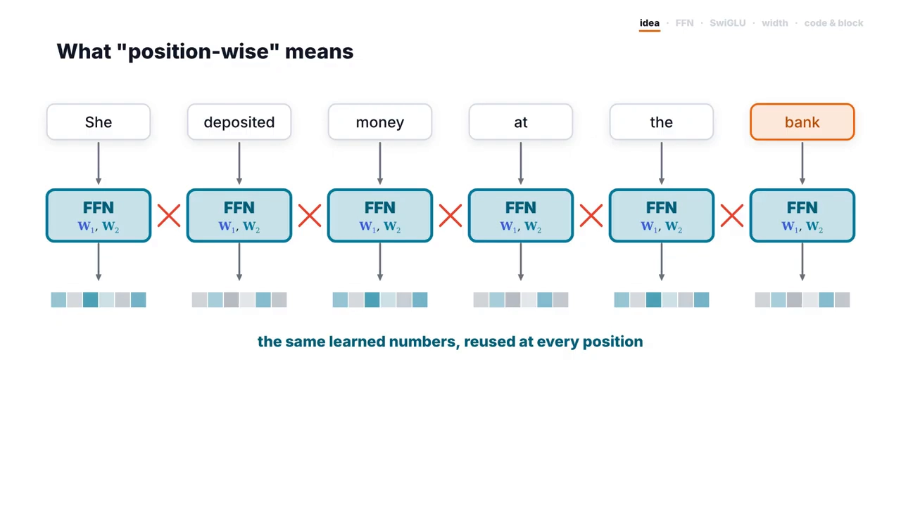
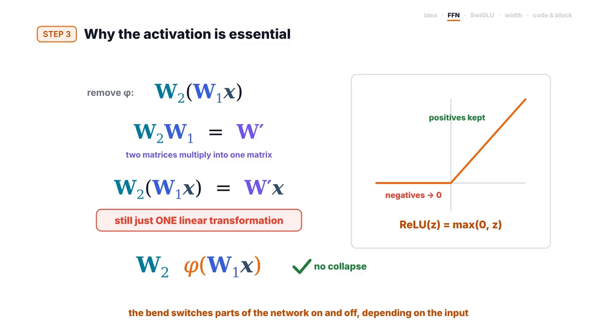
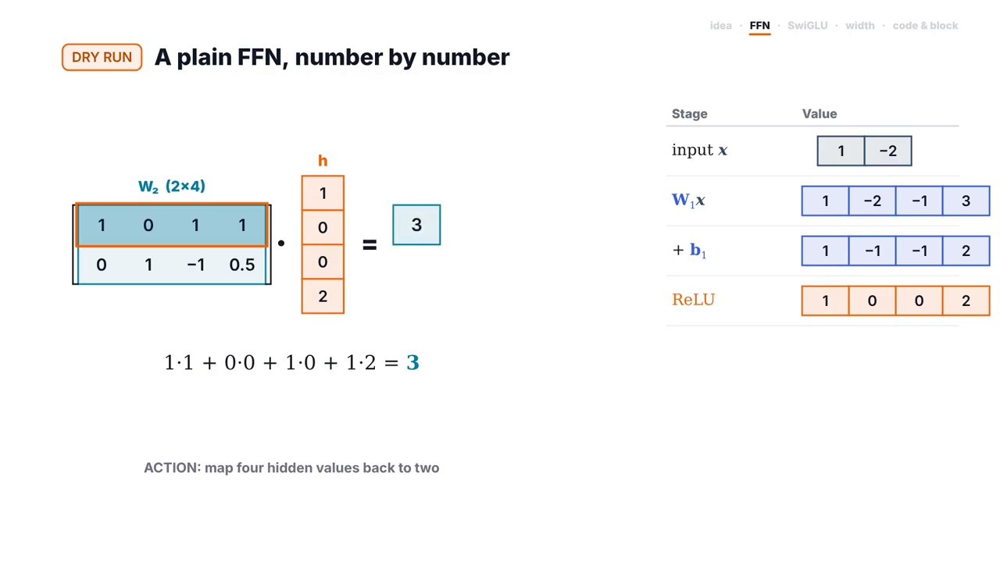
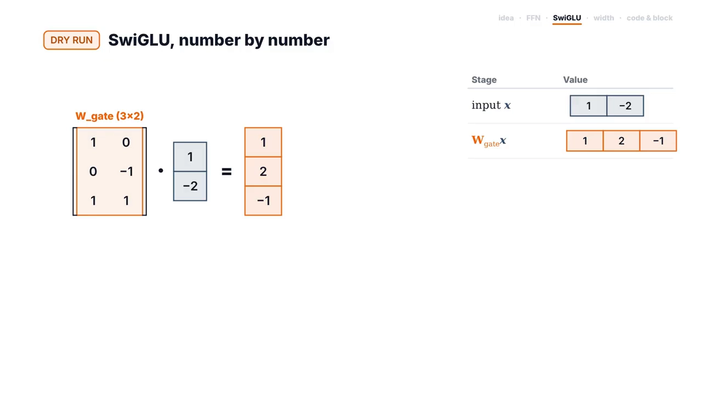
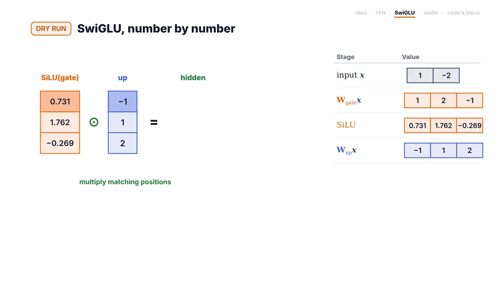
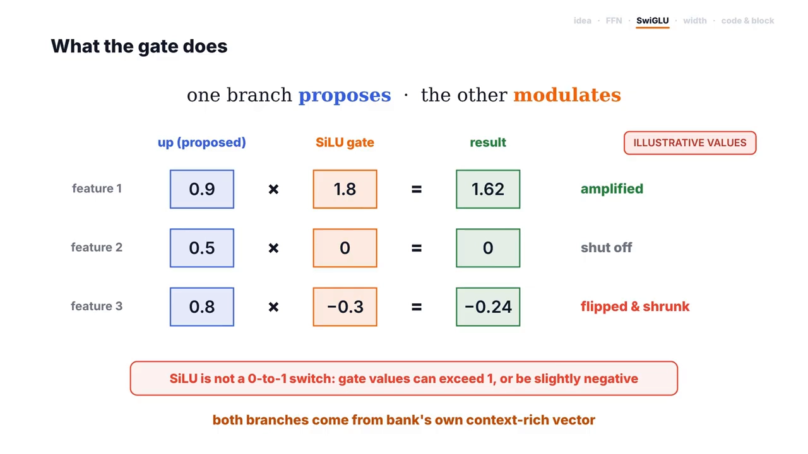
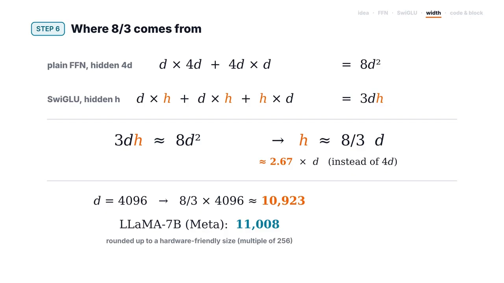
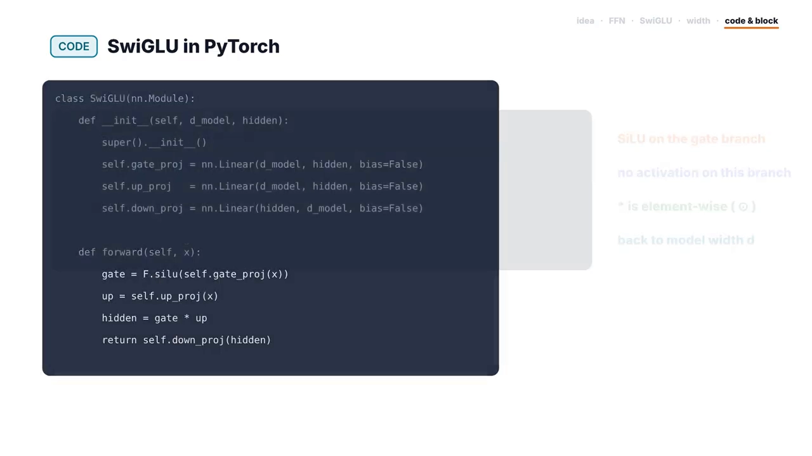

# 一支 token 穿过 SwiGLU：Gate、Up、Down 三个矩阵的形状、顺序与手算

> 视频来源：[SwiGLU 讲解：为什么现代 LLM 换掉了 ReLU](https://www.youtube.com/watch?v=ofCVXwM42Cs&t=0)（YouTube · 原题 *SwiGLU Explained: Why Every Modern LLM Replaced ReLU*，约 15 分钟）
> 本文基于视频演说图文稿整理，配图截自视频。字幕为自动生成，按上下文订正了 SwiGLU / SiLU / gate / up、down projection 等术语。本文只回答一个问题：**一支 token 的向量到底怎么一步步穿过 gate、up、down 这三个矩阵**——形状怎么变、激活加在哪一步、相乘发生在乘之前还是乘之后。至于"多出来的那个矩阵在机制上换到了什么、有没有受控证据"，见本小节另一篇。

## 本讲要解决的核心问题（SCQA）

**背景**：Transformer 里注意力负责让 token 之间交换信息，前馈网络（FFN）负责在每个 token 内部做变换。经典 FFN 的结构很好记：$W_1$ 把向量升到 $4d$ 宽、逐元素过激活、$W_2$ 再压回 $d$。两个矩阵，一升一降。

**冲突**：现代模型（Llama 一类）把这块换成了 SwiGLU，矩阵从两个变成三个：gate、up、down。名字都很像"投影"，代码里也就四行，但初学最容易在这里记混：哪条支路要过激活？两条支路的宽度为什么必须一样？逐元素相乘得到的是 $h$ 维还是 $d$ 维？中间宽度为什么不再是 $4d$？

**疑问**：拿一个具体的小输入，能不能把这三步完整手算一遍，把每一步的形状和数字都对上？

**回答（中心思想）**：**顺序是"两次投影 → 只对 gate 支过 SiLU → 逐元素相乘 → down 投影"**。用 $d$ 表示模型宽度、$h$ 表示中间宽度：$W_{\text{gate}}$ 与 $W_{\text{up}}$ 都是 $d \times h$，两者输出必须同宽才能逐元素相乘；乘积仍是 $h$ 维，最后 $W_{\text{down}}$（$h \times d$）把结果投回 $d$ 维。手算例子 $x = [1,\ -2]$、$h = 3$ 会得到 $\mathrm{gate} = [1,\ 2,\ -1] \to \mathrm{SiLU} = [0.731,\ 1.762,\ -0.269]$、$\mathrm{up} = [-1,\ 1,\ 2]$、$\mathrm{hidden} = [-0.731,\ 1.762,\ -0.538]$、输出 $[-1.269,\ 1.224]$。而"三个矩阵"的代价要靠把 $h$ 从 $4d$ 收到约 $\frac{8}{3}d$ 来对冲。

---

## 一、先摆清位置：attention 混合位置，FFN 混合特征

看一句有歧义的话：*She deposited money at the bank*。这里的 bank 是"银行"，不是"河岸"。注意力机制已经让 bank 这个位置回头看了 deposited 和 money，把上下文拉了进来；现在 token 之间的联系用完了，只剩下 bank 自己的一条向量，每个 Transformer 层会立刻把它送进另一张网络 [【跳转到 00:00】](https://www.youtube.com/watch?v=ofCVXwM42Cs&t=0)。



一句话记住分工：**注意力在 token 之间搬运信息，FFN 在单个 token 内部变换特征** [【跳转到 00:25】](https://www.youtube.com/watch?v=ofCVXwM42Cs&t=25)。

FFN 里完全没有 token 间的交互：每个 token 的向量单独进去、单独出来，六个 token 之间没有箭头。这不是缺点——FFN 不直接读句子，因为注意力已经把相关上下文塞进这条向量里了，FFN 的任务是处理"现在这条向量里已有的东西" [【跳转到 01:08】](https://www.youtube.com/watch?v=ofCVXwM42Cs&t=68)。这就是所谓 **position-wise**（逐位置）：同一套学到的参数，在每一个位置、每一句话、每一次都复用，作用于一个向量的特征维度，而不是句子的词维度 [【跳转到 01:33】](https://www.youtube.com/watch?v=ofCVXwM42Cs&t=93)。

## 二、经典 FFN 的形状：$d \to 4d \to d$，两个矩阵

从一条 token 向量 $x$ 出发（它就是 bank 当前的表示），经典 FFN 分三步 [【跳转到 01:58】](https://www.youtube.com/watch?v=ofCVXwM42Cs&t=118)：

1. 线性投影：$x$ 乘一个学到的矩阵 $W_1$、加偏置 $b_1$，结果是一个**比 $x$ 更宽**的向量；
2. 逐元素激活 $\varphi$：对每个数单独处理，把数值"掰弯"成非线性；
3. 第二个投影 $W_2 x + b_2$ 把向量**压回原来的宽度**，好让它继续在模型里往后走。

合起来：

$$
\mathrm{FFN}(x) = W_2\,\varphi(W_1 x + b_1) + b_2
$$

原版 Transformer 里每个 token 向量是 512 维、隐藏层 2048 维，也就是 512 → 2048 → 512，宽了四倍。但"四倍"是设计选择，不是普适规律 [【跳转到 02:48】](https://www.youtube.com/watch?v=ofCVXwM42Cs&t=168)。

为什么先撑宽再压回去？把隐藏层想成一大排"临时检测器"：每个隐藏单元都是输入特征的一种不同的学到的组合，有几千个，就能对同一条向量并行地算出很多种模式。对 bank 你可以想象出"金融语境""地点""交易""名词角色"这些检测器——**这只是直觉，真实的隐藏单元很少和人类能叫出名字的概念一一对应** [【跳转到 03:38】](https://www.youtube.com/watch?v=ofCVXwM42Cs&t=218)。激活之后，第二个投影把这一排临时特征读一遍，在模型宽度上写出一份压缩的更新。



那为什么必须有激活？拿掉试试：网络变成 $W_2(W_1 x)$，而两个接连作用的矩阵总能先乘起来，$W_2 W_1 = W'$ 只是另一个矩阵，于是 $W_2(W_1 x) = W' x$——**没激活，两层仍然只是一个线性变换，多出来的宽度白费**。把激活放回中间，这个塌缩就不可能了 [【跳转到 04:28】](https://www.youtube.com/watch?v=ofCVXwM42Cs&t=268)。最简的选择是原版用的 ReLU：正数保留、负数归零；这一个"折角"复制到几千个隐藏单元上，就允许网络按输入开关自己的一部分，从而响应任何单个矩阵都抓不住的特征组合。

## 三、用手算跑一遍两矩阵 FFN



用一个极小的版本：两个数进、四个隐藏单元、两个数出。输入 $x = [1,\ -2]$ [【跳转到 05:18】](https://www.youtube.com/watch?v=ofCVXwM42Cs&t=318)。

**第一步，乘 $W_1$**。每个隐藏单元拿自己那一行和 $x$ 做点积：

| 隐藏单元 | $W_1$ 的行 | 点积 |
| --- | --- | --- |
| 1 | $[1,\ 0]$ | 1 |
| 2 | $[0,\ 1]$ | -2 |
| 3 | $[1,\ 1]$ | -1 |
| 4 | $[1,\ -1]$ | 3 |

**第二步，加偏置** $b_1 = [0,\ 1,\ 0,\ -1]$，激活前的值是 $[1,\ -1,\ -1,\ 2]$。

**第三步，ReLU**：正数留下，两个负数归零，隐藏状态变成 $[1,\ 0,\ 0,\ 2]$——第 2、3 号单元对这个输入被关掉了 [【跳转到 06:08】](https://www.youtube.com/watch?v=ofCVXwM42Cs&t=368)。

**第四步，乘 $W_2$**（$2 \times 4$）把四个数映回两个：第一行 $[1,\ 0,\ 1,\ 1]$ 给出 $1 + 0 + 0 + 2 = 3$，第二行 $[0,\ 1,\ -1,\ 0.5]$ 给出 $0 + 0 + 0 + 1 = 1$。**第五步，加 $b_2 = [-1,\ 0.5]$**，输出 $[2,\ 1.5]$。

对照一下：**不加 ReLU**，同样的权重会给出 $[1,\ 1.5]$。激活改变了结果，而形状没变——两进两出 [【跳转到 06:58】](https://www.youtube.com/watch?v=ofCVXwM42Cs&t=418)。真实模型是几千个数，但步骤完全一样。

## 四、换成三个矩阵：gate 与 up 都投到同一个中间宽度

ReLU 不是唯一选项，后来的模型换成了更平滑的曲线：BERT 与 GPT-2 用的 GELU，以及 SiLU（也叫 Swish，$x \cdot \sigma(x)$）。它们在大正数处都像 ReLU，在 0 附近平滑弯曲，并允许小的负值通过 [【跳转到 08:13】](https://www.youtube.com/watch?v=ofCVXwM42Cs&t=493)。

但这些都还只是"对每个数套同一条固定曲线"。下一步的想法是：**让一条学到的支路去控制另一条**。从 $x$ 出发，这次投影**两次**，用两个不同的学到的矩阵 [【跳转到 08:38】](https://www.youtube.com/watch?v=ofCVXwM42Cs&t=518)：

- gate 支：$W_{\text{gate}} x$
- up 支：$W_{\text{up}} x$

两条支路产出**同宽**的隐藏向量。然后：**只对 gate 支过 SiLU**，把两条支路**逐元素相乘**（第一个数乘第一个数、第二个乘第二个……），最后 down 投影 $W_{\text{down}}$ 把结果带回模型宽度。这个设计就叫 **SwiGLU**——用 Swish（即 SiLU）的 gated linear unit（门控线性单元）[【跳转到 09:03】](https://www.youtube.com/watch?v=ofCVXwM42Cs&t=543)。

三个矩阵的形状必须这样摆（$d$ 模型宽度，$h$ 中间宽度）：

| 矩阵 | 形状 | 作用 | 是否过 SiLU |
| --- | --- | --- | --- |
| $W_{\text{gate}}$ | $d \times h$ | 产出每个通道的增益分数 | 是 |
| $W_{\text{up}}$ | $d \times h$ | 产出候选特征值 | 否 |
| $W_{\text{down}}$ | $h \times d$ | 把乘完的 $h$ 维结果投回 $d$ 维 | 否 |

**两条输入投影必须同宽**，因为逐元素相乘要求两个张量形状一致；这也解释了为什么 $W_{\text{gate}}$ 和 $W_{\text{up}}$ 的形状总是写成一样。

## 五、手算：$W_{\text{gate}}$ 那一步



还是 $x = [1,\ -2]$，这次中间宽度取 3。gate 投影用了一个 $3 \times 2$ 的矩阵 [【跳转到 10:18】](https://www.youtube.com/watch?v=ofCVXwM42Cs&t=618)：

$$
W_{\text{gate}} x =
\begin{bmatrix} 1 & 0 \\ 0 & -1 \\ 1 & 1 \end{bmatrix}
\begin{bmatrix} 1 \\ -2 \end{bmatrix}
= \begin{bmatrix} 1 \\ 2 \\ -1 \end{bmatrix}
$$

逐行看：第一行 $1 \cdot 1 + 0 \cdot (-2) = 1$；第二行 $0 \cdot 1 + (-1) \cdot (-2) = 2$；第三行 $1 \cdot 1 + 1 \cdot (-2) = -1$。

注意这一步只是"投影"——**激活还没发生**。形状从 $d = 2$ 变成 $h = 3$，是升维。

## 六、只对 gate 支过 SiLU，然后逐元素相乘



对 $[1,\ 2,\ -1]$ 逐个算 $\mathrm{SiLU}(g) = g \cdot \sigma(g)$ [【跳转到 10:43】](https://www.youtube.com/watch?v=ofCVXwM42Cs&t=643)：

$$
\mathrm{SiLU}(1) \approx 0.731, \qquad \mathrm{SiLU}(2) \approx 1.762, \qquad \mathrm{SiLU}(-1) \approx -0.269
$$

up 投影给出 $W_{\text{up}} x = [-1,\ 1,\ 2]$——**这条支路不过激活**。

逐元素相乘（记作 $\odot$）：

$$
\mathrm{hidden} = \mathrm{SiLU}(\mathrm{gate}) \odot \mathrm{up}
= \begin{bmatrix} 0.731 \\ 1.762 \\ -0.269 \end{bmatrix} \odot
\begin{bmatrix} -1 \\ 1 \\ 2 \end{bmatrix}
= \begin{bmatrix} -0.731 \\ 1.762 \\ -0.538 \end{bmatrix}
$$

三行分别是 $0.731 \times (-1) = -0.731$、$1.762 \times 1 = 1.762$、$(-0.269) \times 2 = -0.538$。此时仍是 $h = 3$ 维。

## 七、down 投影回到模型宽度

最后用 $W_{\text{down}}$ 把 3 维投回 2 维 [【跳转到 11:08】](https://www.youtube.com/watch?v=ofCVXwM42Cs&t=668)：按这个例子里 down 矩阵的取法，第一行相当于把第 1、3 号隐藏单元相加，$-0.731 + (-0.538) \approx -1.269$；第二行把第 2、3 号相加，$1.762 + (-0.538) \approx 1.224$。

$$
y = W_{\text{down}}\,\mathrm{hidden} \approx \begin{bmatrix} -1.269 \\ 1.224 \end{bmatrix}
$$

三个矩阵走完，向量回到原来的宽度 $d = 2$，但它已经被一个**由这个 token 自己算出来的门**改造过。整条链路的形状变化是：

$$
d \xrightarrow{W_{\text{gate}},\,W_{\text{up}}} h \xrightarrow{\ \odot\ } h \xrightarrow{W_{\text{down}}} d
$$

## 八、门控到底在做什么：放大、关断、翻转并缩小



一句话概括两条支路的分工：**一条提出特征，另一条调制它** [【跳转到 09:28】](https://www.youtube.com/watch?v=ofCVXwM42Cs&t=568)。用一个示意例子（视频标明是 illustrative values）：up 支提出三个特征 $0.9,\ 0.5,\ 0.8$，门控值为 $1.8,\ 0,\ -0.3$，乘完分别得到 $1.62$、$0$、$-0.24$——第一个被放大，第二个被关掉，第三个被翻转且缩小。

这里要特别记一句：**SiLU 不是 0 到 1 的开关**。门控值可以大于 1（放大），也可以略小于 0（反向）。而且两条支路都是从 bank 自己那条向量算出来的，所以 bank 经由注意力取得的上下文，最终决定了哪些特征通过、通过得有多强 [【跳转到 09:53】](https://www.youtube.com/watch?v=ofCVXwM42Cs&t=593)。

## 九、中间宽度为什么不是 $4d$：多一个矩阵要付的钱



普通 FFN 只有升、降两个矩阵：中间宽度 $4d$ 时，up 矩阵是 $d \times 4d$、down 矩阵是 $4d \times d$，合计 $4d^2 + 4d^2 \approx 8d^2$（忽略小偏置）。SwiGLU 有三个矩阵：$d \times h$、$d \times h$、$h \times d$，合计 $3dh$ [【跳转到 11:58】](https://www.youtube.com/watch?v=ofCVXwM42Cs&t=718)。

**同样中间宽度下，三个矩阵比两个多 50%**。要把预算拉平，就让两者相等 [【跳转到 12:23】](https://www.youtube.com/watch?v=ofCVXwM42Cs&t=743)：

$$
3dh = 8d^2 \quad\Longrightarrow\quad h = \frac{8}{3}d \approx 2.67\,d
$$

所以 SwiGLU 的中间宽度是约 $2.67d$，而不是 $4d$。代入具体数字：$d = 4096$ 时 $\frac{8}{3} \times 4096 \approx 10{,}923$；Meta 开源的 Llama-7B 用的是 11,008——**向上取整到一个对硬件友好的尺寸**（256 的倍数），所以 $\frac{8}{3}$ 是"参数预算的直觉"，不是放之四海皆准的定律，不同模型会选不同宽度 [【跳转到 12:48】](https://www.youtube.com/watch?v=ofCVXwM42Cs&t=768)。

## 十、落到代码：forward 四行，三个不带 bias 的线性层



在 PyTorch 里，核心就是四行 [【跳转到 13:13】](https://www.youtube.com/watch?v=ofCVXwM42Cs&t=793)：

```python
class SwiGLU(nn.Module):
    def __init__(self, d_model, hidden):
        super().__init__()
        self.gate_proj = nn.Linear(d_model, hidden, bias=False)
        self.up_proj   = nn.Linear(d_model, hidden, bias=False)
        self.down_proj = nn.Linear(hidden, d_model, bias=False)

    def forward(self, x):
        gate = F.silu(self.gate_proj(x))   # SiLU 只加在 gate 支
        up   = self.up_proj(x)             # 这条支路没有激活
        hidden = gate * up                 # 同形状逐元素乘（⊙）
        return self.down_proj(hidden)      # 回到模型宽度 d
```

对着上一篇的形状表核一遍：`gate_proj` 与 `up_proj` 都是 $d \to h$、`down_proj` 是 $h \to d$，三个都是 `bias=False`（所以严格说是三个矩阵，而不是矩阵加偏置）；`*` 在同形状张量上是逐元素乘。

把前面手算的权重装进这个小模块，输入 $[1,\ -2]$，输出是 $[-1.269,\ 1.224]$——**和手算完全一致** [【跳转到 14:09】](https://www.youtube.com/watch?v=ofCVXwM42Cs&t=849)。这种"手算一遍、再让代码复现同一个数"的习惯很有用：形状错、激活加错支路、写成了矩阵乘，都会立刻对不上。

**它在一层里坐在哪**：每个 token 带一条不断累积的向量，叫**残差流**（residual stream）。一份拷贝先过 RMSNorm 归一化，再进 SwiGLU，结果**加回**残差流。也就是说 FFN 写出的是"一份更新"，不是把向量替换掉 [【跳转到 14:23】](https://www.youtube.com/watch?v=ofCVXwM42Cs&t=863)。

回到开头那句话：注意力让 bank 知道 deposited 和 money，SwiGLU 把这份知识变成新的特征，交给下一层 [【跳转到 14:48】](https://www.youtube.com/watch?v=ofCVXwM42Cs&t=888)。

---

## 小结

- FFN 是 position-wise 的：它在单个 token 的向量内部变换特征，不跨 token 交流；注意力负责跨位置混合。
- 经典 FFN 的形状是 $d \to 4d \to d$，两个矩阵约 $8d^2$ 参数；升维是为了并行地算很多"临时检测器"，没有激活则两层会塌成一个矩阵。
- SwiGLU 的顺序是：**两次投影 → 只对 gate 支过 SiLU → 逐元素相乘 → down 投影**。
- 形状：$W_{\text{gate}}$、$W_{\text{up}}$ 都是 $d \times h$（必须同宽），乘积仍是 $h$ 维，$W_{\text{down}}$ 是 $h \times d$。
- 手算（$x = [1,\ -2]$，$h = 3$）：$\mathrm{gate} = [1,\ 2,\ -1]$，$\mathrm{SiLU} = [0.731,\ 1.762,\ -0.269]$，$\mathrm{up} = [-1,\ 1,\ 2]$，$\mathrm{hidden} = [-0.731,\ 1.762,\ -0.538]$，输出 $[-1.269,\ 1.224]$。
- 门控值能大于 1、能等于 0、能略小于 0，所以作用是放大、关断、翻转缩小，而不是 0/1 开关。
- 三个矩阵在同宽度下多 50% 参数，所以 $3dh = 8d^2 \Rightarrow h \approx \frac{8}{3}d \approx 2.67d$；$d = 4096$ 约 10,923，Llama-7B 取硬件友好的 11,008。
- 代码四行、三个 `bias=False` 的 Linear；在 decoder block 里的位置是 RMSNorm → SwiGLU → 加回残差流。

## 关键术语速查

| 术语 | 一句话解释 |
| --- | --- |
| position-wise | 对每个 token 位置独立、参数共享地施加同一个函数；FFN 就是 position-wise 的 |
| $d$ / $h$ | 模型宽度（token 向量维数）与 FFN 中间宽度；SwiGLU 里 $h \approx \frac{8}{3}d$ |
| gate_proj | 产出门控分数的 $d \times h$ 投影，其输出要过 SiLU |
| up_proj | 产出候选内容的 $d \times h$ 投影，不过激活 |
| down_proj | $h \times d$ 投影，把逐元素乘完的 $h$ 维结果投回模型宽度 |
| SiLU / Swish | $\mathrm{SiLU}(g) = g\sigma(g)$，平滑、无上下界，可略小于 0 |
| 残差流（residual stream） | 每个 token 携带、逐层累加的主干向量；FFN 的输出是加在它上面的更新 |
| RMSNorm | 归一化层，SwiGLU 之前先对残差流的拷贝做归一化 |
