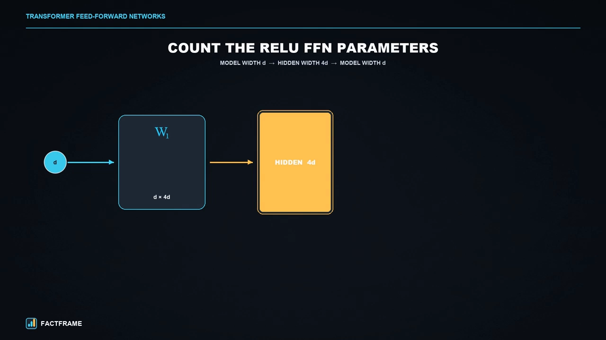
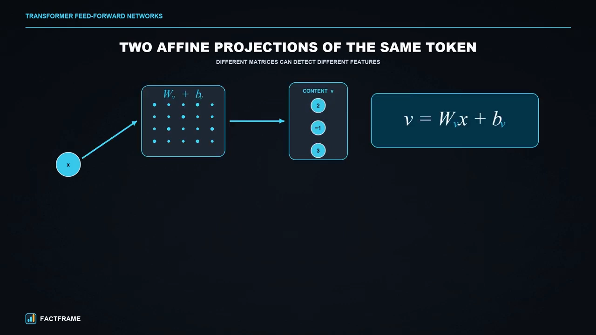
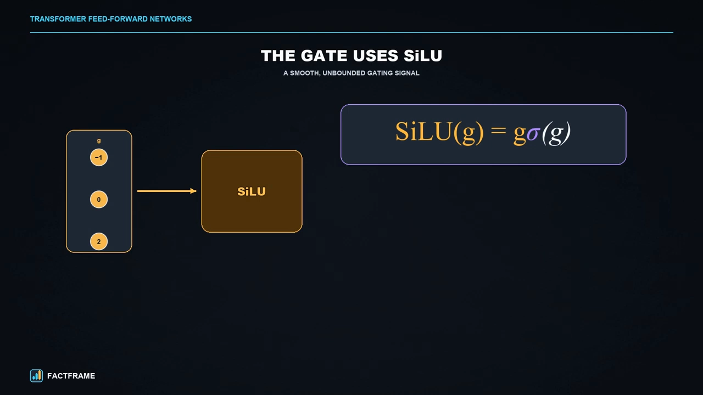
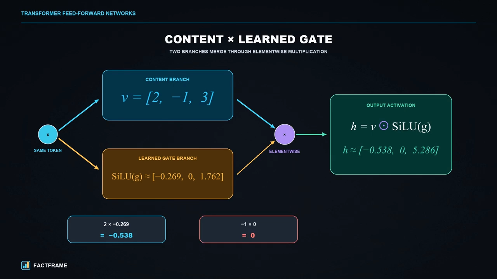
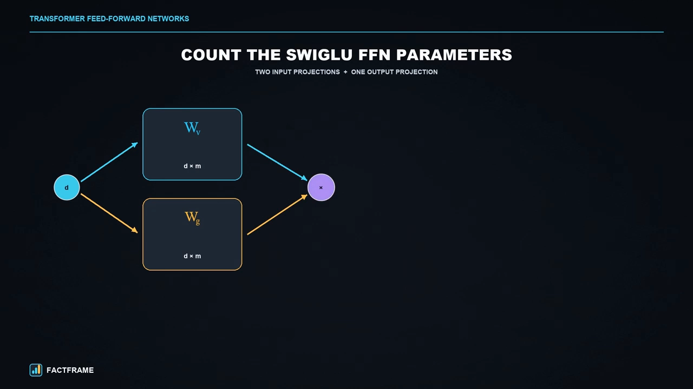
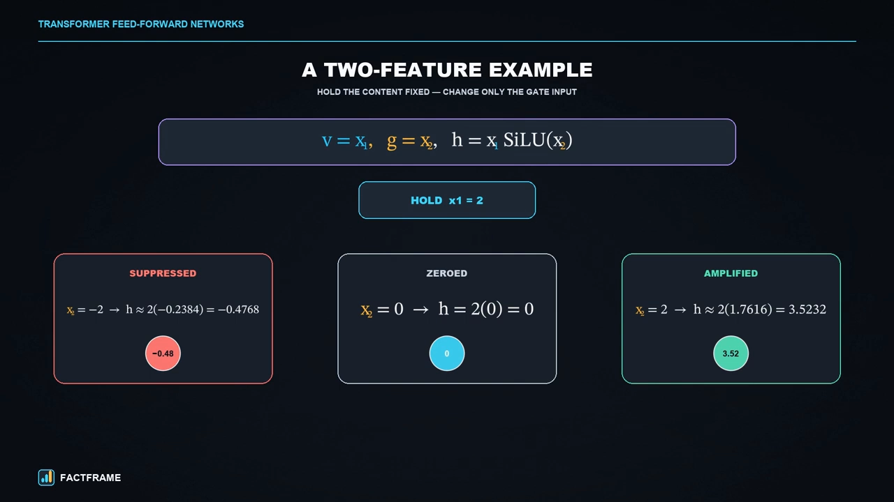
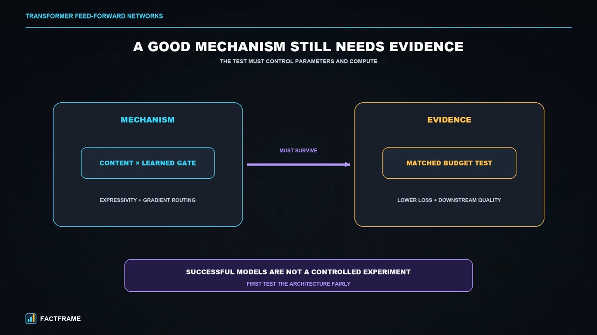
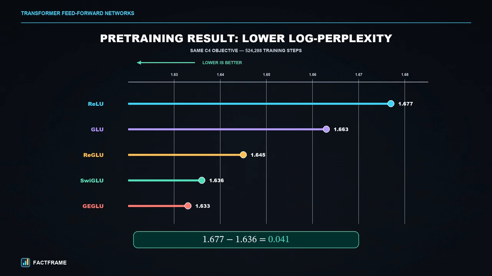

# 为什么 SwiGLU 要三个矩阵：门控乘法、参数对齐与一次受控实验

> 视频来源：[SwiGLU 的数学：门控 FFN 为什么要三个矩阵](https://www.youtube.com/watch?v=czFSpUd0XPc&t=0)（YouTube · FactFrame Science & AI，原题 *Why Modern LLMs Use SwiGLU: The Math Behind Gated FFNs*，约 9 分钟）
> 本文基于视频演说图文稿整理，配图截自视频。字幕为自动生成，术语（SwiGLU、SiLU、gate、content/up projection）按上下文订正；视频把模型宽度记作 $D$、中间宽度记作 $M$，下文统一写作 $d$ 与 $m$。本文只讲"为什么要三个矩阵"这条线；"一支 token 怎么一步步穿过这三个矩阵"的逐行手算与 PyTorch 代码，见本小节另一篇。

## 本讲要解决的核心问题（SCQA）

**背景**：Transformer 每个 block 里都有一块前馈网络（FFN，feed-forward network）。经典版本是"升维 → 逐元素激活 → 降维"：矩阵 $W_1$ 把 $d$ 维的 token 向量撑到 $4d$，激活函数逐个数处理一遍，$W_2$ 再压回 $d$ 维。两个矩阵合计约 $8d^2$ 个参数，是每个 block 里参数和运算量都最大的一档计算。

**冲突**：SwiGLU 在这套结构上多塞了一个矩阵——它同时要算两条投影，再用一条去"门控"另一条。多一个矩阵意味着同宽度下参数多 50%，可它偏偏又被 PaLM、Llama 这类模型全面采用。一个更贵的结构，凭什么值得？

**疑问**：多出来的那个矩阵到底买到了什么计算？多花的参数怎么才能公平地对冲掉？换掉 ReLU 之后模型真的更好，还是只是"大家都在用"？

**回答（中心思想）**：**SwiGLU 用第三个矩阵买的是"对同一个输入做两次不同的测量，再把两次测量相乘"**。乘法让一路信号能连续地缩放另一路：门控可以放大、关断、甚至轻微反向，反向传播时这一个乘积又天然分出两条梯度路径。代价是同中间宽度下参数多 50%，所以要把中间宽度从 $4d$ 收窄到约 $\frac{8}{3}d$ 来对齐预算；在参数量、运算量都对齐的受控预训练实验里，SwiGLU 的留出集 log perplexity 比 ReLU 低 0.041。这三件事合起来，才是"换掉 ReLU"的完整理由。

---

## 一、SwiGLU 换掉的不是一个角落，而是每个 block 里最大的一块计算

先看这块计算有多大。经典 FFN 从模型宽度 $d$ 升到 $4d$ 再压回 $d$：$W_1$ 是 $d \times 4d$，约 $4d^2$ 个参数；$W_2$ 是 $4d \times d$，又是约 $4d^2$。忽略很小的偏置向量，两个矩阵合计约 $8d^2$ 个参数 [【跳转到 00:41】](https://www.youtube.com/watch?v=czFSpUd0XPc&t=41)。

更关键的是"重复"：Transformer 的**每一层**都带一份同样结构的 FFN，同一个 $8d^2$ 的账要乘上层数。所以改 FFN 的写法，不是给模型修个边角，而是重新设计每个 block 里最大的一项计算 [【跳转到 00:58】](https://www.youtube.com/watch?v=czFSpUd0XPc&t=58)。这也解释了为什么 FFN 里的一点结构变化，会被写进几乎所有现代大模型的架构里。

## 二、基线：ReLU FFN 只产生一路"学到的信号"

原版 Transformer 用的是两层 FFN 加 ReLU。跟着一个 token 走一遍：

1. 第一个学到的矩阵把 token 从模型宽度 $d$ 投到更宽的隐空间，激活前的值记为 $a = W_1 x + b_1$；
2. 对 $a$ 的每个分量套同一条固定的逐点规则 ReLU，$\mathrm{ReLU}(a) = \max(0, a)$；
3. 第二个矩阵压回模型宽度：

$$
\mathrm{FFN}(x) = W_2 \,\mathrm{ReLU}(W_1 x + b_1) + b_2
$$

ReLU 快、简单，还能产生精确的 0——被压成 0 的那些隐藏单元，对这个输入就等于"关掉" [【跳转到 01:35】](https://www.youtube.com/watch?v=czFSpUd0XPc&t=95)。

但请注意这个结构的两点特征：输入只造出**一路**学到的隐藏信号；同一套**固定的**逐点规则被套在每一个分量上。每个隐藏通道说"我检测到了某个模式、强度是多少"，而"这个模式这次该出多大力"这件事，没有任何机制去调。SwiGLU 动手改的正是这里。

## 三、第一步：让同一个 token 做两次不同的仿射投影

SwiGLU 拿到同一个 token 向量 $x$ 之后，不做一次投影，而是做两次 [【跳转到 02:00】](https://www.youtube.com/watch?v=czFSpUd0XPc&t=120)：

$$
v = W_V x + b_V, \qquad g = W_G x + b_G
$$

- $v$ 叫作**内容支**（content branch）：它给出"候选内容"，也就是这个 token 想写进去的特征值；
- $g$ 叫作**门控支**（gate branch）：它给出"门控的激活前值"，也就是每个通道该放行多少的前置分数。

关键在"两个矩阵不同"。因为 $W_V$ 和 $W_G$ 是各自独立学出来的，两条支路可以盯着输入的不同特征：内容支可能在检测"这里出现了一个金融语境"，门控支可能在检测"但当前层更需要的是它的名词角色"。如果两条支路共用同一个矩阵，这个分工就不存在了。

**这就是"三个矩阵"中前两个的由来**：不是把一个矩阵拆成两半，而是两份独立的、形状相同的投影。

## 四、门控不是开关：SiLU 可以放大、关断，也可以轻微反向

门控支算完之后要过激活函数，SwiGLU 选的是 SiLU（也写作 Swish）[【跳转到 02:25】](https://www.youtube.com/watch?v=czFSpUd0XPc&t=145)：

$$
\mathrm{SiLU}(g) = g \cdot \sigma(g)
$$

其中 $\sigma$ 是 sigmoid 函数，把任意实数压到 $(0, 1)$。

很多人第一反应会以为"门控"就像水闸，只有开和关两种状态，或者像 sigmoid 那样只能给出 0 到 1 之间的概率。**SiLU 不是这样**：它平滑、没有上下界，可以略小于 0，也可以超过 1。用三个通道举例，令 $g = -1,\ 0,\ 2$：

$$
\mathrm{SiLU}(-1) \approx -0.269, \qquad \mathrm{SiLU}(0) = 0, \qquad \mathrm{SiLU}(2) \approx 1.762
$$

于是同一个门控支，可以做到三种不同的事：

| 门控值 | 增益 | 对内容通道的效果 |
| --- | --- | --- |
| 约 -0.269 | 小负增益 | 把该通道轻微反向 |
| 0 | 零增益 | 把该通道完全关断 |
| 约 1.762 | 大于 1 的增益 | 把该通道放大 |

"能连续调、还能调成负的"正是它和"开关式激活"的根本区别：ReLU 对每个通道只能选"保留原值"或"归零"，而这里的增益是一个由输入算出来的实数。

## 五、第二步：逐元素相乘，再投影回去

把门控逐元素乘到内容上 [【跳转到 02:50】](https://www.youtube.com/watch?v=czFSpUd0XPc&t=170)：

$$
h = v \odot \mathrm{SiLU}(g)
$$

注意是 $\odot$（逐元素乘），不是矩阵乘：第 $i$ 个内容分量只和第 $i$ 个门控分量相乘。把第 3 节的内容向量 $v = [2,\ -1,\ 3]$ 与第 4 节算出的 $\mathrm{SiLU}(g) \approx [-0.269,\ 0,\ 1.762]$ 配起来，得到

$$
h \approx [\,2 \times (-0.269),\ -1 \times 0,\ 3 \times 1.762\,] \approx [-0.538,\ 0,\ 5.286]
$$

三个通道分别被"略微反向""彻底关掉""放大到 5.286"。

到这里每个输出通道都同时依赖**两个针对同一输入学出来的测量**：一个说"内容是多少"，一个说"该给多大增益"。最后一个学到的矩阵把这个 $m$ 维的 $h$ 投回模型宽度 [【跳转到 03:15】](https://www.youtube.com/watch?v=czFSpUd0XPc&t=195)：

$$
\mathrm{SwiGLU}(x) = W_O \left( (W_V x + b_V) \odot \mathrm{SiLU}(W_G x + b_G) \right) + b_O
$$

写成形状就更清楚了：$W_V$ 与 $W_G$ 都是 $d \times m$，$W_O$ 是 $m \times d$。两条支路的输出**必须同宽**（都是 $m$），否则逐元素相乘没有定义——这是"为什么第二条投影的宽度不能随便取"的硬约束。

## 六、第三个矩阵的账单：同宽度多 50%，所以要收窄中间层

多一个矩阵，参数自然多了。算一算这笔账 [【跳转到 04:03】](https://www.youtube.com/watch?v=czFSpUd0XPc&t=243)：

- ReLU FFN，中间宽度 $4d$：$W_1$ 有 $d \times 4d$ 个参数，$W_2$ 有 $4d \times d$ 个，合计约 $8d^2$；
- SwiGLU，中间宽度 $m$：$W_V$ 有 $dm$，$W_G$ 有 $dm$，$W_O$ 有 $md$，合计约 $3dm$。

同样把中间宽度取 $4d$，SwiGLU 就要 $12d^2$，比 $8d^2$ 多 50%。这不公平——比较两个结构的"好坏"时，参数预算必须拉平，否则赢的只是"更大"。所以让两个预算相等 [【跳转到 04:28】](https://www.youtube.com/watch?v=czFSpUd0XPc&t=268)：

$$
3dm = 8d^2 \quad\Longrightarrow\quad m = \frac{8}{3}d \approx 2.67\,d
$$

也就是中间宽度从 $4d$ 收到约 $2.67d$。**这就是"为什么要三个矩阵"的代价一侧**：第三个矩阵不是白给的，它靠收窄中间层来买。收窄之后，每个隐藏通道的宽度变小，但换来的是"每个通道由两次测量相乘得到"——预算对齐之后，真正要比较的就不再是谁更宽，而是每个隐藏通道在做哪种运算 [【跳转到 04:53】](https://www.youtube.com/watch?v=czFSpUd0XPc&t=293)。

（$\frac{8}{3}$ 的具体取整、按硬件对齐到 256 的倍数这些工程细节，属本系列后一节的主题，这里只把它当作"对齐预算的常数"使用。）

## 七、乘法买到的到底是什么：一条测量去连续控制另一条

把结构压到最小：让内容支只读 $x_1$、门控支只读 $x_2$，于是 $h = x_1 \cdot \mathrm{SiLU}(x_2)$。固定 $x_1 = 2$，只动 $x_2$ [【跳转到 05:18】](https://www.youtube.com/watch?v=czFSpUd0XPc&t=318)：

| $x_2$（门控输入） | $\mathrm{SiLU}(x_2)$ | $h = 2 \cdot \mathrm{SiLU}(x_2)$ | 含义 |
| --- | --- | --- | --- |
| -2 | 约 -0.238 | 约 -0.48 | 被抑制并反向 |
| 0 | 0 | 0 | 归零 |
| 2 | 约 1.762 | 约 3.52 | 被放大 |

同一个内容值 $2$，因为"上下文坐标" $x_2$ 变了，拿到的增益完全不同。这就是"条件化的特征选择"：不是全局决定某个特征要不要，而是让每个输入自己决定这次该给多少。

为什么乘法能做到这件事？看局部展开就够了。在 0 附近，$\mathrm{SiLU}(g) \approx \frac{g}{2} + \frac{g^2}{4}$，于是 [【跳转到 05:43】](https://www.youtube.com/watch?v=czFSpUd0XPc&t=343)

$$
h = v \cdot \mathrm{SiLU}(g) \approx \frac{1}{2} v g + \frac{1}{4} v g^2
$$

第一项 $vg$ 是两个学到的特征的**直接乘积**——一个双线性交互项。纯线性层里不会出现这种"两个特征相乘"的项：$W_2 W_1 x$ 无论如何都还能合并成一个矩阵。**门控乘法把"特征 × 特征"这一阶带进了 FFN**，而这一阶恰恰是 ReLU 那套"每通道套同一条固定曲线"给不出的。

## 八、一个乘积，两条梯度路径

前向是相乘，反向就自然是乘积法则。设从下一层来的梯度为 $\delta = \partial L / \partial h$，因为 $h = v \cdot \mathrm{SiLU}(g)$ [【跳转到 06:33】](https://www.youtube.com/watch?v=czFSpUd0XPc&t=393)：

$$
\frac{\partial L}{\partial v} = \delta \cdot \mathrm{SiLU}(g), \qquad \frac{\partial L}{\partial g} = \delta \cdot v \cdot \mathrm{SiLU}'(g)
$$

读一下这两行：

- 内容支拿到的梯度被门控值缩放——**门控决定内容支学多快**；
- 门控支拿到的梯度被内容值缩放——**内容决定门控支学多快**。

两条支路的梯度互相"看着对方"来定学习强度，这就是"耦合的梯度路由"。而 SiLU 的导数随 $g$ 平滑变化，所以门控不是把学习"开关式"地切断，而是连续地重新缩放两条支路上的梯度 [【跳转到 06:58】](https://www.youtube.com/watch?v=czFSpUd0XPc&t=418)。

## 九、机制优雅不算证据：一次参数与算力对齐的受控实验

到这里只能说"这个机制很漂亮"。要论证它值得替换 ReLU，必须在**公平的参数与算力预算**下做受控比较，而不是列一串用了它的成功模型 [【跳转到 07:23】](https://www.youtube.com/watch?v=czFSpUd0XPc&t=443)。

视频引的是 2020 年 Noam Shazeer 的那组受控实验，设定很干净：

- 结构：T5 风格的 encoder-decoder Transformer，宽度统一 768，编码器 12 层、解码器 12 层；
- ReLU FFN：中间宽度 3,072（即 $4 \times 768$）；
- 门控变体：中间宽度 2,048（因为有 3 个大矩阵，而不是 2 个）；
- 预算对齐验算：$2 \times 768 \times 3072 = 3 \times 768 \times 2048$，主导参数与运算量相等；
- 训练：同样的 C4 span-filling 目标，524,288 步；
- 指标：留出集上的 log perplexity，越低越好。

结果是 [【跳转到 08:13】](https://www.youtube.com/watch?v=czFSpUd0XPc&t=493)：

| 变体 | log perplexity（越低越好） |
| --- | --- |
| ReLU | 1.677 |
| GLU | 1.663 |
| ReGLU | 1.645 |
| SwiGLU | 1.636 |
| GEGLU | 1.633 |

SwiGLU 比 ReLU 低 $1.677 - 1.636 = 0.041$；GEGLU 更低一点（1.633）。SwiGLU 并不是每一行都第一，但**门控这一类整体构成了最强的一组**——这是在参数与算力对齐的前提下得出的差别，而不是"因为它更大所以更好"。

## 十、所以现代 LLM 为什么换成 SwiGLU

把上面的线索收起来，答案可以压成一句话：**在相近的主导矩阵预算下，SwiGLU 用"学到的乘法调制"替掉了"一条固定的激活曲线"**，换来三件事 [【跳转到 08:38】](https://www.youtube.com/watch?v=czFSpUd0XPc&t=518)：

1. **条件化的特征选择**：每个隐藏通道的增益由输入自己算出来，可以放大、关断、轻微反向，而不是只有"保留 / 归零"两档；
2. **耦合的梯度路由**：一个乘积在反向传播里分出两条路径，两条支路用对方的数值决定自己学多快；
3. **受控条件下更好的模型质量**：预算对齐的预训练实验里，留出集 log perplexity 更低。

同时也要承认边界：**ReLU 没有过时**。对很多大型 Transformer 来说，SwiGLU 只是"配得上多出来的那条支路"——它多花 50% 的同宽参数，靠把中间宽度收到约 $\frac{8}{3}d$ 才把这笔钱挣回来 [【跳转到 09:03】](https://www.youtube.com/watch?v=czFSpUd0XPc&t=543)。

---

## 小结

- FFN 是每个 block 里最大的一档计算：经典 ReLU 版两个矩阵约 $8d^2$ 参数，且每层重复一次。
- ReLU 版只造出**一路**学到的隐信号，并对所有分量套同一条固定规则——"这次该出多大力"没人管。
- SwiGLU 对同一 token 做**两次独立投影**：$v = W_V x + b_V$（内容）与 $g = W_G x + b_G$（门控），两者形状必须同宽才能逐元素相乘。
- 门控支过 $\mathrm{SiLU}(g) = g\sigma(g)$，**不是 0/1 开关**：可放大（>1）、可关断（0）、可轻微反向（<0）。
- $h = v \odot \mathrm{SiLU}(g)$ 让每个通道同时依赖两次测量；局部展开 $\mathrm{SiLU}(g) \approx g/2 + g^2/4$ 说明它引入了 $vg$ 这种特征间乘积项。
- 反向传播里一个乘积给出两条梯度路径：门控缩放内容支的学习，内容缩放门控支的学习。
- 代价是同中间宽度下参数多 50%，所以对齐预算要求 $3dm = 8d^2$，即 $m = \frac{8}{3}d \approx 2.67d$。
- 受控实验（宽度 768、中间层 3,072 vs 2,048、524,288 步）里 SwiGLU 的 log perplexity 1.636 低于 ReLU 的 1.677，差 0.041；GEGLU 1.633 更低。门控这一类整体最强。
- ReLU 并未被淘汰：SwiGLU 是"多花一条支路的钱，换回条件化调制"，值不值得取决于预算与规模。

## 关键术语速查

| 术语 | 一句话解释 |
| --- | --- |
| FFN（前馈网络） | Transformer block 里对每个 token 向量单独做的两层变换，逐位置（position-wise）执行 |
| $d$ / $m$ | 模型宽度（token 向量维数）与 FFN 中间宽度；视频原文记作 $D$、$M$ |
| 内容支（content branch） | 由 $W_V$ 算出的 $v$，提供"候选特征值" |
| 门控支（gate branch） | 由 $W_G$ 算出的 $g$，经 SiLU 后作为每个通道的增益 |
| SiLU / Swish | $\mathrm{SiLU}(g) = g\sigma(g)$，平滑、无上下界，可略小于 0 |
| $\odot$ 逐元素乘 | 同形状张量对应位置相乘，不是矩阵乘 |
| 参数预算对齐 | 让两种结构的参数量（及主导运算量）相等后再比效果，例如 $3dm = 8d^2$ |
| log perplexity | 预训练常用的困惑度对数，越低表示对留出集下一个 token 的预测越好 |
