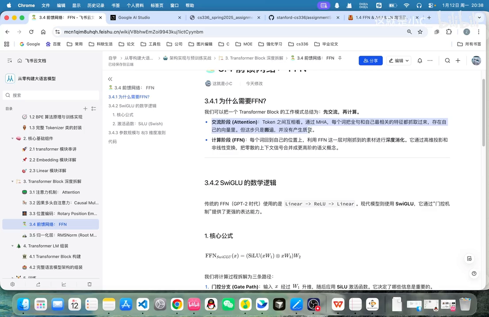
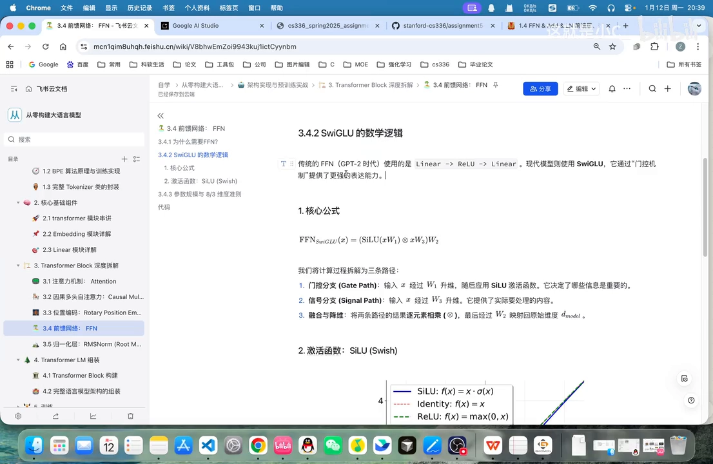
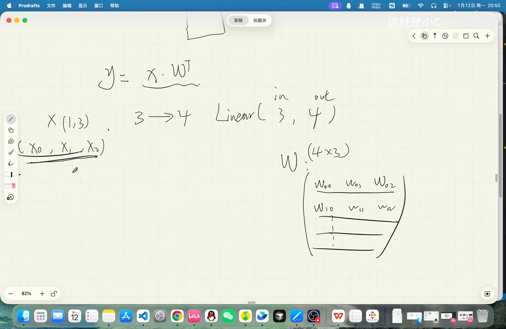
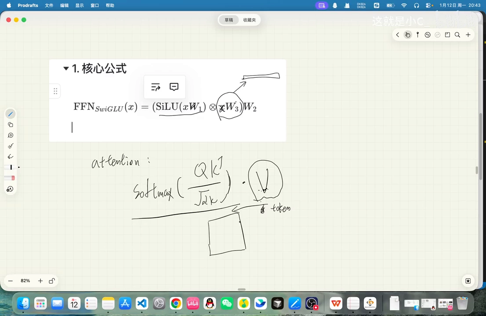
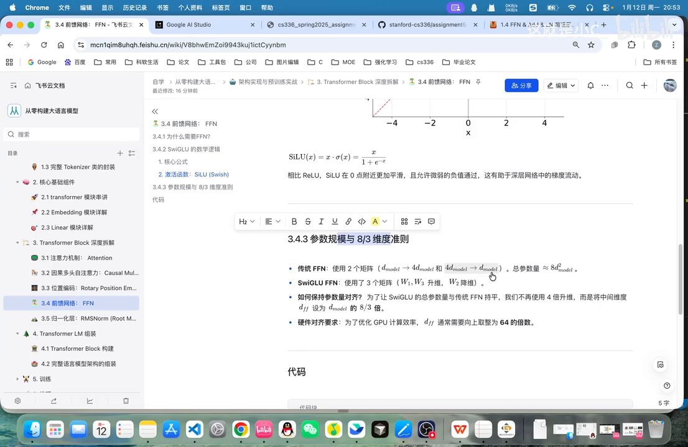
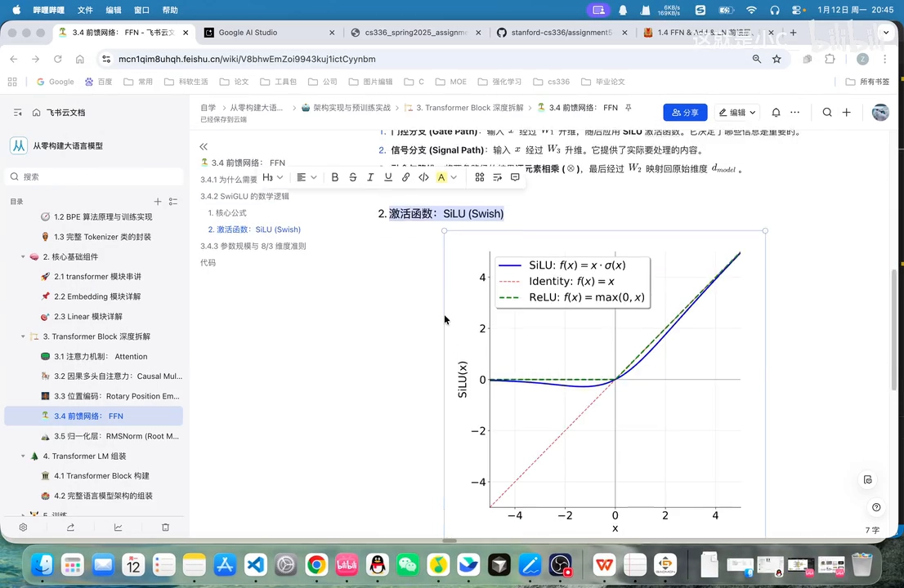
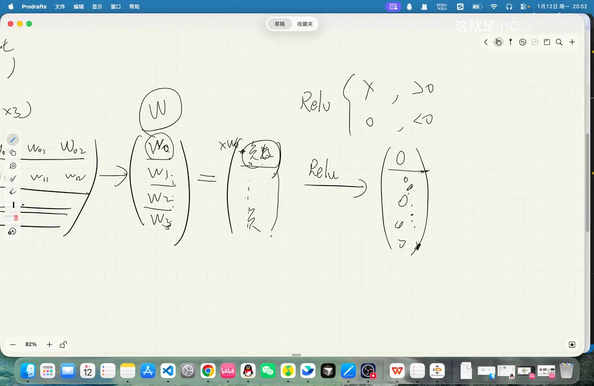
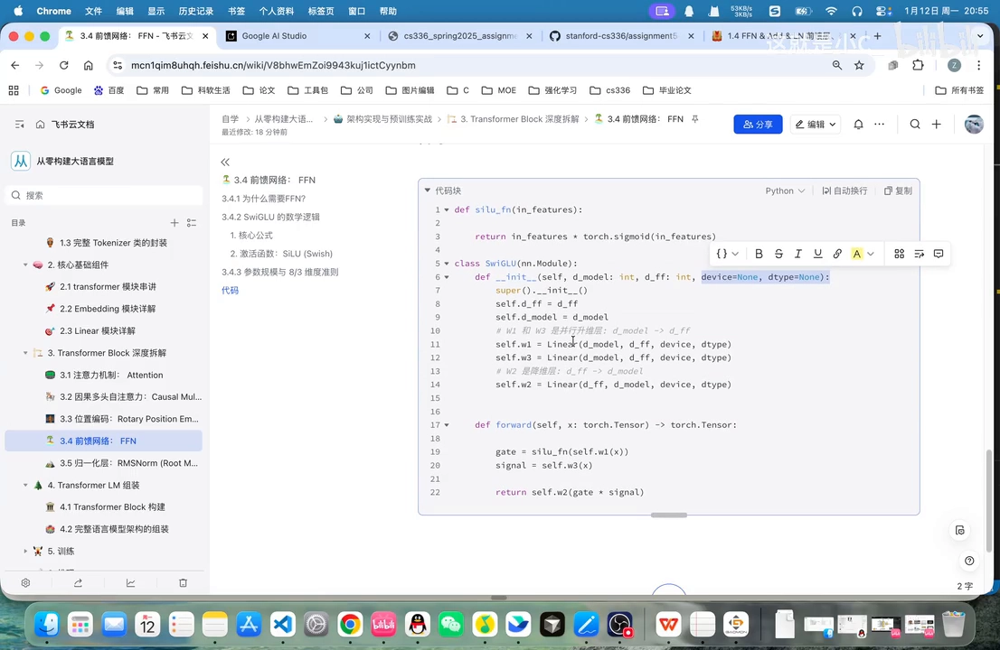

# SwiGLU 的中间维度不是 4d 而是 8/3d：参数量守恒定系数，硬件对齐定取整

> 视频来源：[CS336伴读 3.4 前馈层 FFN 与 SwiGLU](https://www.bilibili.com/video/BV1P2raBiEPF/?t=0)（Bilibili · 小弟）
> 本文基于视频演说图文稿整理，配图截自视频。字幕为自动生成，术语（FFN、SwiGLU、SiLU、ReLU、$d_{\text{model}}$、$d_{ff}$）按上下文订正。这一节的落点是"宽度账"：中间层为什么是 $\frac{8}{3}d$ 而不是 $4d$，以及这个除不尽的系数怎么变成代码里的整数。$d_{\text{model}}$ 较长，下文统一写作 $d$。

## 本讲要解决的核心问题（SCQA）

**背景**：Transformer 的每个 block 都是"先 attention，后 FFN"。经典 FFN 做两件事：把 $d$ 维的 token 向量升到 $4d$，过一个激活函数，再压回 $d$ 维。两个矩阵（$W_1$ 是 $d \times 4d$，$W_2$ 是 $4d \times d$）合计约 $8d^2$ 个参数，这是 block 里参数最多的一块。

**冲突**：现在主流模型改用 SwiGLU。CS336 让大家实现的就是这个版本。可 SwiGLU 要多算一路投影，矩阵从两个变成三个。如果中间层还老老实实升到 $4d$，参数量立刻从 $8d^2$ 涨到 $12d^2$——凭空多 50%。换一个更好的激活函数，不该顺手把模型做大 50%。

**疑问**：三个矩阵的中间层该多宽，才能既保留门控的好处、又不比原来的 FFN 更贵？这个宽度为什么不是整数倍，而是 $\frac{8}{3}$ 这种奇怪的有理数？实际写进代码的时候，$d_{ff}$ 又该填几？

**回答（中心思想）**：**$\frac{8}{3}d$ 是"参数量守恒"这一个方程的唯一解，不是实验调出来的数字**。令 SwiGLU 的三个矩阵总数 $3dh$ 等于传统 FFN 的 $8d^2$，解出 $h=\frac{8}{3}d\approx 2.67d$。但这个值通常是除不尽的（$d=4096$ 时约 $10\,922.67$），而矩阵形状必须是整数，所以落地时还要再向上取整到硬件友好的倍数——视频给的准则是对齐到 64 的倍数。两句话合起来才是完整的"维度准则"：**系数由参数预算决定，取整由硬件决定**。

---

## 一、先记住 FFN 在 block 里的分工：attention 负责搬运，FFN 负责加工



讲宽度之前要先知道这块计算在干什么，否则"中间层多宽"就只是个没有意义的数字。视频把 Transformer block 的工作模式总结成一句话：**先交流，再计算** [【跳转到 00:25】](https://www.bilibili.com/video/BV1P2raBiEPF/?t=25)。

- **交流阶段（attention）**：token 之间互相看，算出一个注意力分数。分数算完之后，它本质上只是把感兴趣的那些 token 的信息拿过来，拿到之后做了一个**简单的相加** [【跳转到 00:50】](https://www.bilibili.com/video/BV1P2raBiEPF/?t=50)。
- **计算阶段（FFN）**：我们希望把拿到的这些 token 的信息真正融合起来，而 attention 只做了简单相加，并没有对拿到的信息进一步加工 [【跳转到 01:15】](https://www.bilibili.com/video/BV1P2raBiEPF/?t=75)。FFN 就是把这个"加法"换成更复杂的操作：通过一个**高维投影**和非线性变换，把零散的信息合并成更高级的语言信息 [【跳转到 01:40】](https://www.bilibili.com/video/BV1P2raBiEPF/?t=100)。

这里埋下了后面所有讨论的伏笔：FFN 的"加工能力"来自那个高维中间层。中间层越宽，能同时容纳的"临时特征"越多；而这一节要算的，正是这个宽度到底该取多少才划算。

学名对照一下：这套结构就是**前馈神经网络**（FFN，feed-forward network），有时也叫 MLP 层；中间那一层的宽度通常记作 $d_{ff}$ 或 $h$，本文统一记作 $h$。

## 二、基线账本：传统 FFN 为什么从 $d$ 升到 $4d$



传统 FFN 的逻辑就是"两个线性层中间加一个激活函数"：线性层一般把维度升到 4 倍，也就是输入维度 $d_{\text{model}}$（特征维度）升到 $4d_{\text{model}}$，过一个激活函数，再由第二个线性层把 $4d_{\text{model}}$ 降回 $d_{\text{model}}$——先升维、再降维 [【跳转到 02:30】](https://www.bilibili.com/video/BV1P2raBiEPF/?t=150)。

先把它的一次前向写成公式。升维矩阵记 $W_1\in\mathbb{R}^{d\times 4d}$，降维矩阵记 $W_2\in\mathbb{R}^{4d\times d}$：

$$
\text{FFN}(x)=\text{ReLU}(xW_1)\,W_2
$$

**为什么要升到 4 倍？** 用视频里的矩阵视角看最直观：$W_1$ 的每一**行**是一个"检测器"——把输入 token 的 $d$ 个分量按一组权重加权求和，得到一个标量。升到 $4d$，就是同时准备 $4d$ 个检测器，让模型在一个极宽的中间空间里并行地测量"这句话里出现了哪些特征"；之后 $W_2$ 再把这 $4d$ 个测量结果加权压回 $d$ 维输出。宽度 $4d$ 是长期沿用的经验比例，也是几乎所有经典 FFN 的默认形状。

### 2.1 把矩阵形状摊开手算一遍（视频 11:29–13:17 的板书）

视频为了让"升维"变得具体，退到一个极小的例子：假设 token 向量是 $1\times 3$ 的，要升到 4 维。



**第一步，写形状。** 定义线性层时按 PyTorch 的习惯写"输入维 → 输出维"，即 `Linear(3, 4)`；但计算机里真正存的权重形状是 $4\times 3$，因为张量按行优先存储，这样取数据才高效 [【跳转到 11:54】](https://www.bilibili.com/video/BV1P2raBiEPF/?t=714)。

**第二步，写公式。** 前向因此记作

$$
y = x\,W^{\mathsf T},\qquad x\in\mathbb{R}^{1\times 3},\quad W\in\mathbb{R}^{4\times 3},\quad y\in\mathbb{R}^{1\times 4}
$$

**第三步，看乘法怎么发生。** 把 $W$ 的四行分别记作 $w_0,w_1,w_2,w_3$，那么

$$
y=\big[\,x\cdot w_0,\; x\cdot w_1,\; x\cdot w_2,\; x\cdot w_3 \,\big]
$$

即 $x$ 先与第一行点积、再与第二行点积、再与第三行点积……这才符合行优先的存储规则 [【跳转到 12:52】](https://www.bilibili.com/video/BV1P2raBiEPF/?t=772)。所谓"升维"，说的就是 $x$ 分别与这些行各做一次点积，得到四个数 [【跳转到 13:17】](https://www.bilibili.com/video/BV1P2raBiEPF/?t=797)。

把 $3\to 4$ 换回真实尺寸，就是 $d \to 4d$：$W$ 有 $4d$ 行，每行 $d$ 个数，于是 $W_1$ 有 $4d^2$ 个参数。

### 2.2 数参数量：$4d^2+4d^2=8d^2$

视频把账算得很直白：这个 FFN 的两个矩阵，总参数就是 $8d^2$ 嘛，差不多就是 $8d^2$——**这个是 $4d^2$，那个也是 $4d^2$** [【跳转到 16:33】](https://www.bilibili.com/video/BV1P2raBiEPF/?t=993)。

$$
|W_1| = d\cdot 4d = 4d^2,\qquad |W_2| = 4d\cdot d = 4d^2,\qquad \text{合计}=8d^2
$$

（偏置向量是 $4d$ 和 $d$ 个元素，相对 $d^2$ 量级可以忽略不计。）

代数字验证一下：取 $d=512$，则每个矩阵 $4d^2=4\times 262\,144=1\,048\,576$，两个合起来 $2\,097\,152\approx 2.10\text{M}$。这就是**一个 block 的 FFN** 的参数量；每个 block 都带一份，全模型还要乘上层数。所以 FFN 的写法一动，动的不是边角，而是模型里最大的一笔参数预算。

## 三、SwiGLU 用三个矩阵：同宽度下参数立刻多 50%

SwiGLU 是 FFN 的一个变种，CS336 里要求实现的正是这个版本 [【跳转到 02:05】](https://www.bilibili.com/video/BV1P2raBiEPF/?t=125)。它的公式是

$$
\text{FFN}_{\text{SwiGLU}}(x)=\big(\text{SiLU}(xW_1)\otimes xW_3\big)W_2
$$

其中 $\otimes$ 是逐元素相乘。对照一下很清楚：**原来的 FFN 里只有两个矩阵 $W_1$、$W_2$，现在这里有三个矩阵** [【跳转到 03:20】](https://www.bilibili.com/video/BV1P2raBiEPF/?t=200)。三路分工如下：

1. **门控分支（gate path）**：$x$ 先乘 $W_1$，做的也是升维，升维之后经过 SiLU 激活——它决定了哪些信息是重要的 [【跳转到 03:45】](https://www.bilibili.com/video/BV1P2raBiEPF/?t=225)。
2. **信息分支（signal path）**：$x$ 乘 $W_3$，同样升维，它提供实际要处理的信息 [【跳转到 07:37】](https://www.bilibili.com/video/BV1P2raBiEPF/?t=457)。
3. **融合与降维**：两路逐元素相乘，最后 $W_2$ 把结果降维回 $d_{\text{model}}$ [【跳转到 08:02】](https://www.bilibili.com/video/BV1P2raBiEPF/?t=482)。

视频在这里给了一个很好用的类比，正好解释"门控"到底在做什么 [【跳转到 06:35】](https://www.bilibili.com/video/BV1P2raBiEPF/?t=395)。



attention 里有一项 $\text{softmax}\!\left(\frac{QK^{\mathsf T}}{\sqrt{d_k}}\right)$，得到的是一张**相似性表格**，表达"我当前这个 token 对哪些东西感兴趣"；再乘上包含所有信息的矩阵，就从里面把感兴趣的内容取出来 [【跳转到 05:20】](https://www.bilibili.com/video/BV1P2raBiEPF/?t=320)。SwiGLU 里 $W_1$ 那一路扮演的正是这张表格的角色：**把有用的信息标出来，把没用的信息设成 0 或很小的数（比如 0.1），再和带着信息的那一路做点积** [【跳转到 06:10】](https://www.bilibili.com/video/BV1P2raBiEPF/?t=370)。而 $W_3$ 那一路相当于 attention 里"包含所有信息的那个矩阵"——把 $x$ 中的信息变得更深层，学到更多东西 [【跳转到 06:10】](https://www.bilibili.com/video/BV1P2raBiEPF/?t=370)。

**门控的代价现在可以算清楚了。** 三路投影意味着三个矩阵，中间宽度记作 $h$：

$$
|W_1| = d\cdot h,\qquad |W_3| = d\cdot h,\qquad |W_2| = h\cdot d
\quad\Longrightarrow\quad \text{合计}=3dh
$$

如果仍然沿用 $h=4d$，就有 $3dh = 3d\cdot 4d = 12d^2$：比传统的 $8d^2$ 多出 $4d^2$，正好是 **多一半**。视频的原话是："如果还是保持升到四倍，它的参数就会增大一半，对不对？我们不希望这样——虽然用上这个更好的激活，但不要把这个参数量变得更多，这会带来一些其他的负担" [【跳转到 17:23】](https://www.bilibili.com/video/BV1P2raBiEPF/?t=1043)。

## 四、$\frac{8}{3}$ 的来历：一个方程，一个解



视频的思路非常直接：**把它等比例地缩放一下就行**。现在是 1 倍升到 4 倍，那我升到 $\frac{8}{3}$ 倍，那样三个矩阵的总参数还是 $8d^2$ [【跳转到 17:48】](https://www.bilibili.com/video/BV1P2raBiEPF/?t=1068)。写成方程就是一句话——**新结构的参数量 = 老结构的参数量**：

$$
3dh = 8d^2
$$

两边同时除以 $3d$：

$$
h=\frac{8d^2}{3d}=\frac{8}{3}d\approx 2.667\,d
$$

**验算一遍，确认"守恒"成立。** 把 $h=\frac{8}{3}d$ 代回去，三个矩阵各是多少：

| 矩阵 | 形状 | 参数量 |
| --- | --- | --- |
| $W_1$（门控升维） | $d\times \frac{8}{3}d$ | $\frac{8}{3}d^2$ |
| $W_3$（信息升维） | $d\times \frac{8}{3}d$ | $\frac{8}{3}d^2$ |
| $W_2$（融合降维） | $\frac{8}{3}d\times d$ | $\frac{8}{3}d^2$ |
| 合计 | — | $8d^2$ |

三项相加：$\frac{8}{3}+\frac{8}{3}+\frac{8}{3}=8$，正好回到传统 FFN 的 $8d^2$。这就是视频那句"三个矩阵的话，他总参数量还是 $8d^2$，所以说现在用上 SwiGLU 这个 FFN 的话，他就是一维升到三分之八 $d_{\text{model}}$"的完整推演 [【跳转到 17:48】](https://www.bilibili.com/video/BV1P2raBiEPF/?t=1068)。

也可以从"缩放比例"的角度再理解一次，这个视角更不容易记错：

- 传统 FFN：升维倍数 $4$，参数 $2$ 个矩阵 $\times 4d^2 = 8d^2$；
- SwiGLU：矩阵数从 $2$ 变 $3$，若倍数仍取 $4$ 则 $3\times 4d^2 = 12d^2$；
- 要让总数不变，倍数必须乘上 $\frac{2}{3}$：$4\times\frac{2}{3}=\frac{8}{3}$。

换句话说，**$\frac{8}{3}$ 里同时装着两件事：分子 8 是原来两个矩阵的预算，分母 3 是现在三个矩阵的个数**。哪天有人问你"为什么不是 3d 也不是 2d"，答案就是这个除法：$8\div 3$。

## 五、$\frac{8}{3}d$ 只保证"参数一样多"，不保证"处处等价"

这一节必须说清边界，否则 $\frac{8}{3}$ 很容易被误当成定律。

**第一，它锁定的只是参数量。** 视频的出发点是"不要把这个参数量变得更多，这会带来一些其他的负担" [【跳转到 17:23】](https://www.bilibili.com/video/BV1P2raBiEPF/?t=1043)——也就是说，之所以要紧着参数走，是因为参数直接连着显存与整体规模的负担。而门控结构带来的其它账（中间要同时留着两路 $h$ 维张量、逐元素相乘后又一份）视频没有展开，我们也不在这里替它下结论。**能确定的只有一件事：$\frac{8}{3}d$ 是"参数量对齐"这一条约束下的解。**

**第二，它不该被当成"取到小数点后三位"。** $2.667d$ 只是一个比例，真正的实现必须落到整数——这一点在代码里会立刻暴露出来。

**第三，偏离 $\frac{8}{3}$ 不等于错。** 参数对齐是"可比性"的前提：要比 SwiGLU 和 ReLU FFN 谁更好，就得先把两边的预算拉平，否则赢的只是"更大"。但一个已经定型的模型完全可以在预算附近微调宽度，去换别的收益（比如凑整到硬件友好的形状）。视频给出的正是这样一条"准则"而不是"公式"：先按 $\frac{8}{3}$ 定基准，再按硬件对齐取整。

## 六、从 $2.667d$ 到代码里的整数：为什么必须向上取整到 64 的倍数

视频在 $8/3$ 准则之后紧接着给了第四条，也是这一节真正的落点：**硬件对齐要求——为了优化 GPU 计算效率，$d_{ff}$ 通常需要向上取整为 64 的倍数** [【跳转到 18:13】](https://www.bilibili.com/video/BV1P2raBiEPF/?t=1093)。

**为什么"除不尽"是个真问题？** 因为 $d_{ff}$ 不是超参数表里的一个小数，它是矩阵的**行数/列数**。$W_1$ 的形状是 $d\times d_{ff}$，$W_2$ 是 $d_{ff}\times d$，形状必须是整数，否则连内存都分配不出来。$d=4096$ 时 $\frac{8}{3}\times 4096 = 10\,922.67$，小数点后面那一位必须被处理掉。

**为什么"向上"而不是"向下"？** 向下取整会让参数量低于预算、同时把中间层做窄；向上取整则宁可稍微超一点点，也不牺牲中间层的表达宽度。方向选择背后是同一条原则：**宽度是能力，参数是成本，成本可以略微超，能力不要打折**。

**为什么是 64 的倍数？** 视频只给结论，没展开机理。从工程常识看，这个数的意义是让每一行/每一块的长度落成硬件搬运与并行切分的整数倍：GPU 上的矩阵乘不是逐个数算的，而是按固定大小的块（tile）分给计算单元，宽度若不能被块大小整除，最后一段就要靠"补零"占满一个块，算力白白空转。对齐到 64 的倍数，等于保证这一类切分都发生在整块边界上。至于对齐粒度具体取多少，会随硬件与算子实现变化（视频给的是 64），因此"对齐到硬件友好的倍数"比"必须等于 64"更接近这条准则的本意。

### 6.1 两次取整的手算

把上面的规则套到两个具体宽度上：

| 模型宽度 $d$ | $\frac{8}{3}d$ | 向上取整到 64 的倍数 | 实际 $d_{ff}$ | 三矩阵参数 $3dh$ | 相对 $8d^2$ |
| --- | --- | --- | --- | --- | --- |
| 512 | 1365.33 | $64\times 22=1408$ | 1408 | 2 162 688 | +3.1% |
| 4096 | 10 922.67 | $64\times 171=10\,944$ | 10 944 | 134 479 872 | +0.2% |

对照 $d=4096$ 这一行：$8d^2=134\,217\,728$，取整后的 $3dh=134\,479\,872$，只比预算多出约 26 万，占比 0.2%。而如果偷懒直接沿用 $4d$，就是 $12d^2=201\,326\,592$，比预算多 50%。**取整的代价随 $d$ 增大而迅速摊薄**——这也是为什么大模型可以放心地按 $\frac{8}{3}$ 取整，小模型则要留意那 3% 的偏差。

## 七、为什么这一层要用 SiLU：被"永远置零"吃掉的通道

$8/3$ 这套算法有一个前提：中间层的通道得**真的在干活**。视频专门花了大段时间讲为什么把 ReLU 换成 SiLU，理由就落在"通道会不会被整批废掉"上。



先复习两个函数。ReLU 就是 $\max(0,x)$：输入大于 0 保持原状，小于 0 直接置为 0 [【跳转到 09:03】](https://www.bilibili.com/video/BV1P2raBiEPF/?t=543)。SiLU 的表达式是 $x$ 乘上一个 sigmoid：

$$
\text{SiLU}(x)=x\cdot\sigma(x)=\frac{x}{1+e^{-x}}
$$

视频说"不用管这个公式，我们看图像就行" [【跳转到 09:28】](https://www.bilibili.com/video/BV1P2raBiEPF/?t=568)。看图能看出的关键差别不在正数一侧（那里两条线几乎重合），而在负数一侧：原来负数全部置为 0，现在负数有一个比较小的值了 [【跳转到 09:53】](https://www.bilibili.com/video/BV1P2raBiEPF/?t=593)。负得很大的输入（比如负一万）仍然近似为 0，但在 0 附近，SiLU 会给它一个非零的小值。

**这个"小值"为什么重要？** 视频用矩阵的视角讲了一个很具体的失败场景，正好接上第二节的板书。



假设 $W$ 的某一行 $w_0$ 学得非常差：不管输入的 $x$ 在这三个分量上取什么值，$x\cdot w_0$ 的结果永远是负数 [【跳转到 13:42】](https://www.bilibili.com/video/BV1P2raBiEPF/?t=822)。负数经过 ReLU 就是 0，于是**不管模型接到什么输入，这一路经过 ReLU 之后的结果全部变成 0** [【跳转到 14:32】](https://www.bilibili.com/video/BV1P2raBiEPF/?t=872)。一行坏了还好，如果很多行都是这样，"那经过 ReLU 之后就是全 0 了，这就非常危险……这一层不就废了吗" [【跳转到 15:22】](https://www.bilibili.com/video/BV1P2raBiEPF/?t=922)。

原因被视频一句话点破："就是这个部分太严格了——小于 0 的话就直接置为 0" [【跳转到 15:46】](https://www.bilibili.com/video/BV1P2raBiEPF/?t=946)。而 SiLU 在 0 附近对这一小段负数**给了一次机会**：让它别变成 0，只要不严格等于 0，这个神经元就还能继续参与计算，梯度还有路可走，网络还能继续工作 [【跳转到 16:09】](https://www.bilibili.com/video/BV1P2raBiEPF/?t=969)。

放回到"宽度账"里看，这条动机和 $\frac{8}{3}d$ 是一体两面：**你花 $8d^2$ 个参数买来的中间层，如果有大批通道被永久置零，那份预算就等于白花**。门控 + 平滑激活让这些通道不至于一次性死掉，$8/3$ 这个系数才谈得上"够用"。

## 八、落到 PyTorch：$d_{ff}$ 是构造时就定死的一个整数



代码部分视频说"比较简单"，但它恰好把前面所有账都落实成了参数 [【跳转到 18:13】](https://www.bilibili.com/video/BV1P2raBiEPF/?t=1093)：

- `silu_fn`：输入乘上自己的 sigmoid，就是那个 $x\cdot\sigma(x)$；
- 构造 SwiGLU 时要传两个关键参数：`d_model` 是某个 token 的向量长度（特征维度），`d_ff` 是"升维到多少维" [【跳转到 18:38】](https://www.bilibili.com/video/BV1P2raBiEPF/?t=1118)；
- 三个线性层：`W1`、`W3` 是 $d_{\text{model}}\to d_{ff}$ 的升维矩阵，`W2` 是 $d_{ff}\to d_{\text{model}}$ 的降维矩阵 [【跳转到 19:03】](https://www.bilibili.com/video/BV1P2raBiEPF/?t=1143)；
- `forward`：$x$ 先过 `W1` 再进 `silu_fn` 得到 gate，$x$ 过 `W3` 得到 signal，两者逐元素相乘，最后过 `W2` 降维 [【跳转到 19:28】](https://www.bilibili.com/video/BV1P2raBiEPF/?t=1168)。

注意 `d_ff` 在代码里被标注为整型（int）——它不是一个能写 $\frac{8}{3}d$ 的浮点参数。所谓"实现 $8/3$ 准则"，在代码里的样子就是一句取整：

```python
d_model = 4096
d_ff = int(8 * d_model / 3)          # 10922，先落成整数
d_ff = ((d_ff + 63) // 64) * 64      # 向上取整到 64 的倍数 -> 10944
```

（这里的 `d_ff` 通常还会作为构造参数从配置文件读进来，而不是每次在类里现算；上面这段只是把两步规则写全。）

**这两行代码就是本节的浓缩版**：第一行来自 $3dh=8d^2$，第二行来自硬件对齐。前者决定"应该多宽"，后者决定"实际填几"。少了第一行，模型会比设计的贵 50%；少了第二行，你可能得到一个 10922 这种让算子切分很难受的宽度。

## 小结

- FFN 是 block 里"计算"的那一半：attention 只做搬运与相加，FFN 靠高维投影加非线性把上下文真正加工成更高阶的语义。
- 传统 FFN 的形状是 $d\to 4d\to d$，两个矩阵各 $4d^2$，合计 $8d^2$；升维的物理含义是 $W$ 的每一行是一个检测器，一次算出 $4d$ 个测量值。
- SwiGLU 用三个矩阵（$W_1$ 门控升维、$W_3$ 信息升维、$W_2$ 降维），合计 $3dh$；沿用 $h=4d$ 就会变成 $12d^2$，凭空多 50%。
- 让 $3dh=8d^2$ 得 $h=\frac{8}{3}d\approx 2.667d$：分子 8 是原预算，分母 3 是矩阵个数，三个 $\frac{8}{3}d^2$ 相加正好回到 $8d^2$。
- $\frac{8}{3}$ 只是"参数量对齐"的解，它不保证其它账也等价；它也不是最终取值，因为 $\frac{8}{3}d$ 通常除不尽。
- 落地时要向上取整到硬件友好的倍数（视频给的准则是 64），例如 $d=4096$ 时 $10\,922.67\to 10\,944$，代价约 0.2%；$d=512$ 时 $\to 1408$，代价约 3.1%。
- 中间层要真在干活：ReLU 把负数一律置零，一行权重学坏就能让整条通道永远输出 0；SiLU 在 0 附近留一个非零小值，让神经元还有活路。

## 关键术语速查

| 术语 | 一句话解释 |
| --- | --- |
| FFN（前馈神经网络） | block 里 attention 之后的那层 MLP，做"高维投影 + 非线性 + 降维"，负责加工信息 |
| $d$ / $d_{\text{model}}$ | 模型宽度，即一个 token 向量的维数，所有形状账的基准单位 |
| $d_{ff}$ / $h$ | FFN 中间层宽度；传统 FFN 取 $4d$，SwiGLU 取约 $\frac{8}{3}d$ 后再对齐取整 |
| 升维矩阵 | 形如 $d\times 4d$ 的权重，每行是一个"检测器"，与输入点积得到一个中间特征 |
| SwiGLU | 三矩阵的门控 FFN：$\big(\text{SiLU}(xW_1)\otimes xW_3\big)W_2$ |
| 门控（gating） | 用一路投影标出"哪些信息重要"，再与另一路信息逐元素相乘，实现按需放大或关断 |
| SiLU（Swish） | 激活函数 $x\cdot\sigma(x)$，正半轴近似恒等、0 附近平滑、负半轴保留小的非零值 |
| ReLU | 激活函数 $\max(0,x)$，负数一律置零；可能造成通道整批失效 |
| 参数量守恒 | 让新老结构参数总量相等再比较效果，本例即解 $3dh=8d^2$ |
| 硬件对齐 | 把宽度向上取整到块大小的整数倍（如 64），避免算子切分时算力空转 |
