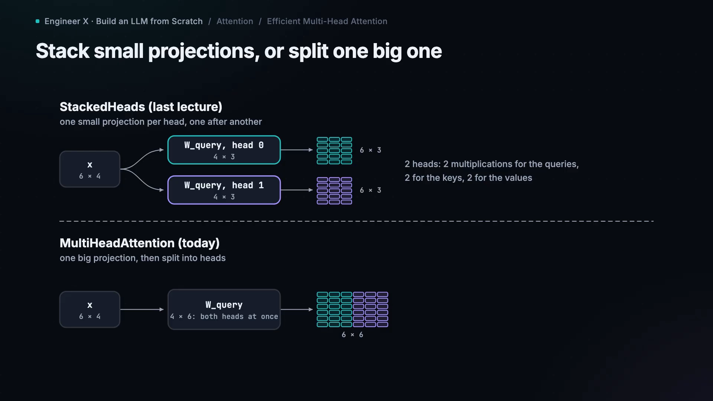
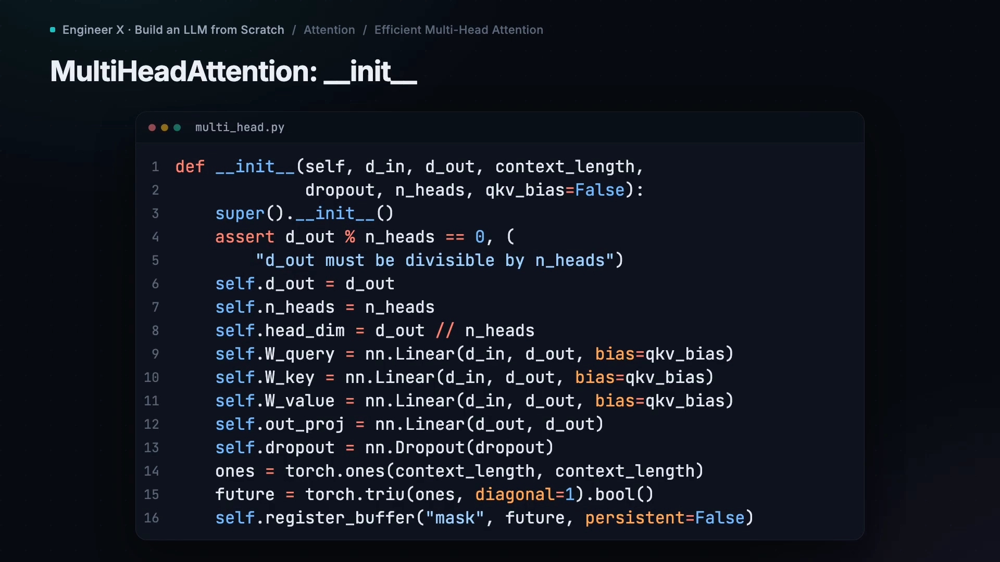
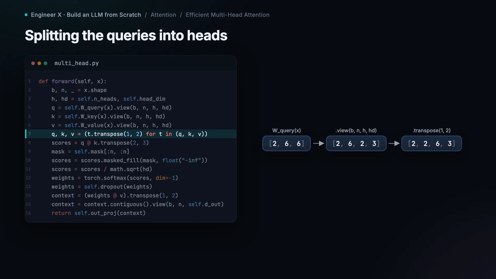
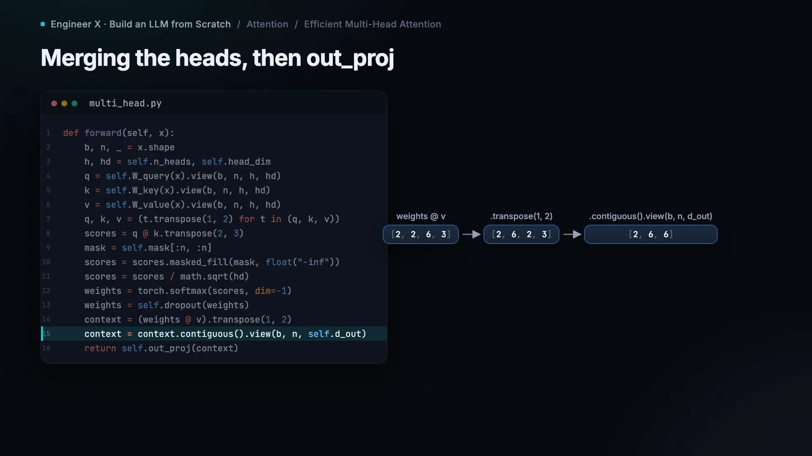
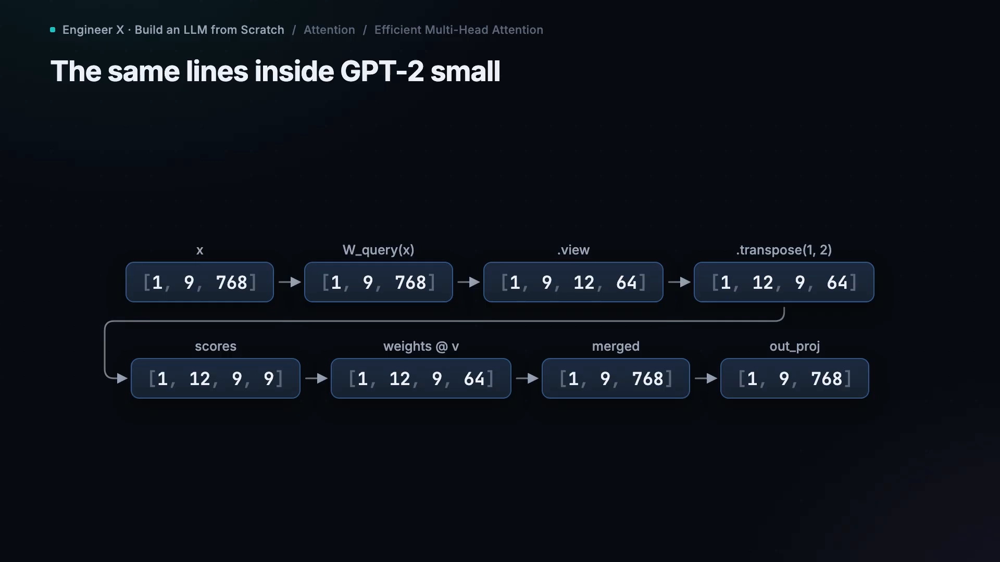
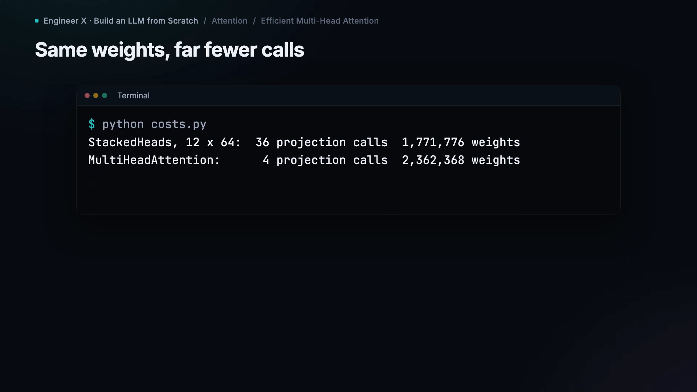

# 多头不是多算：一次大投影加两次重排，把 768 切成 12 个 64

> 视频来源：[Multi-Head Attention in PyTorch: Efficient Weight Splits, view and transpose](https://www.youtube.com/watch?v=Iy7jiVsJ0fw&t=0)（YouTube · Engineer X「Build an LLM from Scratch」系列 · Attention）
> 导读：这一讲只做一件事——把「每个头各算一遍」的写法，改写成「一次大投影 + view + transpose」的写法，然后逐行读出每个张量的形状。本文覆盖它逐行读代码的全过程，并把注意力代价那个面试题放在最后收尾。

本文基于视频演说图文稿整理，配图截自视频。

## 本讲要解决的核心问题（SCQA）

**背景**：多头注意力（multi-head attention）在上一讲已经跑通了一个能用的版本：12 个头，就是 36 个独立的小投影矩阵，一次一次顺序地算（Q、K、V 各 12 个）。

**冲突**：这样写虽然正确，却把一个本该是「一次批量运算」的工作拆成了几十次 Python 循环里的调用。GPU 最擅长的是大矩阵乘法，最不擅长的是在 Python 里排几十次队。换到真实模型（GPT-2 的 768 维、12 个头）上，这个写法就是性能瓶颈。

**疑问**：能不能只做三次投影（Q、K、V 各一次），就用一次矩阵乘法把所有头的注意力一起算出来？如果能，头是怎么被「切」出来的，又是怎么被「拼」回去的？

**回答（中心思想）**：**多头不是多算。** 把 $h$ 个小权重矩阵并排拼成一个大权重矩阵，做**一次**投影就得到所有头的 Q、K、V；再用 `view` 把最后一维按 $h \times d_k$ 重新解释（不搬一个数），用 `transpose(1,2)` 把头的维度提到 token 前面，一次批量矩阵乘就同时算出所有头的分数；算完 `transpose` 回来、`contiguous` 补齐内存、`view` 拼回原宽度，最后过一个 `out_proj` 混合各头的结果。参数量与算术量都不变，变的只是「调用的次数」，从 36 次降到 4 次。

---

## 一、把 36 次小投影拼成 3 次大投影：省的不是算术，是调用

上一讲的写法可以概括成一句话：每个头有自己的 $W^{Q}$，4×3 的小矩阵，做一次小乘法；K 和 V 各再来一遍。12 个头就是 36 次投影调用，一个接一个 [【跳转到 00:00】](https://www.youtube.com/watch?v=Iy7jiVsJ0fw&t=0)。



关键的那一步是**拼权重**：把两个头的小权重矩阵**并排**贴在一起，$W^{Q}$ 从 4×3 变成 4×6。对同一个输入做**一次**乘法，得到 6×6 的结果——它的前三列恰好就是「头 0」原本会算出来的东西，后三列就是「头 1」的 [【跳转到 00:30】](https://www.youtube.com/watch?v=Iy7jiVsJ0fw&t=30)。

$$
X_{6\times 4}\; W^{Q}_{4\times 6} \;=\; \underbrace{\big[\,Q_0 \;\big\vert\; Q_1\,\big]}_{6\times 6}
$$

这里要立刻澄清一个常见的误解：这不是近似，也不是「平均掉」了什么。两边是同一个数学对象，只是**组织方式**不同——把 12 个 $[d \times d_k]$ 的小矩阵横向拼成一个 $[d \times h d_k]$ 的大矩阵，等价于一次性算完所有头。视频里说得很直接：同样的数字，差别只在浮点舍入 [【跳转到 00:03】](https://www.youtube.com/watch?v=Iy7jiVsJ0fw&t=3)。

那剩下的事情就只有一件：**把这 6 列拆成两组 3 列**。而这件事，`view` 和 `transpose` 就能做完，且**不复制任何一个数**——它们只是重新解释「哪几个数算一组」[【跳转到 00:50】](https://www.youtube.com/watch?v=Iy7jiVsJ0fw&t=50)。

> **术语**：*head dimension*（头维度，记作 $d_k$）是每个头各自负责的宽度。总宽度 $d_{out}$ 被 $h$ 个头均分，所以 $d_k = d_{out} / h$。GPT-2 small 里 $d_{out}=768$、$h=12$，于是 $d_k = 64$。

## 二、`__init__` 里最重要的一个变化：`d_out` 是「所有头的总宽」

改造的起点在构造函数。这里的定义变了、而且变得很关键：`d_out` 现在指的是**所有头加在一起的总宽度**，不再是单个头的宽度。因此它必须能被头数整除，每个头拿到 $d_{out} / h$，也就是 $d_k$。



```python
assert d_out % n_heads == 0, "d_out must be divisible by n_heads"
self.head_dim = d_out // n_heads
self.W_query = nn.Linear(d_in, d_out, bias=qkv_bias)
self.W_key   = nn.Linear(d_in, d_out, bias=qkv_bias)
self.W_value = nn.Linear(d_in, d_out, bias=qkv_bias)
self.out_proj = nn.Linear(d_out, d_out)
```

三个投影全部从 $d_{in}$ **直接**映到完整的 $d_{out}$——不是映到 $d_k$ [【跳转到 01:05】](https://www.youtube.com/watch?v=Iy7jiVsJ0fw&t=65)。这一句 `nn.Linear` 从 `d_in` 直接映到 `d_out`，就是「多头的成本优势」在代码里的落点：它一次就把所有头的份额都算完了。

除了投影，构造函数里还有三样东西保持不变：一个新的 `out_proj`（$d_{out} \to d_{out}$，后面讲）、同样的 dropout、以及那个上三角的因果掩码 buffer。

## 三、forward 只多了两行：`view` 和 `transpose`

`forward` 的前段短得有点意外：

```python
b, n, _ = x.shape
h, hd = self.n_heads, self.head_dim
q = self.W_query(x).view(b, n, h, hd)
k = self.W_key(x).view(b, n, h, hd)
v = self.W_value(x).view(b, n, h, hd)
q, k, v = (t.transpose(1, 2) for t in (q, k, v))
```

第一行是那次「大投影」，得到的是所有头并排的结果 [【跳转到 01:34】](https://www.youtube.com/watch?v=Iy7jiVsJ0fw&t=94)。用一个具体的小例子看会更清楚：一句话 6 个 token、每个 token 4 个特征，batch 为 2。投影后 $W_{\text{query}}(x)$ 是 $[2, 6, 6]$——6 个 token，每个 token 6 个数，前 3 个属于头 0，后 3 个属于头 1。

接着 `view` 把最后一维 6 拆成两个头、每头 3 个数：$[2, 6, 2, 3]$。这一步**内存里一个数都没动**，只是换了一种「怎么读这块连续内存」的说法。

`transpose(1, 2)` 交换 token 维和 head 维，得到 $[2, 2, 6, 3]$，也就是（batch、heads、tokens、head_dim）四层。



把这条链写成一个表，读者照着记就行（示例是 batch 2、6 个 token、2 个头、$d_k=3$）：

| 步骤 | 代码 | 形状 | 含义 |
| --- | --- | --- | --- |
| 输入 | `x` | $[2, 6, 4]$ | batch、token、特征 |
| 大投影 | `W_query` | $[2, 6, 6]$ | 所有头并排 |
| 切最后一维 | `.view(b, n, h, hd)` | $[2, 6, 2, 3]$ | 拆成 head 与 head_dim |
| 提头到前 | `.transpose(1, 2)` | $[2, 2, 6, 3]$ | batch、heads、tokens、head_dim |

## 四、为什么一定要 `transpose`：矩阵乘只看最后两维

这是全篇最值得记住的一句判断：**`transpose` 不是为了好看，是因为矩阵乘法只作用在最后两个维度上**。

我们想要的，是让每个头的 $6 \times 3$ 矩阵「端端正正」地待在最后两维，前面的 batch 和 heads 只是「搭车」随着一起广播 [【跳转到 02:10】](https://www.youtube.com/watch?v=Iy7jiVsJ0fw&t=130)。如果停在 $[2, 6, 2, 3]$，最后两维是 $(2, 3)$——那是「头和 head_dim」，不是「token 和 head_dim」，乘法就会算错东西。

反过来读也一样：`view` 之后 tensor 的语义是「token 在第 2 维、head 在第 3 维」，而注意力需要的是「head 在第 2 维、token 在第 3 维」，因为接下来要算的是「每个 token 对每个 token」的分数矩阵。`transpose(1, 2)` 就是这次语义对调。

还记得第一节那个「前三列是头 0、后三列是头 1」的说法吗？完全可以验证：从这里切出来的头 0 的 Q，和上一讲单独用 $W^{Q}_0$ 算出来的结果**一模一样**——因为大权重本来就是把两个小头并排放好的。

## 五、一次批量矩阵乘，四个分数矩阵

乘法的写法只有一行，但它的含义值得拆开看：

```python
scores = q @ k.transpose(2, 3)     # [2,2,6,3] @ [2,2,3,6] -> [2,2,6,6]
```

Q 是 $[2, 2, 6, 3]$；K 在最后两个轴上转置，变成 $[2, 2, 3, 6]$；`@` 只把最后两维按 $(6\times3)\cdot(3\times6)$ 乘起来，前面的 $[2, 2]$ 被**原样保留并逐个复用**，于是得到 $[2, 2, 6, 6]$——2 句话 × 2 个头，一共 4 张 $6\times 6$ 的分数表，一行代码出四个 [【跳转到 02:35】](https://www.youtube.com/watch?v=Iy7jiVsJ0fw&t=155)。

视频里做了一个很硬的核对：这么算出来的分数，和「写一个 for 循环逐个头算」的结果**完全相同**；而且头 0 的分数和上一讲逐字一致（"train" 那一行的开头仍然是 -0.52 和 0.3）[【跳转到 02:58】](https://www.youtube.com/watch?v=Iy7jiVsJ0fw&t=178)。差别只在速度：一次调用取代一个循环，这才是 GPU 上快的真正原因。

后面的步骤几乎不用改：

- 掩码：`self.mask[:n, :n]` 取出前 $n\times n$ 的因果掩码，`masked_fill` 把 future 位置填成负无穷；
- 缩放：除以 $\sqrt{d_k}$（注意是 `hd`，不是 `d_out`）；
- softmax：`dim=-1`，即沿「被注意的 token」这一维归一化；
- dropout：形状不变。

这四步都「不介意」前面多出来一个 heads 维度——多一个维就是多一层并行，而不是多一种特殊情况。

## 六、拼回去：`transpose` → `contiguous` → `view`

$$ \text{weights} \; @ \; V \;:\; [2,2,6,6]\cdot[2,2,6,3] \;\to\; [2,2,6,3] $$

这一步每个头都拿到了自己的上下文向量。接下来的任务反过来：把「头」这个维度消掉，让每行 token 变回一条完整宽度的向量。

顺序是**先 `transpose` 把 token 挪回头的前面**（$[2,2,6,3] \to [2,6,2,3]$），**再 `view` 把最后两维合并**回 $d_{out} = h \cdot d_k$（$[2,6,2,3]\to[2,6,6]$）。



这里有一个必须交代的坑：**经过 `transpose` 之后，张量在内存里已经不连续了**，此时 `view` 会直接报错（它在 06 讲里已经出现过一次）。解决办法是 `contiguous()`——它先老老实实做一次连续的拷贝，把数据按新顺序排好，然后 `view` 才被允许调用 [【跳转到 03:50】](https://www.youtube.com/watch?v=Iy7jiVsJ0fw&t=230)。

```python
context = (weights @ v).transpose(1, 2)          # [2,2,6,3] -> [2,6,2,3]
context = context.contiguous().view(b, n, self.d_out)   # -> [2,6,6]
```

换句话说：`view` 是**零拷贝**的，代价是它只接受「内存本来就排得对」的张量；`contiguous` 是**有拷贝**的，代价换来的是「随便怎么排都能重排」。多头的这两次重排，一次免费、一次付费，恰好对称。

## 七、`out_proj`：让 12 个头的结果互相开会

拼回来的 $[2,6,6]$ 已经是「上一讲那个 concat 后的结果」——每个 token 的 3 个数来自头 0，接着 3 个数来自头 1，一模一样 [【跳转到 04:15】](https://www.youtube.com/watch?v=Iy7jiVsJ0fw&t=255)。

但 `forward` 的最后一行是新的：

```python
return self.out_proj(context)
```

`out_proj` 是一个 $d_{out}\to d_{out}$ 的线性层，它的作用是让**输出的每一个数都能混合所有头找到的信息**。没有它，注意力也能工作：每个头的结果只是被并排放在一起，第 1 到第 64 维永远只属于头 0，第 65 到第 128 维永远只属于头 1，各头之间没有任何交流。GPT-2 有这个层，绝大多数 LLM 也都有，所以课程把它加上了。

> 这里顺手记住一个对称性：GPT 系列里 $d_{in} = d_{out}$，所以注意力的输出形状和输入形状完全一样。768 进、768 出，12 个 64 拼起来还是 768。

## 八、拿 GPT-2 的真权重跑一遍：768 = 12 × 64

前面用的都是玩具尺寸（6 个 token、2 个头）。真正有说服力的是把 GPT-2 small 第 5 层的权重加载进来，和课程自己的多头注意力实现逐位对比。



9 个 token、每个 768 个数进去，query 投影保持 768 宽；`view` 加 `transpose` 把它切成 12 个 64，得到 $[1, 12, 9, 64]$；于是 **12 张 $9\times 9$ 的分数表被一起算出来**，形状 $[1,12,9,9]$ [【跳转到 05:06】](https://www.youtube.com/watch?v=Iy7jiVsJ0fw&t=306)。

视频里还留了一个很直观的钩子：取这个张量的第 4 个头（下标 3），就是上一讲演示过的、那个「找到了奶牛」的头。也就是说，GPT-2 真实权重里的单个头，和我们在玩具例子里切出来的单个头，是同一种东西，只是尺寸从 3 变成了 64。

几个尺寸的关系可以一并记住：

| 模型 | $d_{out}$ | 头数 $h$ | $d_k = d_{out}/h$ |
| --- | --- | --- | --- |
| GPT-2 small | 768 | 12 | 64 |
| GPT-2 medium | 1024 | 16 | 64 |
| GPT-2 最大（约 15 亿参数） | 1600 | 25 | 64 |

三个型号的 $d_k$ 都是 64——这不是巧合，而是「头维度保持稳定、靠增加头数扩宽模型」的一种工程习惯。

## 九、同权重、少调用：多头的收益到底在哪

这一讲的说服力最后落在一段实跑输出上：



- **调用次数**：上一讲的包装类在 GPT-2 尺寸下是 **36 次**投影调用（12 个头 × 3），今天这个类是 **4 次**：Q、K、V、`out_proj` [【跳转到 05:46】](https://www.youtube.com/watch?v=Iy7jiVsJ0fw&t=346)。
- **参数量**：Q/K/V 的权重**完全一样**，约 177 万，只是排成三个大矩阵而不是 36 个小矩阵；唯一多出来的是 `out_proj`，约 59 万。
- **算术量**：一样。多头并没有把计算量乘上 $h$，因为总宽度没有变——$h$ 个头每个只做 $d_k$ 维，合起来还是 $d_{out}$ 维。

所以「多头」贵的从来不是算力，而是**调用次数**。GPU 做一次大乘法，比在 Python 循环里做很多次小乘法快得多。

再往前一步：生产环境通常会用 PyTorch 内置的 `scaled_dot_product_attention`，设置 `causal=True` 后与本讲实现的结果差异约在 $1.5\times10^{-7}$ 量级（浮点舍入范围）；在 GPU 上它还能用上融合内核（例如 FlashAttention）[【跳转到 06:26】](https://www.youtube.com/watch?v=Iy7jiVsJ0fw&t=386)。

## 十、收尾的面试题：注意力的代价随上下文长度平方增长

这一部分结尾留了一个「任何 transformer 面试都可能问」的问题：注意力的成本怎么随上下文长度增长？

以 GPT-2 small 为例，只数注意力分数这一个张量：256 个 token 时，每层不到 80 万个分数；1024 个 token（GPT-2 的完整上下文）时，每层 1250 万个，约 50 MB，12 层加起来约 600 MB。上下文翻倍，分数变成 4 倍；再翻倍，变成 16 倍——如果像普通训练代码那样把每层分数都留着等反向传播，接近 10 GB [【跳转到 07:26】](https://www.youtube.com/watch?v=Iy7jiVsJ0fw&t=446)。

原因一句话就能说清：**每个 token 都要和每个其他 token 打分**，所以是 $O(n^2)$；而投影层和前馈层只是每个 token 各自过一遍，是 $O(n)$。这也是长上下文昂贵、以及「不一次性存下整张分数表」的 FlashAttention 之类内核如此重要的原因——尽管算术量本身仍然是平方级。

## 小结

- **多头不是多算**：把 $h$ 个小权重并排拼成一个大权重，一次投影就等于做完所有头的投影；参数与算术都不变，省下的是调用次数（36 次 → 4 次）。
- `d_out` 的语义变了：它是**所有头的总宽度**，必须能被 $h$ 整除；$d_k = d_{out}/h$。
- `view(b, n, h, hd)` **只切最后一维**、不搬数据；`transpose(1, 2)` 把 head 提到 token 前面，因为**矩阵乘只作用最后两维**。
- 一次 `q @ k.transpose(2, 3)` 就算出 batch × heads 张分数表，与逐个头的 for 循环结果完全相同。
- 拼回去的顺序是 `transpose(1,2)` → `contiguous()` → `view`；`transpose` 之后张量不连续，`view` 会报错，必须先付费做一次连续拷贝。
- `out_proj` 让各头的信息真正混合；没有它注意力也能跑，但表示能力受限，GPT-2 与多数 LLM 都有这一层。
- 注意力的成本随上下文长度**平方**增长，投影与 FFN 只随长度线性增长。

## 关键术语速查

| 术语 | 一句话解释 |
| --- | --- |
| head（头） | 把 $d_{out}$ 切出来的一段子空间，每个头在自己的 $d_k$ 维里独立做注意力 |
| head_dim（$d_k$） | 单个头的宽度，等于 $d_{out} / h$ |
| view / reshape | 重新解释张量形状的重排操作；`view` 要求内存连续，且不复制数据 |
| transpose | 交换两个维度，只改步长（stride），不改内存，所以结果通常不连续 |
| contiguous | 按当前逻辑顺序做一次连续拷贝，让 `view` 能继续用 |
| 批量矩阵乘 | `@` 只看最后两维做矩阵乘法，前面的维度当作批次逐个复用 |
| out_proj | 拼接后的输出投影，$d_{out} \to d_{out}$，负责混合各头的信息 |
| 因果掩码 | 上三角为 1 的布尔表，把「未来的 token」位置填成负无穷 |
