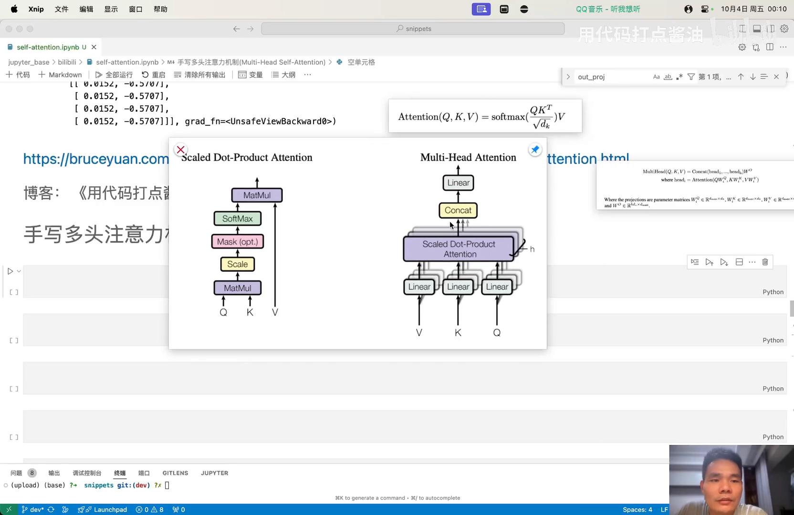
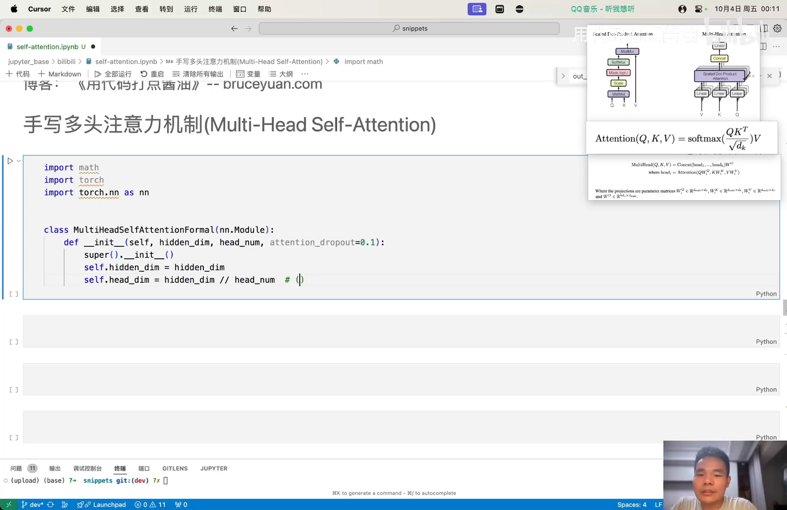
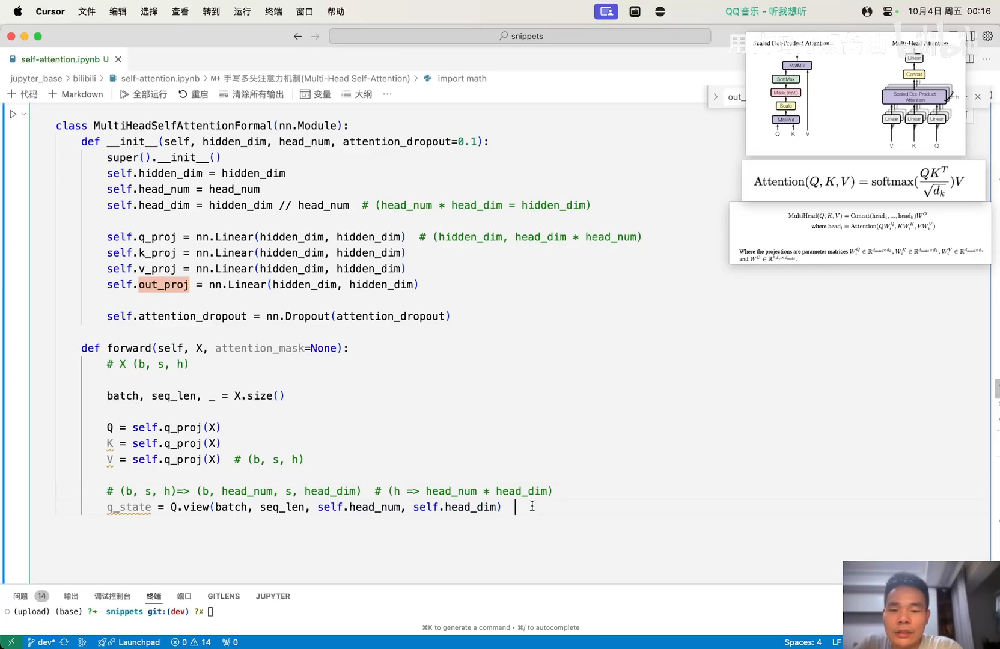
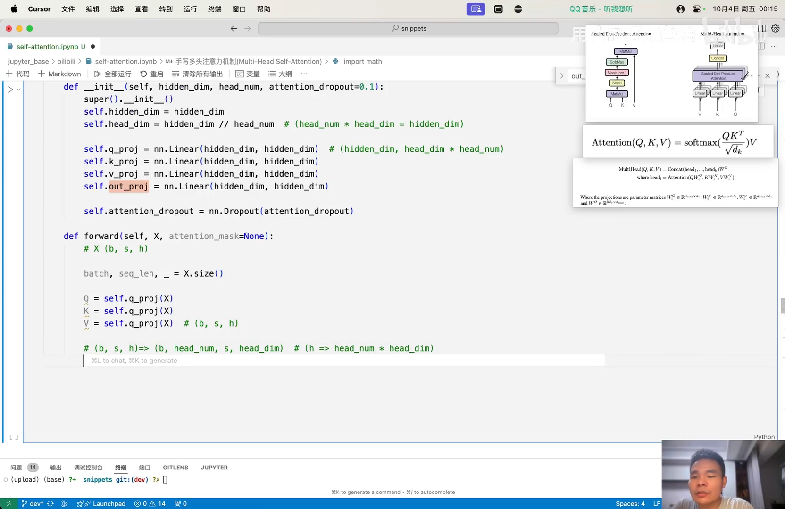
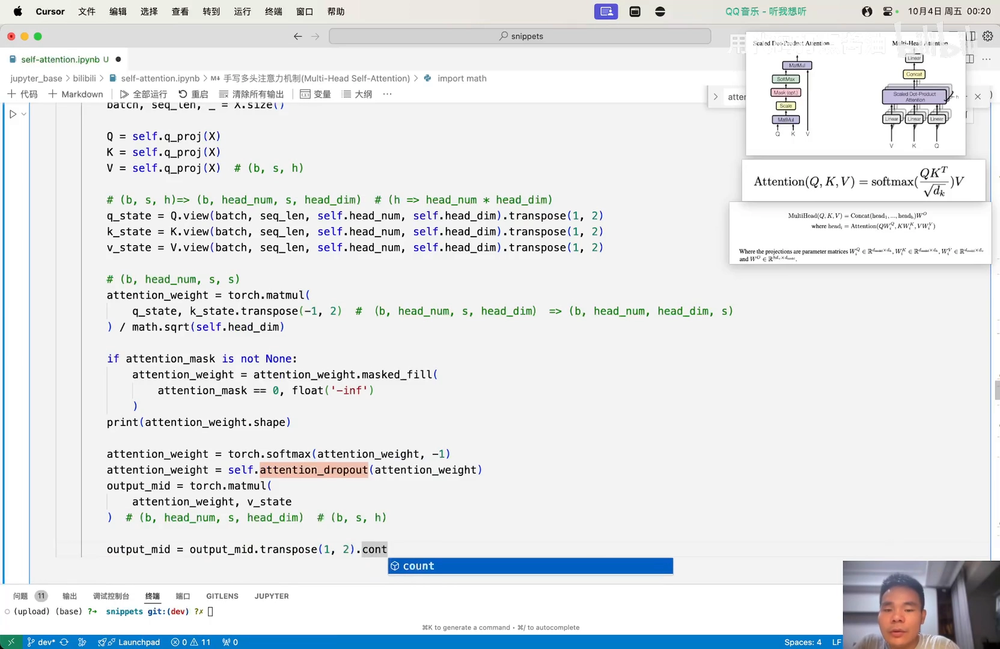
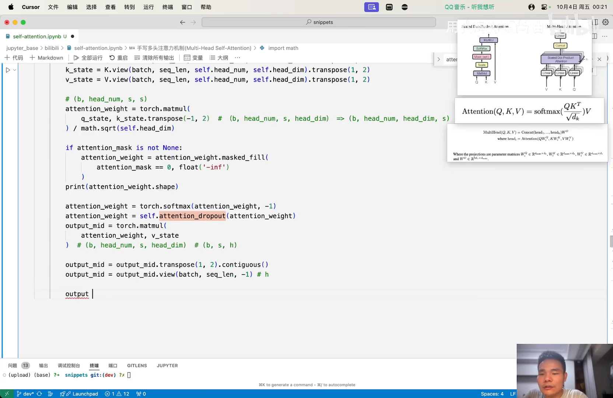
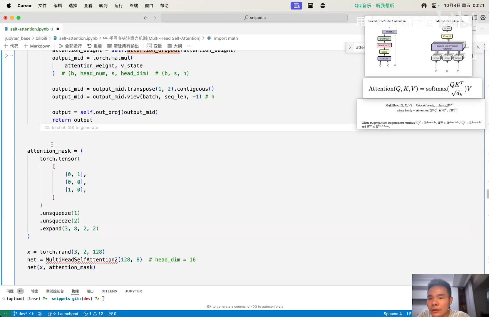

# 手写多头注意力：先 view 再 transpose，拼回去之前要先 contiguous

> 视频来源：[PyTorch手写多头注意力 精细版](https://www.bilibili.com/video/BV19mxdeBEbu/?t=0)（Bilibili · 用代码打点酱油）
> 导读：这一讲从零开始把多头自注意力敲一遍，代码全程在画面上。本文的价值在于「形状对照」：每一步 tensor 是几维、为什么要这一维、少了它会报什么错。视频原声字幕由语音转写，部分术语已按画面代码校正；画面里 forward 有两行笔误，本文末尾单独说明。

本文基于视频演说图文稿整理，配图截自视频。

## 本讲要解决的核心问题（SCQA）

**背景**：上一讲（手写 self-attention 的四重境界）已经写出了一版能跑的单头自注意力：一句 $\mathrm{softmax}(QK^{T}/\sqrt{d_k})\,V$ 就完事，输入输出都是 `(b, s, h)`。

**冲突**：多头注意力的公式看上去只是「多做几遍再拼起来」，可一落到代码里就全是形状问题：`nn.Linear` 到底该映到 `hidden_dim` 还是 `head_dim`？`view` 该拆哪一维？为什么拆完还要 `transpose`？算完之后怎么拼回去？拼的时候为什么突然冒出一个 `contiguous`？

**疑问**：这七八行代码里，每一个形状变换各自在解决什么问题，顺序能不能换？

**回答（中心思想）**：**多头注意力的实现就是一条形状链**——`(b, s, h)` 经过大投影仍是 `(b, s, h)`，用 `view` 把最后一维拆成「头数 × 头维度」两层，用 `transpose(1, 2)` 把 head 维提到 token 前面（因为要和「被注意的 token」维挨着，才能做 `-1`、`-2` 的转置与矩阵乘），算完注意力再把 head 挪回 token 后面，此时张量已不连续，必须 `contiguous()` 拷贝一次，最后再 `view` 一将头数与头维度合并回 `h`，过一个 `output_proj`。**先 view 再 transpose，拼回去要先 contiguous**——顺序不是风格问题，是内存布局的硬约束。

---

## 一、多头的定义：把头的结果 concat 起来，再过一个输出矩阵

先把公式对齐，后面写代码才不会迷路。单头自注意力（也叫 scaled dot-product attention，缩放点积注意力）就是一张图配一条公式：

$$
\mathrm{Attention}(Q, K, V) = \mathrm{softmax}\!\left(\frac{QK^{T}}{\sqrt{d_k}}\right)V
$$

多头则是同一个东西做 $N$ 遍，然后把结果拼起来、再乘一个输出矩阵：

$$
\mathrm{MultiHead}(Q,K,V) = \mathrm{Concat}(\mathrm{head}_1, \dots, \mathrm{head}_N)\,W^{O}
$$



对照两张图看，多头相对单头**只多了两处**：并联的 $N$ 条支路，以及顶部那个 `Concat` 加 `Linear` [【跳转到 00:48】](https://www.bilibili.com/video/BV19mxdeBEbu/?t=48)。没有新的算子，没有新的公式，只有「多份」和「拼接」。这一点决定了实现思路：**用一次批量运算把 $N$ 条支路一起算掉，再用形状操作假装它们是 $N$ 条独立支路。**

## 二、`head_dim` 由整除得来：头数乘头维度必须等于隐藏宽度

构造函数里最关键的一行，是把总宽度切给每个头：

```python
class MultiHeadSelfAttention(nn.Module):
    def __init__(self, hidden_dim, head_num, attention_dropout=0.1):
        super().__init__()
        self.hidden_dim = hidden_dim
        self.head_num = head_num
        self.head_dim = hidden_dim // head_num   # head_num * head_dim == hidden_dim
```



这里有个必须记住的恒等式：

$$
\text{head\_num} \times \text{head\_dim} = \text{hidden\_dim}
$$

为什么要用整除？因为**每个头是独立做一次自注意力的**，注意力需要在 $d_k$ 维里算相似度；如果总宽度切不整齐，就等于有个头分到的维度不完整 [【跳转到 02:52】](https://www.bilibili.com/video/BV19mxdeBEbu/?t=172)。

> **需要注意的一个细节**：`head_num` 一定要存成成员变量（写成 `self.head_num`），不能只当局部参数用。视频里作者写到 `view` 那一步才发现自己只存了 `head_dim`，只好回头补一行 [【跳转到 06:32】](https://www.bilibili.com/video/BV19mxdeBEbu/?t=392)。这不是小事——`view` 里两个参数都要用，缺一个就写不下去。

## 三、四个 `nn.Linear`：全部从 `hidden_dim` 到 `hidden_dim`

接着是四个投影层，形状**一模一样**：

```python
self.q_proj = nn.Linear(hidden_dim, hidden_dim)   # 其实是 (hidden_dim, head_dim * head_num)
self.k_proj = nn.Linear(hidden_dim, hidden_dim)
self.v_proj = nn.Linear(hidden_dim, hidden_dim)
self.out_proj = nn.Linear(hidden_dim, hidden_dim)
self.attention_dropout = nn.Dropout(attention_dropout)
```

为什么不是映到 `head_dim`？视频里的解释很直白：**我们真正想要的是「从 `hidden_dim` 到 `head_dim` 乘 `head_num`」，但因为多个小矩阵可以写成一个大矩阵，所以直接写成从 `hidden_dim` 到 `hidden_dim` 更优雅** [【跳转到 03:28】](https://www.bilibili.com/video/BV19mxdeBEbu/?t=208)。

这句话值得展开，因为它是「多头不贵」的根源：

- 每个头原本需要自己的 $W^{Q}_i$，形状是 $[h, d_k]$；
- 把 $N$ 个这样的矩阵**横向并排**，就得到 $[h, N d_k] = [h, h]$；
- 于是一次 `nn.Linear` 就等价于 $N$ 次小投影，参数量完全相同（$h \times h$ 一个不少），只是排布不同。

四个矩阵分别对应公式里的 $W^{Q}$、$W^{K}$、$W^{V}$、$W^{O}$——前三者产生 Q、K、V，最后一个 `out_proj` 就是公式最外层那个 $W^{O}$ [【跳转到 03:52】](https://www.bilibili.com/video/BV19mxdeBEbu/?t=352)。

## 四、forward 的第一件事：把 `batch` 和 `seq_len` 记下来

```python
def forward(self, X, attention_mask=None):
    # X (b, s, h)
    batch, seq_len, _ = X.size()
```

输入是 `(b, s, h)`：batch、序列长度、特征宽度。第三维用 `_` 丢掉，前两维存进局部变量 [【跳转到 04:40】](https://www.bilibili.com/video/BV19mxdeBEbu/?t=280)。

视频在这里故意留了个悬念：「为什么要记下来，大家思考一下」[【跳转到 04:52】](https://www.bilibili.com/video/BV19mxdeBEbu/?t=292)。答案是后面每一个 `view` 都要用——`view` 是**从头到尾重写形状**的操作，你必须把不变的维度显式写出来，不能像 `reshape(-1)` 那样把一切都交给自动推断。记住这一点，后面每一步就不容易写错。

## 五、`view` 只拆最后一维：把 `h` 拆成头数与头维度

```python
Q = self.q_proj(X)
K = self.k_proj(X)
V = self.v_proj(X)          # 三个都是 (b, s, h)
```

三个投影完之后，形状**没变**，仍是 `(b, s, h)`——因为 `nn.Linear` 只改最后一维的内容，不改维度数量。

现在的语义是：每个 token 有一条长度为 `h` 的向量，其中前 `head_dim` 个数属于头 0，接下来 `head_dim` 个属于头 1……但**张量本身并不知道这个分法**，它只知道「最后一维是 h」。要把这个隐含的划分显式化：

```python
q_state = Q.view(batch, seq_len, self.head_num, self.head_dim)
```

形状从 `(b, s, h)` 变为 (b, s, head_num, head_dim) 四层。评论区的注释写得很准：把 `h` 读成 `head_num` 乘 `head_dim` [【跳转到 06:08】](https://www.bilibili.com/video/BV19mxdeBEbu/?t=368)。

这一步**不复制数据**。`view` 只是换一种方式解释同一块连续内存：原来「一个 token 的 h 个数」，现在被读成「一个 token 的 head_num 组、每组 head_dim 个数」。因为乘积相等，读法才成立。

## 六、`transpose(1, 2)`：把 head 维挪到第二位置

```python
q_state = Q.view(batch, seq_len, self.head_num, self.head_dim).transpose(1, 2)
```

视频原话是「head_dim 放到第二个维度里面，所以要做一下 transpose，就是把第 1、第 2 两个维度变换一下」[【跳转到 06:56】](https://www.bilibili.com/video/BV19mxdeBEbu/?t=416)。



变换后是 (b, head_num, s, head_dim)。为什么要换？把接下来的两步连起来看就懂了：

1. 注意力分数要算 `matmul`（`q_state` 与转置后的 `k_state`），而 `matmul` **只作用在最后两维**；
2. 所以最后两维必须正好是「待乘的两个矩阵」——对 Q 来说是 $(s, d_k)$。

(b, s, head_num, head_dim) 的最后两维是 $(head\_num, head\_dim)$，那是「哪几个头、每个头多宽」，不是「哪几个 token、每个 token 多宽」。`transpose(1, 2)` 之后最后两维才变成 $(s, head\_dim)$，正是要乘的东西 [【跳转到 07:36】](https://www.bilibili.com/video/BV19mxdeBEbu/?t=456)。

一句话概括这一节的判断：**`view` 负责「拆」（把宽度切成头），`transpose` 负责「排」（把头提到 token 前面）；两件事必须分开做，因为 `view` 只认内存顺序，`transpose` 只改维度语义。**

## 七、分数、缩放与掩码：除了 `head_dim` 的平方根，不是 `hidden_dim` 的

```python
attention_weight = torch.matmul(
    q_state, k_state.transpose(-1, 2)      # (b, head, s, d) => (b, head, d, s)
)                                          # -> (b, head_num, s, s)
```

`k_state` 的 `transpose(-1, -2)` 用负数下标写，等价于交换最后两维：形状从 (b, head_num, s, head_dim) 变成 (b, head_num, head_dim, s)，乘完得到 (b, head_num, s, s)——**每个头一张 $s \times s$ 的分数表** [【跳转到 08:00】](https://www.bilibili.com/video/BV19mxdeBEbu/?t=480)。

接着是缩放。这里有个很容易照抄错的点：除的是 $\sqrt{head\_dim}$，**不是** $\sqrt{hidden\_dim}$ [【跳转到 08:24】](https://www.bilibili.com/video/BV19mxdeBEbu/?t=504)。

```python
) / math.sqrt(self.head_dim)
```

原因很朴素：缩放是为了在 softmax 之前把点积的方差压回 1 附近，而点积是在 $d_k$ 维上做的，所以分母必须匹配 $d_k$。如果你按 `hidden_dim` 去缩放，就会多除一个 $\sqrt{head\_num}$，注意力分布随之变得过于平坦——代码跑得通、结果不对，属于最难查的那类 bug。

然后是可选的掩码：

```python
if attention_mask is not None:
    attention_weight = attention_weight.masked_fill(
        attention_mask == 0, float('-inf')
    )
```



语义是「掩码为 0 的位置填一个极小的值」，视频里直接填负无穷 [【跳转到 08:48】](https://www.bilibili.com/video/BV19mxdeBEbu/?t=528)。填 -inf 而不是 0 的原因：后面要过 softmax，$e^{-\infty} = 0$，这样被遮住的位置**权重严格为 0**；如果填 0，反而会参与竞争。

## 八、softmax 与 dropout 的顺序：写反了会静默出错

```python
attention_weight = torch.softmax(attention_weight, -1)
attention_weight = self.attention_dropout(attention_weight)
```

`softmax(..., -1)` 沿最后一维（被注意的 token 方向）归一化，让每一行加起来是 1 [【跳转到 09:45】](https://www.bilibili.com/video/BV19mxdeBEbu/?t=585)。

视频里作者在这一段写错过顺序，自己念出来纠正：「这个位置写错了，应该是 softmax 之后再去 dropout」[【跳转到 09:57】](https://www.bilibili.com/video/BV19mxdeBEbu/?t=597)。这个顺序不是随意定的：

- 先 softmax 再 dropout：拿到的是一组合法的注意力权重（和为 1），dropout 随机把它们中的某些置零（训练时其余位置按比例放大）；
- 先 dropout 再 softmax：被置零的位置仍然是 0，softmax 会把剩下的重新归一化——dropout 的效果等于没做。



## 九、乘 V、拼回来：`transpose` → `contiguous` → `view`

```python
output_mid = torch.matmul(attention_weight, v_state)   # (b, head_num, s, head_dim)
```

权重乘 V，每个头拿到自己的上下文向量，形状还是 (b, head_num, s, head_dim)——注意最后两维回到了 $(s, d_k)$，因为权重矩阵是 $(s, s)$ 乘 $(s, d_k)$。

接下来要「拼头」。目标形状是 $(b, s, head\_num \times head\_dim)$ [【跳转到 10:45】](https://www.bilibili.com/video/BV19mxdeBEbu/?t=645)，但当前是 (b, head_num, s, head_dim)，head 在 token **前面**。所以顺序是：

```python
output_mid = output_mid.transpose(1, 2).contiguous()
output_mid = output_mid.view(batch, seq_len, -1)       # 最后的 -1 自动补成 h
```

三步各自的职责：

1. `transpose(1, 2)`：把 head 挪回 token 后面，(b, head_num, s, head_dim) → (b, s, head_num, head_dim)。只有 head 和 head_dim 挨着了，`view` 才能把它们合并成一个宽度。
2. `contiguous()`：**必须出现的一步**。`transpose` 只改步长（stride）、不动内存，所以张量此刻在内存里的顺序和逻辑顺序不一致；`view` 要求内存连续，会直接报错。`contiguous()` 按逻辑顺序做一次真实拷贝，把内存理顺并返回一个新的连续张量 [【跳转到 11:09】](https://www.bilibili.com/video/BV19mxdeBEbu/?t=669)。
3. `view` 一拐到位：用 `-1` 让 PyTorch 自动算出最后是 `h`，把头数与头维度合并回 `hidden_dim`。



视频里还提到一条实用建议：**这一步也可以用 `reshape` 代替**，因为 `reshape` 会在需要时自动拷贝，只是「用 `transpose` 之后配 `contiguous` + `view`」更符合 PyTorch 的习惯写法 [【跳转到 11:21】](https://www.bilibili.com/video/BV19mxdeBEbu/?t=681)。

> **判断句记一下**：凡是「先 `transpose` 后合并维度」，就一定要么 `.contiguous().view(...)`，要么 `.reshape(...)`。只写 `transpose` 后接 `view`，必然报错。

## 十、最后一步：`out_proj` 与 `return`

```python
output = self.out_proj(output_mid)
return output
```

`out_proj` 就是公式里的 $W^{O}$，作用是把拼接后的结果整体再混合一次，形状仍是 `(b, s, h)` [【跳转到 11:45】](https://www.bilibili.com/video/BV19mxdeBEbu/?t=705)。到这里，输入 `(b, s, h)`、输出 `(b, s, h)`，形状完美闭合——这也是为什么多头注意力可以像积木一样一层层叠起来。

## 十一、跑通它：输入 (3, 2, 128)、8 个头、每个 16 维

测试直接照抄上一讲的样例形状 [【跳转到 12:08】](https://www.bilibili.com/video/BV19mxdeBEbu/?t=728)：

```python
attention_mask = (
    torch.tensor([[0, 1], [0, 0], [1, 0]])
    .unsqueeze(1).unsqueeze(2)
    .expand(3, 8, 2, 2)
)
x = torch.rand(3, 2, 128)
net = MultiHeadSelfAttention(128, 8)     # head_dim = 16
net(x, attention_mask)
```



几个数字对得上：输入宽度 128、8 个头，所以每个头 16 维（`head_dim` 为 16），$8 \times 16 = 128$ 正好回到 `hidden_dim`。

掩码那段也顺带暴露了「多头」的另一处形状要求：原始掩码只有 `(3, 2, 2)`（batch、query、key），必须 `unsqueeze` 两次再 `expand` 到 `(3, 8, 2, 2)`，把 head 维补出来，才能与 (b, head_num, s, s) 的分数张量对齐。`expand` 不复制数据，只是在广播维度上「假装有 8 份」。

### 画面里的两处笔误（重要）

对照画面代码会发现一个容易被误抄的地方：`forward` 里 K 和 V 两行仍然写成了 `self.q_proj`——编辑器用黄色波浪线提示 `k_proj`、`v_proj` 未被使用 [【跳转到 05:08】](https://www.bilibili.com/video/BV19mxdeBEbu/?t=308)。正确写法是：

```python
Q = self.q_proj(X)
K = self.k_proj(X)      # 画面里误写成 self.q_proj(X)
V = self.v_proj(X)      # 画面里误写成 self.q_proj(X)
```

这个笔误在**纯自注意力**的场景下不会报错（形状对得上，代码能跑），但会让 Q、K、V 完全相同，多头就退化成「同一份表示自己和自己做点积」，注意力的表达力直接损失一大半。检查方法很简单：给三个投影层随机初始化后打印 `Q[0,0,:4]`、`K[0,0,:4]`、`V[0,0,:4]`，三者不该相同。另外画面里这个类的名字先后出现过两版（`MultiHeadSelfAttentionFormal` 与测试时的 `MultiHeadSelfAttention2`），属于命名差异，不影响逻辑。

## 小结

- 多头的公式只有两处新增：$N$ 条并联支路 + `Concat` 后接 $W^{O}$；实现上全靠形状操作「假装」有 $N$ 条支路。
- 地基是 $head\_num \times head\_dim = hidden\_dim$，所以 `head_dim` 由 `hidden_dim` 除以 `head_num` 整除得出；`head_num` 必须存成成员变量，否则 `view` 写不出来。
- 四个 `nn.Linear` 全部写成 `hidden_dim` 进、`hidden_dim` 出：多个小矩阵并排等于一个大矩阵，参数量一样，只是写法更优雅。
- `batch` 和 `seq_len` 要在一开始就取出来，因为后面每个 `view` 都要显式写出不变的维度。
- `view` 负责「拆宽度」，`transpose(1, 2)` 负责「把头提到 token 前面」；原因在于 `matmul` 只看最后两维。
- 缩放除的是 $\sqrt{head\_dim}$，不是 $\sqrt{hidden\_dim}$；掩码填 $-\infty$ 而不是 0。
- 拼回去的顺序是 `transpose(1, 2)` → `contiguous()` → `view(b, s, -1)`；也可以一步 `reshape`，但**绝不能**在 `transpose` 后直接 `view`。
- `out_proj` 把各头的结果混合一次，输出形状与输入一致，`(b, s, h)` 闭合。
- 画面里 K、V 两行沿用 `self.q_proj` 是笔误，会让多头退化成单头，抄代码时要改。

## 关键术语速查

| 术语 | 一句话解释 |
| --- | --- |
| hidden_dim | 模型的隐藏层宽度，也是注意力输入输出的最后一维 |
| head_num | 头的个数，把 `hidden_dim` 均分成多少份 |
| head_dim | 单个头的宽度，等于 `hidden_dim` 除以 `head_num`，注意力和缩放都在这上面做 |
| view | 重写张量形状，不复制数据，要求内存连续 |
| transpose | 交换两个维度，只改步长不改内存，所以结果通常不连续 |
| contiguous | 按逻辑顺序做一次真实拷贝，让后续 `view` 合法 |
| reshape | 更宽容的重排，需要时会自动拷贝，可替代 `contiguous() + view()` |
| masked_fill | 按布尔掩码把指定位置替换成给定值，常用来填负无穷 |
| out_proj | 公式里的 $W^{O}$，把拼接后的多头结果再混合一次 |
