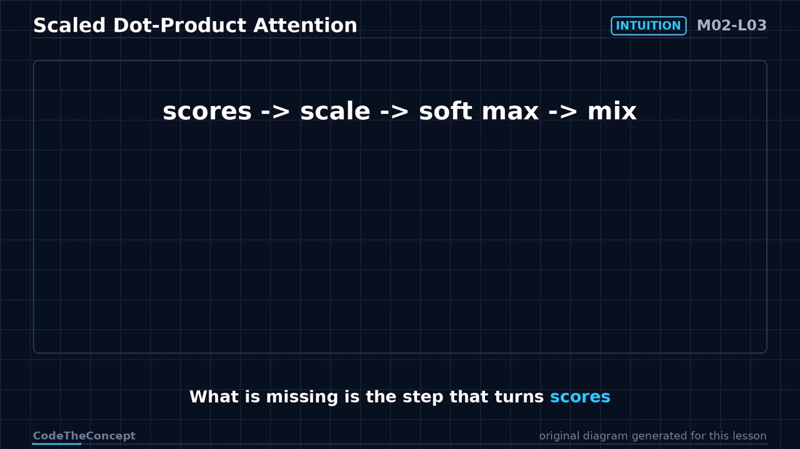
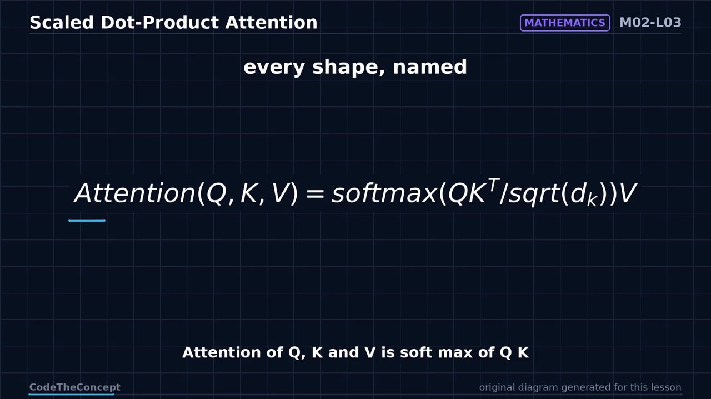
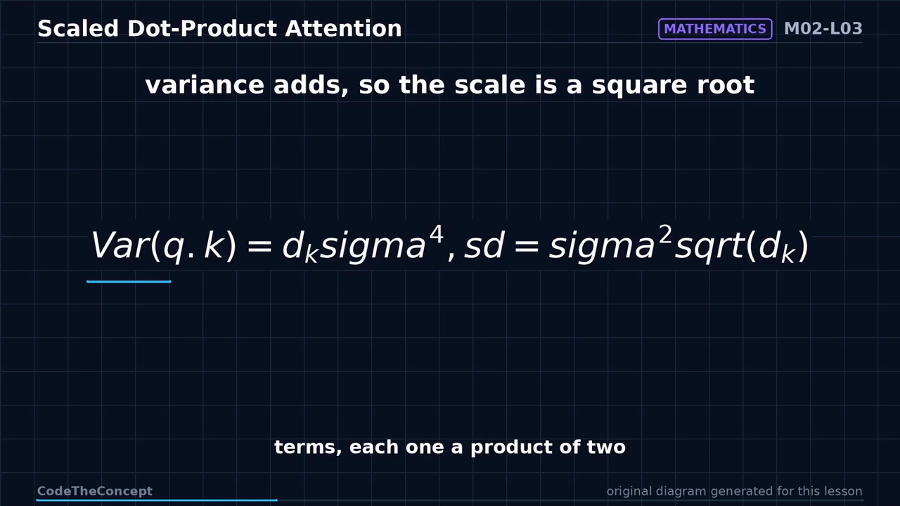
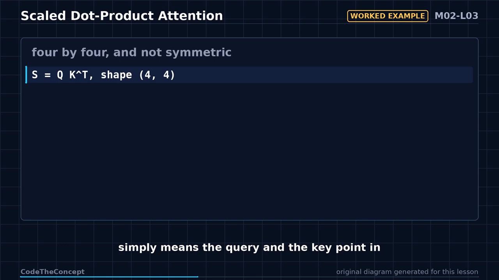
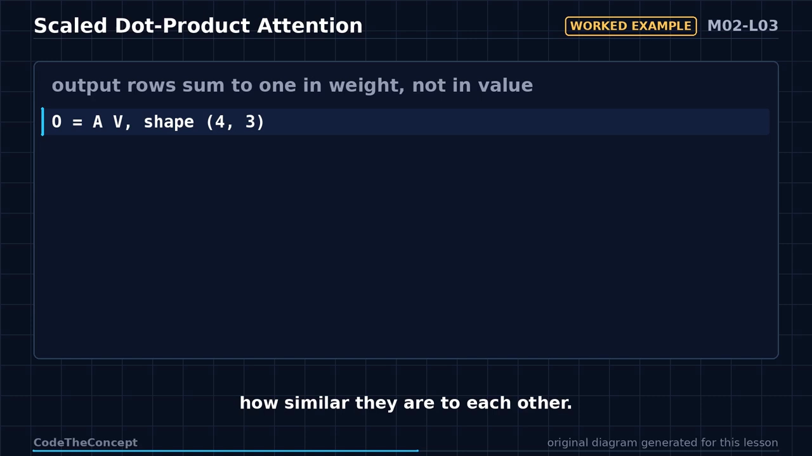
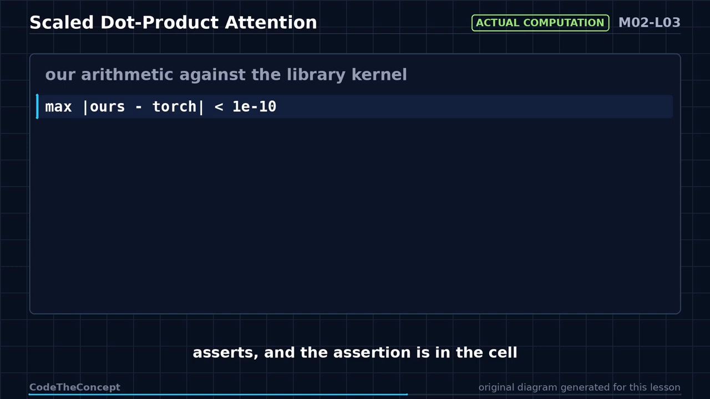
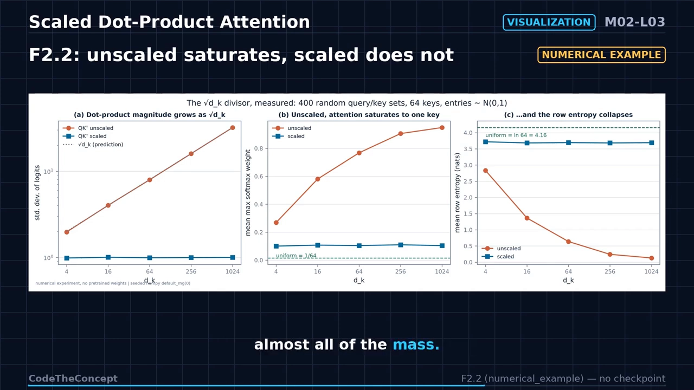

# 分母为什么是根号 d_k：分数方差随维度增长，Softmax 就只剩一个赢家

> 视频来源：[Scaled dot-product attention: why divide by the square root of dk](https://www.youtube.com/watch?v=PeAwEpizRxk)（YouTube · CodeTheConcept · 注意力机制系列 M02-L03）｜时长约 13 分钟
> 导读：这支视频的讲法是「先手算、再推导、最后实测、最后自曝边界」。本文按同样的顺序走一遍：四步流水线、形状链、凸组合、方差论证、四个 token 的完整手算、与 PyTorch 的逐位对照、跨两个数量级的维度扫描，以及这个论证在训练好的网络里还站得住多少。字幕里的 `d k`、`root d k`、`DK` 统一订正为 $d_k$。

本文基于视频演说图文稿整理，配图截自视频。

## 本讲要解决的核心问题（SCQA）

**背景**：注意力的公式写出来只有一行：

$$
\mathrm{Attention}(Q,K,V) = \mathrm{softmax}\!\left(\frac{QK^{\top}}{\sqrt{d_k}}\right)V
$$

绝大多数人第一次见到它时，接受的解释是「除以一个尺度因子让它更稳定」——至于为什么偏偏是 $\sqrt{d_k}$，而不是 $d_k$、也不是干脆不除，通常被含糊带过，当成一个「约定」。

**冲突**：一个被所有 Transformer 从 BERT 到 GPT 亿次重复的核心算子，里面最关键的一个数竟然是靠约定俗成的。这意味着一旦有人改了实现（去掉缩放、换成 $d_k$、换成长度归一化），我们没有任何判据去预测会发生什么。

**疑问**：分母为什么恰好是 $\sqrt{d_k}$？它是从哪一步数学里掉出来的？如果不除，坏掉的到底是什么？

**回答（中心思想）**：**因为点积的方差随 $d_k$ 线性增长，所以它的标准差随 $\sqrt{d_k}$ 增长；除以 $\sqrt{d_k}$ 就把分数的典型幅度拉回到与维度无关的 1。** 这一步不是为了让数字好看，而是为了不让 softmax 落进饱和区：饱和的行会变成几乎 one-hot 的硬 argmax，而 softmax 的导数恰恰由权重本身构成，于是反向传播几乎没有话可对 query、key 说，这一层就学不会「该看哪里」。视频最后还补了一句同等重要的话：这个推导是在「独立、零均值、单位方差」的干净假设下做的，它解释的是「为什么这样设计」，**不是**描述训练好的网络内部的真实统计。

---

## 一、整条机制只有四步：打分、缩放、归一化、混合

注意力被讲得很神秘，是因为人们习惯从「它在模拟人类注意」讲起。视频的做法相反：先把它拆成四个操作，别的什么都没有——没有循环（recurrence）、没有卷积、没有门控，也没有从上一个 token 传下来的状态 [【跳转到 00:50】](https://www.youtube.com/watch?v=PeAwEpizRxk&t=50)。

四步分别是：

1. **打分（score）**：算出所有 query 与 key 两两之间的分数，得到一张 $N\times N$ 的表；
2. **缩放（scale）**：把每个分数除以 $\sqrt{d_k}$；
3. **归一化（softmax）**：把每一行分数变成一组和为 1 的权重；
4. **混合（mix）**：用这组权重把 value 加权求和，得到输出。

> **术语**：*softmax* 是一个把任意实数向量变成概率向量的函数：先对每个元素取指数 $e^{z_i}$，再除以所有指数之和。指数保证结果永远为正，除以总和保证加起来等于 1。分数（score，也叫 logits）则是 softmax 的输入，可以取任意实数、可正可负、没有上界。

这个公式里的 $Q,K,V$ 就是上一小节做完投影与多头切分之后的三个张量；本节只关心 $QK^{\top}$ 之后发生的事。

## 二、把形状链读完，有两件事值得先记住

视频把每一步的形状都念了一遍，这条链本身就是理解注意力的最短路径 [【跳转到 01:40】](https://www.youtube.com/watch?v=PeAwEpizRxk&t=100)：

| 步骤 | 表达式 | 形状 | 含义 |
| :--- | :--- | :--- | :--- |
| 输入 | $Q, K, V$ | $N \times d_k$ | 每个 token 一组 query、key、value |
| 打分 | $QK^{\top}$ | $N \times N$ | 每对 token 一个分数 |
| 缩放 | $QK^{\top}/\sqrt{d_k}$ | $N \times N$ | 除以标量，形状不变 |
| 归一化 | $\mathrm{softmax}(\cdot)$ | $N \times N$ | 按行归一化，每行和为 1 |
| 混合 | $\mathrm{softmax}(\cdot)V$ | $N \times d_k$ | 回到 value 的形状 |

两件事值得单独标出来：

- **$N\times N$ 这一级是整条链里唯一随序列长度平方增长的地方**，这正是长上下文昂贵的全部根源 [【跳转到 02:05】](https://www.youtube.com/watch?v=PeAwEpizRxk&t=125)；
- **$d_k$ 在输出形状里彻底消失了**。输出永远是 $N\times d_k$，与 $d_k$ 的取值无关——这正是「可以把这样的层一层层叠起来」的前提。

## 三、softmax 让注意力只做「重新分配」，不做「创造」

softmax 的定义带来一个很容易被忽略、但威力极大的事实：每个输出都是正的，且每一行加起来等于 1 [【跳转到 02:30】](https://www.youtube.com/watch?v=PeAwEpizRxk&t=150)。

用线性代数的语言说，每个输出行都是 value 各行的**凸组合**（convex combination）：系数非负、和为 1 的加权平均。

> **术语**：一组向量的*凸组合*，就是「权重非负且加起来等于 1」的加权平均。它的几何意义是：结果一定落在这些向量围成的凸包（convex hull）内部，绝不会跑到外面去。类比：把三种颜色的颜料按任意比例混，你混不出一种原本不存在的原色。

由此得到一个相当锋利的结论：**注意力层无法产生一个任何 token 原本都没有的特征**。它只是把已有的东西重新分配 [【跳转到 02:55】](https://www.youtube.com/watch?v=PeAwEpizRxk&t=175)。创造新特征是前馈网络（FFN）的工作——那是模块三的主题。

视频在这里给了个很好的反问句式：当有人说「注意力给这个 token 增加了信息」时，追问一句——那新信息指向哪个方向？它只能指向已有 value 的凸包内部。这个视角在后面解释「为什么平坦的权重等于没做事」时会立刻派上用场。

## 四、方差论证：点积的标准差就是 $\sigma^2\sqrt{d_k}$

现在进入本讲的正题。一个分数是 $q$ 与 $k$ 的点积：

$$
q\cdot k = \sum_{i=1}^{d_k} q_i k_i
$$

它把 $d_k$ 个乘积加在一起，每个乘积都是两个独立条目的积 [【跳转到 03:20】](https://www.youtube.com/watch?v=PeAwEpizRxk&t=200)。设每个条目的均值为 0、方差为 $\sigma^2$，且所有条目彼此独立，逐步算：

**第一步：每一项的均值是 0。** 因为因子独立且都零均值，

$$
\mathbb{E}[q_i k_i] = \mathbb{E}[q_i]\,\mathbb{E}[k_i] = 0
$$

**第二步：每一项的方差是 $\sigma^4$。** 均值既然已经是 0，方差就是二阶矩：

$$
\mathrm{Var}(q_i k_i) = \mathbb{E}\left[q_i^2 k_i^2\right] - 0 = \mathbb{E}\left[q_i^2\right]\mathbb{E}\left[k_i^2\right] = \sigma^2 \cdot \sigma^2 = \sigma^4
$$

**第三步：$d_k$ 项相加，方差线性累加。** 独立性保证协方差为零，所以方差可以直接相加：

$$
\mathrm{Var}(q\cdot k) = \sum_{i=1}^{d_k} \mathrm{Var}(q_i k_i) = d_k\,\sigma^4
$$

**第四步：开方得到典型幅度。** 标准差是方差的平方根：

$$
\mathrm{sd}(q\cdot k) = \sqrt{d_k\,\sigma^4} = \sigma^2\sqrt{d_k}
$$

取 $\sigma = 1$（条目本身已是单位尺度），就得到视频幻灯片上那一行：

$$
\mathrm{Var}(q\cdot k) = d_k,\qquad \mathrm{sd}(q\cdot k) = \sqrt{d_k}
$$

这就是分母的来源 [【跳转到 04:10】](https://www.youtube.com/watch?v=PeAwEpizRxk&t=250)：

> **方差是线性相加的，所以「典型幅度」只能按平方根长大。** 用它自己的平方根去除，分数的典型幅度就不再依赖 $d_k$ 了。

注意这里有一个常见的直觉陷阱，视频开头就点了出来：很多人以为分数会像维度本身那样长大（$d_k$ 倍），实际上长大得慢得多，只慢一个平方根的量级 [【跳转到 00:25】](https://www.youtube.com/watch?v=PeAwEpizRxk&t=25)。当 $d_k$ 从 4 涨到 1000（250 倍），典型幅度只涨了约 16 倍。

## 五、这个论证只用了三条很弱的假设，所以它很稳

推导里到底用到了什么？视频特意列了一遍 [【跳转到 04:10】](https://www.youtube.com/watch?v=PeAwEpizRxk&t=250)：

- **独立性**：各项之间没有相关性，方差才能直接相加；
- **零均值**：乘积项的期望与方差的算法才能这么干净；
- **有限方差**：方差这个概念本身要成立。

**它从头到尾没有假设条目服从正态分布。** 这一点很关键：只要满足上面三条，不管条目是从均匀分布、伯努利分布还是别的什么分布里抽出来的，结论都成立。所以这个结论的稳健性，比许多「假设高斯」的推导要强得多。

## 六、四个 token 的手算：缩放不决定谁赢，只决定赢得多尖

抽象推导之后，视频回到具体数字：4 个 token，$d_k = 3$。$Q$ 乘 $K^{\top}$ 得到一个 $4\times 4$ 的分数矩阵 [【跳转到 04:35】](https://www.youtube.com/watch?v=PeAwEpizRxk&t=275)。

读这张表时，视频提醒了三件事：

1. **前两行每一项都是负的，这是允许的。** 分数没有边界，负分只表示这个 query 与这个 key 大致指向相反的方向；
2. **第三、四行符号混杂**，正负都有；
3. **第 1 行第 3 列与第 3 行第 1 列不相等。** 这是上一讲的结论：乘积两侧由不同的矩阵生成，所以这张表不对称。

接着做缩放：每个元素除以 $\sqrt{3} \approx 1.732$ [【跳转到 05:00】](https://www.youtube.com/watch?v=PeAwEpizRxk&t=300)。矩阵整体向零收缩，但**没有符号翻转、没有次序改变**——因为除以一个正常数是单调操作。

这句话值得单独记住：**缩放从来不决定谁赢，它只决定赢家被偏好得有多尖锐** [【跳转到 05:25】](https://www.youtube.com/watch?v=PeAwEpizRxk&t=325)。换句话说，$\sqrt{d_k}$ 改变的是分布的「温度」，不是排序。

然后是 softmax。得到的注意力权重矩阵里，最大的权重只有约 0.35——4 个 token、3 个维度，本来就产生不了尖锐的分布。每一行都接近平坦，视频说得很坦诚：这不是注意力的缺陷，而是这个例子的性质，4 个 key 之间本来就没多少可区分的。

最后一步，权重矩阵乘 value 矩阵，输出 4 行 3 个数，形状和输入 value 完全一致 [【跳转到 06:15】](https://www.youtube.com/watch?v=PeAwEpizRxk&t=375)：

先看权重矩阵的行和，四行都等于 1（在打印精度内）；再看四个输出行，它们彼此非常相似。原因上一节已经埋好了：**每行都是同样四个 value 向量的近乎等权平均，所以每行都落在四个向量中心附近**。平坦的权重意味着平淡的输出，一层权重若全是平的，它除了求平均几乎什么也没做 [【跳转到 06:40】](https://www.youtube.com/watch?v=PeAwEpizRxk&t=400)。而在一个训练过的、有 200 个 token 的网络里，这些行并不平坦——那个差别才是这层值得存在的原因。

## 七、四步手算与 PyTorch 对得上：这不是「教学简化版」

手算之后剩下的唯一问题：我们算的到底是不是真实的注意力？Notebook N01 把同一组 $Q,K,V$ 喂给 PyTorch 自带的融合注意力函数，然后比较：

两者在浮点舍入范围内一致，远低于 notebook 断言的容差 [【跳转到 07:05】](https://www.youtube.com/watch?v=PeAwEpizRxk&t=425)。这件事比任何示意图都有价值：**它说明刚才那四步不是注意力的简化教学版本，它们就是注意力**；库只是把同样的算术在一个融合核里算得更快。

## 八、实测：$d_k$ 跨两个数量级，标准差跟住 $\sqrt{d_k}$

推导终究是推导，还要看数。实验设置是：$d_k$ 取 5 个值，每个设置跑 400 次独立试验，每次 64 个 key [【跳转到 07:30】](https://www.youtube.com/watch?v=PeAwEpizRxk&t=450)。

| $d_k$ | 实测分数标准差 | 预测值 $\sqrt{d_k}$ |
| :--- | :--- | :--- |
| 4 | 1.97 | 2 |
| 64 | 7.94 | 8 |
| 1024 | 32.09 | 32 |

实测的离散程度在两个数量级以上的范围内跟住了 $\sqrt{d_k}$ 曲线，差得只有百分之几 [【跳转到 07:55】](https://www.youtube.com/watch?v=PeAwEpizRxk&t=475)。视频特意强调这里被平均的是什么：每个设置 400 次独立试验，所以这些是期望值，不是一次幸运的抽样。**如果只跑一次，这条趋势会被噪声埋掉，你会错误地得出「这个效应很弱」的结论** [【跳转到 08:20】](https://www.youtube.com/watch?v=PeAwEpizRxk&t=500)。

同一张图还画了 softmax 那边发生了什么，三个面板来自同一次带种子的实验：

- 左图：分数的标准差与预测的 $\sqrt{d_k}$ 直线重合；
- 中图：**不除 $\sqrt{d_k}$ 时，$d_k = 1024$ 下平均最大权重达到 0.949**——64 个 key 里有一个几乎吃掉了全部权重 [【跳转到 08:45】](https://www.youtube.com/watch?v=PeAwEpizRxk&t=525)；
- 右图：同一条件下的**行熵塌到 0.13 nats**；而除了 $\sqrt{d_k}$ 之后，最大权重稳定在 0.1 附近、熵稳定在 3.69 附近，均匀分布在 64 个 key 上应该是 4.16（即视频里标注的 $\ln 64$）[【跳转到 09:15】](https://www.youtube.com/watch?v=PeAwEpizRxk&t=555)。

> **术语**：*熵*（entropy）在这里度量「注意力有多分散」。若一行权重均匀分布在 $N$ 个 key 上，熵取最大值 $\ln N$（自然对数单位叫 nats）；若全部压在一个 key 上，熵为 0。上面的 4.16 ≈ $\ln 64$ 就是「完全均匀」，3.69 表示相当分散，0.13 表示几乎就是 one-hot。

## 九、饱和之后真正坏掉的是梯度，不是数值溢出

到这里容易得出一个错误结论：不缩放会导致指数溢出、出现 `nan`。视频明确否掉了它 [【跳转到 09:15】](https://www.youtube.com/watch?v=PeAwEpizRxk&t=555)：任何工程上像样的 softmax 都会先减去行内最大值再取指数，所以**溢出早就被处理掉了**。

真正的失效发生在梯度上 [【跳转到 09:33】](https://www.youtube.com/watch?v=PeAwEpizRxk&t=573)：

- softmax 的导数是由**权重自身**搭起来的：$s_i(1-s_i)$ 与 $-s_i s_j$；
- 当某一行趋近 one-hot（某个 $s_i\to 1$、其余 $\to 0$），这些项全都趋于 0；
- 于是一个饱和的注意力行变成了**硬的 argmax**：它几乎不把梯度传回给 query 与 key 矩阵；
- 这一层就停止学习「该看哪里」。

视频对这件事的措辞很值得抄下来：**前向看起来很果断，反向已经无话可说** [【跳转到 09:58】](https://www.youtube.com/watch?v=PeAwEpizRxk&t=598)。正是这种前向与反向的不对称，解释了为什么 $\sqrt{d_k}$ 被写进**架构**里，而不是丢给优化器去调一个超参数。

## 十、这个推导的边界：它解释「为什么这么选」，不描述训练后的真实统计

这是全片最克制的一段，也是很多解释停下来的地方。推导做了三个假设：query 与 key 的条目**独立、零均值、单位方差**。而一个训练好的网络三条全破 [【跳转到 10:23】](https://www.youtube.com/watch?v=PeAwEpizRxk&t=623)：

- 学出来的投影之间**相关**；
- 它们的尺度是**训练结果说了算**的，没什么理由恰好是 1；
- LayerNorm 在**上游**，一直在重塑输入。

所以这张图说明的是「这个除数当初为什么被选中」，它**并不描述训练好的视觉 Transformer 内部的统计**；后者需要真正去测，那是模块五的内容。

视频要求把两句话严格分开：

1. 这个除数是由一个**干净假设下的设计论证**辩护的；
2. 这个除数是**实际发布的 checkpoint 用的值**。

**两句话谁也证明不了谁** [【跳转到 10:48】](https://www.youtube.com/watch?v=PeAwEpizRxk&t=648)。

也有一个能对得上的锚点：课程里两个预训练网络的头维度都是 64，而 $1/\sqrt{64}$ 恰好等于 0.125 [【跳转到 11:13】](https://www.youtube.com/watch?v=PeAwEpizRxk&t=673)。这不是为了幻灯片挑的数字，而是 checkpoint 自己报告的 attention scale；notebook 里用断言去校验这个等式，而不是打印出来「看着像」。

## 小结

- 注意力的全部机制是四步：打分、缩放、softmax、混合，没有循环、卷积、门控或跨 token 状态。
- 形状链 $N\times d_k \to N\times N \to N\times d_k$ 告诉我们两件事：$N\times N$ 是长上下文昂贵的唯一来源；$d_k$ 在输出形状里消失，所以这类层可以层层堆叠。
- softmax 的输出是一组和为 1 的非负权重，所以注意力做的是**凸组合**——它重新分配已有特征，不创造新特征。
- 一个分数是 $d_k$ 个独立乘积之和，每项方差 $\sigma^4$，方差线性累加得 $d_k\sigma^4$，故标准差为 $\sigma^2\sqrt{d_k}$；除以 $\sqrt{d_k}$ 让典型幅度与维度无关。
- 论证只用到独立性、零均值、有限方差三条弱假设，没有用到正态性。
- 除数是单调正缩放：不改变排序、不改变符号，只改变赢家被偏好得有多尖锐。
- 未缩放时 $d_k=1024$ 的平均最大权重达 0.949、行熵塌到 0.13 nats；缩放后最大权重约 0.1、熵 3.69（均匀为 4.16）。
- 失效点在梯度而不是溢出：饱和行等于硬 argmax，softmax 导数随权重退化为零，query/key 收不到梯度。
- 训练好的网络会破坏三条假设，所以这个推导只解释「为什么这样设计」，不描述真实 checkpoint 的内部统计。

## 关键术语速查

| 术语 | 一句话解释 |
| :--- | :--- |
| score（分数 / logits） | query 与 key 的点积，softmax 的输入，可正可负、无上界 |
| 点积 | 两个等长向量逐项相乘再求和，衡量方向的一致程度 |
| 方差 / 标准差 | 刻画随机量偏离均值的平均程度；标准差是方差的平方根 |
| softmax | 先取指数再除以总和，把任意实数向量变成和为 1 的正权重 |
| 凸组合 | 权重非负且和为 1 的加权平均，结果不会跑出被组合向量的凸包 |
| 熵 | 权重分布的分散程度，均匀分布取最大值 $\ln N$，单位为 nats |
| 饱和（saturation） | 权重几乎全压在一个位置上，行趋近 one-hot |
| 梯度消失 | 反向传播经过饱和 softmax 时导数趋零，参数几乎收不到更新信号 |
| $d_k$ | 每个头的 query/key 向量长度，即「头维度」 |
