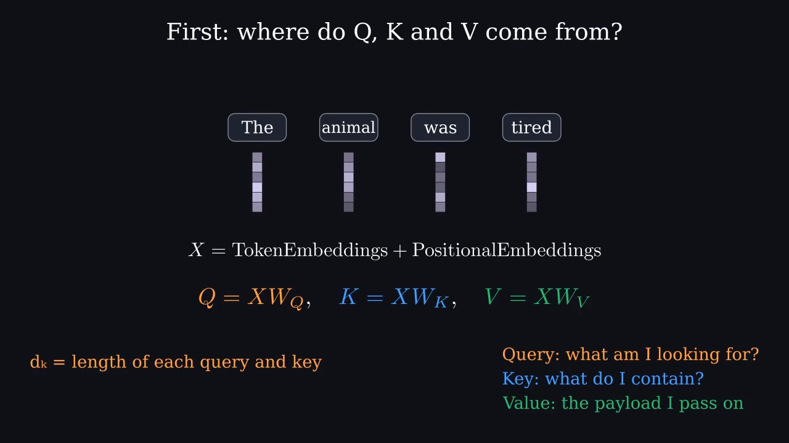
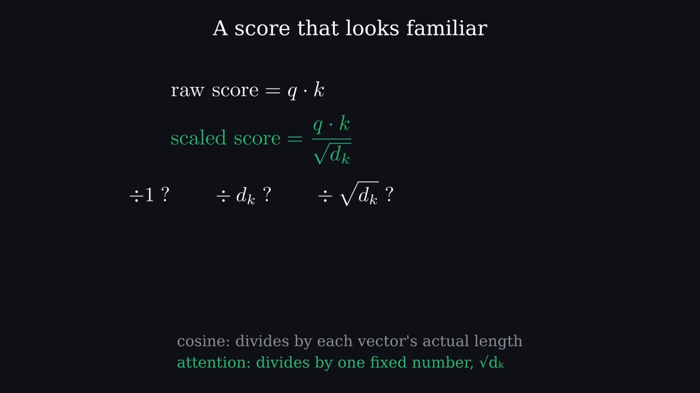
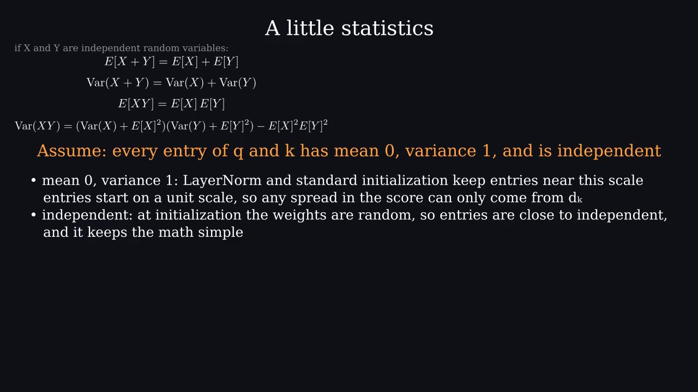
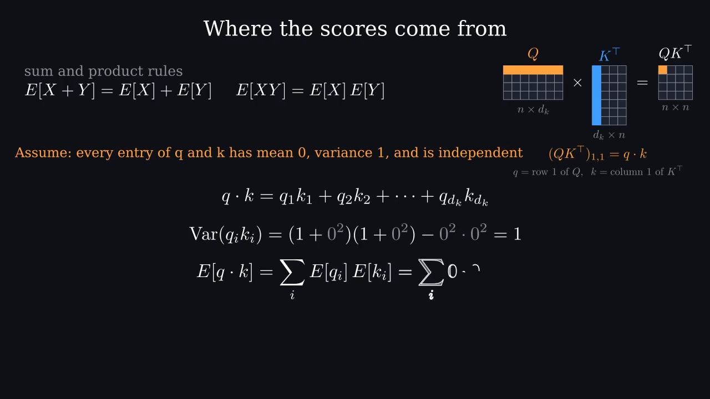
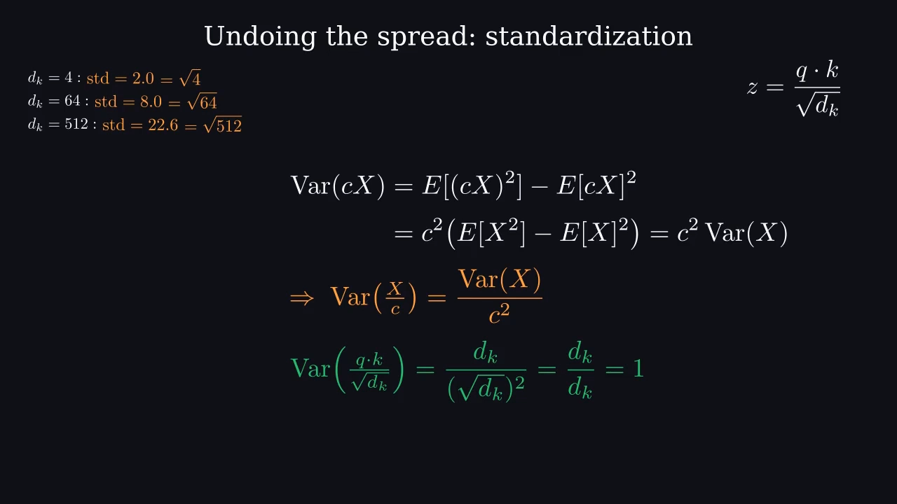
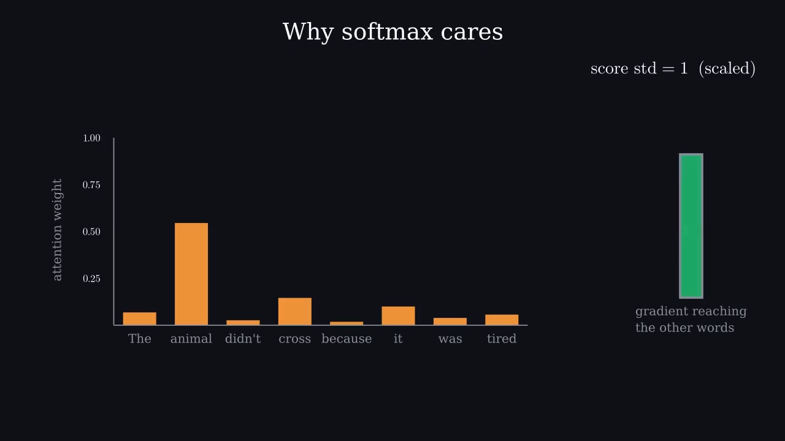
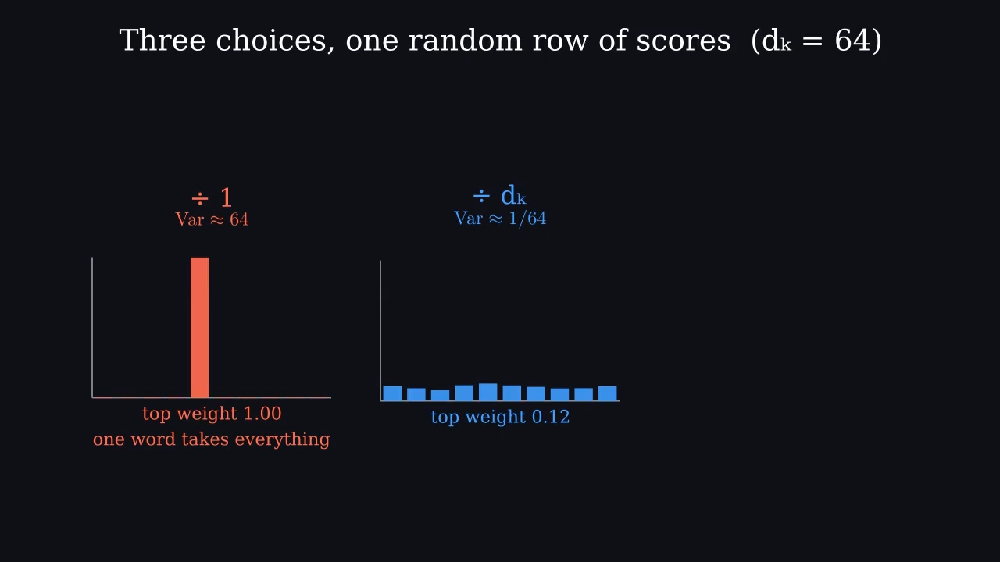
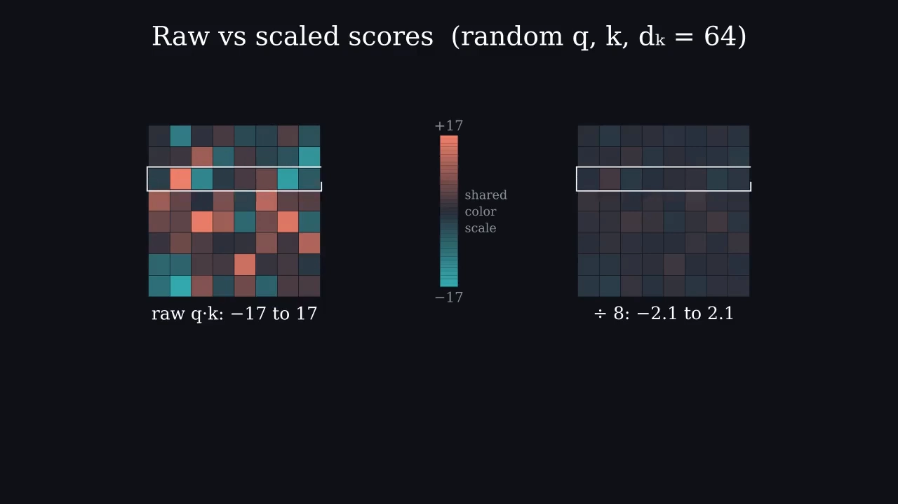

# 把根号 d_k 拿掉会怎样：方差从 1 涨到 64，Softmax 只挑一个词、梯度几乎归零

> 视频来源：[Remove sqrt dk and your transformer stops learning](https://www.youtube.com/watch?v=iZdERUHDnZg)（YouTube · 视觉化讲解）｜时长约 10 分钟
> 导读：这篇讲的是「不缩放会怎样」，所以重点不在推导，而在现象与对比：三种除数各会得到什么分布、热力图的范围被压掉多少、梯度还剩多少能回流。想看 $\sqrt{d_k}$ 的完整期望/方差推导与「凸组合」推论，见同小节的另一篇。字幕里把 $d_k$ 念成「d k」、把 $\sqrt{d_k}$ 念成「root d k」，本文统一写作 $d_k$。

本文基于视频演说图文稿整理，配图截自视频。

## 本讲要解决的核心问题（SCQA）

**背景**：$\mathrm{softmax}(QK^{\top}/\sqrt{d_k})V$ 是每个 Transformer 的心脏，从 BERT 到 GPT，这段代码被跑了亿万次。它底下那个小小的除数 $\sqrt{d_k}$，看上去像个无足轻重的实现细节 [【跳转到 00:00】](https://www.youtube.com/watch?v=iZdERUHDnZg&t=0)。

**冲突**：它并不是实现细节。**没有它，大型 Transformer 会很难学起来。** 但「很难学」是个模糊的说法——到底哪一步坏了、坏成什么样、换成别的除数会怎样，平时很少有人摊开算一遍。

**疑问**：去掉缩放，具体会发生什么？为什么偏偏是 $\sqrt{d_k}$，而不是 $d_k$，也不是干脆不除？

**回答（中心思想）**：**去掉缩放，分数会以 $\sqrt{d_k}$ 的幅度散开；$d_k = 64$ 时标准差已经是 8，softmax 的指数对这么大的输入极敏感，于是输出几乎 one-hot——一个词吃掉几乎全部注意力，回流到其他词的梯度几乎归零，模型失去「同时关注多个相关词」的能力，学习停滞。** 除以 $d_k$ 又走到另一个极端：方差被压到 $1/64$，分数几乎没差别，注意力摊平得挑不出重点。**只有除以 $\sqrt{d_k}$ 让方差回到 1：既偏好重要的词，又不忽略其余的词——这就是根号的全部理由。**

---

## 一、先看清 $d_k$ 是什么：它不是整个 embedding 的大小

要把「缩放」讲清楚，得先知道被缩放的东西从哪来。注意力开始之前，每个词先变成一个 token，每个 token 变成一个向量；Transformer 本身没有顺序概念，所以要给每个 token 加上位置编码，再由三个可学习矩阵把 $X$ 投影成 query、key、value [【跳转到 00:25】](https://www.youtube.com/watch?v=iZdERUHDnZg&t=25)：

三者的分工可以背成三句话：

- **query 问：我在找什么？**
- **key 答：我包含什么？**
- **value 才是真正被传递出去的信息。**

每个 query 和 key 都是一个长度为 $d_k$ 的向量。**注意 $d_k$ 不是完整的 embedding 维度** [【跳转到 00:50】](https://www.youtube.com/watch?v=iZdERUHDnZg&t=50)：多头注意力并行跑好几个头，每个头把 embedding 投影到属于自己的、更短的 query 与 key 上，通常

$$
d_k = \frac{d_{\text{model}}}{h}
$$

$h$ 是头数。两个具体例子：BERT 的 embedding 是 768 维、12 个头，于是 $d_k = 64$；GPT-3 是 12288 维、96 个头，于是 $d_k = 128$ [【跳转到 01:15】](https://www.youtube.com/watch?v=iZdERUHDnZg&t=75)。视频特意说了一句：**记住 64**，那是接下来反复测试的尺寸。

> **术语**：*多头注意力*（multi-head attention）不是把同一份注意力算很多遍，而是把 $d_{\text{model}}$ 宽的向量**切成 $h$ 份**，每份各自算一次注意力，最后拼回去。$d_k$ 就是每份的宽度，也叫头维度。它决定了「一次点积要把多少个乘积加起来」，而这一点马上会成为整件事的关键。

## 二、原始分数与缩放后的分数：它像余弦相似度，但不完全像

接下来，每个 query 与每个 key 都用点积比较一次，得到**原始分数**（raw score）；再把原始分数除以 $\sqrt{d_k}$，得到**缩放后的分数**（scaled score）[【跳转到 01:40】](https://www.youtube.com/watch?v=iZdERUHDnZg&t=100)：

$$
\text{raw score} = q\cdot k,\qquad \text{scaled score} = \frac{q\cdot k}{\sqrt{d_k}}
$$

这个形状确实眼熟。**余弦相似度**也把点积除掉了东西——但余弦除的是**每个向量自己的真实长度**，而注意力除的是**一个固定的数** $\sqrt{d_k}$ [【跳转到 02:05】](https://www.youtube.com/watch?v=iZdERUHDnZg&t=125)。

所以缩放可以理解为「一种归一化」，但它是**粗糙版的归一化**：它不知道这两个向量实际有多长，只知道它们「最多可能有多长」。这就留下一个问题：既然要归一化，为什么偏偏除以 $\sqrt{d_k}$，而不是 $d_k$，或者干脆不除？要回答它，需要一点统计。

## 三、四条统计事实，和三条关于 query/key 的假设

视频先把要用到的工具列出来。若 $X$ 与 $Y$ 独立 [【跳转到 02:30】](https://www.youtube.com/watch?v=iZdERUHDnZg&t=150)：

$$
\mathbb{E}[X+Y] = \mathbb{E}[X] + \mathbb{E}[Y]
$$

$$
\mathrm{Var}(X+Y) = \mathrm{Var}(X) + \mathrm{Var}(Y)
$$

$$
\mathbb{E}[XY] = \mathbb{E}[X]\,\mathbb{E}[Y]
$$

$$
\mathrm{Var}(XY) = \big(\mathrm{Var}(X) + \mathbb{E}[X]^2\big)\big(\mathrm{Var}(Y) + \mathbb{E}[Y]^2\big) - \mathbb{E}[X]^2\,\mathbb{E}[Y]^2
$$

前三条是「和与积的期望、和与积的方差」的标准结论，第四条稍长，是用方差与均值拼出来的乘积方差公式。**记住它们的共同前提：独立。** 独立性一破，第三条与第四条就不再成立。

接着是假设：query 与 key 的**每个条目均值为 0、方差为 1，且彼此独立** [【跳转到 02:55】](https://www.youtube.com/watch?v=iZdERUHDnZg&t=175)。

这个假设不是拍脑袋，视频给了三条理由：

1. **为什么均值是 0、方差是 1？** 因为 LayerNorm 会把每个 token 的输入向量 $X$ 保持在零均值、单位方差；而标准的参数初始化又让 query、key 大致维持在同一尺度上——至少训练早期是这样。
2. **这条假设最重要的推论是：每个条目已经在单位尺度上了。** 那么如果分数还是散开了，**唯一的可能原因就只剩 $d_k$**，也就是「我们把多少项加在了一起」。
3. **为什么可以认为彼此独立？** 初始化时权重是随机的，所以条目接近独立；而且这个假设能让数学保持简单。

视频也主动交代了这个假设的时效：**训练之后这些假设只是近似成立，但需要缩放的理由不变** [【跳转到 03:20】](https://www.youtube.com/watch?v=iZdERUHDnZg&t=200)。

## 四、分数从哪来：把 $d_k$ 维「加掉」，得到 $n\times n$ 的一张表

$Q$ 每一行是一个 query，共 $n$ 行、每行 $d_k$ 个数；$K^{\top}$ 每一列是一个 key。两者相乘，$d_k$ 这一维被求和掉，剩下一个 $n\times n$ 的网格：每个 query 与每个 key 组合一个原始分数 [【跳转到 03:45】](https://www.youtube.com/watch?v=iZdERUHDnZg&t=225)。

每个分数就是 $Q$ 的一行乘 $K^{\top}$ 的一列——也就是**两个各有 $d_k$ 个数的向量的点积**。所有位置的行为完全一样，所以「研究清楚一个分数」等于「研究清楚全部」。

把点积写开，就是逐项相乘再相加：

$$
q\cdot k = q_1k_1 + q_2k_2 + \cdots + q_{d_k}k_{d_k}
$$

## 五、从一个乘积到整个点积：方差是 $d_k$，标准差是 $\sqrt{d_k}$

现在把假设代进公式。先只看**单个乘积** $q_i k_i$：把均值 0、方差 1 代入乘积方差公式 [【跳转到 04:35】](https://www.youtube.com/watch?v=iZdERUHDnZg&t=275)，

$$
\mathrm{Var}(q_i k_i) = (1 + 0^2)(1 + 0^2) - 0^2 \cdot 0^2 = 1
$$

公式里所有带均值的项都消失了，**每个乘积的方差就是 1**。

再用期望的加法与乘法规则：

$$
\mathbb{E}[q\cdot k] = \sum_{i=1}^{d_k} \mathbb{E}[q_i]\,\mathbb{E}[k_i] = \sum_{i=1}^{d_k} 0 = 0
$$

分数均值为零——这就是为什么「它的平均值」永远没什么好看，好看的是**它的典型幅度**。

最后用方差的加法规则：$d_k$ 个方差为 1 的项相加，方差就是 $d_k$ [【跳转到 05:00】](https://www.youtube.com/watch?v=iZdERUHDnZg&t=300)：

$$
\mathrm{Var}(q\cdot k) = d_k \quad\Longrightarrow\quad \mathrm{sd}(q\cdot k) = \sqrt{d_k}
$$

结论一句话：**点积的方差随向量长度增长。向量越长，分数越野。** 而野分数正是下一步 softmax 的麻烦。这里要特别留意「方差线性增长、标准差按平方根增长」的区别：$d_k$ 翻 16 倍，方差涨 16 倍，而分数的典型幅度只涨 4 倍。

## 六、用真数字看一眼：分数到底有多「野」

理论说标准差是 $\sqrt{d_k}$，视频用直方图核对了一遍（每个设置 20,000 组随机 query/key 对）[【跳转到 05:00】](https://www.youtube.com/watch?v=iZdERUHDnZg&t=300)：

- $d_k = 4$：原始分数都挤在 0 附近；
- $d_k = 64$（一个注意力头的典型尺寸）：**标准差已经到 8**；
- $d_k = 512$：分数摆动远超正负 40。

三个标准差读出来是 2、8、22.6——**正好是 $\sqrt{4}$、$\sqrt{64}$、$\sqrt{512}$**，和数学预测一致 [【跳转到 05:25】](https://www.youtube.com/watch?v=iZdERUHDnZg&t=325)。$d_k$ 越大，分数散得越开。

## 七、统计学的标准动作：减均值、除以标准差

对这种事，统计学有一个标准动作叫**标准化**（standardization）：先减均值，再除以标准差。我们的均值本来就是 0，标准差是 $\sqrt{d_k}$，所以「标准化一个分数」就等价于「除以 $\sqrt{d_k}$」 [【跳转到 05:50】](https://www.youtube.com/watch?v=iZdERUHDnZg&t=350)。

为什么这样除完方差恰好是 1？用方差的定义算一遍就清楚了。变量乘上常数 $c$：

$$
\mathrm{Var}(cX) = \mathbb{E}\left[(cX)^2\right] - \mathbb{E}[cX]^2 = c^2\left(\mathbb{E}\left[X^2\right] - \mathbb{E}[X]^2\right) = c^2\,\mathrm{Var}(X)
$$

也就是 $c$ 被平方后提到外面。除以 $c$ 等于乘 $1/c$，所以**方差除以 $c^2$**：

$$
\mathrm{Var}\!\left(\frac{X}{c}\right) = \frac{\mathrm{Var}(X)}{c^2}
$$

令 $c = \sqrt{d_k}$，代进去：

$$
\mathrm{Var}\!\left(\frac{q\cdot k}{\sqrt{d_k}}\right) = \frac{d_k}{(\sqrt{d_k})^2} = \frac{d_k}{d_k} = 1
$$

回到直方图上看：把每个样本都除以 $\sqrt{d_k}$，无论 $d_k$ 多大，**形状都变成同样窄、标准差都是 1** [【跳转到 06:15】](https://www.youtube.com/watch?v=iZdERUHDnZg&t=375)。所以 $\sqrt{d_k}$ 做的事就是「撤销这次扩散」。

但扩散本身真的有害吗？这要看下一步 softmax。

## 八、softmax 为什么在乎：指数对输入幅度极其敏感

softmax 用指数函数，而指数对输入的大小**极其敏感** [【跳转到 06:40】](https://www.youtube.com/watch?v=iZdERUHDnZg&t=400)。输入差距每增加 1，权重之比就再乘一个 $e$。于是输入的尺度直接决定了输出的形状：

- 输入尺度小 → 输出接近均匀，注意力「什么都看一点」；
- 输入尺度大 → 输出接近 one-hot，注意力「只看一个」。

现在做那个实验：跳过缩放，$d_k = 64$（BERT 的头尺寸）。分数的标准差跳到 8，**输出几乎变成 one-hot，一个词拿走了几乎全部注意力** [【跳转到 07:05】](https://www.youtube.com/watch?v=iZdERUHDnZg&t=425)。

视频在这张图上放了一个「梯度计量表」：右侧那根绿柱表示**还有多少梯度能回流到其他词**。它要说明的因果链是三段 [【跳转到 07:30】](https://www.youtube.com/watch?v=iZdERUHDnZg&t=450)：

1. softmax 饱和，输出趋近 one-hot；
2. softmax 的导数由权重自身构成（$s_i(1-s_i)$ 这类项），权重趋近 one-hot 时这些项趋近 0，**梯度几乎消失**；
3. 学习停滞——并且模型**失去了同时关注多个相关词的能力**。

反过来，除以 $\sqrt{d_k}$ 之后分数回到健康范围：**不太尖，也不太扁，刚好适合学习**。上面那张图就是缩放后的状态：重点词拿到约 0.55，其他词仍有份额，梯度有路可走。

## 九、为什么不除别的：三种选择的直接对比

既然知道 softmax 会怎么反应，就可以把三种除数放在同一行随机分数上比一比（$d_k = 64$）[【跳转到 07:55】](https://www.youtube.com/watch?v=iZdERUHDnZg&t=475)：

| 除数 | 分数的方差 | softmax 后的样子 | 诊断 |
| :--- | :--- | :--- | :--- |
| 不除（即除以 1） | 约 64 | 最大权重 1.00，注意力几乎全给一个词 | 太大 |
| 除以 $d_k$ | 约 $1/64$ | 最大权重 0.12，几乎均匀摊平 | 太小 |
| 除以 $\sqrt{d_k}$ | 约 1 | 最大权重 0.35，有偏好但不极端 | 刚好 |

三种结果的解释都很直白：

- **不除**：方差约 64，softmax 把几乎全部注意力交给一个词。**太大**。
- **除以 $d_k$**：方差缩到约 $1/64$，分数之间几乎没有差别，softmax 只能把注意力摊得很均匀，**每个词看起来都一样，注意力再也没法把任何东西挑出来**。**太小**。
- **除以 $\sqrt{d_k}$**：方差是 1，注意力仍然能偏好真正重要的词，同时不忽略其余。**刚好** [【跳转到 08:20】](https://www.youtube.com/watch?v=iZdERUHDnZg&t=500)。

这就是根号存在的**全部**理由：它是唯一一个「把扩散撤销掉、又不过度压缩」的除数。

## 十、换成分数矩阵看：范围被压掉了一个量级

同一件事还可以用矩阵视角看。取 $d_k = 64$ 的随机分数矩阵，左图是原始点积，右图是同一批分数除以 8（即 $\sqrt{64}$），两图共用同一个色标 [【跳转到 08:45】](https://www.youtube.com/watch?v=iZdERUHDnZg&t=525)：

- 原始点积的跨度是 $-17$ 到 $17$；
- 除以 8 之后跨度是 $-2.1$ 到 $2.1$。

在同一个色标下，**缩放后的分数几乎不离零**，范围被明显压缩。再把两边各取一行分别送进 softmax：原始分数那一行几乎把所有权重交给一个 token；缩放后的那行把注意力分散到几个 token 上，**于是梯度能流动** [【跳转到 09:10】](https://www.youtube.com/watch?v=iZdERUHDnZg&t=550)。

## 小结

- $d_k$ 是每个头的 query/key 长度，不是整个 embedding：$d_k = d_{\text{model}}/h$，BERT 是 64，GPT-3 是 128。
- 原始分数是 $q\cdot k$，缩放后的分数是 $q\cdot k/\sqrt{d_k}$；它与余弦相似度形似而神不同——除的是一个固定数，不是各向量的真实长度。
- 在「条目零均值、方差 1、彼此独立」的假设下，单个乘积的方差为 1，点积的方差累加为 $d_k$，所以标准差是 $\sqrt{d_k}$；实测 2、8、22.6 分别对上 $\sqrt{4}$、$\sqrt{64}$、$\sqrt{512}$。
- 除以 $\sqrt{d_k}$ 是标准化的特例：均值已是 0，除完方差 $d_k/d_k = 1$，直方图形状在所有维度上都一样窄。
- 不缩放时 $d_k=64$ 的标准差是 8，softmax 输出几乎 one-hot，一个词吃掉几乎全部注意力。
- 三种除数对比很干脆：不除（方差 64，最大权重 1.00，太大）、除 $d_k$（方差 1/64，最大权重 0.12，太小）、除 $\sqrt{d_k}$（方差 1，最大权重 0.35，刚好）。
- 分数矩阵视角：原始点积跨度 −17 到 17，除以 8 后压缩到 −2.1 到 2.1，一行的 softmax 从「只给一个」变成「分散给几个」。
- 因果链：尺度失控 → softmax 饱和 → 导数由权重构成而趋零 → 回流梯度消失 → 学习停滞、失去同时关注多个词的能力。

## 关键术语速查

| 术语 | 一句话解释 |
| :--- | :--- |
| $d_k$（头维度） | 每个头的 query/key 向量长度，$d_k = d_{\text{model}}/h$ |
| 原始分数 / 缩放分数 | 分别是 $q\cdot k$ 与 $q\cdot k/\sqrt{d_k}$ |
| 方差 / 标准差 | 度量随机量偏离均值的程度；标准差是方差的平方根 |
| 标准化 | 先减均值再除以标准差，得到零均值单位方差的变量 |
| softmax | 取指数再归一化成和为 1 的权重；对输入幅度极其敏感 |
| 饱和 | softmax 输出趋近 one-hot，权重被一个位置独占 |
| one-hot | 只有一个位置是 1、其余全 0 的分布，等价于硬 argmax |
| 梯度 | 反向传播时参数该往哪个方向改的信号；饱和 softmax 会让它趋零 |
| 余弦相似度 | 点积除以两个向量各自长度，得到只看方向不看长度的相似度 |
