# 上下文翻倍，注意力开销翻四倍：n×n 分数矩阵如何吃掉长文本的显存与算力

> 视频来源：[Why Attention Is Quadratic, and What Long Context Costs](https://www.youtube.com/watch?v=jSYcPvr1XVM)（YouTube · 视频 ID `jSYcPvr1XVM`，讲座系列第 10 集，时长约 21 分钟）
> 本文基于视频演说图文稿整理，配图截自视频。这支视频的讲法很克制：**全程只做一件事——从矩阵形状往下推**，把"长上下文到底贵在哪"算到具体数字；凡是需要实测才能回答的结论，讲者都单独标注为「实测」并写明是谁、哪一年测的。

## 本讲要解决的核心问题（SCQA）

**背景**：一个 Transformer 层里的权重矩阵（$W_Q,W_K,W_V,W_O$ 和 MLP 的两大块）大小只取决于宽度 $d$，与上下文长度 $n$ 无关。所以"上下文从 2k 涨到 128k，模型参数量没变"这句话是对的。

**冲突**：但每个头、每一层，都要先算一个 $n \times n$ 的分数矩阵 $QK^\top$。这个方块不来自权重，也没法靠因果掩码省掉——上下文翻倍，它的元素数量就翻四倍。

**疑问**：$n^2$ 到底从哪来？在整个前向账本里，它什么时候从配角变成主角？显存会不会比算力更早撑不住？业界已经有哪些绕开的路子，各自又付出什么代价？

**回答（中心思想）**：$n^2$ 纯粹来自 $QK^\top$ 的形状。整层开销是 $24nd^2 + 4n^2d$ FLOPs，平方项与权重项在 $n = 6d$ 打平，之后平方项主导。而**显存比算力更早撞墙**——32 个头的一层，在 13 万 token 的上下文下就要 1 TiB，一张 80 GB 的加速卡连一层都放不下。在线 softmax 让这个方块可以永不落地（也就是 FlashAttention），但那只是显存与访存优化，算术复杂度分毫未改；滑动窗口、稀疏模式、线性注意力、状态空间模型各有可被一句话命名的代价。**长窗口是预算，不是承诺。**

---

## 一、$n^2$ 藏在矩阵的形状里，不藏在权重里

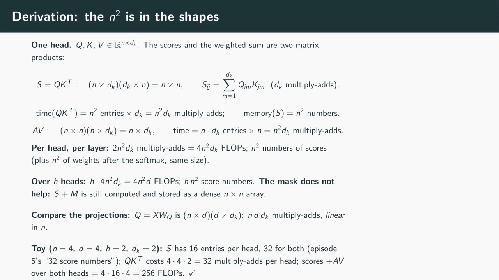

沿用第 5 集的记账约定：**一次乘加记 2 FLOPs**；$d_k = d/h$；忽略偏置、掩码与归一化。全场固定配置是 $n = 2048$、$d = 4096$、$h = 32$。下面所有数字都在这套约定下比较，讲者反复强调的一点是：**推导只用到形状**，不需要知道里面装的是什么数 [【跳转到 00:50】](https://www.youtube.com/watch?v=jSYcPvr1XVM&t=50)。

### 1.1 两个矩阵乘，两种"贵"

单看一个头，$Q,K,V$ 都是 $n \times d_k$。

**第一步，算分数矩阵：**

$$
S = QK^\top:\quad (n \times d_k)(d_k \times n) = n \times n
$$

它的每个元素是一次长度 $d_k$ 的点积：

$$
S_{ij} = \sum_{m=1}^{d_k} Q_{im}K_{jm}
$$

所以有 $n^2$ 个元素、每个元素 $d_k$ 次乘加——时间 $n^2 d_k$ 次乘加，显存 $n^2$ 个数。**"平方"就是在这里诞生的**：两个矩阵乘法的外层维度都是 $n$，所以结果必然摊成一张 $n \times n$ 的方桌 [【跳转到 01:15】](https://www.youtube.com/watch?v=jSYcPvr1XVM&t=75)。

**第二步，加权求和：**

$$
AV:\quad (n \times n)(n \times d_k) = n \times d_k
$$

输出只有 $n d_k$ 个元素，看着很省，但每个元素是一次长度 $n$ 的点积，所以时间又是 $n^2 d_k$ 次乘加。

两头合起来：**每个头、每一层，$2n^2d_k$ 次乘加，也就是 $4n^2d_k$ FLOPs；同时持有 $n^2$ 个分数和 $n^2$ 个 softmax 之后的权重**（后者和前者一样大）。把 $h$ 个头加总，$h d_k = d$，于是变成 $4n^2 d$ FLOPs 与 $h n^2$ 个分数。

### 1.2 因果掩码救不了你

因果掩码（causal mask）在直觉上像是把下三角浪费掉的一半省了下来。但讲者的提醒很直接：$S + M$ 是**整块稠密计算、稠密存储**的，然后才把那一半丢掉。账面上一分钱没省 [【跳转到 01:40】](https://www.youtube.com/watch?v=jSYcPvr1XVM&t=100)。

### 1.3 顺便确认：投影本身是线性的

$Q = XW_Q$ 是 $(n \times d)(d \times d_k)$，成本 $n d d_k$ 次乘加——**对 $n$ 是线性的**。所以"注意力贵"这件事，责任完全在 $QK^\top$ 和 $AV$ 这两个方阵乘法上，不在投影上。这一点后面会反复用到：整层里除了这两步，其余全是 $O(n)$ 的。

### 1.4 用一个玩具例子核一遍

第 5 集的小玩具：$n = 4$、$d = 4$、$h = 2$、每头 $d_k = 2$。每个头 16 个分数，两个头 32 个；$QK^\top$ 每头 $4 \cdot 4 \cdot 2 = 32$ 次乘加；两头的"分数 + 加权求和"是 $4 \cdot 16 \cdot 4 = 256$ FLOPs，正好落在 $4n^2d$ 这一项上 [【跳转到 02:05】](https://www.youtube.com/watch?v=jSYcPvr1XVM&t=125)。小到能背下来的例子先对上，后面的大数字才可信。

---

## 二、整层账本：2k 上下文时平方项只占 7.7%

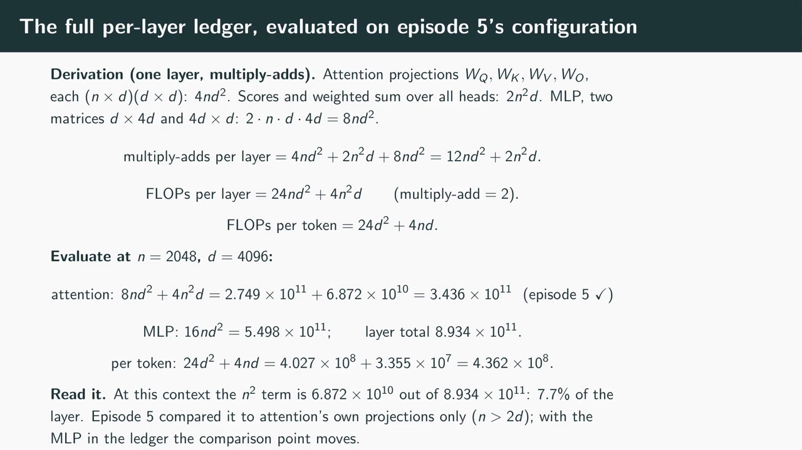

把一层拆干净，只有三块 [【跳转到 02:30】](https://www.youtube.com/watch?v=jSYcPvr1XVM&t=150)：

1. **四个投影矩阵** $W_Q,W_K,W_V,W_O$，每个 $d \times d$，各自乘一个 $n \times d$ 的输入：$4nd^2$ 次乘加；
2. **分数与加权求和**（所有头）：$2n^2d$ 次乘加；
3. **MLP**（第 7 集讲过的那两块）：$d \times 4d$ 与 $4d \times d$，各花 $n \cdot d \cdot 4d$，合计 $8nd^2$。

于是：

$$
\text{乘加/层} = 4nd^2 + 2n^2d + 8nd^2 = 12nd^2 + 2n^2d
$$

$$
\text{FLOPs/层} = 24nd^2 + 4n^2d, \qquad \text{FLOPs/token} = 24d^2 + 4nd
$$

每 token 只需把整层除以 $n$：$24d^2 + 4nd$。**注意这两项的性质完全不同**——$24d^2$ 由权重决定，跟上下文无关；$4nd$ 是唯一随上下文增长的部分。

代入第 5 集的配置（$n = 2048$、$d = 4096$）验证 [【跳转到 02:55】](https://www.youtube.com/watch?v=jSYcPvr1XVM&t=175)：

| 项目 | 数值（FLOPs） |
| --- | --- |
| 注意力子层 $8nd^2 + 4n^2d$ | $2.749 \times 10^{11} + 6.872 \times 10^{10} = 3.436 \times 10^{11}$ |
| MLP $16nd^2$ | $5.498 \times 10^{11}$ |
| 整层合计 | $8.934 \times 10^{11}$ |
| 每 token $24d^2 + 4nd$ | $4.027 \times 10^8 + 3.355 \times 10^7 = 4.362 \times 10^8$ |

注意力子层的数字与第 5 集完全吻合，说明账本没记错。但更值得注意的是另一件事：**在这个上下文长度下，平方项只有 $6.872 \times 10^{10} / 8.934 \times 10^{11} = 7.7\%$**。而且 MLP 一项（$5.498 \times 10^{11}$）就比整个注意力子层还大。

这解释了一个常见困惑：为什么很多模型在 2k、4k 上下文下跑得好好的，"平方复杂度"似乎无关痛痒。第 5 集只拿平方项和注意力自己的投影比，得到 $n > 2d$；把 MLP 放进账本之后，这条比较线必须重画——这就是下一节。

---

## 三、交叉点 $n = 6d$：平方项什么时候变成主角

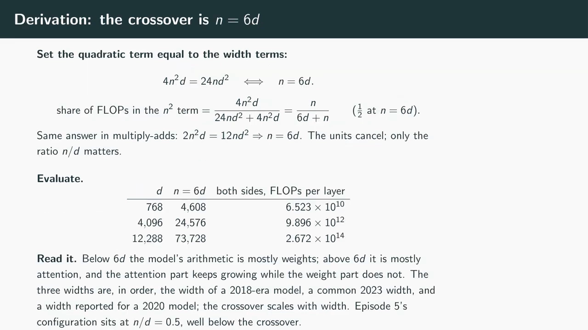

### 3.1 解一个一次方程就够了

让平方项等于全部权重项 [【跳转到 03:20】](https://www.youtube.com/watch?v=jSYcPvr1XVM&t=200)：

$$
4n^2d = 24nd^2 \quad\Longleftrightarrow\quad n = 6d
$$

上下文长度等于宽度的 6 倍时，"分数 + 加权求和"的成本正好等于层里所有权重矩阵的成本之和。低于它，这一层主要在算权重；高于它，主要在算注意力。

顺带还能得到**注意力占整层 FLOPs 的比例**：

$$
\frac{4n^2d}{24nd^2 + 4n^2d} = \frac{n}{6d + n}
$$

$n = 6d$ 时恰好是 $\tfrac{1}{2}$。用乘加口径算也一样，因为系数 2 在分子分母同时约掉——**只有 $n/d$ 这个比值重要**，与单位无关。讲者在这里还专门纠正了一个容易混淆的口算：视频里口头说的"60"，指的就是 $6d$。

### 3.2 三个真实宽度：模型越大，交叉点越远

| 宽度 $d$ | 交叉点 $n = 6d$ | 两侧相等的每层 FLOPs |
| --- | --- | --- |
| 768 | 4,608 | $6.523 \times 10^{10}$ |
| 4,096 | 24,576 | $9.896 \times 10^{12}$ |
| 12,288 | 73,728 | $2.672 \times 10^{14}$ |

三个宽度依次对应：2018 年那一代模型的宽度、2023 年常见宽度、2020 年 Brown 等人论文里最大模型报告的宽度 [【跳转到 04:10】](https://www.youtube.com/watch?v=jSYcPvr1XVM&t=250)。趋势很清楚：**模型越宽，交叉点越远**。原因是权重项按 $d^2$ 增长，而注意力项按 $d$ 增长。

第 5 集的配置是 $n/d = 0.5$，远在交叉点之下——这正是当时平方项只占注意力子层四分之一的理由。

### 3.3 固定宽度看曲线：从 4% 爬到 98%

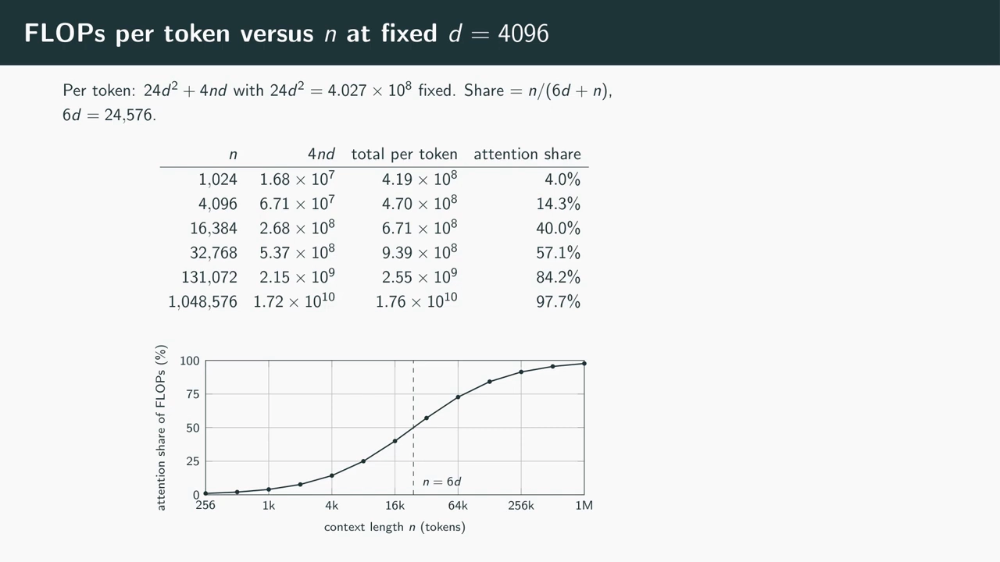

把宽度钉死在 $d = 4096$，只让上下文增长。每 token 的权重部分是常数 $24d^2 = 4.027 \times 10^8$，注意力部分是 $4nd$ [【跳转到 04:35】](https://www.youtube.com/watch?v=jSYcPvr1XVM&t=275)：

| 上下文 $n$ | 注意力 $4nd$ | 每 token 总计 | 注意力占比 |
| --- | --- | --- | --- |
| 1,024 | $1.68 \times 10^7$ | $4.19 \times 10^8$ | 4.0% |
| 4,096 | $6.71 \times 10^7$ | $4.70 \times 10^8$ | 14.3% |
| 16,384 | $2.68 \times 10^8$ | $6.71 \times 10^8$ | 40.0% |
| 32,768 | $5.37 \times 10^8$ | $9.39 \times 10^8$ | 57.1% |
| 131,072 | $2.15 \times 10^9$ | $2.55 \times 10^9$ | 84.2% |
| 1,048,576 | $1.72 \times 10^{10}$ | $1.76 \times 10^{10}$ | 97.7% |

从 1k 到 100 万 token，每 token 成本涨了约 42 倍，其中绝大部分是那个平方矩阵贡献的；到 100 万 token 时占 97.7%，**权重项已经是可以忽略的零头** [【跳转到 05:00】](https://www.youtube.com/watch?v=jSYcPvr1XVM&t=300)。

曲线形状值得单独记住两点：

- **它不是悬崖，而是一条缓慢的 S 形曲线**。比交叉点小几倍的模型几乎感觉不到注意力；但超过交叉点几倍之后迅速饱和。
- **每多一个 token，它都要在每个层、对窗口里每个其他 token 付满 4d FLOPs**。把模型做大并不能消掉这件事——唯一能推远交叉点的办法是加大 $d$，可那会让其他所有东西一起变贵。

一句话总结这一章：**时间你可以等，显存你不能。**

---

## 四、显存比算力更早撞墙

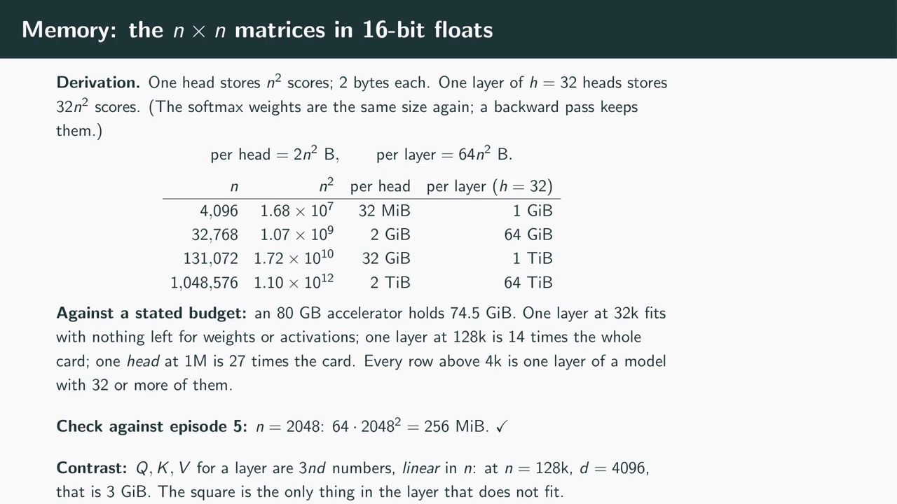

### 4.1 每头 2n² 字节

如果真把这个方块存下来：每个头 $n^2$ 个分数，16 位浮点每个 2 字节，所以**每头 $2n^2$ 字节**；一层 $h = 32$ 个头，就是 $32n^2$ 个分数、**$64n^2$ 字节** [【跳转到 05:25】](https://www.youtube.com/watch?v=jSYcPvr1XVM&t=325)。

| $n$ | $n^2$ | 每头 | 每层（$h = 32$） |
| --- | --- | --- | --- |
| 4,096 | $1.68 \times 10^7$ | 32 MiB | 1 GiB |
| 32,768 | $1.07 \times 10^9$ | 2 GiB | 64 GiB |
| 131,072 | $1.72 \times 10^{10}$ | 32 GiB | 1 TiB |
| 1,048,576 | $1.10 \times 10^{12}$ | 2 TiB | 64 TiB |

（softmax 之后的权重和分数一样大；反向传播还得把它们留着。）

### 4.2 对着预算看：一层就爆

设一张数据中心加速卡有 80 GB，可用 74.5 GiB [【跳转到 05:50】](https://www.youtube.com/watch?v=jSYcPvr1XVM&t=350)：

- **32k token**：一层的分数矩阵刚好塞满，权重、激活、其他 31 层全都没地方；
- **128k token**：一层就是整张卡的 14 倍；
- **100 万 token**：**单个头**就是整张卡的 27 倍。

自检一句：$n = 2048$ 时公式给出 $64 \cdot 2048^2 = 256$ MiB，正是第 5 集报过的数字 [【跳转到 06:15】](https://www.youtube.com/watch?v=jSYcPvr1XVM&t=375)。

### 4.3 对照：$Q$、$K$、$V$ 是线性的

同一层里，$Q$、$K$、$V$ 一共是 $3nd$ 个数，**对 $n$ 线性**；$n = 128k$、$d = 4096$ 时只有 3 GiB [【跳转到 06:40】](https://www.youtube.com/watch?v=jSYcPvr1XVM&t=400)。所以讲者的结论很锋利：**层里唯一放不下的东西，就是那个平方**。接下来两页幻灯片要解决的正是它。

---

## 五、在线 softmax：让 $n \times n$ 方块永不落地

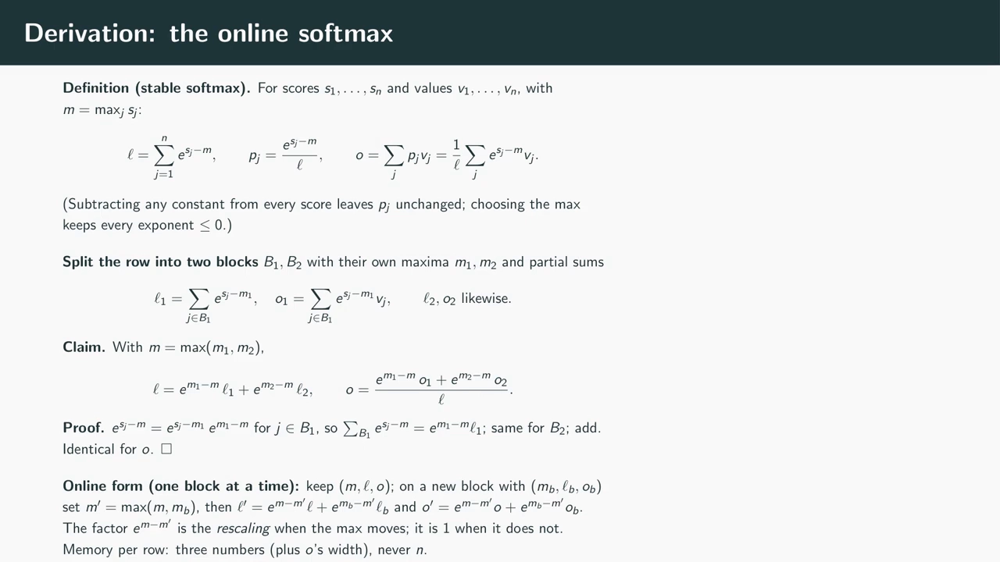

### 5.1 先看稳定写法

数值上稳定的 softmax 做法是：先把每行分数减去该行最大值 $m$ 再取指数，这样每个指数都 $\le 0$，不会溢出。减去一个常数不改变 softmax 的结果，因为它在分子分母里同时约掉 [【跳转到 07:05】](https://www.youtube.com/watch?v=jSYcPvr1XVM&t=425)：

$$
\ell = \sum_{j=1}^{n} e^{s_j - m}, \qquad p_j = \frac{e^{s_j - m}}{\ell}, \qquad o = \sum_j p_j v_j = \frac{1}{\ell}\sum_j e^{s_j - m} v_j
$$

看着像是"必须先把整行看完才能开始算"。**其实不必。**

### 5.2 把一行切成两块

把这一行分成两块 $B_1, B_2$，各自用自己的最大值 $m_1, m_2$ 算出各自的局部和与局部输出：

$$
\ell_1 = \sum_{j \in B_1} e^{s_j - m_1}, \qquad o_1 = \sum_{j \in B_1} e^{s_j - m_1} v_j
$$

$B_2$ 同理。设 $m = \max(m_1, m_2)$，则声称：

$$
\ell = e^{m_1 - m}\ell_1 + e^{m_2 - m}\ell_2, \qquad o = \frac{e^{m_1 - m} o_1 + e^{m_2 - m} o_2}{\ell}
$$

证明只有一行：对 $j \in B_1$ 有 $e^{s_j - m} = e^{s_j - m_1} \cdot e^{m_1 - m}$，求和即得；对 $o$ 逐项同理。也就是说，**一块相对于"错误最大值"的求和，等于它相对于自身最大值的求和乘上一个修正因子**。这一切都是等价的，没有任何近似 [【跳转到 07:30】](https://www.youtube.com/watch?v=jSYcPvr1XVM&t=450)。

于是可以"在线"地走：一路带着当前最大值 $m$、当前和 $\ell$、当前输出 $o$。新的一块来了，取新的最大值 $m'$，把旧的 $\ell$ 和 $o$ 乘上重缩放因子 $e^{m - m'}$，再加上按同样比例缩放的新块贡献。**如果最大值没变，因子就是 1** [【跳转到 07:55】](https://www.youtube.com/watch?v=jSYcPvr1XVM&t=475)。这个恒等式由 Nvidia 的 Milakov 与 Gimelshein 在 2018 年发表。

### 5.3 六个数字验证一遍

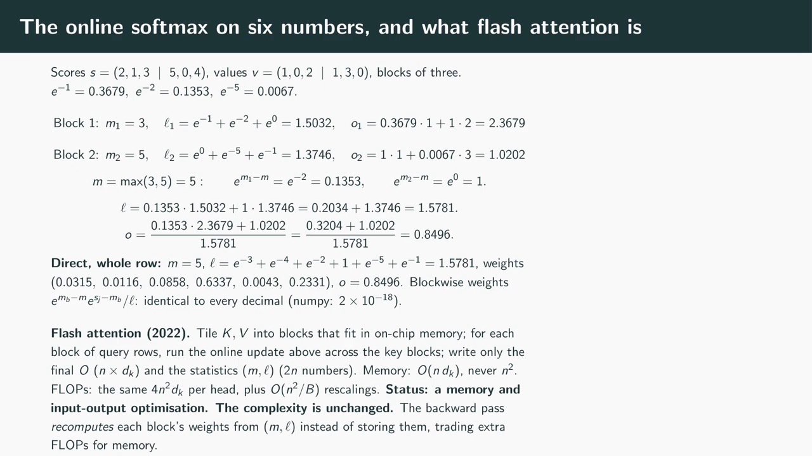

取分数 $s = (2,1,3 \mid 5,0,4)$、值 $v = (1,0,2 \mid 1,3,0)$，每块 3 个 [【跳转到 08:20】](https://www.youtube.com/watch?v=jSYcPvr1XVM&t=500)：

- 第一块：$m_1 = 3$，$\ell_1 = e^{-1} + e^{-2} + e^{0} = 1.5032$，$o_1 = 0.3679 \cdot 1 + 1 \cdot 2 = 2.3679$；
- 第二块：$m_2 = 5$，$\ell_2 = e^{0} + e^{-5} + e^{-1} = 1.3746$，$o_2 = 1 \cdot 1 + 0.0067 \cdot 3 = 1.0202$；
- 合并：$m = 5$，修正因子 $e^{m_1 - m} = e^{-2} = 0.1353$、$e^{m_2 - m} = 1$，
  $\ell = 0.1353 \times 1.5032 + 1.3746 = 1.5781$，
  $o = (0.1353 \times 2.3679 + 1.0202) / 1.5781 = 0.8496$。

直接整行算（用真实最大值 5）得到同样的 $\ell = 1.5781$ 和 $o = 0.8496$；两种写法的权重逐位相同，NumPy 给出的差异是 $2 \times 10^{-18}$ 量级 [【跳转到 09:10】](https://www.youtube.com/watch?v=jSYcPvr1XVM&t=550)。

### 5.4 FlashAttention 是什么，不是什么

把 $K$、$V$ 切成能放进片上内存的块，每一组 query 行沿着这些块扫过去，做上面那套更新，最后只写回输出 $O$（$n \times d_k$）和每行两个统计量 $(m, \ell)$。**$n \times n$ 的矩阵从头到尾没有被造出来**，所以显存是 $O(n d_k)$ 而不是 $O(n^2)$ [【跳转到 09:35】](https://www.youtube.com/watch?v=jSYcPvr1XVM&t=575)。

但算术没有变小：每个头仍然是 $4n^2d_k$ FLOPs，另外加上每块 $O(n^2/B)$ 次重缩放。反向传播还更贵，因为它要从存下的 $(m, \ell)$ **重算**每块的权重，而不是把权重读回来——用额外 FLOPs 换显存。

所以讲者的措辞值得照抄：**FlashAttention 是显存与访存的优化，不是复杂度的改变；任何说它让注意力变成线性的人都是错的。** 显存这一点的功劳，2021 年 Rabe 与 Staats 已经指出；2022 年 Dao 等人在斯坦福做的工作，是让它跑得快。

---

## 六、生成时的账：每 token 线性，整段仍是平方

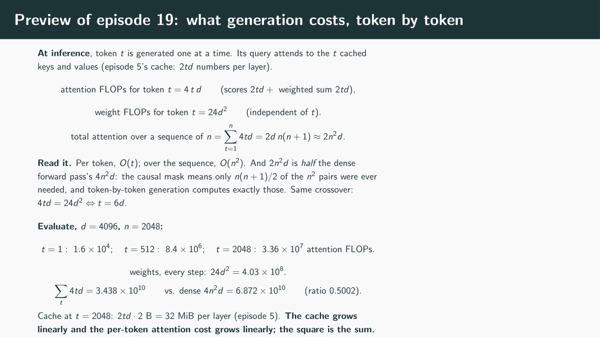

推理时 token 是一个一个生成的。生成第 $t$ 个 token 时，它的 query 只跟已经算好的 $t$ 个 key/value 打交道（也就是第 5 集讲过的 KV cache，每层 $2td$ 个数）[【跳转到 10:00】](https://www.youtube.com/watch?v=jSYcPvr1XVM&t=600)。

- 第 $t$ 个 token 的注意力成本：$4td$ FLOPs（分数 $2td$ + 加权求和 $2td$）；
- 权重成本：每步都是 $24d^2$，**与 $t$ 无关**；
- 整段序列加起来：

$$
\sum_{t=1}^{n} 4td = 2d\,n(n+1) \approx 2n^2d
$$

**单个 token 是 $O(t)$，整段序列仍是 $O(n^2)$**。而且 $2n^2d$ 恰好是稠密前向那 $4n^2d$ 的**一半**——这不是巧合：因果掩码本来就只需要 $n(n+1)/2$ 个 token 对，逐 token 生成算的正好就是这些，而稠密前向把整个方块算了一遍再把一半扔掉 [【跳转到 10:25】](https://www.youtube.com/watch?v=jSYcPvr1XVM&t=625)。

交叉点还是 6d，只是把 $n$ 换成 $t$：$4td = 24d^2 \Leftrightarrow t = 6d$。用 $d = 4096$、$n = 2048$ 代进去 [【跳转到 10:50】](https://www.youtube.com/watch?v=jSYcPvr1XVM&t=650)：

- $t = 1$：$1.6 \times 10^4$；$t = 512$：$8.4 \times 10^6$；$t = 2048$：$3.36 \times 10^7$；
- 而每一步的权重都是 $4.03 \times 10^8$；
- 全序列注意力合计 $3.438 \times 10^{10}$，对稠密的 $6.872 \times 10^{10}$，比值 0.5002；
- 结束时 KV cache 是 $2td \cdot 2\text{B} = 32$ MiB 每层，正是第 5 集的数字。

一句话：**cache 随 $t$ 线性增长，每 token 的注意力成本随 $t$ 线性增长，平方出现在求和里。**

---

## 七、四条替代路线，每条都有可命名的代价

### 7.1 滑动窗口：用感受野换线性

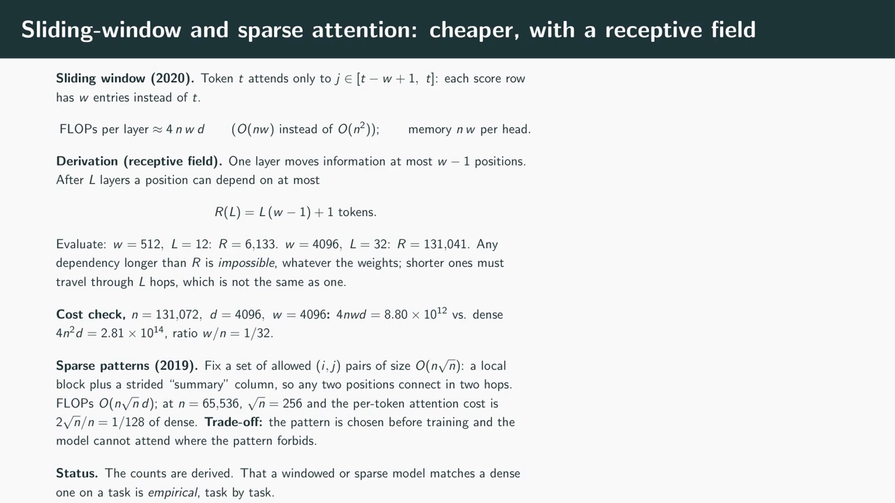

2020 年 Allen 研究所的 Longformer 用的是最朴素的一招：**token $t$ 只看以自己结尾的 $w$ 个 token**，于是每条分数行只有 $w$ 项而不是 $t$ 项 [【跳转到 11:15】](https://www.youtube.com/watch?v=jSYcPvr1XVM&t=675)。成本变成每层约 $4nwd$ FLOPs（$O(nw)$），显存每头 $nw$。

代价是**可推导的**，不用猜：一层最多把信息搬 $w-1$ 个位置，$L$ 层之后，一个位置最多能依赖

$$
R(L) = L(w-1) + 1
$$

个 token [【跳转到 11:40】](https://www.youtube.com/watch?v=jSYcPvr1XVM&t=700)。$w = 512$、$L = 12$ 时是 6,133；$w = 4096$、$L = 32$ 时是 131,041。**比 $R$ 更长的依赖，无论权重怎么学都不可能存在**；比它短的依赖，也得经过 $L$ 跳中转，而不是直接读到。成本核对：$n = 131,072$、$d = 4096$、$w = 4096$ 时，$4nwd = 8.80 \times 10^{12}$ 对稠密的 $4n^2d = 2.81 \times 10^{14}$，省下 $w/n = 1/32$。

### 7.2 稀疏模式：连接图自己设计

2019 年 OpenAI 的 Child 等人的 Sparse Transformer 换了个思路：**预先固定一组允许的 $(i,j)$ 对**，总量 $O(n\sqrt{n})$——一个局部块加一条跨步的"摘要"列，使得任意两个位置两跳可达 [【跳转到 12:05】](https://www.youtube.com/watch?v=jSYcPvr1XVM&t=725)。成本 $O(n\sqrt{n}d)$；$n = 65,536$ 时 $\sqrt{n} = 256$，每 token 的注意力成本是稠密的 $1/128$。代价同样明确：**这个模式在训练前就定死了，模型不能去看它不允许的地方**。

### 7.3 线性注意力：换个函数，重排一次矩阵乘

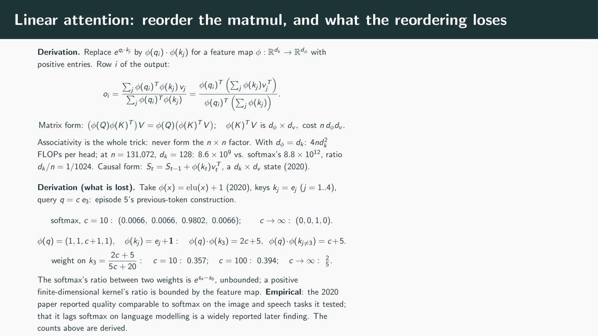

第三类做法直接改函数：把 $e^{q \cdot k}$ 换成 $\phi(q) \cdot \phi(k)$，其中特征映射 $\phi$ 的输出全为正，这样权重仍然非负、仍可归一化 [【跳转到 12:30】](https://www.youtube.com/watch?v=jSYcPvr1XVM&t=750)：

$$
o_i = \frac{\sum_j \phi(q_i)^\top \phi(k_j)\, v_j}{\sum_j \phi(q_i)^\top \phi(k_j)} = \frac{\phi(q_i)^\top \left(\sum_j \phi(k_j) v_j^\top\right)}{\phi(q_i)^\top \left(\sum_j \phi(k_j)\right)}
$$

关键在最后一步：$\phi(q_i)$ 与 $j$ 无关，可以提到求和外面，于是矩阵形式变成

$$
(\phi(Q)\phi(K)^\top)V = \phi(Q)\left(\phi(K)^\top V\right)
$$

**结合律就是全部戏法**：中间的 $n \times n$ 因子从头到尾没有出现 [【跳转到 13:20】](https://www.youtube.com/watch?v=jSYcPvr1XVM&t=800)。取 $d_\phi = d_k$，每头成本 $4n d_k^2$ FLOPs，对 $n$ 线性；$n = 131,072$、$d_k = 128$ 时是 $8.6 \times 10^9$，对 softmax 的 $8.8 \times 10^{12}$，低 $d_k/n = 1/1024$。因果情形更漂亮：中间那个矩阵退化成累加 $S_t = S_{t-1} + \phi(k_t)v_t^\top$，一个 $d_k \times d_v$ 的状态——这就是 2020 年 Katharopoulos 等人那篇论文标题《Transformers are RNNs》的由来。

**它丢了什么，也是推出来的。** 取他们的特征映射 $\phi(x) = \mathrm{elu}(x) + 1$，借用第 5 集"看上一个 token"的构造：key 是 4 个单位向量，query 是 $c \cdot e_3$ [【跳转到 13:45】](https://www.youtube.com/watch?v=jSYcPvr1XVM&t=825)：

- softmax：$c = 10$ 时权重是 $(0.0066, 0.0066, 0.9802, 0.0066)$，$c \to \infty$ 时趋近 $(0,0,1,0)$；
- 线性注意力：$\phi(q) = (1,1,c+1,1)$，$\phi(k_j) = e_j + \mathbf{1}$，于是 $\phi(q) \cdot \phi(k_3) = 2c+5$，$\phi(q) \cdot \phi(k_{j \ne 3}) = c+5$；
- key 3 上的权重是 $\dfrac{2c+5}{5c+20}$：$c = 10$ 时 0.357，$c = 100$ 时 0.394，$c \to \infty$ 时趋近 $\dfrac{2}{5}$。

**无论 query 多大，它都超不过 40%。** 原因是结构性的：softmax 两个权重之比是 $e^{s_a - s_b}$，无上界；而正定的有限维核，其权重比被特征映射本身卡住 [【跳转到 14:10】](https://www.youtube.com/watch?v=jSYcPvr1XVM&t=850)。这个例子里，这一点是定理而不是经验。实际中有多疼，只能测：2020 年那篇论文报告在它测过的图像和语音任务上质量与 softmax 相当；而"线性注意力在语言建模上落后 softmax"是后来被广泛报告的发现。

### 7.4 状态空间模型：固定大小的状态

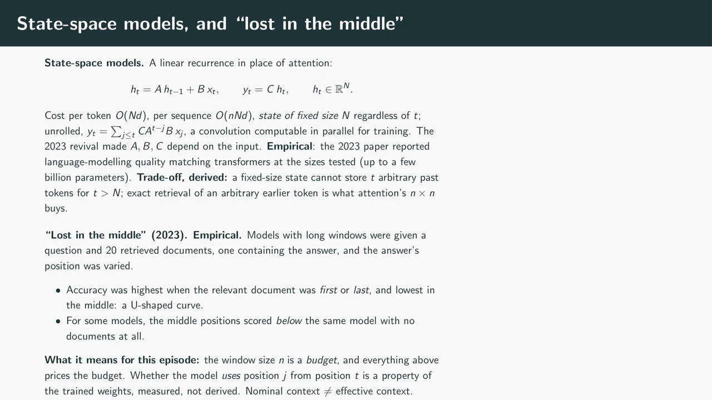

第四类是另一条主流路线：用线性递推替代注意力 [【跳转到 14:35】](https://www.youtube.com/watch?v=jSYcPvr1XVM&t=875)：

$$
h_t = A h_{t-1} + B x_t, \qquad y_t = C h_t, \qquad h_t \in \mathbb{R}^{N}
$$

每 token 成本 $O(Nd)$，每序列 $O(nNd)$，**状态大小 $N$ 与 $t$ 无关**——这恰恰是注意力缺的性质。展开后 $y_t = \sum_{j \le t} CA^{t-j}B x_j$，是一个可以在训练时并行计算的卷积。2021 年结构化状态空间的工作让它能训得好；2023 年 Gu 与 Dao 的选择性状态空间让 $A,B,C$ 依赖输入，并报告在所测规模（到几十亿参数）上语言建模质量与 Transformer 相当 [【跳转到 15:00】](https://www.youtube.com/watch?v=jSYcPvr1XVM&t=900)。那是实测结论。

代价同样是推导出来的：**固定大小的状态存不下 $t$ 个任意历史 token（当 $t > N$）**，而"精确取回任意一个更早的 token"正是注意力那个 $n \times n$ 矩阵买到的东西。

---

## 八、长窗口是预算，不是承诺

上面三条路线加上稠密注意力，都逃不过这条来自 2023 年的实测提醒。斯坦福的 Liu 等人给带长窗口的模型一道问题、20 篇检索文档（其中一篇含答案），然后**把答案所在文档的位置在上下文里挪动** [【跳转到 15:25】](https://www.youtube.com/watch?v=jSYcPvr1XVM&t=925)：

- 相关文档在**最前或最后**时准确率最高，在**中间**时最低——一条 U 形曲线；
- 对某些模型，答案放中间时的得分甚至**低于**不给任何文档的同一模型。

这就是"lost in the middle"。含义很明确：**位置 $j$ 的信息是否真的被位置 $t$ 用上，是一个训练出来的权重性质，需要实测，不能推导**。名义上下文不等于有效上下文 [【跳转到 15:50】](https://www.youtube.com/watch?v=jSYcPvr1XVM&t=950)。

---

## 九、哪些是推出来的，哪些是测出来的

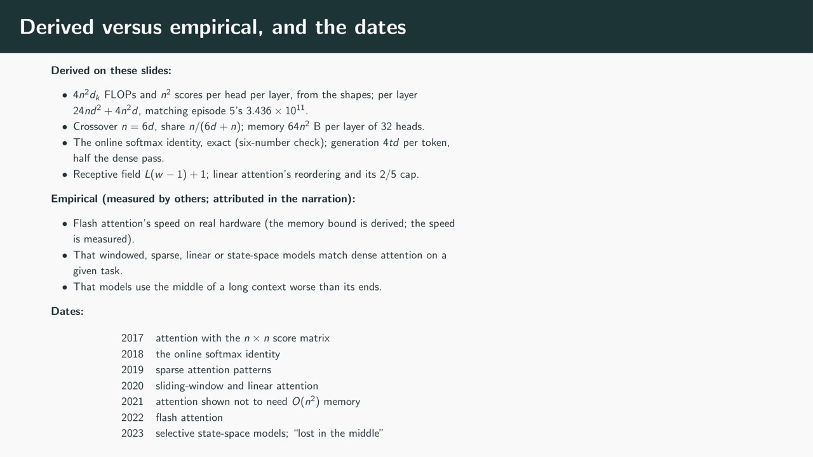

讲者最后把结论分成了两栏，这个分法本身就值得学：

**推导得到的（本讲自己算的）**：每头每层 $4n^2d_k$ FLOPs 与 $n^2$ 个分数；整层 $24nd^2 + 4n^2d$，并复现了第 5 集的 $3.436 \times 10^{11}$；交叉点 $n = 6d$ 与占比 $n/(6d+n)$；32 头一层 $64n^2$ 字节；在线 softmax 恒等式（六个数字验证精确）；生成每 token $4td$、整段是稠密的一半；窗口的感受野 $L(w-1)+1$；线性注意力的重排与 $2/5$ 上限。

**实测得到的（别人的）**：FlashAttention 在真实硬件上更快（**显存结论是推导的，速度是测的**）；窗口/稀疏/线性/状态空间模型在某个任务上能否追上稠密注意力（分别是 Beltagy 等 2020、Child 等 2019、Katharopoulos 等 2020、Gu 与 Dao 2023，各自在自选任务上）；以及模型用不好长上下文中段这件事（Liu 等 2023）。

时间线也压成了一张表：2017 年带 $n \times n$ 分数矩阵的注意力；2018 年在线 softmax 恒等式；2019 年稀疏注意力模式；2020 年滑动窗口与线性注意力；2021 年证明注意力不需要 $O(n^2)$ 显存；2022 年 FlashAttention；2023 年选择性状态空间模型与 lost in the middle [【跳转到 16:40】](https://www.youtube.com/watch?v=jSYcPvr1XVM&t=1000)。

---

## 小结

1. **平方来自形状**：$QK^\top$ 是 $(n \times d_k)(d_k \times n) = n \times n$，每个头每层 $4n^2d_k$ FLOPs、$n^2$ 个分数；投影是线性的，掩码也不省。
2. **整层账本是 $24nd^2 + 4n^2d$**，代回第 5 集配置精确复现 $3.436 \times 10^{11}$；在 2k 上下文下平方项只占 7.7%。
3. **交叉点 $n = 6d$**：768 宽是 4,608 token，4096 宽是 24,576，12288 宽是 73,728；模型越宽，交叉点越远。
4. **占比曲线是 S 形不是悬崖**：宽度 4096 时，1k 上下文 4%、32k 时 57%、1M 时 97.7%。
5. **显存比算力更狠**：32 头一层 $64n^2$ 字节，4k 时 1 GiB，128k 时 1 TiB，而一张卡只有 74.5 GiB 可用。
6. **在线 softmax 让方块永不落地**：带着 $(m, \ell, o)$ 递推，新块来了就乘 $e^{m - m'}$ 重缩放，结果与直接算完全一致（六个数字差 $2 \times 10^{-18}$）。
7. **FlashAttention 是显存/IO 优化，不是复杂度改变**：算术仍是 $O(n^2)$，反向还要重算权重。
8. **生成时每 token 线性、整段平方**：$4td$ 每 token，合计约 $2n^2d$，正好是稠密前向的一半；交叉点还是 $t = 6d$。
9. **四条替代路线各有可命名的代价**：窗口的感受野 $L(w-1)+1$、稀疏的固定连接图、线性注意力的 $2/5$ 上限、状态空间的固定状态容量。
10. **长窗口是预算，不是保证**：2023 年的实测显示模型用不好长上下文中段。

---

## 关键术语速查

| 术语 | 一句话解释 |
| --- | --- |
| 分数矩阵 $S = QK^\top$ | 每个 query 与每个 key 的内积，$n \times n$ 个元素，平方复杂度的唯一来源 |
| $d$ 与 $d_k$ | $d$ 是模型宽度（隐藏维），$d_k = d/h$ 是单个头的宽度 |
| 因果掩码 | 让 token 只能看自己和之前的 token；但它不省算力，因为矩阵照样稠密算出再丢掉一半 |
| 交叉点 $n = 6d$ | 平方项成本等于全部权重项成本时的上下文长度 |
| 在线 softmax | 分块计算 softmax，只保留运行最大值、运行和与运行输出，结果与整行计算完全等价 |
| FlashAttention | 用在线 softmax 在分块上算注意力，显存 $O(n d_k)$，算术仍是 $O(n^2)$ |
| KV cache | 自回归生成时缓存的 $t$ 个 key/value，每层 $2td$ 个数，随 $t$ 线性增长 |
| 感受野 $L(w-1)+1$ | 滑动窗口注意力叠加 $L$ 层后，一个位置最多能依赖的 token 数 |
| 线性注意力 | 用正定特征映射替换指数内积，靠结合律消掉 $n \times n$ 因子，代价是权重比有上界 |
| 状态空间模型 | 用 $h_t = A h_{t-1} + B x_t$ 这类固定大小状态的线性递推替代注意力 |
| lost in the middle | 2023 年实测发现：长上下文中段的信息最容易被模型忽略，准确率呈 U 形 |
