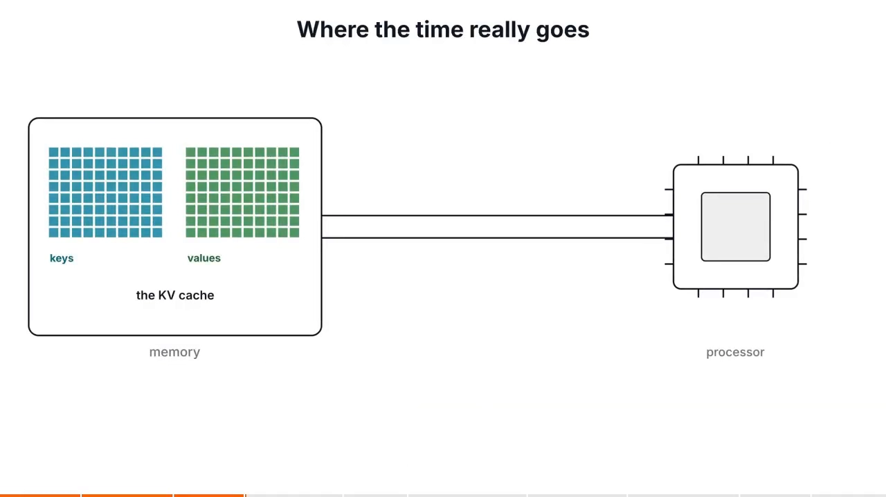
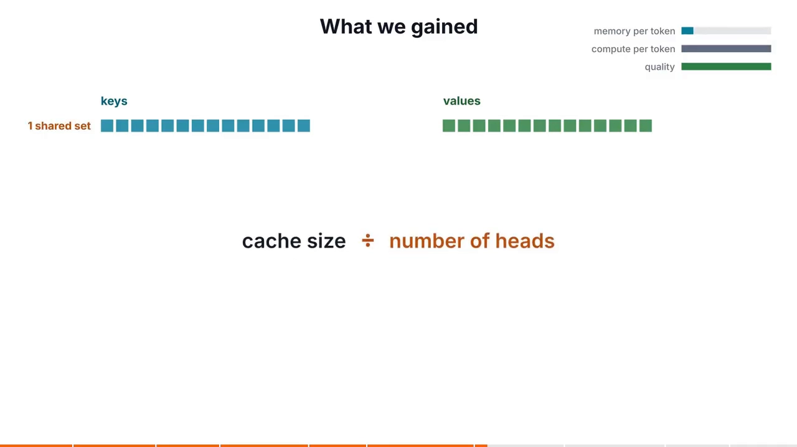
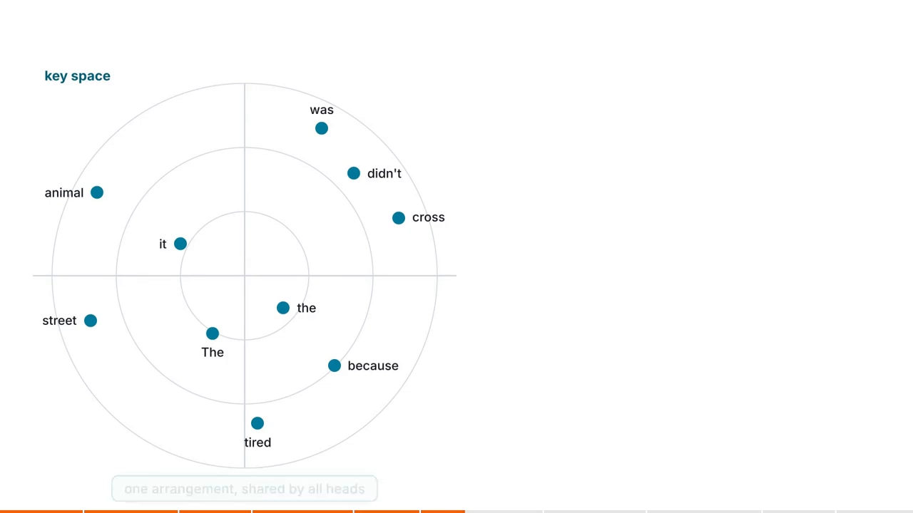
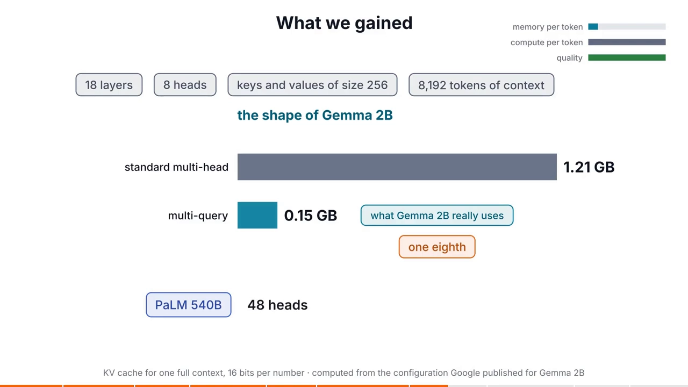
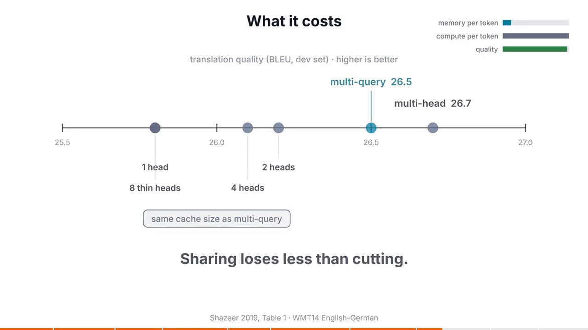
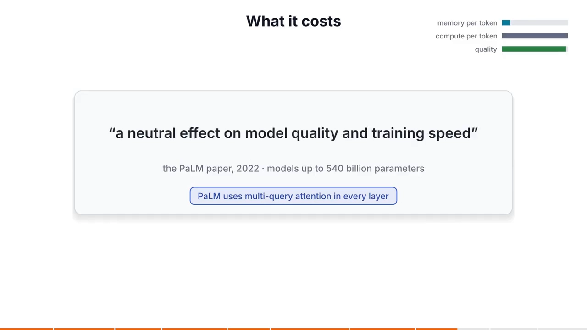
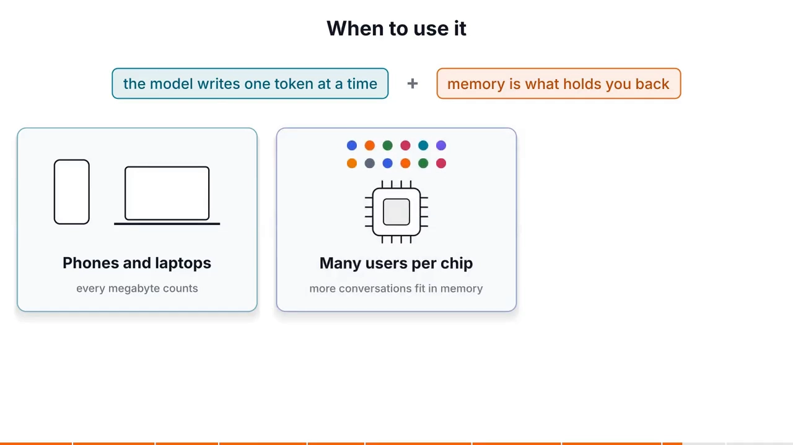

# MQA 的矩阵账：一个 KV 头如何服务多个 Query 头，又丢掉了什么

> 视频来源：[Multi-Query Attention: How to Cut KV Cache by 95%](https://www.youtube.com/watch?v=xHeVSI4DRyc&t=0)（YouTube · 动画讲解，10 分钟）
> 本文基于视频演说图文稿整理，配图截自视频。这支视频不讲公式推导，而是从「解码时时间到底花在哪」讲起：为什么把 K/V 砍到一份，解码就能快十几倍；一份 K/V 又是怎么同时喂给八个 Query 头而不至于让八个头问出同一个问题的；最后用原始论文的 BLEU 分数交代代价，并给出 GQA 这个折中档位。

## 本讲要解决的核心问题（SCQA）

**背景**：想让语言模型答得快，直觉做法是让它算得少——参数更少、乘法更少。几乎所有人都这么想。

**冲突**：2019 年，原 Transformer 论文的作者之一做了个反直觉的实验：算术量几乎没动，解码器却快了大约 12 倍。他砍掉的不是计算，而是**内存流量**——数据在显存和处理器之间搬来搬去的量。

**疑问**：慢的既然是「搬」而不是「算」，那到底在搬什么？能不能少搬一点？

**回答（中心思想）**：在搬的是 KV cache——每个头、每一层都存了一份自己的 K 和 V，每生成一个 token 就要把整份缓存从显存搬到处理器一遍。MQA（多查询注意力）的做法是**保留全部 Query 头，让它们共用同一组 K 头和 V 头**：K/V 只投影一次而不是八次，缓存体积除以头数，这一步的搬运量随之除以头数。各头因为「提问方向」不同，仍然会算出不同的注意力；代价在质量上——原始翻译实验里 BLEU 从 26.7 掉到 26.5，几乎没动，但在超大模型上这个折衷会变得明显，于是有了 GQA。

---

## 一、先把注意力讲清楚：Query 提问，Key 应答，Value 交货

句子里每个 token 都会被转成三个向量 [【跳转到 00:34】](https://www.youtube.com/watch?v=xHeVSI4DRyc&t=34)：

- **Query（查询）**：我在找什么？
- **Key（键）**：我包含什么？
- **Value（值）**：如果有人选中我，我交出去的是什么？

处理一个 token 时，模型拿它的 query 去和每一个 key 比对，越接近权重越高；然后按这些权重把 value 混合起来，得到这个 token 的新表示 [【跳转到 00:59】](https://www.youtube.com/watch?v=xHeVSI4DRyc&t=59)。

上图把整件事画全了：`it` 对 `The / animal / didn't / cross / ...` 各给一个权重，权重最大的是 `animal`，于是 `it` 的新向量主要是 `animal` 的 value 混出来的（"a blend of the values"）。这就是「指代消解」在这层里发生的样子。

多头注意力就是把这套动作并排做几遍：每个头用自己的 $W_Q$、$W_K$、$W_V$ 把 token 投到自己的小空间里，一个头可能盯语法，另一个可能盯代词指代——八个头，八种读同一句话的方式 [【跳转到 01:24】](https://www.youtube.com/watch?v=xHeVSI4DRyc&t=84)。

**这里有个关键细节，后面全部代价都由它引起：标准设计里，每个头都有自己独立的 Key 和 Value。**

## 二、缓存是怎么长出来的：每来一个 token，每个头每个层都加一份

模型一个字一个字地写。写每个新 token 时，它要和前面所有内容做注意力；而前面的 token 不会变，它们的 K 和 V 也不会变，每步重算就是白干 [【跳转到 02:02】](https://www.youtube.com/watch?v=xHeVSI4DRyc&t=122)。所以模型把它们存起来，这个存起来的地方就叫 **KV cache（键值缓存）**。

它长得很快：每来一个新 token，就要在**每一层、每一个头**上都追加一份 K 和一份 V。以一个 18 层、8 个头的模型为例，几千个 token 之后，缓存里就是几亿个数字——而这只是**一条**对话；一台服务器同时要扛几百条对话 [【跳转到 02:27】](https://www.youtube.com/watch?v=xHeVSI4DRyc&t=147)。

## 三、时间真正花在哪：算得少，搬得多

这里是全片最反直觉的一段。模型写一个 token 时，算术量其实很小：每个头只有一个 query，去和缓存里的 key 比一比。但为了让这次比对发生，**整份缓存必须从内存搬到处理器**——每一个 key、每一个 value、每一步都搬 [【跳转到 02:52】](https://www.youtube.com/watch?v=xHeVSI4DRyc&t=172)。

而现代芯片的乘法速度远快于内存把数字送过来的速度，这个上限就叫 **memory bandwidth（内存带宽）**。

视频的类比很到位：一位刀工天下第一的厨师，厨房里只有一扇很窄的储藏室门。拖慢晚饭的不是切菜，是走路 [【跳转到 03:17】](https://www.youtube.com/watch?v=xHeVSI4DRyc&t=197)。

顺带解释了一个常见疑惑：训练时为什么感觉不到这个问题？因为训练是**所有位置一起算**的，每个从内存读进来的数字会被反复用很多次；而生成时，为了产出一个 token，会把整份缓存读一遍，下一个 token 再读一遍 [【跳转到 03:23】](https://www.youtube.com/watch?v=xHeVSI4DRyc&t=203)。文本越长越糟：同样的活，要搬的东西越来越多。

## 四、两条路：砍头会掉分，共享 K/V 不会

想少搬，最直接的想法是让缓存变小，办法有两个：头数变少，或每个头变窄。论文两条都试了，质量都掉了 [【跳转到 04:00】](https://www.youtube.com/watch?v=xHeVSI4DRyc&t=240)。

更聪明的做法是：**头一个都不砍，但让它们共用一组 key 和一组 value**。每个 token 只投影一次到 key 空间、一次到 value 空间，而不是八次；query 保持各自独立。名字由此而来——多个查询，一组键值。

这就是所谓的**广播（broadcast）**：一份 K/V 被复制给所有 Query 头使用，而不是每个头自己维护一份。它省的不只是显存，还有参数和投影计算——$W_K$、$W_V$ 从 8 份变成 1 份。

## 五、共享之后，八个头凭什么还问得不一样

这里有个必须回答的追问：如果每个头看到的 key 都一样，它们不会都注意同一个地方吗？

不会。**注意力模式来自「query 与 key 的比较」，key 不动，换一个 query，模式就换。**

每个头把当前 token 投影到**同一个空间**，但方向不同：一个头的 query 指向动词，另一个指向主语。同样的点，不同的方向，出来的注意力图案就不同 [【跳转到 04:50】](https://www.youtube.com/watch?v=xHeVSI4DRyc&t=290)。

图书馆的类比很好记：一座图书馆、一份目录，八个读者进来各问各的问题，翻同一排书架，最后带走的书不一样；旧设计是建了八座图书馆，每座都复制一份目录——复制的那部分大多是不必要的 [【跳转到 05:15】](https://www.youtube.com/watch?v=xHeVSI4DRyc&t=315)。value 也一样：每个头混合的是同一份 value，但用的是自己的权重，所以每个头返回的仍是自己的混合物。

## 六、算账：缓存除以头数，具体能省多少

缓存原来存的是「每个头各一份」，现在只存一份，所以它**缩小到原来的头数分之一**（视频原话：cache size ÷ number of heads）[【跳转到 06:07】](https://www.youtube.com/watch?v=xHeVSI4DRyc&t=367)。

以 Gemma 2B 的真实形状为例：18 层、8 个头、K/V 每头 256 维、上下文 8192 token、每个数字 16 位 [【跳转到 06:18】](https://www.youtube.com/watch?v=xHeVSI4DRyc&t=378)。

$$
\text{KV cache} = L \times 2 \times n \times H \times s \times \frac{16}{8}\ \text{字节}
$$

式中的 $L$ 是层数，$2$ 是 K 与 V 各一份，$n$ 是头数，$H$ 是头维度，$s$ 是上下文长度，最后那个 $\frac{16}{8}$ 是「16 位 = 2 字节」。MQA 把 $n$ 换成 1，整个表达式的值就除以 $n$。

1.21 GB → 0.15 GB，八分之一。换成最大的 PaLM（48 个头），这个倍数是 48。

省下来的搬运，直接换成延迟：原始实验里解码器每生成一个 token 的时间从 46 微秒降到 4 微秒以下，而训练速度几乎没变——训练本来就不是被这份流量卡住的 [【跳转到 06:43】](https://www.youtube.com/watch?v=xHeVSI4DRyc&t=403)。

对一个真实系统来说，这笔账会变成三件事：同一张卡上装下更多对话、足够的上下文不至于撑爆显存、每个用户拿到更快的回复。

## 七、代价：质量只挪了一点点，但不总是这么干净

天下没有免费的加速。视频把代价分成三层讲：

**第一层，原始翻译实验：几乎无损。** BLEU 从 26.7 掉到 26.5（WMT14 英德）。而且注意同图里另外三个点——同样缓存体积下「头更少」或「头更窄」的版本分数更低，所以视频给了一句总结：sharing loses less than cutting，共享比砍头丢得少 [【跳转到 06:55】](https://www.youtube.com/watch?v=xHeVSI4DRyc&t=415)。

**第二层，一个容易被忽略的细节：参数被花在别处。** 共享 K/V 减少了一些参数，论文把这些参数又花在更宽的 FFN（前馈层）上，所以模型总规模保持不变——也就是说，这个对比是「同样的参数量、更小的缓存」，不是「更小的模型」[【跳转到 07:20】](https://www.youtube.com/watch?v=xHeVSI4DRyc&t=440)。

**第三层，放到更大规模上。** PaLM 团队后来在 540B 规模上报了同样的结论：对质量和训练速度都是中性影响，PaLM 每一层都用了多查询注意力 [【跳转到 07:50】](https://www.youtube.com/watch?v=xHeVSI4DRyc&t=470)。

但不总是这么干净：2023 年有研究者在大型 T5 上量到**小而真实的质量下降**，训练也偶尔变得不稳定。对超大模型来说，一组共享的 key 可能太紧了。他们的答案是取中间档——不是一组，而是几组共享，这就是 **GQA（分组查询注意力）**，也是这条路的自然下一步 [【跳转到 08:02】](https://www.youtube.com/watch?v=xHeVSI4DRyc&t=482)。

## 八、什么时候该用它：这是一个刻度盘

视频给的判断标准很短：**模型是一个 token 一个 token 写 + 瓶颈在内存**，才值得上 MQA [【跳转到 08:27】](https://www.youtube.com/watch?v=xHeVSI4DRyc&t=507)。

- **适合**：手机、笔记本上的小模型，每一兆显存都要算；一张卡上跑很多用户的服务器；输出很长、缓存会一直长的场景。
- **不适合**：只读不生成的模型（根本没有缓存可缩），以及「要从超大模型里榨出最后一点质量」的场景——那就该选分组版本，更稳。

把全片压成一句：**当系统慢的时候，先问它要搬什么，而不只是问它要算什么。** MQA 就是在「搬」这一侧动刀的第一个方案——保留全部 query 头、共享一组 K/V、缓存除以头数、生成变快，而质量只挪了一点点 [【跳转到 09:17】](https://www.youtube.com/watch?v=xHeVSI4DRyc&t=557)。

## 小结

- **瓶颈的诊断先于方案的发明**：解码一步算术很少、却要把整份 KV cache 搬一遍，所以瓶颈是内存带宽，不是乘法。
- **MQA 的机制**：保留每个头的 Query，让所有头共用一组 Key 和 Value；每个 token 只投影一次 K、一次 V，缓存与参数都除以头数。
- **为什么共享不等于同质**：注意力来自 query 与 key 的比较，key 不动、query 方向不同，出来的模式就不同。
- **量化收益**：Gemma 2B 形状下 1.21 GB → 0.15 GB（八分之一）；PaLM 48 头对应 48 倍；每 token 解码时间 46 微秒 → 4 微秒以下。
- **代价与折衷**：原始实验 BLEU 26.7 → 26.5，同缓存体积下「共享」比「砍头」丢得少；省下的参数被补回 FFN，总规模不变；超大模型上出现过质量下降与训练不稳，于是有了 GQA。
- **选用条件**：逐 token 生成 + 内存受限才划算；纯读模型用不上；要榨干质量就退到 GQA。

## 关键术语速查

| 术语 | 一句话解释 |
| --- | --- |
| KV cache | 生成过程中缓存历史 token 的 Key/Value，避免每步重算，但体积随层数、头数、上下文线性增长 |
| 内存带宽 memory bandwidth | 内存往处理器送数据的速度上限；解码阶段通常卡在这里，而不是卡在乘加 |
| MQA（多查询注意力） | 全部 Query 头共用一组 K/V，缓存除以头数，K/V 的投影与存储都只做一次 |
| 广播 broadcast | 一份 K/V 被所有 head 复用，不必每个头各存一份 |
| head_dim | 每个头的向量宽度；K/V 每头 256 维这类数字直接决定缓存大小 |
| GQA（分组查询注意力） | 头分成若干组、组内共享 K/V 的中间档，质量比 MQA 稳，缓存比 MHA 小 |
| BLEU | 机器翻译的自动评分，越高越好；26.7 → 26.5 代表质量小幅下降 |
