# MQA 省的是带宽不是算力：共享一份 KV 之后解码为什么快了

> 视频来源：[Multi-Query Attention Explained: Dealing with KV Cache Memory Issues Part 1](https://www.youtube.com/watch?v=Z6B51Odtn-Y&t=0)（YouTube · Dr Raj Dandekar，MIT 机器学习方向博士，《Build DeepSeek from Scratch》系列）
> 本文基于视频演说图文稿整理，配图截自视频。这支视频先用白板把 KV cache 的体积公式逐项算出来（GPT-2、GPT-3、DeepSeek V3/R1 三档），再解释多查询注意力（MQA）为什么用「所有头共用一组 K/V」把这份缓存除以头数，最后拿 GPT-2 与 Falcon 两个真实模型对照，画出权重热力图、注意力图与实测推理耗时。视频开头有一段赞助口播，与主题无关，本文不涉及。

## 本讲要解决的核心问题（SCQA）

**背景**：语言模型推理是一个 token 一个 token 往外吐的。每吐一个新 token，都要把它和前面所有 token 做一次注意力——这是解码的固定动作。

**冲突**：为了不重复计算历史 token 的 Key 和 Value，我们把它们缓存起来，这就是 KV cache。缓存换来了计算量从平方级降到线性级，但缓存本身必须一直躺在显存里：按视频给出的配置，DeepSeek V3/R1 这个量级（61 个 Transformer 块、128 个注意力头、头维度 128、上下文 10 万）单条请求的 KV cache 要占约 400 GB。

**疑问**：能不能在不重算历史 K/V 的前提下，把这 400 GB 压下来？

**回答（中心思想）**：能。最省事的一刀就是**多查询注意力（MQA，Multi-Query Attention）：所有 Query 头共用同一组 Key 头和 Value 头**。缓存的维度里那个「头数 $n$」被消掉，体积按头数缩小 $1/N$（DeepSeek 的 128 头：400 GB → 3 GB）。它带来的是每个解码步要搬进计算单元的数据变少、解码变快；代价是「每个头看一个视角」这件事被削弱，模型质量下降。

---

## 一、解码只需要最后一个位置的上下文向量

先把推理流程摊开。输入 4 个 token（视频里的例子是 `The next day is`），先过一层数据预处理，再逐层过 Transformer 块，最后过输出层，得到一个 logits 矩阵，取其中概率最大的下标，就得到下一个 token（视频里是 `bright`）[【跳转到 02:28】](https://www.youtube.com/watch?v=Z6B51Odtn-Y&t=148)。

logits 是一个长度等于词表大小的向量（比如词表 5 万，就是 5 万个分数），取最大值所在的索引，再查回对应的 token [【跳转到 03:36】](https://www.youtube.com/watch?v=Z6B51Odtn-Y&t=216)。

这里藏着第一个关键认识：**要预测下一个 token，只需要最后一个 token 的上下文向量**，前面几个 token 的上下文向量算出来也没人用 [【跳转到 03:57】](https://www.youtube.com/watch?v=Z6B51Odtn-Y&t=237)。

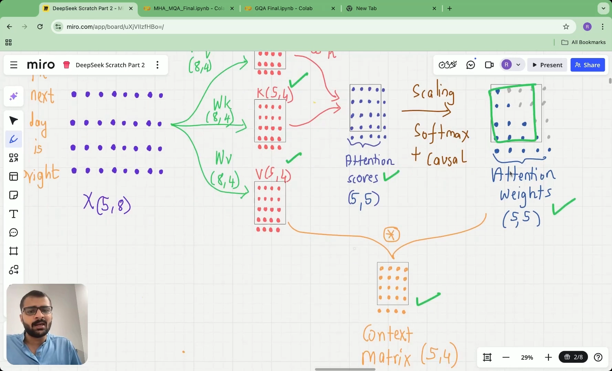

上图是完整的一层多头注意力的所有中间矩阵：$X(5,8)$（5 个 token、每个 8 维）分别乘 $W_q$、$W_k$、$W_v$ 得到 $Q(5,4)$、$K(5,4)$、$V(5,4)$，$QK^\top$ 得到 $5\times5$ 的注意力分数，再做缩放、Softmax 与 causal 掩码得到注意力权重，最后乘 $V$ 得到上下文矩阵 $C(5,4)$。图上打勾的部分，正是上一轮迭代里已经算过的那些——这一轮不必重算。

第二个关键认识是自回归的拼接：把预测出的 `bright` 接到输入后面，新一轮的输入变成 `The next day is bright`，整条序列再走一遍整个架构 [【跳转到 04:16】](https://www.youtube.com/watch?v=Z6B51Odtn-Y&t=256)。但走到多头注意力里会发现，新增的只有最后一行，其余行与上一轮完全相同。

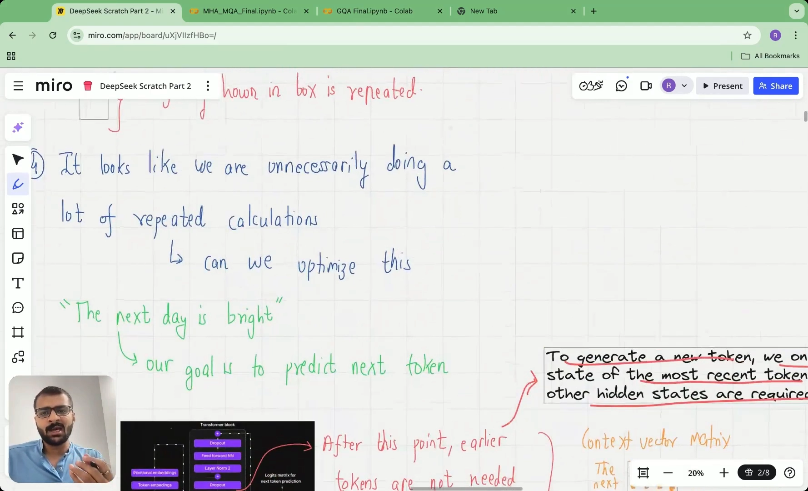

于是问题自然浮现：既然除了最后一行之外都没变，为什么每次都要重算？白板上那句批注就是整节课的引子——「We are unnecessarily doing a lot of repeated calculations, can we optimize this?」[【跳转到 05:13】](https://www.youtube.com/watch?v=Z6B51Odtn-Y&t=313)

## 二、缓存把重复计算消掉了，却把显存账单留了下来

### 2.1 只算新的一行，历史 K/V 存起来

反向推一遍就能看出该省什么。要得到最后一个 token 的上下文向量，只需要「该 token 的注意力权重」乘上整张 $V$ 矩阵；要得到注意力权重，只需要注意力分数；要得到注意力分数，只需要该 token 的 query 向量乘上整张 $K$ 矩阵 [【跳转到 05:51】](https://www.youtube.com/watch?v=Z6B51Odtn-Y&t=351)。

也就是说，每来一个新 token，真正要现算的只有：它的 query 向量、它的 key 向量、它的 value 向量。前两个拼到缓存的 K 矩阵后面，value 拼到缓存的 V 矩阵后面，然后照常做 $QK^\top$、Softmax、乘 $V$ [【跳转到 06:03】](https://www.youtube.com/watch?v=Z6B51Odtn-Y&t=363)。

结果就是计算量的阶数变了：**用缓存，计算量随 token 数线性增长；不用缓存，随 token 数平方增长** [【跳转到 07:13】](https://www.youtube.com/watch?v=Z6B51Odtn-Y&t=433)。这就是 KV cache 的「好的一面」——省算力、省钱。

### 2.2 坏的一面：这份缓存有多大

视频里用「每一块土地都要付钱」来类比显存：存下来的每一个参数都要占地方、都要付代价 [【跳转到 08:02】](https://www.youtube.com/watch?v=Z6B51Odtn-Y&t=482)。

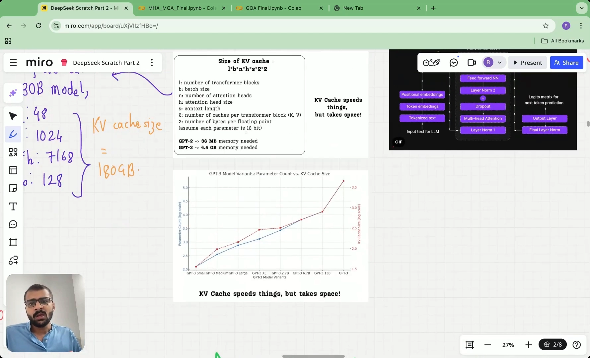

一个 Transformer 块里，K 矩阵的行数是上下文长度 $s$，列数是「注意力头数 × 头维度」$n \times h$；V 矩阵同样一份，所以乘 2；再乘层数 $L$、批大小 $B$、每个参数的字节数（16 位浮点，即 2 字节）[【跳转到 08:33】](https://www.youtube.com/watch?v=Z6B51Odtn-Y&t=513)：

$$
\text{KV cache} = L \times B \times n \times H \times s \times 2 \times 2
$$

代入几档真实配置 [【跳转到 09:41】](https://www.youtube.com/watch?v=Z6B51Odtn-Y&t=581)：

| 模型 | 视频里给出的规模 | KV cache |
| --- | --- | --- |
| GPT-2 | 小模型 | 36 MB |
| GPT-3 | 96 个注意力头 | 4.5 GB |
| DeepSeek V3 / R1 | 61 层、128 头、头维度 128、上下文 10 万 | 约 400 GB |

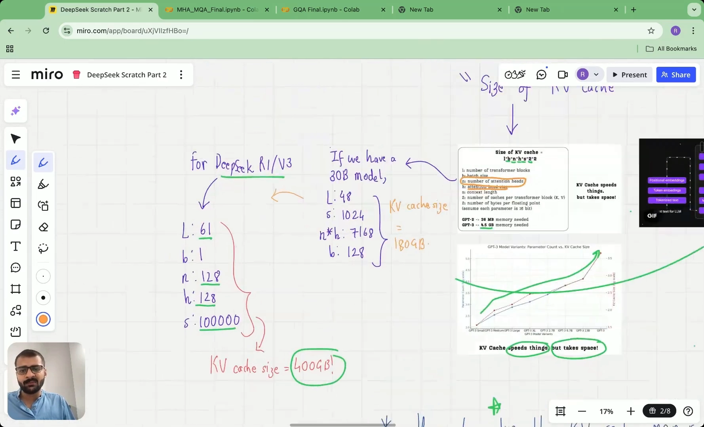

顺带把 30B 那档算一遍：$48 \times 128 \times 7168 \times 1024 \times 2 \times 2 \approx 180$ GB（视频里读作 180 GB），而 DeepSeek 那档是 400 GB [【跳转到 09:52】](https://www.youtube.com/watch?v=Z6B51Odtn-Y&t=592)。注意这里都还只是**一条**请求。

上面这张板书的右侧还有一条随模型规模一起上扬的红线：模型参数越多，KV cache 越大，曲线的斜率几乎同步变陡（同一张图在前一节的公式图里也能看到）。

到这里就能理解视频反复强调的那句话：KV cache 让计算变快，但它占空间；占用越多，推理越慢、成本越高，服务方最后只能把账单转给用户 [【跳转到 10:16】](https://www.youtube.com/watch?v=Z6B51Odtn-Y&t=616)。所以显存问题必须解，DeepSeek 也不可能真的让 400 GB 一直趴在卡上——它做了一系列创新，主线是 MLA（多头潜在注意力），但在到 MLA 之前，得先看懂前一步的 MQA [【跳转到 11:06】](https://www.youtube.com/watch?v=Z6B51Odtn-Y&t=666)。

## 三、先看清正常多头注意力：每个头各有一套 K 和 V

MQA 的提法一句话就能说完：**如果所有注意力头共用同一组 K 矩阵和 V 矩阵会怎样？**[【跳转到 11:31】](https://www.youtube.com/watch?v=Z6B51Odtn-Y&t=691)

但这句话本身很抽象，得先知道正常的多头注意力长什么样。视频用了一个具体例子：5 个 token、每个 8 维的输入矩阵 $X(5,8)$，4 个注意力头。

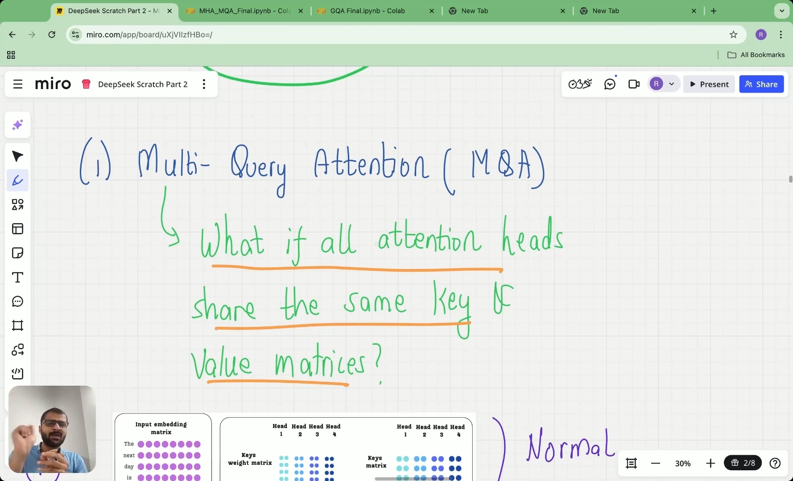

正常多头注意力里，可训练的 key 权重矩阵 $W_K$ 和 value 权重矩阵 $W_V$ 被**按头切开**：第一个切片是 head 1 的 $W_{K1}$，第二个是 head 2 的 $W_{K2}$……4 个头就有 4 份互不相同的 $W_K$ [【跳转到 12:46】](https://www.youtube.com/watch?v=Z6B51Odtn-Y&t=766)。

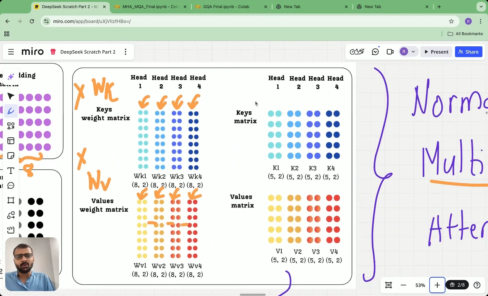

为什么在示意图里，4 个头的权重被涂成 4 种不同颜色？因为它们的数值本来就不同——权重是随机初始化的，训练后也不会自动变得一样。既然 $W_{K1}$ 与 $W_{K2}$ 不同，乘出来的 $K_1$ 与 $K_2$ 自然不同；$V$ 同理 [【跳转到 13:16】](https://www.youtube.com/watch?v=Z6B51Odtn-Y&t=796)。

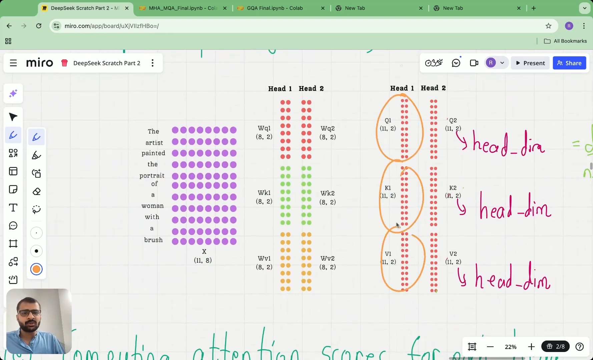

这张图把三个形状的关系钉死了：行是 token 数，列是「总维度拆成 4 个头后的头维度」。所谓 head_dim，就是总维度除以头数；这个乘数直接决定了每一份 K、V 有多大 [【跳转到 19:22】](https://www.youtube.com/watch?v=Z6B51Odtn-Y&t=1162)。

## 四、MQA 的做法：只留一套，其余头照抄

既然 KV cache 的体积里有一项是头数 $n$，那把「头与头之间的差异」去掉，缓存就只需要存一份。

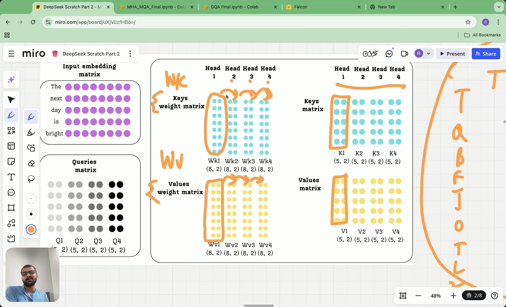

具体做法是：$W_K$、$W_V$ 只保留一份（head 1 的那份），头 2、头 3、头 4 用同一份权重，乘出来的 K、V 也就完全相同 [【跳转到 17:42】](https://www.youtube.com/watch?v=Z6B51Odtn-Y&t=1062)。于是缓存里只需要存一份 K、一份 V，其余头在推理时直接复用这份 [【跳转到 16:52】](https://www.youtube.com/watch?v=Z6B51Odtn-Y&t=1012)。

**但 Query 没有被共享。** 这一点最容易看错：$Q_1,Q_2,Q_3,Q_4$ 仍然是四个不同的投影、四组不同的数值。MQA 只是说 K 和 V 在所有头之间相同，没说「所有头问同一个问题」[【跳转到 18:32】](https://www.youtube.com/watch?v=Z6B51Odtn-Y&t=1112)。

于是缓存公式里的 $n$ 变成了 1：

| 项目 | MHA（标准多头注意力） | MQA（多查询注意力） |
| --- | --- | --- |
| 每个头的 K/V | 各有一套，互不相同 | 全部共用同一套 |
| 缓存的维度 | $L \times B \times n \times H \times s \times 2$ | $L \times B \times 1 \times H \times s \times 2$ |
| 缩小倍数 | 1 | $n$ |
| GPT-3 量级 | 4.5 GB | 64 MB |
| DeepSeek 量级（128 头） | 400 GB | 3 GB |

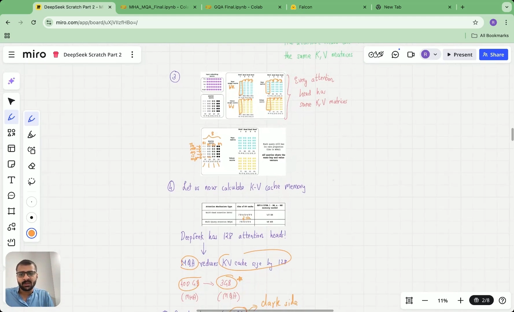

视频里的换算很干脆：DeepSeek 有 128 个头，缓存就小 128 倍，400 GB 直接变成 3 GB [【跳转到 20:12】](https://www.youtube.com/watch?v=Z6B51Odtn-Y&t=1212)；GPT-3 有 96 个头，4.5 GB 缩到 MB 级别，也是接近「差两个数量级」的效果 [【跳转到 35:26】](https://www.youtube.com/watch?v=Z6B51Odtn-Y&t=2126)。

## 五、为什么共享之后解码就快了：每步搬运量除以头数

把「快」拆开看，解码一步真正要做的算术很少：只有一个新 token 的那一行 query，去和整张 K 矩阵比对，再乘一次 V。相比之下，**要读进计算单元的数据很多**——整张 K 和整张 V，每一步都要完整读一遍；序列越长，搬的越多，而搬的这些数据服务的只是「一个字」的输出 [【跳转到 06:53】](https://www.youtube.com/watch?v=Z6B51Odtn-Y&t=413)。

MQA 把这个搬运量按头数除掉了：K 的字节数从 $s \times n \times H \times 2$ 变成 $s \times H \times 2$。同时，$W_K$、$W_V$ 的切片只剩一份，投影这一步的乘加也跟着少了——视频在实测那一段把两个原因并列说了：显存里存的东西少了，计算量也少了，所以推理时间变短 [【跳转到 27:47】](https://www.youtube.com/watch?v=Z6B51Odtn-Y&t=1667)。

需要说明一句：视频主线讲的是「显存占用」与「成本」，并没有逐字使用 memory-bound、带宽这些术语；上面这段「每步搬运量除以头数」是把它的口述翻译成搬运量的语言，方向与它的结论一致——存得越多、搬得越多，推理就越慢。

## 六、实测：GPT-2 与 Falcon 的对照

光看公式不够，视频拿两个真实模型开跑：`gpt2-medium`（约 3.55 亿参数，标准多头注意力）与 `falcon-rw-1b`（约 10 亿参数，实现的是 MQA）[【跳转到 25:43】](https://www.youtube.com/watch?v=Z6B51Odtn-Y&t=1543)。提示词统一用 `The quick brown fox jumps over the lazy dog`（9 个 token）。

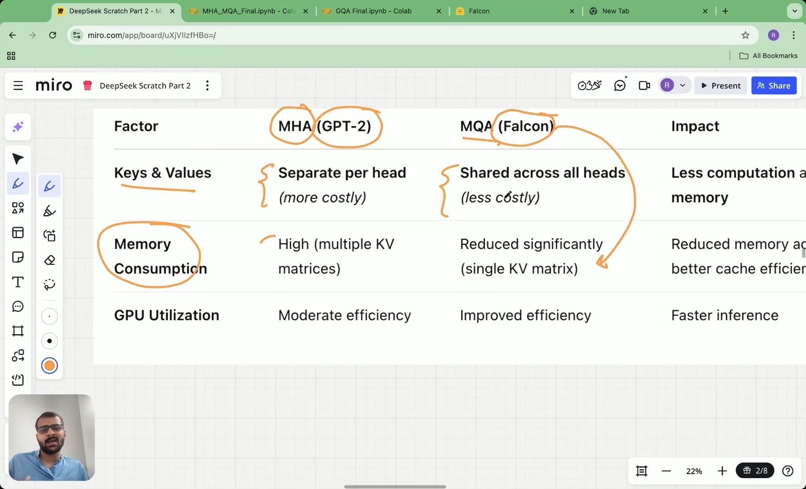

跑出来的耗时直接印在 Colab 输出里：

```
Inference Time - MHA (GPT2-Medium): 1.062 seconds
Inference Time - MQA (Falcon-RW-1B): 0.640 seconds
```

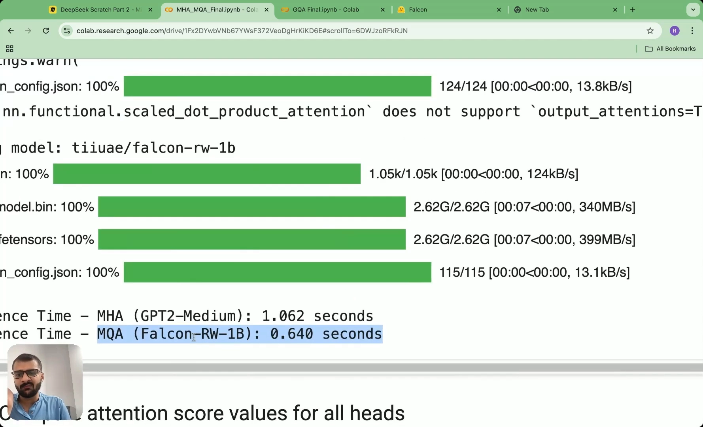

1.062 秒 → 0.640 秒，快了约四成 [【跳转到 28:12】](https://www.youtube.com/watch?v=Z6B51Odtn-Y&t=1692)。这里要如实提醒一句：两个模型的参数量并不相同（3.55 亿 vs 10 亿），所以这组秒数只能当方向性证据——作者本人的判断也是「显存占得少、计算也少，所以更快」，而不是严格的同参数量对比实验。

第三组实验是权重热力图。把 4 个头的可训练 $W_K$ 画成热力图，GPT-2 的 head 0、1、2、3 颜色分布明显不同——因为它们的权重本来就不共享 [【跳转到 31:05】](https://www.youtube.com/watch?v=Z6B51Odtn-Y&t=1865)。换成 Falcon 之后，head 0、1、2、3、4、5 的 $W_K$ 与 $W_V$ 热力图**长得一模一样**，这正是 MQA 在实现层面留下的指纹 [【跳转到 32:08】](https://www.youtube.com/watch?v=Z6B51Odtn-Y&t=1928)。

## 七、代价：共享 K/V 让「多视角」退化成「多问法」

多头注意力的初衷是什么？是**用不同的头捕获不同的视角** [【跳转到 21:44】](https://www.youtube.com/watch?v=Z6B51Odtn-Y&t=1304)。

视频给了一个经典歧义句：`The artist painted the portrait of a woman with a brush`。它可以理解成「画家用画笔画的」，也可以理解成「画的是拿着画笔的女人」。单头自注意力只能给一种解释，多头才能同时把两种关系编码进上下文 [【跳转到 20:54】](https://www.youtube.com/watch?v=Z6B51Odtn-Y&t=1254)。

而 MQA 把 $K_1=K_2$、$V_1=V_2$ 直接写死了。query 虽然不同，注意力分数也确实会不同，但「不同的头看到的世界」被统一了，能捕获的视角数量随之下降 [【跳转到 22:34】](https://www.youtube.com/watch?v=Z6B51Odtn-Y&t=1354)。

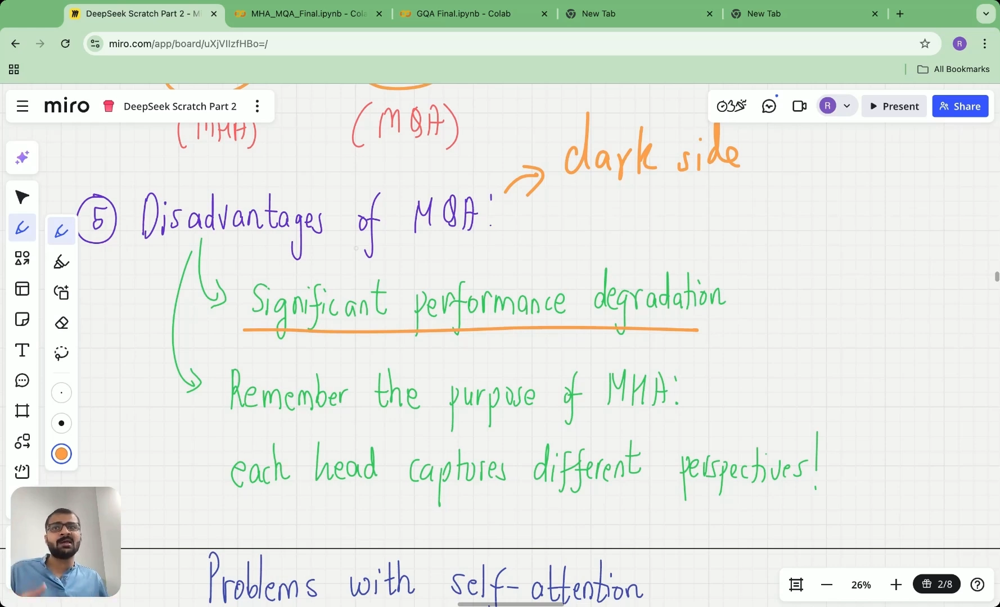

注意力图的对照也支持这一点。GPT-2（MHA）的各头注意力图差别明显，有的盯第一个 token，有的盯对角线附近，有的扫一片 [【跳转到 34:30】](https://www.youtube.com/watch?v=Z6B51Odtn-Y&t=2070)；Falcon（MQA）的头则「看起来都差不多」，多样性明显更低 [【跳转到 35:01】](https://www.youtube.com/watch?v=Z6B51Odtn-Y&t=2101)。

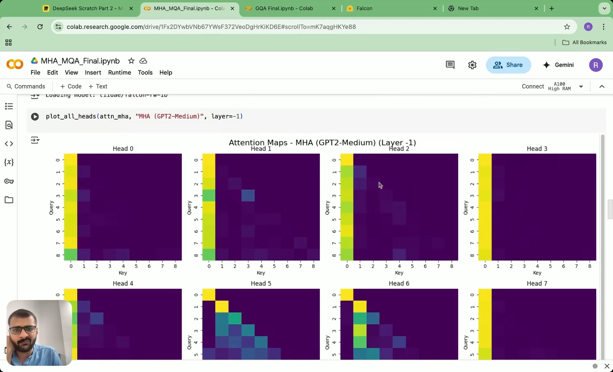

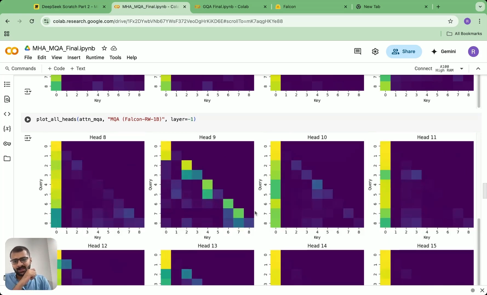

视频作者的态度很直接：DeepSeek 的模型在性能与长上下文上都很强，所以它当然不会停在这一步——省下显存是真的，性能退化也是真的，这笔账要换个更聪明的算法来还（后续的 GQA 与 MLA）[【跳转到 36:22】](https://www.youtube.com/watch?v=Z6B51Odtn-Y&t=2182)。

## 八、把 MQA 放回路线图：它是第一刀，不是终点

按视频的叙述顺序，KV cache 这个问题的解决史是这样的 [【跳转到 11:06】](https://www.youtube.com/watch?v=Z6B51Odtn-Y&t=666)：

1. **MQA**：所有头共用一组 K/V，缓存除以头数，代价是多视角退化；
2. **GQA**（分组查询注意力）：不共享到只剩一组，而是分成若干组、组内共享——下一步的话题；
3. **MLA**（多头潜在注意力）：DeepSeek 论文里的关键创新，也是这条线的重头戏。

所以 MQA 的历史地位是「第一个被想出来的办法」：思路简单到一句话能说完，收益立刻可见（400 GB → 3 GB），但它的缺陷也逼着后续工作往「少共享一点、但共享得更聪明」的方向走。

## 小结

- **解码只需要最后一个位置的上下文向量**，历史 token 的 K/V 一旦算过就没有重算的必要，于是有了 KV cache。
- **缓存的代价是显存**：$L \times B \times n \times H \times s \times 2 \times 2$，GPT-2 是 36 MB，GPT-3 是 4.5 GB，DeepSeek V3/R1 这一档是 400 GB。
- **MQA 的一刀砍在头数上**：$W_K$、$W_V$ 只留一份，所有头共用同一组 K/V，缓存按头数缩小 $1/N$。
- **Query 没有被共享**：$Q_1..Q_4$ 仍然各不相同，所以各头的注意力权重仍然不同——但「看到的世界」被统一了。
- **快来自搬运量变小**：每步要读的 K/V 字节数除以头数，实测 GPT-2 1.062 秒 vs Falcon 0.640 秒（两者参数量不同，只作方向性证据）。
- **代价是多样性**：权重热力图显示 Falcon 各头完全相同，注意力图也趋于相似；多头原本「一个头一个视角」的设计被削弱。
- **路线图的下一步**：GQA 用分组共享折中，MLA 用低秩压缩把这一支收编。

## 关键术语速查

| 术语 | 一句话解释 |
| --- | --- |
| KV cache | 把历史 token 的 Key/Value 张量存下来，避免每次解码重算，计算量从平方级降到线性级 |
| 头维度 head_dim | 总隐藏维度除以头数，决定每个头的 K/V 有多宽 |
| Query 头 | 每个头独立的一套「提问」投影，MQA 里它不被共享，是保留多样性的那一半 |
| MQA（多查询注意力） | 所有 Query 头共用一组 K/V，缓存体积除以头数，代价是头间多样性下降 |
| GQA（分组查询注意力） | MQA 与 MHA 的折中：头分成若干组，组内共享 K/V，组间不共享 |
| MLA（多头潜在注意力） | DeepSeek 的关键创新，把 K/V 压到低维潜空间，进一步缩小缓存 |
| logits | 输出层给出的、长度等于词表大小的分数向量，取最大项即为下一个 token |
