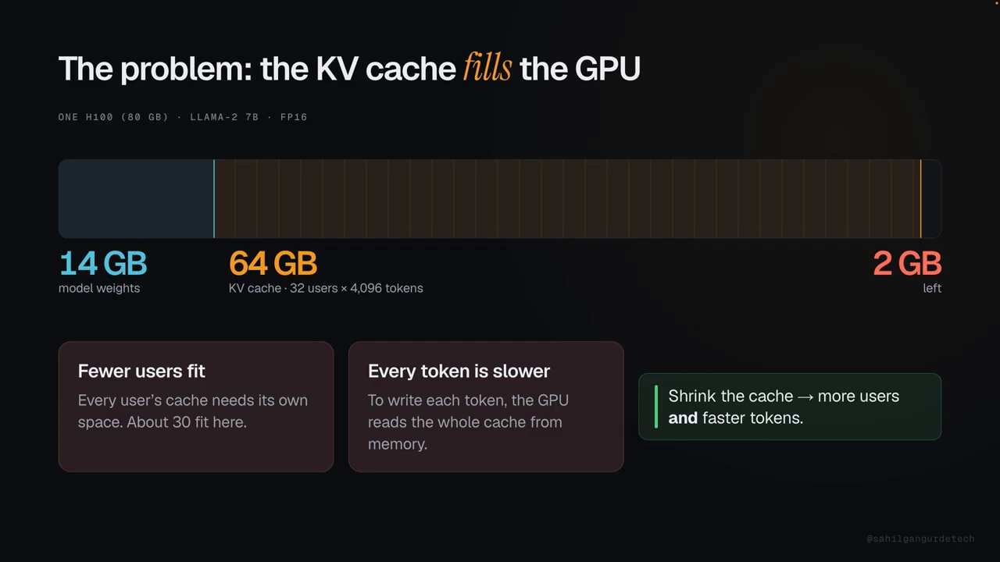
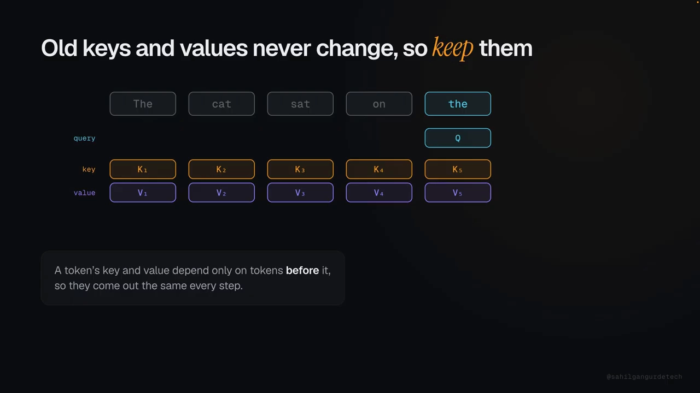
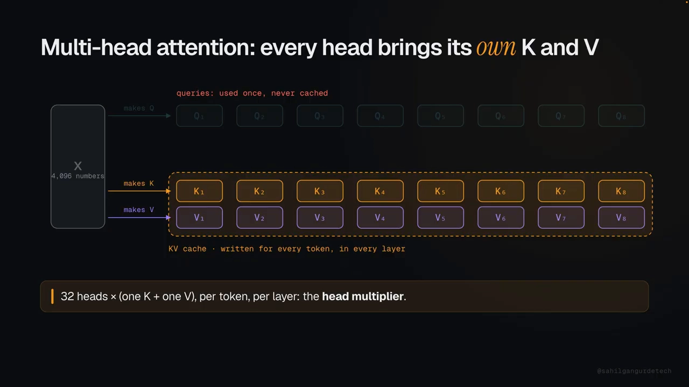
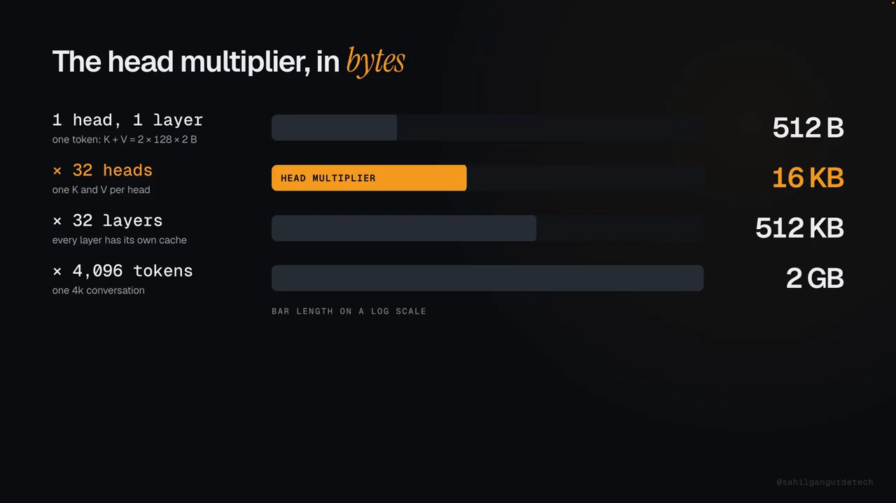
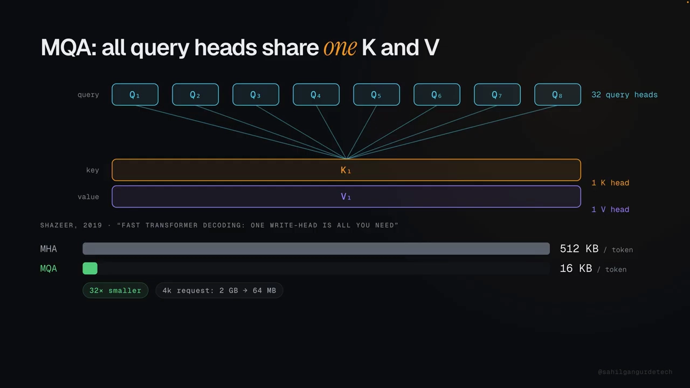
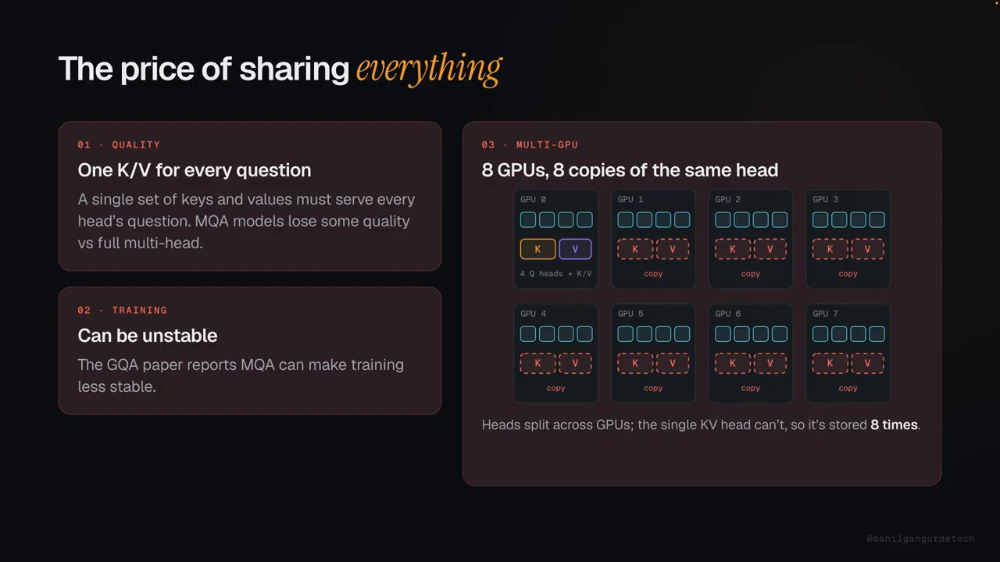
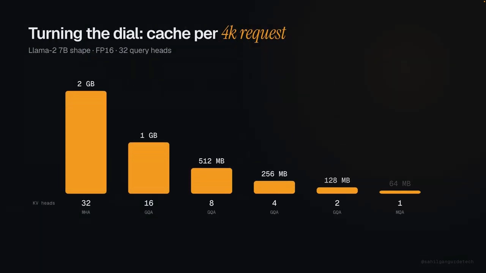
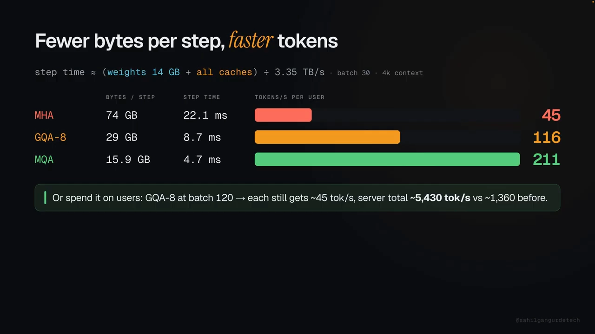

# 把 KV 头从 32 拧到 1：同一个 7B 模型每 token 的缓存从 512 KB 掉到 16 KB

> 视频来源：[Why Modern LLMs Stopped Using Standard Attention Heads](https://www.youtube.com/watch?v=g-owfWGKvIU&t=0)（YouTube · Sahil Gangurde，约 27 分钟）
> 本文基于视频演说图文稿整理，配图截自视频。这支视频从一个具体到能上机复现的谜题出发：一块 80 GB 的 H100 装 14 GB 的 Llama-2 7B，为什么 30 个人就挤爆了？答案在 KV cache。接着它只用一个问题——「query 头数和 KV 头数凭什么必须相等」——推出 MQA 与 GQA，并把省下的字节折算成能装多少人、每人每秒多少 token。文中所有数值（32 层、32 头、head dim 128、FP16、4000 字上下文、H100 的 3.35 TB/s）都是视频明确给出的。

## 本讲要解决的核心问题（SCQA）

**背景**：大模型吐字是一个 token 一个 token 来的。为了不重算历史，模型把每个历史 token 的 key 和 value 存进显存，这份存货就是 KV cache。

**冲突**：一块 H100 有 80 GB 显存，Llama-2 7B 的 FP16 权重只占 14 GB，看上去还能再塞五六份模型。可实际开到 30 个并发、每人约 4000 token 的对话，显存就见底了——**吃光显存的不是模型，是缓存**。

**疑问**：缓存里到底存了什么、为什么这么大？这么大的东西，能不能在不重训模型的前提下砍掉一个数量级？

**回答（中心思想）**：**缓存体积里有一个纯属设计选择的因子——KV 头数 $h_{kv}$；把它从 32 降到 1，同一个 7B 模型每个 token 的缓存就从 512 KB 掉到 16 KB（32 倍），一段 4000 token 的对话从 2 GB 掉到 64 MB**。全部共享一份 K/V 的做法叫 **MQA（multi-query attention）**，省 32 倍但要付质量、训练稳定性与多卡复制的代价；把 query 头分组、每组共用一份的做法叫 **GQA（grouped-query attention）**，取 8 个 KV 头能拿到接近 MHA 的质量、接近 MQA 的速度——这是今天几乎所有开源模型的默认选择。

---

## 一、先把谜题摆在桌面上：64 GB 的缓存、只剩 2 GB 的显存

画面把账算得很直白：一块 80 GB 的 H100，Llama-2 7B 的 FP16 权重约 14 GB，让 32 个人各聊约 4000 token，那片橙色区域就是 KV cache——**64 GB，比模型本身大四倍多**，最后只剩 2 GB [【跳转到 00:50】](https://www.youtube.com/watch?v=g-owfWGKvIU&t=50)。

缓存过大在两个方向上同时收税 [【跳转到 01:15】](https://www.youtube.com/watch?v=g-owfWGKvIU&t=75)：

- **装不下更多的人**：每个用户的缓存都要独占一块空间，能并发的用户数被显存除以「人均缓存」卡死，本例大约 30 人；
- **每个人更慢**：每产出一个新 token，都要把那个人整份缓存从显存里读一遍。

所以缓存一小，两个指标同时变好——这正是视频要讲的全部动机。

## 二、缓存里装的是 K 和 V，而 Q 用完就扔

每个 token 会产生三支向量（一组数字）：

| 向量 | 角色 | 通俗说法 |
| --- | --- | --- |
| Query（查询） | 这个 token 此刻要问什么 | 我走进图书馆，手里拿着的问题 |
| Key（键） | 这个 token 能提供什么 | 书脊上的标签 |
| Value（值） | 被选中之后交出去的内容 | 翻开的书页内容 |

注意力的动作只有两步：**match（匹配）**——用最新的 query 去和所有历史 key 比对打分，分数归一化；**mix（混合）**——按这些分数把各个 value 加权混成一个输出向量，这个输出再去影响下一个 token 的预测 [【跳转到 04:35】](https://www.youtube.com/watch?v=g-owfWGKvIU&t=275)。

关键观察在这里：这一步**需要最新的 query，但需要每一个历史 token 的 key 和 value**。而一个 token 的 key 和 value 只依赖它前面的 token，所以每步算出来都一模一样，重算是纯浪费——**存下来**。这就是 KV cache。反过来，query 只为它自己那一步服务，用完就扔，所以它叫 KV cache 而不是 QKV cache [【跳转到 05:50】](https://www.youtube.com/watch?v=g-owfWGKvIU&t=350)。

也正因如此，缓存随每个新 token 长一格，而且是**每个用户各长各的**。

## 三、头乘数：32 个 query 头，各自带一份私有的 K 和 V

为什么要很多头？视频用 `The cat sat on the mat because it` 举例：要接下去写，模型得同时问好几个问题——「it 指谁？」（落在 cat 上，也分一点给 mat）、「紧挨着我前面的是什么？」（落在 because 上）、「动作是什么？」（落在 sat 上）。一个问题不够用，所以并排问很多个，每个提问者就是一个**注意力头**（attention head）；真实模型里每个头要找什么模式是学出来的，不是人写的 [【跳转到 07:05】](https://www.youtube.com/watch?v=g-owfWGKvIU&t=425)。

Llama-2 7B 每层 32 个头 [【跳转到 07:30】](https://www.youtube.com/watch?v=g-owfWGKvIU&t=450)。在标准的多头注意力（**MHA, multi-head attention**）里，**每个头不光有自己的 query，还有自己私有的 key 和 value**：query 1 配 key 1 和 value 1，query 2 配 key 2 和 value 2……于是每层每个 token 都要写 32 份 K、32 份 V 进缓存。视频把这个 32 叫作 **head multiplier（头乘数）**，并直接称它为「本片里的反派」。

## 四、字节阶梯：512 B 一路乘到 2 GB

从最小单位开始数。一个头、一层、一个 token：key 是 128 个数，value 也是 128 个数，每个数 2 字节（FP16），

$$
2 \times 128 \times 2 = 512\ \text{字节}
$$

单看真的微不足道。然后逐级乘上去：

$$
512\ \text{B} \times 32\ \text{（头）} = 16\ \text{KB}
$$

$$
16\ \text{KB} \times 32\ \text{（层）} = 512\ \text{KB（每个 token）}
$$

$$
512\ \text{KB} \times 4096\ \text{（token）} = 2\ \text{GB（一段 4000 字对话）}
$$

**每个 token 半兆，一个人一段对话 2 GB**；30 个人就把 60 GB 显存填满了，正好回到开场那张图 [【跳转到 10:00】](https://www.youtube.com/watch?v=g-owfWGKvIU&t=600)。

把它写成一般式（$L$ 层、$h_{kv}$ 个 KV 头、head 维度 $d_h$、每个数 $b$ 字节）：

$$
\text{bytes per token} = 2 \cdot L \cdot h_{kv} \cdot d_h \cdot b
$$

再加序列长度与 batch：$S$ 和 $B$ 各乘一次。逐项看哪些能动：那个 2 是 K 和 V，改不掉；层数少一层模型就更笨；$d_h$ 几乎处处是 128；$b$ 是精度，属于另一条故事线。**五个因子里，只剩下 $h_{kv}$ 是一个纯设计选择** [【跳转到 10:50】](https://www.youtube.com/watch?v=g-owfWGKvIU&t=650)。

于是视频抛出那个「简单到不值一问」的问题：**为什么 KV 头数必须等于 query 头数？** 没有任何东西强迫它们相等——后面全部结论都从这个提问里长出来 [【跳转到 11:15】](https://www.youtube.com/watch?v=g-owfWGKvIU&t=675)。

## 五、MQA：只留一组 K/V，缓存除以 32

先想清楚每一件东西在干什么：query 是「问题」，头的多样性正来自问题不同，这份多样性要保住；**key 和 value 描述的是历史 token 本身**——它们是标签和内容，与提问者是谁无关。那么，如果所有头读同一套标签、同一套内容，只是各自的问题不同，会怎样？

视频在句子上试了一遍：head 1 仍问「it 指谁」，所以仍然找到 cat；head 2 仍问「前面是什么」，落在 because；head 3 仍找到 sat。**对着同一批标签问不同的问题，答案依然是不同的** [【跳转到 13:20】](https://www.youtube.com/watch?v=g-owfWGKvIU&t=800)。这就是 MQA 的想法：query 一个都不少，但整层只留 **1 个 K 头、1 个 V 头**。它由 Noam Shazeer 提出（2019 年那篇 *Fast Transformer Decoding: One Write-Head Is All You Need*），思路正是「写缓存这件事，一个头就够了」。

缓存只存 K 和 V，所以每个 token 只需要存一份：

$$
2 \times 32 \times 1 \times 128 \times 2 = 16\ \text{KB}
$$

对比 512 KB，**正好 32 倍**；那段 2 GB 的对话变成 64 MB。显存账如下：80 GB 的卡里约 60 GB 可以留给缓存，MHA 每人 2 GB 只够 30 人，MQA 每人 64 MB **纸面上能装 900 多人**（实际会先撞上别的限制，但缓存不再是那堵墙）[【跳转到 15:00】](https://www.youtube.com/watch?v=g-owfWGKvIU&t=900)。

### 5.1 顺带把带宽也省了

速度上的收益更微妙一点。产出一个 token 时，最慢的不是算术，而是把数据从内存读出来，数学单元大部分时间在等。

- **MHA**：读进来的每一份 K/V 只被一个头使用，于是大约「一个字节换一次运算」；
- **MQA**：同一份 K/V 被 32 个头共用，**同样的读取量换 32 倍的运算量**。算术强度从约 1 FLOP/byte 抬到约 32 FLOP/byte，GPU 仍然没被喂饱（那需要每字节约 295 次浮点运算），但等待时间大幅缩短 [【跳转到 15:50】](https://www.youtube.com/watch?v=g-owfWGKvIU&t=950)。

## 六、共享一切的代价：质量、训练稳定性、多卡复制

既然这么划算，为什么不是所有模型都用 MQA？因为三笔账 [【跳转到 16:15】](https://www.youtube.com/watch?v=g-owfWGKvIU&t=975)：

1. **质量**：一套标签和内容要同时服务所有类型的问题，这种挤压会体现出来，MQA 模型通常比完整 MHA 略差；
2. **训练稳定性**：后续对比两种方案的研究者发现，MQA 会让训练变得不那么稳——把每个头的需求都塞进一份 K/V，本身就更难学；
3. **多卡复制（最隐蔽的一笔）**：装不进一张卡的大模型会被切开放在多张卡上，比如 8 张，每张分到一部分头。query 头能整除，每卡 4 个；但**整个模型只有 1 个 KV 头，每张卡都需要它**，于是每张卡各存一份——同一样东西存 8 份。**恰恰在最大的模型上，省下来的空间又悄悄漏掉了** [【跳转到 17:30】](https://www.youtube.com/watch?v=g-owfWGKvIU&t=1050)。

## 七、GQA：把 query 头分组，旋钮停在中间

既然全共享代价大、全私有太贵，中间档在哪？**GQA（grouped-query attention）**，2023 年由 Google 的团队提出：把 query 头分组，每组共用一份 K 和一份 V——像学习小组共用一套笔记。两个头一组，缓存减半；四个头一组，缓存剩四分之一；把所有头放进一组，就回到 MQA [【跳转到 18:25】](https://www.youtube.com/watch?v=g-owfWGKvIU&t=1105)。

视频强调了一个漂亮的观点：**MHA 与 MQA 不是两种不同的想法，而是同一个旋钮的两端，旋钮刻度就是「保留几个 KV 头」，GQA 是中间的所有档位**。

把旋钮拧一遍，同一个 Llama-2 7B 形态、FP16、32 个 query 头、一段 4000 token 的请求：

| KV 头数 | 类型 | 单 token 缓存 | 单请求缓存（4k） |
| --- | --- | --- | --- |
| 32 | MHA | 512 KB | 2 GB |
| 16 | GQA | 256 KB | 1 GB |
| 8 | GQA | 128 KB | 512 MB |
| 4 | GQA | 64 KB | 256 MB |
| 2 | GQA | 32 KB | 128 MB |
| 1 | MQA | 16 KB | 64 MB |

GQA 论文的核心结论是：**取 8 个 KV 头时，质量接近完整的 MHA，速度接近 MQA——拿到大部分收益，只付很小代价**。论文把 8 选为甜点，今天大多数模型也用 8。而且它顺手解决了上一节的多卡问题：8 个 KV 头，8 张卡正好一卡一个，不用复制 [【跳转到 19:47】](https://www.youtube.com/watch?v=g-owfWGKvIU&t=1187)。Llama-3 8B 就是 32 个 query 头配 8 个 KV 头（每 4 个 query 头一组）。

### 7.1 不用从头训：平均一下，再补 5%

更实用的一点：不需要从零训练一个新模型，**可以直接改造手上已有的模型**。做法是把将要合并成一组的那 4 个 key 头做权重平均、value 头同样处理；作者试过「只留其中一个头」和「随机初始化」，效果都不如平均。同样的手法可以一路转换到 MQA，只是 GQA 保留的头更多、丢的东西更少。转换后再训练一小段——约为原始训练量的 **5%**，让模型适应共享，他们称之为 **up-training**。比起从头训一个新模型，这几乎不算钱 [【跳转到 20:46】](https://www.youtube.com/watch?v=g-owfWGKvIU&t=1246)。

### 7.2 三种方案并排

32 个 query 头不变，只改 KV 头：

- **MHA（32 个 KV 头）**：512 KB/token，质量最好，最慢；
- **GQA-8**：128 KB/token，质量接近 MHA，速度很快；
- **MQA（1 个 KV 头）**：16 KB/token，质量略有损失，三者中最快。

## 八、回到 GPU 结账：省下的字节折成人和速度

现在把前面所有字节换成时间。容量这一侧：60 GB 缓存预算下，MHA 每人 2 GB 装 30 人；GQA-8 每人 512 MB 装 **120 人**，同样硬件四倍的人数；MQA 每人 64 MB 纸面 900 多人 [【跳转到 22:01】](https://www.youtube.com/watch?v=g-owfWGKvIU&t=1321)。

速度这一侧，每步的时间大致就是「要读的字节 ÷ 内存能读多快」：

$$
t_{\text{step}} \approx \frac{\text{权重 14 GB} + \sum \text{所有人的缓存}}{3.35\ \text{TB/s}}
$$

H100 的带宽按 3.35 TB/s 算，30 人、4k 上下文：

- **MHA**：$14 + 60 = 74$ GB → 约 22.1 ms/步 → 每人约 **45 tok/s**；
- **GQA-8**：$14 + 15 = 29$ GB → 约 8.7 ms/步 → 每人约 **116 tok/s**（同样的人，快 2.5 倍）；
- **MQA**：$14 + 1.9 \approx 15.9$ GB → 约 4.7 ms/步 → 每人约 **211 tok/s**，此时每步几乎只剩权重 [【跳转到 23:12】](https://www.youtube.com/watch?v=g-owfWGKvIU&t=1392)。

或者不换速度、换人数：GQA-8 开 120 人时每人仍约 45 tok/s，整机输出从约 1,360 tok/s 变成约 5,430 tok/s——**同样的硬件，约四倍的产出** [【跳转到 24:02】](https://www.youtube.com/watch?v=g-owfWGKvIU&t=1442)。

## 九、真实模型怎么选，代码里长什么样

真实选择基本沿着「模型越大越需要」这条线 [【跳转到 24:27】](https://www.youtube.com/watch?v=g-owfWGKvIU&t=1467)：

- Llama-2 7B 用的是标准 MHA；
- Falcon-7B 一路走到 MQA：71 个 query 头，只配 1 个 KV 头；
- 从 Mistral 7B、Llama-3 8B 到 700 亿级的大模型，基本都是 8 个 KV 头的 GQA；
- Llama-2 70B 有 64 个 query 头、80 层：全 MHA 要 2.5 MB/token，GQA-8 只要 320 KB，**少 8 倍**。这就是为什么 Meta 在更大的 Llama-2 上用了 GQA，而 7B 那版没用。

代码层面改动小得惊人：query 是 32 个头，key/value 只有 8 个，缓存只存这 8 份；真正做注意力之前，把每个 KV 头按组重复 4 次，让形状对上——Hugging Face 的 Llama 实现大致就是这么做的，之后就是普通的 match、mix [【跳转到 25:42】](https://www.youtube.com/watch?v=g-owfWGKvIU&t=1542)。一个小细节：这个 repeat 只是造临时副本，像 FlashAttention 这类快速内核可以直接接受头数更少的 K/V，**repeat 完全没必要**；无论如何，躺在缓存里的东西一直很小。

视频末尾也点了几条后续路线：**PagedAttention** 解决缓存碎片浪费，**量化**用更少的字节存每个数，而 DeepSeek 走了另一条路——不共享 K/V，而是把它们压缩进一个低维潜向量（multi-head latent attention）。

## 小结

- 显存被吃光的不是模型而是缓存：H100 80 GB 上，14 GB 权重之后，32 人 × 4000 token 的 KV cache 占 64 GB。
- 缓存里只留 K 和 V，因为它们的值一旦算出就不再改变；query 只用一次就丢。
- 字节阶梯：一个头一层一个 token 512 B，乘 32 个头 16 KB，乘 32 层 512 KB，乘 4096 token 2 GB。
- 五个因子里只有 KV 头数是纯设计选择——「为什么 KV 头数要等于 query 头数？」这个问题引出全部结论。
- MQA 全共享，缓存除以 32（512 KB 变 16 KB），容量与带宽双赢，代价是质量、训练稳定性与多卡复制。
- GQA 分组共享，是一个连续旋钮：32 → 16 → 8 → 4 → 2 → 1，缓存对应 2 GB → 64 MB。
- 8 个 KV 头是甜点：质量接近 MHA、速度接近 MQA，且 8 卡正好一卡一个；已有 MHA 检查点做权重平均 + 约 5% up-training 即可转换。
- 结账：同样 30 人，MHA 45 tok/s；GQA-8 116 tok/s 或换成 120 人、整机约 5,430 tok/s。

## 关键术语速查

| 术语 | 一句话解释 |
| --- | --- |
| KV cache | 存下每个历史 token 的 key 与 value，避免每步重算 |
| attention head | 一组并行的「提问者」，各自有一套 query/key/value 投影 |
| head multiplier | 每个头都自带一份 K/V 带来的乘数，本例为 32 |
| MHA | 多头注意力：每个 query 头配自己私有的 K 头和 V 头 |
| MQA | 多查询注意力：所有 query 头共用 1 个 K 头和 1 个 V 头 |
| GQA | 分组查询注意力：query 头分组，每组共用一份 K/V，介于 MHA 与 MQA 之间 |
| 算术强度 | 每读入一个字节所做的浮点运算次数；共享 K/V 能把它抬高 |
| up-training | 把 MHA 权重平均成 GQA/MQA 后，用约 5% 的原始训练量继续训练 |
| PagedAttention | 用分页方式管理缓存，减少显存碎片浪费（视频末尾提及） |
| MLA | DeepSeek 的多头潜注意力：不共享 K/V，而是把它们压缩进低维向量 |
