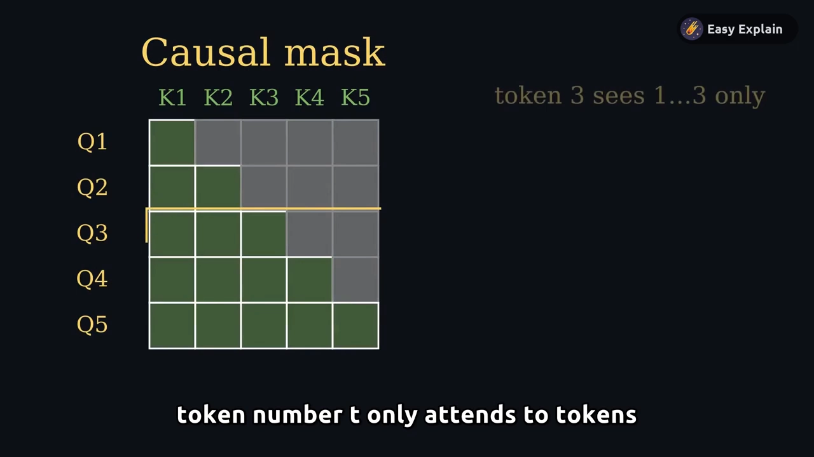
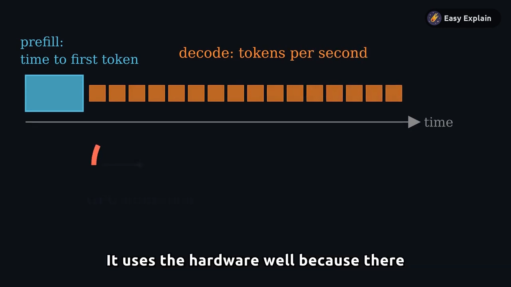
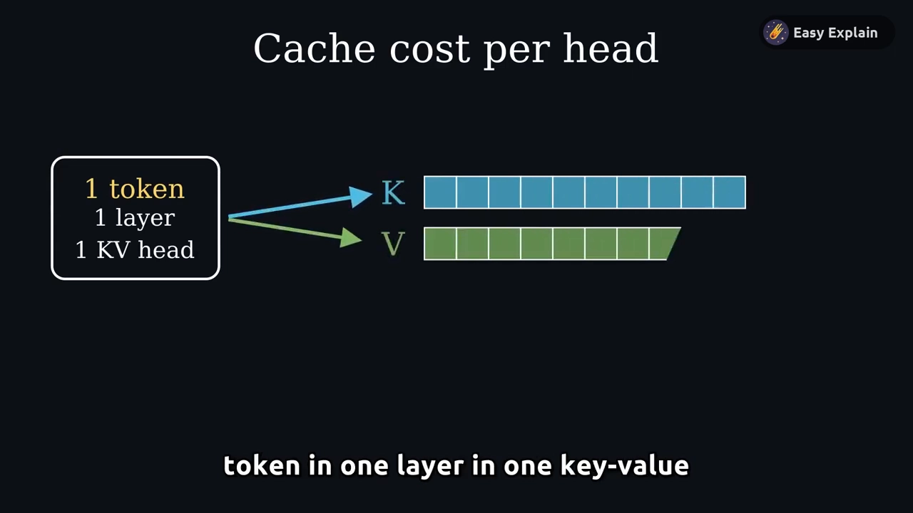
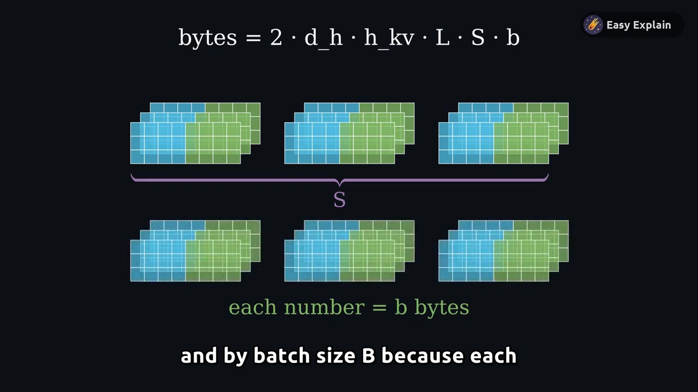
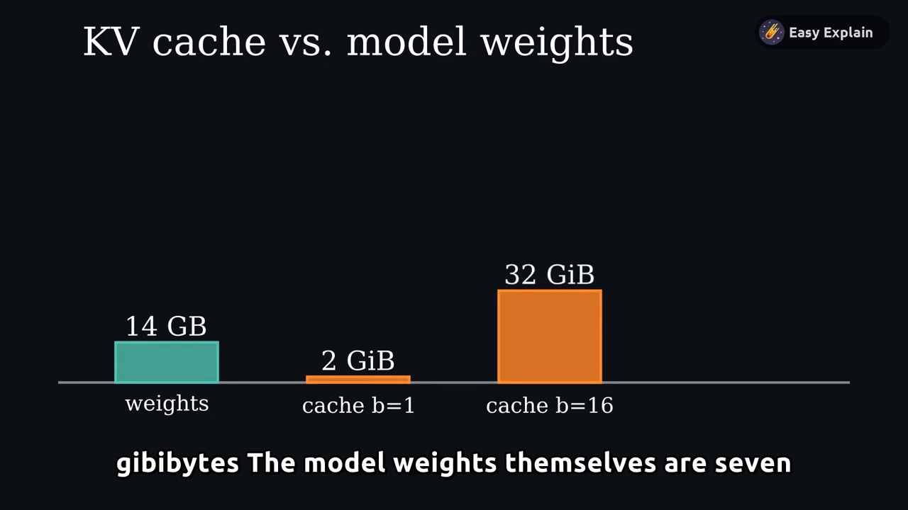
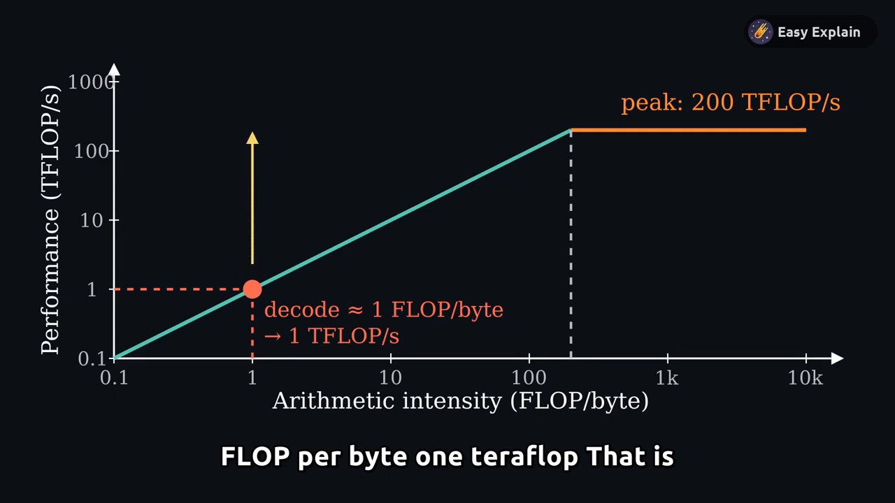
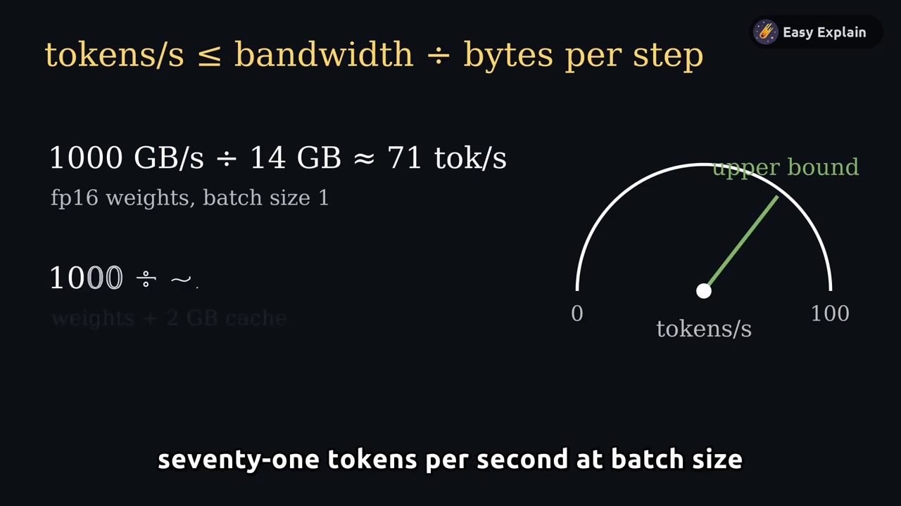
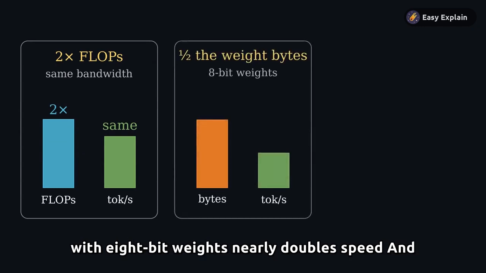

# 每步搬多少字节，就决定每秒出多少 token：KV Cache 的字节账与 decode 上限

> 视频来源：[The KV Cache Explained: Why LLM Decoding Is Memory-Bound](https://www.youtube.com/watch?v=uJLSDw2xJ4w&t=0)（YouTube · Easy Explain 系列第 5 讲，约 13 分钟）
> 本文基于视频演说图文稿整理，配图截自视频。这支视频只做一件事：把「解码为什么慢」算成一道字节题——先用因果掩码推出 KV cache 为什么必须存在，再把每 token、每段上下文、每个 batch 的字节数一级级乘出来，最后用算术强度与 roofline 证明 decode 卡在内存带宽上，并把带宽直接换算成每秒 token 数的上限。文中所有配置（32 层、32 头、head dim 128、FP16）都是视频明确声明的「假定典型值」。

## 本讲要解决的核心问题（SCQA）

**背景**：一块现代 GPU 每秒能做几百太次（tera，$10^{12}$）浮点运算。按直觉，让这样的芯片写文章应该快到看不见过程。

**冲突**：可你和它聊天时，字是一个一个蹦出来的，而且越长越慢。算力明明还有大量空闲，速度却上不去。

**疑问**：慢在哪里？如果把「每生成一个 token 要动多少数据」算清楚，能不能反过来预测它的每秒 token 数？

**回答（中心思想）**：**decode 阶段每生成一个 token，都要把全部模型权重和整份 KV cache 从显存搬进计算单元一次；每步要搬的字节数决定了每秒 token 数的上限**。KV cache 的字节数是一个纯乘法：$2 \cdot L \cdot h_{kv} \cdot d_h \cdot S \cdot B \cdot b$。以一个假定的 7B 模型为例，每个 token 就要 512 KiB，4096 token 的上下文在 batch 16 时是 32 GiB，比 14 GiB 的权重还大一倍多。而 decode 的算术强度只有约 1 FLOP/byte，远低于这台卡 200 FLOP/byte 的脊点，于是算力利用率掉到 0.5%：**要更快，只能少搬字节**。

---

## 一、先承认浪费：每写一个词，都把前文重读一遍

视频开场的类比很朴素：你写故事时，每写一个新词之前都要把整篇从头读一遍、重新理解一次。朴素的语言模型就是这么干的——它没有记忆，「过去」在每一步都被重新计算一遍。可过去并没有改变，重算纯属浪费 [【跳转到 00:27】](https://www.youtube.com/watch?v=uJLSDw2xJ4w&t=27)。

要把这份浪费量化，先看注意力本身。每个 token 的向量会被投影成三个东西：query（我在找什么）、key（我包含什么）、value（选中我之后交出去什么），然后

$$
\text{Attn}(Q,K,V) = \operatorname{softmax}\!\left(\frac{QK^{\top}}{\sqrt{d_h}}\right)V
$$

分数矩阵的每一行说的都是「这个 token 在看谁」 [【跳转到 00:52】](https://www.youtube.com/watch?v=uJLSDw2xJ4w&t=52)。

## 二、因果掩码是 KV cache 存在的全部理由

关键观察只有一句：**生成是因果的**（causal）。第 $T$ 个 token 只看 1 到 $T$ 号 token，绝不看未来。

上图就是这个因果性的矩阵形态：行是 query，列是 key，右上半边被遮掉，第 3 行只对 $K_1, K_2, K_3$ 亮绿 [【跳转到 01:17】](https://www.youtube.com/watch?v=uJLSDw2xJ4w&t=77)。

因果性推出一条极强的性质：一个 token 的 key 和 value **只依赖它自己和它前面的 token**，所以在某一层算出来之后，无论后面再来多少词，它们都不会变。变了才有鬼。既然不变，就不要重算——把它们存起来。每一层、每一个注意力头、每一个历史 token 的 K 和 V 都存下来，这份存货就叫 **KV cache（键值缓存）** [【跳转到 01:22】](https://www.youtube.com/watch?v=uJLSDw2xJ4w&t=82)。

于是每一步只算最新那个 token 的 query、key、value，把新 K/V 追加进缓存，然后对着全部历史做注意力 [【跳转到 01:36】](https://www.youtube.com/watch?v=uJLSDw2xJ4w&t=96)。注意 query 不缓存——它只用一次就丢，所以它叫「KV cache」而不是「QKV cache」。

### 2.1 省下的工作量是可以算的

生成 $n$ 个 token 时，没有缓存的那条路，第 $t$ 步要重算 $t$ 个 token，总量是

$$
1+2+\cdots+n = \frac{n(n+1)}{2}
$$

$n=1000$ 时大约是 50 万次 token 过网络；有缓存时每步只处理一个新 token，共 1000 次——**便宜了 500 倍** [【跳转到 01:56】](https://www.youtube.com/watch?v=uJLSDw2xJ4w&t=116)。

## 三、推理被切成两段：prefill 花钱买首字，decode 决定吐字速度

- **prefill（预填充）**：整个 prompt 一次性过网络，所有 prompt token 并行，它们的 K/V 被写进缓存，同时产出第一个新 token 的概率分布。你等的「第一个字」就是它，通常叫 time to first token。因为并行度高，硬件用得很满。
- **decode（解码）**：生成一个 token，喂回去，再生成下一个。严格串行，因为第 $t+1$ 个 token 需要第 $t$ 个；每步只处理一个 token，却要读完整份缓存和全部权重 [【跳转到 02:30】](https://www.youtube.com/watch?v=uJLSDw2xJ4w&t=150)。

两个阶段的手感完全不同，而全片讨论的是后者：**decode 决定了首字之后的流速**，偏偏它把硬件用得很差。

## 四、字节账第一层：一个 token、一层、一个 KV 头

从最小单位开始数。一个 token、一层、一个 KV 头，要存一支 key 向量和一支 value 向量，每支长度是 head dimension，记作 $d_h$，所以是 $2 d_h$ 个数字 [【跳转到 03:04】](https://www.youtube.com/watch?v=uJLSDw2xJ4w&t=184)。

然后逐级乘：

1. 乘 key/value 头数 $h_{kv}$——每个头都留自己的一对；
2. 乘层数 $L$——每一层有自己的缓存；
3. 乘序列长度 $S$——每个 token 都要存；
4. 乘每个数字的字节数 $b$（FP16 就是 2）；
5. 乘 batch size $B$——batch 里每条序列的缓存是私有的。

$$
\text{KV bytes} = 2 \cdot L \cdot h_{kv} \cdot d_h \cdot S \cdot B \cdot b
$$

这个式子里没有指数、没有分段，**每个因子都是普通乘法**：内存随序列长度线性增长，也随 batch 线性增长 [【跳转到 03:57】](https://www.youtube.com/watch?v=uJLSDw2xJ4w&t=237)。先记住这一点，后面所有的工程灾难都从这里长出来。

## 五、代入一个 7B 模型：每个 token 半兆，4096 token 两吉字节

视频给的假定配置是：$L=32$ 层、32 个注意力头，而在这种经典的多头设计里 **KV 头也是 32 个**，$d_h=128$，权重与缓存都用 FP16（每数字 2 字节）。

先算每 token：

$$
2 \times 32 \times 32 \times 128 \times 2 = 524{,}288\ \text{字节} \approx 0.5\ \text{MiB}
$$

也就是说，**每生成一个 token，缓存里就多出半个兆字节** [【跳转到 04:27】](https://www.youtube.com/watch?v=uJLSDw2xJ4w&t=267)。听起来还好，往下乘就不好听了：

$$
S=4096,\ B=1:\quad 4096 \times 0.5\ \text{MiB} = 2\ \text{GiB}
$$

$$
B=16:\quad 2\ \text{GiB} \times 16 = 32\ \text{GiB}
$$

而模型权重本身是 $7\times10^9 \times 2 = 14\ \text{GiB}$。也就是说，**batch 16 时缓存比模型大一倍多** [【跳转到 04:52】](https://www.youtube.com/watch?v=uJLSDw2xJ4w&t=292)。

## 六、容量只是半个问题：缓存还得被读一遍

显存装不下是显性问题，另一半是隐性的：**每个 decode 步都要把每个权重和整份缓存读一遍，才产出这一个 token** [【跳转到 05:28】](https://www.youtube.com/watch?v=uJLSDw2xJ4w&t=328)。

于是问题变成：GPU 搬字节的速度，和它做数学的速度，哪个先见底？衡量这件事的量叫**算术强度**（arithmetic intensity）：每从内存读入一个字节，做了多少次浮点运算。强度高说明芯片在忙着算，强度低说明它在等数据——**是这个比值决定你先撞上哪堵墙** [【跳转到 05:33】](https://www.youtube.com/watch?v=uJLSDw2xJ4w&t=333)。

### 6.1 decode 的算术强度约等于 1

取一个 $D\times D$ 的权重矩阵 $W$ 和一个 token 向量 $x$。矩阵乘向量要 $D^2$ 次乘法加 $D^2$ 次加法，约 $2D^2$ 次浮点运算；但必须把 $D^2$ 个权重按每个 2 字节读进来，即 $2D^2$ 字节。相除：

$$
\frac{2D^2\ \text{FLOP}}{2D^2\ \text{bytes}} = 1\ \text{FLOP/byte}
$$

**大约每个字节只换来一次浮点运算** [【跳转到 06:15】](https://www.youtube.com/watch?v=uJLSDw2xJ4w&t=375)。为什么这么低？因为每个权重被读进来、只用一次乘加、然后就被丢掉，**没有任何复用**。

对比 prefill：那是矩阵乘矩阵，假设一次处理 1000 个 prompt token，每个读进来的权重就被用 1000 次，算术强度约 1000 FLOP/byte。同一块芯片、同一份权重，prefill 是计算密集型，decode 是搬运密集型。

### 6.2 roofline：decode 站在斜坡最左端

把这件事画成一张图就是 **roofline 模型**：横轴算术强度，纵轴可达性能。左侧性能沿一条斜率等于内存带宽的直线上升，撞到算力峰值后变平，拐点叫 **ridge point（脊点）** [【跳转到 06:32】](https://www.youtube.com/watch?v=uJLSDw2xJ4w&t=392)。

视频用一组「说明性假设」的代数值：FP16 峰值 200 TFLOPS、带宽 1 TB/s。于是

$$
\text{脊点} = \frac{200\times10^{12}\ \text{FLOP/s}}{1\times10^{12}\ \text{B/s}} = 200\ \text{FLOP/byte}
$$

要变成计算受限，一个负载大约每读一个字节得算 200 次浮点。decode 落在哪里？约 1 FLOP/byte，在脊点左边两个数量级，稳稳站在斜坡上：性能 = 1 TB/s × 1 FLOP/byte = **1 TFLOP/s**，只有那台假设峰值算力的 **0.5%**。上图那个红点就是它，向上那根黄色箭头是空着的算力——**计算单元超过 99% 的时间在等内存** [【跳转到 07:22】](https://www.youtube.com/watch?v=uJLSDw2xJ4w&t=442)。

（视频也提醒：真实芯片参数不同，请查自己的数据手册。这里的关键不是 200 这个数，而是「decode 的强度远小于脊点」这个结构性结论。）

## 七、把带宽直接换算成每秒 token 数

于是有了一条极其好用的经验法则：每个 token 至少要把所有模型字节读一遍，所以

$$
\text{tokens/s} \le \frac{\text{带宽}}{\text{每步读取字节数}}
$$

代入 1 TB/s 与 14 GB 的 FP16 权重：

$$
\frac{1000\ \text{GB/s}}{14\ \text{GB}} \approx 71\ \text{tokens/s}\quad(\text{batch size}=1)
$$

把前面那 2 GiB 缓存也加进去，每步约 16 GB，于是掉到约 **62 tokens/s** [【跳转到 07:47】](https://www.youtube.com/watch?v=uJLSDw2xJ4w&t=467)。

这是**上限**，真实系统落在它下面。但它的预测能力很强，视频列了三条：

1. **FLOPs 翻倍、带宽不变的 GPU，decode 一点都不会变快**——因为它根本不在计算受限区；
2. **权重压到 8 bit，字节减半，速度近乎翻倍**——直接改分母；
3. **batching 几乎免费**：服务 16 个用户时，权重只读一次给所有人共用，算术强度往 16 抬，吞吐随之上涨。**唯一不能共享的就是缓存——它按用户私有**，所以想让 batch 开得更大、让每个用户更快，就得让缓存变小 [【跳转到 08:12】](https://www.youtube.com/watch?v=uJLSDw2xJ4w&t=492)。

## 八、公式里哪个因子能拧

回头看字节公式，五个因子里四个是硬件或业务约束：那个 2 是 K 和 V 改不掉；$L$ 少一层模型就弱一点；$d_h$ 几乎处处是 128；$b$ 是精度（另一条故事线）；$S$ 和 $B$ 是用户给的长度与并发。**唯一可以当设计旋钮的是 $h_{kv}$**：

- **MQA（multi-query attention，多查询注意力）**：所有 query 头共用一组 K/V 头，在例子里缓存直接除以 32，代价是质量上有一点冒险 [【跳转到 08:34】](https://www.youtube.com/watch?v=uJLSDw2xJ4w&t=514)；
- **GQA（grouped-query attention，分组查询注意力）**：query 按组切开，每组共用一个 KV 头。取 8 个 KV 头时，每 token 变成

$$
2 \times 32 \times 8 \times 128 \times 2 = 131{,}072\ \text{字节} = 128\ \text{KiB}
$$

是原来的四分之一；4096 token 的缓存从 2 GiB 降到 512 MiB [【跳转到 09:09】](https://www.youtube.com/watch?v=uJLSDw2xJ4w&t=549)。

另外两个按名字提到的方向：**sliding window attention（滑动窗口注意力）** 只让每个 token 看最近的窗口，缓存过了窗口就不再增长；**缓存量化**把 K/V 从 16 bit 压到 8 bit 甚至 4 bit，直接改字节数。两者都是拿一点精度换内存 [【跳转到 09:29】](https://www.youtube.com/watch?v=uJLSDw2xJ4w&t=569)。

## 九、把账算到自己模型上：四行代码与四个坑

视频最后用 PyTorch + Hugging Face 演示：读 config 里的 `num_hidden_layers`、`num_key_value_heads`，head dimension 用 hidden size 除以注意力头数，然后套用同一个公式；也可以把所有缓存张量的元素数乘元素大小求和，去验证公式算得对不对 [【跳转到 11:16】](https://www.youtube.com/watch?v=uJLSDw2xJ4w&t=676)。

顺手记下视频点名的四个常见错误 [【跳转到 11:41】](https://www.youtube.com/watch?v=uJLSDw2xJ4w&t=701)：

1. **忘了缓存同时随 batch 和长度线性增长**。能舒服装下 16 段短对话的服务器，用户一旦粘贴长文档就会 OOM。要按「最坏情况长度 × batch」规划显存，而不是按平均对话；
2. **用注意力头数去算缓存，而模型其实是 GQA**。公式里的分母是 KV 头数，可能比注意力头数少好几倍；
3. **以为 FLOPs 更高的 GPU 解码更快**。先看内存带宽；
4. **一边用缓存一边悄悄改了 prompt 前缀**，让已存的 key/value 全部失效。

顺带一句代码演示里的公平性提醒：计时前要 `torch.cuda.synchronize()`（GPU 是异步的），两条路径生成同样多的 token、用同样的贪心解码，并且**核对 token ID 是否完全一致**——不一致说明有 bug，不是加速 [【跳转到 10:26】](https://www.youtube.com/watch?v=uJLSDw2xJ4w&t=626)。

## 小结

- 因果掩码保证了历史 token 的 K/V 永不再变，所以它们被缓存而不是重算；不缓存时总量是 $n(n+1)/2$，缓存后是 $n$，$n=1000$ 时差 500 倍。
- 推理分成 prefill（并行、算力受限、决定首字延迟）与 decode（串行、带宽受限、决定 tok/s）。
- 缓存字节数 $= 2 \cdot L \cdot h_{kv} \cdot d_h \cdot S \cdot B \cdot b$，每一项都是线性因子；假定 7B 配置下每 token 512 KiB，4096 token、batch 16 时 32 GiB，比 14 GiB 的权重还大。
- decode 是矩阵乘向量，算术强度约 1 FLOP/byte，远低于假设 GPU 200 FLOP/byte 的脊点，算力利用率约 0.5%。
- 所以 tok/s 的上限约等于「带宽 ÷ 每步读取字节数」：1 TB/s 与 14 GB 权重给出约 71，加上 2 GiB 缓存约 62。
- 推论：加 FLOPs 无用，减字节有用；batching 近乎免费但缓存私有——于是压缩 KV cache 成为主线，MQA/GQA、滑动窗口、缓存量化都是同一件事的不同做法。

## 关键术语速查

| 术语 | 一句话解释 |
| --- | --- |
| KV cache | 把每一层、每个 KV 头、每个历史 token 的 key 和 value 存下来，避免每步重算 |
| prefill | 一次性并行处理整个 prompt 的阶段，产出第一个 token，决定首字延迟 |
| decode | 一次生成一个 token 的串行阶段，每步读全量权重与缓存，决定每秒 token 数 |
| memory-bound | 性能由内存带宽而非算力决定；decode 就是典型 |
| 算术强度 | 每从内存读入一个字节所做的浮点运算次数，单位 FLOP/byte |
| roofline 模型 | 用算术强度与带宽、算力峰值画出的性能上界图，拐点叫脊点 |
| 脊点 | 带宽斜线与算力水平线的交点；强度低于它即为带宽受限 |
| MQA | 所有 query 头共用一组 KV 头，缓存除以头数 |
| GQA | query 分组，每组共用一个 KV 头，介于 MHA 与 MQA 之间 |
| 滑动窗口注意力 | 每个 token 只看最近一段窗口，缓存超过窗口长度后不再增长 |
| 缓存量化 | 用 8 bit 甚至 4 bit 存 K/V，直接减少字节数，换取一点精度损失 |
