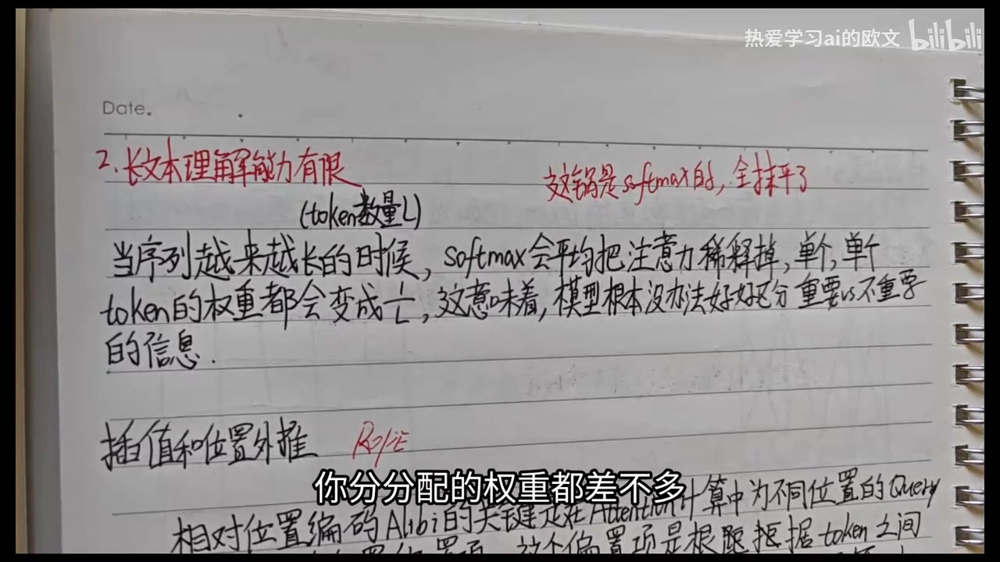
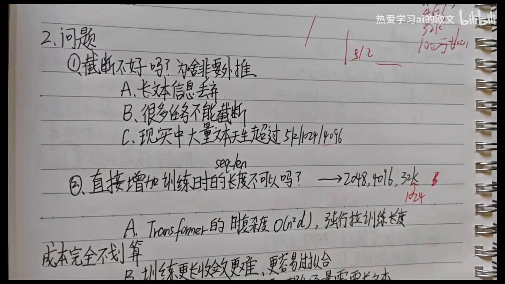
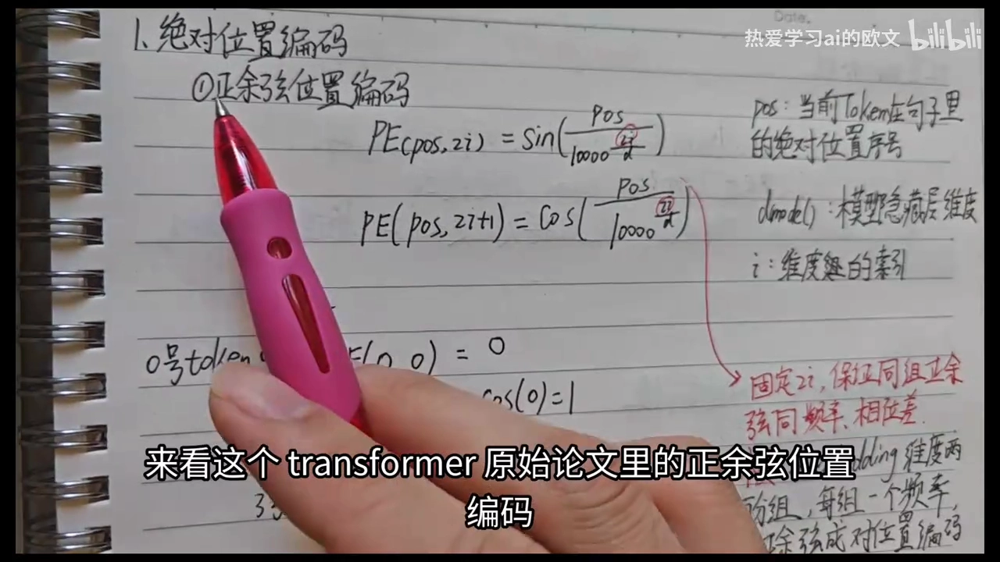
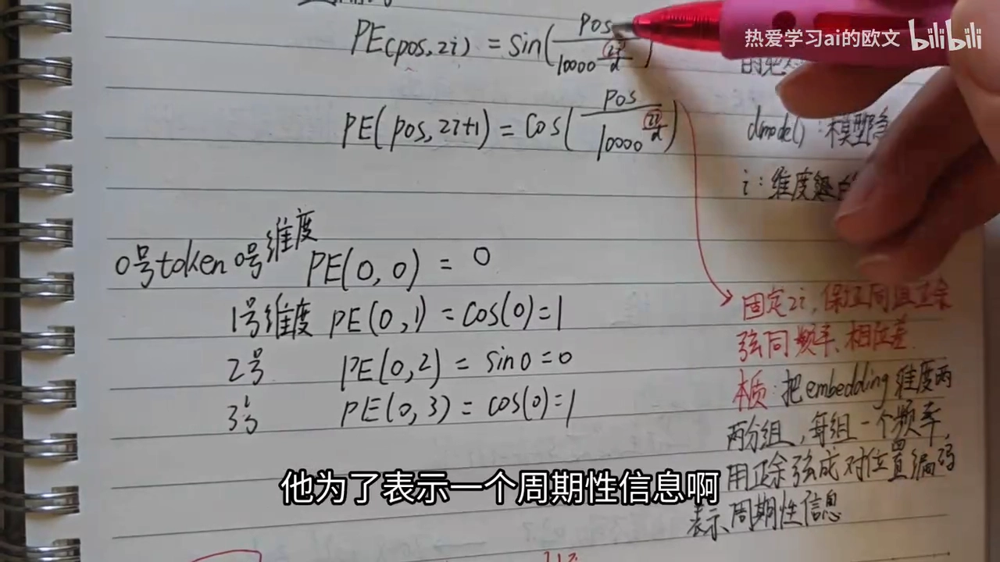
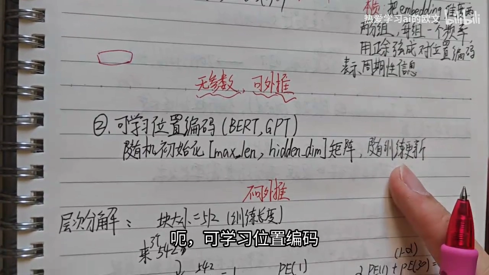
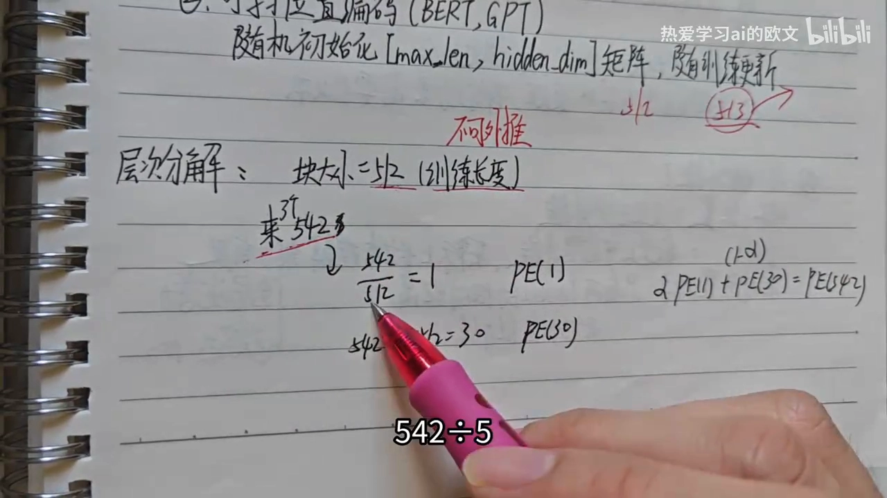
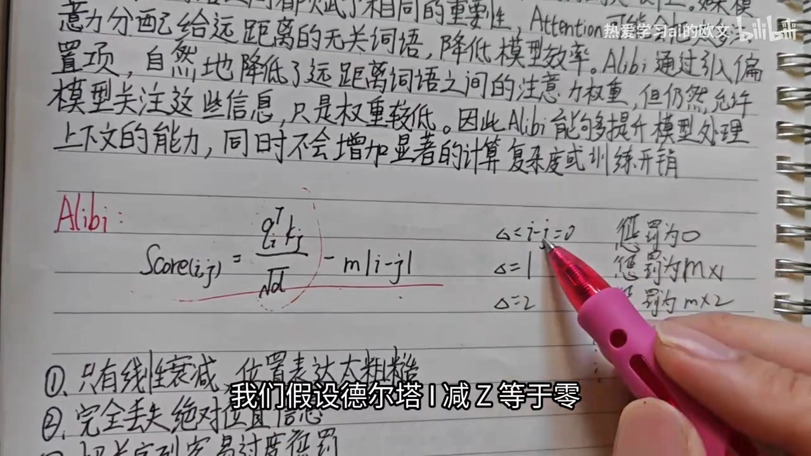
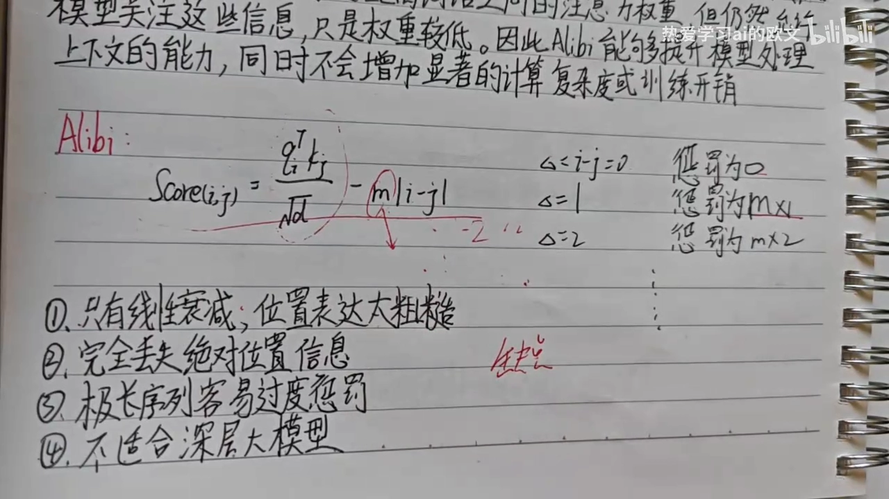

# 绝对位置编码缺距离，相对位置编码丢绝对：位置编码外推的两难

> 视频来源：[位置编码的局限](https://www.bilibili.com/video/BV1DmR1BJEsq/?t=0)（Bilibili · 热爱学习的欧文）
> 本文基于视频演说图文稿整理，配图截自视频。
> 导读：这支视频用手写笔记把绝对位置编码（正弦余弦、可学习）与相对位置编码（ALiBi）逐条过一遍，先讲清"位置外推"到底指什么、为什么截断和加长训练长度都替代不了它，再算清两条路线各自的坑，最后落到"为什么要换成 RoPE"。

## 本讲要解决的核心问题（SCQA）

**背景**：Transformer 的核心是自注意力（Self-Attention）。自注意力本身是个"集合运算"——把一句话里 token 的顺序打乱，算出来的注意力分数一模一样。所以模型必须额外被喂进"谁在第几位"的信息，这就是**位置编码**（Positional Encoding）。常见做法只有两大类：把位置塞进输入，或者改注意力分数的算法。

**冲突**：两类做法都留了洞。绝对位置编码把位置塞进输入，可训练时见过的最大长度只有 512 个 token，推理时来一篇超过 512 的文章怎么办？相对位置编码改注意力分数，外推是自由了，但它把"这是第几个 token"这层信息彻底扔掉。

**疑问**：这两条路的坑到底有多深？能不能只靠"截断到 512"或者"干脆把训练长度拉到 32K"绕过外推？

**回答（中心思想）**：**绝对位置编码丢的是距离，相对位置编码丢的是绝对**，两者单独用都不够。绝对位置编码里，正弦版本能按公式算出任意位置的向量、但长文本理解能力有限（注意力权重被 softmax 稀释成 $\frac{1}{L}$）；可学习版本连外推都做不到，层次分解只是勉强凑合、效果也差。纯相对位置编码（以 ALiBi 为例）外推自由，可是只有线性衰减、位置表达太粗糙、还丢了绝对信息。正因为一边丢距离、一边丢绝对，后面的 RoPE 才要把两边的长处合起来。

---

## 一、位置编码只有两条路：塞进输入，或者改注意力

视频一开篇就把两大类摆清楚 [【跳转到 00:00】](https://www.bilibili.com/video/BV1DmR1BJEsq/?t=0)：

- **绝对位置编码**：想办法把位置信息融入到输入中。也就是说，一个 token 的向量表示 = 词向量 + 位置向量，位置从一开始就跟着输入一起进模型。
- **相对位置编码**：不去动输入，而是想办法微调一下 Attention 的结构，使它有能力分辨不同位置的 token。

要理解这两条路的差别，先记住两个词。**token** 是模型处理文本的最小单位，一句话会被切成若干 token（比如"位置编码的局限"可能被切成"位置""编码""的""局限"四块）；**位置向量**则是每个位置的"身份证号"被编码成的一串数字，维度与词向量相同，可以直接相加。

### 1.1 绝对位置编码：位置是输入的一部分

视频举了两个绝对位置编码的代表 [【跳转到 00:30】](https://www.bilibili.com/video/BV1DmR1BJEsq/?t=30)：一个是 BERT 里那种**可学习的位置编码**（一张可以从训练中更新的参数表），另一个是《Attention is all you need》论文里用的**正弦余弦位置编码**。《Attention is all you need》就是提出 Transformer 的那篇原始论文，所以后者也叫 Transformer 原始位置编码。

一般认为绝对位置编码的缺点是**没有外推性**（extrapolation）：如果预训练的最大长度是 512，那么最多就只能处理长度为 512 的句子，再长就处理不了了。

那能不能把超长补上？视频提到一种补救思路：把超过 512 的位置向量**随机初始化**，然后继续微调。但随机初始化之后效果不太好 [【跳转到 00:55】](https://www.bilibili.com/video/BV1DmR1BJEsq/?t=55)。另外也有一些最近的研究表明，通过**层次分解**（hierarchical decomposition）的方式，可以让绝对位置编码外推到足够长的范围，同时保持还不错的效果——因此外推性并不是绝对位置编码最明显的缺点 [【跳转到 01:05】](https://www.bilibili.com/video/BV1DmR1BJEsq/?t=65)。这一点很关键：**绝对位置编码真正最致命的问题不是"不能外推"，而是下面这条**。

### 1.2 绝对位置编码最致命的坑：位置算得太"平"，模型看不见自己身边

视频把它记在笔记的第二条：**长文本理解能力有限**（设 token 数量为 $L$）[【跳转到 02:14】](https://www.bilibili.com/video/BV1DmR1BJEsq/?t=134)。当序列越来越长的时候，softmax 会平均地把注意力稀释掉，单个 token 的权重都会变成 $\frac{1}{L}$，这意味着模型根本没办法区分重要和不重要的信息。

这里的机制值得展开一句。注意力分数经过 softmax 之后，一行权重要加和为 1；序列有 $L$ 个 token，那么"平均分"就是每人 $\frac{1}{L}$。$L$ 从 512 涨到 32K，$\frac{1}{L}$ 就从约 $2\times10^{-3}$ 掉到约 $3\times10^{-5}$。如果位置编码给出的位置信号是平铺的，序列一长，模型就会给每个位置的 token 分配差不多的权重；可按理说，一个 token 更应该关注自己附近的 token。

所以视频的结论是：**这种平铺的绝对位置编码，导致长文本经过 softmax 之后都被抹平了，模型不能注意到自己附近的 token**。画面上的红笔批注写得更直白："这锅是 softmax 的，全抹平了"[【跳转到 02:39】](https://www.bilibili.com/video/BV1DmR1BJEsq/?t=159)。

视频对这两个坑的定级很清楚：**这才是绝对位置编码最大的一个坑；没有外推性也是个坑，但这个坑还小一点。这两个坑我们都要解决。**

### 1.3 相对位置编码：不动输入，只动注意力分数

相对位置编码的定义，笔记上写得很完整 [【跳转到 03:08】](https://www.bilibili.com/video/BV1DmR1BJEsq/?t=188)：**把本来依赖于二元坐标 $(i, j)$ 的位置向量，改为只依赖于相对距离 $i-j$，并且通常会进行截断，以适应不同的、任意的距离。**

这里的 $(i, j)$ 要拆开看：$i$ 是"第几个 token"，$j$ 是"这个 token 的第几个维度"。绝对位置编码要指定"第 3 个 token 的第 7 维"，就必须同时知道 $i$ 和 $j$；相对位置编码只想知道**两个 token 隔多远**，也就是 $i-j$（更准确地说，是 query 位置 $i$ 与 key 位置 $j$ 的差），不再关心它是句子的第 3 个还是第 3000 个。

截断（clipping）的意思是给距离封顶：距离超过某个阈值就按阈值算。截断之后，尽管相对距离 $i-j$ 会随序列长度增长而增大，但通过极端值的截断操作，模型只需要学习并处理有限范围内的相对位置编码，从而避免了处理非常大或非常小的相对距离带来的复杂度 [【跳转到 03:16】](https://www.bilibili.com/video/BV1DmR1BJEsq/?t=196)。

在使用方式上，相对位置编码与绝对位置编码最大的差别是**加在哪一步**[【跳转到 03:55】](https://www.bilibili.com/video/BV1DmR1BJEsq/?t=235)：

- 绝对位置编码：在最开始、输入层就把位置向量加到词向量上；
- 相对位置编码：最开始什么都不加，只在**注意力分数**上改动——给分数加上（或减去）两个 token 之间的距离。

具体效果视频用一句话讲透了 [【跳转到 04:19】](https://www.bilibili.com/video/BV1DmR1BJEsq/?t=259)：假设两个 token 离得很近，$i-j$ 就比较小，减掉之后注意力权重反而比较大；假设它们离得非常远，比如一行里的最后一个，绝对值就非常大，注意力分数减去这个非常大的数就变得非常小，代表这两个 token 关系比较远。也就是说，**距离成了分数的直接修正项，远处的 token 被天然地压低**。

---

## 二、先算外推这笔账：训练只见过 512，推理就只能截断吗

### 2.1 定义：训练时只见过 512，推理时能不能不截断

笔记上的定义分三行，正好是"正常情况 / 没有外推 / 有外推"[【跳转到 05:29】](https://www.bilibili.com/video/BV1DmR1BJEsq/?t=329)：

1. **正常情况**：模型训练时用的句子最大长度是 512，而且用的是可学习位置编码（这属于绝对位置编码）。
2. **没有外推时**：推理时输入的文本长度超过了 512 个 token，比如输入了一整篇文章，模型只能处理 512 个——那只好把前面那些 token 全都截掉，只保留最后 512 个 token。这就是传统做法。
3. **有外推时**：不用截断，可以直接处理更长的文本，推理能到 1024、到 4096、到 32K，甚至可以到 100 万 token；而训练时只需要用短的训练长度，推理时仍然保证效果不会崩坏 [【跳转到 06:10】](https://www.bilibili.com/video/BV1DmR1BJEsq/?t=370)。

一句话概括：**外推 = 训练用短序列，推理能拉长，而且效果不崩。**

### 2.2 为什么不能靠"截断"绕过去

视频自己先把这个问题提出来：截断不好吗？为什么非得要外推 [【跳转到 06:39】](https://www.bilibili.com/video/BV1DmR1BJEsq/?t=399)。答案是三条，其中前两条其实是同一个意思：

- **长文本信息丢弃**：截断就把长文本前面的信息全丢了；
- **很多任务不能截断**：有些任务必须综合前面的信息才能回答；
- **现实中大量文本天生就超过 512 / 1024 / 4096**：即便模型训练长度是 4096，现实中很多文本也超过 4096——比如要一次送进去好几个 PPT，那就超了 [【跳转到 07:14】](https://www.bilibili.com/video/BV1DmR1BJEsq/?t=434)。

所以视频的态度很强硬：**不能截断，截断效果非常非常不好，我们不要截断。**

### 2.3 为什么也不能靠"把训练长度拉长"绕过去

那直接把训练长度增加不就行了？加到 2048、4096、32K（32K 就是 32 × 1024，三万多）——数学上当然可以 [【跳转到 07:38】](https://www.bilibili.com/video/BV1DmR1BJEsq/?t=458)。但视频给了三条成本论证 [【跳转到 08:11】](https://www.bilibili.com/video/BV1DmR1BJEsq/?t=491)：

1. **时间复杂度不划算**：自注意力对序列长度是平方级增长，笔记写的是 $O(n^2 d)$（口语里常说成 $O(n^2)$）。强行拉长训练长度，成本完全划不来 [【跳转到 08:06】](https://www.bilibili.com/video/BV1DmR1BJEsq/?t=486)。序列长度翻倍，注意力那部分的计算量就要翻四倍。
2. **训练更难**：训练长度更长，收敛也更难，非常容易过拟合。
3. **大部分场景用不上**：大部分日常句子很短，只有部分场景需要长文本；盲目增加长度，成本非常高，也不太好。

由上面这两点就能推断出来 [【跳转到 08:43】](https://www.bilibili.com/video/BV1DmR1BJEsq/?t=523)：**位置编码外推是必须的，不能单纯靠增加训练长度来实现。数学上能实现，但实际功能上绝对不行。**

---

## 三、正弦位置编码：能算到任意位置，但位置算得太"平"

### 3.1 公式：一串不用训练、直接硬算出来的三角函数

这是 Transformer 原始论文里的位置编码 [【跳转到 09:06】](https://www.bilibili.com/video/BV1DmR1BJEsq/?t=546)。给定 token 的绝对位置 $pos$ 和维度索引 $i$：

$$
PE(pos, 2i) = \sin\left(\frac{pos}{10000^{2i/d_{model}}}\right)
$$

$$
PE(pos, 2i+1) = \cos\left(\frac{pos}{10000^{2i/d_{model}}}\right)
$$

三个符号的含义是 [【跳转到 09:29】](https://www.bilibili.com/video/BV1DmR1BJEsq/?t=569)：

| 符号 | 含义 |
| --- | --- |
| $pos$ | 当前 token 在句子里的绝对位置编号（第几个 token） |
| $d_{model}$ | 模型隐藏层的维度，也就是位置向量的总维数 |
| $i$ | 维度组的索引，$2i$ 与 $2i+1$ 是成对的两个维度 |

视频强调：这个位置编码**不需要任何参数，也不需要任何训练参数**，完全按公式硬算 [【跳转到 09:58】](https://www.bilibili.com/video/BV1DmR1BJEsq/?t=598)。

以 0 号 token（$pos=0$）为例，逐维代进去就明白了 [【跳转到 09:43】](https://www.bilibili.com/video/BV1DmR1BJEsq/?t=583)：$PE(0, 0) = \sin(0) = 0$；$PE(0, 1) = \cos(0) = 1$；$PE(0, 2)$ 又是 $\sin(0) = 0$；$PE(0, 3)$ 又是 $\cos(0) = 1$。每个 token 的每个维度都能这样算出来一个确定的值。

### 3.2 为什么两个式子都写 $2i$，而不是 $2i+1$

视频在这里专门解释了一个容易被问倒的细节：为什么两个式子的分母都固定写 $2i$？按理说第二个写成 $2i+1$ 不是更自然吗 [【跳转到 11:22】](https://www.bilibili.com/video/BV1DmR1BJEsq/?t=682)。

答案是：**固定 $2i$ 是为了保证同一组正余弦同频率、只差一个固定相位** [【跳转到 11:32】](https://www.bilibili.com/video/BV1DmR1BJEsq/?t=692)。它本质上把 embedding 的维度**两两分组**，每组共用一个频率，因为正弦位置编码表示的就是周期性信息 [【跳转到 11:38】](https://www.bilibili.com/video/BV1DmR1BJEsq/?t=698)。如果两个式子的指数写得不一样，这两维的频率就完全不一样了，同一组内也就导不出一个干净的周期性来 [【跳转到 12:01】](https://www.bilibili.com/video/BV1DmR1BJEsq/?t=721)。

换个说法：位置编码的每一对维度，就是一对同频率的正弦、余弦波——像钟表的时针和分针，同频率、相位差固定，合起来才能标定一个位置。低维的波周期短、变化快（负责细粒度），高维的波周期长、变化慢（负责粗粒度）。

### 3.3 它其实可以外推，但长文本理解能力拖住了它

正弦位置编码的好处是**可以外推** [【跳转到 10:38】](https://www.bilibili.com/video/BV1DmR1BJEsq/?t=638)：因为它不需要任何训练参数，推理时 token 超过训练长度，也可以照这个规律算出它的位置编码——公式里 $pos$ 只是代入的变量，"第 8000 个位置"照样有解 [【跳转到 10:52】](https://www.bilibili.com/video/BV1DmR1BJEsq/?t=652)。

但视频立刻补了一句转折 [【跳转到 11:05】](https://www.bilibili.com/video/BV1DmR1BJEsq/?t=665)：**它确实可以外推，可另一个坑是长文本理解能力不足，而那是最大的坑。所以它虽然可以外推，我们现在也不采用了。**

为什么"能外推"还不管用？回到 1.2 节那条：位置信号是平铺的，序列一长，softmax 把注意力抹平，每个 token 的权重都趋近 $\frac{1}{L}$。公式能算出第 10000 个位置的向量，不代表模型能用好它——**能算出来 ≠ 能理解**。

---

## 四、可学习位置编码：一旦变成参数，就彻底不能外推

### 4.1 一张 max_len × hidden_dim 的表

BERT 和 GPT 系列用的是另一种绝对位置编码 [【跳转到 12:06】](https://www.bilibili.com/video/BV1DmR1BJEsq/?t=726)：它是一张**随机初始化的 $\text{max\_len} \times \text{hidden\_dim}$ 矩阵**，行数等于支持的最大长度，列数等于隐藏层维度；每一行就是一个位置的向量，训练时随梯度一起更新 [【跳转到 12:22】](https://www.bilibili.com/video/BV1DmR1BJEsq/?t=742)。

它的问题是**完全不能外推**，而且是字面意义上的不能：假设只有 512 个位置向量，第 513 个 token 要用的那一行参数**根本不存在**——没有值可以查。正弦编码缺的是"训练没教过"，可学习编码缺的是"根本没有这一行"。

### 4.2 层次分解：用"块号 + 块内偏移"凑一个位置

为了对付这个问题，人们搞出了一个**层次分解**的方法 [【跳转到 12:53】](https://www.bilibili.com/video/BV1DmR1BJEsq/?t=773)。视频对这方法的评价是"可以了解，但用处也不是很大"。

做法如下 [【跳转到 13:03】](https://www.bilibili.com/video/BV1DmR1BJEsq/?t=783)：设块大小等于训练长度 512。现在来了一个 542 个 token 的推理长度，第 542 个 token 的位置向量怎么算？

1. 先做整除：$542 \div 512 = 1$，把第 1 个位置向量 $PE(1)$ 取出来 [【跳转到 13:19】](https://www.bilibili.com/video/BV1DmR1BJEsq/?t=799)；
2. 再取余数：$542 - 1 \times 512 = 30$，把 $PE(30)$ 取出来；
3. 把两者做一个**加权组合**来表示第 542 个位置，即用 $PE(1)$ 与 $PE(30)$ 按权重 $\alpha$ 与 $1-\alpha$ 混合（画面上就标注了这两个系数）[【跳转到 13:29】](https://www.bilibili.com/video/BV1DmR1BJEsq/?t=809)。

这背后的默认假设是：**未来的位置向量和前面的位置向量有一定的周期性重复关系**，所以往下重复着用就行。视频的评价也很直接 [【跳转到 13:54】](https://www.bilibili.com/video/BV1DmR1BJEsq/?t=834)：这种位置编码太粗糙了，效果也比较差。

---

## 五、算总账：绝对位置编码要么不能外推，要么外推了也不懂长文

到这里可以给绝对位置编码结账了。视频在笔记上写下一条三行的对比 [【跳转到 14:29】](https://www.bilibili.com/video/BV1DmR1BJEsq/?t=869)：

| 方案 | 能否外推 | 真正的问题 |
| --- | --- | --- |
| 可学习位置编码（BERT、GPT） | 完全无法外推 | 超出 max_len 的位置没有参数可查；层次分解只是粗糙凑合 |
| 正弦余弦位置编码（原始 Transformer） | 数学上可无限外推 | 长文本理解能力有限，权重被 softmax 抹平 |
| 相对位置编码（以 ALiBi 为代表） | 天然可以外推 | 丢失绝对位置信息，位置表达太粗糙 |

视频在这里还专门纠正了自己笔记上的一个措辞 [【跳转到 14:34】](https://www.bilibili.com/video/BV1DmR1BJEsq/?t=874)：长文本理解能力有限其实是**两个问题**导致的——一个是全局注意力，一个是位置编码。原来写的是"正弦位置编码"，讲着讲着改口：这样写不太好，这里应该写**绝对位置编码**，并不一定都是正弦的错。

而更狠的一句是 [【跳转到 14:59】](https://www.bilibili.com/video/BV1DmR1BJEsq/?t=899)：**绝对位置编码是这个"根"，是长文本理解能力差的根。所以今天还是不要采用绝对位置编码。** 改当然也可以从注意力那边改，但主要还是要改绝对位置编码，因此一般采用相对位置编码。

---

## 六、相对位置编码落地成 ALiBi：用一条线性惩罚换外推

### 6.1 做法：在注意力分数上减掉 $m\lvert i-j \rvert$

ALiBi（Attention with Linear Biases）的关键，是在注意力计算中为不同位置的 query 和 key 添加一个**位置偏置项**，这个偏置项按 token 之间的相对距离计算 [【跳转到 16:52】](https://www.bilibili.com/video/BV1DmR1BJEsq/?t=1012)：距离越远，惩罚越大，从而减少远距离 token 之间的相互影响 [【跳转到 17:07】](https://www.bilibili.com/video/BV1DmR1BJEsq/?t=1027)。

公式只有一行，就是在缩放点积分数后面减掉一个线性惩罚 [【跳转到 17:48】](https://www.bilibili.com/video/BV1DmR1BJEsq/?t=1068)：

$$
\text{Score}(i,j) = \frac{q_i^{\top} k_j}{\sqrt{d}} - m \, \lvert i - j \rvert
$$

其中 $q_i$ 是第 $i$ 个位置的 query 向量，$k_j$ 是第 $j$ 个位置的 key 向量，$d$ 是每个头的维度，$m$ 是一个固定的斜率常数（也是整个位置编码唯一的可调参数）。$\lvert i-j \rvert$ 就是两个 token 的距离。

视频用三个距离把效果摆出来 [【跳转到 17:58】](https://www.bilibili.com/video/BV1DmR1BJEsq/?t=1078)：

| 距离 $\delta = \lvert i-j \rvert$ | 含义 | 惩罚项 |
| --- | --- | --- |
| 0 | 自己关注自己 | 0 |
| 1 | 关注隔壁 token | $m$ |
| 2 | 隔一个 token | $2m$ |

**隔得越远减得越多，模型就天然更关注离自己更近的 token。** 这也顺手补上了绝对位置编码"看不见邻居"的那个坑——注意力的形状不再是被 softmax 摊平的一张白纸，而是自带了一个以自己为中心、向外衰减的坡度。

### 6.2 为什么这东西对长文本有效

视频大段引述了 ALiBi 的立论 [【跳转到 17:18】](https://www.bilibili.com/video/BV1DmR1BJEsq/?t=1038)，逻辑链条很干净：

1. 在长文本中，远距离的词语之间通常存在较弱的关联性；
2. 如果模型对所有词语之间都赋予相同的重要性，注意力可能把太多注意力分配给远距离的无关词语，降低模型性能；
3. ALiBi 通过引入偏置项，自然地降低了远距离词语之间的注意力权重，但仍然允许模型关注这些信息，只是权重较低；
4. 因此 ALiBi 能提升模型处理长文本的能力，同时不会显著增加计算开销和训练开销。

第 4 点是它最大的卖点：**位置信息变成了分数上的一个减法，不需要在输入里存任何位置向量，因此推理长度可以一直往上加，不存在"没有第 513 行参数"的问题。**

### 6.3 那为什么今天都用 RoPE 而不是 ALiBi：四个缺点

视频把 ALiBi 的缺点列成四条 [【跳转到 18:28】](https://www.bilibili.com/video/BV1DmR1BJEsq/?t=1108)：

1. **只有线性衰减，位置表达太粗糙**。整个位置编码唯一的可调参数只有 $m$，别的什么都没有 [【跳转到 18:47】](https://www.bilibili.com/video/BV1DmR1BJEsq/?t=1127)——距离 100 和距离 101 之间只差一个 $m$，模型没法表达"这两个距离其实很不一样"。
2. **完全丢失了绝对位置信息**。这正是 1.3 节那个设计的副作用：只看 $i-j$，就不知道自己是第几个 token。
3. **极长序列里惩罚项太高**。距离到几万时，$m\lvert i-j\rvert$ 这个减数会大到把分数压没，容易过度惩罚。
4. **不适合深层大模型** [【跳转到 18:33】](https://www.bilibili.com/video/BV1DmR1BJEsq/?t=1113)。

于是这里出现了一个漂亮的两难：**绝对位置编码丢距离（长文本里看不见邻居），相对位置编码丢绝对（不知道自己在第几位）。** 视频的收尾就是这条推断线 [【跳转到 18:57】](https://www.bilibili.com/video/BV1DmR1BJEsq/?t=1137)：

- 正弦位置编码虽然可以外推，但外推长了之后长文本理解能力很有限，这就限制了它不能处理太长的文本；
- 可学习位置编码完全不能外推，虽然有层次分解的方法，但还是不行，效果也不好，同样无法理解长文本；
- 纯的相对位置编码比绝对位置编码好在完全可以外推 [【跳转到 19:27】](https://www.bilibili.com/video/BV1DmR1BJEsq/?t=1167)，但它又感觉完全丢弃了绝对位置信息，"好像也差点意思"。

因此要**综合考虑这两种方法的优点**——这就是现在大模型里最常采用的 **RoPE**（旋转位置编码）[【跳转到 19:38】](https://www.bilibili.com/video/BV1DmR1BJEsq/?t=1178)。视频最后留了一句预告：下节课介绍什么叫 RoPE、它解决了什么样的问题 [【跳转到 19:56】](https://www.bilibili.com/video/BV1DmR1BJEsq/?t=1196)。

---

## 小结

- **位置编码只有两条路**：绝对位置编码把位置加进输入；相对位置编码不动输入，只在注意力分数上加距离。
- **绝对位置编码有两个坑**，且视频明确排序：长文本理解能力有限是最大的坑（softmax 把权重摊平成 $\frac{1}{L}$，模型看不见附近的 token），外推性只是小一点的坑。
- **外推 = 训短推长且效果不崩**。截断会丢前文信息、且很多任务不允许截断；直接拉长训练长度又受 $O(n^2 d)$ 成本、收敛难度和日常短句为主的现实三重限制，所以外推是必须的。
- **正弦位置编码能外推但不管用**：它无参数、按公式硬算，任意 $pos$ 都有解；但位置信号平铺，长文本里仍会被 softmax 抹平。固定写 $2i$ 是为了让成对的正余弦同频率、只差固定相位。
- **可学习位置编码完全不能外推**：$\text{max\_len} \times \text{hidden\_dim}$ 矩阵里没有第 513 行参数；层次分解用"块号 + 块内偏移"加权凑位置，太粗糙、效果差。
- **纯相对位置编码（ALiBi）外推自由但丢绝对**：$\text{Score}(i,j) = \frac{q_i^{\top}k_j}{\sqrt{d}} - m\lvert i-j\rvert$，距离越远惩罚越大，天然偏向近邻；代价是只有线性衰减、位置表达粗糙、丢失绝对位置、极长序列过度惩罚、不适合深层大模型。
- **结论**：一边丢距离、一边丢绝对，所以才需要把两边优点合起来的 RoPE。

## 关键术语速查

| 术语 | 一句话解释 |
| --- | --- |
| 位置编码（Positional Encoding） | 给自注意力补上"谁在第几位"的信息，否则打乱词序结果不变 |
| 绝对位置编码（Absolute PE） | 把位置向量直接加到输入的词向量上，位置信息随输入一起进模型 |
| 相对位置编码（Relative PE） | 不改进输入，只在注意力分数上按两个 token 的相对距离做修正 |
| 外推（Extrapolation） | 用较短的序列训练，推理时能处理更长的序列且效果不崩坏 |
| 截断（Truncation） | 输入超过最大长度时只保留最后若干 token 的兜底做法，会丢前文信息 |
| 正弦余弦位置编码（Sinusoidal PE） | 原始 Transformer 的无参数方案，按 $pos$ 与维度索引直接算出正余弦值 |
| 可学习位置编码（Learned PE） | BERT、GPT 用的参数表，形状为 max_len × hidden_dim，随训练更新 |
| 层次分解（Hierarchical Decomposition） | 用"块号 + 块内偏移"两个已学位置向量的加权组合，近似表示超长位置 |
| ALiBi | 在注意力分数上减去 $m\lvert i-j\rvert$ 的相对位置方案，外推自由但表达粗糙 |
| RoPE（旋转位置编码） | 同时保留绝对与相对信息的位置编码方案，当下大模型的主流选择 |
