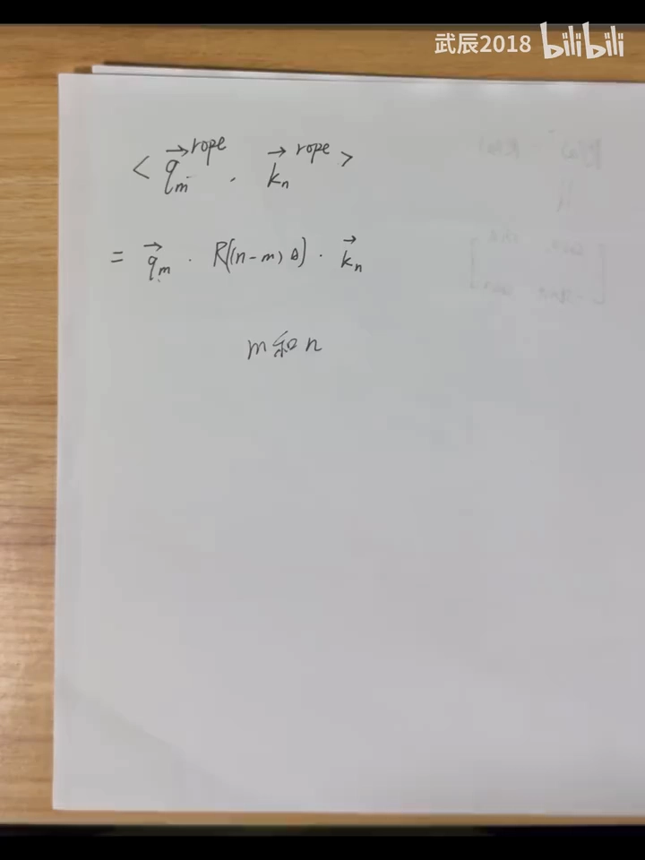
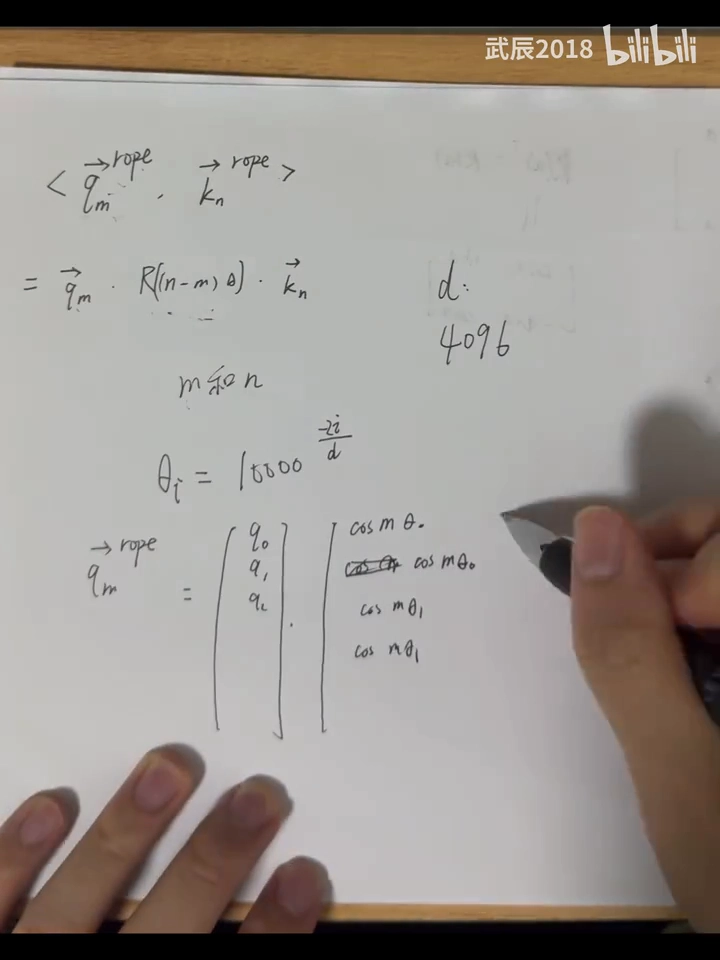
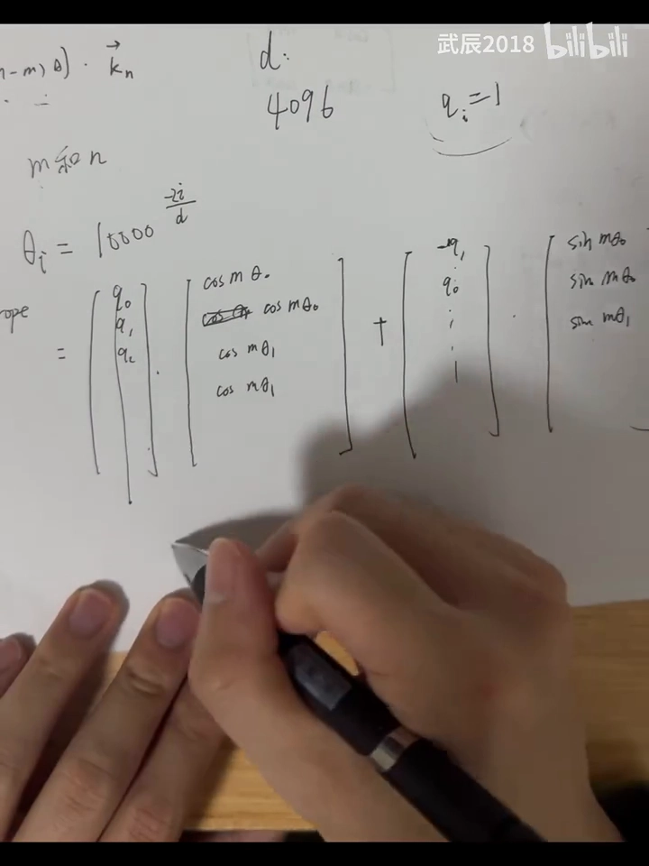
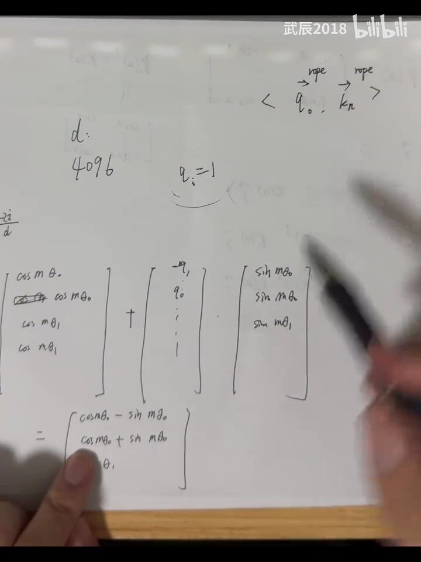
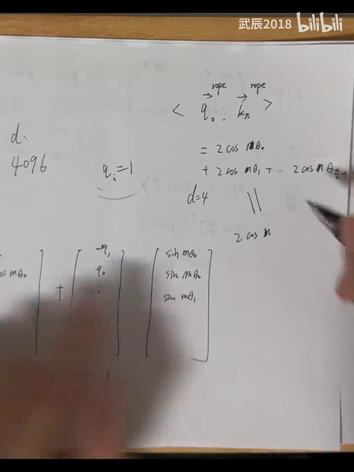
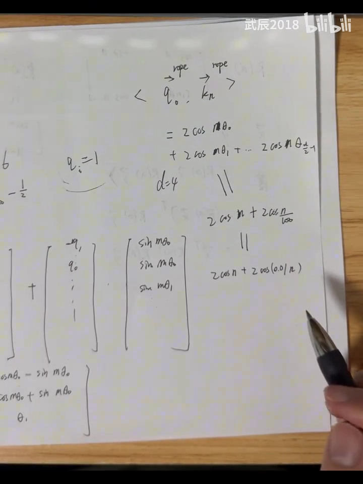
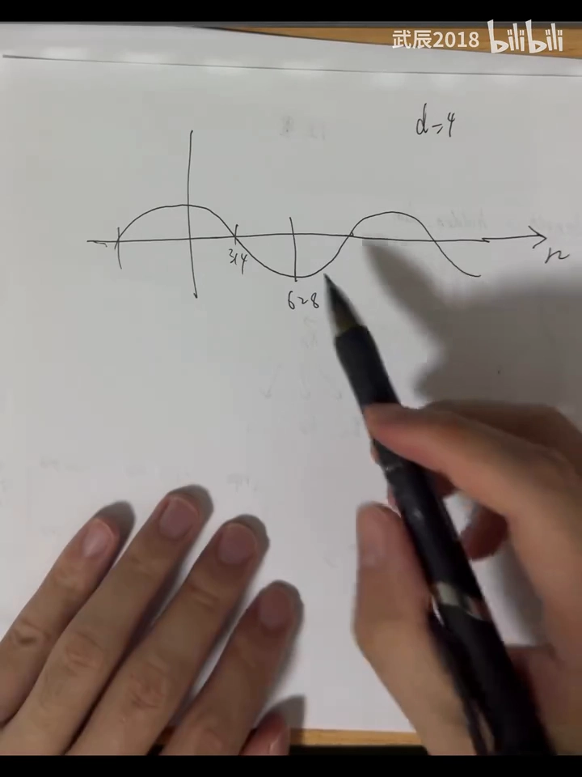
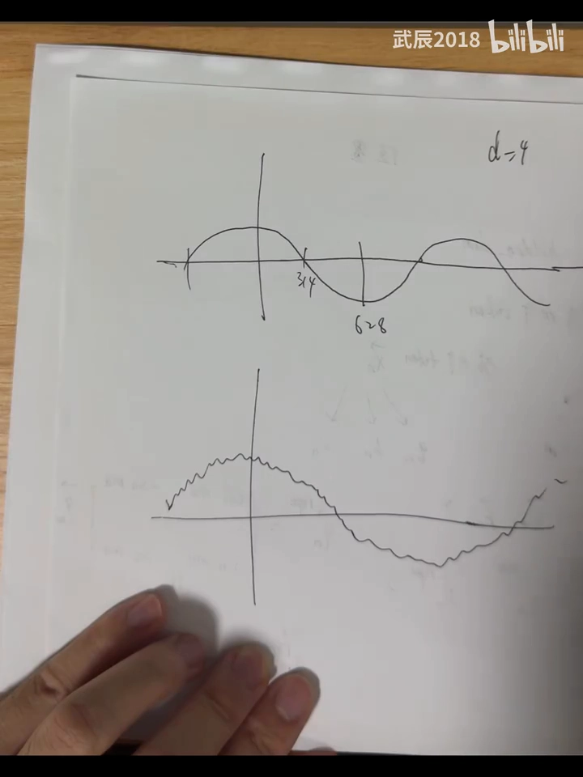
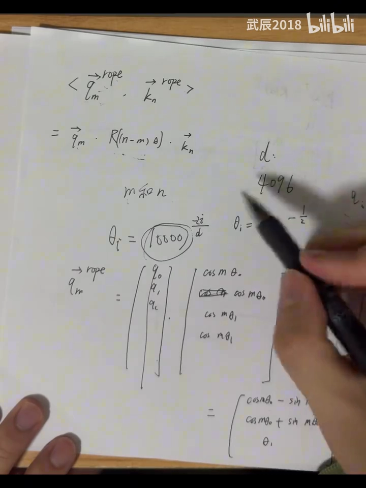

# q 和 k 全取 1，内积变成一串 cos：RoPE 的远程衰减与底数的作用

> 视频来源：[旋转位置编码为什么有远程衰减性](https://www.bilibili.com/video/BV1iuoYYNEcZ/?t=0)（Bilibili · 武辰）
> 本文基于视频演说图文稿整理，配图截自视频。
> 导读：这支视频只用一张白纸和一支笔，做了两个"大胆但合法"的假设——所有 $q$ 取 $1$、维度缩到 $4$——就把 RoPE 的注意力内积化简成一串 $\cos$ 相加，然后靠手画曲线看清"远程衰减"到底长什么样、为什么会衰减、底数（base）又在其中调什么。本文按视频顺序复现这条路径；严格的"上界而非等式"证明在系列另一篇《衰减是上界不是等式》里，这里只做直观推导。

## 本讲要解决的核心问题（SCQA）

**背景**：旋转位置编码（RoPE，Rotary Position Embedding）做的事情是"把位置变成旋转角度"：第 $m$ 个位置的 query 向量整体转 $m\theta$，第 $n$ 个位置的 key 向量整体转 $n\theta$。上一个视频已经推出一个关键结论——旋转之后 $q_m$ 与 $k_n$ 的内积，只通过 $(n-m)\theta$ 依赖位置：绝对位置被抵消，剩下的只有"两个 token 隔多远"。

**冲突**：可"只跟间隔有关"这句话还不够用。间隔变大时，这个内积是变大、变小，还是原地打转？如果它随距离上下震荡、并不缩小，那我们就没有理由说 RoPE 会"自动偏爱近处"。而上一支视频恰恰只讲了内积与 $n-m$ 有关，没讲这个关系的方向与形状。

**疑问**：旋转之后，两个 token 的注意力分数究竟随距离怎么变？变化幅度有多大？又由哪些参数决定？

**回答（中心思想）**：**把所有 $q$ 都取 $1$ 之后，内积退化成一串 $\cos$ 的和** $\sum_i 2\cos\!\big((n-m)\theta_i\big)$：近距离时各频段相位接近、同相叠加；距离拉远后，不同频率先后"转完一圈"，互相抵消，于是整体递减——这就是远程衰减（long-term decay）。能衰减到多远、以及衰减得有多慢，由维度 $d$ 与旋转频率的底数 $b$ 共同决定：**底数越大，每个频率转得越慢，有效范围越远**。

---

## 一、先把问题问对：远程衰减到底在说什么

视频一上来先把这个特性的名字点出来：旋转位置编码有一个很重要的性质，叫做**远程衰减性**（long-term decay）[【跳转到 00:05】](https://www.bilibili.com/video/BV1iuoYYNEcZ/?t=5)。

它指的是很朴素的一件事。设第 $m$ 个 token 提供 query、第 $n$ 个 token 提供 key：

- 如果这两个 token 隔得比较近，它们之间的注意力分数应该比较高；
- 如果隔得比较远，注意力分数应该比较低。

这件事"符合直觉" [【跳转到 00:28】](https://www.bilibili.com/video/BV1iuoYYNEcZ/?t=28)。视频举的例子很具体：一段很长的话里，第一百个字和第一百零一个字之间紧密性很强，它们甚至可能组成同一个词语；但第一个字和第一万个字，可能就没有太多关联了 [【跳转到 00:33】](https://www.bilibili.com/video/BV1iuoYYNEcZ/?t=33)。

这里先解释两个词，后面会一直用到。**token** 是模型处理文本的最小单位，一句话会被切成若干 token，位置编号就是"它是第几个"。**注意力分数**（attention score）是 query 与 key 的内积再除以 $\sqrt{d}$：内积越大，说明这两个 token 越"对得上"，softmax 之后分到的权重就越大。所以"远程衰减"说的其实是：**距离越大，内积越小，模型自然把注意力倾向近处**。

上一支视频给出的结论是，经过 RoPE 之后

$$
\langle q_m^{\text{rope}},\, k_n^{\text{rope}} \rangle = q_m^{\top} R\big((n-m)\theta\big)\, k_n
$$

也就是说，内积确实和 $n-m$ 有关系 [【跳转到 01:01】](https://www.bilibili.com/video/BV1iuoYYNEcZ/?t=61)。但视频作者很坦白地补了一句：**它到底是正相关、反相关还是别的什么关系，上次没讲清楚** [【跳转到 01:06】](https://www.bilibili.com/video/BV1iuoYYNEcZ/?t=66)。这就是本讲要补的那一段。

---

## 二、$q$、$k$ 全取 1：一个大胆但合法的假设

要看清趋势，先把公式写出来。视频回到最常用的频率定义：在 RoFormer 原始论文里，第 $i$ 对的旋转频率是

$$
\theta_i = 10000^{-\frac{2i}{d}}, \qquad i = 0, 1, \dots, \frac{d}{2}-1
$$

其中 $d$ 是 **head dimension**，即单个注意力头里 query／key 向量的维度；再乘以头数就是模型的隐藏维度 [【跳转到 00:41】](https://www.bilibili.com/video/BV1iuoYYNEcZ/?t=41)。画面里把它写成 $d = 4096$ 来举例 [【跳转到 02:09】](https://www.bilibili.com/video/BV1iuoYYNEcZ/?t=129)——真实模型里这个数字随规模与切头方式变化，但 4096 这个量级足够用来做推理。

于是第 $m$ 个位置的旋转结果可以写成很紧凑的"两项相加"形式：

$$
q_m^{\text{rope}} =
\begin{pmatrix} q_0 \\ q_1 \\ q_2 \\ q_3 \\ \vdots \end{pmatrix}
\odot
\begin{pmatrix} \cos m\theta_0 \\ \cos m\theta_0 \\ \cos m\theta_1 \\ \cos m\theta_1 \\ \vdots \end{pmatrix}
+
\begin{pmatrix} -q_1 \\ q_0 \\ -q_3 \\ q_2 \\ \vdots \end{pmatrix}
\odot
\begin{pmatrix} \sin m\theta_0 \\ \sin m\theta_0 \\ \sin m\theta_1 \\ \sin m\theta_1 \\ \vdots \end{pmatrix}
$$

第一项是"原向量逐元素乘 $\cos$"，第二项是"把每一对里的两个分量换个位置、其中一个取负，再逐元素乘 $\sin$"。$k_n$ 完全同理，只是把 $m$ 换成 $n$ [【跳转到 02:14】](https://www.bilibili.com/video/BV1iuoYYNEcZ/?t=134)。视频作者自己也说，网上那个"q0、q1、q2 配一堆 cos、sin"的大矩阵看起来很吓人，但只要做过一次推理就能推出来 [【跳转到 03:16】](https://www.bilibili.com/video/BV1iuoYYNEcZ/?t=196)。

接下来是本讲最关键的一步：**做一个很大胆的假设，假设所有的 $q$ 都取 $1$** [【跳转到 03:36】](https://www.bilibili.com/video/BV1iuoYYNEcZ/?t=216)。

为什么说它"大胆但合法"？大胆，是因为真实的 $q$ 是模型学出来的向量，各分量大小、正负都不一样；取全 $1$ 显然不是真实情况。合法，是因为**这一步只是为了看趋势**：视频讲得很清楚，"这是一个很大胆的假设，但不妨碍我们去直观地理解" [【跳转到 03:55】](https://www.bilibili.com/video/BV1iuoYYNEcZ/?t=235)。全 $1$ 之后，第二项里的 $-q_1$、$-q_3$ 就变成负一，剩下的只有 $\cos$ 与 $\sin$ 两个序列。

---

## 三、代入之后，内积真的变成了一串 cos

全取 $1$ 之后，每一对分量（第 $i$ 对，频率 $\theta_i$）在位置 $m$ 上变成

$$
\big(\cos m\theta_i - \sin m\theta_i,\; \cos m\theta_i + \sin m\theta_i\big)
$$

第 $n$ 个位置的 key 也一样，只是 $m$ 换成 $n$。视频把这两列写在一起看：第一列是"$\cos$ 减 $\sin$"，第二列是"$\cos$ 加 $\sin$"，后面的每一对只是把 $\theta_0$ 换成 $\theta_1$、$\theta_2$…… [【跳转到 04:22】](https://www.bilibili.com/video/BV1iuoYYNEcZ/?t=262)

再往下一步，视频做了第二个简化：**只算第 $0$ 个 query 和第 $n$ 个 key 的内积** [【跳转到 04:52】](https://www.bilibili.com/video/BV1iuoYYNEcZ/?t=292)。为什么可以这样？因为把 $m=0$ 代进去，$\sin 0 = 0$、$\cos 0 = 1$，第 $0$ 个位置的 $q$ 就退化成一个"全是 1"的向量 [【跳转到 05:21】](https://www.bilibili.com/video/BV1iuoYYNEcZ/?t=321)。于是内积里 query 那一侧不用再管，只需要看 key 的每个分量。

把每一对的贡献算出来，是一个非常干净的恒等式。记 $c_m = \cos m\theta$、$s_m = \sin m\theta$，一对分量的内积是

$$
(c_m - s_m)(c_n - s_n) + (c_m + s_m)(c_n + s_n) = 2\,(c_m c_n + s_m s_n) = 2\cos\big((m-n)\theta\big)
$$

于是整条向量的内积就是所有对的和：

$$
\langle q_0^{\text{rope}},\, k_n^{\text{rope}} \rangle = \sum_{i=0}^{\frac{d}{2}-1} 2\cos\big(n\theta_i\big)
$$

这正是视频在白纸上写下的那行：两倍的 $\cos n\theta_0$，加两倍的 $\cos n\theta_1$，一直加到两倍的 $\cos n\theta_{\frac{d}{2}-1}$ [【跳转到 05:38】](https://www.bilibili.com/video/BV1iuoYYNEcZ/?t=338)。注意最后的角标是 $\frac{d}{2}-1$：$d$ 维向量被切成 $\frac{d}{2}$ 对，每对共用一个频率。

一个值得记住的中间结论在这里已经出现了：**每个频率对距离的贡献都是 $2\cos$ 的形状**，也就是说它天生是周期函数——不会单调下降。远程衰减只能来自"很多个不同周期的 $\cos$ 叠在一起"这件事本身。

---

## 四、把 $d$ 缩成 4，就能亲眼看见"周期"

公式看着还是抽象，视频于是又做了一个"不大胆"的假设：**令 $d = 4$** [【跳转到 06:19】](https://www.bilibili.com/video/BV1iuoYYNEcZ/?t=379)。真实模型里 $d$ 可能是 4096 这个量级，但先看最小的例子，规律才看得清。

$d = 4$ 意味着只有两对分量，$\theta_0$ 与 $\theta_1$：

$$
\theta_0 = 10000^{0} = 1, \qquad \theta_1 = 10000^{-\frac{1}{2}} = \frac{1}{100} = 0.01
$$

[【跳转到 07:02】](https://www.bilibili.com/video/BV1iuoYYNEcZ/?t=422)

代进去，内积就是两个 $\cos$ 相加：

$$
\langle q_0^{\text{rope}},\, k_n^{\text{rope}} \rangle = 2\cos n + 2\cos(0.01n)
$$

[【跳转到 07:39】](https://www.bilibili.com/video/BV1iuoYYNEcZ/?t=459)

这两个 $\cos$ 的"快慢"相差一百倍。第二项 $2\cos(0.01n)$ 的周期是

$$
\frac{2\pi}{0.01} = 628
$$

也就是每 628 个 token 才转完一圈 [【跳转到 08:04】](https://www.bilibili.com/video/BV1iuoYYNEcZ/?t=484)；而第一项 $2\cos n$ 的周期只有 $2\pi \approx 6.28$ 个 token，几乎"每几个 token 就抖一下"。

画出来就是画面里那条平滑的波：一个周期内先高后低、再回到高处。作者自己先替观众把疑惑说出来了：**这明明是个周期函数，怎么可能随 $n$ 增大而"衰减"？不是在扯淡吗** [【跳转到 09:07】](https://www.bilibili.com/video/BV1iuoYYNEcZ/?t=547)。

---

## 五、真实维度下，它是一条"整体递减"的曲线

答案就藏在上一条公式里：$d$ 小时只有两个 $\cos$，衰减确实不明显；**$d$ 很大时形状完全不一样** [【跳转到 09:31】](https://www.bilibili.com/video/BV1iuoYYNEcZ/?t=571)。

画面上方是 $d=4$ 的曲线，下方是 $d$ 很大时的曲线。下面这条有几个特征值得逐条说：

1. **本质上仍是周期函数**——它没有逃出 $\cos$ 的世界，放大看仍然会重复 [【跳转到 09:41】](https://www.bilibili.com/video/BV1iuoYYNEcZ/?t=581)。
2. **但在一定范围内，它是"整体递减"的**：从 $n=0$ 出发，包络一路往下走。
3. **它不是严格单调递减**，曲线上带着高频的小毛刺——那是频率最高的那几对分量在每个 token 上快速地正负摆动造成的。视频的原话是"它不一定是单调递减，它是整体递减" [【跳转到 09:51】](https://www.bilibili.com/video/BV1iuoYYNEcZ/?t=591)。

为什么"很多个周期不同的 $\cos$ 加起来"会呈现整体下降？直觉是这样的：

- $n$ 很小时，所有 $n\theta_i$ 都接近 $0$，每一项 $\cos(n\theta_i)$ 都接近 $1$，$\frac{d}{2}$ 项同号相加，和最大；
- $n$ 变大，频率高的项（$\theta_i$ 大的）先转过好几圈，正负交替、彼此抵消；频率低的项还停在 $1$ 附近；
- $n$ 再变大，连最慢的那一项也开始转，于是整体包络继续往下掉。

所以"衰减"不是某个 $\cos$ 变小了，而是**各频段逐渐失去同步**。视频对这条性质的表述是：当 $n$ 越接近 $0$（两个 token 挨得越近）时内积越大，$n$ 离得越远时内积越小 [【跳转到 10:06】](https://www.bilibili.com/video/BV1iuoYYNEcZ/?t=606)——这正是"近处注意力分数高、远处分数低"想要的形状。

顺便回答一个量级问题：这个内积能有多大？视频说它可以达到几万甚至几十万、几百万的级别 [【跳转到 10:26】](https://www.bilibili.com/video/BV1iuoYYNEcZ/?t=626)（注意这里说的是真实 $q$、$k$ 的规模，不是上面"全取 1"的玩具情形）。而日常大模型的输入最多几千到几万个 token，所以在整个可用区间里，"保持远程衰减"这件事是绰绰有余的 [【跳转到 10:32】](https://www.bilibili.com/video/BV1iuoYYNEcZ/?t=632)。换句话说：**衰减是局部性质，但只要上下文落在它还在衰减的那一段里，就够用**。

---

## 六、底数是那个"能看多远"的旋钮

到这里，还有一个参数一直没被讨论：$\theta_i = b^{-\frac{2i}{d}}$ 里的底数 $b$（原始论文取 $10000$）。视频说它和衰减的范围直接相关：**这个值还和底数有关，底数越大的话，周期越大** [【跳转到 10:48】](https://www.bilibili.com/video/BV1iuoYYNEcZ/?t=648)。

把上一节的图像和这个公式连起来看，结论几乎是显然的：

- 每一对的频率是 $\theta_i = b^{-\frac{2i}{d}}$，对应周期 $\dfrac{2\pi}{\theta_i} = 2\pi\, b^{\frac{2i}{d}}$；
- 底数 $b$ 变大，所有 $\theta_i$ 都变小，所有周期都变长——**每一根"指针"都转得更慢**；
- 转得更慢意味着"失去同步"这件事发生得更晚，于是包络能维持下降趋势的区间被拉长，可用的距离范围变大。

用 $d=4$ 的玩具例子最容易看清：底数 $10000$ 时，慢的那一项是 $2\cos(0.01n)$，周期 628；如果把底数调大，$b^{-\frac{1}{2}}$ 会变得更小，周期随之变长，曲线在更长的距离上才开始回头。

视频最后把这条结论包装成一道面试题：如果有人问"在长上下文里，怎么样才能让外推性更明显一些"，可以回答——**让底数变得更大一些就好了** [【跳转到 11:03】](https://www.bilibili.com/video/BV1iuoYYNEcZ/?t=663)。

这里要提醒一句边界：底数**不是推理时随手能改的超参**，它和模型训练时见过的位置分布绑在一起。本系列另一篇《衰减是上界不是等式》会讲清"改底数为什么能扩上下文、工程上又要配套什么"，这里只保留视频给出的那一层结论：**底数调大 → 周期变长 → 衰减范围变大**。

---

## 七、这套推导的边界：它是直观解释，不是证明

诚实地说，本讲整条推导建立在两个假设上：$q$、$k$ 全取 $1$，以及 $m=0$。视频自己也把这两个假设称为"很大胆"，并明确说目的是"直观理解" [【跳转到 02:09】](https://www.bilibili.com/video/BV1iuoYYNEcZ/?t=129)。所以使用时有两点需要记住：

1. **它给的是趋势，不是逐条分数的保证**。真实 $q$、$k$ 各分量大小不一，某些频段的权重可能被学得很大，某些很小，曲线的具体形状会变；但"越近越大、越远越小"的整体趋势来自频率阶梯本身，不会因为权重变化而消失。
2. **"衰减"的严格说法是上界**：它约束的是"平均而言"，并不承诺某一条具体的注意力分数一定比更近的那条小。这一层结论由本系列另一篇《衰减是上界不是等式：频率阶梯与base如何决定注意力能看多远》完整给出，本文不重复推导。

如果把本讲的推理压缩成一句话：**位置进角度 → 角度差进 $\cos$ → 一串不同周期的 $\cos$ 相加 → 近处同相、远处失相 → 整体衰减；底数决定这些 $\cos$ 转得多慢，也就决定了衰减能拖多远。**

---

## 小结

- **远程衰减说的是趋势**：两个 token 隔得越近，注意力分数应该越高；越远越低。这符合直觉，也是 RoPE 的一个副产品。
- **上一支视频只回答了"依赖 $n-m$"**，没回答方向和形状；本讲补的就是这一段。
- **关键假设是"所有 $q$ 取 1"**：它不真实，但足以看清趋势；代入后每一对分量化成一个干净的 $2\cos((m-n)\theta_i)$。
- **$d=4$ 时能看见两个频率**：$\theta_0 = 1$、$\theta_1 = 0.01$，内积为 $2\cos n + 2\cos(0.01n)$，慢项的周期是 628 个 token。
- **$d$ 很大时曲线是"整体递减、不严格单调"**：高频项造成毛刺，低频项决定包络；衰减来自各频段逐渐失去同步，而不是某一个 $\cos$ 变小。
- **底数是控制范围的旋钮**：$\theta_i = b^{-2i/d}$，底数越大周期越长、衰减越慢、可用距离越远；这就是"想让外推性更明显就把底数调大"的来历。
- **别把它当证明**：严格结论是上界，不是每条分数都单调；底数也与训练时的位置分布绑定，不能推理时随手改。

## 关键术语速查

| 术语 | 一句话解释 |
| --- | --- |
| 远程衰减（long-term decay） | 距离越远的两个 token，注意力分数整体越低的趋势 |
| 注意力分数 | query 与 key 的内积除以 $\sqrt{d}$，经 softmax 后变成权重 |
| head dimension（$d$） | 单个注意力头里 query／key 向量的维度，决定频率阶梯有多少级 |
| 频率 $\theta_i$ | 第 $i$ 对维度每前进一个 token 转过的角度，$\theta_i = 10000^{-2i/d}$ |
| 底数（base，$b$） | 频率公式里的基数，原始论文取 $10000$；越大则所有频率转得越慢 |
| 周期 | 该频率转完一圈所需的 token 数，等于 $2\pi/\theta_i$ |
| 包络 | 一条振荡曲线整体的上下轮廓；衰减看的是包络，不是每个毛刺 |
