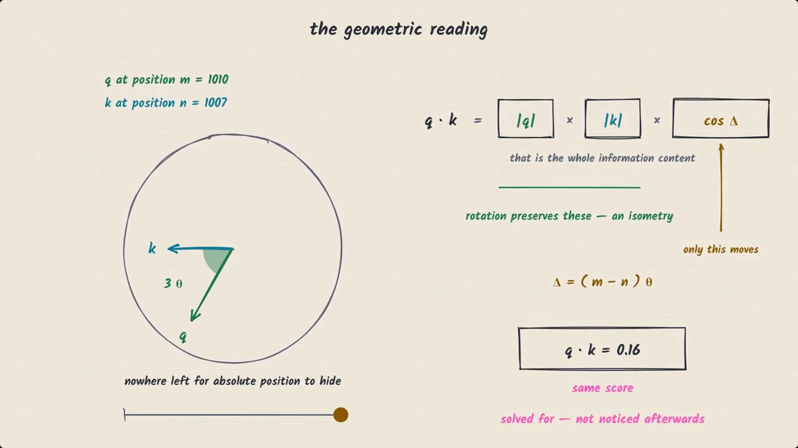
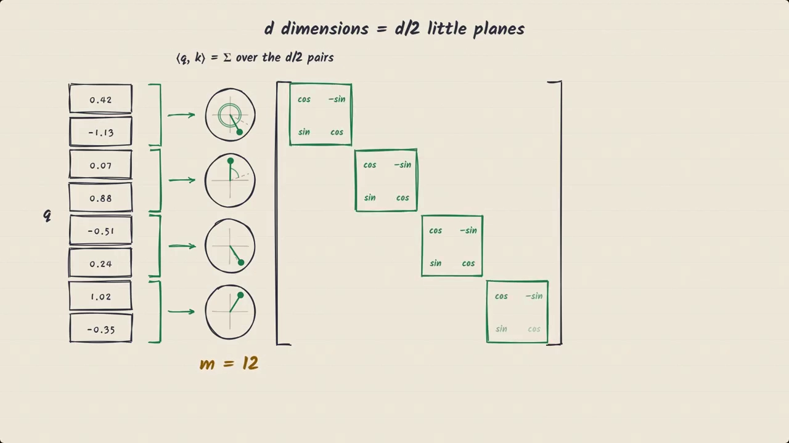
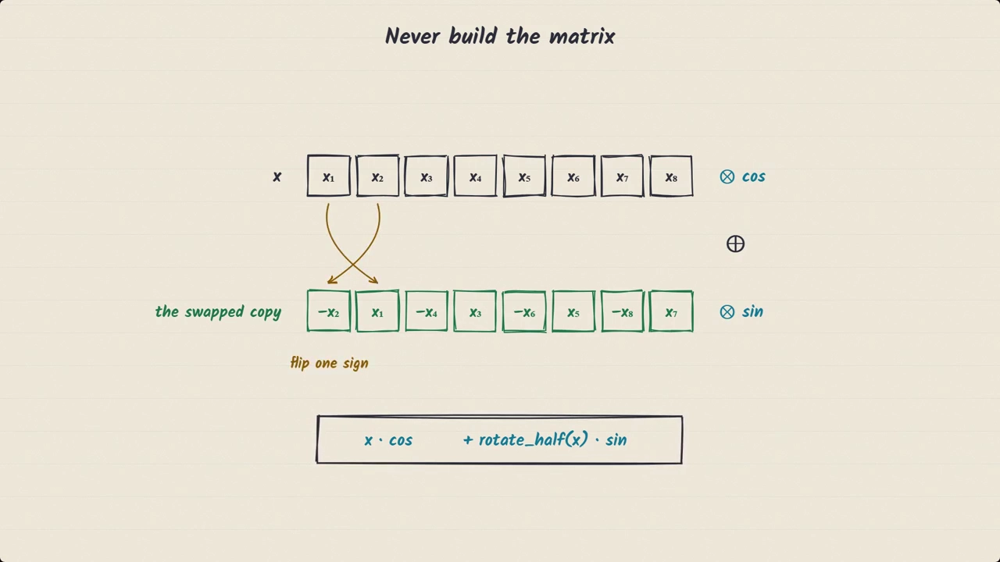
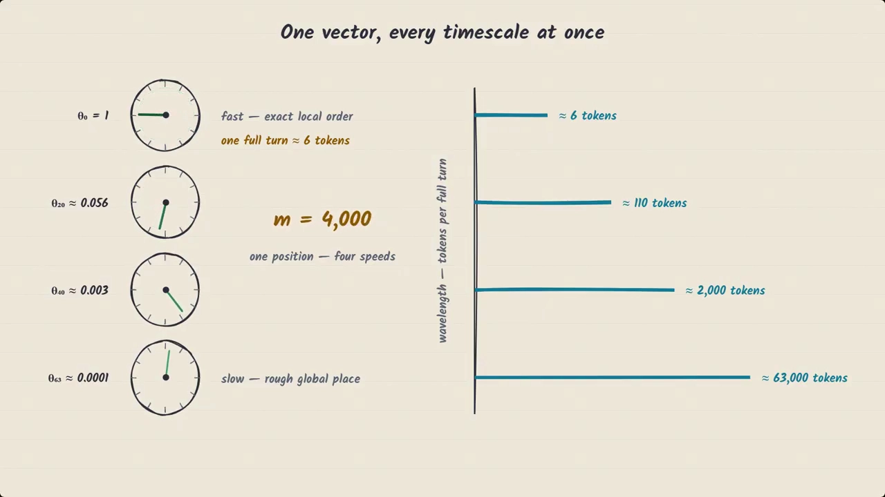
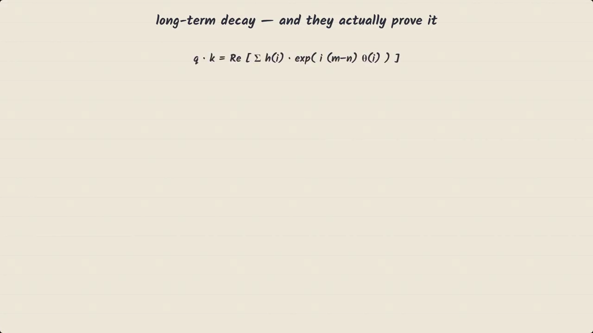
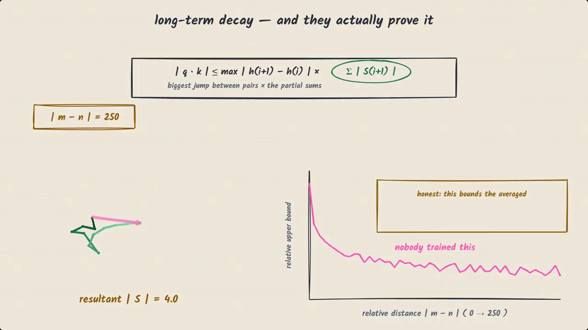
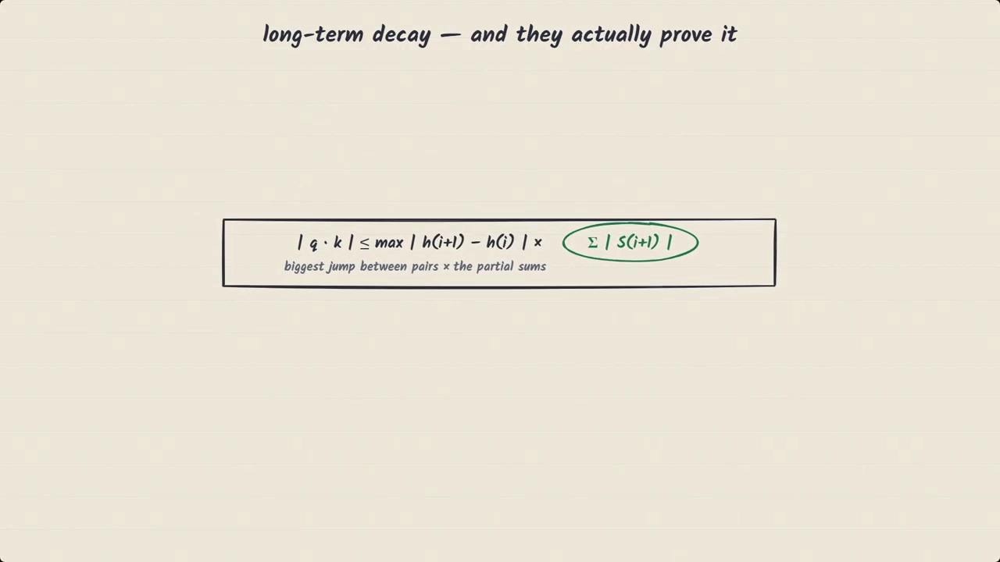
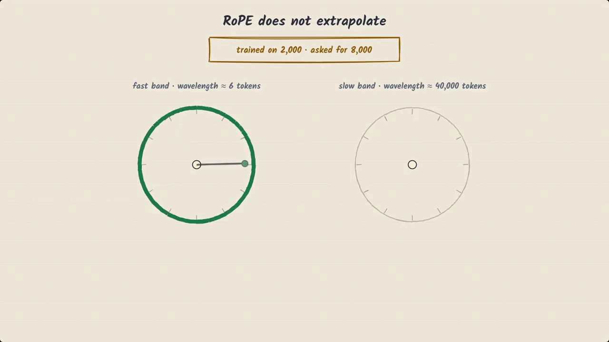
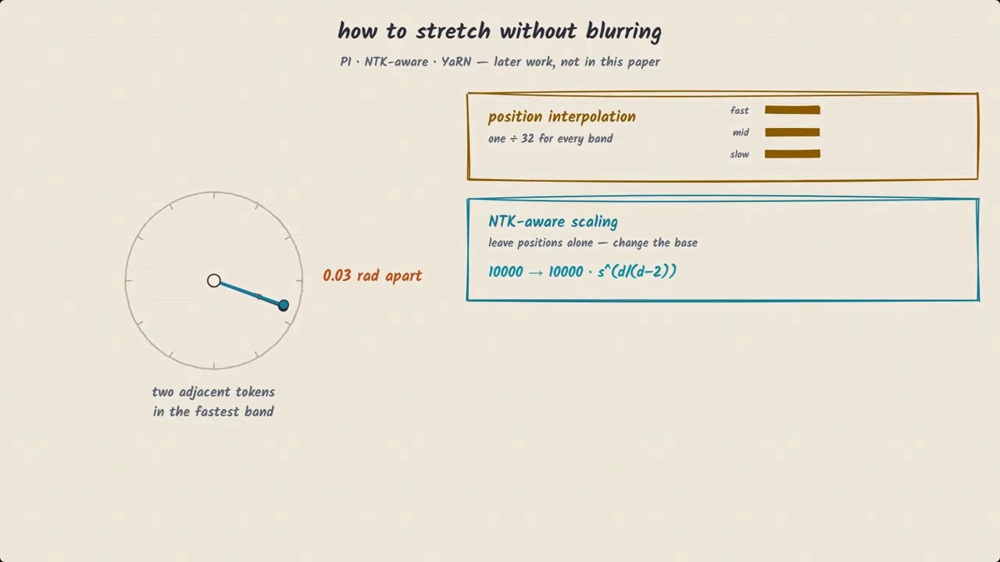
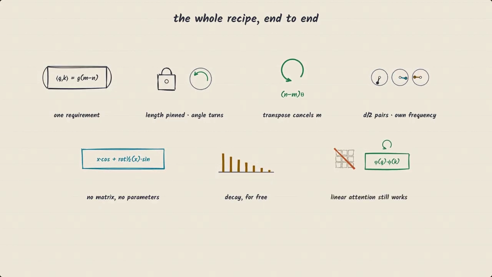

# 衰减是上界不是等式：频率阶梯与base如何决定注意力能看多远

> 视频来源：[RoPE From Scratch: The Rotation Inside Every LLM, Fully Derived](https://www.youtube.com/watch?v=bWNRf-LivjU&t=0)（YouTube · Papers by Hand）
> 本文基于视频演说图文稿整理，配图截自视频。
> 导读：这支 19 分钟的视频把 RoFormer 论文从"一条要求"推到"8 行代码"，重点落在两件最容易被讲错的事上——**远程衰减是上界而不是等式**，以及**频率阶梯与底数 base 决定了一个模型"能看多远"**。旋转公式的逐行推导已在系列另一篇《RoPE 复数空间推导：通过二维平面旋转矩阵注入相对位置信息》中给出，本文只保留必要的一行摘要，把篇幅留给衰减、阶梯与 base；位置插值、NTK-aware、YaRN 三种外推调法只讲到"它们在动哪个旋钮"，细节留给 2.4 各篇。

## 本讲要解决的核心问题（SCQA）

**背景**：现在几乎所有主流模型（Llama、Qwen、Mistral、Gemma、DeepSeek）在 query 与 key 相遇之前，都插着同样三行代码：一个 $\cos$、一个 $\sin$，加一次"半个向量的交换"。这就是旋转位置编码。它 2021 年出自深圳一家小公司，之后大约一年几乎没人关注；等到长上下文成为刚需，人们才发现它是唯一一种"可以被拉伸"的位置方案。

**冲突**：RoPE 常被当成"正弦位置编码加几步额外操作"，也常被说成"天生会外推"、"距离越远分数一定越低"。这两种说法都不对：论文只证明了**一个上界**，而"能外推"更是与实验相反——训练 2000 个 token、直接拿去跑 8000，模型会崩。

**疑问**：既然衰减只是上界、外推根本不行，RoPE 凭什么赢？频率阶梯和 base 到底在控制什么？

**回答（中心思想）**：**衰减来自多频段的失相，论文证明的是一个随距离下降的天花板，而非每条分数的单调性；而 base 决定这些频段"转多快"，也就决定了模型见过多少角度、能把上下文拉到多长。** 更准确地说：要求"分数只依赖间隔"这一行条件，唯一解就是旋转；衰减、与线性注意力的兼容、可拉伸性，都是这条要求的副作用。

---

## 一、一条要求，逼出唯一答案：位置只能进角度

先把这条推导压缩成几行，够用就行。

论文没有先提机制再测效果，而是反过来：**把想要的性质写下来，解出机制**。这条性质是：设 $f_q$ 负责把词向量 $x_m$ 和位置 $m$ 组装成 query，$f_k$ 负责把 $x_n$ 与 $n$ 组装成 key，要求

$$
\big\langle f_q(x_m, m),\; f_k(x_n, n) \big\rangle = g\big(x_m,\, x_n,\, m-n\big)
$$

右边只允许出现 $m-n$，不允许单独出现 $m$ 或 $n$ [【跳转到 04:01】](https://www.youtube.com/watch?v=bWNRf-LivjU&t=241)。换句话说：**不是在要求"位置信息有用"，而是在要求"绝对位置在数学上彻底隐身，只有间隔活下来"**。

解它的过程很短 [【跳转到 05:12】](https://www.youtube.com/watch?v=bWNRf-LivjU&t=312)：

1. 先看最小情形 $d=2$：query 和 key 是平面上的两个点，写成极坐标（长度 + 角度）。
2. 加边界条件：位置 $0$ 处必须原样返回 $w\cdot x$，不带任何位置痕迹。
3. 令 $m=n$（两个 token 在同一位置，间隔为 $0$），此时分数必须等于"完全没有位置"时的分数。这逼出一个结论：**位置不能改变长度，只能改变角度**。
4. 再令角度部分的差只依赖间隔，于是"位置造成的角度偏移"对 query 与 key 必须是同一个函数，且与词向量无关；把间隔 $m$ 到 $m+1$ 走一步，偏移的差是常数——常数差分的数列就是等差数列，所以角度必须是 $m\theta$ 的线性形式。

于是编码后的向量就是"原向量旋转 $m\theta$"：

$$
q_m = R(m\theta)\,q, \qquad
R(\alpha) = \begin{pmatrix} \cos\alpha & -\sin\alpha \\ \sin\alpha & \cos\alpha \end{pmatrix}
$$

而内积里那个绝对角度会自动消失：

$$
q_m^{\top} k_n = q^{\top} R(m\theta)^{\top} R(n\theta)\, k = q^{\top} R\big((n-m)\theta\big)\, k
$$

关键就在 $R(\alpha)^{\top} = R(-\alpha)$：转置就是反向转。先倒退 $m\theta$、再前进 $n\theta$，净效果是前进 $(n-m)\theta$，配合三角函数的和角公式，其余全部抵消 [【跳转到 06:27】](https://www.youtube.com/watch?v=bWNRf-LivjU&t=387)。

---

## 二、几何读法：内积只剩长度和夹角，绝对位置无处可藏



为什么"旋转"是唯一解，视频给了一个看完就忘不掉的解释：**内积这个运算只包含两样信息——两个向量的长度，以及它们之间的夹角**。旋转不改变长度（它是等距变换，isometry），它做的唯一一件事就是移动角度 [【跳转到 06:45】](https://www.youtube.com/watch?v=bWNRf-LivjU&t=405)。

于是画面上的式子变得很直白：

$$
q \cdot k = \lvert q \rvert \times \lvert k \rvert \times \cos \Delta, \qquad \Delta = (m-n)\theta
$$

长度那一栏被钉死，只有"夹角"这一栏在动；而夹角里能出现的只有间隔。视频顺势做了一个演示：query 在位置 10、key 在位置 7，两者之间有一段夹角；把两个 token 一起往下挪 1000 个位置，两支箭头一起绕圈，夹角一模一样，分数一模一样 [【跳转到 07:10】](https://www.youtube.com/watch?v=bWNRf-LivjU&t=430)。**平移不变性不是事后发现的巧合，而是当初就解出来的目标**。

### 2.1 把真数字塞进去：间隔相同，分数就相同

为了让这件事可信，视频直接用 $d=4$ 压了一遍具体数字（两对频率：$\theta_0 = 1$、$\theta_1 = 1/100$）[【跳转到 11:20】](https://www.youtube.com/watch?v=bWNRf-LivjU&t=680)：

1. 第 3 个位置的 query 取 $(1, 0, 1, 0)$，第 1 个位置的 key 取 $(0, 1, 1, 0)$。
2. 第一对按 3 弧度旋转：$\cos 3 \approx -0.99$、$\sin 3 \approx 0.14$，这一对落到 $(-0.99,\, 0.14)$；第二对只转 $0.03$ 弧度，几乎没动。
3. key 那边同样按 1 弧度与 $0.01$ 弧度转。
4. 两对分别贡献约 $0.91$ 与 $1.00$，合计约 $1.91$。

然后换成位置 5 与位置 3——**间隔还是 2**。这时每个分量都变了：query 的第一对从 $(-0.99, 0.14)$ 变成 $(0.28, -0.96)$，几乎没有一项相同；可是总分还是约 $1.91$ [【跳转到 12:10】](https://www.youtube.com/watch?v=bWNRf-LivjU&t=730)。（视频口播在这两处分别读作 1.99 与 1.909，按画面上的数值复算，两者应当一致。）

这也解释了视频为什么能把"相对位置"当成一个几何事实来讲：你能改的是两只箭头的位置，改不了的是它们之间的角度。

---

## 三、推广到 $d$ 维：$d/2$ 个小平面各转各的，频率排成几何阶梯

真实模型的 head dimension 是 64 或 128，不是 2。推广方式很自然，而且合法——因为内积对每个分量是线性的：**把 $d$ 个维度切成 $d/2$ 个互相独立的二维子空间，每一对在自己的小平面上转**。把 $d/2$ 个小旋转块摞成一个矩阵，就得到块对角矩阵：对角线上依次是 $2\times2$ 的旋转块，其余全是零 [【跳转到 07:35】](https://www.youtube.com/watch?v=bWNRf-LivjU&t=455)。



每个块有自己的频率：

$$
\theta_i = 10000^{-\frac{2i}{d}}, \qquad i = 0, 1, \dots, \frac{d}{2}-1
$$

底数与原始的正弦位置编码一样，都是 $10000$——视频特意点了一句："同一个底数，这不是巧合" [【跳转到 08:00】](https://www.youtube.com/watch?v=bWNRf-LivjU&t=480)。

这个矩阵还有两个性质值得记住：

- **它是正交的**，所以变换保持范数：向量不会因为加了位置就爆炸或缩水。
- **它几乎全是零**，所以它是一个强烈的提示——**你永远不该真的把它建出来**。$d\times d$ 的矩阵里每一行只有两个非零元，乘一遍等于把绝大部分算力丢掉。

### 3.1 实现只需要两个逐元素操作

把二维旋转展开看，一对分量 $(x_1, x_2)$ 变成

$$
x_1\cos\alpha - x_2\sin\alpha, \qquad x_2\cos\alpha + x_1\sin\alpha
$$

于是整条向量上的操作就是"两个逐元素乘法 + 一次加法"：$x$ 乘一份 $\cos$，加上"把每一对换位并给其中一个改符号"的副本乘一份 $\sin$ [【跳转到 09:40】](https://www.youtube.com/watch?v=bWNRf-LivjU&t=580)。那个"换位、改一个符号"的函数，就是各家实现里的 `rotate_half`。

于是全部实现就是八行 [【跳转到 10:05】](https://www.youtube.com/watch?v=bWNRf-LivjU&t=605)：



```python
inv_freq = 1 / 10000 ** (arange(0, d, 2) / d)   # d/2 个频率
freqs    = outer(pos, inv_freq)                 # [N, d/2] 每个位置每个频段的角度
cos      = cat(freqs, freqs, -1).cos()          # [N, d]  每个角复制两份
sin      = cat(freqs, freqs, -1).sin()          # 只算一次，永久缓存
rotate_half(x) = cat(-x[d/2:], x[:d/2], -1)     # 换位 + 改一个符号
q = x @ Wq ;  k = x @ Wk                        # 和以前一样的投影
q = q * cos[pos] + rotate_half(q) * sin[pos]
k = k * cos[pos] + rotate_half(k) * sin[pos]
# scores = q @ k.T / sqrt(d)   <- 完全不用改
```

几个容易踩的点也在画面里：

- $\cos$ 与 $\sin$ 只依赖位置，**算一次、永久缓存**，没有可学参数，也不按层存东西；
- **$V$ 从不旋转**，注意力分数的计算流程一个字都没改；
- 论文里把"配对"做成相邻两维交错，多数实现是"前后两半配对"——**同一个操作，只是维度的排列不同**。

---

## 四、一个向量同时装下所有时间尺度：快针管次序，慢针管位置

这些 $\theta_i$ 是最容易被跳过的部分，也是视频认为当下最要紧的部分。它们排成一个**几何阶梯**:第一对拿到 $\theta \approx 1$ 弧度/token,也就是每 6 到 7 个 token 转完一整圈;最后一对的频率约为 $1/10000$,转完一圈要好几万个 token。在整个训练窗口里,它几乎没离开过起始角度 [【跳转到 08:25】](https://www.youtube.com/watch?v=bWNRf-LivjU&t=505)。



用画面上的波长来读最清楚（波长 = 转一圈需要的 token 数 = $2\pi/\theta_i$）：

| 频段（示例） | $\theta_i$ 量级 | 转一圈 ≈ 多少 token | 它能告诉你什么 |
| --- | --- | --- | --- |
| 最快（$i=0$） | $1$ | 约 $6$ | 精确的局部次序：谁紧挨着谁 |
| 中快（$i \approx 20$） | $0.056$ | 约 $110$ | 短语级的次序 |
| 中慢（$i \approx 40$） | $0.003$ | 约 $2000$ | 段落级的位置 |
| 最慢（$i \approx 63$） | $0.0001$ | 约 $63000$ | 只给一个"大概在文档哪一段" |

所以视频的结论是：**这个向量不是"编码一次位置"，而是同时在所有尺度上编码位置，像钟表的指针**——秒针给出精确的局部次序，时针给不出精确值，但能告诉你大致在一天的哪个位置。**近处锐利、远处平滑，全装在一个向量里** [【跳转到 08:50】](https://www.youtube.com/watch?v=bWNRf-LivjU&t=530)。记住这个阶梯，因为"上下文能被拉伸"这件事，根源就在这里。

---

## 五、衰减从哪里来：近处相干相加，远处互相抵消

现在进入这支视频最硬的一段：**性质一，远程衰减，而且作者真的证明了它** [【跳转到 12:35】](https://www.youtube.com/watch?v=bWNRf-LivjU&t=755)。

思路是"把向量按对分组，把分数写成对上的求和"。每一对分量可以合成一个复数 $h_i$（该对 query、key 分量的乘积，与位置无关），于是

$$
q \cdot k = \mathrm{Re}\left[\sum_i h_i \, e^{\,\mathrm{i}(m-n)\theta_i}\right]
$$



接下来用**Abel 变换**——可以理解为"离散版的分部积分"——把这个求和改写。改写之后出来一个上界：

$$
\lvert q \cdot k \rvert \;\le\; \max_i \lvert h_{i+1} - h_i \rvert \;\times\; \sum_i \lvert S_{i+1} \rvert
$$

[【跳转到 13:00】](https://www.youtube.com/watch?v=bWNRf-LivjU&t=780)

它说的是：分数的绝对值不超过"相邻两对乘积之间最大的那一跳"乘上"这些部分和的绝对值之和"。**衰减就住在部分和里**。

部分和是什么？是一束单位向量，角度分别是 $(m-n)\theta_i$：

- 间隔很小时，这些角度都接近 $0$，所有单位向量指向同一个方向，**相干相加**，部分和很大；
- 间隔变大时，不同的 $\theta_i$ 把它们撒在圆周的不同位置上，**互相抵消**，部分和就小了。

视频把这句总结成一句漂亮的话：**"距离摧毁了相干性。注意力于是自己偏向局部，而没有人把这个规则写进代码。"** [【跳转到 13:25】](https://www.youtube.com/watch?v=bWNRf-LivjU&t=805)



---

## 六、严格结论是上界，不是"每条分数都递减"

这一节是全文最容易讲错的地方，视频专门打了预防针：**这是对一个平滑量的上界，不是对任何单条分数的承诺** [【跳转到 13:50】](https://www.youtube.com/watch?v=bWNRf-LivjU&t=830)。



把"上界"和"等式"的差别摊开讲：

1. **上界管的是整体**：距离变大，天花板下降，于是"平均而言"远处的分数被压低。这是统计意义上的趋势。
2. **它不保证逐条**：某个具体的远处 token，因为 $h_i$ 恰好同相，分数完全可能高于某个近处 token。视频认为这恰恰是“你会想要”的行为——真实模型确实需要偶尔把注意力放到远处。
3. **上界是"有人证过"的**：论文给出了证明，所以这条性质不是训练出来的经验，而是结构自带的。

用第一支视频（同小节的《q 和 k 全取 1，内积变成一串 cos》）里的话说：$q$、$k$ 全取 1 时曲线是"整体递减、不严格单调"；这里给出了它之所以"整体"的确切理由。

---

## 七、这个旋转还顺手解决了线性注意力的兼容问题

视频把第二性质称为“论文暗自最自豪的那部分” [【跳转到 13:55】](https://www.youtube.com/watch?v=bWNRf-LivjU&t=835)。

先说两种注意力：

- **普通注意力**：权重来自 $\exp(q\cdot k / \sqrt{d})$。这个指数逼着你把 $N\times N$ 的分数矩阵显式建出来，代价是二次方。
- **线性注意力**：把相似度换成一个可分解的形式 $\varphi(q)\cdot\varphi(k)$。一旦可分解，就能重新结合：先把 key 与 value 乘起来，**那个 $N\times N$ 的矩阵根本不会出现**。

问题在于：所有“在分数上加一项”的相对位置方案（比如 T5 那种给每个相对距离一个可学偏置的做法）在这里全部失效——因为偏置是“往矩阵的某个元素上加一个数”，而那个矩阵**已经不存在了**。

RoPE 完全不慌：它不动分数，**它是在这一切发生之前、对 $q$ 和 $k$ 本身做一个保范数的旋转** [【跳转到 14:25】](https://www.youtube.com/watch?v=bWNRf-LivjU&t=865)。你只要把特征映射的输出旋转一下，继续算就行——**相对位置在线性注意力里是白送的**。

这也解释了前面那个悬念：为什么"把偏置加在分数上"的方案会埋雷？因为一旦你换了注意力实现，矩阵没了，偏置无处可加。

---

## 八、RoPE 不会自动外推：慢频段只扫过圆周的一小段

接下来是视频里最诚实的一段，因为它要纠正一个流传很广的说法：**RoPE 不外推**。训练 2000 个 token、推理直接上 8000，模型会散架 [【跳转到 14:50】](https://www.youtube.com/watch?v=bWNRf-LivjU&t=890)。



原因直接从频率阶梯里来，不需要额外假设：

- **快频段没问题**：训练期间它们已经转过成千上万圈，圆周上每个角度都见过。你问它位置 8000 的角度，它训练时早就见过这个角度。
- **慢频段才是坑**：一条波长 40000 token 的频段，在 2000 token 的训练窗口里只扫过圆周的约 $5\%$。你让它回答"位置 8000 是什么角度"，等于把训练中从未出现的角度丢给它——**分布外，注意力就乱了**。

注意这里的因果链：**不是"位置太大所以不行"，而是"这个角度没见过所以不行"**。位置本身没有意义，角度才有。这也正是后面所有外推方法共同的着力点：让新位置落回训练时见过的角度区间。

---

## 九、base 是"能看多远"的旋钮：PI、NTK-aware、YaRN 三种调法

后面这些修法都不在这篇论文里（属于后续工作），视频只用它们说明"旋钮在哪里" [【跳转到 15:15】](https://www.youtube.com/watch?v=bWNRf-LivjU&t=915)。



1. **位置插值（PI）**：不要外推，改内插。把每个位置乘上"训练长度 / 目标长度"的比例，位置 128,000 就变成 4,000，所有角度都落回训练区间。
   - **代价**：它把一切都压扁了，包括你需要的锐度。缩 32 倍之后，最快频段里原本相差整整 1 弧度的相邻 token，现在只差约 $0.03$ 弧度 [【跳转到 15:40】](https://www.youtube.com/watch?v=bWNRf-LivjU&t=940)——**用模糊近处换来远处**，所以必须微调才能恢复。
2. **NTK-aware 缩放**：**完全不动位置，改底数**。$10000$ 变成 $10000 \times s^{\frac{d}{d-2}}$ [【跳转到 16:05】](https://www.youtube.com/watch?v=bWNRf-LivjU&t=965)。
   - 为什么改底数就够？因为频率是这个底数的几何阶梯：底数一变，**慢频段被拉得很狠，快频段几乎没动**。局部次序活下来了，全局范围也延长了。
   - 这正是第一支视频那句"底数越大，周期越大、衰减范围越大"的工程版：调大 base 不是让衰减消失，而是把整条阶梯整体调慢，让"还没转完一圈"的那一段变长。
3. **YaRN**：把"该动哪一段"这个选择逐段显式做出来。波长比训练窗口短的频段——它已经走完整圈，见过的角度够了，**别动**；波长更长的频段——**做插值**；两者之间平滑过渡。另外再给注意力 logits 乘一个温度系数，补偿熵的变化 [【跳转到 16:30】](https://www.youtube.com/watch?v=bWNRf-LivjU&t=990)。

**这就是一个 4K 模型最后能读小说的方式**：不是模型变聪明了，是那些"指针"被调慢了。

---

## 十、论文自己的成绩单：小幅但一致

视频最后把论文的实验摊开，态度很克制 [【跳转到 16:55】](https://www.youtube.com/watch?v=bWNRf-LivjU&t=1015)：

- **机器翻译**：27.5 BLEU，基线 27.3；
- **预训练**：把 RoPE 放进 BERT，掩码语言模型的 loss 下降更快；
- **GLUE**：六项里三项明确更好，其余明确更差——**好坏参半，不粉饰**；
- **线性注意力**：Performer 加上 RoPE 之后收敛更快、最终更低——线性注意力那边的承诺算是兑现了；
- **中文长文档匹配**：512 token 时与基线打平，1024 token 时领先约 1.5 分——**收益随长度增长**；
- 作者也在论文里承认：**他们无法完全解释为什么**。



所以整条链子可以这样收口：

1. **写下一行要求**：分数只能通过间隔依赖位置。
2. **在二维里解它**：长度被钉死 → 位置只能动角度 → 角度必须线性 → 得到旋转。
3. **转置抵消绝对位置**，只剩间隔。
4. **推广**：切成 $d/2$ 对，每对按几何阶梯上的频率自转，从很快到几乎冻住。
5. **实现成 $x\cos\alpha + \mathrm{rot}(x)\sin\alpha$ 这样的逐元素运算**：没有矩阵，没有参数。
6. **衰减是频段之间干涉的副产品**；**线性注意力仍然可用**，因为你旋转的是 $q$、$k$，不是分数。
7. **位置从"查表"变成"一组旋钮"**，于是可以调慢旋钮去读 100 倍长的上下文。

视频结尾留了一个值得一想的问题：既然位置是一组连续的频率而不是学出来的行，那么"长上下文"里有多少是真实的能力提升，又有多少只是我们发现了一个本来就存在、只是碰巧没人去拧的旋钮 [【跳转到 19:00】](https://www.youtube.com/watch?v=bWNRf-LivjU&t=1140)。

---

## 小结

- **一条要求出唯一解**：分数只依赖间隔，解出来就是旋转；衰减、线性注意力兼容、可拉伸都是它的副作用。
- **几何读法**：内积只看长度与夹角，旋转保长度、只移角度，所以绝对位置无处可藏。
- **频率是几何阶梯**：$\theta_i = 10000^{-2i/d}$，从每 6 个 token 一圈到每几万个 token 一圈，一个向量同时装下所有尺度。
- **衰减来自失相**：Abel 变换给出上界 = 相邻两对最大跳变 × 部分和；间隔小则相干相加，间隔大则互相抵消。
- **上界不是等式**：它约束平均，不承诺某条分数；远处的个别 token 完全可能分数很高，而这种不规则正是需要的。
- **RoPE 不外推**：快频段见过了所有角度，慢频段在训练窗口里只扫过圆周的一小段；OOD 的是角度，不是位置编号。
- **base 是旋钮**：PI 靠压缩位置（会模糊近处），NTK-aware 靠调大 base（慢频段拉长、快频段几乎不动），YaRN 逐段决定插不插值。
- **别把衰减当"设计"**：它是旋转 + 频率阶梯的数学后果；写代码时也不要建那个 $d\times d$ 矩阵。

## 关键术语速查

| 术语 | 一句话解释 |
| --- | --- |
| 远程衰减（long-term decay） | 分数随相对距离下降的趋势，严格形式是一个上界 |
| 上界（upper bound） | 一个"不会超过"的天花板，约束整体而非每条分数 |
| Abel 变换 | 离散版的分部积分，用来把"乘积求和"改写成"跳变 × 部分和" |
| 频率阶梯 | $\theta_i = b^{-2i/d}$ 排成等比数列，从最快到最慢覆盖多个尺度 |
| base（$b$） | 阶梯的底数，原始取 $10000$；调大等于把整条阶梯整体调慢 |
| 波长 | 转完一圈所需的 token 数，等于 $2\pi/\theta_i$ |
| 块对角矩阵 | 对角线上依次排布 $2\times2$ 旋转块，其余为零；实现时从不真正构建 |
| `rotate_half` | 把向量前后两半互换并给其中一半改符号，用来实现 $x\cos + \mathrm{rot}(x)\sin$ |
| 位置插值（PI） | 把位置按比例压小，使所有角度回到训练区间，代价是局部变模糊 |
| NTK-aware 缩放 | 不动位置，只调大 base，从而主要拉伸慢频段 |
| YaRN | 逐频段决定插不插值，并用温度系数补偿注意力熵的变化 |
