# 位置内插 PI：把超长位置索引压回训练区间，代价是高频分辨率被摊薄

> 视频来源：[Extending Context Window of Large Language Models via Positional Interpolation Explained](https://www.youtube.com/watch?v=oyXdmtHgZFw&t=0)（YouTube · Gabriel Mongaras）｜时长约 29 分钟
> 导读：讲者左边摊开 Meta 的 PI 原论文，右边在平板上手推 RoPE 的旋转，把"外推为什么坏、内插为什么行、要付多少微调代价"一条线讲完。本文按讲解顺序还原推导与实验表格；视频没展开的"分辨率摊薄"一节，按论文公式补在第四章，并明确标注为延伸分析。
> 本文基于视频演说图文稿整理，配图截自视频。

## 本讲要解决的核心问题（SCQA）

**背景**：Llama 一类的开源大模型，上下文窗口是预训练时就定死的——比如 2048 个 token。它的位置信息由 RoPE（Rotary Position Embedding，旋转位置编码）提供：每个 token 的向量按"自己在序列里的位置"旋转一个角度。

**冲突**：实际使用中（长对话、长文档摘要、长程规划）几乎一定会超过这个窗口。最直觉的办法是"把位置索引用得更大一点"，但讲者开门见山地指出：**模型只会用训练时见过的那个位置区间，索引越界之后它不会外推，而是直接崩**——注意力分数从 1 附近一路飙到 8000，输出变成垃圾 [【跳转到 00:25】](https://www.youtube.com/watch?v=oyXdmtHgZFw&t=25)。

**疑问**：有没有一种不动架构、不从头预训练的办法，让已经训好的模型接受更长的上下文？

**回答（中心思想）**：有，就是**位置线性内插**（Position Interpolation，下称 PI）。它不去"外推"新位置，而是把扩长后的位置索引按比例 $\frac{L}{L'}$ 压回原来的训练区间 $[0, L)$，让模型只在自己熟悉的那段区间里取值。这样注意力分数重新落回有界范围，代价是**位置分辨率被摊薄**（越长的序列，相邻位置越难区分），并且**必须补少量微调**才真正生效。

---

## 一、外推的失败不是"记不住"，而是位置索引跑出了训练区间

### 1.1 先用一句话复习 RoPE 在做什么

Transformer 本身对顺序是无感的：把 `I love cats` 打乱成 `cats love I`，如果没有位置信息，模型看到的只是同一堆向量的集合 [【跳转到 00:56】](https://www.youtube.com/watch?v=oyXdmtHgZFw&t=56)。所以要给每个 token 注入"它在第几位"的信息。这件事有两条路：

- **绝对位置编码**：直接给第 $m$ 个位置一个固定向量；
- **相对位置编码**（RoPE 属这一类）：不记绝对坐标，只让"两个 token 之间隔多远"体现在它们的点积里。

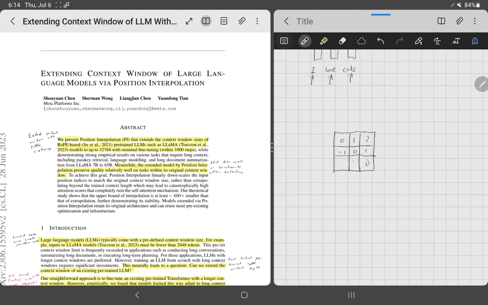

讲者用 `I love cats` 这个三 token 序列手画了那张目标矩阵：对角线上是 0，向右一格是 +1、两格是 +2，向左就是负多少 [【跳转到 02:11】](https://www.youtube.com/watch?v=oyXdmtHgZFw&t=131)。这张矩阵的含义很直白——**第 $i$ 行第 $j$ 列写的是"位置 $i$ 与位置 $j$ 差几位"**；因为 "I" 在 "love" 前面一位，"cats" 在 "love" 后面一位，所以右上角与左下角的符号相反 [【跳转到 03:01】](https://www.youtube.com/watch?v=oyXdmtHgZFw&t=181)。

具体怎么把"差几位"做进向量里？RoPE 用旋转。把每个 token 的向量看成平面上的一个箭头（讲者的例子是向量 $(1,1)$），位置每往后挪一格，就把箭头多转一个固定角度：第一个 token 不转，第二个转 90°，第三个再转 90°——于是三个本来完全相同的向量被转成了三个不同方向的向量 [【跳转到 04:43】](https://www.youtube.com/watch?v=oyXdmtHgZFw&t=283)。**位置信息就藏在"转了多少度"里**。再把这些旋转后的向量两两点积，就得到上面那张相对位置矩阵：自己跟自己点积是 1，相邻的是 0，隔两格的是 $-1$ [【跳转到 06:09】](https://www.youtube.com/watch?v=oyXdmtHgZFw&t=369)。讲者强调，这里只是用小角度代替 90° 来演示，本质就是"用旋转天然地把位置嵌进去" [【跳转到 07:00】](https://www.youtube.com/watch?v=oyXdmtHgZFw&t=420)。

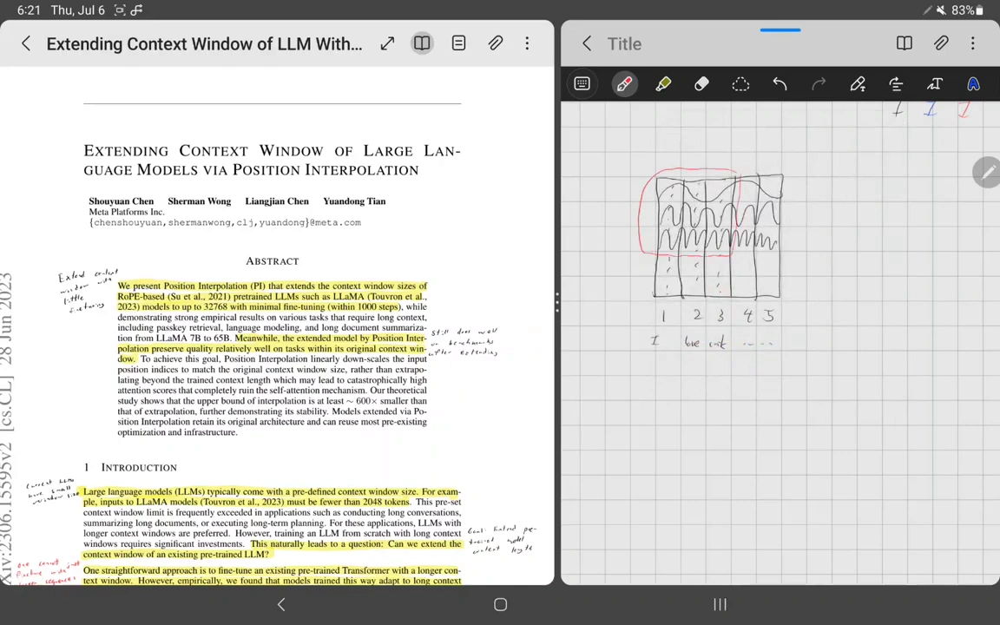

作为对照，讲者也画了绝对位置编码（正弦式）的图：位置 1、2、3、4、5 分别在几条频率不同的正弦波上采样，采样值的组合就是该位置的唯一"指纹" [【跳转到 07:50】](https://www.youtube.com/watch?v=oyXdmtHgZFw&t=470)。他特意说明：论文讲的是 RoPE（相对位置），但**外推的毛病在两种编码上都存在**，只是用绝对编码画图更容易看出来 [【跳转到 08:15】](https://www.youtube.com/watch?v=oyXdmtHgZFw&t=495)。

### 1.2 训练窗口 = 模型见过的唯一一段角度

关键的一句是：如果模型只在前三个 token 上训练过，它就只见过前三个位置对应的那点旋转角度。序列变长，位置信息当然更丰富，但**模型没学过这部分**，所以它不知道该怎么办，开始"发疯" [【跳转到 08:50】](https://www.youtube.com/watch?v=oyXdmtHgZFw&t=530)。

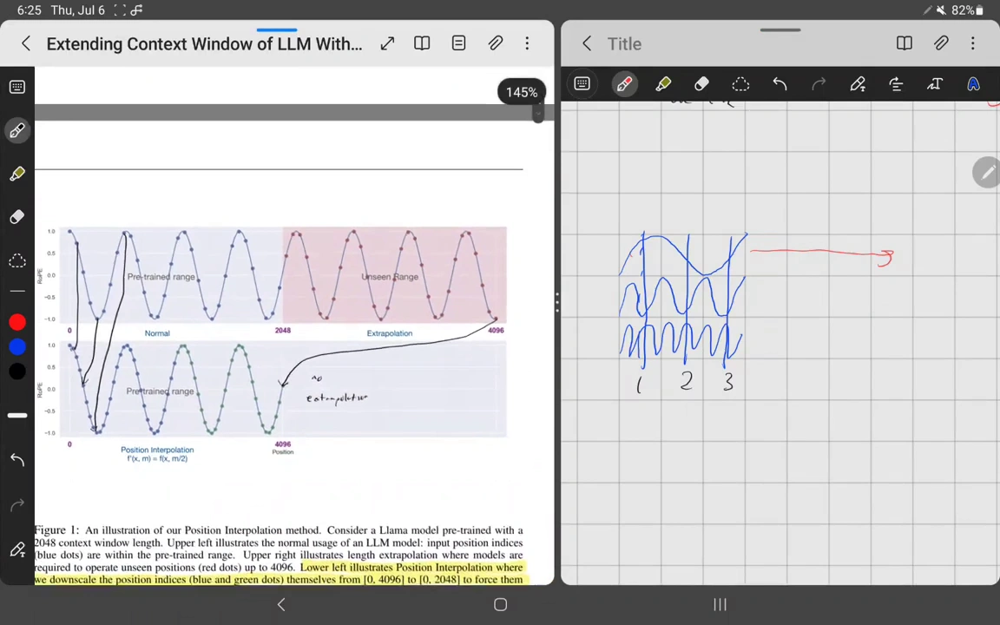

论文 Figure 1 把这件事画成两条正弦曲线：上面那条在 2048 之前点很规整，越过 2048 进入粉色"unseen range"后点数越来越稀（同样的波，位置却越取越远）；下面那条则是 PI 之后的样子——曲线被"加密"了，采样点重新落回 0～2048 的蓝色区间。

### 1.3 崩掉的具体样子：分数从"个位数"变成 8000

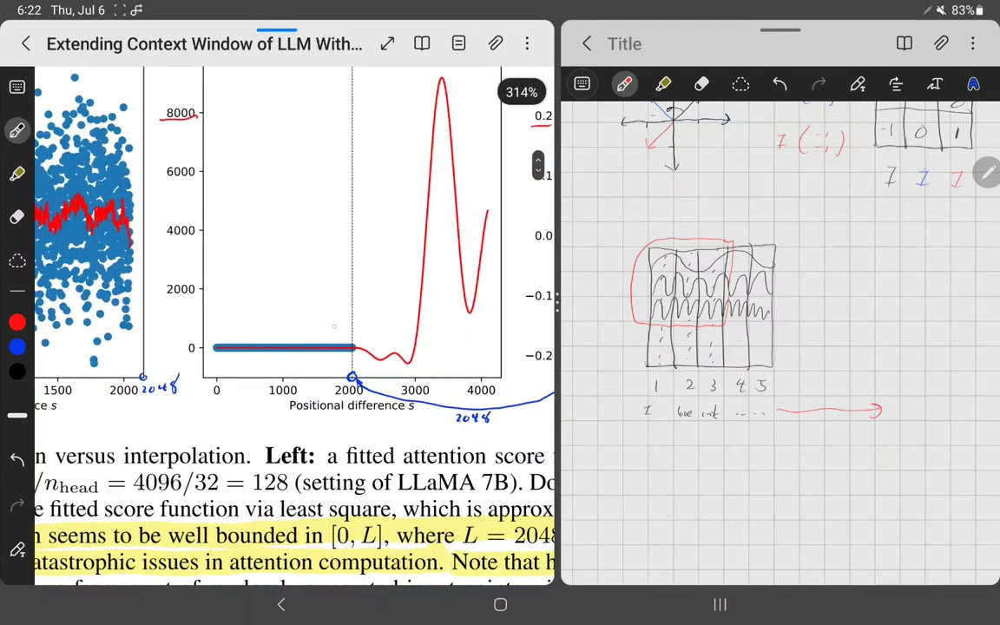

论文 Figure 2 的左边和中间两栏是外推的实测：横轴是 query 与 key 的位置差 $s$，纵轴是注意力分数。位置差在 2048 以内时，分数老老实实待在 $-1$ 到 $1$ 附近——这是神经网络最喜欢的量级 [【跳转到 09:25】](https://www.youtube.com/watch?v=oyXdmtHgZFw&t=565)。一旦越过 2048，曲线开始乱跳；**超过 3000 左右，分数直接冲到 8000 上下**，讲者的评价是"这基本就是让网络输出垃圾，这些信息一点用都没有" [【跳转到 10:00】](https://www.youtube.com/watch?v=oyXdmtHgZFw&t=600)。

这里要强调"这并不是挑数据挑出来的坏例子"：论文在图注里写明，输入点是在 $[0, L)$ 内随机生成的，只要位置差落在这段区间里，外推就会出问题。原因讲者归结为三角基函数是个"万能逼近器"——它能把任意函数拟合出来，所以总能找到一组系数，让分数在 $[0, 2048]$ 内很小、在区间外极大 [【跳转到 10:30】](https://www.youtube.com/watch?v=oyXdmtHgZFw&t=630)。

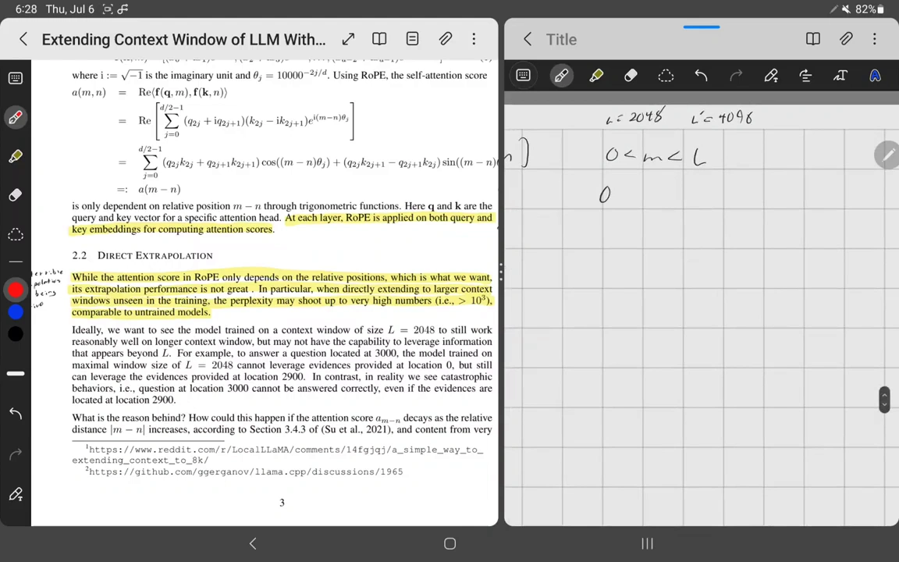

对应到语言模型的语言，就是**困惑度（perplexity，PPL，可以理解为"模型对下一个 token 有多犹豫"，越低越好）会飙到 $10^3$ 以上**，和完全没训练过的模型差不多 [【跳转到 10:30】](https://www.youtube.com/watch?v=oyXdmtHgZFw&t=630)。讲者补充了一个很关键的对照：模型在 2048 上训练，去回答一个位于 3000 的问题时，它连"2900 附近就有证据"都用不上——明明证据在窗口内，它却答不对。这正是"分数被炸坏"的实际后果。

### 1.4 那为什么不干脆直接训一个长窗口？

因为贵，而且贵在平方上。讲者点出 Transformer 的自注意力是 $n^2$ 复杂度：$n$ 是序列长度，注意力矩阵就有 $n \times n$ 那么大，**时间上算这个矩阵是 $n^2$，空间上把它放进显存也是 $n^2$** [【跳转到 10:55】](https://www.youtube.com/watch?v=oyXdmtHgZFw&t=655)。所以预训练时通常只能截一个不算大的长度（比如 2048）。

还有一层"隐性缩水"：token 不等于词，通常是词的一部分（wordpiece 或 byte-pair 编码），所以 2048 个 token 对应的实际文本比大家想象的更短 [【跳转到 11:20】](https://www.youtube.com/watch?v=oyXdmtHgZFw&t=680)。窗口不够用几乎是必然的——这就是 PI 要解决的问题。

---

## 二、PI 的做法：把位置索引乘以 $L/L'$ 压回训练区间

### 2.1 一句话版本

设原训练窗口长度为 $L$（例：2048），想把窗口扩到 $L'$（例：4096）。PI 不去给位置 $L$ 之后的 token 编新号，而是把整条位置轴**按比例压缩回去**：

$$
f'(x, m) = f\left(x,\ m \cdot \frac{L}{L'}\right), \qquad \frac{L}{L'} \le 1
$$

其中 $x$ 是 token 的向量，$m$ 是它在新序列里的原始位置（可以大到 $L'-1$），$f$ 是原来的位置编码函数（这里是 RoPE）。式子的意思是：**读第 $m$ 个位置时，不要用角度 $m\theta$，而要用缩小后的位置 $m' = m\cdot\frac{L}{L'}$ 去算角度** [【跳转到 16:57】](https://www.youtube.com/watch?v=oyXdmtHgZFw&t=1017)。

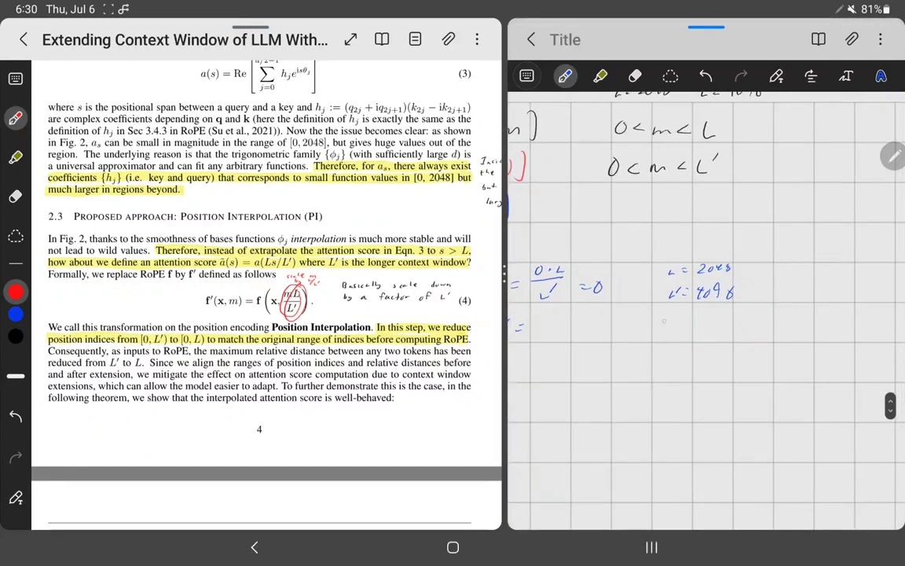

论文的措辞是"把位置索引从 $[0, L')$ 归约到 $[0, L)$"，从而**让任意两个 token 之间的最大相对距离从 $L'$ 缩回 $L$**；位置区间和相对距离都回到了扩展前的范围，注意力分数自然就不会被上下文变长带跑偏，模型也更容易适应 [【跳转到 16:38】](https://www.youtube.com/watch?v=oyXdmtHgZFw&t=998)。

### 2.2 代入数字：2048→4096 就是把索引砍一半

讲者当场算了一遍 [【跳转到 17:22】](https://www.youtube.com/watch?v=oyXdmtHgZFw&t=1042)：

| 原始位置 $m$（新窗口 4096） | 压缩后 $m'=m\cdot\frac{2048}{4096}$ | 落在哪 |
| --- | --- | --- |
| 0 | 0 | 训练区间起点 |
| 2048 | 1024 | 训练区间正中 |
| 4096 | 2048 | 训练区间终点 |

也就是说，$\frac{L}{L'} = \frac{1}{2}$，**整个 4096 的位置轴被均匀地塞进了 0～2048**。想扩到 4 倍、8 倍，就按 $\frac{1}{4}$、$\frac{1}{8}$ 压得更狠一点。讲者的评价是：这个公式"非常容易、非常直观"——它不是去外推嵌入，而是**用内插的方式，把嵌入限制在模型已经见过的范围里**，从而等效地实现了"外推" [【跳转到 18:12】](https://www.youtube.com/watch?v=oyXdmtHgZFw&t=1092)。

### 2.3 换成旋转的视角：不是转得更多，而是转得更少

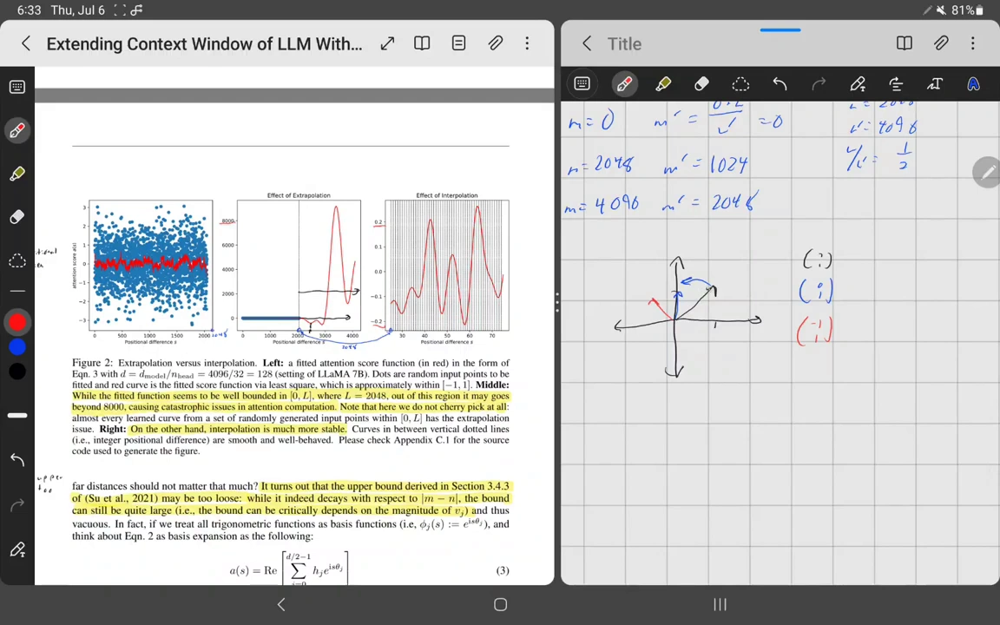

回到那个 $(1,1)$ 的箭头。原来每往后一格转 90°；缩放系数是 $\frac{1}{2}$ 之后，**每格只转 45°** [【跳转到 19:57】](https://www.youtube.com/watch?v=oyXdmtHgZFw&t=1197)：

- 第 1 个 token：不转，仍是 $(1,1)$；
- 第 2 个 token：转 45°，变成约 $(0,1)$ 的方向 [【跳转到 20:32】](https://www.youtube.com/watch?v=oyXdmtHgZFw&t=1232)；
- 第 3 个 token：再转 45°，方向对应 $(-1,1)$ 附近。

于是序列从"转 90°、180°"变成"转 45°、90°"。讲者把两种结局对照得很清楚：**内插是"稍微少转一点"**，所有向量都还留在训练时见过的那半圈里；**外推是"越转越多"**，第三个向量直接转出训练范围，模型从来没见过这个角度，输出自然不稳定 [【跳转到 21:02】](https://www.youtube.com/watch?v=oyXdmtHgZFw&t=1262)。他的总结只有一句：网络知道区间"从这里到这里"，那么区间内部的点它也知道——所以让新位置只落在已知区间内部，稳定性就回来了 [【跳转到 20:37】](https://www.youtube.com/watch?v=oyXdmtHgZFw&t=1237)。

---

## 三、为什么有效：注意力分数只依赖压缩后的相对距离

RoPE 的注意力分数可以写成（$s$ 是 query 与 key 之间的位置差，$d$ 是头维度）：

$$
a(s) = \mathrm{Re}\left[\sum_{j=0}^{d/2-1} h_j e^{\mathrm{i} s \theta_j}\right], \qquad \theta_j = 10000^{-2j/d}
$$

其中 $h_j$ 是由 query、key 决定的复系数，$\mathrm{i}$ 是虚数单位。这个式子里**只有 $s = m-n$ 这一个位置相关的量** [【跳转到 09:25】](https://www.youtube.com/watch?v=oyXdmtHgZFw&t=565)。既然分数的行为完全由"相对距离有多大"决定，那么 PI 只要保证**相对距离不越界**，分数就不会越界。

PI 之后，原来的位置差 $s$ 变成 $s\cdot\frac{L}{L'}$。以 $L=2048$、$L'=4096$ 为例，原本可以到 4095 的位置差，现在最大只有 2047，**整条曲线被压回了模型最熟悉的那一段**。

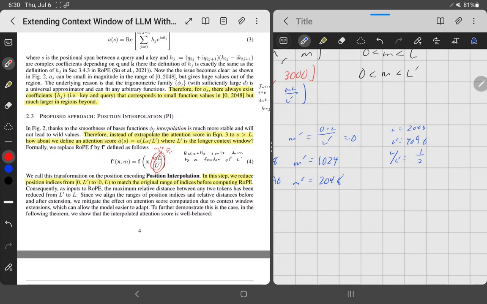

论文还给了理论上的支撑：三角基函数 $\phi_j(s)=e^{\mathrm{i}s\theta_j}$ 在区间内是"平滑"的，内插后的注意力分数表现良好，可以证明**内插的分数上界至少比外推小约 600 倍**。这个数字写在论文摘要里，也是讲者在视频开头读摘要时划重点的一句 [【跳转到 00:00】](https://www.youtube.com/watch?v=oyXdmtHgZFw&t=0)。

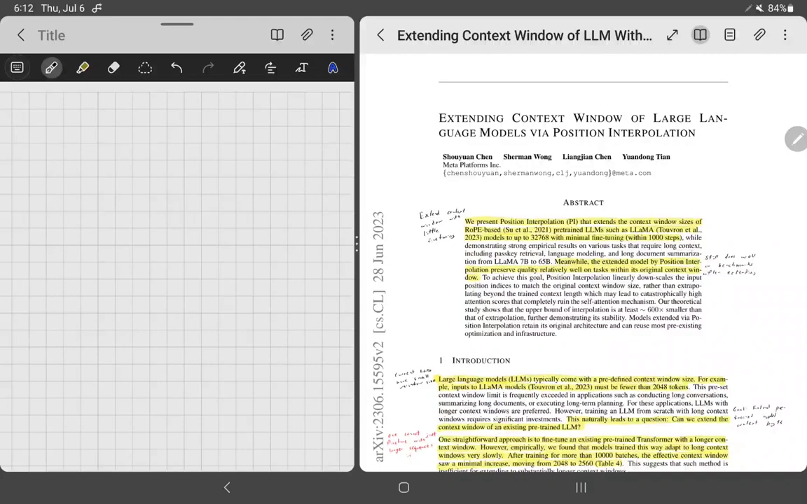

讲者用一句"采样更密，值域就稳"把这层意思讲透：当你把采样点变密（位置轴被压缩），取值范围的波动就很小，不会出现那种"没见过这个值，于是随手给出 8000"的情况 [【跳转到 18:37】](https://www.youtube.com/watch?v=oyXdmtHgZFw&t=1117)。

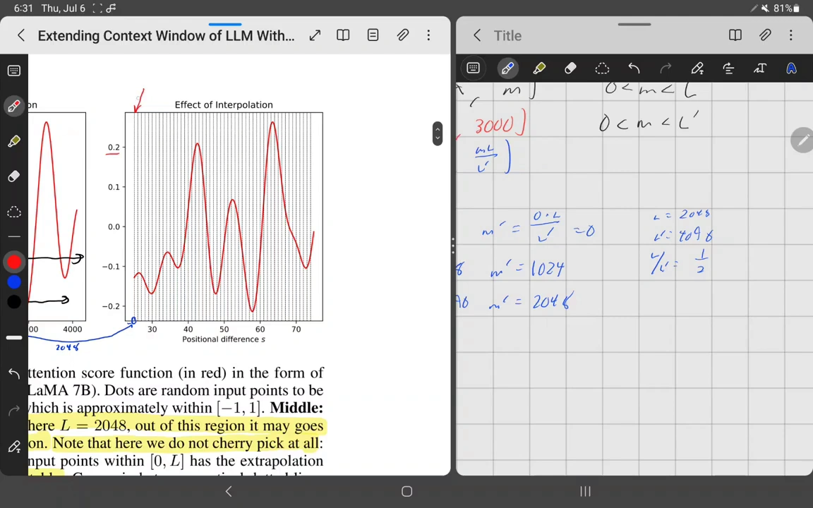

Figure 2 的右栏就是内插后的结果：同一个拟合出来的分数函数，在压缩后的位置上变成了一条**平滑、有界、周期性规整**的曲线，纵轴范围只剩 $[-0.2, 0.2]$ 量级。讲者的说法是：这相当于把外推那张图"归一化"了一遍，注意力分数保持稳定 [【跳转到 19:27】](https://www.youtube.com/watch?v=oyXdmtHgZFw&t=1167)。

---

## 四、代价：分辨率被摊薄，还得补一点微调

到这里 PI 看起来是白捡的便宜，但讲者并没有停在"so easy"上。下面三条代价里，4.1 是视频未展开、按公式补的延伸分析；4.2 和 4.3 既有讲者的原话，也能在论文表格里逐格核对。

### 4.1 高频分辨率被摊薄（延伸分析，非讲者原话）

RoPE 的每个二维子空间有自己的频率 $\theta_j = 10000^{-2j/d}$：低维（$j$ 小）转得快，是"高频"；高维转得慢，是"低频"。PI 把所有频率的相位统统一乘 $\frac{L}{L'}$，等效于**每个维度的"每格角度"都变小了**：

$$
\Delta\varphi_j = \theta_j \cdot \frac{L}{L'} = \theta_j \cdot \frac{1}{2}
$$

对高频维度来说，原来相邻 token 的相位差是 $\theta_j$，现在只剩一半——**两个相邻位置的向量被转得更近，模型区分"差一位"和"差两位"就更吃力**。这正是"位置分辨率被摊薄"的由来：总的角度预算没变（还是那半圈），要容纳的位置却翻了一倍，于是每个位置的"刻度"都变细了。

一个直观的算术检查：$L'=32768$、$L=2048$ 时压缩比是 $\frac{1}{16}$，高频维度相邻两位的相位差只剩原来的十六分之一，而模型从未见过"这么小的相位差代表相邻"这种情形——所以单靠改公式不够，必须让模型重新适应刻度，这就引出下一条。

### 4.2 必须微调：不微调分数照样很烂，200 步就见效

讲者强调得很直白：**PI 也必须在 PI 的设定下做微调** [【跳转到 27:06】](https://www.youtube.com/watch?v=oyXdmtHgZFw&t=1626)。如果只改位置映射、不做任何微调，分数会非常差；但只要微调 **200 次迭代**，分数立刻好起来，继续微调还会再好一点。

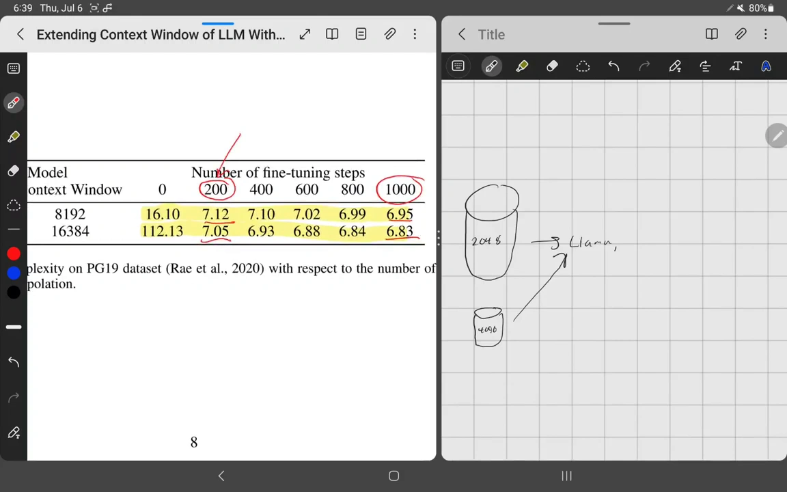

论文 Table 4 把这一点量化在 PG19 数据集上（PPL 越低越好）：

| 目标窗口 | 0 步（不微调） | 200 步 | 400 步 | 600 步 | 800 步 | 1000 步 |
| --- | --- | --- | --- | --- | --- | --- |
| 8192 | 16.10 | 7.12 | 7.10 | 7.02 | 6.99 | 6.95 |
| 16384 | 112.13 | 7.05 | 6.93 | 6.88 | 6.84 | 6.83 |

可以看到，**绝大部分收益都发生在头 200 步**，之后只是缓慢收敛。讲者顺带点出规模：他讲"200 步"，论文摘要写的是"1000 步以内"——两者不矛盾，200 步已经拿到主要效果，1000 步是收敛后的数字。他还提到微调数据用的是 **the Pile**，所以整套流程的代价只是"在一个更大窗口的数据集上跑 200 次更新" [【跳转到 27:31】](https://www.youtube.com/watch?v=oyXdmtHgZFw&t=1651)。

### 4.3 继续往上拉，收益会回退

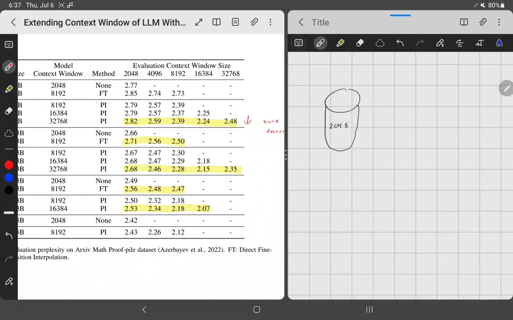

把窗口继续往上推并不是免费的。Table 3 里 7B 模型用 PI 扩到 32768，四列窗口的困惑度是 2.82 → 2.59 → 2.39 → 2.24，趋势一路向下，**但最后一个 32768 处回升到 2.48**；13B 那行同样在最后从 2.15 回到 2.35。这个"先降后升"说明：压缩比太大时，分辨率摊薄的副作用开始压过"多看到上下文"的收益。讲者在 32768 这一档只说"still does really well" [【跳转到 27:56】](https://www.youtube.com/watch?v=oyXdmtHgZFw&t=1676)，表格里的这处回升则由数据自己交代。

另外还有一处不易察觉的代价：**在原始窗口上，PI 模型的困惑度会比原模型略高一点**（Table 2 中 7B 未改动模型在 2048 上是 7.20，PI 扩到 32768 的那一行在 2048 上是 7.23）。换句话说，为了换长上下文，短上下文上的那点精度是让渡出去的一部分。

---

## 五、实验：PI 让困惑度随窗口增大而下降

讲者看结果时抓的重点很清楚：不是"PI 没把模型弄坏"，而是"**PI 让模型真的用上了更长的上下文**"。

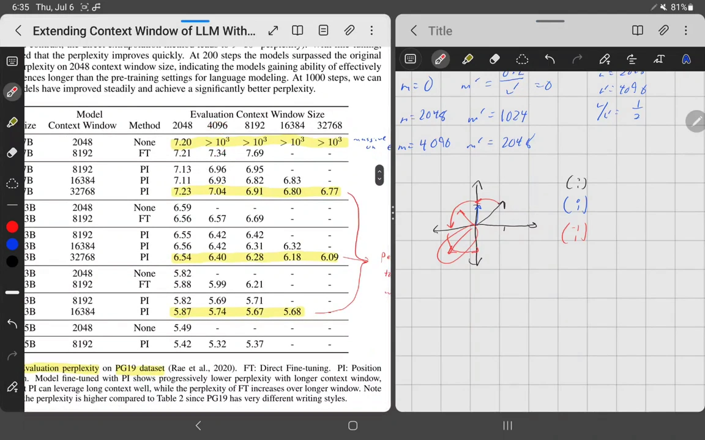

Table 2 是 PG19 数据集上的困惑度，四组模型规模（7B、13B、3B、5B），三种做法：

- **None**：原模型直接拿去跑更长窗口。7B 在 4096 及以后全部是 $>10^3$——完全不能用 [【跳转到 22:17】](https://www.youtube.com/watch?v=oyXdmtHgZFw&t=1337)；
- **FT**（直接外推 + 微调）：7B 扩到 8192 后，2048/4096/8192 三档是 7.21 / 7.34 / 7.69，**窗口越大越差**；
- **PI**：7B 扩到 8192 是 7.13 / 6.96 / 6.95，扩到 32768 是 7.23 / 7.04 / 6.91 / 6.80 / 6.77，**窗口越大越好**。

讲者对"越低"这件事的解读值得抄下来：困惑度下降的原因，是模型能用上更多信息——窗口更大，它就能从更靠前的上下文里捞东西；而**它是"下降"而不是"持平"，说明它不只是"能用"这段上下文，而是"确实在用"这段上下文** [【跳转到 23:32】](https://www.youtube.com/watch?v=oyXdmtHgZFw&t=1412)。这个推理很干净：如果窗口是摆设，困惑度会持平甚至有噪声，不会单调下降。

13B 上趋势一样（PI 扩到 32768 时从 6.54 一路降到 6.09）[【跳转到 23:57】](https://www.youtube.com/watch?v=oyXdmtHgZFw&t=1437)；3B、5B 也保持同样的单调性。Table 3 换到 Arxiv Math Proof-pile 数据集，结论不变——这也是讲者说"换一个数据集，结论照旧"的地方。

---

## 六、对照组：直接外推 + 微调，为什么不如 PI

这是全片最有说服力的一段。讲者先把"很多人的第一反应"摆出来：既然要长窗口，那就**拿一个 4096 的数据集，用常规外推法微调 LLaMA，让它见见没见过的位置**——听起来合理 [【跳转到 25:01】](https://www.youtube.com/watch?v=oyXdmtHgZFw&t=1501)。

结果表里看得很清楚（Table 2 的 FT 行）：外推微调确实"保住了一些信息"，但**窗口越开越大，困惑度反而往上走**（7B：7.21 → 7.34 → 7.69）。讲者的判断是：模型虽然被给了更大的窗口，**却用不上它** [【跳转到 26:16】](https://www.youtube.com/watch?v=oyXdmtHgZFw&t=1576)。

对比 PI 那几行，同一个模型、同样的微调流程，困惑度随窗口增大而下降。他用这一对照收束全片论点：**哪怕外推法被微调到一个 8192 的窗口长度，它在更大窗口上仍然越做越差；PI 则相反**——"这只能说明内插方法要好得多" [【跳转到 26:41】](https://www.youtube.com/watch?v=oyXdmtHgZFw&t=1601)。

把两条线并排看，机制其实一致：

| 做法 | 位置轴怎么变 | 分数落在哪 | 结果 |
| --- | --- | --- | --- |
| 直接外推 | 索引继续长大，越过 $L$ | 越界，值可到 8000 | 微调也救不回来 |
| PI 内插 | 索引乘 $\frac{L}{L'}$，压回 $[0, L)$ | 有界、平滑 | 窗口越大困惑度越低 |

---

## 七、工程视角：改一处位置映射，加 200 步微调

讲者在结尾给了一段"要不要用"的判断，理由有三条：

1. **实现极简**。不需要动模型结构，只是把相对位置（旋转角）按一个因子缩小；论文也保留了原架构，可以复用现有的优化与基础设施 [【跳转到 19:27】](https://www.youtube.com/watch?v=oyXdmtHgZFw&t=1167)。
2. **能救已有的模型**。它不是"下次预训练时记得开长窗口"，而是**能修好已经训好的模型**——Llama、Falcon 这类现成权重都能直接套 [【跳转到 28:46】](https://www.youtube.com/watch?v=oyXdmtHgZFw&t=1726)。
3. **代价可控**。200 步微调换一个长上下文，讲者认为是"很强大"的性价比 [【跳转到 27:56】](https://www.youtube.com/watch?v=oyXdmtHgZFw&t=1676)。

他也提到论文是开源的、附了复现图表的代码，并说自己正在折腾 Falcon，如果试了会把结果放在评论区 [【跳转到 28:21】](https://www.youtube.com/watch?v=oyXdmtHgZFw&t=1701)。整篇论文被他评价为"一篇很快的论文，不难"，但方法很可能会被后续广泛采用。

值得一提的是，PI 的这个"统一乘一个缩放系数"也正是后续方法的起点：既然问题出在"所有频率被一起压扁"，那自然可以**只压低频、不动高频**（NTK-Aware）或者**分频段处理**（YaRN）——那是本系列接下来两节的内容；而它们要修的那个毛病，正是本章 4.1 说的分辨率摊薄。

---

## 小结

- **外推坏的根源是位置越界**：RoPE 的注意力分数只由相对距离 $s$ 决定，模型只学过 $[0, L)$ 这一段 $s$，越界后分数会从个位数飙到 8000，困惑度冲到 $10^3$ 以上。
- **PI 的做法是压缩位置轴**：$f'(x,m) = f\left(x, m\cdot\frac{L}{L'}\right)$，把 $[0, L')$ 线性映射回 $[0, L)$，等效于"每个位置少转一点"（90° 变 45°）。
- **有效的原因**：压缩后相对距离重新落回训练区间，三角基函数的平滑性让分数保持有界；论文给出的上界比外推小约 600 倍。
- **代价一：分辨率摊薄**。所有频率统统一乘同一个系数，高频维度相邻位置的相位差被压缩，长距离与近邻的区分都变钝——压缩比越大越明显。
- **代价二：必须微调**。不微调时 PPL 是 16.10 / 112.13，200 步后降到 7.12 / 7.05，1000 步收敛到 6.95 / 6.83。
- **代价三：继续拉长会回退**。Table 3 中 7B 扩到 32768 时最后一档从 2.24 回升到 2.48；原窗口上的精度也会略掉（7.20 → 7.23）。
- **对照组说明 PI 不是"微调的功劳"**：同样微调，直接外推在 8192 上困惑度随窗口上升（7.21 → 7.34 → 7.69），PI 则下降（7.13 → 6.96 → 6.95）。

## 关键术语速查

| 术语 | 一句话解释 |
| --- | --- |
| 上下文窗口（context window） | 模型一次能"看见"的 token 数上限，预训练时定死，例：2048 |
| RoPE（旋转位置编码） | 给每个 token 的向量按位置旋转一个角度，位置信息藏在旋转量里，注意力分数只依赖相对距离 |
| 绝对位置编码 | 给每个位置一个固定正弦采样向量，与 RoPE 的相对式写法相对 |
| 外推（extrapolation） | 把位置索引用到训练区间之外，例：在 2048 上训练的模型直接跑 4096 |
| 内插（interpolation） | 在已有取值范围内插值取点，PI 即把长位置轴压回训练区间 |
| PI（位置线性内插） | $m' = m\cdot\frac{L}{L'}$，把位置索引按比例缩小后再算位置编码 |
| 压缩比 $\frac{L}{L'}$ | 原窗口长度与新窗口长度之比，2048→4096 时是 $\frac{1}{2}$ |
| 困惑度（perplexity, PPL） | 模型对下一个 token 的犹豫程度，越低越好；PI 下随窗口增大而下降 |
| $\theta_j$（旋转频率） | 第 $j$ 个二维子空间的频率 $10000^{-2j/d}$，决定该维度转多快 |
| 位置分辨率 | 相邻位置在角度上的"刻度"间隔；PI 压得越狠，刻度越细、区分越难 |
