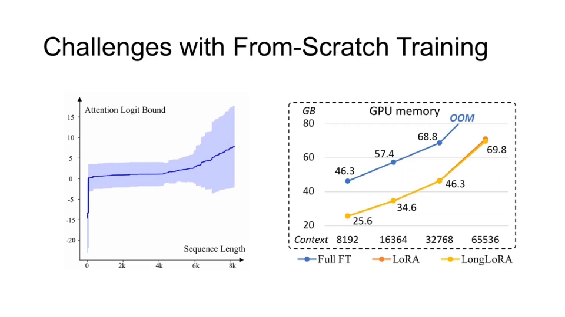
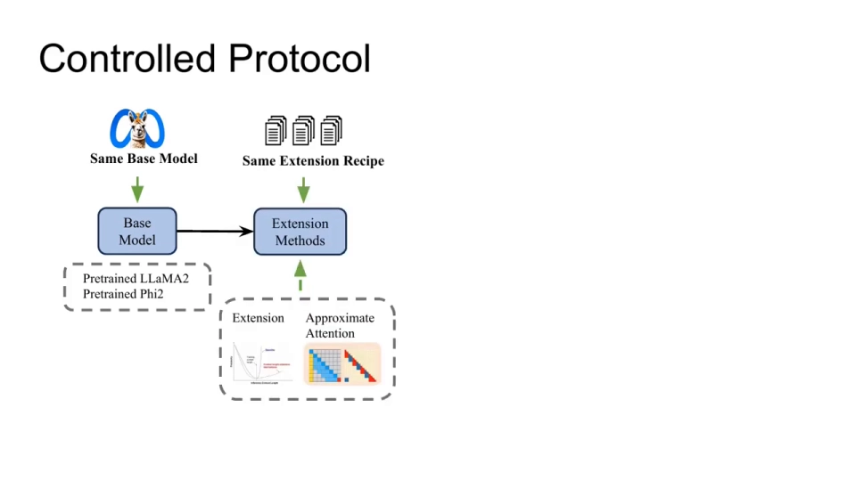
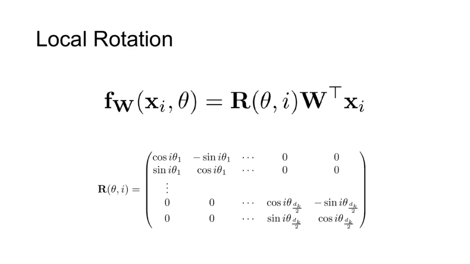
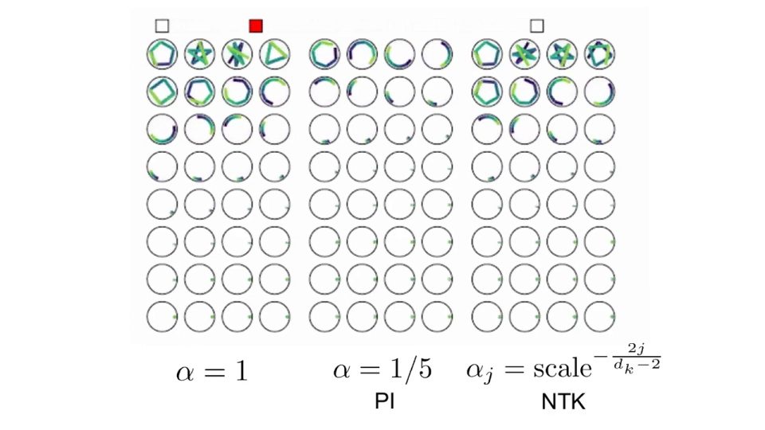
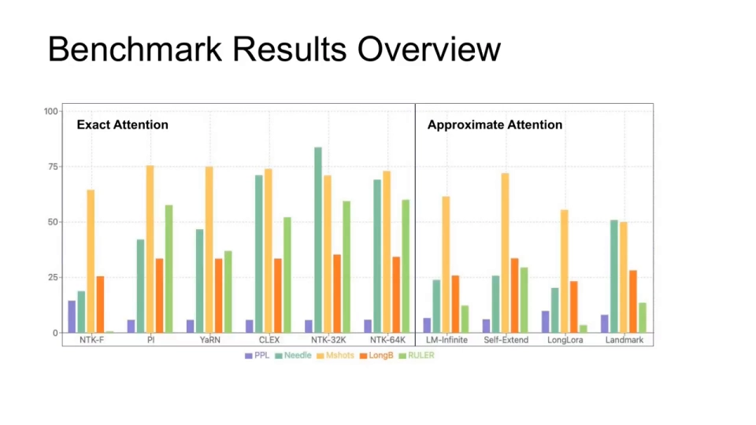
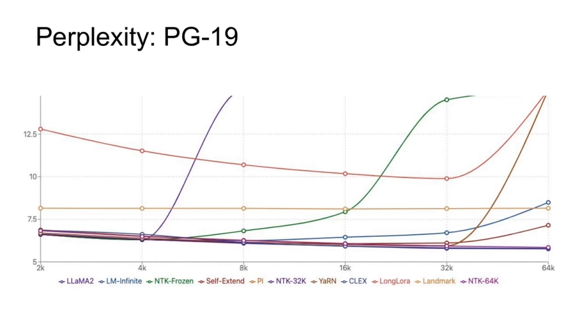
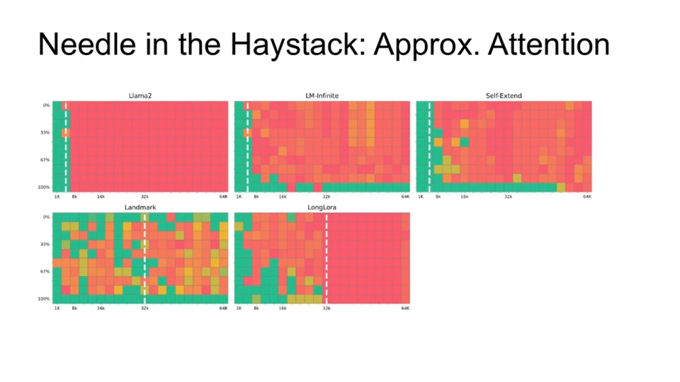
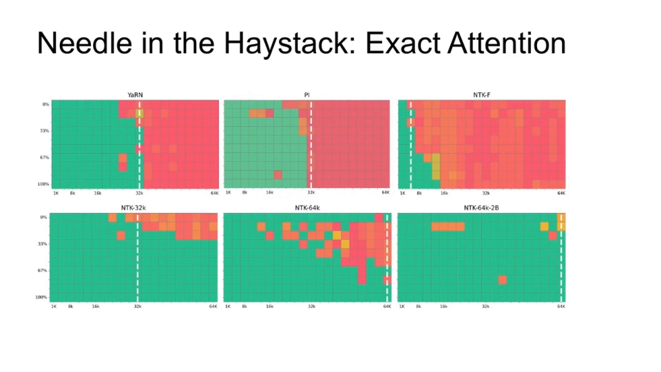
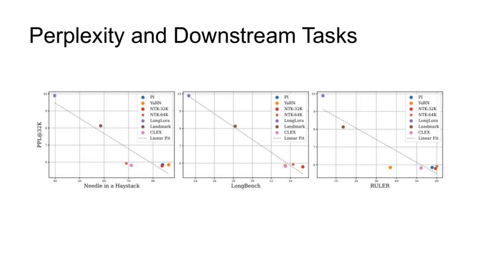
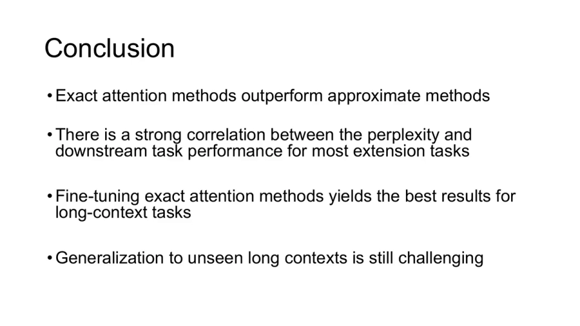

# 同一底座、同一份数据的对照实验：NTK 系缩放赢在保高频与可外推，输在必须微调和无限长度

> 视频来源：[Long-Context LLM Extension（长上下文扩展方法对照实验）](https://www.youtube.com/watch?v=dc4chADushM)（YouTube · Sasha Rush）｜时长约 26 分钟
> 本文基于视频演说图文稿整理，配图截自视频。这是一场教程 + 实验报告的讲演，内容来自一篇把各种长上下文扩展方法放进同一套受控设置里对比的论文（讲者在开场致谢了 Jing Nathan Yan、Yi Lu 等多位作者）。本文只讲它对 NTK 系方法的判定：赢在哪、什么时候掉。

## 本讲要解决的核心问题（SCQA）

**背景**：长上下文是刚需——法律、金融文档要整本塞进去，in-context learning 与长思维链推理要往上下文里堆越来越多的示例。从头训一个长上下文模型的代价却很高。

**冲突**：于是出现了一条"后训练扩展"的产业链：拿一个已经训好的模型，用少量额外训练把它撑到更长。但各家论文用的底座不同（不同版本的 Llama、Mistral）、训练配方不同、数据不同，**根本无法横向比较**，甚至还流传过"困惑度（perplexity）对长上下文扩展不重要"这类说法。

**疑问**：如果固定底座、固定训练数据、尽量固定超参，只让"扩展方法"当唯一变量，NTK 系方法到底赢在哪、什么时候掉？

**回答（中心思想）**：NTK 系——**改 RoPE 的旋转基 + 追加长数据微调**——在这套受控设置里全面占优或至少持平，而且能外推到训练长度之外；花哨的变体没有赢过基础版；冻结不训的版本到 8K 就发散；近似注意力方法不适合用来做外推；无限长度仍然无解。

---

## 一、为什么大家都不从头训：扩展长上下文要付三重代价

讲者先交代动机 [【跳转到 00:37】](https://www.youtube.com/watch?v=dc4chADushM&t=37)：长上下文的好处有两类——最直观的是**处理长文档**（把整份合同甚至整本书放进上下文），不那么直观的是**做 in-context learning 或推理**（往上下文里塞更多示例，让模型自己从中学，甚至像 o1 那样在超长上下文里现场做思维链）。

那为什么不把所有模型都训成长上下文？三个理由 [【跳转到 01:02】](https://www.youtube.com/watch?v=dc4chADushM&t=62)：

1. **稳定性**：在极长序列上训练，模型本身很难稳住；
2. **显存**：处理长序列要吃下巨量显存；
3. **数据**：训练集里本来就没有那么多长上下文样本，得想办法造合成样本，逼模型学会处理长序列。

正因为从头训这么贵，才有了"拿已训好的模型往后接"这条路线：一个带长度上限训出来的 Transformer 不会自然延伸到更长序列，直接喂长输入就会散架；但如果用小技巧（甚至完全不加训练技巧）就能把它撑长，至少能让它在长序列上**稳定工作**——注意，这不承诺它比原模型更好 [【跳转到 01:52】](https://www.youtube.com/watch?v=dc4chADushM&t=112)。

## 二、文献不可比：底座、配方、基准三样都没控住

讲者对这个领域的评价很直白：由于方法本身数学上简洁优雅，涌现了大量论文，几乎都说"这招有效、能推出稳定的模型"。但真正想比较时，麻烦有三个 [【跳转到 02:42】](https://www.youtube.com/watch?v=dc4chADushM&t=162)：

1. **底座不同**：有的用 Llama 的某个版本，有的用 Mistral，有的用别的开源模型；
2. **配方不同**：微调数据量不同、训练数据集也不同；
3. **基准不足**：直到最近才有一些能真正衡量长上下文推理能力的综合基准。

更麻烦的是由此长出的"民间共识"。讲者举了一例：去年有人说**困惑度对长上下文扩展其实不重要**，理由是长上下文的影响并不体现在困惑度上，所以它可能不是该看的指标 [【跳转到 03:07】](https://www.youtube.com/watch?v=dc4chADushM&t=187)。这个说法对不对？后面第八节会用同一套受控数据正面回答它。

## 三、受控协议：只让"扩展方法"当唯一变量

方法是给这件事上一套实验设计 [【跳转到 03:32】](https://www.youtube.com/watch?v=dc4chADushM&t=212)：

- **同一个底座模型**（LLaMA2、Phi2 这类预训练模型）；
- **同一份扩展训练数据**，尽可能**同一套超参**；
- **两边都测**：内在指标（困惑度、从上下文里取回信息的能力）+ 外在指标（RULER 这类基准、many-shot in-context learning、LongBench）。

这样一来，方法之间的差别就只能来自"扩展方法"本身，而不是各篇论文里那些说不清的杂音 [【跳转到 03:57】](https://www.youtube.com/watch?v=dc4chADushM&t=237)。

实验里出现的选手（读图时会反复遇到这几个名字）：`ntk_32k`（标准的 NTK 系方法，扩到 32k）、`ntk_64k`（同族但扩到 64k）、`ntk_frozen`（只改缩放、不做扩展微调）、`PI`（位置内插）、`YaRN`、`CLEX`，以及一批近似注意力方法（LM-Infinite、Self-Extend、LongLoRA、Landmark）。

## 四、教程部分：RoPE 的旋转矩阵，和"只有相对距离活下来"

要理解这些方法在改什么，先要把 RoPE 写成公式。讲者说这是现代 Transformer 相对 2017 年原始描述为数不多的改动之一 [【跳转到 04:47】](https://www.youtube.com/watch?v=dc4chADushM&t=287)：先定义一个**局部旋转函数**，输入是词嵌入 $x_i$ 和一个旋转基 $\theta$，

$$
f_W(x_i, \theta) = R(\theta, i)\, W^\top x_i
$$

把 $W^\top x_i$ 想成普通的线性层，新东西是那个 $R$：它吃进旋转基和位置 $i$（也就是 token 在序列里的绝对位置），输出一个**块对角矩阵，每个块都是 2×2 的旋转矩阵**，作用是把嵌入的每两个维度当成一对、各自旋转一个角度 [【跳转到 05:37】](https://www.youtube.com/watch?v=dc4chADushM&t=337)。

用法是把 Q 和 K 都换成这个函数：key 和 query 各按自己的绝对位置旋转，注意力其余部分完全不变。为什么这样做有意思？因为算 query 与 key 的外积时，旋转矩阵与它转置的乘积会**把两个绝对位置相减**，留下一项 $n - m$——**编码进注意力的是相对距离，不是绝对位置** [【跳转到 07:17】](https://www.youtube.com/watch?v=dc4chADushM&t=437)。而且这个编码同时依赖两件事：相对距离，以及每一维各自的旋转速率（同一向量里，靠上的维度转得快，靠下的转得慢）。

## 五、两类解法：改旋转基，还是改注意力结构

真正的麻烦出现在"要跑出训练长度"的时候：一旦相对位置越过某条严格的界线，模型就会遇到训练时从未见过的旋转组合，还得凭它去预测下一个词 [【跳转到 08:32】](https://www.youtube.com/watch?v=dc4chADushM&t=512)。文献里有两大类应对：

- **第一类：改旋转的用法**，让预训练模型觉得"没那么奇怪"——注意力仍然覆盖全部新上下文；
- **第二类：改注意力本身**，干脆不越界。

### 5.1 改旋转基：给 $\theta$ 乘一个常数 $\alpha$

第一类方法统一做法是：把旋转基 $\theta$ 逐位置地乘以一个新常数 $\alpha$，改变每个位置的旋转量 [【跳转到 09:22】](https://www.youtube.com/watch?v=dc4chADushM&t=562)。

**PI（位置内插）**：想把长度扩 5 倍（训了 1,000 token，测试要吃 5,000 token），就把基乘 $1/5$。所有旋转都变慢，于是最远处 5,000 token 的旋转量正好等于原模型里 1,000 token 的旋转量——**相当于把 5 个 token 塞进原来给 1 个 token 的旋转额度里** [【跳转到 09:47】](https://www.youtube.com/watch?v=dc4chADushM&t=587)。

这个想法很讨巧，但实践上有个关键弱点：如前面的示意图所示，PI 会对**短距离、高频的那些项改动特别大**，而短距离对语言建模极其重要，我们恰恰最想保住它们；长上下文真正难对付的是那些**低频、看得很远**的项 [【跳转到 10:37】](https://www.youtube.com/watch?v=dc4chADushM&t=637)。这就是 NTK 系方法的全部动机。讲者在这里很坦诚：**NTK 这个名字取得有点过于复杂，他不打算解释为什么叫这个，只看数学**——也就是它如何改变旋转。

图上三栏从下到上排开每一对的旋转轨迹，对应三种设置：

- 左栏 $\alpha = 1$：原版 RoPE；
- 中栏 $\alpha = 1/5$：PI，可以看到**高频项的变化非常大**，全都慢了下来，这种变慢一路延续到低频项——只不过在低频那里影响相对小；
- 右栏：NTK 的逐维缩放，权重是

$$
\alpha_j = \text{scale}^{-\frac{2j}{d_k - 2}}
$$

其中 $j$ 是维度（配对）序号，$d_k$ 是 key 的维度。图上看得出的效果是：**顶上的高频项几乎和 RoPE 一样，越往下越接近 PI** [【跳转到 11:49】](https://www.youtube.com/watch?v=dc4chADushM&t=709)。它们最终仍然把所有旋转都塞回原来的结构里，只是**不同的旋转被缩放不同的量**。实验里会测好几支 NTK 变体，但共同点就是这一条：**保高频，把低频推向 PI** [【跳转到 12:14】](https://www.youtube.com/watch?v=dc4chADushM&t=734)。

### 5.2 改注意力结构：四种"截断"路线

第二类方法完全不碰旋转，而是**不让注意力走出训练范围**——短序列的行为因此和以前一模一样，只要管住那片"红线外"的区域 [【跳转到 12:44】](https://www.youtube.com/watch?v=dc4chADushM&t=764)。四种代表做法：

1. **块对角注意力**（LongLoRA）：让注意力矩阵呈块对角结构，每块只回看固定长度。不同头、不同层错开块结构，保证整个长上下文仍然有广泛通信，只是单个头不越界 [【跳转到 13:09】](https://www.youtube.com/watch?v=dc4chADushM&t=789)。
2. **滑动窗口**（LM-Infinite）：结构平滑，每个 query 回看固定距离，但不把矩阵切块。实现上不如块对角高效，但自从 Mistral 这类模型发布后变得很常见 [【跳转到 13:34】](https://www.youtube.com/watch?v=dc4chADushM&t=814)。
3. **封顶长度**（Self-Extend）：不一定非要做高效注意力——还是看所有 token，只是**给超出范围的相对位置设一个上限**：原模型长度是 1,000，那么"看 1,000 个位置以外的东西"就当成"看 1,000 个位置远的东西" [【跳转到 14:24】](https://www.youtube.com/watch?v=dc4chADushM&t=864)。
4. **地标注意力**（Landmark Attention）：没有理由只用一个封顶长度，可以把不同长度分组为"地标"，甚至按层级去注意这些地标，同样保证不越界 [【跳转到 14:49】](https://www.youtube.com/watch?v=dc4chADushM&t=889)。

## 六、主结果：标准 NTK 全面占优，YaRN 与 CLEX 接近但落后，近似注意力更差

这张图是整场报告的主结论 [【跳转到 15:54】](https://www.youtube.com/watch?v=dc4chADushM&t=954)。左半区是**精确注意力**路线（各种 NTK 与位置内插的变体），右半区是一大批**近似注意力**路线（靠截断注意力绕开问题）。五组指标：困惑度、needle in a haystack、multi-shot ICL、LongBench、RULER——前两个可以看作任务本身的内在指标，后三个代表一组不同的长任务。除了头一个 `ntk_frozen`，其余方法都在额外的长数据上微调过 [【跳转到 16:19】](https://www.youtube.com/watch?v=dc4chADushM&t=979)。

讲者给的高层结论是：

- **标准的 NTK 方法（这里叫 `ntk_32k`）基本上全面胜出**：在所有指标上要么显著更好，要么至少持平 [【跳转到 16:44】](https://www.youtube.com/watch?v=dc4chADushM&t=1004)；
- 同族的 **YaRN 与 CLEX 相对接近，但在这些基准上表现更差**；
- 近似注意力方法里 **Self-Extend 相对好**，但**全都远不如"改 RoPE 结构 + 追加微调"这条路线**；
- 不同任务之间的准确率**相关性很高**：对大多数方法来说，扩展得更好，下游几个长上下文基准就一起更好 [【跳转到 17:09】](https://www.youtube.com/watch?v=dc4chADushM&t=1029)。

## 七、曲线与热图：4K 是 Llama 的墙，冻结不训 8K 就发散，NTK 还能往外推

横轴是测试时的上下文长度，纵轴是困惑度 [【跳转到 17:34】](https://www.youtube.com/watch?v=dc4chADushM&t=1054)：

- 走到 4K 附近，**基座 Llama 的困惑度开始明显变差**——这就是那堵墙；
- `ntk_frozen`（只改缩放、不做扩展微调）**到 8K 左右还行，之后发散** [【跳转到 18:24】](https://www.youtube.com/watch?v=dc4chADushM&t=1104)；
- 其他方法大多能再往前走一段，几支 NTK 系方法到 32k 都还算稳；
- 有几条线从一开始就很差，对应近似注意力方法——它们**即使在短序列上也不够强**。

再放大看 [【跳转到 18:49】](https://www.youtube.com/watch?v=dc4chADushM&t=1129)：`ntk_32k`、CLEX、`ntk_64k` 三支到 64,000 token 都做得极好；**只扩到 32k 的那支在序列的大部分区间反而更好**，两者在末端收敛。这就是"扩到哪就练到哪"的经验：多练不一定在目标长度内更优。而 YaRN 与最基础的位置内插能撑到 32k，之后在序列末端掉下去。**这些方法的一个重要差别，就在 32k 及更远处（甚至超出它们被训练扩展到的位置）表现如何**。

needle in the haystack 是这块的经典（也有争议）测试 [【跳转到 19:44】](https://www.youtube.com/watch?v=dc4chADushM&t=1184)。读图方式：横轴是上下文长度，纵轴是那条事实被埋得多深（越靠上越远），右上角最难。

- **基线 Llama 到 4K 还行，再往外几乎什么都不行**；
- 不少近似注意力方法能撑到更长，但**失去了长期记忆**——它们填满图的下半部分（近处的针），上半部分不行 [【跳转到 20:09】](https://www.youtube.com/watch?v=dc4chADushM&t=1209)；
- 有些方法结果居中，比如 Landmark Attention 能看得很远，但中间区域大量失手。

换成改旋转基的那批方法 [【跳转到 20:49】](https://www.youtube.com/watch?v=dc4chADushM&t=1249)（虚线白线标出各自被扩展到的长度）：

- 绝大多数模型在图的左半部分都不错，大面积涂绿；
- **位置内插与 YaRN 开始在最硬的 case 上出问题**：它们没法回看 32,000 token 把针找出来；
- **`ntk_32k` 与 `ntk_64k` 明显更好**，能往回看并找到；
- `ntk_frozen` 扩不出它原本训练的长度；
- 而 NTK 系方法最值钱的一条性质是**外推**：`ntk_32k` 即使在超出它被扩展到的长度之外，也还能回看得很远 [【跳转到 21:14】](https://www.youtube.com/watch?v=dc4chADushM&t=1274)。

## 八、困惑度还是最好的罗盘：与下游高度相关，也能看出模型是否真在用长上下文

这里要小心一个偏差：所有这些扩展方法可能只是在**优化检索**，而不是真的更会做长上下文语言建模 [【跳转到 21:39】](https://www.youtube.com/watch?v=dc4chADushM&t=1299)。于是论文把"困惑度"和"下游任务表现"对起来看——这正是第二节那个"困惑度不重要"说法的正面回应。

结论是：**在这个受控设置里，32,000 token 处的困惑度与下游任务成绩高度相关**——模型如果能把长序列上的困惑度压下去，它在那些长任务上通常也继续更好 [【跳转到 22:15】](https://www.youtube.com/watch?v=dc4chADushM&t=1335)。讲者特别强调，这个结论**只有在同一底座、同一份数据上才测得出来**：正因为把其他变量都固定了，才能拿困惑度横着比。

还有一个更直接的检验：这些模型**到底在用长上下文，还是学会了"把 4000 词以前的东西全忘掉"** [【跳转到 23:05】](https://www.youtube.com/watch?v=dc4chADushM&t=1385)。做法是按上下文位置平均负对数似然（NLL），并把"只回看前 4,000 词"的 Llama 作为参照线：

- 表现好的那几条线**能低于**这条参照线——证明它们确实从 4,000 词以前的信息里拿到了信号，甚至比基座模型的困惑度更好；
- 没调好的方法不但长序列上很差，**在新数据上甚至比 Llama 还差** [【跳转到 23:30】](https://www.youtube.com/watch?v=dc4chADushM&t=1410)。

## 九、结论与边界：一条能上线的路线，和四个还开着的问题

讲者的总结可以压缩成六条 [【跳转到 23:55】](https://www.youtube.com/watch?v=dc4chADushM&t=1435)：

1. **基于相对位置嵌入 NTK 插值的方法是一条很好的路线**：既能达到目标扩展长度，**还经常能推广到该长度之外**；
2. 试了几支更花哨的同族变体，**最基础的那一支就很好用**，具体超参在论文里给了 [【跳转到 24:00】](https://www.youtube.com/watch?v=dc4chADushM&t=1440)；
3. **用近似注意力来做长上下文扩展要更小心**：可以work，也可能翻车，而且**没看到哪一支能外推到给定长度之外** [【跳转到 24:25】](https://www.youtube.com/watch?v=dc4chADushM&t=1465)；
4. 一个很好用的性质是**困惑度与下游扩展任务强相关**：所以扩长上下文基本可以照搬预训练的套路——把困惑度调好，任务表现多半会跟上；
5. **微调是必要的**：所有基于"冻结"的方案都没能拿到好结果 [【跳转到 24:50】](https://www.youtube.com/watch?v=dc4chADushM&t=1490)；
6. **无限长度的外推仍然很难**：用注意力目前没有答案，即便最好的方法，在极长序列上的 needle 成绩也开始退化 [【跳转到 25:15】](https://www.youtube.com/watch?v=dc4chADushM&t=1515)。

把这篇的结论和姊妹篇（讲机制的一篇）对起来看，能得到一个很实用的判断：NTK 系之所以赢，是因为它**按维度分别缩放**——高频几乎不动、低频尽量向 PI 靠；而它之所以"输"，全在边界上：**不微调就发散、超出目标长度会退化、无限长度无解、以及"扩展得好"可能只是"检索变好"**。所以选型时的正确问法不是"哪个方法最强"，而是"我的目标长度是多少、能不能做那一段微调、超出长度时会以什么方式坏掉"。

## 小结

- 从头训长上下文要付稳定性、显存、数据三份代价，所以"后训练扩展"成了一条产业；扩展只保证稳定工作，不保证比原模型更好。
- 文献长期不可比：底座、配方、基准都没控住；受控协议把它压缩成"同一个底座 + 同一份数据 + 同一套超参，只变扩展方法"。
- 两大类方法：改旋转基（PI 乘 $1/5$；NTK 逐维缩放 $\alpha_j = \text{scale}^{-\frac{2j}{d_k-2}}$）与改注意力结构（块对角、滑动窗口、封顶长度、地标）。
- 主结果：标准 NTK（`ntk_32k`）五项指标全面占优或持平；YaRN、CLEX 接近但落后；近似注意力方法更差，Self-Extend 在那一类里相对好。
- 困惑度曲线上，4K 是基座的墙，`ntk_frozen` 到 8K 就发散；`ntk_32k`、`ntk_64k`、CLEX 能撑到 64k；只扩到 32k 的版本在大部分区间反而更好。
- needle 热图里，NTK 系不但能覆盖被扩展的长度，**还能往外推**；PI 与 YaRN 在最硬的 case 上吃力；近似方法只填近处、远处失忆。
- 困惑度依然是最好的罗盘：32k 处的困惑度与下游高度相关；按位置平均的 NLL 还能验证模型是否真的用上了 4,000 词以前的信息。
- 边界很清楚：必须微调、近似注意力不宜外推、无限长度仍未解决。

## 关键术语速查

| 术语 | 一句话解释 |
| --- | --- |
| 长上下文扩展 | 拿已训好的短窗口模型，用少量额外训练把它撑到更长序列 |
| 受控协议 | 固定底座、数据与超参，只让"扩展方法"变化，使比较有意义 |
| RoPE 旋转基 $\theta$ | 决定每一对维度转多快的常数序列，PI 与 NTK 都是在它上面做缩放 |
| PI（位置内插） | 把旋转基整体乘 $1/s$，让最远处的位置等价于训练内的位置 |
| NTK 系方法 | 按维度分别缩放旋转基（$\alpha_j = \text{scale}^{-2j/(d_k-2)}$），保高频、压低频 |
| `ntk_frozen` | 只改缩放、不做扩展微调的 NTK 版本，用来检验"免微调"是否可行 |
| 近似注意力 | 靠块对角、滑动窗口、封顶长度、地标等方式截断注意力，绕开越界 |
| perplexity（困惑度） | 模型对下一个 token 的预测平均有多"意外"，越低越好 |
| needle in a haystack | 把一句话埋进长文再提问的检索测试，只能当能力下限 |
| 负对数似然（NLL）按位置平均 | 把损失按 token 位置切开看，用来判断模型是否真的利用了远处上下文 |
