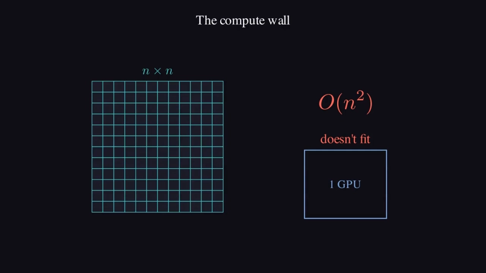
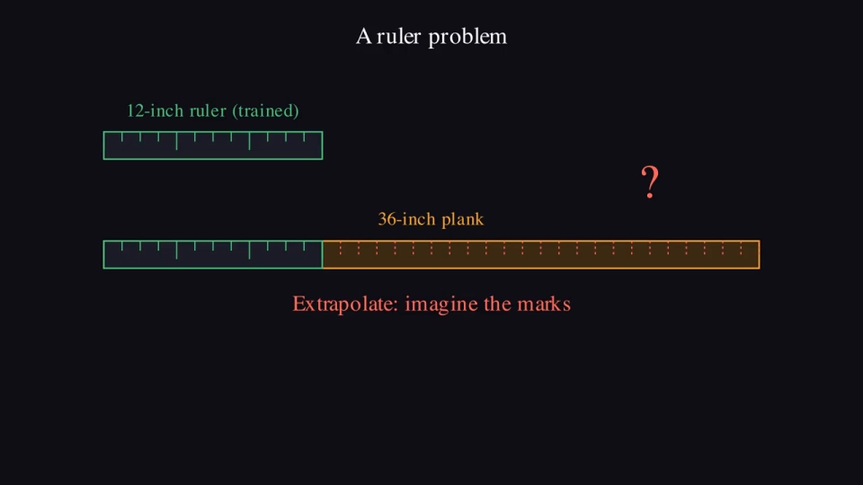
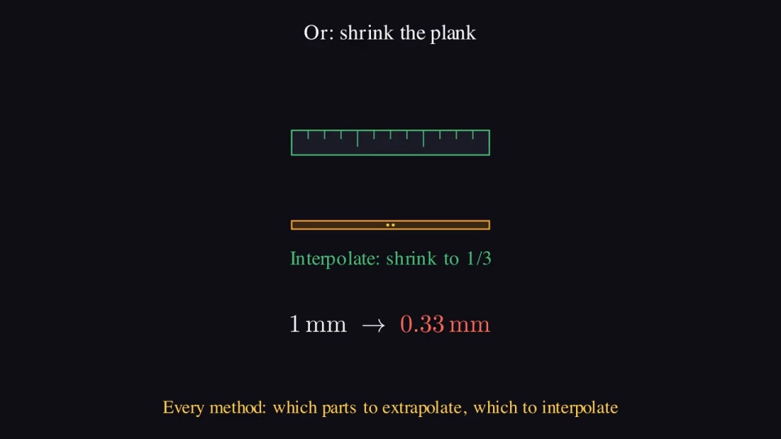
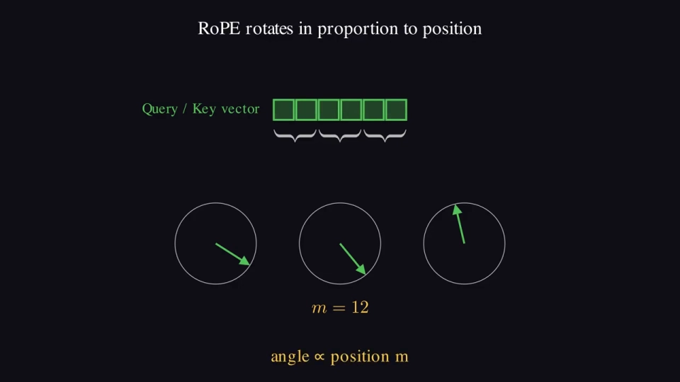
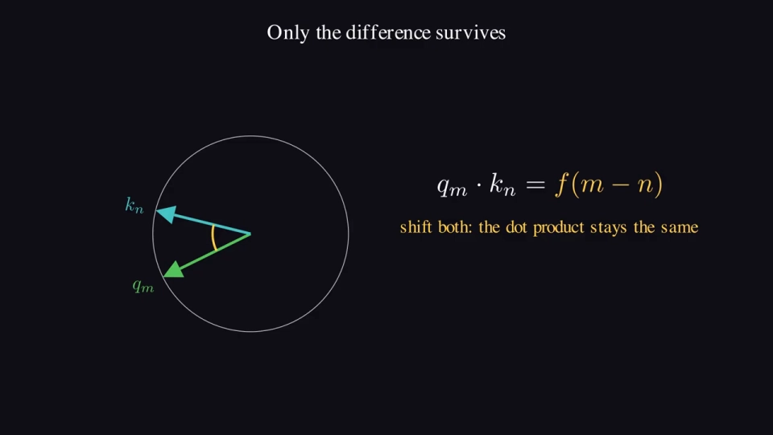
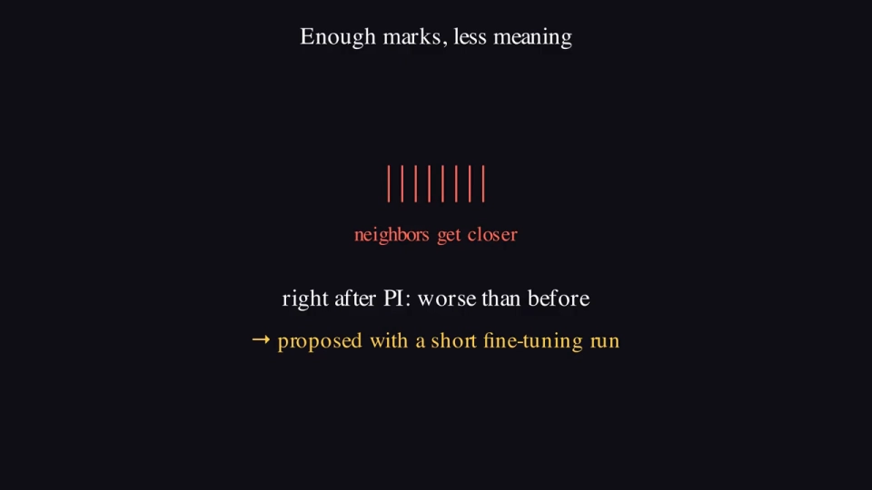
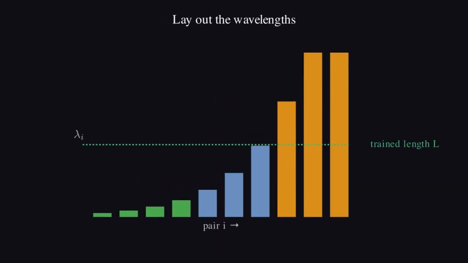
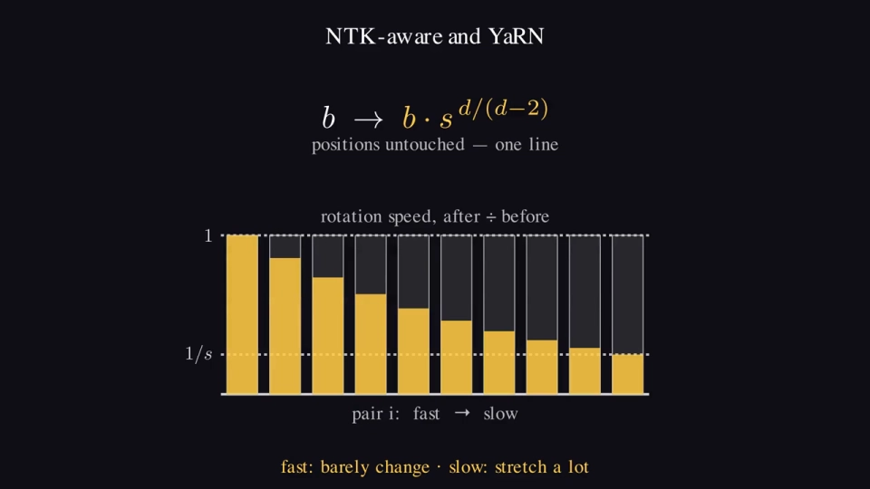
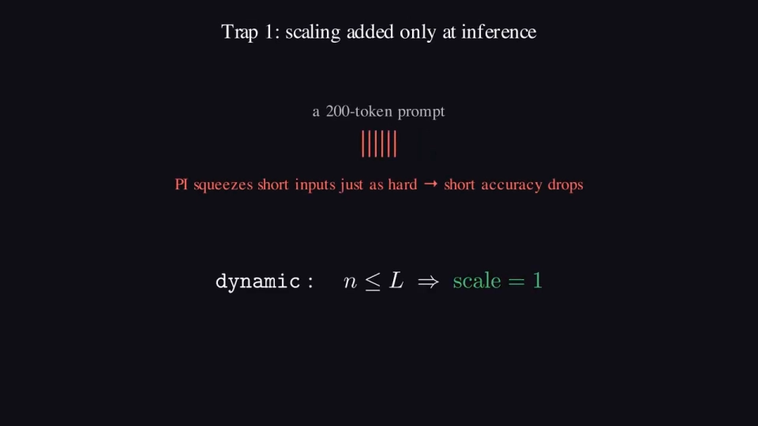
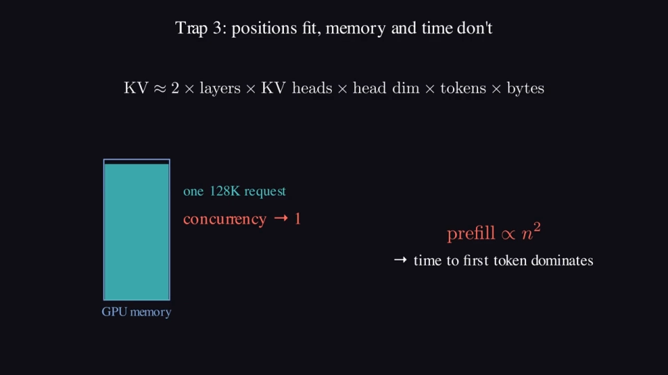

# 改底数不改位置：NTK-aware 缩放的一行公式与 Dynamic NTK 的按需生效

> 视频来源：[Long Context LLM Explained（长上下文的两堵墙：位置墙与算力墙）](https://www.youtube.com/watch?v=mJNE6b4kkxE)（YouTube · Struggle Technology）｜时长约 12 分钟
> 本文基于视频演说图文稿整理，配图截自视频。这是一支用动画把"长度外推"讲成几何问题的短片：全片围着 RoPE 的一对旋转角速度打转。本小节的落点是它给出的两件工具——改底数的 NTK-aware 缩放、和按需生效的 Dynamic NTK；位置内插（PI）与 YaRN 只在需要对照时出现。

## 本讲要解决的核心问题（SCQA）

**背景**：模型卡上写着 `context length 128k`，而模型的 RoPE 底数 $b$ 还是 10,000，权重是在 4K 或 8K 的窗口里训出来的。位置序号 $m$ 一旦走到 90,000，就进入了训练时从未出现过的角度区间。

**冲突**：最直接的办法是把位置序号压回去（位置内插，PI），但它是"一刀切"——把每一对维度的旋转全部按 $1/s$ 压慢，连本来就不缺覆盖的高频对也被压扁，近邻分辨力白白损失 [【跳转到 02:46】](https://www.youtube.com/watch?v=mJNE6b4kkxE&t=166)。

**疑问**：能不能不动位置序号，只改一个常量，让该缩的慢对缩、不该动的快对不动？短输入又怎么避免被同一把尺子挤压？

**回答（中心思想）**：NTK-aware 缩放只改 RoPE 的底数，改成 $b' = b \cdot s^{d/(d-2)}$，位置序号原样不动；这个指数选得恰好让最慢那一对按 PI 的方式被拉长 $s$ 倍、最快那一对几乎不动，中间各对平滑过渡。Dynamic NTK 再补一层判断：输入长度没超过训练长度时把 scale 退回 1，只有真超长才放大底数。

---

## 一、先分清两堵墙：位置墙是尺子问题，算力墙是 $n^2$ 问题

视频开篇就把"长上下文"拆成两件互不相关的事 [【跳转到 00:25】](https://www.youtube.com/watch?v=mJNE6b4kkxE&t=25)：

1. **位置墙**：模型在 4K 或 8K 上训练，推理时却坐到了位置 90,000。位置方案走进了没见过的区域，输出就散架了——**即使显存无限，这一步也照样崩**。
2. **算力墙**：每个 token 都要看每个 token，算术量和显存放着长度的平方长。从 8K 到 128K 不是 16 倍的问题，是 256 倍的问题 [【跳转到 06:54】](https://www.youtube.com/watch?v=mJNE6b4kkxE&t=414)。

两堵墙要用两套完全不同的工具拆：位置内插、NTK-aware、YaRN 攻第一堵；窗口化、ring attention 攻第二堵；needle 测试只负责检查到底拆掉没有。混着谈，讨论必然变成一团糨糊。

本篇只处理位置墙。讲者给了一个很土的类比：你只被训练过一把 **12 英寸的尺子**，现在有人递给你一块 **36 英寸的木板**，怎么办？

- **外推**（extrapolate）：想象刻度以同样的间距继续往后排。这是你没去过的地盘，绝大多数情况下会算错 [【跳转到 01:06】](https://www.youtube.com/watch?v=mJNE6b4kkxE&t=66)。
- **内插**（interpolate）：把木板缩到三分之一，再用你熟悉的那把尺子去量它的复印件。

内插的代价在图里写得很直白：**每一格都落回了熟悉区间，但精细区分被碾碎了——1 mm 的间隙变成 0.33 mm**。讲者由此给出一句总纲：本质上，每一种位置方法都只是在回答"哪些部分外推、哪些部分内插"。

## 二、RoPE 只需要一个事实：每一对维度按自己的角速度转

要用好这句话，只需要 RoPE 的一个事实：它把 query 和 key 向量切成一对对二维分量，每对按与位置 $m$ 成正比的角度旋转 [【跳转到 01:31】](https://www.youtube.com/watch?v=mJNE6b4kkxE&t=91)。

第 $i$ 对转多快，由这条式子定：

$$
\theta_i = b^{-\frac{2i}{d}}
$$

其中 $b$ 是叫 **base（底数）** 的常数，多数模型取 10,000；$d$ 是单个注意力头的维度；$\theta_i$ 是**每个 token 前进一格所加的角度**（弧度）；由此还能定义这一对的**波长**：

$$
\lambda_i = \frac{2\pi}{\theta_i}
$$

波长就是"这一对转满一整圈需要多少个 token"。式子的意思只有一句：**每一对有自己的转速，$i$ 越大转得越慢** [【跳转到 01:56】](https://www.youtube.com/watch?v=mJNE6b4kkxE&t=116)。

代入一组具体数字（按上式手算，非讲者原话）：取 $b = 10000$、$d = 128$，则 $i = 0$ 的第一对 $\theta_0 = 1$ 弧度/token，波长约 **6.3 个 token**；最慢的 $i = 63$ 那一对 $\theta_{63} \approx 1.2 \times 10^{-4}$，波长约 **5.4 万个 token**。同一条向量里，最快的一对和慢对之间的时间尺度差了近四个数量级——这正是后面所有取舍的来源。

再补一个关键性质：把位置 $m$ 上的 query 和位置 $n$ 上的 key 做点积，旋转矩阵相乘之后只剩 $m - n$ 的函数活着。

换句话说，两边同时平移，点积不变 [【跳转到 02:21】](https://www.youtube.com/watch?v=mJNE6b4kkxE&t=141)。这就是"重新编排位置序号"这件事居然有意义的原因——注意力看到的本来只是相对距离。

## 三、PI 的问题不是不够巧，是不分快慢一刀切

位置内插（Position Interpolation，PI）是最省事的修法：设训练长度 $L$、目标长度 $L'$，取 $s = L'/L$，然后把位置序号本身缩小：

$$
m' = \frac{m}{s}
$$

$s = 32$ 时，位置 90,000 被当成位置 2,812.5 —— 这样每个旋转角都落回训练区间。**出现小数完全没问题，因为 RoPE 的旋转角是连续的**。这就是"把木板缩一缩"的那一步：刻度够用了，但每一格的含义变轻了。

文稿还给了一个很实用的观察：**刚做完 PI 的模型，表现比之前更差**，所以 PI 在原论文里是和一短段微调一起提出来的。

PI 到底破坏了什么？把各对的波长摊开看就清楚了。

- $i$ 小的快对，波长只有几个 token，负责"把一个词和它旁边的词分开"。它们在训练里已经转过几万圈，**没有未见的区域**。
- $i$ 大的慢对，波长是几万 token 量级，在训练长度里**连一圈都没转完**，只见过角度范围的一小片。

而 PI 把它们的转速统一除以 $s$：真正有麻烦的只有慢对，快对却被连坐。**白白丢掉局部分辨率**这件事本身就把答案递到手里了——别动快对，只缩慢对 [【跳转到 03:54】](https://www.youtube.com/watch?v=mJNE6b4kkxE&t=234)。

## 四、NTK-aware 缩放：位置不动，只把底数换成 $b \cdot s^{d/(d-2)}$

第一个这么做的是社区发明的 **NTK-aware 缩放**，它只有一行：**不要碰位置，把底数 $b$ 乘上 $s$ 的 $\frac{d}{d-2}$ 次幂**。

$$
b' = b \cdot s^{\frac{d}{d-2}}
$$

它让每一对都变慢，但**慢得不均匀：快对几乎不动，慢对被拉长很多** [【跳转到 04:22】](https://www.youtube.com/watch?v=mJNE6b4kkxE&t=262)。这话听起来像许诺，其实可以直接从第二节那两条式子算出来。

**补充推导（非讲者原话，只是把文稿给的两条公式接起来）**：波长与底数的关系是 $\lambda_i = 2\pi b^{2i/d}$，把 $b$ 换成 $b'$ 后

$$
\frac{\lambda'_i}{\lambda_i} = \left(\frac{b'}{b}\right)^{\frac{2i}{d}} = \left(s^{\frac{d}{d-2}}\right)^{\frac{2i}{d}} = s^{\frac{2i}{d-2}}
$$

于是：

- 最快的 $i = 0$：指数为 0，**缩放比正好是 1，一对都没动**；
- 最慢的 $i = d/2 - 1$：指数 $(d-2)/(d-2) = 1$，**缩放比正好是 $s$**，也就是按 PI 的方式被拉长 $s$ 倍；
- 中间各对按 $s^{2i/(d-2)}$ 平滑地在两者之间过渡。

所以那个看起来奇怪的 $\frac{d}{d-2}$ 不是凑出来的：**它恰好是"让最慢那对拉伸 $s$ 倍、最快那对一动不动"的唯一指数**。

拿 $d = 128$、$s = 8$ 试一下（按上式手算）：$2i/(d-2) = i/63$，于是 $i = 0$ 缩放比 1、$i = 21$ 约 2 倍、$i = 42$ 约 4 倍、$i = 63$ 正好 8 倍；对应的底数从 10,000 变成约 82,700。**同一份权重、同一套位置序号，只是换了一张频率表。**

把它和 PI 摆在一起，差别一眼可见：

| 对照项 | PI（位置内插） | NTK-aware 缩放 |
| --- | --- | --- |
| 改的是什么 | 位置序号 $m' = m/s$ | RoPE 底数 $b' = b \cdot s^{d/(d-2)}$ |
| 位置序号 | 改：90,000 被当成 2,812.5 | 不改，仍是 90,000 |
| 快对（小 $i$） | 与慢对一样被压 $s$ 倍 | 几乎不动，缩放比趋近 1 |
| 慢对（大 $i$） | 压缩 $s$ 倍 | 拉长约 $s$ 倍，与 PI 的目标一致 |
| 中间各对 | 一刀切 | 按 $s^{2i/(d-2)}$ 平滑过渡 |
| 缩放是否逐维 | 否，所有频率同一个缩放比 | 是，每对按 $s^{2i/(d-2)}$ 各不相同 |

"改底数"之所以能等价于"逐对改转速"，是因为底数只出现在 $\theta_i$ 里：位置 $m$ 仍然原样乘进去，变的只是每一对的角速度本身。**这就是标题那句"改底数不改位置"的全部含义。**

需要说清边界：文稿对这一行给出的评价是"改动只有一行、几行代码"，以及上面那张逐对比值的图；**它并没有承诺可以完全不做微调**。这一点在本系列另一支对照实验里会被检验（冻结不训的 NTK 版本在 8K 之后就发散），本篇不展开。

## 五、Dynamic NTK：让放大只在需要时生效

静态放大有一个副作用，文稿把它列成"坑一"：**只在推理时加缩放**，却不做额外训练。原因很朴素——缩放是一把固定的尺子，**它压 200 个 token 的短 prompt 时和压 128K 一样狠**，于是短输入的精度先掉了 [【跳转到 10:03】](https://www.youtube.com/watch?v=mJNE6b4kkxE&t=603)。

`dynamic` 这个类型就是为这件事准备的：**只要输入还装得进训练长度，就把 scale 退回 1**。

$$
n \le L \;\Rightarrow\; \text{scale} = 1
$$

翻成工程语言：短 prompt 走原来的路径，一点也不改；只有序列真超过训练窗口，底数才开始被放大（文稿只给了这一条条件，超长时 $s$ 具体怎么取没有展开）。同一份权重因此能同时"在短文本上不变形、在长文本上不崩"，代价是模型在不同长度上的行为不再统一，调参和复现时都得盯住实际长度——这也是为什么配置里必须留下 `rope_scaling` 的类型和 factor，而不能靠"我记得开了缩放"。

## 六、上线前要看的三个字段与三个坑

**要看什么**：模型目录里的 `config.json`，重点三个字段——`max_position_embeddings`（标称窗口）、`rope_theta`（底数）、`rope_scaling`（type 是 `linear` / `dynamic` / `yarn` 之一，外加 factor）。type 和 factor 一起决定了到底哪种方法在起作用、力度多大 [【跳转到 10:03】](https://www.youtube.com/watch?v=mJNE6b4kkxE&t=603)。这也解释了为什么"模型卡写 128k"这句话本身信息量很低：它可能是真训过，也可能只是换了一张频率表。

**坑一：只在推理时加缩放**——上面已讲，短输入先受伤。

**坑二：配置在格式转换里丢了**。把权重转成 GGUF 之类的格式时，如果 `rope_theta` 或 `rope_scaling` 没被带过去，模型会**静默地坏掉**：短 prompt 看着一切正常，长 prompt 开始胡言乱语。这类故障最难查，因为它不报错。

**坑三：位置装得下，显存和时间装不下**。

KV cache 的体积大致是

$$
\text{KV} \approx 2 \times \text{layers} \times \text{KV heads} \times \text{head dim} \times \text{tokens} \times \text{bytes}
$$

于是一个 128K 的请求就可能把并发压到 1；而 prefill 又随长度的平方增长，首 token 延迟（time to first token）直接决定用户体验 [【跳转到 10:28】](https://www.youtube.com/watch?v=mJNE6b4kkxE&t=628)。**位置墙拆了，算力墙还在原地。**

## 七、边界：NTK 拆的是位置墙，不是"长上下文"本身

这一节把文稿里与"拆掉位置墙之后还剩什么"有关的部分压缩成四条，因为它们决定了"敢不敢真的上线"：

1. **另一堵墙有另一套工具**：滑动窗口把每个 token 的注意力限制在最近 $W$ 个 token，代价降到 $O(N \cdot W)$；层数堆起来把感受野扩到"层数 × 窗口"，但**离开窗口的信息是真的没了**。删旧 KV 会让输出崩掉，原因是前几个 token 被模型当成注意力的"下水道"（attention sink）：softmax 要求权重加和为 1，没处可看的头也得把概率质量倒在开头几个 token 上；修法是把开头几个 token 钉在缓存里。这套东西能换来"永不退化的聊天"，**换不来"读一份 10 万 token 的合同"**。
2. **远距离注意力要靠多卡**：ring attention 把 flash attention 的分块思路抬到 GPU 层面，边传 KV 边算注意力，只要算一块比传一块慢，通信就近乎免费；代价是因果掩码带来的负载不均，要靠 striped attention 一类的划分来抹平。
3. **needle 测试只是下限**：埋一句话进长文再问，全绿并不等于能用。要追问四件事——针是不是太显眼（工作里要找的内容和周围用同一套词汇）、是不是只有一根针（多针、跨针推理会让分数明显掉）、**中间是不是空的**（lost in the middle 的 U 形：开头和结尾被用上，中间被忽略）、热图有没有一直画到标称长度（Ruler 显示不少模型在标称数字之前就掉了）。
4. **结论**：needle 挂了一定不能用；needle 全过也不保证你的任务能用。真正的采纳决策要用**自己文档分布里的一小份评测集**来做 [【跳转到 09:38】](https://www.youtube.com/watch?v=mJNE6b4kkxE&t=578)。

## 小结

- 长上下文是两堵墙：位置墙（没见过 90,000 这个位置）与算力墙（$n^2$ 的开销），用两套不相干的工具拆，混谈必然混乱。
- 一切位置方法都在回答"哪些部分外推、哪些部分内插"；PI 选的是全部内插，于是 1 mm 变 0.33 mm，快对的局部分辨率被白白牺牲。
- RoPE 的每一对维度按 $\theta_i = b^{-2i/d}$ 自转，波长 $\lambda_i = 2\pi/\theta_i$；点积只留下 $m-n$，所以重排位置才有意义。
- 快对在训练里转过几万圈、没有未见区域，慢对连一圈都没转完——**该缩的只有慢对**，这是 NTK 系方法的共同出发点。
- NTK-aware 缩放不动位置序号，只改底数 $b' = b \cdot s^{d/(d-2)}$；这个指数恰好让最慢那对拉伸 $s$ 倍、最快那对不动，中间按 $s^{2i/(d-2)}$ 过渡。
- Dynamic NTK 把"是否放大"变成条件判断：$n \le L$ 时 scale 退回 1，短输入完全走原路。
- 工程上有三个坑：只在推理时加缩放、格式转换丢了 `rope_theta` / `rope_scaling`（静默坏）、位置装得下但 KV cache 和 prefill 装不下。
- NTK 只拆位置墙；窗口化、ring attention 属于另一堵墙，needle 测试只提供下限。

## 关键术语速查

| 术语 | 一句话解释 |
| --- | --- |
| 位置墙 | 位置序号超出训练区间，模型遇到从没见过的旋转角，输出崩坏（与显存无关） |
| 算力墙 | 注意力让算术与显存随序列长度的平方增长，8K 到 128K 是 256 倍 |
| RoPE | 旋转位置编码：把 Q/K 切成二维对，按与位置成正比的角度旋转 |
| base（底数）$b$ | 决定各对旋转频率尺度的常数，多数模型取 10,000 |
| 波长 $\lambda_i$ | 第 $i$ 对转满一整圈所需的 token 数，越大的 $i$ 越长 |
| PI（位置内插） | 把位置序号缩小 $s$ 倍（$m'=m/s$），让所有角度落回训练区间 |
| NTK-aware 缩放 | 不改位置，只把底数放大为 $b \cdot s^{d/(d-2)}$，实现"快对几乎不动、慢对拉长 $s$ 倍" |
| Dynamic NTK | `rope_scaling` 的 `dynamic` 类型：输入不超过训练长度时退回 scale = 1，只有超长才放大 |
| needle in a haystack | 在长文里埋一句话再问的检索测试，只能当能力下限 |
| attention sink | softmax 权重必须加和为 1，模型把无处安放的注意力倒在前几个 token 上的现象 |
