# 从论文到config：YaRN 落地后的账单、缓存与开关

> 视频来源：[How RoPE Let LLMs Stretch from 4K to 128K Context](https://www.youtube.com/watch?v=uOsFsDnCAWE&t=0)（YouTube · Sahil Gangurde）｜时长约 49 分钟
> 导读：这支长视频前半段是把 RoPE 从头讲一遍（注意力为什么看不见顺序、旋转怎么给出相对位置、长期衰减上界），后半段才落到 YaRN 以及"落地之后"。本系列 2.3 已完整讲过 RoPE 的推导，位置内插（PI）与 NTK-aware 各有专篇，所以本文只保留与**落地**直接相关的那部分：上界为什么压不住越界、PI 的实测账、NTK-by-parts 与温度的代码形态、KV cache 的账单、动态 $s$ 与固定 $s$ 的取舍，以及五家模型 config 里的真实参数。
> 本文基于视频演说图文稿整理，配图截自视频。

## 本讲要解决的核心问题（SCQA）

**背景**：几乎每个开源模型的 `config.json` 里都有一组 `rope_scaling` 字段。"开 YaRN、因子 4、上下文 128K"——在部署脚本里就是几行配置。

**冲突**：打开开关几乎免费，**账单却全在显存里**。Llama 2 7B 每读一个 token，都要在 KV cache 里留下这个 token 的 key 和 value，折算下来是 **512 KB/token**：4K 上下文一条对话 2 GB，64K 是 32 GB，128K 是 **64 GB**——一张 80 GB 的 H100 扣掉 13.5 GB 权重之后，只够**一个** 128K 用户。更糟的是，YaRN 论文里那个"随长度自适应"的动态缩放因子 $s$，一旦随长度变化，缓存里每个 key 记录的角度就全错了。

**疑问**：从论文到 config，哪些参数是真正的机制、哪些只是约定？为什么服务端宁可放弃动态缩放？这 64 GB 又该怎么省？

**回答（中心思想）**：**YaRN 在算法上几乎是免费的（只改位置编码、温度折进 cos/sin 表），但在系统上一点也不便宜（上下文长度直接乘进 KV cache）。** 落地时真正要做的判断只有四个：①认清 RoPE 的保证只是"距离"和"一个很高的上界"，越界照样会炸；②按"每根指针训练中转过几圈"分档减速（NTK-by-parts），再补一个温度；③服务端用**固定** $s$，因为动态 $s$ 会让缓存失效；④用 GQA / MLA 把缓存本身压小——而 MLA 里那条专门留给位置的 64 维车道，恰恰是 YaRN 唯一不去拉伸的东西。

---

## 一、先把账单算清楚：长上下文花的是显存

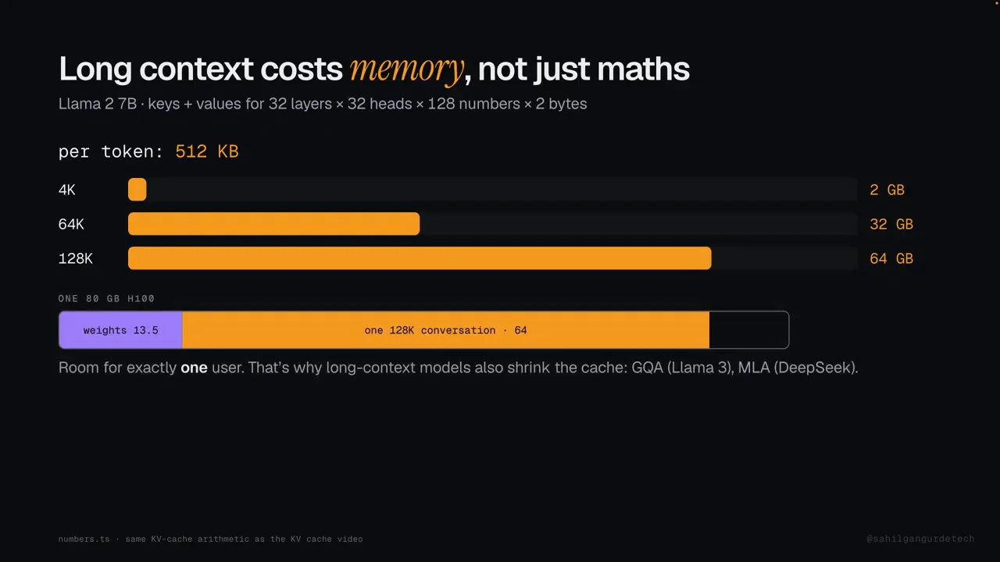

视频把这张账单放在讲完算法之后、讲服务端之前，顺序很讲究：**算法决定"能不能读 128K"，显存决定"能同时服务几个 128K"**。

### 1.1 512 KB 是怎么来的

Llama 2 7B 的一层里，key 和 value 各有 32 个头，每个头 128 个数，每个数是 2 字节（fp16）。于是每个 token 在**每一层**要存：

$$
2\ \text{（K 和 V）}\times 32\ \text{（头）}\times 128\ \text{（数）}\times 2\ \text{字节} = 16{,}384\ \text{字节}
$$

再乘 32 层，就是 $16{,}384 \times 32 = 524{,}288$ 字节 ≈ **512 KB**。乘上长度立刻见血：4,096 token 约 2 GB，65,536 token 约 32 GB，131,072 token 约 **64 GB** [【跳转到 43:04】](https://www.youtube.com/watch?v=uOsFsDnCAWE&t=2584)。

> 一个口径问题：这段口播说的是"每 token 51 KB"，但幻灯片上的算式与 2 GB / 32 GB / 64 GB 这三档数字只有按 **512 KB** 才算得通（32 层 × 32 头 × 128 数 × 2 字节 × 2）。本文按画面与算式，取 512 KB。

### 1.2 一张卡只够一个用户

80 GB 的 H100 里，光权重就占 13.5 GB，剩下的装一条 128K 对话的 64 GB 缓存，已经所剩无几——**刚好一个用户** [【跳转到 43:38】](https://www.youtube.com/watch?v=uOsFsDnCAWE&t=2618)。这就是为什么"每个做长上下文的模型，同时都在压缓存"：

- **GQA**（grouped query attention，分组查询注意力）：让多个 query 头共享一组 K/V 头，直接把"头的份数"除下去，Llama 3 走的就是这条路（本系列 2.2 有专篇）；
- **MLA**（multi-head latent attention，多头潜在注意力）：先把 K/V 压成一个低维潜向量再缓存，DeepSeek 系列走这条路——第九节会看到它和 YaRN 的一个微妙关系。

---

## 二、RoPE 真正保证的是什么：只有距离，而且衰减只是一个上界

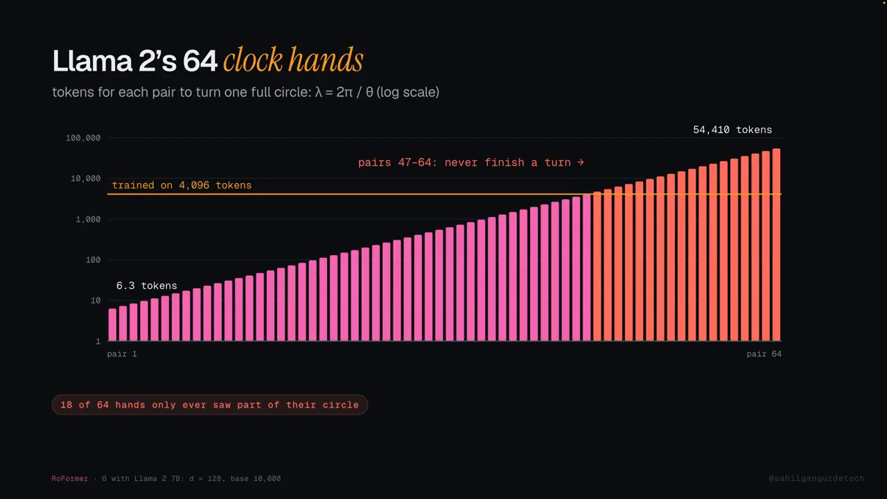

### 2.1 64 根指针，两个极端

一个 128 维的头拆成 64 对，每对一个速度，$\lambda = 2\pi/\theta$ 就是它转一圈需要的 token 数。图上第一对是 6.3 个 token，最后一对是 **54,410** 个 token [【跳转到 15:42】](https://www.youtube.com/watch?v=uOsFsDnCAWE&t=942)。

在这张对照表上画一条 4,096 的线，右侧立刻变红：**64 根里有 18 根在训练期间一圈都没转完**（图上标的是 pairs 47–64）。视频把这句说得很重："记住 18 这个数，长上下文之所以难，全在这里"。

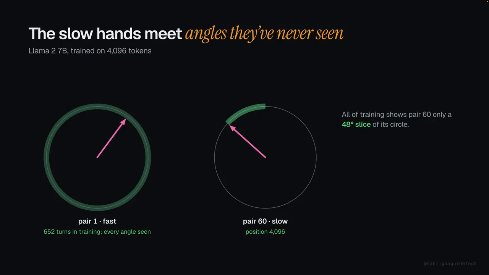

画面上的对照非常直观：快指针 pair 1 在 4,096 个 token 里转了 **652 圈**，圆周被反复覆盖，之后遇到什么角度都不算新；慢指针 pair 60 只扫过 **48°**，就像一块只被展示过"12:00 到 2:00"的表，你问它四点半是什么意思，它没有这个概念 [【跳转到 25:14】](https://www.youtube.com/watch?v=uOsFsDnCAWE&t=1514)。

### 2.2 长期衰减：远距离的分数有"天花板"

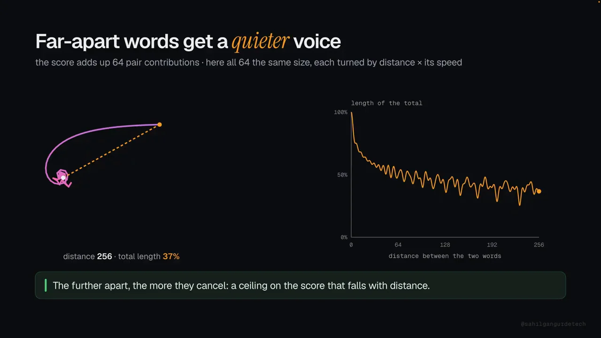

注意力分数是 64 对贡献之和，每一对按"距离 × 自己的速度"旋转。把每个贡献画成一根小箭头首尾相接：距离为 0 时所有箭头同向，总和最长；距离一拉开，快箭头四散、互相抵消，总和变短。距离 256 时，只剩原来的 **37%** [【跳转到 20:53】](https://www.youtube.com/watch?v=uOsFsDnCAWE&t=1253)。

论文把这件事写成一个严格的上界，用的是**分部求和**（summation by parts，又叫 Abel 变换）：把"64 个旋转的部分和"提出来，上界就变成"相邻两项差的最大值 × 部分链的总长度"，后一个因子只和距离有关 [【跳转到 22:33】](https://www.youtube.com/watch?v=uOsFsDnCAWE&t=1353)。

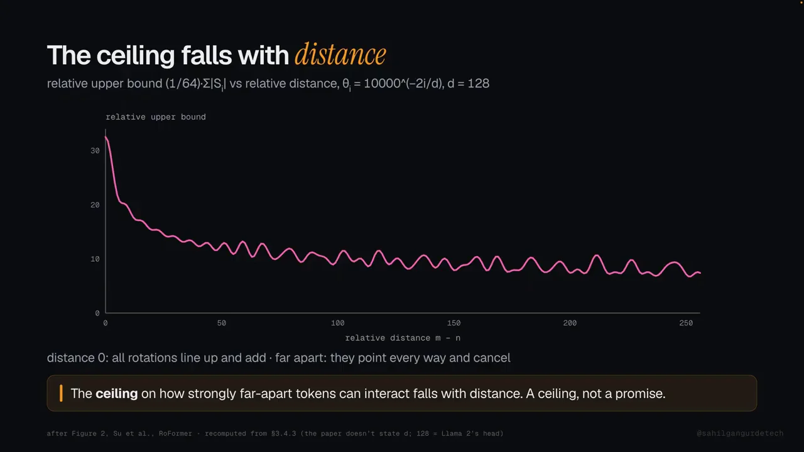

请看准这张图的纵轴：**上界在 30 附近**。视频在这里给了一句我认为是全场最重要的提醒——"这是一个**天花板，不是承诺**"（a ceiling, not a promise）。上界高到几十，而模型真正在意的分数只在正负个位数之间，所以这个上界根本拦不住越界后的爆炸 [【跳转到 26:33】](https://www.youtube.com/watch?v=uOsFsDnCAWE&t=1593)。

### 2.3 论文给的三个证据（顺带看看 RoFormer 的战绩）

RoFormer（2021 年提出 RoPE 的论文）本身的收益是"温和"的，视频难得地没有只挑好听的讲：

- **机器翻译**：WMT 2014 英德，Transformer-base 27.3 BLEU，RoFormer 27.5——赢了，但只赢 0.2 [【跳转到 22:53】](https://www.youtube.com/watch?v=uOsFsDnCAWE&t=1373)；
- **GLUE**：六个任务里三个更好、三个更差（MRPC 88.9→89.5、STS-B 85.8→87、QQP 71.2→86.4 变好；SST-2 93.5→90.7、QNLI 90.5→88、MNLI 84.6→80.2 变差）[【跳转到 23:33】](https://www.youtube.com/watch?v=uOsFsDnCAWE&t=1413)；
- **长文本才是它的主场**：中文法律文书 CAIL2019-SCM 上，512 token 的 WoBERT 基线 68.10%，RoFormer-512 是 68.29%，把窗口开到 1,024 的 RoFormer-1024 拿到 **69.79%**。

> 口径问题：口播把 BLEU 说成 74.3 与 73.5（顺序还与"RoFormer 小胜"相反），幻灯片上写的是 27.3 与 27.5。这里按画面。

另外两个证据只有趋势没有数字：把 BERT 的位置编码换成 RoPE，训练损失下降更快；因为 RoPE 只改向量、不改注意力图，它甚至能塞进 Performer 这类线性注意力模型，而"按距离打分"的方法塞不进去。

---

## 三、越界为什么会炸：一个可以自己复现的实验

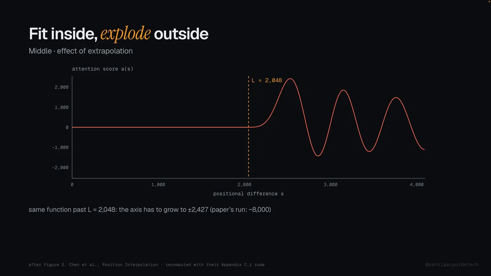

位置内插的论文做过一个很有说服力的实验，视频用作者自己的代码复现了一遍：随机指定 0 到 2,048 之间每个距离上的"目标注意力分数"，然后用 Llama 的真实速度去拟合这 64 条正弦波之和 [【跳转到 26:53】](https://www.youtube.com/watch?v=uOsFsDnCAWE&t=1613)。

- **圈内**：拟合得很好，分数老老实实待在 ±1 以内；
- **圈外**：**同一个函数**稍微越过 2,048，纵轴就必须一路放大——视频这次跑到约 **±2,427**，论文里那次跑到约 **8,000** [【跳转到 27:13】](https://www.youtube.com/watch?v=uOsFsDnCAWE&t=1633)。

几千分的注意力分数会把 softmax 彻底压扁：一个 token 抢走全部注意力，其余全被清零，于是困惑度直接冲到一千以上。这就是"越界即崩"的定量版本。

但同一张图里还藏着解法的根据：**在这些已经见过的整点之间取值，曲线是平滑温和的**（视频提到 25 到 75 这一段整点之间的走势）。一句话总结这两张图：**走到没见过的位置是危险的，而在见过的点之间插值是安全的**——这正是位置内插的全部动机 [【跳转到 27:53】](https://www.youtube.com/watch?v=uOsFsDnCAWE&t=1673)。

---

## 四、位置内插：200 步换一个窗口，代价记在高频上

PI 的做法是把位置标签整体缩小：位置 $m$ 处的新旋转 = 原来 $m \cdot L/L'$ 处的旋转（$L$ 原长、$L'$ 新长）。因为角度 = 位置 × 速度，缩小位置等价于把所有指针统一减速 $s = L'/L$ 倍。4K 到 64K 就是 $s=16$ [【跳转到 29:53】](https://www.youtube.com/watch?v=uOsFsDnCAWE&t=1793)。

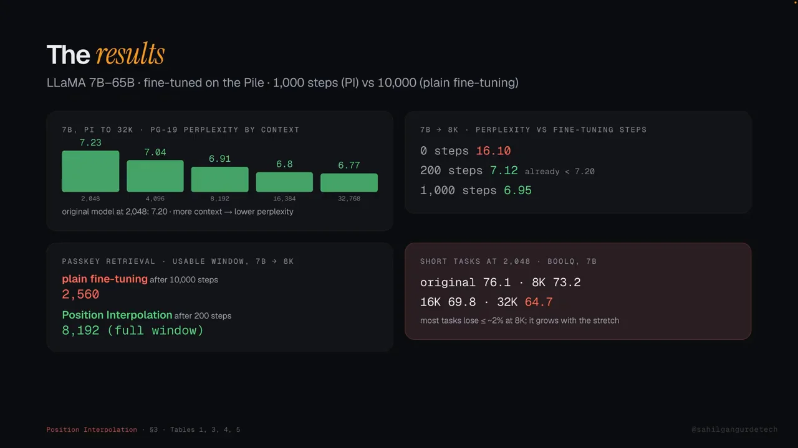

这张面板把 PI 的账算得很全（论文在 LLaMA 7B–65B 上微调 1,000 步）[【跳转到 31:33】](https://www.youtube.com/watch?v=uOsFsDnCAWE&t=1893)：

- **越长越好用**：7B 扩到 32K 后，PG-19 困惑度在两万上下文处是 6.77，比原始模型在 2,048 上的 7.20 还低——多出来的窗口确实被用上了；
- **微调很便宜**：完全不微调就能撑到 8K，困惑度约 16.10（很差，但远不是"一千"）；**200 步**就到 7.12，已经优于原模型；1,000 步到 6.95；
- **pass key 才是硬指标**：在同一批数据上纯微调 10,000 步，可用窗口只从 2,048 挪到 2,560；PI 只用 200 步就把 8,192 的窗口整个打通 [【跳转到 32:13】](https://www.youtube.com/watch?v=uOsFsDnCAWE&t=1933)；
- **代价在短任务上**：BoolQ 从 76.1 掉到 8K 的 73.2、16K 的 69.8、32K 的 64.7——拉得越长掉得越多。

掉分的原因在第二节那根快指针上：相邻 token 原本在它上面差 1 弧度（57°），除以 16 之后只剩 **3.6°**，专门负责"分辨邻居"的那根指针几乎分不出邻居了 [【跳转到 32:53】](https://www.youtube.com/watch?v=uOsFsDnCAWE&t=1973)。视频用一句大白话收束这一段：PI 把每根指针都按同一比例减速，于是"秒针也被拖慢了"。

---

## 五、从改 base 到按圈数分档

### 5.1 NTK-aware：只改一个 base，快指针分毫不动

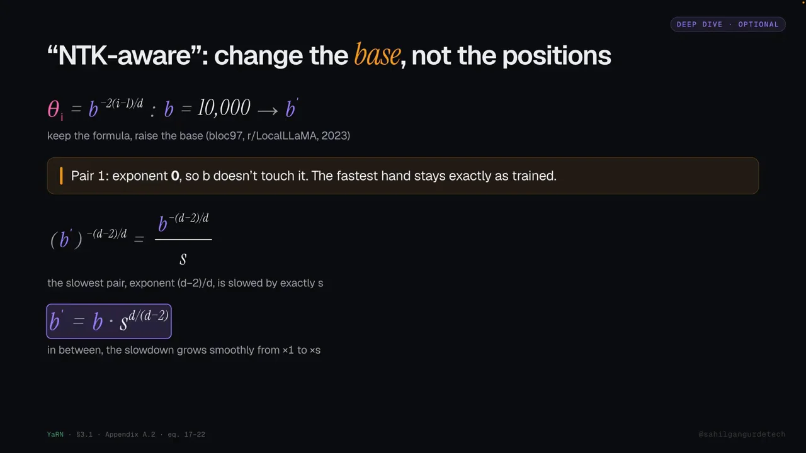

NTK-aware 插值来自 bloc97 的一篇 Reddit 帖（论文把它收编并命名）：**保持速度公式，只把 base 抬高**。看指数就明白它为什么"只动慢的"：

$$
\theta_i = b^{-2(i-1)/d}
$$

- 第 1 对的指数是 0，所以它恒等于 1 弧度/token，base 抬到多少都与它无关——**快指针原样保留**；
- 让最慢那一对恰好慢 $s$ 倍，解出新的 base：

$$
b' = b\cdot s^{\,d/(d-2)}
$$

Llama 2 扩到 64K（$s=16$）时，base 从 10,000 变成约 **167,000**；逐对看，pair 1 不变、pair 32 慢约 4 倍、pair 64 慢 16 倍 [【跳转到 36:23】](https://www.youtube.com/watch?v=uOsFsDnCAWE&t=2183)。

视频还顺便交代了这条路线的现实地位：**Code Llama 直接把 base 设成 1,000,000、按 16K 训练；Llama 3 从第一天起就用 500,000 的 base** [【跳转到 37:03】](https://www.youtube.com/watch?v=uOsFsDnCAWE&t=2223)。也就是说，"抬 base"已经从补丁变成了预训练配置的一部分。

它的缺陷是那条"平滑曲线"：中间的指针只被拖慢一点点，仍然会游到训练没见过的角度。论文的实测里，NTK-aware 微调后在 32K 上崩掉——所以还需要第三步。

### 5.2 NTK-by-parts：按"转过几圈"分档

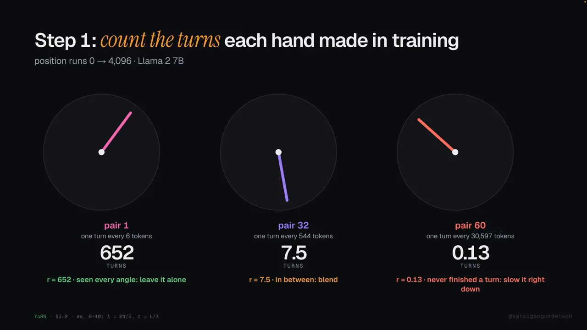

YaRN 的第一块拼图把 NTK-aware 的"平滑曲线"换成**分段**的。判据是圈数：

$$
r = \frac{L}{\lambda} = \frac{\text{训练长度}}{\text{该对波长}}
$$

三根代表指针的结果一目了然：pair 1 转了 **652 圈**（每个角度都见过，别动它）、pair 32 转了 **7.5 圈**（在中间，混合）、pair 60 转了 **0.13 圈**（连六分之一圈都不到，必须像 PI 一样压下去）[【跳转到 38:23】](https://www.youtube.com/watch?v=uOsFsDnCAWE&t=2303)。

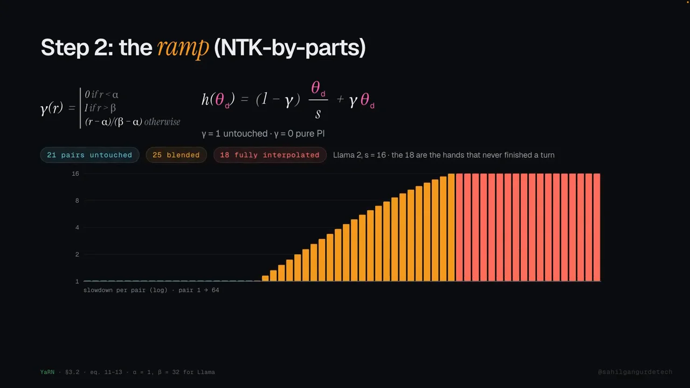

写成公式就是两个式子：一个是斜坡，一个是混合。

$$
\gamma(r)=\begin{cases}0 & r<\alpha\\ 1 & r>\beta\\ \dfrac{r-\alpha}{\beta-\alpha} & \text{其他}\end{cases}
\qquad
h(\theta_d) = (1-\gamma)\frac{\theta_d}{s} + \gamma\,\theta_d
$$

$\gamma=1$ 表示保持原速，$\gamma=0$ 表示纯 PI。Llama 家族用 $\alpha=1$、$\beta=32$，于是 Llama 2 在 $s=16$ 下分成：**21 对不动、25 对混合、18 对完全内插**——最后这 18 对，正是第二节里"一圈都没转完"的那批 [【跳转到 39:23】](https://www.youtube.com/watch?v=uOsFsDnCAWE&t=2363)。

视频还给了三种方法并排的一页：PI 是"所有指针一律慢 16 倍"，NTK-aware 是一条平滑曲线，NTK-by-parts 是"平的、上坡、再平"——**每一段的长度由这根指针在训练里实际看到过什么决定**。

---

## 六、温度：一行常数，运行时零成本

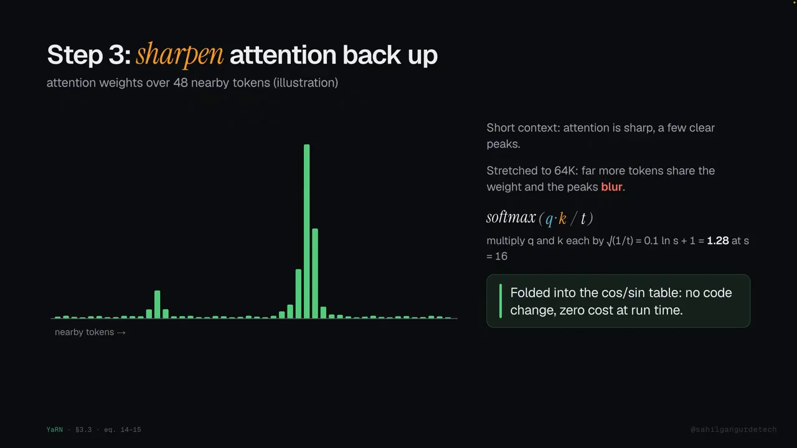

第二块拼图跟角度无关，讲的是**注意力的锐度**。短上下文时注意力通常有几个清晰的峰；拉到 64K 之后有两件事同时发生：参与分享权重的 token 变多了，而且被减速的指针让不同位置看起来更像——峰就被摊平了。修法是温度：在 softmax 之前把所有分数整体放大 [【跳转到 40:24】](https://www.youtube.com/watch?v=uOsFsDnCAWE&t=2424)。

YaRN 拟合出来的规则简单到只有一行：

$$
\sqrt{1/t} = 0.1\ln s + 1
$$

$s=16$ 时等于 **1.28**；做法是**给 query 和 key 各乘 1.28**（这样点积就被放大 $1.28^2\approx1.63$ 倍，即 $1/t$）。而 RoPE 的旋转本来就是用预先算好的 cos/sin 表做的，这个因子可以直接乘进表里——**注意力代码一行不改，运行时开销为零** [【跳转到 41:04】](https://www.youtube.com/watch?v=uOsFsDnCAWE&t=2464)。

顺便把三块拼图的谱系串起来（视频画了一张"家族树"）：RoPE 分两支，一支是位置内插，一支是 NTK-aware；把"按指针逐根决定减速倍数"这个想法加进去得到 NTK-by-parts；再加上温度，就是 YaRN。三步，没有第四步。

---

## 七、训练账与结果：600 步、384 张 A100 小时

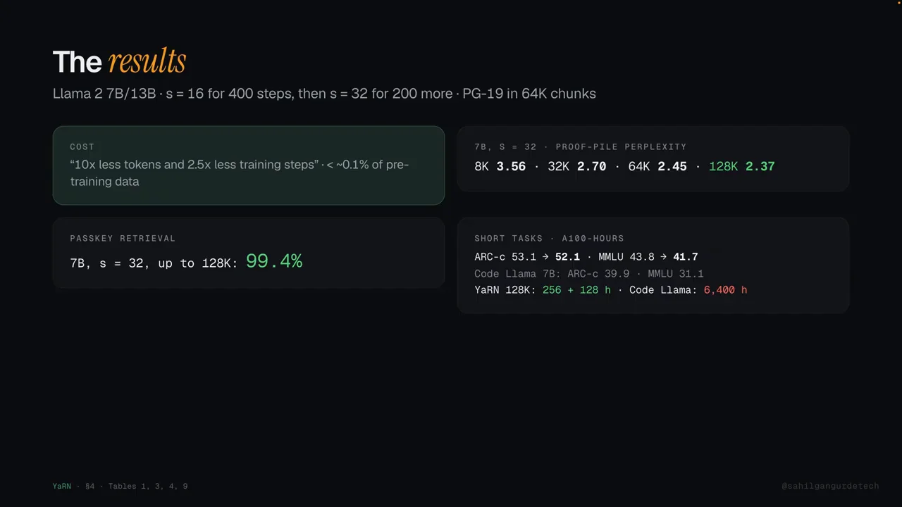

实验配置：Llama 2 7B/13B，先在 PG-19 的 64K 长块上以 $s=16$ 微调 **400 步**，再从该检查点以 $s=32$ 走 **200 步**（合计 600 步）[【跳转到 41:24】](https://www.youtube.com/watch?v=uOsFsDnCAWE&t=2484)。

| 指标 | 数值 |
| --- | --- |
| 训练量（对比此前方法） | 约 1/10 的 token、1/2.5 的步数，不到预训练数据的 0.1% |
| 7B、$s=32$ 的 Proof-pile 困惑度 | 8K 3.56 · 32K 2.70 · 64K 2.45 · **128K 2.37** |
| 128K 隐藏 pass key 命中率 | **99.4%** |
| 短任务（ARC-c） | 53.1 → **52.1** |
| 短任务（MMLU） | 43.8 → **41.7** |
| 对照：Code Llama 7B 长上下文版 | ARC-c 39.9、MMLU 31.1（掉得更狠） |
| 训练成本 | YaRN 128K：256 + 128 = **384 A100 小时**；Code Llama 长上下文阶段：**6,400 小时** |

两条值得单独拎出来：第一，**困惑度在 128K 处还在降**（2.45 → 2.37），说明窗口不是"名义 128K、实际用不满"；第二，**训练成本比 Code Llama 的长上下文阶段低一个量级**（384 对 6,400）[【跳转到 42:04】](https://www.youtube.com/watch?v=uOsFsDnCAWE&t=2524)。

---

## 八、服务端的账：动态 $s$ 是个"漂亮的坑"

算法到这儿就完整了，但视频接下来问了一个很少有人问的问题：**能读 128K，和能服务 128K，是两件事**。

### 8.1 为什么缓存里的 key 从来不用重转

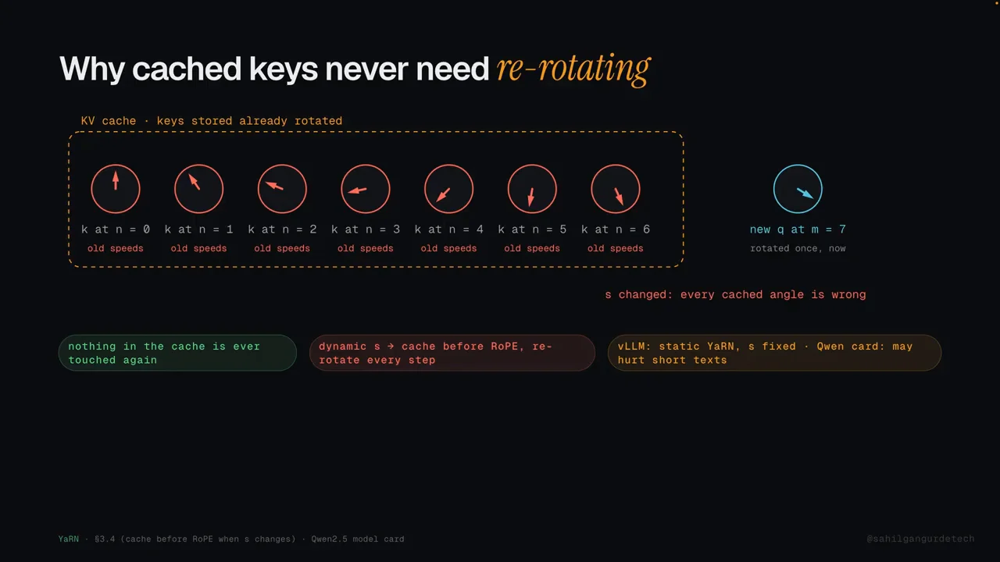

RoPE 有一个很适合服务的性质：每个 key 在生成时被自己的位置转一次，然后就以"转好"的形态存进缓存；新 token 到来时只需要转它自己的 query。因为分数只关心 $(m-n)$ 这个距离，缓存里那些 key 的角度**永远有效，再也不需要碰** [【跳转到 44:25】](https://www.youtube.com/watch?v=uOsFsDnCAWE&t=2665)。

### 8.2 动态 $s$ 会把这个性质打破

论文还描述了一个"动态模式"：让 $s$ 跟着当前长度走，$s=\max(1,\ l'/L)$，其中 $l'$ 是当前长度、$L$ 是训练长度。短 prompt 因此完全不受影响，听着很美。

代价是：**$s$ 一变，所有指针的速度都变，而缓存里每个 key 都是用旧速度转出来的**。要支持这种模式，只能缓存"旋转前"的 key，然后在每一步把全部 key 重新转一遍 [【跳转到 45:01】](https://www.youtube.com/watch?v=uOsFsDnCAWE&t=2701)。

所以服务端的现实选择很一致：

- **vLLM 这类推理服务器用固定的 $s$** 跑 YaRN，把"缓存只写一次"的性质保住；
- **Qwen 的模型卡**则提醒：固定 YaRN 会**轻微损伤短文本**的表现——因为短 prompt 也吃到了为长文本准备的减速与温度。

这就是第一处真正意义上的"论文与工程分歧"：论文里动态 $s$ 是加分项，服务端里它是负资产。

---

## 九、从 config 到代码：五家模型的真实参数，和那条不被拉伸的车道

### 9.1 各家 config 里的实际参数

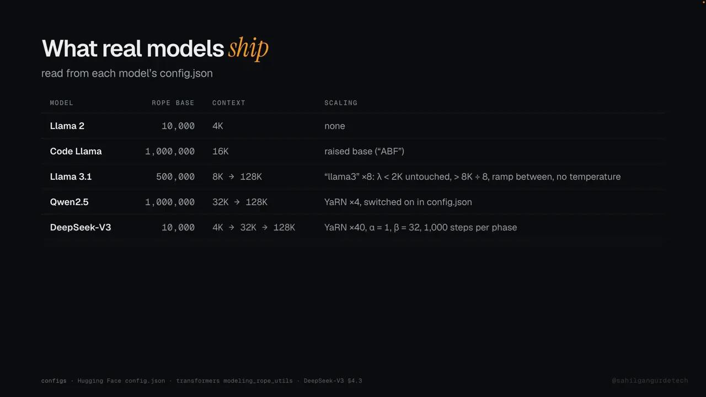

直接从各模型的 `config.json` 读出来的对照表 [【跳转到 45:25】](https://www.youtube.com/watch?v=uOsFsDnCAWE&t=2725)：

| 模型 | RoPE base | 上下文 | 缩放方式 |
| --- | --- | --- | --- |
| Llama 2 | 10,000 | 4K | 无 |
| Code Llama | 1,000,000 | 16K | 抬高 base（"ABF"） |
| Llama 3.1 | 500,000 | 8K → 128K | `"llama3"` ×8：波长小于 2K 的不动、大于 8K 的除以 8、中间走斜坡，**不带温度** |
| Qwen2.5 | 1,000,000 | 32K → 128K | YaRN ×4，需要在 `config.json` 里手动开 |
| DeepSeek-V3 | 10,000 | 4K → 32K → 128K | YaRN ×40，$\alpha=1$、$\beta=32$，每阶段 1,000 步 |

两个细节值得注意：**Llama 3.1 的 `"llama3"` 缩放本质就是 NTK-by-parts**（按波长分档 + 斜坡），只是去掉了温度那一项；而 **DeepSeek-V3 用的是标准 YaRN**，$\alpha$、$\beta$ 与论文里给 Llama 调的值一模一样，分两阶段各 1,000 步。

### 9.2 参考实现只有十几行

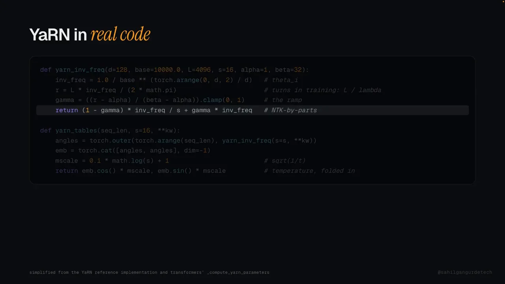

视频给了一段从 YaRN 参考实现与 Transformers 的 `_compute_yarn_parameters` 精简来的代码，结构就是三步 [【跳转到 46:05】](https://www.youtube.com/watch?v=uOsFsDnCAWE&t=2765)：

```python
def yarn_inv_freq(d=128, base=10000.0, L=4096, s=16, alpha=1, beta=32):
    inv_freq = 1.0 / base ** (torch.arange(0, d, 2) / d)      # theta_i
    r = L * inv_freq / (2 * math.pi)                          # 训练中转过的圈数 L / lambda
    gamma = ((r - alpha) / (beta - alpha)).clamp(0, 1)        # 斜坡
    return (1 - gamma) * inv_freq / s + gamma * inv_freq      # NTK-by-parts

def yarn_tables(seq_len, s=16, **kw):
    angles = torch.outer(torch.arange(seq_len), yarn_inv_freq(s=s, **kw))
    emb = torch.cat((angles, angles), dim=-1)
    mscale = 0.1 * math.log(s) + 1                            # sqrt(1/t)
    return emb.cos() * mscale, emb.sin() * mscale             # 温度折进表里
```

注意 `mscale` 直接乘在 cos/sin 上——这就是"温度零成本"在代码里的样子。**模型其余部分一行都不用改**。

### 9.3 下一站：MLA 与那条只放位置的车道

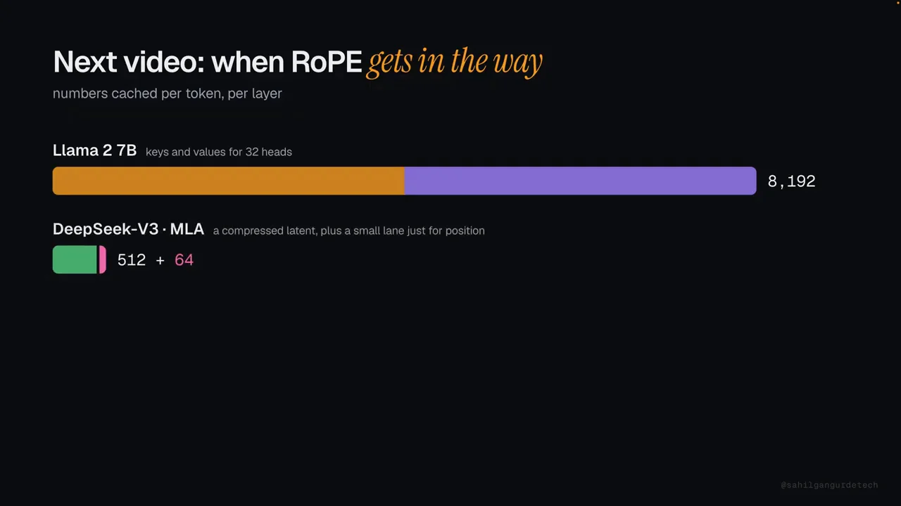

视频结尾留了一个钩子，也正好解释了为什么 YaRN 在 DeepSeek 上是 $\times 40$ 这种"夸张"的倍数：

- Llama 2 7B 每个 token、每一层缓存 **8,192** 个数（32 个头的 key 与 value）；
- DeepSeek-V3 的 MLA 每 token、每层只缓存 **576** 个数：一个 512 维的压缩潜向量，外加一条只有 **64** 维的"位置车道" [【跳转到 46:45】](https://www.youtube.com/watch?v=uOsFsDnCAWE&t=2805)；
- 为什么要单开一条车道？因为 **RoPE 恰好会破坏让压缩变快的那个技巧**——把旋转塞进压缩后的潜向量里就行不通了。于是 DeepSeek 给旋转单开一小块地方，而**这条车道正是 YaRN 唯一不去拉伸的东西** [【跳转到 47:25】](https://www.youtube.com/watch?v=uOsFsDnCAWE&t=2845)。

这句话信息量很大：位置编码和缓存压缩是两套互相牵制的设计，先把位置这块修好（YaRN），压缩那块才有空间做（MLA）；而压缩做下去之后，位置又必须被单独安置。MLA 的细节留给了下一支视频（本系列 2.2 已从 GQA/MQA 的角度讲过缓存压缩，可以对照着读）。

---

## 小结

- **账单先行**：Llama 2 7B 的 KV cache 是 512 KB/token，128K 一条对话 64 GB；80 GB 的 H100 扣掉权重只够一个用户。长上下文的瓶颈是显存，不是数学。
- **RoPE 只保证距离**：长期衰减是一个上界（约 30），远高于有用分数的量级，**拦不住越界后的爆炸**；论文的翻译/GLUE/法律文书三组证据都很温和，长文本才是它的主场。
- **越界的爆炸可以复现**：圈内拟合到 ±1，越过 2,048 后纵轴要拉到 ±2,427（论文约 8,000），而整点之间仍然平滑——这就是内插安全的根据。
- **PI 便宜但伤高频**：200 步就能把 8,192 窗口打通（纯微调 10,000 步只有 2,560），代价是 57.3° 变 3.6°、BoolQ 从 76.1 掉到 64.7。
- **NTK-aware 与 NTK-by-parts**：抬 base（10,000 → 167,000）保住快指针，但中段压不够；按圈数 $r$ 分档后，Llama 2 在 $s=16$ 下是 21 对不动 / 25 对混合 / 18 对全内插。
- **温度**：$q$、$k$ 各乘 $\sqrt{1/t}=0.1\ln s+1$（$s=16$ 时 1.28），折进 cos/sin 表，运行时零成本。
- **落地结果**：600 步、384 A100 小时，128K 困惑度 2.37、pass key 99.4%，短任务掉 1–2 分。
- **工程取舍**：动态 $s$ 会让缓存里所有 key 的角度失效，所以 vLLM 用固定 $s$；既然固定 $s$，就要接受 Qwen 模型卡里那句"可能轻微伤短文本"。
- **config 与现实**：Code Llama 抬 base、Llama 3.1 用去掉温度的 NTK-by-parts、Qwen2.5 手动开 YaRN、DeepSeek-V3 用标准 YaRN $\times40$；参考实现不过十几行。
- **下一站**：MLA 把缓存压到 576，并给位置单留 64 维车道——那条车道是 YaRN 唯一不拉伸的部分。

## 关键术语速查

| 术语 | 一句话解释 |
| --- | --- |
| KV cache | 推理时缓存每个已读 token 的 key 与 value，避免重复计算；体积随上下文线性增长 |
| 长期衰减（long-term decay） | RoPE 的注意力分数上界随距离下降；是天花板，不是保证 |
| 分部求和（Abel 变换） | 推导长期衰减上界用的恒等变形，把"64 项旋转之和"换成"部分和 × 相邻差" |
| 位置内插（PI） | 把位置乘以 $L/L'$，等价于所有指针统一减速 $s$ 倍 |
| NTK-aware | 只抬高 base，$b' = b\cdot s^{\,d/(d-2)}$，快指针不变、慢指针慢 $s$ 倍 |
| NTK-by-parts | 按圈数 $r=L/\lambda$ 分档，用斜坡 $\gamma(r)$ 在原速与 PI 速之间混合 |
| attention temperature | 把注意力分数整体放大 $1/t$ 倍，$\sqrt{1/t}=0.1\ln s+1$，可折进 cos/sin 表 |
| 动态 $s$ | $s=\max(1, l'/L)$ 随当前长度变化；对短 prompt 友好，但会让 KV cache 失效 |
| 固定 $s$ | 服务端（如 vLLM）常用的做法：$s$ 一旦设定就不变，缓存只写一次 |
| GQA / MLA | 两类压缓存的结构：共享 K/V 头（GQA）、把 K/V 压成低维潜向量（MLA） |
| 位置车道 | MLA 里专门承载 RoPE 的一小块维度（DeepSeek-V3 是 64 维），不参与压缩、也不被 YaRN 拉伸 |
