# 数它转了几圈：YaRN 的斜坡插值与温度补偿

> 视频来源：[Stretching an LLMs context window (YaRN)](https://www.youtube.com/watch?v=TydZda7bRMU&t=0)（YouTube · mesanu）｜时长约 15 分钟
> 导读：这支视频只讲一个问题——把 4K 窗口拉到 64K/128K 时，RoPE 的 64 根"指针"里到底哪几根出了事、该怎么分别处理。它给出的所有数字（27° 扇形、圈数阈值、温度公式、PPL 表）都能在幻灯片上核对；本文按讲解顺序还原推导，并在第八节补上论文表格里的每一格。
> 本文基于视频演说图文稿整理，配图截自视频。

## 本讲要解决的核心问题（SCQA）

**背景**：Llama 2 的预训练窗口是 4,096 个 token。它的位置信息来自 RoPE（Rotary Position Embedding，旋转位置编码）：把每个 token 的 query/key 向量两两配对，每一对看成一个平面上的箭头，第 $m$ 个位置的箭头转 $m \theta$ 度，$\theta$ 只和这一对的下标有关。于是"两个 token 隔多远"就藏进了它们箭头之间的夹角里。

**冲突**：给一个只会读 4,096 个位置的模型塞一篇 64,000 token 的文档，它不会只是"差一点"，而是预测直接崩掉——后半段的位置像是它从没见过的语言。最省钱的办法不是重训，而是改"怎么读位置"再短微调；可第一版改法（位置内插，Position Interpolation，PI）把**所有**指针一起减速 16 倍，连专门用来区分相邻 token 的那根快指针也被拖慢，57.3° 的近邻夹角被压成 3.6°。

**疑问**：如果慢指针才是越界的元凶，能不能只压慢的、放过快的？只改角度就够了吗？

**回答（中心思想）**：**YaRN 由两块拼图组成，而且都是"按每根指针在训练中转过几圈"来决定待遇的**。第一块叫 NTK-by-parts（按部位缩放）：用圈数 $r=L/\lambda_d$ 把 64 对分成三档——转过很多圈的 21 对原封不动，一圈都没转完的 18 对完全内插，中间的 25 对按直线斜坡混合；第二块是 attention temperature（注意力温度）：把所有注意力分数整体放大 $\sqrt{1/t}=0.1\ln s+1$ 倍（$s=16$ 时约 1.28），把变平的 softmax 重新压尖，并且可以折进预先算好的 cos/sin 表里，运行时零成本。两者叠加后，400 步微调把 4K 拉到 64K，再 200 步到 128K，训练数据只占原预训练的千分之一量级。

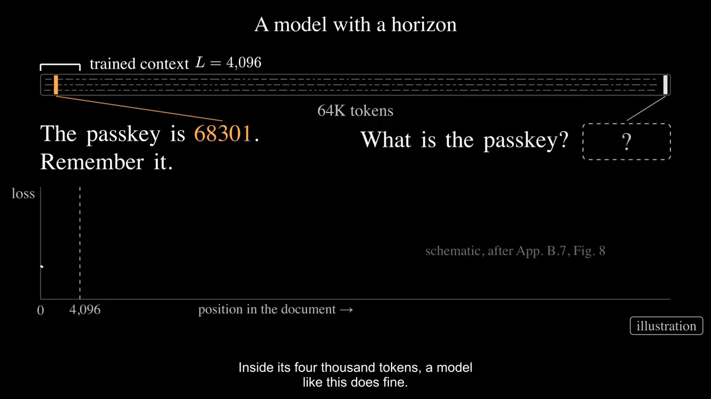

---

## 一、一个 Llama 2 的头里有 64 根转速不同的指针

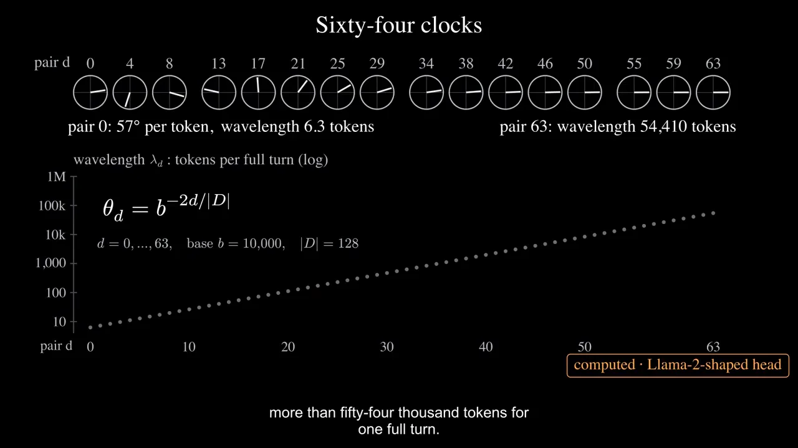

### 1.1 位置藏在"转了多少"里，比较只看"差多少"

注意力算的是 query 和 key 的点积，这个式子本身对顺序毫无知觉：把"狗咬人"换成"人咬狗"，点积一模一样。RoPE 的补法是把成对的数字当箭头转——位置 $m$ 的每一对转 $m\theta_d$，位置 $n$ 的同一对转 $n\theta_d$，两个箭头之间的夹角就变成 $(m-n)\theta_d$。单个点积只认夹角，所以整张注意力表只认出"隔多远"，不认"坐在第几号座位" [【跳转到 01:40】](https://www.youtube.com/watch?v=TydZda7bRMU&t=100)。

关键在于：**每一对转的速度都不一样**。一个 128 维的头有 64 对，速度由一个公式和唯一的常数 base 决定：

$$
\theta_d = b^{-2d/\vert D \vert},\quad d = 0,\dots,63,\quad b = 10{,}000,\quad \vert D \vert = 128
$$

（视频把这对下标写成 $d$、把维度写成 $\vert D \vert$；有些资料用 $i$ 表示第 $i$ 对，公式形式完全一样。）[【跳转到 02:20】](https://www.youtube.com/watch?v=TydZda7bRMU&t=140)

### 1.2 波长：转一圈需要多少个 token

一对指针转满一圈所需的 token 数，叫它的**波长**（wavelength）$\lambda_d$。图上第一对（pair 0）每 token 转 1 弧度，约 57°，所以每 6.3 个 token 就转完一圈；最后一对（pair 63）要 54,410 个 token 才转完一圈 [【跳转到 02:20】](https://www.youtube.com/watch?v=TydZda7bRMU&t=140)。把 64 根指针想成一座钟：

- **快指针**（短波长）：相邻 token 之间就转过一大截，专门用来分辨"谁紧挨着谁"；
- **慢指针**（长波长）：几百上千个 token 才动一点点，专门用来度量"两个远距离 token 大概差多远"。

合起来，位置就在每一个尺度上被写了一遍。这里顺带解释一个后面要反复用的词：**高频率部分**（high-frequency part）指的就是这些快指针，它们的角度随位置变化得最快。

### 1.3 4,096 那条线：18 根慢指针从没转满一圈

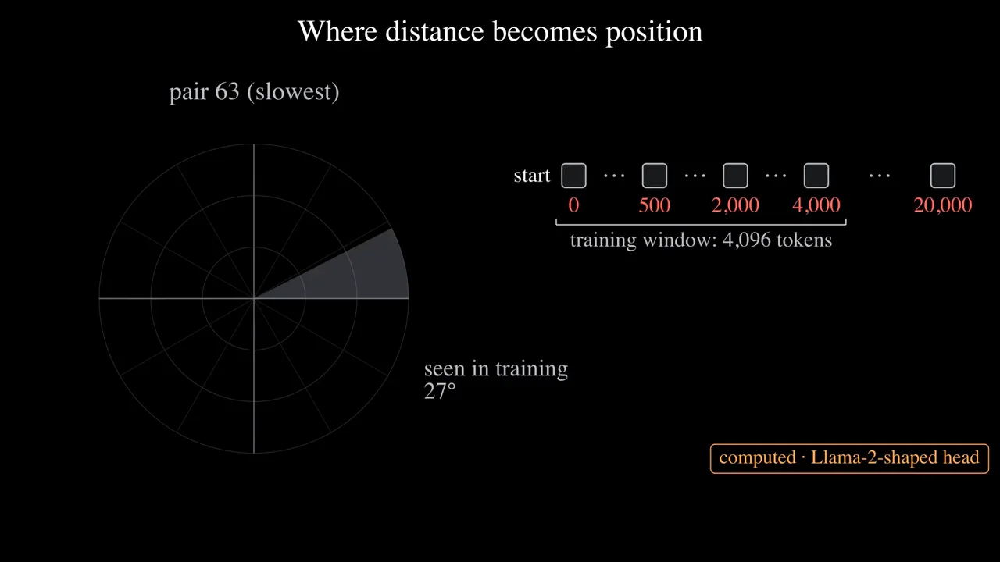

训练时最长只见过 4,096 个 token。对最慢的那一对来说，4,096 个 token 只够它转出

$$
\frac{4096}{54{,}410}\times 360^\circ \approx 27^\circ
$$

也就是图上那一小块灰色扇形：**模型为这一对学到的所有"读法"，都落在这 27° 里**。同一张图右侧还标了 0、500、2,000、4,000、20,000 这些位置——前四个在训练窗口内，20,000 已经越界。

哪些对属于"从没转满一圈"？视频给了一个很干脆的判据：一次完整旋转都没完成的 pair，在 Llama 2 的头里有 **18 对**。这些指针在训练里只见过圆周的一小段；把它们推到 64,000 token，它们已经转了一圈多，指向训练里从未出现过的方向 [【跳转到 03:20】](https://www.youtube.com/watch?v=TydZda7bRMU&t=200)。

而快指针完全没这个问题：第一对在 4,096 的窗口里已经转了 650 多圈，每个方向都被反复见过。所以**越界的病只在慢指针身上**——这句话是后面所有方法的出发点。

还有一个更微妙的点，视频特意点出：注意力虽然只看距离，但"到第一个 token 的距离"是特殊的。对一根在训练中从没转满一圈的指针来说，每个 token 与句首的距离会给出一个**互不相同**的角度，于是这一对不只携带相对距离，还能让模型反推出"我在第几位"。换句话说，慢指针里混着一部分**绝对位置**的功能。一旦位置越界，这部分报出来的就是模型没学过读的绝对位置 [【跳转到 04:00】](https://www.youtube.com/watch?v=TydZda7bRMU&t=240)。

---

## 二、位置内插：把标尺重新贴一遍，代价落在快指针上

### 2.1 一个除法搞定"不出圈"

位置内插（PI）的想法直白到不能再直白：既然模型只认识前 4,096 个位置的角度，那就把每个位置都除以扩展倍数 $s$：

$$
m \;\longrightarrow\; \frac{m}{s}
$$

从 4,000 到 64,000，$s=16$。把所有位置除以 16，等价于把所有指针统一减速 16 倍：位置 64,000 拿到的角度，正是当年位置 4,000 的角度 [【跳转到 04:40】](https://www.youtube.com/watch?v=TydZda7bRMU&t=280)。

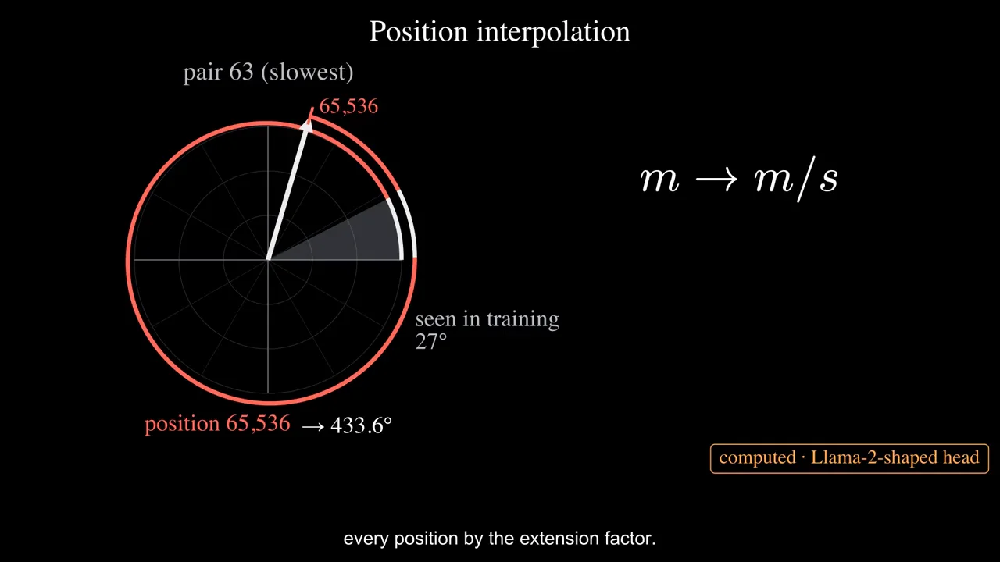

图上是最慢的一对：位置 65,536 的原始角度是 433.6°，早就绕过一整圈；除以 16 之后回到 27° 的扇形内——**这正是 PI 有效的原因：它让每根指针都退回到自己见过的角度区间**。加上少量微调，这套做法确实能用。

### 2.2 代价：57.3° 被压成 3.6°

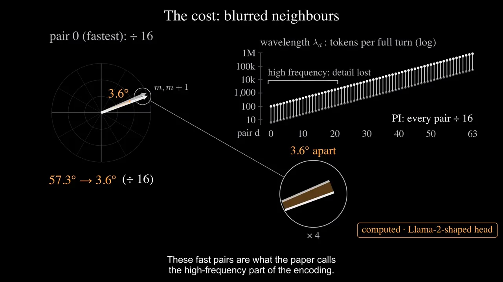

问题在于"统一减速"不看对象。第一对指针原本在两个相邻 token 之间转 57.3°，除 16 之后只剩 3.6°——**专门用来分辨近邻的那根指针，现在几乎分不出近邻了**。图上那句标注说得很准：high frequency: detail lost（高频细节丢失）。而且越往外推（$s$ 越大）压得越狠，细节丢得越多 [【跳转到 05:20】](https://www.youtube.com/watch?v=TydZda7bRMU&t=320)。

历史经验也印证了这一点：早年用 PI 的微调，一旦扩到原始长度的 8 倍以上就容易出问题，即使微调过也一样。

---

## 三、NTK-aware：只改一个 base，快指针分毫不动

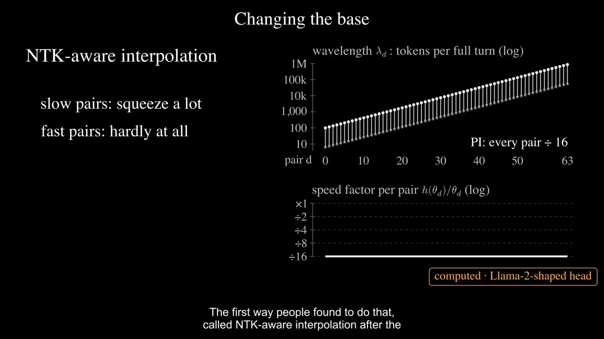

### 3.1 为什么改 base 能"只动慢的"

第一个绕开这个矛盾的办法叫 **NTK-aware** 插值（NTK 指 neural tangent kernel，神经网络正切核，是这个方法的灵感来源；更细的推导见本系列的 NTK-aware 那一节，这里只取结论）。它不碰位置，只改那个常数 base：

- 第一对的指数是 0，所以 $\theta_0 = b^0 = 1$，**无论 base 多大它都是一 token 一弧度**——快指针原封不动；
- 最后一对的指数约是 $-1$，它的速度几乎完全由 base 决定，抬高 base 就等于按比例拖慢它。

于是选一个新 base，让最慢那对被拖慢正好 $s$ 倍：从 10,000 抬到大约 **167,000**（$s=16$）。中间各对按指数平滑地从"不动"过渡到"慢 16 倍"，全程不需要微调 [【跳转到 06:20】](https://www.youtube.com/watch?v=TydZda7bRMU&t=380)。

### 3.2 但它不精确：中段慢得不够

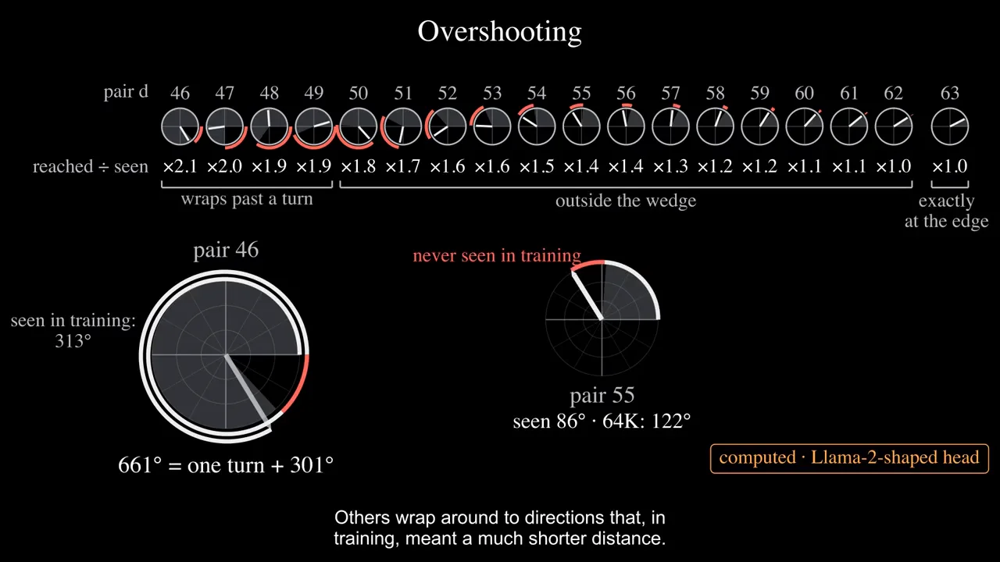

平滑曲线的毛病是**中段的慢指针只被拖慢了一点点**。视频把它算成了一张对照表：把"实际转到的角度 ÷ 训练里见过的最大角度"逐对列出来——pair 46 是 2.1 倍，pair 47 是 2.0，一直到 pair 63 才恰好 1.0（正好卡在扇形边缘）。图上还画了两个具体例子：

- **pair 46**：训练里见过 313°，到 64K 时实际转到 661° = 一整圈 + 301°，方向落在训练中没出现过的位置；
- **pair 55**：训练里见过 86°，到 64K 时是 122°，直接越出扇形。

论文把这种"过冲"（overshooting）当作 NTK-aware 效果反转的原因：微调之后，它在完整扩展长度上反而不如 PI，实际使用时那个缩放因子还得设得比你想扩的倍数**更大**才勉强能用 [【跳转到 07:00】](https://www.youtube.com/watch?v=TydZda7bRMU&t=420)。

---

## 四、NTK-by-parts：用"转过几圈"给每根指针分档

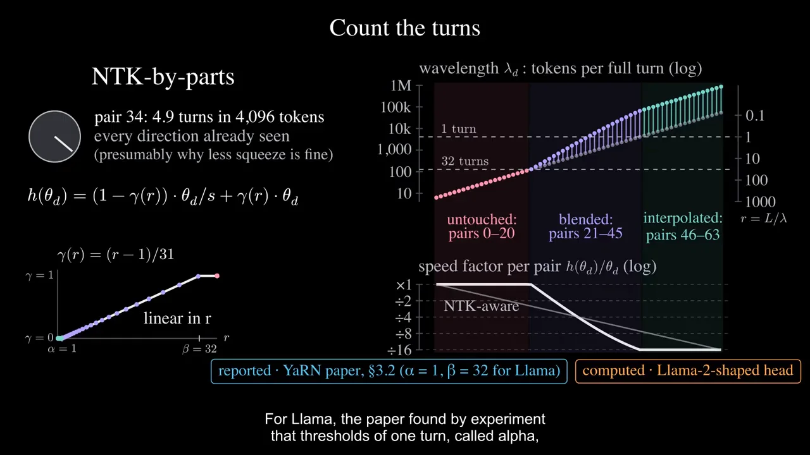

### 4.1 判据：$r(d) = L / \lambda_d$

NTK-by-parts 把这个直觉写成规则。对每一对，数它在原始训练窗口里转过几整圈：

$$
r(d) = \frac{L}{\lambda_d}
$$

比如中间那对 pair 34，在 4,096 的窗口里转过 4.9 圈，幻灯片上的批注是：每个方向它都已经见过，所以大概正因为如此，少压一点也没关系 [【跳转到 08:20】](https://www.youtube.com/watch?v=TydZda7bRMU&t=500)。$r$ 的大小直接说明它对位置的"职责"：

- $r$ 很大：波长相对窗口小到可以忽略，它只负责**局部的相对位置**，原样保留；
- $r < 1$：一圈都没转完，它带着"绝对位置"的味道，必须像 PI 一样完全内插；
- 介于两者之间：转过几圈，角度还能粗粒度地说明位置，给一个**混合**。

### 4.2 斜坡 $\gamma(r)$ 与混合公式

两个阈值是论文实验调出来的：$\alpha = 1$ 圈、$\beta = 32$ 圈。权重从 1 线性滑到 0：

$$
\gamma(r) = \frac{r - \alpha}{\beta - \alpha}\quad(\text{在 } 0 \text{ 与 } 1 \text{ 之间截断})
$$

图左下角写的就是 $\gamma(r) = (r-1)/31$。每一对的新速度是"原速"和"PI 速度"的加权混合：

$$
h(\theta_d) = (1-\gamma(r))\cdot\frac{\theta_d}{s} + \gamma(r)\cdot\theta_d
$$

$\gamma = 1$ 表示完全不动，$\gamma = 0$ 表示纯 PI。中段这些对为什么可以少压一点？视频给的解释是：它们在训练窗口里本来就绕过好几圈，再往前转也不会撞见"没见过的新方向"，所以压力可以小一些 [【跳转到 08:00】](https://www.youtube.com/watch?v=TydZda7bRMU&t=480)。

### 4.3 落到 Llama 2 头上：21 / 25 / 18

在 Llama 2 的一个头里，这套规则分出来的三组是：

- **21 对最快**：一点不动；
- **25 对中间**：按斜坡混合，减速倍数从大约 1 一直到接近 16；
- **18 对最慢**：完全内插。

注意最后这个 18，正好是第一节里"从没转满一圈"的那 18 对——两套说法对上了 [【跳转到 08:20】](https://www.youtube.com/watch?v=TydZda7bRMU&t=500)。

### 4.4 三根指针的结果对照

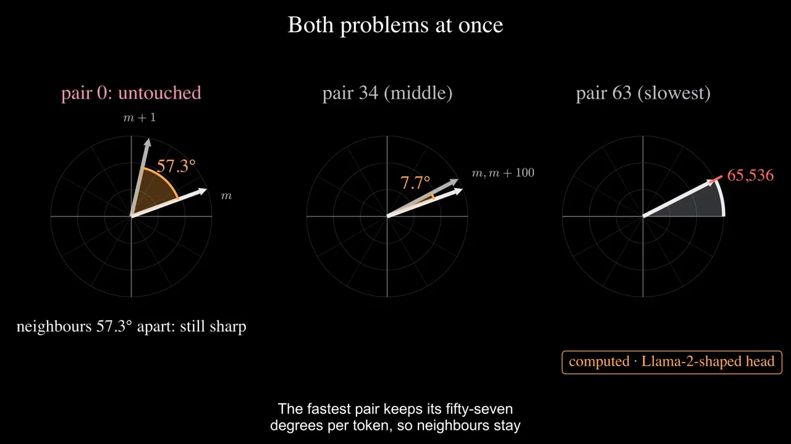

一张图把三个区域同时摆出来：快指针照旧 57.3°，近邻依然清楚；中间那根在 100 个 token 的距离上只转 7.7°；最慢的那根被除以 16，即使到了 65,536 号位置也还在训练见过的扇形里。"两个问题一次解决"，指的就是这个 [【跳转到 08:40】](https://www.youtube.com/watch?v=TydZda7bRMU&t=520)。

---

## 五、第二个毛病：注意力被摊平了，得补一个温度

角度修好之后，还有一块拼图**跟角度无关**。

### 5.1 为什么长上下文会让 softmax 变平

注意力分数算完之后要过 softmax 变成权重。上下文越长，参与竞争的 key 就越多，权重就越容易被稀释：原来一个 query 只在一个 token 上集中用力，现在要摊给几万个 token，峰值自然被压平。视频给了一个纯手工构造的玩具例子（幻灯片上标着 toy · constructed）：假设有一个 query 真正想要的 key（就是那个 pass key），它的分数比成千上万个填充 key 高 6 分。结果是 [【跳转到 09:05】](https://www.youtube.com/watch?v=TydZda7bRMU&t=545)：

- 4,000 个 key 时，这个 pass key 拿到大约 **9%** 的注意力；
- 64,000 个 key 时，只剩**不到 1%**；
- 把所有分数整体放大之后，softmax 重新变尖，在这个玩具里甚至比 4,000 个 key 时还要尖。

幻灯片上还标注了对应论文的位置：§3.3 与附录 A.3——也就是说，"长上下文让注意力熵增大、分布变平"是论文自己给出的直觉，玩具只是把它算给你看。

### 5.2 论文测的不是注意力，是困惑度

论文真正报告的指标是**困惑度**（perplexity，PPL）：模型对文本有多"惊讶"，越低越好。结论是：用合适的温度把所有分数整体放大，能在整个扩展窗口上把困惑度压下来；而且**最优温度对大多数文档、各个位置几乎一样**，所以每个扩展倍数配一个常数就够了 [【跳转到 09:45】](https://www.youtube.com/watch?v=TydZda7bRMU&t=585)。

### 5.3 温度是拟合出来的，不是推导出来的

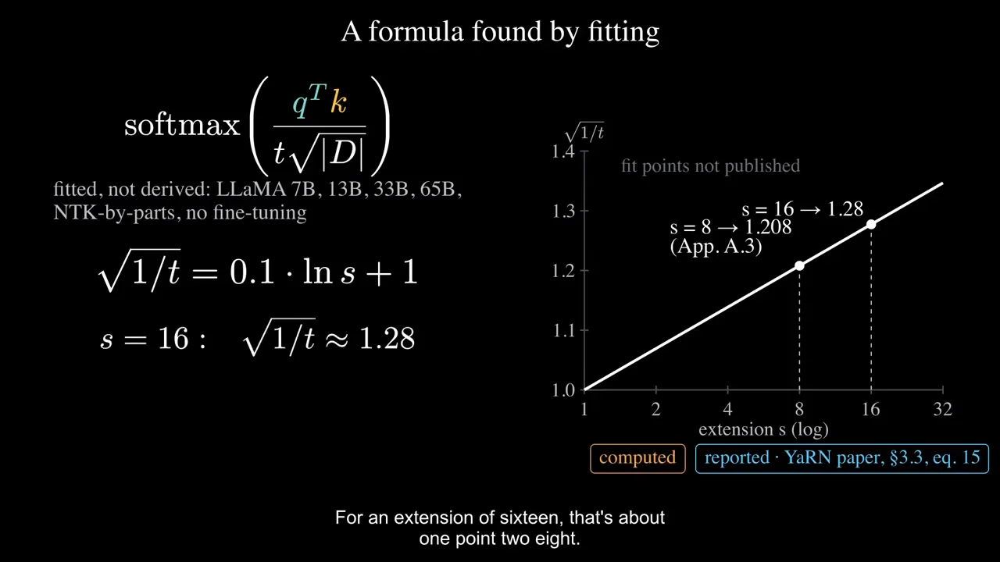

作者在最早的几代 Llama（7B、13B、33B、65B）上，用"NTK-by-parts 但不微调"的设置去扫不同扩展倍数下的最优温度，得到一条很干净的直线 [【跳转到 10:06】](https://www.youtube.com/watch?v=TydZda7bRMU&t=606)：

$$
\sqrt{1/t} = 0.1\cdot\ln s + 1
$$

$s=16$ 时是 $1.28$ 左右；图上 $\times$ 标出的两个拟合点是 $s=8 \to 1.208$、$s=16 \to 1.28$（附录 A.3），并注明拟合点本身没有公开。**这一句很重要**：公式是拟合的经验式，不是从理论推出来的——这也是第八节要提醒的边界之一。

### 5.4 为什么偏偏是开根号

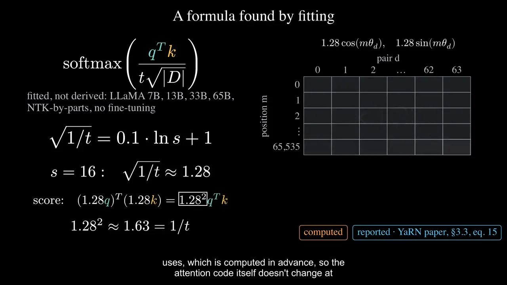

因为最便宜的施加方式，是**给 query 和 key 各乘一个数**。分数是 query 和 key 的点积，两边各乘 1.28，分数就乘上 $1.28^2 \approx 1.63$，正好等于 $1/t$——这就是为什么拟合出来的量是 $\sqrt{1/t}$ 而不是 $1/t$ 本身 [【跳转到 10:26】](https://www.youtube.com/watch?v=TydZda7bRMU&t=626)。

而 RoPE 的旋转本来就是用预先算好的 sin/cos 表做的，这个缩放可以直接乘进那张表里（图上写成 $1.28\cos(m\theta_d)$、$1.28\sin(m\theta_d)$）。于是：

- 注意力代码**一个字符都不用改**；
- 和 FlashAttention 这类高度优化的注意力实现完全兼容；
- 运行时开销为零。

---

## 六、两块拼图合起来就是 YaRN，改动全部落在位置编码里

把"按部位内插"和"温度"叠在一起，就是 YaRN。它有一个很讨人喜欢的工程性质：**所有的改动都发生在位置编码里**，模型的权重、注意力的计算代码全部保持原样，直到你去做那次短微调为止 [【跳转到 10:46】](https://www.youtube.com/watch?v=TydZda7bRMU&t=646)。

### 6.1 不微调也能用：动态的 $s$

还有一条"完全不微调"的用法。生成时文本是一个 token 一个 token 长出来的，那就不必提前把扩展倍数钉死，而是**每一步按当前长度重算**：

$$
s = \max\left(1,\ \frac{l'}{L}\right)
$$

$l'$ 是当前长度、$L$ 是原始训练窗口。文本还在窗口内时 $s$ 恰好等于 1，什么都不变；一旦超出，就按"当前长度 ÷ 原窗口"做刚好够用的压缩。这样模型在窗口外是**平滑退化**，而不是撞上一堵墙。温度用同一个 $s$ 算，会自动跟着走；论文报告这种做法能在不微调的情况下把可用上下文扩大到两倍以上 [【跳转到 11:26】](https://www.youtube.com/watch?v=TydZda7bRMU&t=686)。

### 6.2 一个必须记住的实现细节：缓存要在旋转前存

动态 $s$ 有一个代价。慢指针的旋转角度会随着 $s$ 变化，而生成过程中缓存下来的 key 是**已经旋转过**的。$s$ 一变，缓存里所有 key 的角度就都不对了。所以工程上必须：**缓存旋转前（未施加 RoPE）的 key，每次使用时按当前的 $s$ 现算旋转** [【跳转到 11:46】](https://www.youtube.com/watch?v=TydZda7bRMU&t=706)。

这条细节看起来只是实现顺序问题，实际决定了服务端能不能开动态缩放——配套的落地篇会专门讲 vLLM 为什么宁可用固定 $s$。

---

## 七、400 步 + 200 步：把 4K 拉到 64K 再到 128K

### 7.1 训练设置

主实验用的是 Llama 2 7B 和 13B：

1. 先在 64,000 token 的书籍长文（PG19）上微调 **400 步**，$s=16$，得到 64K 模型；
2. 从这个检查点再走 **200 步**，$s=32$，得到 128K 模型。

训练量小到什么程度？视频给的比例是"大约只用了原始预训练数据的千分之一量级"（论文写的是 under a tenth of a percent，不到 0.1%）[【跳转到 00:40】](https://www.youtube.com/watch?v=TydZda7bRMU&t=40)。

### 7.2 困惑度表：16× 在 128K 处直接失效

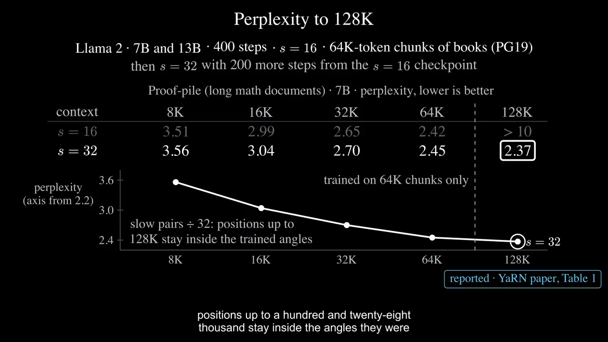

论文 Table 1 的每一格（7B，越低越好）[【跳转到 12:34】](https://www.youtube.com/watch?v=TydZda7bRMU&t=754)：

| 上下文长度 | 8K | 16K | 32K | 64K | 128K |
| --- | --- | --- | --- | --- | --- |
| $s=16$（64K 模型） | 3.51 | 2.99 | 2.65 | 2.42 | > 10 |
| $s=32$（128K 模型） | 3.56 | 3.04 | 2.70 | 2.45 | 2.37 |

两件事同时看：

- **在各自的能力范围内，窗口越长困惑度越低**：$s=16$ 从 3.51 一路降到 2.42，说明多出来的上下文确实被用来做预测了，不是摆设；
- **超出范围就会断崖**：$s=16$ 的模型在 128K 上直接崩到 10 以上；$s=32$ 的模型在 128K 还能给 2.37，甚至比它在 64K 上的 2.45 更低。

### 7.3 为什么只在 64K 上训过，却能在 128K 工作

这是整支视频里最值得记住的一句解释：**128K 模型只见过 64,000 token 的训练块，却能在两倍长度上工作，原因是它的慢指针被除以 32，位置一直到 128,000 都还落在训练见过的角度区间里** [【跳转到 12:34】](https://www.youtube.com/watch?v=TydZda7bRMU&t=754)。换句话说，能扩多远不取决于"训练时喂了多长的文本"，而取决于"最慢的指针有没有被压够"。

### 7.4 便宜的账与 pass key 的账

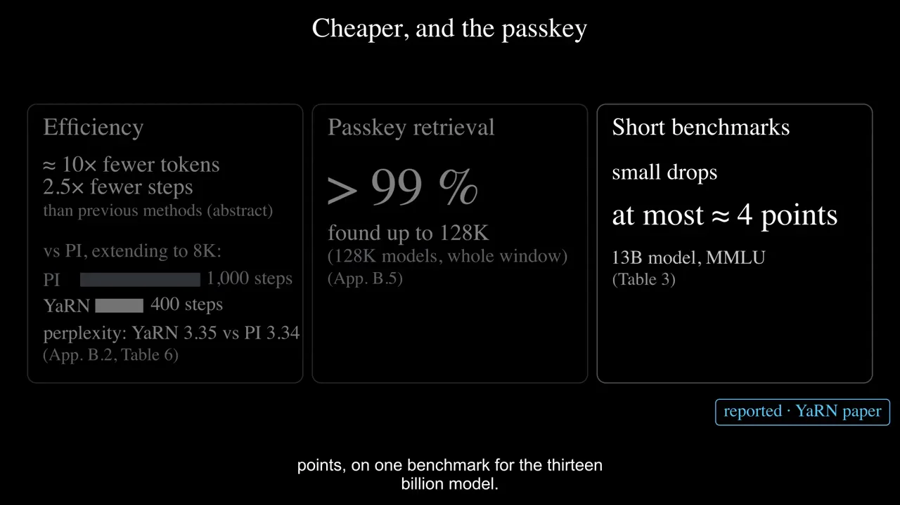

幻灯片把论文摘要里的三句话拆成了三张卡片 [【跳转到 13:14】](https://www.youtube.com/watch?v=TydZda7bRMU&t=794)：

- **效率**：比此前的方法少约 **10 倍**训练 token、少 **2.5 倍**训练步数。论文里唯一把对比摊开写的一处，是"PI 扩展到 8,000 token"：YaRN 用 **400 步**就追平了 PI 的 **1,000 步**，困惑度 3.35 对 3.34（附录 B.2、Table 6）——基本打平，步数少一半多。
- **Pass key 检索**：128K 模型在整个窗口上找到隐藏 pass key 的比例 **> 99%**。更细的数是视频最后给出的：64K 模型在 8K–64K 区间平均 **96.3%（7B）/ 97.5%（13B）**（Table 9）。
- **短基准**：小幅下滑，最多约 **4 分**，出现在 13B 模型的 MMLU 上。

---

## 八、三条边界：这套数字不能无脑照搬

视频最后没有停在好消息上，而是明确列了三条限制 [【跳转到 13:34】](https://www.youtube.com/watch?v=TydZda7bRMU&t=814)：

1. **$\alpha$ 和 $\beta$ 是为 Llama 家族调出来的**，温度公式是拟合而不是推导。换一个模型家族，这两个阈值和温度的关系式都可能需要重新定。
2. **头条结果来自"微调过"的模型**。不微调时 YaRN 依然有效（配合动态 $s$），但困惑度会明显更高。
3. **困惑度本身不能说明模型有没有用满窗口**。论文里 32× 模型找回 pass key 的可靠性比 16× 更高，而两者的困惑度其实差不多——指标不同，结论就可能不同。

### 回到开头那个 68301

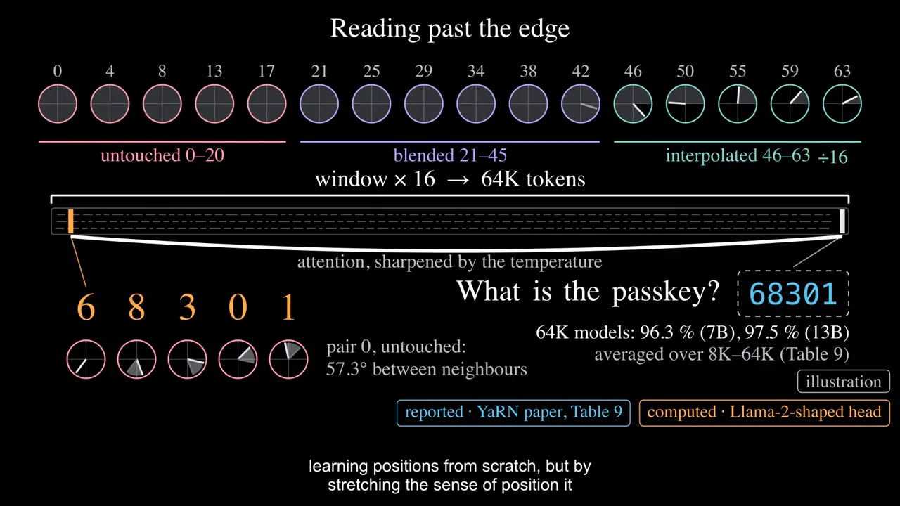

开头埋的那篇 64,000 token 文档，pass key 藏在离问题几万个 token 的句首。在微调过的模型里，它靠三件事把这个五位数读出来 [【跳转到 14:14】](https://www.youtube.com/watch?v=TydZda7bRMU&t=854)：

- **快指针没被碰过**，所以相邻 token 依然分得清，"6 8 3 0 1" 这五个数字的顺序不会糊；
- **慢指针除以 16**，每个位置都留在它学过的角度里，几万 token 的距离仍然是"可读的"；
- **中间的指针按斜坡混合**，再加上温度把注意力重新压尖。

所以模型不是"从零学会了一套新位置"，而是**把它本来就有的位置感拉长了**——这就是"数它转了几圈"这个视角的全部意义。

---

## 小结

- Llama 2 的一个头里有 64 对指针，波长从 6.3 个 token 排到 54,410 个 token；快指针分辨近邻，慢指针度量远近。
- 训练窗口 4,096 只够最慢那对扫过 **27°** 的扇形，一圈都没转完的共有 **18 对**——越界时它们指向模型从未见过的方向，这才是崩掉的根因。
- **PI** 把每个位置除以 $s$，让所有指针退回学过的角度，但把快指针的 57.3° 压成 3.6°，高频细节被摊薄。
- **NTK-aware** 只抬高 base（10,000 → 167,000）就保住了快指针，但中段压得不够，pair 46 过冲到 661°（一圈 + 301°），微调后反而不如 PI。
- **NTK-by-parts** 用圈数 $r=L/\lambda_d$ 分档：$\alpha=1$、$\beta=32$、$\gamma(r)=(r-1)/31$，把 Llama 的 64 对分成 **21 不动 / 25 混合 / 18 全内插**。
- **温度**把所有分数放大 $\sqrt{1/t}=0.1\ln s+1$ 倍（$s=16$ 时 1.28），可以折进 cos/sin 表，注意力代码零改动。
- 400 步把 4K 拉到 64K，再 200 步到 128K；32× 模型在 128K 上困惑度 2.37，16× 模型在 128K 上 > 10。
- 边界：阈值与温度公式都是针对 Llama 拟合的；头条结果来自微调模型；困惑度不能证明窗口被用满。

## 关键术语速查

| 术语 | 一句话解释 |
| --- | --- |
| 波长 $\lambda_d$ | 第 $d$ 对指针转满一圈所需的 token 数；Llama 2 里从 6.3 到 54,410 |
| 高频率部分 | 波长很短、随位置变化最快的那批指针，负责分辨相邻 token |
| 位置内插（PI） | 把所有位置除以扩展倍数 $s$，等价于所有指针统一减速 $s$ 倍 |
| NTK-aware | 只抬高 RoPE 的 base，让快指针不动、慢指针被拖慢 $s$ 倍 |
| NTK-by-parts | 按圈数 $r$ 把指针分三档：不动、线性混合、完全内插 |
| 圈数 $r(d)$ | 训练窗口长度除以该对波长，$r=L/\lambda_d$ |
| $\alpha$、$\beta$ | 斜坡的两个阈值，论文取 1 圈与 32 圈 |
| 注意力温度 | 把注意力分数整体放大 $1/t$ 倍，让 softmax 重新变尖 |
| pass key 测试 | 在长文档里藏一个随机数字串，再问模型要它，用来检验窗口是否真的可用 |
| 动态 $s$ | 生成时按当前长度实时重算扩展倍数，$s=\max(1, l'/L)$ |
